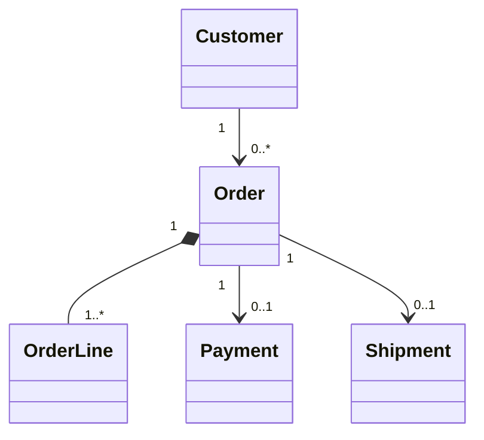
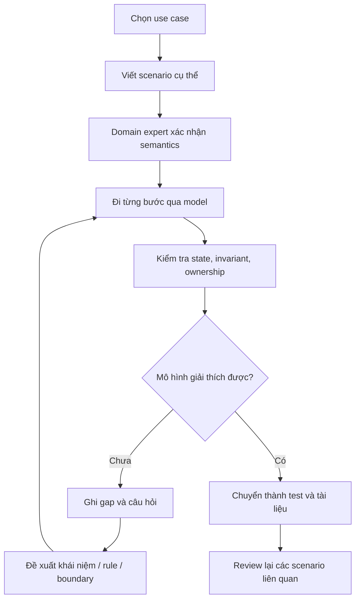

# Rà soát mô hình bằng tình huống cụ thể thay vì chỉ xem sơ đồ lớp

Trong Domain-Driven Design (DDD), mô hình domain phải giải thích được cách nghiệp vụ thực sự vận hành. Một sơ đồ lớp có thể cho thấy `Order` liên kết với `Customer`, `OrderLine` và `Payment`, nhưng chưa trả lời được điều gì xảy ra khi khách đặt đơn cuối cùng của một sản phẩm, thanh toán bị timeout, kho giữ hàng thành công nhưng đơn bị hủy, hoặc nhân viên xử lý một yêu cầu giao hàng đã quá hạn.

Vì vậy, khi rà soát mô hình, hãy dùng **tình huống nghiệp vụ cụ thể** để kiểm tra các khái niệm, hành vi, invariant, ranh giới aggregate và quan hệ giữa Bounded Context. Sơ đồ lớp vẫn hữu ích để trao đổi cấu trúc, nhưng nó chỉ là một góc nhìn. Tình huống cho thấy mô hình có thể giải thích hành vi theo thời gian, quyết định của actor, các điều kiện biên và kết quả sau mỗi bước hay không.

Bài viết hướng dẫn cách chuẩn bị, điều phối và ghi nhận một buổi model review dựa trên scenario; cách biến ví dụ thực tế thành rule, command, event và test; cùng một ví dụ xuyên suốt về đặt hàng, giữ kho và thanh toán. Mục tiêu là giúp domain expert và developer cùng kiểm chứng mô hình bằng những việc thật, thay vì chỉ đánh giá tên class hoặc mũi tên quan hệ.

## 1. Vì sao chỉ xem sơ đồ lớp là chưa đủ?

Sơ đồ lớp mô tả cấu trúc tại một thời điểm: class nào tồn tại, class nào tham chiếu class nào, quan hệ một-nhiều hoặc kế thừa ra sao. Nhưng nghiệp vụ luôn diễn ra theo thời gian. Một quy trình có thể bắt đầu ở trạng thái này, nhận một sự kiện, kiểm tra policy, thay đổi trạng thái rồi tạo ra nghĩa vụ cho một bộ phận khác.

Ví dụ, một sơ đồ có thể thể hiện:



Sơ đồ trên chưa trả lời:

- Một `Order` có thể tồn tại trước khi có `Payment` hay không?
- Kho giữ hàng ở thời điểm nào và reservation có hết hạn không?
- `Payment` ở trạng thái `AUTHORIZED` đã được coi là thanh toán hoàn tất chưa?
- Nếu payment provider đã xử lý nhưng phản hồi bị timeout, hệ thống nên làm gì?
- Một đơn có thể tạo nhiều shipment không?
- Ai được phép hủy đơn sau khi shipment đã bàn giao cho hãng vận chuyển?
- Khi một thao tác thất bại, trạng thái nào phải được giữ lại để phục hồi?

Nếu nhóm chỉ nhìn cấu trúc, mỗi người có thể tự tưởng tượng một quy trình khác nhau. Code sau đó thường chứa các giả định chưa được domain expert xác nhận.

### 1.1. Cấu trúc không tự chứng minh hành vi hợp lệ

Một class có field `status` không cho biết những trạng thái nào được phép. Một quan hệ `Order -> Payment` không nói rõ payment có thể được retry, void hoặc capture ra sao. Một association giữa `Order` và `Shipment` không xác định quan hệ một-một hay một-nhiều trong mọi trường hợp.

Scenario giúp hỏi trực tiếp: “Khi actor làm việc này trong điều kiện đó, hệ thống phải quyết định gì và trạng thái thay đổi thế nào?”

### 1.2. Tên class có thể đúng nhưng semantics vẫn sai

Hai người có thể đồng ý rằng hệ thống cần class `Reservation`, nhưng một người hiểu đó là số lượng hàng tạm giữ, người khác hiểu là cam kết có identity, thời hạn và trạng thái. Tên giống nhau chưa đủ tạo ra Ubiquitous Language.

Khi mô tả tình huống, domain expert phải giải thích reservation được tạo khi nào, ai sở hữu, điều gì làm nó hết hạn, và hành động nào giải phóng nó. Những câu trả lời này mới kiểm chứng được semantics.

### 1.3. Scenario phát hiện phần bị thiếu trong mô hình

Một mô hình có thể giải thích happy path nhưng không có chỗ biểu diễn kết quả chưa rõ, thao tác lặp, tranh chấp tài nguyên hoặc hành động bù trừ. Tình huống cụ thể làm lộ những khoảng trống đó trước khi chúng trở thành lỗi production.

## 2. Scenario-based model review là gì?

Scenario-based model review là cách rà soát mô hình bằng một hoặc nhiều tình huống mô tả actor, mục tiêu, điều kiện ban đầu, hành động, quyết định nghiệp vụ và kết quả mong đợi. Nhóm dùng scenario để lần theo model và hỏi xem từng bước được biểu diễn bằng khái niệm, hành vi và ranh giới nào.

Một scenario tốt không chỉ là một câu user story ngắn. Nó đủ cụ thể để người tham gia có thể thống nhất:

- Ai hoặc hệ thống nào khởi tạo hành động?
- Họ muốn đạt kết quả gì?
- Trạng thái và dữ liệu nào đã tồn tại?
- Điều kiện nào cần được kiểm tra?
- Quyết định thuộc về context nào?
- Điều gì thay đổi và điều gì không thay đổi?
- Sự kiện hoặc thông báo nào được tạo ra?
- Nếu một bước thất bại, hệ thống phản ứng thế nào?

### 2.1. Scenario khác use case tổng quát ở mức chi tiết

Use case “Đặt hàng” có thể mô tả mục tiêu lớn. Scenario “Khách đặt hai sản phẩm, kho chỉ còn một sản phẩm và không cho phép backorder” là một ví dụ cụ thể để kiểm tra một nhánh nghiệp vụ.

Một use case có thể có nhiều scenario:

- Đặt hàng thành công.
- Hết hàng trước khi giữ chỗ.
- Hai khách đồng thời đặt sản phẩm cuối cùng.
- Thanh toán bị từ chối.
- Payment timeout nhưng provider đã authorize.
- Khách yêu cầu hủy sau khi shipment đã được tạo.

### 2.2. Scenario không phải bản mô tả implementation

Không nên bắt đầu bằng “controller gọi service A, rồi repository B”. Hãy mô tả điều actor làm và kết quả nghiệp vụ cần có. Sau đó nhóm mới quyết định module, aggregate, application service, event hoặc adapter nào đảm nhiệm.

## 3. Cấu trúc một scenario đủ tốt để review

Có thể dùng cấu trúc sau:

| Thành phần | Nội dung cần làm rõ | Ví dụ |
|---|---|---|
| Tên | Kết quả hoặc tình huống nổi bật | Thanh toán timeout sau khi provider đã authorize |
| Actor | Người hoặc hệ thống khởi tạo | Checkout application / khách hàng |
| Mục tiêu | Điều actor muốn đạt | Hoàn tất đặt hàng mà không authorize trùng |
| Trigger | Sự kiện bắt đầu | Khách bấm xác nhận đặt hàng |
| Preconditions | Trạng thái ban đầu | Đơn nháp hợp lệ, reservation đang được giữ |
| Main flow | Các bước bình thường | Gửi authorization, nhận kết quả, xác nhận đơn |
| Alternate/exception flow | Nhánh khác hoặc lỗi | Timeout, decline, reservation hết hạn |
| Business rules | Quy tắc quyết định | Retry phải dùng cùng idempotency key |
| Postconditions | Trạng thái sau xử lý | Payment có kết quả tra cứu được, order chưa bị xác nhận sai |
| Evidence | Dấu vết có thể kiểm tra | Payment reference, event ID, audit record |

Không cần ghi thành biểu mẫu cứng cho mọi scenario. Cấu trúc này giúp tránh thiếu actor, trạng thái ban đầu hoặc kết quả cần kiểm chứng.

### 3.1. Viết điều kiện bằng dữ kiện cụ thể

Tránh: “Nếu kho không đủ hàng thì xử lý phù hợp.”

Nên viết: “Sản phẩm SKU-10 còn một đơn vị khả dụng. Hai yêu cầu đặt mỗi yêu cầu một đơn vị đến gần như đồng thời. Chỉ một reservation được chấp nhận; yêu cầu còn lại nhận kết quả không đủ hàng.”

Dữ kiện cụ thể giúp nhóm nhận ra invariant về sức chứa và nhu cầu kiểm soát concurrency.

### 3.2. Ghi rõ thời điểm và thứ tự

Nếu quy tắc phụ thuộc thời gian, hãy ghi thời điểm cụ thể và timezone. Nếu hai hành động có thể đồng thời, đừng mô tả một thứ tự tuần tự giả định. Hãy xác định điều gì phải đúng dù thứ tự thực thi thay đổi.

### 3.3. Phân biệt kết quả nghiệp vụ với kết quả kỹ thuật

“HTTP 200” là kết quả kỹ thuật. “Payment đã được authorize” là fact nghiệp vụ. “Không nhận được phản hồi trong 3 giây” là quan sát của caller, không chứng minh payment thất bại. Scenario cần phân biệt các mức này.

## 4. Chọn scenario để kiểm tra mô hình

Không cần liệt kê mọi khả năng tưởng tượng. Hãy chọn những scenario có khả năng xảy ra, tác động lớn hoặc giúp kiểm tra một quyết định mô hình quan trọng.

### 4.1. Happy path

Kiểm tra luồng nghiệp vụ bình thường từ đầu đến cuối. Nó giúp phát hiện khái niệm và bước chính còn thiếu.

### 4.2. Alternate path

Kiểm tra biến thể được nghiệp vụ cho phép, ví dụ thanh toán khi nhận hàng hoặc giao thành nhiều đợt.

### 4.3. Rejection path

Kiểm tra điều kiện bị từ chối: hết hàng, không đủ hạn mức, actor không đủ quyền hoặc trạng thái không cho phép hành động.

### 4.4. Boundary case

Kiểm tra đúng thời điểm deadline, số lượng bằng ngưỡng, đơn có một dòng hàng, số tiền bằng giới hạn hoặc thay đổi timezone.

### 4.5. Failure/unknown outcome

Kiểm tra timeout, message lặp, consumer dừng giữa chừng, provider không sẵn sàng hoặc kết quả chưa xác định.

### 4.6. Concurrency scenario

Kiểm tra hai actor cùng thay đổi một tài nguyên hoặc cùng thực hiện một hành động. Đây là cách tốt để kiểm tra aggregate boundary và cơ chế bảo vệ invariant.

### 4.7. Policy-change scenario

Kiểm tra khi một quy tắc thay đổi: phí giao hàng theo vùng, thời hạn giữ chỗ, hạn mức tín dụng hoặc điều kiện hủy. Mô hình có thể biểu diễn thay đổi đó ở đâu?

### 4.8. Recovery scenario

Kiểm tra quy trình tiếp tục sau khi một phần đã commit và phần sau thất bại. Hành động bù trừ thuộc context nào? Trạng thái workflow được lưu ở đâu?

## 5. Quy trình rà soát mô hình bằng scenario

Một buổi review có thể được tổ chức theo các bước:

1. Chọn một use case và một scenario cụ thể.
2. Mời domain expert, developer và người hiểu vận hành liên quan.
3. Đọc scenario bằng ngôn ngữ nghiệp vụ, xác nhận actor và mục tiêu.
4. Đi từng bước và hỏi khái niệm nào chịu trách nhiệm cho quyết định.
5. Ghi trạng thái trước/sau, invariant và điều kiện chuyển tiếp.
6. Xác định event, command, policy và side effect có ý nghĩa.
7. Kiểm tra ownership: Bounded Context nào quyết định, context nào chỉ tiêu thụ kết quả?
8. Thử nhánh ngoại lệ, dữ liệu biên và lỗi kỹ thuật.
9. Ghi câu hỏi chưa được giải đáp thay vì tự giả định.
10. Cập nhật model, glossary, scenario và test sau khi thống nhất.



### 5.1. Một người dẫn dắt, nhưng không độc quyền câu trả lời

Facilitator giữ buổi review tập trung vào scenario, ghi nhận thuật ngữ và ngăn cuộc thảo luận trượt sang tranh luận framework. Domain expert xác nhận nghiệp vụ; developer làm rõ khả năng biểu diễn trong model; vận hành nêu tình huống thực tế và cách phục hồi.

Không nên để developer tự trả lời thay domain expert về policy. Cũng không nên để sơ đồ hoặc code hiện tại được coi là bằng chứng cuối cùng rằng quy tắc đúng.

### 5.2. Dừng lại khi có câu hỏi chưa được quyết định

Nếu nhóm chưa biết đơn được coi là hết hạn ở đúng thời điểm deadline hay sau deadline, hãy ghi câu hỏi và người có thẩm quyền trả lời. Không tự chọn `>` hay `>=` rồi biến thành quy tắc nghiệp vụ mà chưa xác nhận.

## 6. Ví dụ xuyên suốt: đặt hàng, giữ kho và thanh toán

Một cửa hàng trực tuyến cho phép khách đặt sản phẩm. Khi checkout, hệ thống cần giữ hàng, ủy quyền thanh toán và xác nhận đơn. Mỗi Bounded Context sở hữu dữ liệu và invariant riêng:

- Sales sở hữu Order và cam kết bán hàng.
- Inventory sở hữu stock và reservation.
- Payment sở hữu authorization, capture và refund.
- Shipping sở hữu shipment và delivery progress.

### 6.1. Scenario A — đặt hàng thành công

**Dữ kiện ban đầu:**

- Khách hàng C-10 đặt hai đơn vị SKU-10.
- Inventory có năm đơn vị khả dụng.
- Giá và địa chỉ giao hợp lệ.
- Payment provider sẵn sàng.

**Luồng:**

1. Checkout nhận yêu cầu đặt hàng.
2. Sales tạo hoặc chuẩn bị Order theo trạng thái phù hợp.
3. Sales yêu cầu Inventory giữ hai đơn vị với `reservationId` ổn định.
4. Inventory xác nhận reservation.
5. Sales yêu cầu Payment authorize khoản tiền cần thiết.
6. Payment trả về payment reference và trạng thái authorization.
7. Sales xác nhận Order và lưu các reference cần truy vết.
8. Sales phát `OrderConfirmed` để các consumer liên quan phản ứng.

**Câu hỏi model review:**

- Order được tạo trước hay sau khi giữ kho? Nếu tạo trước, trạng thái ban đầu là gì?
- Reservation là Entity riêng hay một phần của Stock aggregate?
- Ai bảo vệ invariant không giữ quá số lượng khả dụng?
- `PaymentAuthorized` có đồng nghĩa đã thu tiền không?
- Order chỉ được xác nhận sau khi cả reservation và authorization thành công chứ?
- Event nào là fact đã xảy ra và event nào chỉ là yêu cầu hành động?

### 6.2. Scenario B — hết hàng

**Dữ kiện:** SKU-10 chỉ còn một đơn vị, khách yêu cầu hai đơn vị và không cho phép backorder.

Inventory từ chối reservation. Sales phải trả kết quả phù hợp cho khách và không được xác nhận Order như thể hàng đã được giữ.

**Câu hỏi:**

- Có tạo Order ở trạng thái `REJECTED` hoặc `PENDING` không?
- Nếu Order nháp đã được tạo, nó được giữ lại để khách sửa hay kết thúc?
- Có phát `OrderConfirmed` không? Câu trả lời phải là không nếu đơn chưa được xác nhận.
- Inventory có cần lưu lần từ chối hay chỉ trả kết quả cho command?

Scenario này kiểm tra ranh giới giữa Order và Reservation, cùng semantics của trạng thái đơn.

### 6.3. Scenario C — payment timeout nhưng provider đã authorize

**Dữ kiện:**

- Inventory đã giữ hàng thành công.
- Payment nhận `AuthorizePayment` và provider đã authorize.
- Response bị mất trên mạng; Sales nhận timeout.

Sales không thể kết luận payment thất bại. Nó phải giữ trạng thái kết quả chưa rõ, tra cứu theo operation ID hoặc retry cùng idempotency key. Không được tạo một authorization mới bằng key khác chỉ vì không nhận response.

**Câu hỏi:**

- Payment có lưu operation ID trước khi gọi provider không?
- Ai sở hữu quy trình tra cứu kết quả?
- Order hiển thị `PAYMENT_PENDING`, `PAYMENT_UNKNOWN` hay trạng thái khác?
- Reservation có deadline không và xử lý ra sao trong lúc payment chưa rõ?
- Nếu provider xác nhận authorization đã thành công, bước tiếp theo là gì?
- Nếu provider xác nhận chưa xử lý, có thể retry an toàn không?

### 6.4. Scenario D — hai khách cùng mua đơn vị cuối cùng

**Dữ kiện:** Inventory có một đơn vị khả dụng. Hai yêu cầu reserve đến gần như đồng thời.

Kết quả hợp lệ là chỉ một reservation được chấp nhận. Cách triển khai có thể dùng optimistic locking, atomic update, constraint hoặc cơ chế khác, nhưng model review cần xác định invariant và owner trước.

**Câu hỏi:**

- Aggregate nào bảo vệ available quantity?
- Nếu Reservation là aggregate riêng, cơ chế nào ngăn hai aggregate cùng chiếm đơn vị cuối?
- Kết quả của request thua cuộc được biểu diễn thế nào?
- Retry có thể biến request từ thất bại thành thành công khi hàng được trả lại không?
- Có cần phân biệt `OUT_OF_STOCK` với `CONCURRENCY_CONFLICT` không?

### 6.5. Scenario E — khách hủy sau khi shipment đã bàn giao

Shipping đã bàn giao kiện hàng cho hãng vận chuyển. Khách yêu cầu hủy đơn.

Đây không còn là thao tác `Order.cancel()` đơn giản nếu hàng đã đi vào mạng lưới vận chuyển. Có thể cần yêu cầu thu hồi, từ chối giao hoặc quy trình return/refund riêng.

**Câu hỏi:**

- Sales có thể chấp nhận yêu cầu hủy nhưng ghi trạng thái `CANCELLATION_REQUESTED` không?
- Shipping sở hữu quyết định kiện hàng có thể thu hồi không?
- Khi nào Payment tạo refund?
- Ai thông báo kết quả cuối cùng cho khách?
- Nếu thu hồi thất bại, đơn được coi là gì?

Scenario này có thể làm lộ rằng một enum `CANCELLED` duy nhất đang gộp yêu cầu hủy, hủy được xác nhận và quy trình trả hàng.

## 7. Đi từng bước qua model: câu hỏi cần đặt

Khi đọc một scenario, đừng hỏi ngay “class nào xử lý?”. Hãy đi theo các lớp câu hỏi sau.

### 7.1. Câu hỏi về ngôn ngữ

- Domain expert gọi hành động này là gì?
- Thuật ngữ có nghĩa giống nhau ở mọi Bounded Context không?
- “Đã đặt”, “đã xác nhận”, “đã thanh toán” có phải ba fact khác nhau không?
- Có từ nào đang được dùng cho cả command và event không?

### 7.2. Câu hỏi về trạng thái và lifecycle

- Entity nào tồn tại trước và sau hành động?
- Trạng thái nào được phép?
- Điều kiện nào làm trạng thái thay đổi?
- Có deadline, effective date hoặc trạng thái chưa rõ không?
- Hành động có thể lặp không?
- Có thể đảo ngược không, và đến thời điểm nào?

### 7.3. Câu hỏi về invariant

- Điều gì phải luôn đúng?
- Ai có thể làm cho điều đó sai?
- Invariant cần được bảo vệ trong một transaction hay qua nhiều context?
- Nếu có hai command đồng thời, kết quả hợp lệ là gì?
- Có thể biểu diễn trạng thái sai bằng public API không?

### 7.4. Câu hỏi về ownership

- Context nào sở hữu quyết định?
- Context khác cần command, query hay event?
- Consumer có đang tự tái hiện rule của provider không?
- Có Entity hoặc ORM model nội bộ nào bị lộ qua boundary không?
- Ai chịu trách nhiệm khi contract không thể ánh xạ?

### 7.5. Câu hỏi về persistence và phục hồi

- Trạng thái nào phải được lưu trước khi gọi hệ thống ngoài?
- Nếu process dừng giữa hai bước, làm sao tiếp tục?
- Event nào phải được ghi cùng transaction?
- Retry có idempotent không?
- Có cần compensation hoặc reconciliation không?

## 8. Từ scenario đến command, event và policy

Scenario là ngôn ngữ trao đổi. Sau khi semantics được xác nhận, nhóm có thể chuyển từng bước thành mô hình và contract phù hợp.

Ví dụ từ Scenario A:

| Câu trong scenario | Khái niệm kỹ thuật/domain có thể tương ứng |
|---|---|
| Khách yêu cầu đặt hàng | `PlaceOrder` command |
| Sales xác nhận đơn hợp lệ | `Order` aggregate behavior |
| Yêu cầu giữ hai đơn vị | `ReserveStock` command |
| Inventory xác nhận giữ hàng | `StockReserved` event/result |
| Payment authorize thành công | `PaymentAuthorized` event |
| Sales xác nhận đơn | `OrderConfirmed` event |
| Hệ thống không nhận response | `UNKNOWN` outcome, query/retry theo operation ID |

Không phải mọi bước trong scenario đều cần một class hoặc event riêng. Hãy đặt tên khi nó biểu đạt một ý nghĩa, quyết định hoặc hợp đồng có giá trị. Một bước thuần kỹ thuật như serialize JSON không cần trở thành domain concept.

### 8.1. Command thể hiện ý định

`ReserveStock` là yêu cầu thực hiện hành động. Inventory có thể chấp nhận hoặc từ chối. Không nên gọi command đó là `StockReserved` vì tên event phải mô tả điều đã xảy ra.

### 8.2. Event thể hiện fact

`StockReserved` chỉ được phát khi Inventory đã xác nhận reservation. Consumer có thể phản ứng nhưng không được giả định event là một command bắt buộc mọi consumer phải thực hiện theo cùng cách.

### 8.3. Policy giải thích quyết định

Nếu đơn chỉ được xác nhận khi reservation còn hiệu lực và payment authorization hợp lệ, policy hoặc application workflow có thể phối hợp các kết quả. Invariant nội tại của từng aggregate vẫn do aggregate tương ứng bảo vệ.

## 9. Kiểm tra Aggregate Boundary bằng tình huống

Sơ đồ class có thể cho thấy `Order` chứa `OrderLine`, nhưng không cho biết có nên chứa `Payment` hoặc `Reservation` bên trong cùng aggregate hay không.

Hãy dùng scenario để hỏi:

- Những dữ liệu nào cần được cập nhật nguyên tử để giữ invariant?
- Có cần tải toàn bộ object graph để thực hiện hành vi không?
- Hai phần có vòng đời và owner khác nhau không?
- Có thể thay đổi độc lập hoặc có tải concurrency khác nhau không?
- Nếu một phần thất bại, phần còn lại có thể giữ trạng thái trung gian hợp lệ không?

Ví dụ `Order` và `InventoryReservation` thường thuộc hai context khác nhau. Một đơn có thể tạo nhiều reservation hoặc reservation có thể hết hạn độc lập. Gom chúng vào một aggregate chỉ vì checkout cần cả hai sẽ kéo invariant của Inventory vào Sales.

### 9.1. Đừng dùng transaction boundary để che model chưa rõ

Một transaction lớn cập nhật Order, Inventory và Payment có thể làm luồng happy path đơn giản, nhưng nếu ba context có ownership riêng thì transaction đó làm các boundary phụ thuộc chặt. Scenario failure sẽ cho thấy điều gì xảy ra khi một phần đã commit hoặc một hệ thống ngoài không phản hồi.

### 9.2. Scenario concurrency là phép thử aggregate quan trọng

Nếu hai khách cùng đặt đơn vị cuối cùng, một mô hình chỉ dựa trên `availableQuantity` được đọc rồi giảm trong memory có thể không bảo vệ invariant khi chạy đồng thời. Hãy kiểm tra bằng integration test với persistence/locking thật sau khi đã xác định rule.

## 10. Kết hợp Event Storming và Example Mapping

Scenario-based review có thể dùng cùng các kỹ thuật cộng tác khác.

### 10.1. Event Storming

Event Storming giúp nhóm sắp xếp các domain event trên dòng thời gian, sau đó tìm command, actor, policy và external system liên quan.

Với ví dụ đặt hàng, các event có thể gồm:

```text
OrderPlaced
StockReserved
PaymentAuthorized
OrderConfirmed
ShipmentCreated
ShipmentDelivered
```

Các câu hỏi và điểm bất đồng có thể được ghi riêng. Đừng biến mọi sticky note thành event thật trong code; mục tiêu là khám phá ngôn ngữ và luồng nghiệp vụ trước.

### 10.2. Example Mapping

Example Mapping thường tách:

- Story hoặc use case cần hiểu.
- Rule nghiệp vụ.
- Example cụ thể chứng minh rule.
- Question chưa có câu trả lời.

Ví dụ:

| Story | Rule | Example | Question |
|---|---|---|---|
| Hủy đơn | Không thể hủy qua luồng thông thường sau khi bàn giao vận chuyển | Shipment đã handed over | Có quy trình thu hồi không? |
| Giữ kho | Không giữ quá available quantity | Còn 1, hai request cùng đến | Request thua cuộc có được retry không? |
| Xác nhận đơn | Cần reservation hợp lệ và payment authorization theo policy | Payment timeout | Trạng thái order trong lúc tra cứu là gì? |

### 10.3. Khi nào dùng kỹ thuật nào?

Event Storming phù hợp để khám phá luồng rộng và quan hệ giữa context. Example Mapping phù hợp để làm rõ rule và ví dụ cho một story. Một scenario walkthrough chi tiết phù hợp để lần theo model và xác minh từng quyết định. Có thể kết hợp cả ba theo quy mô buổi làm việc.

## 11. Biến scenario thành acceptance test

Sau khi domain expert xác nhận rule, scenario có thể được chuyển thành Given-When-Then hoặc test ở cấp phù hợp.

Ví dụ:

```gherkin
Feature: Reserve stock during checkout

  Scenario: Only one customer reserves the last unit
    Given SKU-10 has 1 available unit
    When two checkout requests each reserve 1 unit concurrently
    Then exactly one reservation is accepted
    And available quantity is 0
    And no accepted reservation is duplicated
```

Ví dụ timeout:

```gherkin
Scenario: Payment authorization response is lost
  Given an authorization request has operation ID PAY-OP-10
  And the provider has authorized the payment
  When the caller times out before receiving the response
  Then the payment outcome is recorded as unknown
  And a retry uses the same idempotency key
  And no second authorization is created
```

Acceptance test mô tả hành vi quan sát được. Không nên ghi chi tiết implementation như tên repository hoặc thứ tự private method vào scenario.

### 11.1. Scenario test không thay thế mọi loại test

Một acceptance test có thể xác minh luồng xuyên hệ thống, nhưng không thay thế unit test cho invariant hoặc integration test cho locking. Hãy giữ mỗi test ở đúng tầng:

- Unit test: behavior và invariant của Entity/Aggregate/Policy.
- Application test: điều phối use case.
- Integration test: transaction, persistence, unique constraint, optimistic locking.
- Contract test: producer/consumer hiểu đúng schema và semantics.
- Acceptance test: kết quả nghiệp vụ mà actor quan sát được.

## 12. Ghi nhận gap, quyết định và bất đồng

Một buổi review có giá trị ngay cả khi chưa giải quyết được mọi câu hỏi. Điều quan trọng là ghi nhận phần đã thống nhất và phần còn chưa rõ.

### 12.1. Phân loại phát hiện

- **Confirmed rule:** domain expert đã xác nhận.
- **Model gap:** scenario không thể biểu diễn rõ bằng model hiện tại.
- **Ambiguous term:** thuật ngữ có nhiều nghĩa.
- **Ownership gap:** chưa rõ context/team nào quyết định.
- **Technical constraint:** yêu cầu persistence, concurrency hoặc integration cần được kiểm tra.
- **Open question:** câu hỏi cần người có thẩm quyền trả lời.

### 12.2. Ghi quyết định thay vì chỉ ghi kết luận

Ví dụ:

```text
Decision: Payment timeout is an unknown outcome, not a decline.
Reason: Provider may have committed authorization before response loss.
Model impact: Payment operation stores stable operation ID and status UNKNOWN.
Follow-up: Payment team confirms provider lookup semantics and timeout policy.
Owner: Payment context owner.
```

Một quyết định tốt ghi cả lý do, hệ quả và owner. Khi domain hoặc provider thay đổi, nhóm có thể xem lại giả định.

### 12.3. Bất đồng cần được làm rõ bằng ví dụ

Nếu một người nói “đơn được xác nhận khi thanh toán thành công”, người khác nói “đơn được xác nhận khi kho giữ hàng”, hãy yêu cầu mỗi người đưa ví dụ và giải thích nghĩa của “xác nhận”. Có thể họ đang nói về hai trạng thái khác nhau: `PaymentAuthorized` và `OrderConfirmed`.

Không giải quyết bất đồng bằng cách chọn tên class nhanh hơn. Hãy xác định actor, quyết định, quyền lợi và hệ quả trong từng trường hợp.

## 13. Tài liệu nên được tạo ra từ model review

Tài liệu cộng tác hữu ích nên phản ánh quyết định đã xác nhận và có thể được cập nhật khi mô hình đổi.

Một bộ tài liệu gọn có thể gồm:

- Scenario catalog: danh sách scenario quan trọng và owner.
- Domain glossary: thuật ngữ, định nghĩa và context áp dụng.
- State transition matrix: trạng thái, hành động, guard và kết quả.
- Context Map: Bounded Context, quan hệ và contract.
- Decision record: quyết định, lý do, giả định và tác động.
- Acceptance examples: scenario có thể kiểm thử.
- Open questions: câu hỏi chưa có câu trả lời và người chịu trách nhiệm.

Không cần tạo tài liệu riêng cho mọi cuộc trao đổi. Hãy ưu tiên artefact giúp team hiểu, triển khai, kiểm thử và vận hành domain.

### 13.1. Tài liệu phải có owner và thời điểm xem lại

Một glossary không được cập nhật sẽ nhanh chóng trở thành nguồn hiểu nhầm. Mỗi artefact cần biết ai duy trì và thay đổi nào khiến nó cần review lại.

### 13.2. Không để sơ đồ thay thế ví dụ

Sơ đồ cho thấy cấu trúc hoặc luồng tổng quát; scenario cho thấy nghĩa cụ thể. Tài liệu tốt có thể liên kết hai thứ: mỗi aggregate hoặc event quan trọng có scenario chứng minh vì sao nó tồn tại.

## 14. Đánh giá một mô hình qua nhiều scenario

Một model không nên được chấp nhận chỉ vì nó giải thích tốt một ví dụ. Hãy chọn một tập scenario bao phủ các quyết định quan trọng.

| Nhóm scenario | Điều cần kiểm chứng |
|---|---|
| Happy path | Model có biểu diễn được luồng cốt lõi không? |
| Alternate path | Biến thể nghiệp vụ có được diễn đạt tự nhiên không? |
| Rejection | Rule và lý do từ chối có rõ không? |
| Boundary/time | Deadline, ngưỡng và thời điểm hiệu lực có semantics rõ không? |
| Concurrency | Invariant có được bảo vệ khi thao tác đồng thời không? |
| Duplicate/retry | Hành động lặp có an toàn và có kết quả xác định không? |
| Failure/recovery | Trạng thái một phần và compensation có được mô hình hóa không? |
| Cross-context | Owner, contract và mapping có rõ không? |
| Policy change | Quy tắc thay đổi có thể được định vị và kiểm thử không? |

### 14.1. Không cần mọi scenario có cùng độ sâu

Luồng đơn giản có thể chỉ cần một ví dụ Given-When-Then. Scenario về payment timeout hoặc concurrent reservation cần mô tả kỹ hơn vì có rủi ro về tiền và tài nguyên.

### 14.2. Ưu tiên scenario làm lộ invariant

Nếu một scenario có thể làm hệ thống bán vượt tồn kho, thu tiền hai lần hoặc xác nhận đơn sai, nó có giá trị review cao. Hãy ưu tiên các trường hợp đó trước các chi tiết giao diện ít ảnh hưởng đến model.

## 15. Các dấu hiệu mô hình chưa vượt qua review

- Người tham gia không thống nhất được nghĩa của trạng thái hoặc thuật ngữ.
- Happy path chạy được nhưng không giải thích được timeout, hủy hoặc retry.
- Một scenario buộc nhiều caller tự sửa field nội bộ.
- Không xác định được context sở hữu quyết định.
- Không biết aggregate nào bảo vệ invariant.
- Event được phát trước khi hành động được xác nhận.
- Không phân biệt command, event và trạng thái hiện tại.
- Không thể mô tả kết quả khi hai hành động xảy ra đồng thời.
- Tài liệu chỉ có sơ đồ class mà không có ví dụ hoặc rule.
- Test kiểm tra implementation nhưng không chứng minh outcome nghiệp vụ.

Khi gặp các dấu hiệu này, hãy ghi model gap và điều chỉnh model hoặc scenario. Đừng cố ép scenario vào cấu trúc hiện tại chỉ vì sơ đồ đã được vẽ.

## 16. Anti-pattern trong model review

**Chỉ trình chiếu class diagram.** Người tham gia đánh giá tên class nhưng không kiểm tra hành vi. Hãy walkthrough một scenario từ trigger đến postcondition.

**Bắt đầu từ database schema.** Field và foreign key phản ánh cách lưu trữ, không nhất thiết là khái niệm domain. Hãy hỏi nghiệp vụ trước.

**Dùng ví dụ chung chung.** “Có lỗi thì retry” không đủ. Hãy nêu lỗi gì, side effect đã commit chưa và key nào được giữ.

**Chỉ review happy path.** Mô hình có thể thất bại ngay khi gặp từ chối, timeout hoặc concurrency. Bổ sung alternate và failure scenario.

**Để developer tự quyết định semantics.** Developer có thể đề xuất model nhưng domain expert phải xác nhận quy tắc nghiệp vụ.

**Để domain expert chỉ xem sơ đồ.** Sơ đồ có thể xa ngôn ngữ hằng ngày. Hãy kể tình huống bằng ví dụ cụ thể và dùng thuật ngữ họ nhận ra.

**Nhầm HTTP response với fact nghiệp vụ.** Timeout không có nghĩa command thất bại; HTTP 200 cũng không tự định nghĩa domain outcome.

**Biến mọi bước thành class hoặc event.** Chỉ tạo khái niệm khi nó có semantics hoặc trách nhiệm rõ.

**Không ghi open question.** Nhóm tự điền giả định để buổi review kết thúc nhanh, sau đó code khóa giả định sai.

**Không liên kết scenario với test.** Quy tắc được thống nhất nhưng không có test bảo vệ, khiến hành vi dễ lệch khi code thay đổi.

**Tài liệu không có owner.** Scenario catalog và glossary nhanh chóng lỗi thời nếu không ai cập nhật.

## 17. Quy trình chuẩn bị và điều phối buổi review

### Trước buổi review

1. Chọn một use case quan trọng và 2–4 scenario đại diện.
2. Thu thập dữ kiện thật từ vận hành, support hoặc domain expert.
3. Chuẩn bị glossary hiện tại, Context Map và model liên quan.
4. Đánh dấu giả định và câu hỏi chưa được trả lời.
5. Mời đúng người có quyền xác nhận rule và người hiểu đường đi kỹ thuật.

### Trong buổi review

1. Đọc scenario bằng ngôn ngữ nghiệp vụ.
2. Xác nhận actor, mục tiêu và precondition.
3. Đi từng bước; tại mỗi quyết định hỏi “ai quyết định và dựa trên rule nào?”.
4. Ghi trạng thái, event, invariant và owner.
5. Thử một nhánh lỗi hoặc boundary case.
6. Tách fact đã thống nhất khỏi assumption và open question.
7. Kết thúc mỗi scenario bằng postcondition rõ ràng.

### Sau buổi review

1. Cập nhật glossary, model và Context Map nếu có quyết định mới.
2. Chuyển rule đã xác nhận thành acceptance example hoặc unit test.
3. Giao owner và deadline cho open question.
4. Liên kết scenario với ticket hoặc decision record liên quan.
5. Review lại các scenario bị ảnh hưởng khi model thay đổi.

## 18. Ví dụ biên bản review ngắn

```text
Scenario: Payment provider timeout after authorization

Confirmed facts:
  - Provider may authorize before the caller receives a response.
  - Timeout does not prove that authorization failed.

Rules:
  - A retry uses the same idempotency key.
  - Payment outcome remains UNKNOWN until queried or confirmed.

Model impact:
  - Payment owns PaymentOperation and provider reference.
  - Sales does not infer payment status from network timeout.

Open questions:
  - Provider lookup consistency delay?
  - Maximum reservation hold duration during UNKNOWN outcome?

Owners:
  - Payment team: provider lookup and idempotency semantics.
  - Sales team: customer-facing order state.
  - Inventory team: reservation expiry policy.
```

Biên bản này ngắn nhưng có thể hành động: nó ghi fact, rule, model impact, câu hỏi và owner. Nhóm không cần ghi lại toàn bộ cuộc hội thoại.

## 19. Checklist đánh giá

Trước khi kết thúc một buổi model review, hãy kiểm tra:

- Scenario có actor, trigger, mục tiêu và precondition cụ thể không?
- Main flow và ít nhất một alternate/failure path quan trọng đã được xem chưa?
- Dữ kiện về thời gian, số lượng và thứ tự có rõ không?
- Domain expert đã xác nhận thuật ngữ và rule chưa?
- Mỗi quyết định có owner trong đúng Bounded Context không?
- Trạng thái trước/sau và invariant có được xác định không?
- Command, event và query có bị nhầm lẫn không?
- Aggregate boundary có bảo vệ invariant trong tình huống thực tế không?
- Concurrency, duplicate, timeout và recovery có được xem xét khi liên quan không?
- Có phân biệt outcome nghiệp vụ với lỗi kỹ thuật không?
- Model có biểu diễn được scenario mà không cần caller sửa state nội bộ không?
- Open question và assumption đã được ghi rõ cùng owner chưa?
- Scenario có được liên kết với test hoặc acceptance criteria không?
- Glossary, Context Map và decision record có được cập nhật không?
- Có người chịu trách nhiệm duy trì tài liệu sau review không?

## 20. Câu hỏi tự kiểm tra

1. Vì sao sơ đồ lớp không đủ để chứng minh một domain model phản ánh đúng nghiệp vụ?
2. Scenario-based model review khác việc đọc use case hoặc xem code như thế nào?
3. Một scenario nên chứa những thành phần nào để có thể kiểm chứng model?
4. Vì sao cần phân biệt timeout kỹ thuật với kết quả nghiệp vụ?
5. Những loại scenario nào giúp kiểm tra model ngoài happy path?
6. Trong ví dụ đặt hàng, vì sao `PaymentAuthorized` không nhất thiết đồng nghĩa `OrderConfirmed`?
7. Scenario hai khách cùng mua đơn vị cuối cùng giúp kiểm tra invariant và aggregate boundary ra sao?
8. Event Storming và Example Mapping hỗ trợ model review ở những bước nào?
9. Làm thế nào chuyển scenario đã xác nhận thành acceptance test mà không khóa implementation detail?
10. Cần ghi nhận bất đồng và open question như thế nào để không biến giả định thành rule?

## Kết luận

Rà soát mô hình bằng tình huống cụ thể giúp nhóm kiểm tra xem domain model có giải thích được hành vi, quyết định, trạng thái, invariant và ngoại lệ trong nghiệp vụ hay không. Sơ đồ lớp vẫn hữu ích để trao đổi cấu trúc, nhưng scenario mới cho thấy các khái niệm tương tác ra sao theo thời gian và ai sở hữu từng quyết định. Hãy chọn scenario có dữ kiện rõ, đi cùng domain expert qua main flow và failure path, ghi nhận rule cùng câu hỏi chưa được giải đáp, rồi chuyển các ví dụ đã xác nhận thành test và tài liệu có owner. Khi model vượt qua nhiều scenario quan trọng, nhóm có cơ sở tốt hơn để tin rằng nó phản ánh domain và có thể tiếp tục tiến hóa.
