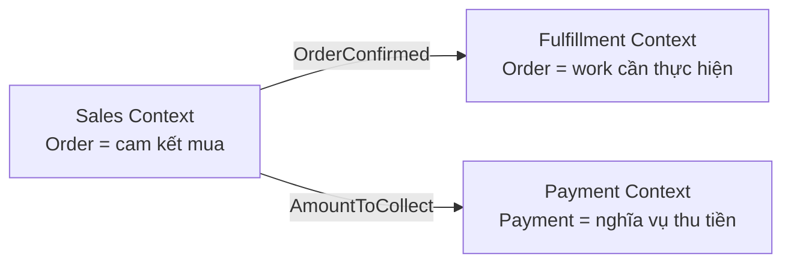

# Nhận diện khi tài liệu và cách hiểu giữa các nhóm đã lệch nhau

Trong Domain-Driven Design, chất lượng của mô hình phụ thuộc vào chất lượng của sự hiểu biết chung về nghiệp vụ. Một thuật ngữ được hiểu khác nhau giữa Product, chuyên gia nghiệp vụ, đội phát triển và đội vận hành có thể tạo ra nhiều lỗi hơn một dòng code sai, vì mỗi nhóm sẽ xây dựng quyết định đúng theo cách hiểu riêng của mình. Khi đó tài liệu vẫn có thể đầy đủ về hình thức, code vẫn có thể chạy, API vẫn có thể ổn định, nhưng các nhóm đang nói về những phiên bản khác nhau của cùng một domain.

Mục tiêu của việc nhận diện lệch cách hiểu là tìm ra nơi mô hình chung đã mất đồng bộ, xác định bằng chứng cụ thể và đưa các nhóm quay lại cùng một ngôn ngữ. Tài liệu trong DDD vì vậy không chỉ ghi lại kiến thức đã biết. Nó giúp nhóm nhìn thấy thuật ngữ nào có nghĩa ổn định, quy tắc nào thuộc bounded context nào, quyết định nào còn đang tranh luận và ví dụ nào đủ rõ để kiểm chứng cách hiểu.

## 1. Lệch cách hiểu giữa các nhóm là gì?

Lệch cách hiểu xảy ra khi hai hay nhiều nhóm sử dụng cùng một từ, cùng một quy trình hoặc cùng một khái niệm nhưng gán cho chúng những ý nghĩa, điều kiện hoặc phạm vi khác nhau. Điểm khó là sự lệch này thường không xuất hiện dưới dạng một câu tuyên bố rõ ràng như “hai bên đang hiểu khác nhau”. Nó lộ ra qua câu hỏi, ví dụ, quy tắc và quyết định ở những thời điểm khác nhau.

Ví dụ, trong một hệ thống thương mại, mọi người đều nói “đơn hàng”. Sales có thể coi đơn hàng là cam kết mua đã được khách xác nhận. Fulfillment có thể coi đó là công việc cần thực hiện trong kho. Payment quan tâm đến nghĩa vụ thu tiền. Cả ba cách hiểu đều có thể hợp lý trong context riêng, nhưng nếu một tài liệu dùng Order như thể nó có một nghĩa duy nhất cho toàn hệ thống thì mô hình sẽ nhanh chóng trở nên mơ hồ.

Có ba mức lệch cần phân biệt:

| Mức lệch | Biểu hiện | Rủi ro |
|---|---|---|
| Từ ngữ | Cùng một thuật ngữ nhưng định nghĩa khác | API, tên class và tài liệu gây hiểu nhầm |
| Quy tắc | Cùng một thuật ngữ nhưng điều kiện áp dụng khác | Quyết định nghiệp vụ sai |
| Mô hình | Mỗi nhóm mô hình hóa một khái niệm khác nhau | Sai ranh giới và sai trách nhiệm |

Không phải mọi khác biệt đều là lỗi. Hai bounded context có thể cố ý dùng cùng một từ theo hai nghĩa khác nhau. Điều cần phát hiện là khi sự khác biệt đó không được đặt tên, không được giới hạn bởi context và khiến một nhóm suy luận sai khi giao tiếp với nhóm khác.

## 2. Dấu hiệu đầu tiên thường xuất hiện ở đâu?

Một cách hiểu bị lệch thường để lại nhiều dấu hiệu nhỏ trước khi gây ra sự cố lớn. Nhóm nên coi những dấu hiệu này là tín hiệu cần điều tra thay vì chỉ sửa câu chữ trong tài liệu.

Một số dấu hiệu có giá trị cao:

- Hai cuộc họp dùng cùng một thuật ngữ nhưng đưa ra hai kết luận khác nhau.
- Product mô tả một trạng thái mà code không có, hoặc code có trạng thái mà tài liệu không giải thích.
- QA tạo hai bộ test khác nhau vì mỗi người hiểu điều kiện nghiệp vụ khác nhau.
- Một đội yêu cầu API “để lấy Order”, trong khi đội sở hữu API hỏi lại “Order ở context nào?”.
- Một từ xuất hiện rất nhiều trong tài liệu nhưng không có ví dụ cho biết khi nào khái niệm đó tồn tại.
- Một quy tắc được viết bằng các từ như “thường”, “có thể”, “thông thường” trong khi code lại xử lý như một invariant tuyệt đối.
- Người mới đọc tài liệu phải hỏi một chuyên gia để hiểu ý nghĩa của thuật ngữ cốt lõi.
- Một thay đổi nhỏ ở một bounded context liên tục buộc nhóm khác sửa tài liệu hoặc logic mà không ai xác định được hợp đồng nào đã thay đổi.
- Các nhóm có cùng sơ đồ quy trình nhưng khi đi qua một case cụ thể lại chọn các nhánh khác nhau.

Một dấu hiệu đơn lẻ chưa đủ kết luận. Giá trị nằm ở việc tập hợp các dấu hiệu thành bằng chứng.

## 3. Phân biệt lỗi tài liệu với lỗi mô hình

Không nên mặc định rằng tài liệu sai là nguyên nhân của sự lệch. Có ít nhất ba nguồn hiểu biết có thể đang khác nhau: hiểu biết nghiệp vụ, mô hình trong code và tài liệu.

```text
                 Hiểu biết nghiệp vụ
                    /          \
                   /            \
                  v              v
          Mô hình trong code <-> Tài liệu
```

Có bốn tình huống phổ biến:

| Hiểu biết nghiệp vụ | Code | Tài liệu | Chẩn đoán ban đầu |
|---|---|---|---|
| A | A | A | Đồng bộ |
| A | B | B | Mô hình và tài liệu có thể đang hợp thức hóa một hiểu biết sai |
| A | A | B | Documentation drift |
| A | B | C | Có tranh chấp hoặc thay đổi chưa được thống nhất |

Trong tình huống cuối, việc sửa Markdown trước có thể che mất vấn đề. Cần đưa tranh chấp ra ánh sáng, xác định quyết định nghiệp vụ và bounded context liên quan rồi mới cập nhật mô hình và tài liệu.

DDD không coi code là “sự thật duy nhất” hay tài liệu là “sự thật duy nhất”. Mô hình tốt hình thành từ sự cộng tác giữa người hiểu domain và người xây dựng hệ thống. Tài liệu tốt làm cho quyết định đó có thể được đọc, kiểm tra và cập nhật.

## 4. Những loại lệch cách hiểu thường gặp

### 4.1. Lệch thuật ngữ

Hai nhóm dùng cùng một từ nhưng định nghĩa khác nhau.

```text
Sales: "Customer" = người sở hữu tài khoản mua hàng
Support: "Customer" = người đang liên hệ với trung tâm hỗ trợ
Identity: "Customer" = chủ thể có danh tính đã xác thực
```

Đây là lý do bounded context có thể cần các model khác nhau. Không nên ép mọi context dùng cùng một class chỉ vì tên giống nhau.

### 4.2. Lệch quy tắc

Các nhóm đồng ý về tên nhưng không đồng ý về điều kiện.

Ví dụ, “đơn hàng có thể hủy” có thể được hiểu là:

```text
Sales:
  được hủy khi chưa giao cho kho

Fulfillment:
  được hủy khi chưa bắt đầu picking

Payment:
  được hoàn tiền nếu giao dịch chưa settlement
```

Các quy tắc này có thể cùng tồn tại. Vấn đề xuất hiện khi tài liệu nói “Order có thể cancel” mà không chỉ rõ context và điều kiện.

### 4.3. Lệch trạng thái

Một nhóm coi trạng thái là chuỗi tuần tự, nhóm khác coi đó là tập các điều kiện độc lập.

```text
Sales:
Draft -> Confirmed -> Cancelled

Fulfillment:
Ready -> Picking -> Packed -> Shipped

Payment:
Authorized -> Captured -> Refunded
```

Order = Shipped không nhất thiết có nghĩa Payment = Captured. Nếu tài liệu gom các trạng thái này vào một lifecycle duy nhất, nhóm đọc sẽ suy luận sai.

### 4.4. Lệch thời điểm

Một nhóm nói “khi đơn hàng được tạo”, nhưng nhóm khác hiểu đó là lúc người dùng bấm Submit, lúc transaction commit hoặc lúc sự kiện được consumer nhận.

Các từ như “ngay khi”, “sau khi”, “đã”, “đang” và “sắp” cần được kiểm tra bằng timeline cụ thể.

### 4.5. Lệch trách nhiệm

Hai nhóm đều nghĩ nhóm kia chịu trách nhiệm quyết định.

Ví dụ:

```text
Pricing quyết định giá bán?
Sales Order chụp giá tại thời điểm xác nhận?
Promotion quyết định mức giảm?
Payment chỉ thu số tiền đã được chốt?
```

Nếu tài liệu không chỉ rõ ownership, mỗi nhóm có thể thêm một phần logic vào model của mình và tạo ra nhiều nguồn sự thật.

### 4.6. Lệch ranh giới

Một khái niệm được chia sẻ quá rộng, khiến các quy tắc thuộc context khác nhau bị trộn vào một model.

Đây thường là dấu hiệu cần xem lại bounded context hơn là thêm một đoạn giải thích vào glossary.

## 5. Cách thu thập bằng chứng trước khi sửa tài liệu

Khi phát hiện nghi ngờ, hãy ghi lại bằng chứng quan sát được. Một bảng nhỏ thường hữu ích hơn một cuộc tranh luận dài.

| Câu hỏi | Bằng chứng cần tìm |
|---|---|
| Hai nhóm đang dùng từ nào? | Câu nói, tài liệu, tên API, tên class |
| Họ hiểu từ đó như thế nào? | Định nghĩa và ví dụ cụ thể |
| Khác biệt xuất hiện ở đâu? | Case, trạng thái, điều kiện, thời điểm |
| Ai sở hữu quyết định? | Bounded context, team, domain capability |
| Khác biệt có chủ ý không? | Quyết định đã được ghi nhận hay chưa |
| Nếu không sửa thì hậu quả gì? | Bug, rework, integration mismatch, delay |

Một kỹ thuật đơn giản là yêu cầu mỗi bên mô tả cùng một scenario bằng ba phần: “đầu vào”, “điều kiện”, “kết quả”. Nếu hai bên dùng cùng từ nhưng tạo ra hai scenario khác nhau, đã có bằng chứng về semantic drift.

Ví dụ:

```text
Scenario: khách hủy đơn sau khi thanh toán

Sales:
  Input: Order = Confirmed
  Action: Cancel
  Result: Order = Cancelled

Payment:
  Input: Payment = Captured
  Action: Refund
  Result: RefundRequested

Fulfillment:
  Input: Picking = NotStarted
  Action: Stop fulfillment
  Result: FulfillmentCancelled
```

Ba mô tả không mâu thuẫn nếu chúng thuộc ba context khác nhau. Chúng trở thành vấn đề khi một tài liệu dùng chúng như một lifecycle duy nhất.

## 6. Dùng ngôn ngữ chung để phát hiện semantic drift

Ubiquitous Language không chỉ là danh sách từ vựng. Mỗi thuật ngữ quan trọng nên có ngữ cảnh, ý nghĩa, ví dụ và những điều không được suy ra từ nó.

Một mục glossary hữu ích có thể có cấu trúc:

```markdown
### Order

- Context: Sales
- Ý nghĩa: cam kết mua đã được Sales xác nhận.
- Có khi: khách đã xác nhận các dòng hàng và điều kiện thương mại.
- Không đồng nghĩa với: Shipment, Invoice hoặc Payment.
- Trạng thái liên quan: Draft, Confirmed, Cancelled.
- Owner: Sales.
- Ví dụ: Order SO-1024 được Confirmed lúc 10:15.
```

Điểm quan trọng là glossary phải giúp giải quyết câu hỏi thực tế. Nếu một thuật ngữ không có tranh chấp hoặc không ảnh hưởng đến quyết định, không cần biến tài liệu thành từ điển khổng lồ.

Khi cùng một từ xuất hiện ở nhiều bounded context, hãy ghi rõ context thay vì cố tìm một định nghĩa toàn hệ thống. Ví dụ `Customer` trong Sales và `Customer` trong Support có thể là hai model hợp lệ nếu ranh giới và cách ánh xạ được xác định.

## 7. Bounded Context là công cụ quản lý khác biệt về nghĩa

Bounded Context cho phép một mô hình có ngôn ngữ nhất quán bên trong ranh giới của nó. Khi hai nhóm bất đồng về nghĩa, câu hỏi quan trọng không chỉ là “định nghĩa nào đúng?” mà còn là “định nghĩa này đúng trong context nào?”.



Ở đây `Order` không cần trở thành một object chung cho cả ba context. Hợp đồng giữa chúng nên truyền đúng thông tin cần thiết, ví dụ `OrderConfirmed` có thể chứa `orderId`, các dòng hàng và thông tin giao nhận cần cho Fulfillment.

Nếu nhóm cố giải quyết mọi bất đồng bằng cách thêm trường vào một shared model, model đó sẽ trở thành nơi chứa các giả định của nhiều context. Khi một context thay đổi, context khác dễ bị kéo theo.

## 8. Nhận diện khi tài liệu đang che giấu ranh giới context

Một tài liệu có thể trông rất đầy đủ nhưng vẫn che giấu ranh giới nếu nó dùng các câu như:

- “Order được thanh toán, đóng gói và giao.”
- “Customer có địa chỉ, điểm thưởng, hạn mức tín dụng và lịch sử hỗ trợ.”
- “Product có giá, tồn kho, mô tả marketing và quyền truy cập.”

Những câu này gom nhiều capability vào một chủ thể khái niệm. Hãy thử hỏi:

1. Ai có quyền thay đổi thuộc tính này?
2. Quy tắc nào quyết định thay đổi?
3. Transaction nào phải bảo toàn invariant?
4. Nhóm nào chịu trách nhiệm khi quy tắc thay đổi?
5. Context khác cần dữ liệu này theo dạng nào?

Nếu câu trả lời thay đổi theo thuộc tính, có khả năng model đang gom quá nhiều context.

## 9. Tài liệu nào là nguồn sự thật cho quyết định nào?

Một nguyên nhân phổ biến của documentation drift là không xác định mục đích của từng loại tài liệu. Một glossary, ADR, API contract và runbook không có cùng vai trò.

| Loại tài liệu | Câu hỏi chính | Người đọc chính |
|---|---|---|
| Ubiquitous Language / Glossary | Thuật ngữ này nghĩa là gì trong context này? | Tất cả nhóm liên quan |
| Domain model note | Quy tắc và khái niệm được mô hình hóa thế nào? | Domain + dev |
| ADR | Vì sao nhóm chọn quyết định này? | Dev + architect + reviewer |
| API contract | Hai hệ thống trao đổi dữ liệu ra sao? | Dev tích hợp |
| Event contract | Sự kiện có ý nghĩa gì và dữ liệu nào được phát? | Producer + consumer |
| Runbook | Khi vận hành thì xử lý tình huống nào? | Ops + on-call |
| Test case | Hành vi nào phải được bảo vệ? | Dev + QA |

Nếu một tài liệu đang được dùng để trả lời một câu hỏi nằm ngoài mục đích của nó, người đọc dễ lấy thông tin cũ làm chuẩn.

## 10. Dùng decision log để giữ lịch sử thay đổi của mô hình

Một tài liệu hiện tại cho biết nhóm đang nghĩ gì, nhưng không phải lúc nào cũng cho biết tại sao mô hình lại như vậy. Khi nhiều nhóm cộng tác, lý do của quyết định giúp ngăn việc mở lại cùng một tranh luận.

Một ADR đơn giản có thể ghi:

```markdown
# ADR-042: Sales sở hữu giá tại thời điểm Confirmed

## Context
Promotion có thể thay đổi sau khi khách tạo giỏ hàng.

## Decision
Sales Order chụp đơn giá và discount tại thời điểm Confirmed.
Sau thời điểm đó, thay đổi catalog không làm thay đổi tổng tiền của Order đã Confirmed.

## Consequences
- Sales Order giữ snapshot của commercial terms.
- Catalog không được đọc để tính lại Order đã Confirmed.
- Các báo cáo phải phân biệt current catalog price và order price.
```

Khi một nhóm hỏi “tại sao Order lại giữ giá riêng?”, ADR trả lời được lý do mà một field comment thường không thể hiện.

## 11. Nhận diện lệch qua ví dụ thay vì chỉ đọc định nghĩa

Định nghĩa trừu tượng dễ tạo cảm giác mọi người đã hiểu giống nhau. Ví dụ cụ thể mới kiểm tra được cách hiểu.

Một thuật ngữ nên được thử qua ít nhất ba loại scenario:

1. **Happy path**: trường hợp bình thường.
2. **Boundary case**: gần ranh giới của rule.
3. **Exception case**: điều kiện khiến hành vi khác đi.

Ví dụ với “Order có thể hủy”:

```text
Case A: Confirmed, chưa giao Fulfillment
=> Cancel được?

Case B: Picking đã bắt đầu
=> Cancel được hay phải tạo cancellation request?

Case C: Payment đã Captured
=> Cancel có đồng nghĩa Refund không?
```

Nếu nhóm trả lời khác nhau, đừng sửa glossary ngay. Ghi lại các câu trả lời, xác định context và ownership, rồi đưa ra quyết định.

## 12. Event Storming và workshop giúp làm lộ khoảng trống

Khi tài liệu đã có nhiều phiên bản, một workshop dựa trên event thường giúp nhìn thấy những khác biệt mà việc đọc tài liệu không phát hiện được.

Có thể bắt đầu bằng timeline:

```text
CustomerCreated
      |
OrderPlaced
      |
OrderConfirmed
      |
PaymentCaptured
      |
PickingStarted
      |
ShipmentDispatched
```

Sau đó hỏi với từng event:

- Ai phát ra event?
- Event mô tả fact đã xảy ra hay command mong muốn?
- Context nào sở hữu state thay đổi?
- Consumer cần thông tin gì?
- Có invariant nào phải đúng trước khi event được phát?
- Nếu consumer nhận event trễ thì điều gì xảy ra?

Nếu hai nhóm gắn cùng một event vào hai thời điểm khác nhau, đó là tín hiệu mạnh về temporal drift.

## 13. Phân biệt Command, Event và trạng thái trong tài liệu

Một tài liệu dễ gây lệch nếu dùng các từ này lẫn nhau.

```text
Command:
  ConfirmOrder
  => yêu cầu thực hiện hành động

Event:
  OrderConfirmed
  => fact đã xảy ra

State:
  Confirmed
  => trạng thái hiện tại của aggregate/model
```

Ví dụ, câu “khi Order Confirmed thì gửi ConfirmOrder” có thể gây nhầm vì `ConfirmOrder` là command và `OrderConfirmed` là event. Tài liệu nên dùng động từ và danh từ nhất quán để người đọc biết đâu là yêu cầu, đâu là fact.

## 14. Kiểm tra sự lệch giữa tài liệu và code

Không cần đọc toàn bộ code để tìm drift. Hãy chọn các khái niệm quan trọng và đối chiếu một số điểm:

```text
Thuật ngữ
   |
   +--> Glossary definition
   |
   +--> Aggregate / Entity
   |
   +--> Application command
   |
   +--> Domain event
   |
   +--> API / message contract
   |
   +--> Test scenario
```

Ví dụ, nếu tài liệu nói `OrderConfirmed` là fact sau khi transaction commit nhưng code publish event trước commit, đây là một khác biệt có ý nghĩa kiến trúc. Nó có thể khiến consumer nhận một event cho state chưa được lưu bền vững.

Một cách kiểm tra có hiệu quả là chọn một scenario và đi từ tài liệu đến test rồi đến code:

```java
@Test
void confirms_order_using_current_commercial_terms() {
    Order order = Order.draft(customerId);
    order.addLine(productId, quantity);

    order.confirm(commercialTerms);

    assertThat(order.status()).isEqualTo(OrderStatus.CONFIRMED);
    assertThat(order.total()).isEqualTo(expectedTotal);
}
```

Tên test không thay thế tài liệu nghiệp vụ, nhưng nó giúp phát hiện khi một rule được mô tả mà không có hành vi tương ứng, hoặc hành vi tồn tại mà nhóm chưa thống nhất ý nghĩa.

## 15. Đối chiếu tài liệu giữa các team bằng một semantic diff

Khi có nhiều nhóm, việc so sánh câu chữ không đủ. Hãy tạo một bảng so sánh ý nghĩa:

| Khái niệm | Team A | Team B | Khác biệt | Cách xử lý |
|---|---|---|---|---|
| Order | Cam kết mua | Công việc kho | Model khác | Đặt trong context |
| Customer | Người mua | Người liên hệ | Phạm vi khác | Đổi tên hoặc context |
| Cancel | Hủy order | Dừng picking | Thời điểm khác | Tách command/process |
| Paid | Captured | Invoice issued | Fact khác | Định nghĩa event riêng |

Bảng này có tác dụng biến câu “chúng ta hiểu khác nhau” thành một tập câu hỏi có thể giải quyết.

## 16. Một quy trình xử lý drift có thể lặp lại

Khi phát hiện lệch, có thể dùng quy trình sáu bước:

```text
Phát hiện tín hiệu
      |
      v
Thu thập scenario và bằng chứng
      |
      v
Xác định context + ownership
      |
      v
Thống nhất thuật ngữ / rule / boundary
      |
      v
Cập nhật model + contract + documentation
      |
      v
Thêm ví dụ hoặc test để giữ quyết định
```

Điều quan trọng là không dừng ở bước “cập nhật tài liệu”. Nếu nguyên nhân là bounded context chưa rõ, documentation chỉ che tạm vấn đề. Nếu nguyên nhân là contract sai, cần sửa contract. Nếu nguyên nhân là business rule thay đổi, model và test cũng phải được cập nhật.

## 17. Xác định ownership trước khi yêu cầu mọi người dùng cùng một model

Một câu hỏi tốt trong workshop là: “Ai có quyền quyết định điều này?”.

```text
Sales
  -> quyết định Order có được Confirm hay không

Pricing
  -> quyết định commercial terms khi Sales yêu cầu tính giá

Fulfillment
  -> quyết định trạng thái thực hiện hàng

Payment
  -> quyết định trạng thái giao dịch thanh toán
```

Nếu một tài liệu mô tả cả bốn quyết định dưới một object `Order`, người đọc có thể tưởng rằng một aggregate duy nhất sở hữu toàn bộ invariant. Khi đó ranh giới transaction và trách nhiệm dễ bị sai.

DDD tactical design có ý nghĩa rõ hơn khi strategic design đã làm rõ ai sở hữu model nào.

## 18. Khi nào nên đổi tên thay vì thêm chú thích?

Không phải mọi drift đều cần một đoạn giải thích dài. Nếu hai khái niệm thực sự khác nhau, đổi tên có thể là cách giao tiếp tốt hơn.

Ví dụ:

```text
Customer
CustomerContact
AccountHolder
Buyer
```

Nếu `Customer` trong Support thực chất là người liên hệ, gọi nó là `CustomerContact` có thể loại bỏ nhiều câu hỏi. Tuy nhiên, đừng đổi tên chỉ để tránh tranh luận. Trước tiên cần xác định domain meaning và context.

Một nguyên tắc thực dụng:

> Nếu người đọc thường xuyên phải nhớ một ngoại lệ để hiểu một cái tên, cái tên có thể đang quá rộng.

## 19. Khi nào nên giữ cùng tên nhưng khác nghĩa?

Cùng tên không tự động là vấn đề. Trong một bounded context, tên nên phục vụ model của context đó. Nếu hai context đều có `Customer` nhưng mỗi bên cần một model riêng, việc giữ tên có thể hợp lý.

Điều cần làm là ghi rõ boundary và mapping:

```text
Sales.Customer
    |
    | CustomerId + selected attributes
    v
Support.CustomerContact
```

Ở integration boundary, hãy truyền dữ liệu theo hợp đồng của consumer. Không cần expose toàn bộ internal model của Sales cho Support.

## 20. Anti-pattern: một glossary toàn hệ thống không có context

Một glossary khổng lồ với mỗi thuật ngữ chỉ có một định nghĩa thường tạo ra cảm giác thống nhất giả.

Ví dụ:

```text
Customer = người mua sản phẩm
```

Định nghĩa này có thể đúng trong Sales nhưng sai trong Support, Identity hoặc Billing.

Glossary nên có scope:

```text
Sales:
  Customer = buyer account

Support:
  Customer = party represented by a support interaction
```

Nếu cần một thuật ngữ ở cấp enterprise, hãy ghi rõ nó là concept chung hay chỉ là label dùng để giao tiếp giữa các context.

## 21. Anti-pattern: đồng bộ tài liệu bằng cách copy mọi thứ

Khi một context thay đổi, nhóm có thể copy nguyên mô hình vào tài liệu của context khác để “đảm bảo đồng bộ”. Cách này tạo nhiều bản sao của cùng một kiến thức và làm tăng documentation drift.

Thay vào đó, tài liệu consumer nên mô tả:

- thông tin consumer cần,
- ý nghĩa của thông tin trong context của consumer,
- contract hoặc event dùng để nhận thông tin,
- assumptions mà consumer được phép đưa ra.

Consumer không cần biết toàn bộ domain model của producer.

## 22. Anti-pattern: dùng comment để giải quyết bất đồng nghiệp vụ

Comment như:

```java
// NOTE: order may be cancelled in some cases
```

không đủ để mô tả một rule quan trọng. Nó không cho biết “some cases” là gì, ai quyết định và tại sao.

Nếu rule quan trọng đến mức ảnh hưởng invariant, hãy đưa nó vào domain model, test và tài liệu phù hợp. Comment chỉ nên bổ sung thông tin mà code tự nó không thể biểu đạt.

## 23. Anti-pattern: tài liệu mô tả implementation thay cho domain decision

Tài liệu kiểu:

```text
OrderService gọi OrderRepository rồi publish Kafka message.
```

có thể đúng về implementation nhưng chưa giải thích:

```text
Tại sao Order được Confirm?
Ai có quyền Confirm?
Điều kiện nào phải đúng?
Event nào biểu diễn fact?
Consumer được phép suy luận điều gì?
```

DDD documentation nên ưu tiên quyết định và ý nghĩa domain, sau đó mới mô tả cơ chế kỹ thuật khi cơ chế đó ảnh hưởng đến contract hoặc behavior.

## 24. Dùng change log để phát hiện drift theo thời gian

Drift thường là kết quả của nhiều thay đổi nhỏ. Một quyết định được cập nhật trong một sprint, glossary đổi ở sprint khác, API giữ tên cũ và test vẫn dùng terminology cũ. Sau vài tháng, không ai biết divergence bắt đầu từ đâu.

Một change log ngắn có thể ghi:

```text
2026-03-10
  Sales Order sau Confirmed giữ snapshot commercial terms.

2026-03-12
  Fulfillment không đọc lại current catalog price.

2026-03-15
  Event OrderConfirmed bổ sung effectivePrice.
```

Không cần ghi mọi commit. Chỉ ghi các thay đổi làm thay đổi ý nghĩa, boundary hoặc contract.

## 25. Dùng contract và test để biến quyết định thành bằng chứng

Một quyết định quan trọng nên có ít nhất một cơ chế giúp phát hiện regression. Với integration, đó có thể là contract test. Với domain rule, đó có thể là domain test. Với kiến trúc, đó có thể là architecture test.

Ví dụ contract:

```json
{
  "eventType": "OrderConfirmed",
  "orderId": "SO-1024",
  "customerId": "C-77",
  "lines": [
    {
      "productId": "P-10",
      "quantity": 2,
      "effectivePrice": 125000
    }
  ]
}
```

Tài liệu event nên giải thích `effectivePrice` là giá được chốt trong Sales Order, không phải giá hiện tại từ Catalog. Contract test bảo vệ cấu trúc; domain documentation bảo vệ ý nghĩa.

## 26. Khi hai team bất đồng, hãy đưa tranh luận về scenario

Tranh luận ở mức câu chữ dễ kéo dài:

```text
"Order đã paid."
"Chưa, mới authorized."
"Nhưng khách đã thanh toán."
```

Hãy đổi sang scenario:

```text
Payment provider trả về authorization thành công.
Funds chưa được capture.
Sales có được coi Order là Paid không?
Fulfillment có được bắt đầu không?
```

Scenario buộc nhóm nói về fact, điều kiện và quyền quyết định. Khi câu trả lời rõ, thuật ngữ thường trở nên rõ theo.

## 27. Mẫu workshop 45 phút để tìm semantic drift

Một workshop ngắn có thể đi theo cấu trúc:

| Thời gian | Hoạt động | Kết quả |
|---:|---|---|
| 5 phút | Chọn một scenario có tranh chấp | Phạm vi |
| 10 phút | Mỗi nhóm mô tả scenario riêng | Hai hoặc nhiều model |
| 10 phút | Khoanh thuật ngữ khác nghĩa | Danh sách drift |
| 10 phút | Xác định context và ownership | Boundary |
| 5 phút | Chốt decision | Quy tắc |
| 5 phút | Ghi tài liệu và ví dụ | Artifact cập nhật |

Người điều phối nên yêu cầu người tham gia đưa ra ví dụ cụ thể trước khi tranh luận về tên. Điều này giảm nguy cơ mọi người đồng ý về từ nhưng vẫn hiểu khác nhau.

## 28. Một mẫu trang documentation cho một khái niệm quan trọng

```markdown
# Order — Sales Context

## Meaning
Cam kết mua đã được Sales xác nhận.

## Owner
Sales.

## Lifecycle
Draft -> Confirmed -> Cancelled

## Invariants
- Order đã Confirmed không đọc lại current catalog price.
- Tổng tiền được tính từ commercial terms đã chốt.

## Commands
- ConfirmOrder
- CancelOrder

## Events
- OrderConfirmed
- OrderCancelled

## Integration
Fulfillment nhận OrderConfirmed để tạo fulfillment work.

## Non-goals
Order không đại diện cho Payment transaction hoặc Shipment lifecycle.

## Examples
...
```

Mẫu này tập trung vào meaning, ownership, invariant và boundary. Người đọc có thể hiểu model mà không cần biết toàn bộ implementation.

## 29. Đọc tài liệu từ góc nhìn của nhóm khác

Một cách kiểm tra đơn giản là mời một thành viên từ context khác đọc tài liệu và trả lời:

1. Khái niệm này thuộc ai?
2. Tôi có được phép thay đổi nó không?
3. Tôi được phép suy luận điều gì từ event hoặc API?
4. Điều gì tôi không được suy luận?
5. Nếu business rule thay đổi, tôi cần biết từ đâu?

Nếu người đọc không trả lời được, tài liệu có thể thiếu boundary hoặc contract. Nếu họ trả lời bằng kiến thức chỉ tồn tại trong đầu của một chuyên gia, tài liệu chưa đủ khả năng truyền tải shared understanding.

## 30. Khi nào một bất đồng là dấu hiệu của model tốt hơn?

Không nên coi mọi bất đồng là thất bại. Một bất đồng được làm rõ có thể giúp nhóm nhận ra hai khái niệm trước đây bị gộp sai.

Ví dụ:

```text
Trước:
  OrderStatus = Draft | Confirmed | Paid | Shipped

Sau:
  SalesOrderStatus = Draft | Confirmed | Cancelled
  PaymentStatus = Authorized | Captured | Refunded
  FulfillmentStatus = Ready | Picking | Packed | Shipped
```

Model mới có nhiều trạng thái hơn nhưng mỗi trạng thái có ownership rõ hơn. Sự phức tạp đã được đặt vào đúng boundary thay vì giấu trong một enum lớn.

## 31. Checklist nhận diện lệch cách hiểu

Trước khi kết luận rằng tài liệu giữa các nhóm đã lệch, hãy kiểm tra:

- [ ] Có thuật ngữ nào được dùng nhưng chưa có context không?
- [ ] Hai nhóm có đưa ra cùng một ví dụ cho thuật ngữ đó không?
- [ ] Có rule nào mỗi nhóm diễn giải bằng điều kiện khác nhau không?
- [ ] Có lifecycle nào đang trộn nhiều context không?
- [ ] Có sự khác biệt về thời điểm xảy ra event không?
- [ ] Có hai team cùng nghĩ mình sở hữu một quyết định không?
- [ ] Có một model dùng chung chỉ vì tên giống nhau không?
- [ ] API hoặc event có làm lộ internal model của producer không?
- [ ] Tài liệu hiện tại có ghi lý do của quyết định quan trọng không?
- [ ] Có test hoặc contract nào bảo vệ quyết định đó không?
- [ ] Một người từ context khác có thể đọc và mô tả đúng boundary không?
- [ ] Khi business rule thay đổi, nhóm biết tài liệu nào cần cập nhật không?

Nếu nhiều câu trả lời là “không”, vấn đề có thể lớn hơn một lỗi tài liệu đơn lẻ.

## 32. Bài tập thực hành: tìm drift trong hệ thống thương mại

Giả sử có bốn team: Sales, Catalog, Fulfillment và Payment. Tài liệu chung ghi:

```text
Order được tạo khi khách checkout.
Order có thể được thanh toán và giao.
Product cung cấp giá hiện tại.
Khi Order Paid, Fulfillment bắt đầu xử lý.
```

Code và các cuộc họp lại cho thấy:

```text
Sales:
  Giá được chốt khi ConfirmOrder.

Catalog:
  Giá có thể thay đổi bất kỳ lúc nào.

Payment:
  Paid chỉ có nghĩa funds đã Captured.

Fulfillment:
  Có thể bắt đầu sau khi OrderConfirmed, không phụ thuộc Payment.
```

Hãy thực hiện các bước:

1. Khoanh các thuật ngữ có khả năng lệch nghĩa.
2. Viết scenario cho `checkout`, `ConfirmOrder`, `PaymentCaptured` và `FulfillmentStarted`.
3. Xác định bounded context sở hữu từng trạng thái.
4. Tách các lifecycle đang bị gom vào `Order`.
5. Viết lại một mục glossary cho `Order` trong Sales.
6. Đề xuất event contract giữa Sales và Fulfillment.
7. Ghi một ADR giải thích thời điểm chốt giá.
8. Thêm một test hoặc contract assertion giúp phát hiện khi tài liệu và behavior lại lệch.

Một đáp án tốt không cần làm cho tất cả team dùng cùng một model. Nó cần làm cho mỗi team biết model của mình có ý nghĩa gì, boundary ở đâu và hợp đồng với context khác là gì.

## 33. Kết luận

Nhận diện lệch cách hiểu là một hoạt động liên tục của DDD. Khi nhiều nhóm cùng phát triển một domain, drift có thể xuất hiện ở thuật ngữ, rule, lifecycle, thời điểm, ownership hoặc boundary. Tài liệu giúp làm lệch nghĩa trở nên nhìn thấy được, nhưng tài liệu chỉ có giá trị khi nó gắn với model, quyết định và ví dụ thực tế.

Một quy trình bền vững bắt đầu từ bằng chứng: chọn scenario, ghi cách hiểu của từng nhóm, xác định context và ownership, sau đó chốt thuật ngữ hoặc rule. Khi khác biệt là có chủ ý, hãy biểu diễn nó bằng bounded context và contract. Khi khác biệt là lỗi, cập nhật model, documentation và test cùng nhau.

Ubiquitous Language vì thế không phải là yêu cầu mọi người dùng một từ duy nhất. Nó là cam kết rằng mỗi thuật ngữ quan trọng có một ý nghĩa rõ ràng trong context của nó, các khác biệt giữa context được đặt tên, và những quyết định làm thay đổi model đều có thể được người khác kiểm tra. Khi đó tài liệu trở thành một phần của mô hình cộng tác thay vì một bản ghi tĩnh đi sau code.
