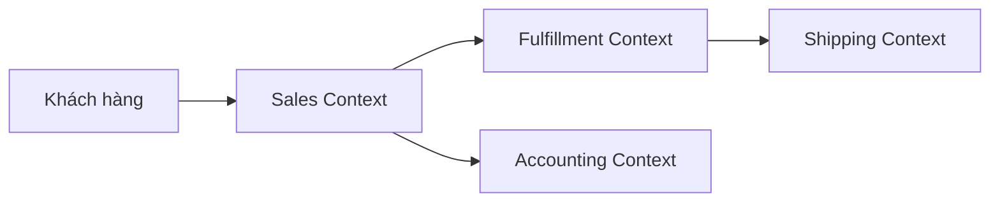
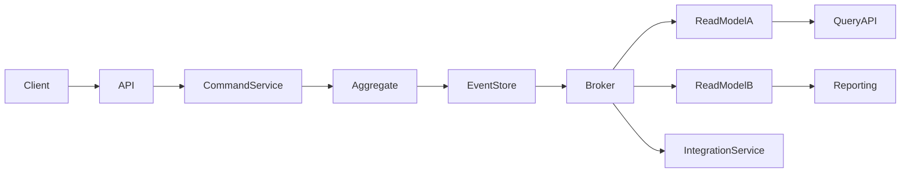

# Áp dụng microservices, CQRS và Event Sourcing khi chưa có nhu cầu

Trong Domain-Driven Design, microservices, CQRS và Event Sourcing là những lựa chọn kiến trúc có thể giải quyết các vấn đề khác nhau. Chúng không phải là dấu hiệu cho thấy một hệ thống đã “trưởng thành”, cũng không phải là phần bắt buộc của DDD. Sai lầm phổ biến là chọn cả ba ngay từ đầu vì chúng xuất hiện cùng nhau trong nhiều kiến trúc mẫu, rồi cố tìm bài toán để biện minh cho lựa chọn đó.

Một hệ thống nên bắt đầu từ hiểu biết nghiệp vụ: đâu là domain quan trọng, ranh giới nào có ý nghĩa, quy tắc nào cần bảo vệ, đội nào sở hữu quyết định nào và hệ thống đang gặp giới hạn gì. Sau đó mới chọn mức độ phân tán, cách đọc ghi dữ liệu và cách lưu lịch sử phù hợp với những nhu cầu đã quan sát được.

DDD cung cấp ngôn ngữ và cách suy nghĩ để tìm ra ranh giới của domain. Microservices là một cách triển khai các ranh giới đó thành những tiến trình có thể triển khai độc lập. CQRS tách mô hình hoặc đường đi của lệnh và truy vấn khi hai nhu cầu này thực sự khác nhau. Event Sourcing lưu trạng thái bằng chuỗi sự kiện nghiệp vụ thay vì chỉ lưu trạng thái cuối. Ba quyết định này có thể kết hợp, nhưng mỗi quyết định đều mang chi phí riêng.

## 1. Sai lầm bắt đầu khi giải pháp đi trước vấn đề

Hãy xem hai cách bắt đầu một dự án.

**Cách thứ nhất:**

> “Chúng ta sẽ dùng microservices, Kafka, CQRS và Event Sourcing để có kiến trúc hiện đại.”

Sau đó đội phát triển tạo nhiều service, nhiều topic, nhiều database và nhiều lớp chuyển đổi dữ liệu. Khi có một quy tắc nghiệp vụ đơn giản như “không được hủy đơn sau khi đã giao”, việc kiểm tra quy tắc lại cần truy vấn hoặc gửi thông điệp qua nhiều thành phần.

**Cách thứ hai:**

> “Đơn hàng có những trạng thái nào? Ai được phép chuyển trạng thái? Quy tắc nào phải đúng ngay tại thời điểm quyết định? Khối lượng đọc và ghi có khác nhau đáng kể không? Chúng ta có cần biết toàn bộ lịch sử thay đổi dưới dạng sự kiện không?”

Các câu hỏi thứ hai giúp xác định nhu cầu trước khi chọn công nghệ. Nếu một module đơn hàng có thể xử lý hàng trăm hoặc vài nghìn giao dịch mỗi giây trên một database quan hệ thông thường, việc thêm mạng, broker và nhiều database chưa chắc tạo ra giá trị tương ứng.

## 2. Ba khái niệm này giải quyết ba loại vấn đề khác nhau

| Lựa chọn | Vấn đề chính có thể giải quyết | Cái giá phải trả |
| --- | --- | --- |
| Microservices | Cần triển khai, mở rộng, sở hữu hoặc cô lập các bounded context một cách độc lập | Network call, phân tán dữ liệu, observability, deployment và vận hành |
| CQRS | Mô hình xử lý command và nhu cầu đọc có đặc tính khác nhau đáng kể | Hai mô hình, đồng bộ dữ liệu, eventual consistency và thêm đường đi dữ liệu |
| Event Sourcing | Cần lịch sử sự kiện làm nguồn sự thật để tái dựng trạng thái, audit hoặc replay | Thiết kế event schema, versioning, replay, migration và debugging phức tạp hơn |

Không có quan hệ bắt buộc rằng đã dùng DDD thì phải dùng microservices, đã dùng microservices thì phải dùng CQRS, hoặc đã dùng CQRS thì phải dùng Event Sourcing.

Một bounded context có thể sống trong một modular monolith. Một module có thể dùng command handler và query handler riêng mà vẫn dùng chung một database. Một domain có thể phát domain event cho integration mà vẫn lưu trạng thái bằng bảng hiện tại. Các lựa chọn này vẫn hoàn toàn phù hợp với tư duy DDD.

## 3. DDD giúp tìm ranh giới trước khi chọn cách triển khai

Trong DDD, bounded context là ranh giới ngữ nghĩa của một model. Trong cùng một context, một thuật ngữ nên có nghĩa nhất quán. Giữa hai context, cùng một từ có thể mang nghĩa khác nhau.

Ví dụ trong hệ thống thương mại:

- **Order** trong Sales có thể là cam kết mua hàng của khách.
- **Order** trong Fulfillment có thể là công việc cần đóng gói và giao.
- **Order** trong Accounting có thể là cơ sở để ghi nhận doanh thu.

Nếu ta tạo ba microservice chỉ vì có ba tên “Order”, ta đã nhầm lẫn ranh giới ngôn ngữ với ranh giới triển khai. Trước tiên cần xác định mỗi context chịu trách nhiệm về quyết định nào và trao đổi thông tin nào với context khác.

Một cách hữu ích để kiểm tra là vẽ model trước:



Sơ đồ này chưa nói rằng mỗi context phải là một service. Nó chỉ làm rõ các ranh giới nghiệp vụ. Sau khi hiểu ranh giới, đội mới đánh giá xem có lý do vận hành để tách chúng thành các tiến trình độc lập hay không.

## 4. Khi nào microservices thực sự có lý do?

Microservices đáng cân nhắc khi ranh giới nghiệp vụ đã đủ rõ và có nhu cầu độc lập về triển khai hoặc vận hành. Một số tín hiệu mạnh là:

1. Một bounded context cần scale theo cách rất khác context còn lại.
2. Một context cần lịch triển khai riêng vì thay đổi thường xuyên hoặc có vòng đời khác.
3. Một đội có ownership rõ ràng và có khả năng vận hành service của mình.
4. Một context cần cô lập về độ tin cậy hoặc tải.
5. Công nghệ lưu trữ hoặc runtime phù hợp với một context nhưng không phù hợp với toàn hệ thống.
6. Chi phí phối hợp trong một codebase hoặc một deployment đã trở thành nút thắt có bằng chứng cụ thể.

Điểm quan trọng là “có nhiều team” hoặc “muốn scale” chưa đủ. Nếu nhiều team cùng sửa một domain model và phải deploy cùng nhau, tách service có thể chỉ chuyển coupling từ code sang API, event và quy trình release.

## 5. Khi microservices chưa mang lại lợi ích

Một ứng dụng nhỏ có vài quy tắc nghiệp vụ, ít team và ít yêu cầu scale thường hưởng lợi từ một modular monolith hơn. Các module vẫn có thể có:

- domain model riêng;
- application service riêng;
- repository riêng;
- domain event riêng;
- dependency rule rõ ràng;
- test theo bounded context.

Ta có thể đặt ranh giới module trong cùng một process:

```text
application
├── sales
│   ├── domain
│   ├── application
│   └── infrastructure
├── fulfillment
│   ├── domain
│   ├── application
│   └── infrastructure
└── accounting
    ├── domain
    ├── application
    └── infrastructure
```

Kiến trúc này cho phép đội học được model và dependency trước khi trả giá cho phân tán. Nếu sau này một module cần trở thành service, ranh giới đã được xác định trước.

## 6. Microservices biến coupling thành coupling phân tán

Trong một monolith, lời gọi giữa hai module có thể là lời gọi hàm. Trong microservices, cùng một quan hệ có thể trở thành:

```text
Service A
   |
   | HTTP/gRPC
   v
Service B
   |
   | database
   v
State B
```

Mỗi network call có thể thất bại. Timeout, retry, duplicate request, version API, authentication, tracing và circuit breaker trở thành một phần của bài toán.

Nếu một use case đơn giản phải gọi năm service theo chuỗi, độ phức tạp không nằm trong domain model mà nằm trong phối hợp phân tán. Đội cần một lý do nghiệp vụ hoặc vận hành đủ mạnh để chấp nhận chi phí đó.

## 7. CQRS không chỉ có nghĩa là đặt tên hai class Command và Query

CQRS, ở mức cốt lõi, là tách trách nhiệm thay đổi trạng thái khỏi trách nhiệm đọc trạng thái. Có nhiều mức độ áp dụng:

| Mức | Cách làm | Chi phí |
| --- | --- | --- |
| Nhẹ | Tách command handler và query handler trong cùng module | Thấp |
| Trung bình | Mô hình đọc khác mô hình domain, vẫn có thể chung database | Vừa |
| Mạnh | Read model riêng, pipeline đồng bộ riêng | Cao |
| Phân tán | Write service và read service độc lập | Rất cao |

CQRS không yêu cầu phải có message broker, microservices hay Event Sourcing. Nếu query đơn giản có thể đọc trực tiếp từ database mà không làm biến dạng domain model, không có lý do phải dựng read database riêng.

## 8. Khi CQRS thật sự hữu ích

CQRS có giá trị khi mô hình ghi phải bảo vệ quy tắc và invariant, trong khi mô hình đọc cần hình dạng dữ liệu hoàn toàn khác.

Ví dụ:

- ghi đơn hàng cần aggregate `Order` để bảo vệ trạng thái;
- màn hình quản trị cần bảng tổng hợp theo khách hàng, khu vực, sản phẩm và ngày;
- báo cáo cần join nhiều nguồn dữ liệu;
- lưu lượng đọc lớn hơn nhiều lần lưu lượng ghi;
- read model cần tối ưu cho một trải nghiệm cụ thể.

Khi đó có thể dùng:

```text
Command --> Domain Model --> Write Store
                         |
                         +--> Event --> Read Model
                                      |
                                      v
                                   Query
```

Nhưng nếu ứng dụng chỉ có CRUD đơn giản và cùng một schema đáp ứng cả đọc lẫn ghi, CQRS toàn diện có thể chỉ tạo thêm mã và đồng bộ dữ liệu.

## 9. Event Sourcing giải quyết nhu cầu lưu lịch sử, không phải nhu cầu “dùng event”

Event-driven architecture và Event Sourcing thường bị đánh đồng.

Trong mô hình thông thường, hệ thống có thể lưu:

```text
Order
status = PAID
total = 1200000
```

Sau đó phát một domain event:

```text
OrderPaid
```

Event này thông báo một fact đã xảy ra. Nó không nhất thiết là nguồn sự thật duy nhất.

Với Event Sourcing, trạng thái được tái dựng từ chuỗi event:

```text
OrderCreated
ItemAdded
PaymentAuthorized
OrderPaid

Current state = fold(events)
```

Nếu không có nhu cầu audit ở mức sự kiện, replay, temporal reasoning hoặc tái dựng trạng thái từ lịch sử, Event Sourcing có thể là một gánh nặng không cần thiết.

## 10. Event Sourcing mang theo một hợp đồng dữ liệu dài hạn

Một event đã được lưu lâu dài sẽ trở thành dữ liệu lịch sử. Khi schema thay đổi, đội phải nghĩ đến:

- version event;
- upcasting;
- compatibility;
- replay;
- migration;
- idempotency;
- ordering;
- snapshot;
- retention.

Ví dụ event:

```json
{
  "type": "OrderPaid",
  "version": 2,
  "orderId": "O-123",
  "amount": 1200000,
  "currency": "VND",
  "paidAt": "2026-11-18T09:30:00Z"
}
```

Nếu sau này `amount` cần biểu diễn bằng một cấu trúc tiền tệ khác, thay đổi schema không đơn giản như đổi một cột trong bảng. Các event cũ vẫn tồn tại và phải được đọc bởi code mới.

Đây là một quyết định dữ liệu dài hạn. Không nên đưa Event Sourcing vào hệ thống chỉ vì muốn “có audit log”.

## 11. Audit log không đồng nghĩa với Event Sourcing

Có nhiều cách đáp ứng nhu cầu audit:

| Nhu cầu | Giải pháp có thể đủ |
| --- | --- |
| Biết ai sửa trường nào | Audit table |
| Biết lịch sử trạng thái | History table |
| Ghi nhận hành động nghiệp vụ quan trọng | Domain/integration event |
| Tái dựng aggregate từ mọi thay đổi | Event Sourcing |
| Phân tích hành vi theo thời gian | Event log hoặc analytics pipeline |

Nếu yêu cầu chỉ là “khi giá sản phẩm thay đổi phải biết ai thay đổi và giá cũ là bao nhiêu”, một audit table thường dễ vận hành hơn Event Sourcing.

## 12. Sai lầm lớn hơn: kết hợp cả ba ngay từ ngày đầu

Một stack có thể trông như sau:



Đây là kiến trúc hợp lệ trong một số hệ thống. Nhưng nó có nhiều điểm cần vận hành: API, service, aggregate, event store, broker, consumer, read model và các chiến lược retry/replay. Nếu domain chưa có nhu cầu tương ứng, đội đang trả trước chi phí cho những vấn đề chưa xuất hiện.

Một quy tắc thực tế là mỗi lớp phức tạp mới phải có một vấn đề cụ thể đứng phía sau:

```text
Vấn đề quan sát được
        |
        v
Yêu cầu cần đạt
        |
        v
Quyết định kiến trúc
        |
        v
Bằng chứng sau triển khai
```

Nếu không chỉ ra được “vấn đề nào” và “bằng chứng nào”, quyết định đó cần được xem xét lại.

## 13. Ví dụ: hệ thống bán vé đơn giản

Giả sử hệ thống có:

- 5.000 đơn/ngày;
- 20.000 lượt đọc/ngày;
- một team 6 người;
- một database quan hệ;
- yêu cầu nhất quán khi giữ chỗ;
- audit đơn giản cho thao tác của nhân viên.

Một kiến trúc modular monolith có thể đủ:

```text
Ticketing
├── Reservation
├── Payment
├── Customer
└── Reporting
        |
        v
   PostgreSQL
```

Aggregate `Reservation` bảo vệ invariant “một ghế không được giữ bởi hai reservation đang hiệu lực”. Transaction của database bảo vệ thao tác ghi. Một bảng audit lưu người thực hiện thay đổi.

Đưa bốn module thành bốn microservice, thêm CQRS và Event Sourcing sẽ không tự làm invariant mạnh hơn. Nó chỉ thay đổi cách hệ thống phải phối hợp để bảo vệ invariant đó.

## 14. Bắt đầu bằng invariant thay vì công nghệ

DDD đặt trọng tâm vào quy tắc nghiệp vụ. Hãy viết invariant trước:

```text
Invariant:
Một ghế chỉ có thể có tối đa một reservation ACTIVE
trong cùng một thời điểm bán.
```

Sau đó hỏi:

1. Aggregate nào sở hữu invariant?
2. Transaction boundary nằm ở đâu?
3. Context nào chịu trách nhiệm?
4. Có cần consistency ngay lập tức không?
5. Có cần lưu toàn bộ lịch sử sự kiện không?
6. Có cần scale write độc lập không?

Nếu câu trả lời cho các câu hỏi cuối là “không”, một thiết kế đơn giản có thể đã đáp ứng đầy đủ.

## 15. Tách bounded context trước, tách process sau

Một cách tiến hóa an toàn hơn là:

```text
Giai đoạn 1
Modular monolith
        |
        v
Giai đoạn 2
Module có boundary rõ
        |
        v
Giai đoạn 3
Quan sát tải, ownership, failure
        |
        v
Giai đoạn 4
Tách context cần độc lập
```

Điều này cho phép đội xác minh rằng boundary có ý nghĩa trước khi đưa boundary đó qua network.

Một module tốt nên hạn chế dependency trực tiếp vào model nội bộ của module khác. Giao tiếp qua interface, command hoặc event giúp việc tách sau này ít đau hơn.

## 16. Domain event không buộc phải có message broker

Trong một monolith, domain event có thể được xử lý trong cùng transaction hoặc được đưa vào một outbox:

```text
Aggregate
   |
   +--> State change
   |
   +--> Domain event
             |
             v
          Outbox
             |
             v
          Publisher
```

Nếu hệ thống cần integration với context khác, outbox có thể giúp đảm bảo event được phát đi sau khi transaction nghiệp vụ đã commit. Nhưng việc có domain event vẫn không có nghĩa toàn bộ hệ thống phải trở thành Event Sourcing.

## 17. Phân biệt domain event và integration event

**Domain event** diễn tả một fact có ý nghĩa trong domain model:

```text
OrderPaid
PaymentFailed
ReservationExpired
```

**Integration event** là hợp đồng để context hoặc hệ thống khác nhận thông tin:

```text
OrderPaidForFulfillment
CustomerPaymentConfirmed
```

Một domain event có thể được chuyển đổi thành integration event. Không nên để model nội bộ của một bounded context trở thành API ngầm cho mọi context khác.

## 18. Eventual consistency phải là quyết định nghiệp vụ

CQRS và event-driven architecture thường dẫn đến eventual consistency. Điều đó có nghĩa read model hoặc context khác có thể nhìn thấy trạng thái cũ trong một khoảng thời gian.

Trước khi chọn mô hình này, cần hỏi:

> Trong khoảng thời gian dữ liệu chưa đồng bộ, người dùng có thể chấp nhận điều gì?

Ví dụ:

- báo cáo doanh thu chậm vài giây có thể chấp nhận;
- số lượt xem sản phẩm chậm vài giây có thể chấp nhận;
- số dư tài khoản có thể không chấp nhận;
- hai người cùng giữ một ghế có thể không chấp nhận.

Không nên chọn eventual consistency chỉ vì nó thuận tiện cho kiến trúc. Nó phải phù hợp với quy tắc nghiệp vụ.

## 19. Microservices không tự giải quyết ownership

Tách service nhưng không có ownership rõ sẽ tạo ra distributed monolith. Dấu hiệu thường gặp:

- mọi service đều phụ thuộc vào service khác để hoàn thành một request;
- mọi thay đổi API phải được nhiều team phê duyệt;
- một release cần deploy nhiều service cùng lúc;
- một database được nhiều service ghi trực tiếp;
- lỗi một service kéo theo chuỗi lỗi toàn hệ thống.

Khi đó boundary triển khai tồn tại nhưng boundary ownership chưa tồn tại.

Một service nên có một nhóm chịu trách nhiệm rõ ràng về model, API, vận hành và chất lượng của nó.

## 20. Một database dùng chung có thể phá hỏng boundary

Giả sử có ba service:

```text
Sales ------\
Fulfillment ---> Shared Database
Accounting --/
```

Nếu cả ba service đều ghi trực tiếp vào cùng bảng `orders`, mỗi service thực tế đang phụ thuộc vào schema nội bộ của context khác. Ta có distributed monolith với network call cộng thêm shared database.

Nếu cần microservices, ownership dữ liệu phải được suy nghĩ cùng với ownership nghiệp vụ. Context khác có thể nhận thông tin qua API hoặc event thay vì đọc bảng nội bộ.

## 21. Đừng dùng CQRS để che một domain model yếu

Nếu domain model chỉ là các entity CRUD:

```java
order.setStatus("PAID");
order.setTotal(total);
repository.save(order);
```

việc tạo thêm `CommandHandler`, `QueryHandler`, `EventBus` và `ReadModel` không tự làm domain model tốt hơn.

Nếu quy tắc nghiệp vụ là:

```java
public void markPaid(Payment payment) {
    if (status != OrderStatus.AWAITING_PAYMENT) {
        throw new IllegalStateException("Order cannot be paid");
    }
    if (!payment.matches(total)) {
        throw new IllegalArgumentException("Payment amount is invalid");
    }
    status = OrderStatus.PAID;
}
```

thì giá trị nằm ở việc đặt invariant vào đúng model. CQRS chỉ là một lựa chọn tổ chức đường đi command/query sau khi nhu cầu đọc và ghi đã được hiểu.

## 22. Đừng dùng Event Sourcing để tạo audit trail bằng mọi giá

Nếu yêu cầu là:

```text
09:10 - Alice đổi trạng thái từ PENDING -> APPROVED
09:15 - Bob đổi trạng thái từ APPROVED -> CANCELLED
```

ta có thể lưu history:

| Thời điểm | Người thực hiện | Trước | Sau |
| --- | --- | --- | --- |
| 09:10 | Alice | PENDING | APPROVED |
| 09:15 | Bob | APPROVED | CANCELLED |

Event Sourcing chỉ nên được chọn khi lịch sử sự kiện là một phần quan trọng của cách domain được mô hình hóa và hệ thống thực sự cần khả năng tái dựng trạng thái từ lịch sử đó.

## 23. Một quyết định kiến trúc tốt phải nói rõ điều kiện áp dụng

Thay vì viết:

> “Hệ thống sử dụng microservices vì dễ scale.”

hãy viết:

> “Fulfillment cần scale độc lập vì lưu lượng xử lý đóng gói tăng mạnh vào các đợt khuyến mãi, trong khi Sales không tăng cùng tỷ lệ. Context này có ownership riêng và có thể giao tiếp qua integration event.”

Hoặc:

> “Chúng tôi chưa tách service vì hiện tại lưu lượng chưa tạo ra nhu cầu scale độc lập và đội vận hành còn nhỏ. Boundary vẫn được giữ ở mức module để có thể tách sau.”

Một quyết định có điều kiện giúp đội biết khi nào cần thay đổi kiến trúc.

## 24. Mẫu ADR cho quyết định dùng hoặc chưa dùng công nghệ

Có thể ghi một Architecture Decision Record ngắn:

```markdown
# ADR: Chưa tách Order thành microservice

## Context
- 2 team cùng phát triển hệ thống.
- Lưu lượng hiện tại chưa cần scale độc lập.
- Order và Payment có transaction boundary liên quan.

## Decision
Giữ Order và Payment trong modular monolith.
Boundary giữa hai module được kiểm soát bằng interface.

## Consequences
- Vận hành đơn giản hơn.
- Có transaction local.
- Chưa có independent deployment.

## Revisit when
- Order cần scale độc lập.
- Ownership tách thành team riêng.
- Deployment coupling trở thành bottleneck đo được.
```

ADR không phải lời cam kết vĩnh viễn. Nó là bằng chứng về lý do của quyết định tại một thời điểm.

## 25. Ma trận quyết định thực tế

| Câu hỏi | Nếu “Có” | Nếu “Không” |
| --- | --- | --- |
| Cần deploy context độc lập? | Cân nhắc microservice | Giữ module |
| Cần scale write độc lập? | Cân nhắc tách process | Shared process có thể đủ |
| Read model khác hẳn write model? | Cân nhắc CQRS | Có thể dùng model hiện tại |
| Read/write có tỷ lệ tải rất khác? | CQRS có thể hữu ích | Tránh thêm read pipeline |
| Cần tái dựng trạng thái từ lịch sử event? | Cân nhắc Event Sourcing | State store thông thường có thể đủ |
| Audit chỉ cần biết ai và khi nào? | History/audit table thường đủ | Không áp dụng |
| Context chấp nhận eventual consistency? | Có thể dùng async integration | Giữ consistency local |
| Có team ownership rõ? | Microservice dễ vận hành hơn | Boundary module thường an toàn hơn |

Ma trận này không thay thế phân tích domain. Nó chỉ giúp tránh việc lựa chọn kiến trúc theo trào lưu.

## 26. Red flag: mọi thứ đều trở thành event

Một hệ thống có thể phát event cho mọi setter:

```text
CustomerNameChanged
CustomerPhoneChanged
CustomerAddressChanged
CustomerStatusChanged
CustomerNoteChanged
```

Số lượng event tăng nhanh nhưng giá trị nghiệp vụ không tăng tương ứng. Một event nên đáng quan tâm với consumer vì nó diễn tả một fact hoặc một quyết định có ý nghĩa.

Đặc biệt với Event Sourcing, event schema là một phần của lịch sử. Việc tạo event quá chi tiết làm chi phí bảo trì tăng theo thời gian.

## 27. Red flag: mọi service đều có database riêng nhưng vẫn gọi nhau theo chuỗi

Một request:

```text
API
 -> Customer Service
 -> Order Service
 -> Pricing Service
 -> Inventory Service
 -> Payment Service
 -> Shipping Service
```

có thể trở thành một distributed transaction ẩn. Chỉ cần một service timeout, toàn bộ use case có thể thất bại hoặc phải retry.

Hãy xem use case thực sự cần consistency nào. Nếu nhiều quyết định phải xảy ra trong một transaction, có thể boundary đã được tách quá sớm.

## 28. Red flag: CQRS nhưng read model luôn giống write model

Nếu read model chỉ là bản sao của bảng write:

```text
Write Order
      |
      v
Read Order
```

và query không có yêu cầu khác biệt, pipeline đồng bộ chỉ làm tăng số thành phần. CQRS đáng giá khi read model được tối ưu cho nhu cầu đọc khác biệt.

Một read model tốt thường trả lời một câu hỏi cụ thể:

> “Những đơn đang chờ xử lý của khách hàng VIP trong khu vực miền Nam là gì?”

thay vì chỉ sao chép toàn bộ entity.

## 29. Red flag: Event Sourcing nhưng không ai replay event

Nếu đội không có use case nào cần:

- rebuild aggregate;
- audit theo chuỗi fact;
- phân tích trạng thái theo thời điểm;
- sửa projection bằng replay;
- khôi phục state từ lịch sử;

thì cần xem lại lý do dùng Event Sourcing. Event store không nên tồn tại chỉ vì “sau này có thể cần”.

## 30. Red flag: kiến trúc mẫu được copy nguyên gói

Một template có thể chứa:

```text
DDD
+ Microservices
+ CQRS
+ Event Sourcing
+ Kafka
+ Kubernetes
+ API Gateway
```

Nhưng đây là một tập hợp công nghệ, không phải một mô hình domain. Domain có thể cần một phần, toàn bộ hoặc không cần phần nào trong số đó.

DDD bắt đầu từ business language và model. Kiến trúc nên là hệ quả của những nhu cầu đã được phát hiện.

## 31. Quy trình chọn mức độ phức tạp

Có thể dùng quy trình bảy bước:

1. **Mô tả use case.** Ai làm gì và kết quả nào cần đạt?
2. **Xác định invariant.** Quy tắc nào phải luôn đúng?
3. **Tìm bounded context.** Context nào sở hữu quyết định?
4. **Đánh giá consistency.** Quyết định nào cần transaction ngay?
5. **Đánh giá tải.** Đọc và ghi có cần scale khác nhau không?
6. **Đánh giá lịch sử.** Có cần event history làm nguồn sự thật không?
7. **Đánh giá ownership.** Có team nào đủ năng lực vận hành boundary độc lập không?

Sau đó chọn giải pháp nhỏ nhất đáp ứng yêu cầu hiện tại. Khi yêu cầu thay đổi, quyết định kiến trúc có thể thay đổi theo.

## 32. Ví dụ tiến hóa từ đơn giản đến phức tạp

Giả sử hệ thống thương mại tăng trưởng theo thời gian.

**Giai đoạn 1:**

```text
Modular Monolith
    |
    +-- Sales
    +-- Fulfillment
    +-- Payment
    |
    +-- Relational DB
```

**Giai đoạn 2:** Fulfillment cần read model riêng cho dashboard:

```text
Fulfillment Module
   |
   +--> Write Model
   |
   +--> Domain Event
          |
          v
      Read Model
```

Chỉ lúc này CQRS ở mức module có thể xuất hiện.

**Giai đoạn 3:** Fulfillment tăng tải mạnh và có team ownership riêng:

```text
Sales Module  <--> Integration Events <--> Fulfillment Service
```

Lúc này microservice có lý do rõ hơn.

**Giai đoạn 4:** Fulfillment cần tái dựng lịch sử trạng thái để xử lý tranh chấp và audit nghiệp vụ phức tạp:

```text
Command
   |
   v
Aggregate
   |
   v
Event Store
   |
   +--> Projection
   +--> Audit
   +--> Replay
```

Event Sourcing lúc này có thể trở thành một quyết định có căn cứ.

## 33. Khi nào nên dừng ở modular monolith?

Không có mốc kỹ thuật bắt buộc phải chuyển sang microservices. Có thể giữ modular monolith nếu:

- deployment vẫn đáp ứng nhu cầu;
- đội vẫn sở hữu tốt các module;
- database transaction đáp ứng invariant;
- scale toàn ứng dụng vẫn đủ;
- coupling giữa module được kiểm soát;
- vận hành đơn giản mang lại lợi ích thực tế.

Một modular monolith được thiết kế tốt có thể là kiến trúc dài hạn. “Tách service” không phải là mục tiêu tự thân.

## 34. Bài tập: phát hiện nhu cầu giả

Hãy giả định một hệ thống đặt lịch có 10.000 người dùng và 1.000 booking/ngày. Đội đề xuất:

> “Dùng microservices + CQRS + Event Sourcing ngay từ đầu để dễ scale.”

Hãy trả lời:

1. Bounded context nào đã được xác định?
2. Invariant nào cần bảo vệ?
3. Use case nào cần transaction?
4. Lưu lượng nào thực sự cần scale độc lập?
5. Query nào có hình dạng khác write model?
6. Có yêu cầu replay hoặc temporal audit không?
7. Ai là owner của từng context?
8. Nếu một service tạm thời không phản hồi, nghiệp vụ có thể tiếp tục không?
9. Eventual consistency có chấp nhận được không?
10. Có thể giải quyết nhu cầu hiện tại bằng modular monolith không?

Nếu chưa trả lời được các câu hỏi này, việc chọn cả ba công nghệ vẫn đang đi trước việc hiểu domain.

## 35. Checklist review trước khi thêm microservices, CQRS hoặc Event Sourcing

- [ ] Có vấn đề cụ thể đã được quan sát và đo lường.
- [ ] Bounded context và ownership đã được xác định.
- [ ] Invariant quan trọng đã được xác định.
- [ ] Đã biết transaction boundary cần thiết.
- [ ] Đã đánh giá chi phí network và eventual consistency.
- [ ] Đã xác định nhu cầu scale độc lập nếu chọn microservices.
- [ ] Đã xác định read/write khác nhau nếu chọn CQRS.
- [ ] Đã xác định nhu cầu lịch sử/replay nếu chọn Event Sourcing.
- [ ] Đã có kế hoạch versioning và vận hành nếu lưu event lâu dài.
- [ ] Đã xác định team chịu trách nhiệm vận hành.
- [ ] Đã ghi decision record và điều kiện xem xét lại.

Nếu phần lớn checkbox chưa được trả lời, hãy tiếp tục khám phá domain trước khi thêm độ phức tạp.

## 36. Kết luận

DDD không yêu cầu hệ thống phải phân tán. DDD giúp đội hiểu domain, tìm bounded context và đặt invariant vào đúng nơi. Từ đó, microservices, CQRS và Event Sourcing trở thành các lựa chọn có thể cân nhắc theo nhu cầu.

Microservices phù hợp khi cần boundary triển khai, vận hành hoặc scale độc lập. CQRS phù hợp khi trách nhiệm đọc và ghi có đặc tính khác biệt đáng kể. Event Sourcing phù hợp khi lịch sử event là một phần quan trọng của domain và việc tái dựng trạng thái mang lại giá trị thực.

Một kiến trúc tốt có thể bắt đầu rất đơn giản và tiến hóa khi bằng chứng xuất hiện. Điều cần giữ ổn định là cách đặt câu hỏi: domain đang yêu cầu điều gì, quy tắc nào phải được bảo vệ, context nào sở hữu quyết định và chi phí nào đội sẵn sàng vận hành. Khi câu trả lời thay đổi, kiến trúc có cơ sở để thay đổi theo.

