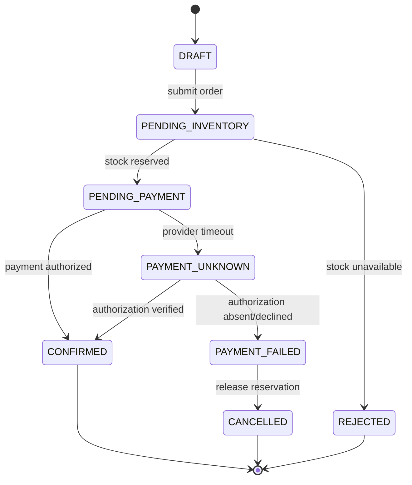
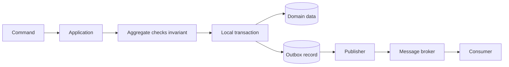

# Dùng sự kiện thay cho bảo vệ bất biến bắt buộc

Trong Domain-Driven Design (DDD), Domain Event là cách diễn đạt một sự việc có ý nghĩa đã xảy ra trong domain. Event giúp các phần khác của hệ thống phản ứng, cập nhật read model, gửi thông báo hoặc tiếp tục một quy trình. Tuy nhiên, một lỗi thiết kế thường gặp là dùng event bất đồng bộ để bảo vệ một invariant phải đúng ngay tại thời điểm quyết định.

Ví dụ, một cửa hàng chỉ còn một sản phẩm nhưng hai khách cùng đặt mua. Nếu Sales cứ xác nhận cả hai đơn rồi phát `OrderPlaced` để Inventory xử lý sau, hai đơn có thể cùng được xác nhận trong khi kho chỉ có một sản phẩm. Consumer nhận event và phát hiện thiếu hàng sau đó không thể làm cho quyết định xác nhận ban đầu trở nên hợp lệ.

Nguyên tắc cần nhớ: **nếu một quy tắc bắt buộc phải đúng trước khi chấp nhận hành động, hãy bảo vệ nó tại nơi có thẩm quyền quyết định và bằng cơ chế đủ nguyên tử**. Event có thể thông báo kết quả đã được chấp nhận hoặc khởi động một workflow có trạng thái chờ rõ ràng. Event không tự thay thế việc kiểm tra invariant, khóa cạnh tranh hoặc ghi nhận reservation.

## 1. Phân biệt invariant, command và event

Muốn tránh lỗi này, trước hết cần dùng đúng thuật ngữ.

### 1.1. Invariant là điều kiện phải luôn đúng

Invariant là quy tắc mà mọi trạng thái hợp lệ của một model hoặc consistency boundary phải tuân thủ. Ví dụ:

- Số lượng hàng đã reserve không được vượt quá lượng có thể phân bổ.
- Một reservation chỉ được xác nhận khi còn hiệu lực.
- Một payment operation không được capture vượt quá số tiền đã được authorize.
- Một tài khoản không được chi vượt hạn mức tín dụng nếu domain không cho phép.
- Một chỗ ngồi chỉ được phân bổ cho tối đa một người tại một thời điểm.

Invariant có phạm vi. Một invariant nội tại của một Aggregate thường phải được bảo vệ trong transaction của Aggregate đó. Một quy tắc liên quan nhiều Aggregate hoặc nhiều Bounded Context cần một consistency mechanism được thiết kế rõ. Không nên mặc định rằng mọi quy tắc toàn hệ thống đều có thể được bảo vệ bằng một event handler.

### 1.2. Command là yêu cầu thực hiện hành động

Command diễn đạt ý định của caller, ví dụ:

- `ReserveStock` — yêu cầu giữ một lượng hàng.
- `AuthorizePayment` — yêu cầu ủy quyền thanh toán.
- `ConfirmOrder` — yêu cầu xác nhận đơn.

Command có thể được chấp nhận hoặc từ chối. Khi xử lý command, module sở hữu invariant phải kiểm tra điều kiện và đưa ra quyết định.

### 1.3. Event là fact đã xảy ra

Domain Event diễn đạt kết quả nghiệp vụ đã được chấp nhận:

- `StockReserved` — hàng đã được giữ.
- `PaymentAuthorized` — thanh toán đã được ủy quyền.
- `OrderConfirmed` — đơn đã được xác nhận.

Event không phải là yêu cầu để một consumer tùy ý quyết định có nên làm hành động ban đầu hay không. Nếu một message mang ý nghĩa yêu cầu, hãy đặt tên và xử lý nó như command.

### 1.4. Phân biệt event với trạng thái

Event ghi nhận một điều xảy ra tại một thời điểm. State biểu diễn tình trạng hiện tại sau khi áp dụng các hành vi. Ví dụ `StockReserved` là event; `ReservationStatus.ACTIVE` là trạng thái của reservation. Không nên coi việc đã publish event là bằng chứng rằng mọi consumer đã cập nhật xong hoặc invariant toàn hệ thống đã được bảo vệ.

## 2. Vì sao event bất đồng bộ không thể thay thế kiểm tra invariant tức thời?

Khi một module phát event qua broker hoặc outbox, consumer thường xử lý sau transaction ban đầu. Giữa lúc producer commit và consumer xử lý có thể có một khoảng trễ.

Trong khoảng thời gian đó:

- một command khác có thể được chấp nhận dựa trên cùng dữ liệu cũ;
- message có thể đến trễ, lặp hoặc sai thứ tự;
- consumer có thể dừng, lỗi hoặc nằm trong dead-letter queue;
- broker có thể đang phục hồi;
- producer không biết consumer đã thực hiện hành động hay chưa.

Vì vậy, việc phát `OrderPlaced` rồi chờ Inventory phản hồi không tự bảo đảm rằng chỉ một đơn được xác nhận cho sản phẩm cuối cùng.

### 2.1. Race condition khi hai request cùng đọc một giá trị

Giả sử kho còn một đơn vị:

```text
available = 1

Request A đọc available = 1
Request B đọc available = 1

A phát OrderPlaced
B phát OrderPlaced

Inventory consumer xử lý A -> phát hiện có thể reserve
Inventory consumer xử lý B -> có thể xử lý trên projection cũ hoặc từ chối sau đó
```

Nếu hai quyết định chấp nhận đơn đã được commit trước khi Inventory bảo vệ lượng hàng, hệ thống đã xác nhận nhiều cam kết hơn khả năng đáp ứng.

### 2.2. Consumer xử lý sau không thể quay ngược thời điểm quyết định

Consumer có thể từ chối reservation, phát `ReservationRejected` hoặc yêu cầu hủy đơn. Những hành động đó là xử lý hậu quả. Chúng không làm cho hai đơn đã được xác nhận ban đầu trở thành một quyết định hợp lệ.

Nếu nghiệp vụ cho phép nhận đơn trước rồi xác nhận khả năng cung ứng sau, trạng thái ban đầu phải diễn đạt đúng cam kết đó, chẳng hạn `PENDING_INVENTORY` hoặc `AWAITING_STOCK`. Không được hiển thị hoặc phát `OrderConfirmed` trước khi điều kiện bắt buộc đã được thỏa mãn.

### 2.3. At-least-once delivery và thứ tự message

Nhiều hệ thống message bảo đảm giao ít nhất một lần thay vì đúng một lần. Consumer có thể nhận cùng event nhiều lần. Một event cũng có thể đến sau event khác nếu partition, retry hoặc nhiều consumer làm thay đổi thứ tự quan sát.

Idempotency và version check là cần thiết để xử lý message lặp hoặc trễ, nhưng chúng không thay thế cơ chế bảo vệ invariant tại write boundary.

## 3. Ví dụ sai: xác nhận đơn rồi mới nhờ event giữ hàng

Giả sử Sales thực hiện:

```java
public void placeOrder(PlaceOrder command) {
    Order order = Order.confirm(command.orderId(), command.lines());
    orderRepository.save(order);
    eventPublisher.publish(new OrderPlaced(order.id()));
}
```

Inventory lắng nghe:

```java
public void on(OrderPlaced event) {
    boolean reserved = inventory.reserve(event.orderId());
    if (!reserved) {
        eventPublisher.publish(
            new StockReservationRejected(event.orderId())
        );
    }
}
```

Vấn đề nằm ở semantics: Sales đã xác nhận đơn trước khi biết Inventory có thể thực hiện cam kết hay không. `StockReservationRejected` chỉ đến sau và buộc hệ thống phải sửa một quyết định đã công bố.

Hậu quả có thể gồm:

- khách nhìn thấy đơn đã xác nhận nhưng sau đó bị hủy;
- Payment đã authorize hoặc capture trước khi biết thiếu hàng;
- notification và analytics đã ghi nhận một đơn thành công;
- refund hoặc compensation trở thành bắt buộc;
- support phải giải thích một cam kết không thể thực hiện.

Nếu doanh nghiệp chấp nhận mô hình backorder hoặc bán trước khi có hàng, đây có thể là một workflow hợp lệ. Nhưng khi đó `OrderConfirmed` phải có semantics phù hợp với chính sách backorder; không được ngầm hiểu là hàng đã được reserve.

## 4. Bảo vệ invariant tại nơi sở hữu dữ liệu và quyết định

DDD khuyến khích đặt hành vi và invariant bên trong Aggregate Root hoặc domain service/policy thuộc đúng Bounded Context. Module sở hữu nguồn dữ liệu có thẩm quyền phải kiểm tra điều kiện trước khi chấp nhận command.

Ví dụ Inventory sở hữu:

- số lượng vật lý hoặc số lượng có thể phân bổ;
- reservation và vòng đời của reservation;
- quy tắc không reserve vượt lượng khả dụng;
- việc giải phóng reservation khi hủy hoặc hết hạn.

Sales không nên đọc một con số khả dụng rồi tự quyết định giảm kho. Sales gửi command `ReserveStock`; Inventory đưa ra kết quả.

### 4.1. Aggregate bảo vệ invariant trong consistency boundary

Nếu `StockItem` là Aggregate Root sở hữu available quantity, hành vi reserve có thể kiểm tra và thay đổi lượng khả dụng trong cùng transaction:

```java
public Reservation reserve(
        ReservationId reservationId,
        Quantity requested,
        Instant now) {
    if (requested.isZeroOrNegative()) {
        throw new InvalidReservationQuantity(requested);
    }
    if (available.isLessThan(requested)) {
        throw new InsufficientStock(productId, requested, available);
    }

    available = available.subtract(requested);
    Reservation reservation = Reservation.create(
        reservationId, productId, requested, now);
    domainEvents.add(new StockReserved(reservationId, productId, requested));
    return reservation;
}
```

Đây là code minh họa. Nếu nhiều request có thể chạy đồng thời trên cùng Aggregate, việc kiểm tra trong memory chưa đủ. Repository và database phải bảo vệ cập nhật cạnh tranh bằng optimistic locking, pessimistic locking, atomic update hoặc constraint thích hợp.

### 4.2. Database constraint là một lớp bảo vệ quan trọng

Một atomic update có thể bảo đảm không giảm lượng khả dụng xuống dưới 0:

```sql
UPDATE stock_balance
SET available_units = available_units - :quantity,
    version = version + 1
WHERE product_id = :product_id
  AND available_units >= :quantity;
```

Nếu số dòng cập nhật là 1, reservation đã lấy được lượng yêu cầu. Nếu là 0, sản phẩm không còn đủ lượng hoặc điều kiện cập nhật không còn đúng. Câu lệnh phải chạy trong transaction và kết hợp với việc ghi reservation/idempotency record theo thiết kế dữ liệu.

Database constraint như `CHECK (available_units >= 0)` có thể là lớp phòng vệ cuối. Constraint không thay thế domain behavior vì nó thường không diễn đạt đủ lý do nghiệp vụ, nhưng nó bảo vệ dữ liệu khi có code path khác hoặc race condition.

### 4.3. Optimistic concurrency cần xử lý conflict đúng cách

Nếu hai command cùng đọc version 10, chỉ một command được cập nhật version tiếp theo. Command còn lại gặp conflict phải tải trạng thái mới và đánh giá lại quyết định. Không được lặp lại một event hoặc ghi đè trên trạng thái mới mà không chạy lại quy tắc.

## 5. Mô hình đúng khi Inventory là Bounded Context riêng

Khi Sales và Inventory là hai context riêng, Sales không thể truy cập trực tiếp aggregate của Inventory. Điều đó không có nghĩa phải dùng event bất đồng bộ để thay cho quyết định reserve.

Một cách làm là gọi capability command của Inventory:

```java
ReservationResult result = inventoryApi.reserve(
    new ReserveStock(
        reservationId,
        productId,
        quantity,
        orderId
    )
);

if (result.accepted()) {
    order.confirmWithReservation(result.reservationId());
} else {
    order.rejectForUnavailableStock();
}
```

Inventory chịu trách nhiệm bảo vệ invariant trong boundary của nó. Sales chỉ xác nhận Order khi nhận được kết quả chấp nhận theo contract.

### 5.1. Timeout không đồng nghĩa với từ chối

Nếu Sales gọi Inventory nhưng timeout, Sales không biết command đã được xử lý hay chưa. Inventory có thể đã commit reservation nhưng response bị mất.

Không được tự suy luận timeout là `ReservationRejected`. Hãy dùng `reservationId` hoặc idempotency key ổn định để truy vấn kết quả hay retry cùng ý định. Trạng thái có thể là `RESERVATION_OUTCOME_UNKNOWN` cho đến khi xác minh được.

### 5.2. Không giữ transaction phân tán mở qua network

Không nên mở database transaction của Sales rồi chờ HTTP call tới Inventory trong khi khóa dữ liệu Sales vẫn được giữ. Cách này kéo dài lock, tăng contention và vẫn không tạo ra một distributed transaction an toàn.

Hãy thiết kế trạng thái trung gian và workflow có thể phục hồi nếu hai context commit độc lập.

## 6. Khi eventual consistency là yêu cầu được chấp nhận

Có những nghiệp vụ không cần xác nhận tức thì. Ví dụ khách gửi yêu cầu đặt hàng và hệ thống cần kiểm tra kho trong vài giây. Khi doanh nghiệp chấp nhận trạng thái chờ, event có thể khởi động workflow.

Điểm quan trọng là trạng thái và ngôn ngữ phải trung thực:



`PENDING_INVENTORY` không phải là một đơn đã xác nhận có hàng. Nó là một yêu cầu đang được xử lý. Khi `StockReserved` đến, workflow có thể chuyển sang bước tiếp theo. Khi `ReservationRejected` đến, workflow kết thúc hoặc đề xuất phương án khác.

### 6.1. Event khởi động process, command thực hiện quyết định

Một workflow có thể hoạt động như sau:

1. Sales lưu Order ở trạng thái `PENDING_INVENTORY`.
2. Sales ghi `OrderSubmitted` vào outbox trong cùng transaction.
3. Process Manager nhận event và gửi command `ReserveStock` đến Inventory.
4. Inventory kiểm tra và reserve nguyên tử.
5. Inventory trả kết quả hoặc phát `StockReserved`/`StockReservationRejected` sau commit.
6. Process Manager cập nhật trạng thái workflow và điều phối bước tiếp theo.

Trong quy trình này, event là phương tiện khởi động và truyền kết quả. Invariant không bị giao cho một consumer tùy ý bảo vệ; Inventory vẫn thực hiện quyết định reserve tại boundary của nó.

### 6.2. Chỉ công bố fact đúng với trạng thái hiện tại

Nếu order đang chờ inventory, không phát `OrderConfirmed`. Có thể phát `OrderSubmitted` hoặc `OrderPendingInventory`. Tên event phải mô tả điều thực sự đã xảy ra.

## 7. Saga và compensation không thay thế invariant

Saga/Process Manager điều phối một quy trình gồm nhiều transaction cục bộ. Khi bước sau thất bại, workflow có thể chạy hành động bù trừ cho bước trước.

Ví dụ:

1. Inventory reserve thành công.
2. Payment authorization bị từ chối.
3. Workflow gửi `ReleaseStock` để giải phóng reservation.
4. Sales chuyển Order sang trạng thái phù hợp.

Compensation là hành động nghiệp vụ mới, không phải rollback vật lý của toàn bộ lịch sử. Nó có thể thất bại, đến trễ hoặc cần retry. Vì vậy, compensation không phải cách để cho phép vi phạm invariant rồi hy vọng sửa sau.

Nếu invariant là “không xác nhận đơn khi chưa giữ được hàng”, Saga phải giữ Order ở trạng thái pending cho tới khi Inventory chấp nhận. Nếu doanh nghiệp cho phép backorder, đó là một quy tắc khác và cần được mô hình hóa rõ.

### 7.1. Compensation xử lý tác dụng phụ đã chấp nhận

Refund sau capture, release reservation sau khi payment decline hoặc cancel shipment request là những ví dụ compensation. Chúng xử lý một hành động hợp lệ trước đó trong một quy trình lớn bị dừng.

### 7.2. Compensation không bảo đảm kết quả ban đầu chưa từng xảy ra

Nếu hai đơn đã được xác nhận cho một sản phẩm cuối cùng, gửi một event hủy đơn sau đó không xóa được trải nghiệm, thông báo hoặc nghĩa vụ đã phát sinh. Compensation có thể giảm thiệt hại, nhưng không biến thiết kế ban đầu thành cách bảo vệ invariant đúng.

## 8. Outbox bảo đảm phát event đáng tin cậy, không bảo vệ invariant thay producer

Transactional Outbox giúp ghi thay đổi domain và message cần publish trong cùng transaction cục bộ. Điều này tránh tình trạng database commit nhưng message không được gửi, hoặc message được gửi trong khi transaction rollback.



Outbox chỉ ghi event sau khi local transaction chấp nhận thay đổi. Nó không làm cho một quyết định thiếu kiểm tra trở nên đúng. Nếu producer xác nhận hai đơn không hợp lệ rồi ghi hai event vào outbox, outbox sẽ phát hành chúng rất đáng tin cậy — nhưng dữ liệu nghiệp vụ đã sai.

### 8.1. Inbox và idempotency xử lý message lặp

Consumer có thể lưu event ID đã xử lý hoặc dùng operation ID để bảo đảm cùng một command không tạo side effect nhiều lần. Đây là bảo vệ chống duplicate, không phải cơ chế thay thế invariant như available quantity hoặc credit limit.

### 8.2. Consumer nên kiểm tra version hoặc sequence khi cần

Nếu projection phụ thuộc thứ tự, consumer cần phát hiện event cũ hoặc thiếu sequence. Nhưng không phải mọi event đều phải được xử lý theo thứ tự toàn cục; semantics và partition key phải được xác định theo aggregate hoặc business key.

## 9. Event Sourcing cũng không tự động giải quyết mọi invariant

Event Sourcing lưu event stream làm nguồn dữ liệu có thẩm quyền và thường dùng optimistic concurrency theo stream. Nó có thể bảo vệ invariant nằm trong một aggregate stream nếu command được xử lý và append với expected version.

Tuy nhiên:

- concurrency control theo một stream không tự bảo vệ invariant trải qua nhiều stream;
- hai aggregate có thể cùng đọc một projection cũ rồi đưa ra quyết định không tương thích;
- append event thành công không chứng minh các context khác đã cập nhật;
- projection bất đồng bộ không nên được dùng làm nguồn quyết định cho invariant bắt buộc nếu nó có thể stale.

Ví dụ hai event stream của hai reservation riêng không tự bảo vệ tổng số reservation so với capacity. Cần một aggregate/stream sở hữu allocation, một atomic counter hoặc cơ chế serialization/constraint phù hợp.

### 9.1. Event store và read projection có vai trò khác nhau

Event store giữ lịch sử có thẩm quyền. Projection được xây từ event để đọc hoặc phân tích. Nếu projection trễ, nó không phải nguồn đáng tin cậy để quyết định một reservation mới khi invariant yêu cầu kết quả tức thời.

### 9.2. Expected version chỉ bảo vệ phạm vi đã định nghĩa

Optimistic concurrency bảo vệ stream được append. Nó không tự tạo transaction nguyên tử giữa Sales, Inventory và Payment. Hãy xác định chính xác invariant nằm trong aggregate nào và consistency boundary nào.

## 10. Phân loại quy tắc trước khi chọn event

Không phải mọi business rule đều cần đồng bộ. Hãy phân biệt:

| Loại quy tắc | Ví dụ | Cách xử lý phù hợp |
|---|---|---|
| Invariant bắt buộc tức thời | Không reserve vượt stock khả dụng | Atomic operation/transaction tại Inventory owner |
| Invariant trong một aggregate | Order đã giao không thể chuyển thẳng về DRAFT | Aggregate behavior và state transition |
| Cross-context prerequisite | Chỉ xác nhận đơn sau khi reservation được chấp nhận | Command tới owner; workflow giữ trạng thái pending nếu bất đồng bộ |
| Eventual consistency được chấp nhận | Search index cập nhật sau khi sản phẩm đổi giá | Event và projection bất đồng bộ |
| Notification | Gửi email sau khi OrderConfirmed | Consumer xử lý event sau commit |
| Analytics | Cập nhật báo cáo doanh thu | Event stream/projection/batch theo yêu cầu |
| Policy cần phối hợp | Khi hết hạn reservation thì mời người tiếp theo | Domain event + policy/process manager với state rõ |

Một rule có thể có nhiều phần. Ví dụ “gửi lời mời waitlist khi có chỗ” có thể xử lý bất đồng bộ, nhưng việc tạo reservation cho người được mời vẫn phải kiểm tra capacity nguyên tử.

## 11. Ví dụ triển khai Inventory với command và event đúng vai trò

Một contract đơn giản:

```java
public record ReserveStock(
    ReservationId reservationId,
    ProductId productId,
    Quantity quantity,
    OrderId orderId
) {}

public sealed interface ReservationResult {
    record Accepted(ReservationId reservationId)
        implements ReservationResult {}

    record Rejected(String reasonCode)
        implements ReservationResult {}
}
```

Inventory application service điều phối:

```java
public ReservationResult reserve(ReserveStock command) {
    return transaction.execute(() -> {
        var existing = reservations.find(command.reservationId());
        if (existing.isPresent()) {
            return existing.get().sameRequest(command)
                ? new ReservationResult.Accepted(existing.get().id())
                : new ReservationResult.Rejected("IDEMPOTENCY_KEY_REUSED");
        }

        StockItem stock = stocks.loadForUpdate(command.productId());
        Reservation reservation = stock.reserve(
            command.reservationId(), command.quantity(), clock.instant());

        reservations.save(reservation);
        stocks.save(stock);
        outbox.addAll(stock.pullDomainEvents());

        return new ReservationResult.Accepted(reservation.id());
    });
}
```

Code trên chỉ minh họa ý tưởng. Trong hệ thống thực tế, cần bảo đảm idempotency record, cập nhật stock, reservation và outbox nằm trong transaction phù hợp; cách lock hoặc atomic update phải được chọn theo database và throughput. Nếu transaction gặp conflict, application phải tải lại và đánh giá command theo trạng thái mới.

### 11.1. Vì sao command result quan trọng?

Sales cần biết Inventory đã chấp nhận hay từ chối để quyết định có thể xác nhận Order hay chưa. `ReservationResult` trả kết quả của quyết định tại owner. Event `StockReserved` sau commit có thể phục vụ consumer khác, nhưng command result là câu trả lời cho use case đồng bộ.

### 11.2. Khi không thể chờ kết quả, dùng pending workflow

Nếu Inventory chỉ nhận command qua broker, Sales phải lưu trạng thái pending và chờ event kết quả. Timeout hoặc message delay không được biến thành xác nhận hoặc từ chối giả. Workflow cần operation ID, deadline, retry và reconciliation.

## 12. Các cách bảo vệ invariant thường dùng

Chọn cơ chế dựa trên phạm vi và yêu cầu consistency.

### 12.1. Aggregate transaction

Phù hợp khi invariant nằm trong một Aggregate và có thể tải/ghi Aggregate trong một transaction. Domain behavior kiểm tra trước khi thay đổi state.

### 12.2. Optimistic locking

Phù hợp khi contention vừa phải và có thể phát hiện version conflict. Command bị conflict phải được đánh giá lại trên state mới.

### 12.3. Pessimistic locking hoặc atomic database operation

Phù hợp khi cần tuần tự hóa cập nhật một tài nguyên hoặc khi atomic conditional update đơn giản hơn việc tải rồi ghi. Cần cân nhắc lock duration, deadlock và throughput.

### 12.4. Unique/check constraint

Phù hợp để bảo vệ uniqueness hoặc giới hạn dữ liệu ở database. Ví dụ chỉ một active reservation cho một seat, hoặc available quantity không âm. Domain layer vẫn cần chuyển constraint violation thành kết quả nghiệp vụ phù hợp.

### 12.5. Reservation/hold

Phù hợp khi một context cần tạm giữ tài nguyên trước khi quy trình lớn hoàn tất. Reservation phải có identity, owner, quantity, expiry, status và quy tắc release/confirm rõ.

### 12.6. Process Manager/Saga

Phù hợp để điều phối nhiều transaction cục bộ khi eventual consistency được chấp nhận. Workflow giữ state, theo dõi timeout và gửi compensation khi cần. Nó không thay thế cơ chế atomic bảo vệ invariant tại từng owner.

## 13. Kiểm thử để phát hiện việc dùng event sai chỗ

Test cần chứng minh invariant được giữ dưới những tình huống thực tế, không chỉ chứng minh event được phát.

### 13.1. Unit test cho domain behavior

- Reserve hợp lệ làm giảm available quantity và tạo reservation.
- Reserve vượt lượng khả dụng bị từ chối.
- Reservation đã hết hạn không được confirm.
- Reservation đã release không thể được confirm theo luồng bình thường.
- Hành động bị từ chối không tạo event `StockReserved`.

### 13.2. Integration test cho concurrency

Khởi tạo một đơn vị khả dụng, chạy hai transaction đồng thời, mỗi transaction reserve một đơn vị. Kết quả phải có đúng một reservation được chấp nhận và available quantity không âm.

Unit test hai object trong memory không đủ chứng minh điều này. Phải kiểm tra database, isolation, locking hoặc atomic update thực tế.

### 13.3. Test message delivery và consumer

- Outbox được ghi cùng transaction với domain change.
- Publisher có thể retry mà không mất event.
- Consumer xử lý duplicate idempotently.
- Event cũ hoặc sai thứ tự được xử lý theo policy.
- Consumer failure không làm mất trạng thái workflow.
- Replay/reconciliation có thể phát hiện projection hoặc workflow bị lệch.

### 13.4. Test semantics của trạng thái trung gian

Nếu dùng eventual workflow, test rằng Order ở `PENDING_INVENTORY` chưa được hiển thị như confirmed. Khi `StockReserved` được xác minh, workflow mới chuyển trạng thái phù hợp. Khi reservation bị từ chối, không có `OrderConfirmed`.

### 13.5. Test timeout và unknown outcome

Giả lập Inventory đã commit reservation nhưng response bị mất. Retry cùng reservation ID phải trả lại cùng kết quả, không giảm stock lần thứ hai. Tương tự với Payment, timeout không được biến thành decline nếu provider chưa được tra cứu.

## 14. Dấu hiệu thiết kế đang dùng event sai vai trò

- Producer phát event rồi coi hành động đã thành công dù chưa kiểm tra invariant.
- Consumer từ chối sau đó nhưng producer đã công bố trạng thái confirmed.
- Projection eventual consistency được dùng làm nguồn quyết định cho stock/credit/capacity bắt buộc.
- Một event handler là nơi duy nhất ngăn trạng thái sai nhưng không có atomicity hoặc concurrency control.
- Hệ thống dựa vào thứ tự message toàn cục mà broker không bảo đảm.
- Retry tạo reservation/payment mới vì không có idempotency key ổn định.
- Compensation được xem như cách thay thế việc kiểm tra trước khi commit.
- Event name mô tả ý định (`ReserveStock`) thay vì fact đã xảy ra (`StockReserved`).
- Unit test chỉ xác minh event được publish, không kiểm tra invariant dưới concurrency.
- Một context tự cập nhật bảng của context khác để xử lý event nhanh hơn.

Khi thấy các dấu hiệu này, hãy truy ngược về câu hỏi: ai có thẩm quyền quyết định, invariant phải đúng ở thời điểm nào và cơ chế nào bảo đảm điều đó?

## 15. Cách review một thiết kế event-driven

Trong design review, lần theo một command cụ thể:

1. Viết invariant bằng một câu có thể kiểm chứng.
2. Xác định module/aggregate sở hữu invariant.
3. Xác định thời điểm hành động được coi là accepted.
4. Kiểm tra việc kiểm tra và cập nhật có nằm trong một consistency boundary không.
5. Kiểm tra concurrency: hai request đồng thời sẽ tạo kết quả nào?
6. Xác định event chỉ được phát sau khi nào.
7. Kiểm tra consumer có được phép xử lý trễ không.
8. Kiểm tra duplicate, out-of-order, retry và dead-letter.
9. Nếu workflow bất đồng bộ, xác định pending state, timeout và recovery.
10. Phân biệt compensation với prevention.
11. Viết unit, integration và contract test tương ứng.
12. Domain expert xác nhận semantics của các trạng thái và cam kết với khách hàng.

## 16. Bảng quyết định: đồng bộ hay bất đồng bộ?

| Câu hỏi | Nếu câu trả lời là Có | Hướng xử lý thường phù hợp |
|---|---|---|
| Hành động có thể được chấp nhận chỉ khi invariant đã đúng ngay lúc này? | Có | Kiểm tra tại owner bằng transaction/atomic operation/locking/constraint |
| Caller cần kết quả để quyết định bước tiếp theo ngay? | Có | Synchronous command API hoặc kết quả có thẩm quyền tương đương |
| Nghiệp vụ chấp nhận trạng thái pending trong khi chờ? | Có | Workflow bất đồng bộ với pending state và event kết quả |
| Consumer chỉ cần cập nhật màn hình hoặc báo cáo sau commit? | Có | Event và projection eventual consistency |
| Hành động là thông báo, không ảnh hưởng quyết định ban đầu? | Có | Publish event sau commit |
| Quy trình gồm nhiều bước cục bộ và có compensation? | Có | Saga/Process Manager, nhưng từng owner vẫn bảo vệ invariant riêng |

Đây không phải bảng chọn công nghệ tự động. Cần xét semantics của domain, latency, failure mode và mức consistency mà doanh nghiệp yêu cầu.

## 17. Những hiểu lầm cần tránh

**“Dùng event là loose coupling nên tốt hơn.”** Event giảm phụ thuộc gọi trực tiếp nhưng tăng eventual consistency, retry và observability. Nó phù hợp khi semantics cho phép xử lý trễ.

**“Có event là đã bảo đảm dữ liệu nhất quán.”** Event chỉ ghi nhận fact hoặc truyền thông tin. Invariant chỉ được bảo vệ nếu nơi quyết định có cơ chế kiểm tra và commit đúng.

**“Consumer từ chối thì producer có thể rollback.”** Consumer thường chạy trong transaction khác. Một event hủy hoặc compensation là hành động mới, không phải rollback nguyên tử của transaction ban đầu.

**“Outbox giải quyết mọi vấn đề event.”** Outbox giải quyết độ tin cậy giữa local commit và publish. Nó không giải quyết oversell, duplicate side effect hoặc sai semantics của event.

**“Event Sourcing sẽ ngăn mọi race condition.”** Expected version bảo vệ stream cụ thể. Invariant qua nhiều stream vẫn cần consistency mechanism khác.

**“Cứ dùng Saga để xử lý invariant xuyên context.”** Saga điều phối tiến trình và compensation. Mỗi context vẫn phải bảo vệ invariant trong phạm vi mình sở hữu.

**“Timeout nghĩa là command thất bại.”** Timeout chỉ nói caller chưa nhận được kết quả đúng hạn. Kết quả có thể đã commit; cần query/retry bằng cùng operation ID.

**“Có thể phát OrderConfirmed trước rồi sửa nếu thiếu hàng.”** Chỉ hợp lệ nếu domain định nghĩa rõ một cam kết có thể bị thu hồi và khách hàng chấp nhận semantics đó. Nếu không, hãy giữ trạng thái pending cho tới khi điều kiện bắt buộc được thỏa mãn.

## 18. Checklist đánh giá

Trước khi dùng event trong một quy trình có invariant quan trọng, hãy kiểm tra:

- Invariant đã được viết rõ và có thể kiểm chứng chưa?
- Ai sở hữu dữ liệu và quyết định có thẩm quyền?
- Hành động được coi là accepted ở thời điểm nào?
- Invariant có được kiểm tra trước khi commit/công bố kết quả không?
- Cơ chế transaction, locking, optimistic version hoặc constraint có bảo vệ concurrency không?
- Event có mô tả fact đã xảy ra thay vì yêu cầu chưa được thực hiện không?
- Event chỉ được publish sau local commit không?
- Outbox/inbox và idempotency có được thiết kế theo failure mode không?
- Consumer có thể xử lý trễ, lặp hoặc sai thứ tự không?
- Projection có bị dùng nhầm làm nguồn quyết định cho invariant bắt buộc không?
- Nếu eventual consistency được chấp nhận, pending state có rõ với người dùng và hệ thống không?
- Timeout/unknown outcome có được phân biệt với decline/rejection không?
- Saga có state, timeout, retry và compensation rõ không?
- Compensation có bị nhầm với prevention hoặc rollback nguyên tử không?
- Test có bao gồm concurrency ở persistence boundary thực tế không?
- Domain expert đã xác nhận semantics của trạng thái và cam kết chưa?

## 19. Câu hỏi tự kiểm tra

1. Phân biệt invariant, command và domain event bằng ví dụ giữ hàng.
2. Vì sao event bất đồng bộ không thể tự bảo vệ invariant phải đúng ngay tại thời điểm chấp nhận command?
3. Hai request cùng đọc `available = 1` có thể tạo ra lỗi gì nếu chỉ phát `OrderPlaced`?
4. Ai phải sở hữu quyết định reserve stock và cơ chế nào có thể bảo vệ nó dưới concurrency?
5. Vì sao timeout không đồng nghĩa với reservation hoặc payment thất bại?
6. Khi nào trạng thái `PENDING_INVENTORY` là cách mô hình hóa đúng?
7. Saga compensation khác prevention invariant như thế nào?
8. Transactional Outbox giải quyết vấn đề gì và không giải quyết vấn đề gì?
9. Event Sourcing với expected version bảo vệ phạm vi nào?
10. Hãy phân biệt invariant bắt buộc tức thời với eventual consistency được nghiệp vụ chấp nhận.

## Kết luận

Event giúp các thành phần phản ứng với fact đã xảy ra, nhưng không thay thế việc bảo vệ invariant tại thời điểm quyết định. Khi một hành động chỉ hợp lệ nếu điều kiện bắt buộc đã đúng, module sở hữu dữ liệu phải kiểm tra và cập nhật bằng một consistency mechanism đủ nguyên tử, chẳng hạn Aggregate transaction, optimistic locking, atomic database operation hoặc constraint. Nếu nghiệp vụ chấp nhận xử lý bất đồng bộ, hãy mô hình hóa trạng thái pending, workflow, timeout và recovery một cách trung thực; chỉ phát event xác nhận sau khi điều kiện tương ứng đã được đáp ứng. Outbox, idempotency và Saga làm cho quy trình phân tán đáng tin cậy hơn, nhưng mỗi thứ giải quyết một vấn đề riêng. Rà soát đúng invariant, owner và thời điểm chấp nhận hành động sẽ giúp hệ thống dùng event đúng vai trò mà không biến lỗi nhất quán thành công việc bù trừ về sau.
