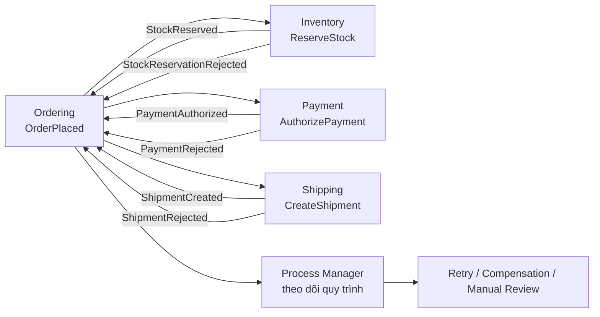
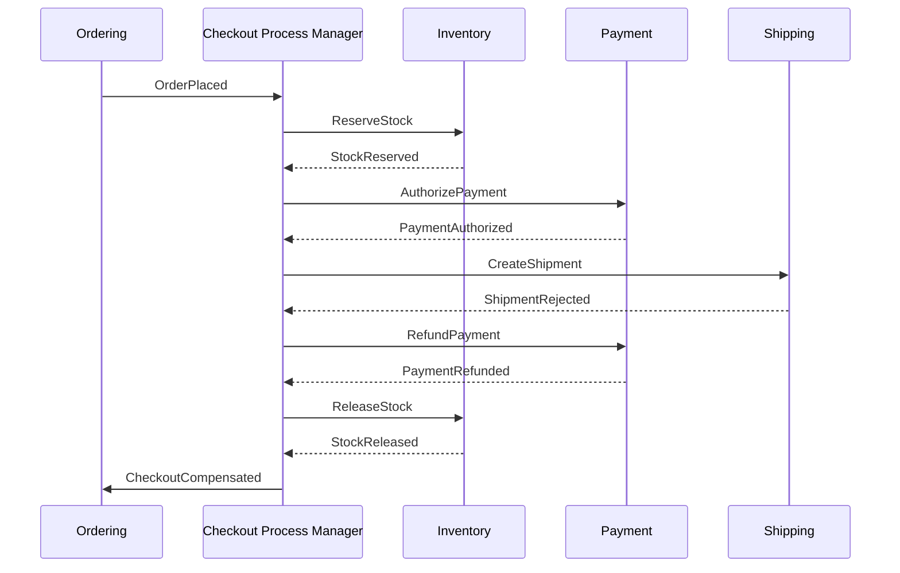
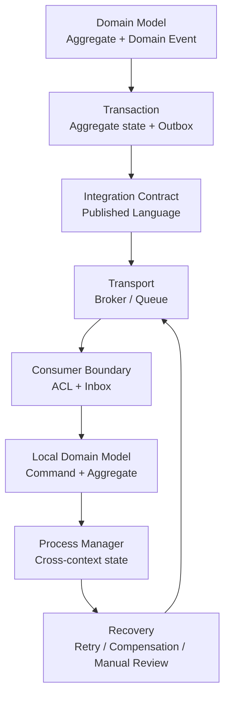

# Thiết kế sự kiện tích hợp và phân tích trạng thái thất bại liên ngữ cảnh

Trong một hệ thống được chia thành nhiều Bounded Context, một thay đổi nghiệp vụ thường không kết thúc trong một context. `Order` có thể phát sinh yêu cầu giữ hàng, thanh toán và giao hàng; mỗi context sở hữu một mô hình, một ngôn ngữ và một transaction boundary riêng. Vì vậy, thiết kế tích hợp không chỉ là chọn Kafka, RabbitMQ hay một message broker. Câu hỏi quan trọng hơn là: **sự kiện nào được phép đi qua ranh giới, sự kiện đó có nghĩa gì với context nhận, và hệ thống sẽ biểu diễn điều gì khi một bước trong quy trình thất bại?**

Trong Domain-Driven Design, integration event là hợp đồng giao tiếp ở ranh giới Bounded Context. Nó nên diễn tả một sự thật nghiệp vụ đã xảy ra trong context phát hành, còn context nhận tự dịch sự thật đó sang ngôn ngữ và mô hình của mình. Khi giao tiếp là bất đồng bộ, hai context không cùng chia sẻ một transaction. Điều đó làm xuất hiện eventual consistency, duplicate delivery, message ordering, timeout, retry và compensation. Nếu những trạng thái này không được mô hình hóa, hệ thống rất dễ có một trạng thái trung gian mà không ai biết phải xử lý tiếp thế nào.

Bài này dùng một quy trình đặt hàng làm ví dụ xuyên suốt. Mục tiêu là thiết kế được event contract đủ rõ, xây dựng đường đi đáng tin cậy từ transaction đến broker, và quan trọng nhất là phân biệt được **sự kiện thất bại**, **xử lý thất bại** và **quy trình nghiệp vụ đang ở trạng thái thất bại**.

## 1. Bắt đầu từ nghiệp vụ, không bắt đầu từ broker

Giả sử hệ thống có bốn Bounded Context:

| Bounded Context | Trách nhiệm chính | Một số khái niệm sở hữu |
|---|---|---|
| Ordering | tiếp nhận và quản lý đơn hàng | Order, OrderLine, OrderStatus |
| Inventory | giữ và giải phóng tồn kho | Reservation, StockItem |
| Payment | ủy quyền, thu và hoàn tiền | Payment, Authorization |
| Shipping | tạo và theo dõi giao hàng | Shipment, Delivery |

Ordering không nên gửi toàn bộ `Order` object sang Inventory. Inventory không cần biết cách Ordering tính giá, khuyến mại hay địa chỉ hiển thị. Nó cần một sự thật được công bố như `OrderPlaced` với những dữ liệu đủ để quyết định có thể giữ hàng hay không.

Một quy trình có thể được mô tả như sau:



Sơ đồ này cho thấy hai loại thông tin cần tách biệt. Một bên là **business fact** như `PaymentAuthorized`; bên kia là **process state** như `WaitingForPayment` hoặc `CompensationRequired`. Event mô tả điều đã xảy ra. Process state mô tả hệ thống đang chờ hoặc phải làm gì tiếp theo.

Nếu chỉ có event mà không có mô hình trạng thái, khi `PaymentAuthorized` đến sau `StockReservationRejected`, đội phát triển phải suy luận từ log xem quy trình đang ở đâu. Nếu chỉ có một cột `status = FAILED`, hệ thống cũng không biết thất bại ở bước nào, có thể retry hay phải hoàn tiền. Vì vậy hai lớp này phải được thiết kế cùng nhau.

## 2. Phân biệt Domain Event và Integration Event

Domain Event phản ánh một thay đổi có ý nghĩa trong mô hình nội bộ của Bounded Context. Integration Event là biểu diễn được công bố để context khác có thể hiểu và phản ứng.

| Khía cạnh | Domain Event | Integration Event |
|---|---|---|
| Phạm vi | bên trong một Bounded Context | qua ranh giới context |
| Người đọc | domain model, handler nội bộ | context khác hoặc hệ thống ngoài |
| Ngôn ngữ | Ubiquitous Language nội bộ | Published Language của context |
| Mức coupling | có thể gắn với mô hình nội bộ | phải ổn định và có chiến lược tiến hóa |
| Giao vận | in-process hoặc cơ chế nội bộ | message broker, queue, topic |
| Transaction | có thể cùng transaction của context | được phát hành sau khi transaction nguồn đã commit |
| Mục đích | điều phối thay đổi trong model | truyền một business fact ra ngoài |

Không nên lấy class Domain Event làm DTO công khai chỉ vì hai cấu trúc đang giống nhau. Khi domain model thay đổi, hợp đồng tích hợp có thể bị phá vỡ nếu hai lớp dùng chung kiểu dữ liệu.

Một cách thiết kế rõ ràng là:

```text
Aggregate
   |
   | Domain Event
   v
Domain Event Handler / Publisher
   |
   | translate
   v
Integration Event
   |
   v
Outbox -> Message Broker -> Consumer
```

Context nhận không cần biết `Order` đã được implement bằng Entity nào, ORM nào hay Aggregate có bao nhiêu child entity. Nó chỉ nhận published contract.

## 3. Xác định event nào đáng để công bố

Không phải mọi thay đổi trong aggregate đều nên trở thành integration event. Một event nội bộ như `OrderLinePriceRecalculated` có thể chỉ phục vụ Ordering. Nếu công bố tất cả các thay đổi nhỏ, contract công khai sẽ phản ánh implementation thay vì nghiệp vụ.

Một integration event tốt thường trả lời được ba câu hỏi:

1. Chuyện gì đã xảy ra?
2. Chuyện đó xảy ra với business object nào?
3. Context nhận cần dữ kiện nào để quyết định hành động của mình?

Ví dụ, `OrderPlaced` có ý nghĩa hơn `OrderRowInserted`. `PaymentAuthorized` có ý nghĩa hơn `PaymentStatusColumnUpdated`. Tên event dùng thì quá khứ vì event mô tả một fact đã xảy ra.

### Event notification và event-carried state transfer

Có hai cách phổ biến để thiết kế payload.

**Event notification** mang ít dữ liệu và nói rằng một fact đã xảy ra. Consumer có thể truy vấn thêm dữ liệu qua API nếu thật sự cần.

```json
{
  "eventType": "OrderPlaced",
  "eventId": "01J9EXAMPLEEVENT01",
  "aggregateId": "ORD-10042"
}
```

Ưu điểm là contract nhỏ. Nhược điểm là consumer có thể trở nên phụ thuộc vào việc gọi ngược producer, làm tăng temporal coupling.

**Event-carried state transfer** mang những dữ kiện mà consumer cần để xử lý.

```json
{
  "eventType": "OrderPlaced",
  "schemaVersion": 1,
  "eventId": "01J9EXAMPLEEVENT01",
  "occurredAt": "2026-11-18T09:30:00Z",
  "aggregateId": "ORD-10042",
  "correlationId": "CHECKOUT-70091",
  "items": [
    {
      "sku": "SKU-42",
      "quantity": 2
    }
  ],
  "currency": "VND",
  "totalAmount": 420000
}
```

Payload không nên là snapshot toàn bộ aggregate. Chỉ công bố các facts và dữ kiện mà published contract cần. Những field như `internalCalculationVersion`, tên bảng hoặc cấu trúc ORM là chi tiết triển khai và không thuộc contract.

## 4. Thiết kế metadata cho việc truy vết và chống trùng

Một integration event thường cần ít nhất các metadata sau:

| Field | Vai trò |
|---|---|
| `eventId` | định danh duy nhất của lần phát hành event |
| `eventType` | loại business fact |
| `schemaVersion` | phiên bản contract |
| `occurredAt` | thời điểm fact xảy ra |
| `aggregateId` | identity của aggregate nguồn |
| `sequence` | thứ tự thay đổi trong aggregate nếu consumer cần |
| `correlationId` | gom các message thuộc cùng một business process |
| `causationId` | cho biết event hiện tại được kích hoạt từ message nào |
| `producer` | context phát hành |

`eventId` và `correlationId` phục vụ hai mục tiêu khác nhau. `eventId` giúp phát hiện duplicate của một message cụ thể. `correlationId` giúp theo dõi toàn bộ quy trình qua nhiều message.

Không nên dùng timestamp làm idempotency key. Hai event khác nhau có thể có cùng timestamp và một message bị retry vẫn giữ nguyên timestamp. Identity của message phải ổn định qua các lần giao lại.

## 5. Outbox giải quyết khoảng trống giữa database và broker

Có một lỗi rất dễ gặp:

```text
BEGIN TRANSACTION
  update Order -> CONFIRMED
COMMIT

publish OrderConfirmed -> broker
        |
        +-- process crash
        +-- broker unavailable
        +-- network timeout
```

Order đã `CONFIRMED`, nhưng `OrderConfirmed` có thể chưa tới broker. Nếu chỉ retry trong request HTTP ban đầu, retry đó cũng có thể thất bại khi process đã chết.

Transactional Outbox đưa publication record vào cùng transaction với thay đổi nghiệp vụ:

```text
BEGIN TRANSACTION
  update Order -> CONFIRMED
  insert OutboxMessage(OrderConfirmed, eventId, payload)
COMMIT

Outbox Publisher
  -> đọc message chưa publish
  -> publish broker
  -> đánh dấu đã publish
```

Nếu transaction rollback, cả Order change và outbox record đều rollback. Nếu transaction commit nhưng broker tạm thời lỗi, outbox record vẫn còn để worker retry. Đây là cơ chế để đạt eventual delivery mà không cần giữ transaction database mở trong lúc chờ broker.

Outbox không làm message thành exactly-once. Publisher có thể publish thành công nhưng chết trước khi ghi nhận trạng thái đã publish. Lần chạy sau có thể gửi lại cùng `eventId`. Vì vậy consumer vẫn phải idempotent.

## 6. Consumer phải được thiết kế cho at-least-once delivery

Giả sử Inventory nhận `OrderPlaced` và tạo reservation. Consumer xử lý thành công rồi crash trước khi ghi nhận rằng message đã hoàn tất. Broker có thể giao lại message.

Nếu handler không idempotent:

```text
OrderPlaced(eventId=E1)
    -> Reserve 2 units
    -> crash

OrderPlaced(eventId=E1)  // redelivery
    -> Reserve thêm 2 units
```

Inventory phải nhận diện `E1` đã được xử lý. Có thể dùng Inbox hoặc một bảng deduplication:

```text
InboxMessage
-------------------------------
consumerName
eventId
processedAt
resultReference
UNIQUE(consumerName, eventId)
```

Một transaction consumer có thể thực hiện:

```text
BEGIN
  insert InboxMessage(Inventory, E1)

  nếu duplicate:
      return kết quả đã biết

  apply Reservation
  ghi domain changes
COMMIT
```

Điểm quan trọng là thao tác ghi dấu đã xử lý và thay đổi nghiệp vụ phải nằm trong cùng transaction của consumer. Nếu chỉ ghi inbox sau khi nghiệp vụ hoàn tất, crash giữa hai bước vẫn tạo duplicate. Nếu ghi inbox trước nhưng không cùng transaction, message có thể bị đánh dấu đã xử lý trong khi reservation chưa commit.

## 7. Không giả định thứ tự toàn cục giữa các context

Một consumer có thể nhận:

```text
PaymentAuthorized(E2)
OrderPlaced(E1)
```

hoặc:

```text
OrderPlaced(E1)
PaymentAuthorized(E2)
PaymentAuthorized(E2)  // duplicate
```

Nếu nghiệp vụ yêu cầu thứ tự thay đổi của cùng một aggregate, producer có thể phát hành `sequence` tăng dần và broker có thể partition theo `aggregateId`. Consumer vẫn phải kiểm tra sequence và quyết định xử lý gap như thế nào.

Ví dụ:

```text
Order ORD-10042

sequence 10 -> OrderPlaced
sequence 11 -> OrderConfirmed
```

Nếu consumer đã xử lý sequence 10 nhưng nhận sequence 12, nó có thể tạm giữ message 12 hoặc yêu cầu cơ chế replay. Không nên tự động coi sequence 12 là hợp lệ chỉ vì message đến trước sequence 11.

Ordering giữa hai aggregate hoặc hai context khác nhau thường không có ý nghĩa tuyệt đối. `PaymentAuthorized` và `StockReserved` có thể đến theo thứ tự khác nhau. Process Manager phải quyết định dựa trên tập trạng thái hiện có, thay vì giả định một thứ tự mạng lưới.

## 8. Mô hình hóa trạng thái thất bại

`FAILED` là quá ít thông tin cho một quy trình liên ngữ cảnh. Cần phân biệt ít nhất bốn nhóm.

| Nhóm | Ví dụ | Có retry? | Hành động tiếp theo |
|---|---|---:|---|
| Transport failure | broker timeout, consumer unavailable | Có | retry với backoff |
| Duplicate | cùng `eventId` đến lại | Không cần xử lý nghiệp vụ | trả kết quả idempotent |
| Business rejection | hết hàng, thẻ bị từ chối | Thường không | chuyển process sang nhánh nghiệp vụ tương ứng |
| Contract failure | schema không hợp lệ, thiếu field bắt buộc | Không mù quáng | quarantine, alert, sửa contract/consumer |
| Timeout | không có response trong SLA | Có điều kiện | retry hoặc chuyển trạng thái timeout |
| Compensation failure | hoàn tiền hoặc release stock thất bại | Có điều kiện | retry compensation, sau đó manual review |

Ví dụ `StockReservationRejected` không phải message delivery failure. Message đã tới Inventory và được xử lý thành công; kết quả nghiệp vụ là **không thể giữ hàng**. Nếu retry vô hạn, hệ thống sẽ lặp lại cùng một quyết định.

Ngược lại, `InventoryUnavailable` có thể là lỗi kỹ thuật tạm thời. Retry có thể hợp lý vì trạng thái nghiệp vụ chưa được quyết định.

### Một state machine hữu ích

Process Manager của checkout có thể dùng các trạng thái:

```text
                    +------------------+
                    |  CheckoutStarted |
                    +--------+---------+
                             |
                             v
                    +------------------+
                    | WaitingForStock  |
                    +---+----------+---+
                        |          |
              StockReserved   StockRejected
                        |          |
                        v          v
               +----------------+  +----------------+
               | WaitingPayment |  |  OrderFailed   |
               +---+--------+---+  +----------------+
                   |        |
        Authorized |        | Rejected
                   |        v
                   |   +----------------+
                   |   | PaymentFailed  |
                   |   +----------------+
                   v
             +-------------+
             |  Confirmed  |
             +------+------+ 
                    |
                    v
             +------------------+
             | WaitingShipment  |
             +---+----------+---+
                 |          |
          Created        Rejected
                 |          |
                 v          v
          +-----------+ +--------------------+
          | Completed | | CompensationNeeded |
          +-----------+ +---------+----------+
                                   |
                                   v
                         +----------------------+
                         | ManualReviewRequired |
                         +----------------------+
```

Tên trạng thái nên phản ánh nghiệp vụ. `WaitingPayment` cho biết hệ thống đang chờ fact nào. `CompensationNeeded` cho biết một thay đổi trước đó đã thành công nhưng không thể tiếp tục quy trình theo nhánh bình thường. `ManualReviewRequired` là terminal state cần con người hoặc một quy trình vận hành can thiệp.

Không nhất thiết phải lưu toàn bộ state machine vào Order Aggregate. Nếu state này chỉ phục vụ điều phối một quy trình kéo dài qua nhiều context, Process Manager hoặc Saga là nơi phù hợp hơn.

## 9. Phân tích failure theo từng điểm trong workflow

Hãy xem workflow:

```text
OrderPlaced
   -> ReserveStock
   -> AuthorizePayment
   -> CreateShipment
   -> OrderCompleted
```

### Trường hợp A: không publish được `OrderPlaced`

Order đã commit nhưng broker không nhận được event.

**Trạng thái nghiệp vụ:** Order vẫn là `Placed`.

**Trạng thái tích hợp:** Outbox publication pending.

**Hành động:** retry publication. Không tạo Order thứ hai và không đổi Order thành `Failed` chỉ vì broker đang lỗi.

### Trường hợp B: Inventory nhận event nhưng hết hàng

Message đã delivered. Inventory trả `StockReservationRejected`.

**Trạng thái nghiệp vụ:** Inventory xử lý thành công về mặt kỹ thuật nhưng business operation bị từ chối.

**Process state:** `StockRejected`.

**Hành động:** Ordering có thể chuyển Order thành `Rejected`, hoặc mở quy trình thay thế sản phẩm. Không retry vô hạn cùng một yêu cầu nếu dữ liệu tồn kho không thay đổi.

### Trường hợp C: Payment thành công nhưng response bị mất

Payment context đã authorize tiền nhưng Ordering không nhận được `PaymentAuthorized`.

Nếu retry bằng một payment request mới, có nguy cơ charge hai lần.

Giải pháp là idempotency key ở Payment, chẳng hạn `paymentOperationId` gắn với `OrderId`. Cùng một operation phải trả lại cùng kết quả đã biết.

```text
AuthorizePayment(operation=PAY-ORD-10042)
    -> authorized
    -> response lost

retry AuthorizePayment(operation=PAY-ORD-10042)
    -> same authorization result
```

### Trường hợp D: Payment thành công, Shipping thất bại

Đây là failure quan trọng về mặt business. Không thể rollback database của Payment bằng một distributed transaction đơn giản.

Process Manager có thể yêu cầu:

```text
PaymentAuthorized
   + ShipmentRejected
   -> issue RefundPayment
   -> release StockReservation
   -> OrderCancelled
```

Đây là **compensation**, không phải rollback. Payment đã thật sự xảy ra; hệ thống tạo một business action mới để hoàn tác tác động của nó.

### Trường hợp E: compensation cũng thất bại

Nếu `RefundPayment` bị timeout, process không nên quay về `OrderCancelled` một cách giả tạo. Nó phải thể hiện rằng có công việc bù trừ chưa hoàn tất.

```text
CompensationNeeded
       |
       +--> RefundRetrying
       |       |
       |       +--> Refunded -> Completed
       |
       +--> RetryExhausted
               |
               v
        ManualReviewRequired
```

Đây là lý do trạng thái thất bại phải được thiết kế như một phần của domain workflow, thay vì chỉ là một exception trong code.

## 10. Saga và Process Manager dùng khi nào

Saga hoặc Process Manager phù hợp khi một business process kéo dài qua nhiều transaction và cần theo dõi kết quả của các bước.

Một Process Manager có thể giữ:

```text
CheckoutProcessId
OrderId
StockState
PaymentState
ShipmentState
CurrentStep
RetryCount
NextActionAt
CorrelationId
```

Nó không nên trở thành Aggregate chứa mọi quy tắc của mọi context. Trách nhiệm của nó là điều phối quy trình: nhận fact, cập nhật process state, phát command tiếp theo và xử lý compensation khi cần.

Ví dụ:



Trong thực tế, một số bước có thể chạy song song. Nếu Inventory và Payment độc lập, Process Manager có thể gửi cả hai command sau `OrderPlaced` và đợi cả `StockReserved` lẫn `PaymentAuthorized`. Khi đó state model phải có hai nhánh độc lập thay vì một chuỗi tuyến tính.

## 11. Java: biểu diễn integration event và process state

Một contract có thể được biểu diễn bằng record riêng với domain model:

```java
public record OrderPlacedIntegrationEvent(
        String eventId,
        int schemaVersion,
        Instant occurredAt,
        String aggregateId,
        String correlationId,
        List<OrderItem> items,
        MoneySnapshot total
) {}

public record OrderItem(
        String sku,
        int quantity
) {}

public record MoneySnapshot(
        String currency,
        long minorUnits
) {}
```

Consumer không nên nhận trực tiếp `Order` Aggregate:

```java
public final class InventoryOrderPlacedHandler {

    private final Inbox inbox;
    private final ReservationService reservations;

    public void handle(OrderPlacedIntegrationEvent event) {
        if (inbox.alreadyProcessed("inventory", event.eventId())) {
            return;
        }

        reservations.reserve(
                event.aggregateId(),
                event.items()
        );

        inbox.markProcessed("inventory", event.eventId());
    }
}
```

Đoạn code chỉ minh họa ý tưởng. Trong production, `reserve` và `markProcessed` phải được thiết kế với cùng transaction boundary phù hợp với Inventory. Nếu `Inbox` là database và reservation cũng là database, transaction phải bao phủ cả hai thao tác để tránh trạng thái “đã xử lý nhưng chưa giữ hàng”.

Process Manager có thể có state rõ ràng:

```java
public enum CheckoutStatus {
    WAITING_FOR_STOCK,
    WAITING_FOR_PAYMENT,
    WAITING_FOR_SHIPMENT,
    COMPLETED,
    REJECTED,
    COMPENSATION_NEEDED,
    MANUAL_REVIEW_REQUIRED
}

public record CheckoutProcess(
        String processId,
        String orderId,
        CheckoutStatus status,
        boolean stockReserved,
        boolean paymentAuthorized,
        boolean shipmentCreated,
        boolean paymentRefunded,
        int retryCount
) {}
```

Điểm đáng chú ý là `CheckoutStatus` không phải là `OrderStatus`. Order có ngôn ngữ của Ordering; Process Manager có ngôn ngữ của quy trình liên context. Hai khái niệm có thể liên quan nhưng không nên bị ép thành một enum duy nhất.

## 12. Retry phải đi cùng phân loại lỗi

Retry không phải một phản xạ chung cho mọi exception.

```text
message received
      |
      v
  classify error
      |
      +----------------------+-----------------------+
      |                      |                       |
 transient              business rejection     contract error
      |                      |                       |
 exponential backoff     publish outcome       quarantine
      |                      |                       |
 retry until limit       continue process       alert + fix
      |
 exhausted
      v
 dead letter / manual review
```

Retry policy nên có giới hạn. Một message có lỗi schema không thể tự khỏi bằng cách thử lại 1000 lần. Nó cần được đưa vào quarantine hoặc dead-letter queue để đội sở hữu contract xử lý.

Với lỗi transient, exponential backoff và jitter giúp giảm việc nhiều consumer cùng retry tại một thời điểm. Tuy nhiên policy cụ thể phải dựa trên SLA của nghiệp vụ. Không nên chọn `retry 5 lần` chỉ vì đó là con số quen thuộc.

## 13. Dead letter và quarantine phải giữ đủ ngữ cảnh

Một dead-letter message hữu ích không chỉ lưu payload. Nó nên có:

| Thông tin | Mục đích |
|---|---|
| eventId | tìm message gốc |
| eventType/version | xác định contract |
| consumer | biết context nào lỗi |
| firstReceivedAt | biết tuổi message |
| lastError | phân tích nguyên nhân |
| retryCount | biết đã thử bao nhiêu lần |
| correlationId | truy vết toàn workflow |
| payload | replay nếu hợp lệ |
| headers/traceId | nối với observability |

Replay cũng phải idempotent. Đưa một message cũ trở lại queue không có nghĩa là hệ thống có thể bỏ qua những thay đổi nghiệp vụ xảy ra sau đó. Trước khi replay, phải xác định consumer có thể xử lý fact cũ trong trạng thái hiện tại hay cần một use case bù trừ khác.

## 14. Anti-Corruption Layer bảo vệ mô hình nhận

Context nhận không nên biến payload ngoài thành domain object bằng cách deserialize thẳng vào Entity. Một Published Language có thể khác Ubiquitous Language của context nhận.

Ví dụ Ordering công bố:

```json
{
  "eventType": "OrderPlaced",
  "items": [
    { "sku": "SKU-42", "quantity": 2 }
  ]
}
```

Inventory có thể dịch thành:

```java
public final class InventoryOrderTranslator {

    public ReserveStockCommand translate(OrderPlacedIntegrationEvent event) {
        return new ReserveStockCommand(
                event.aggregateId(),
                event.items().stream()
                        .map(item -> new StockRequirement(
                                item.sku(), item.quantity()))
                        .toList()
        );
    }
}
```

Sau translator, domain model Inventory không cần biết tên `OrderPlaced`. Nó chỉ biết command hoặc domain concept của chính mình như `ReserveStock`.

ACL cũng là nơi hợp lý để xử lý mapping field, đơn vị đo, currency, enum khác nhau và những quy tắc tương thích tạm thời khi producer đang migrate.

## 15. Versioning integration event

Integration event là contract đã được công bố. Consumer có thể được deploy chậm hơn producer, nên schema phải tiến hóa có chủ đích.

Một thay đổi an toàn thường là thêm field optional:

```text
V1: sku, quantity
V1 + optional warehouseId
```

Consumer cũ vẫn đọc được payload nếu field mới không bắt buộc.

Thay đổi breaking như rename `sku` thành `productCode` cần chiến lược migration:

```text
Producer
  -> phát V1 + V2
  -> consumer cũ đọc V1
  -> consumer mới đọc V2
  -> migrate tất cả consumer
  -> ngừng V1
```

Không nên dùng tên class Java hoặc package làm contract identity. Tên logical như `inventory.stock-reserved` và `schemaVersion` bền hơn trước refactor code.

## 16. Observability phải theo business process

Log riêng lẻ của từng service chưa đủ để phân tích failure liên ngữ cảnh. Cần truyền `correlationId` và `causationId` qua các message.

Một trace có thể trông như:

```text
Correlation: CHECKOUT-70091

Ordering
  E1 OrderPlaced
       |
Inventory
  E2 StockReserved
       |
Payment
  E3 PaymentAuthorized
       |
Shipping
  E4 ShipmentRejected
       |
Process Manager
  C1 CompensationNeeded
       |
Payment
  E5 PaymentRefunded
       |
Inventory
  E6 StockReleased
       |
Ordering
  E7 CheckoutCompensated
```

Từ trace này có thể trả lời được: bước nào chậm, event nào bị retry, compensation có thành công không và process nào đang bị mắc kẹt.

Nên có metric ở cấp process như:

| Metric | Ý nghĩa |
|---|---|
| publication lag | thời gian từ commit đến publish |
| consumer lag | message chờ consumer bao lâu |
| retry count | mức độ không ổn định của integration |
| duplicate rate | chất lượng idempotency và delivery |
| compensation rate | số quy trình phải bù trừ |
| manual review rate | số failure không tự phục hồi |
| stuck process age | quy trình lâu nhất chưa terminal |

Metric `manual review rate` đặc biệt hữu ích. Nếu tỷ lệ này tăng, vấn đề có thể nằm ở thiết kế compensation hoặc contract chứ không chỉ ở hạ tầng message broker.

## 17. Test các failure state thay vì chỉ test happy path

Một integration workflow nên có test cho ít nhất các trường hợp sau:

| Scenario | Kỳ vọng |
|---|---|
| DB commit + broker down | outbox còn pending |
| broker publish + publisher crash | consumer xử lý duplicate an toàn |
| consumer crash trước commit | message được giao lại |
| consumer crash sau commit | duplicate không tạo business effect lần hai |
| event out of order | state machine xử lý gap đúng policy |
| business rejection | không retry vô hạn |
| transient failure | retry theo backoff và giới hạn |
| schema invalid | quarantine/dead-letter |
| compensation success | process đạt terminal state |
| compensation failure | `ManualReviewRequired` hoặc state tương đương |
| old event replay | consumer không phá invariant hiện tại |

Một test tốt không chỉ assert `status = FAILED`. Nó phải assert **lý do thất bại và hành động tiếp theo**.

Ví dụ:

```java
@Test
void should_request_refund_when_shipment_is_rejected_after_payment() {
    process.handle(new PaymentAuthorized("PAY-1"));
    process.handle(new ShipmentRejected("SHIP-1", "NO_CAPACITY"));

    assertThat(process.status())
            .isEqualTo(CheckoutStatus.COMPENSATION_NEEDED);

    assertThat(commands.sent())
            .contains(new RefundPayment("PAY-1"));
}
```

Test này kiểm tra business consequence. Nó không phụ thuộc vào Kafka client hay implementation của database.

## 18. Đừng nhầm transport failure với domain failure

Một nguyên tắc hữu ích là đặt câu hỏi: **consumer đã biết và quyết định điều gì chưa?**

- Nếu chưa nhận được message: integration delivery failure.
- Nếu nhận nhưng không parse được: contract failure.
- Nếu parse được nhưng hệ thống tạm thời không truy cập database: technical transient failure.
- Nếu xử lý được và quyết định “hết hàng”: business rejection.
- Nếu bước trước thành công nhưng bước sau không thể tiếp tục: process compensation state.

Các trạng thái này có policy khác nhau. Gộp chúng vào `FAILED` khiến retry và vận hành trở nên mù mờ.

## 19. Khi nào cần synchronous call

Không phải mọi tương tác giữa context đều phải trở thành event. Nếu use case yêu cầu câu trả lời ngay và không thể chấp nhận eventual consistency, một synchronous API có thể phù hợp.

Tuy nhiên, synchronous call tạo temporal coupling: context gọi phải chờ context được gọi. Nếu một quy trình có thể tiếp tục sau vài giây và chỉ cần biết fact cuối cùng, asynchronous integration event thường phù hợp hơn.

Có thể dùng cả hai trong một workflow:

```text
Checkout API
   -> synchronous validation cần phản hồi ngay
   -> commit Order
   -> asynchronous OrderPlaced
       -> Inventory
       -> Payment
       -> Shipping
```

Điểm quyết định không phải “event-driven luôn tốt hơn”. Câu hỏi là consistency boundary và latency requirement của business process nằm ở đâu.

## 20. Quy trình thiết kế từ Event Storming đến production

Một quy trình thực tế có thể đi theo các bước sau.

### Bước 1: xác định business facts

Trong Event Storming, liệt kê các sự kiện có ý nghĩa nghiệp vụ như `OrderPlaced`, `StockReserved`, `PaymentAuthorized`, `ShipmentCreated`.

### Bước 2: gắn owner

Mỗi fact phải có Bounded Context sở hữu. Nếu hai context cùng tuyên bố sở hữu một trạng thái, ranh giới domain đang mơ hồ.

### Bước 3: xác định published language

Chọn những facts thật sự cần đi qua boundary và thiết kế payload độc lập với internal model.

### Bước 4: xác định consistency requirement

Hỏi business expert: điều gì phải đúng ngay trong một transaction, điều gì có thể đúng sau vài giây, và điều gì có thể cần compensation.

### Bước 5: thiết kế failure states

Vẽ cả happy path và các nhánh `Rejected`, `Timeout`, `RetryExhausted`, `CompensationNeeded`, `ManualReviewRequired` nếu domain cần.

### Bước 6: chọn delivery mechanism

Sau khi hiểu semantics mới chọn outbox, broker, retry policy, partitioning, dead-letter queue và inbox.

### Bước 7: viết contract và compatibility rules

Định nghĩa event type, version, identity, correlation, payload và policy tiến hóa.

### Bước 8: kiểm thử failure

Inject crash và timeout tại các điểm khác nhau. Kiểm tra system cuối cùng đạt state nào, message có bị mất không và compensation có lặp an toàn không.

### Bước 9: observability

Đảm bảo một `correlationId` có thể truy vết qua producer, broker, consumer và process manager.

### Bước 10: vận hành replay

Quy định ai được replay, replay từ đâu, replay có idempotent không và khi nào phải chuyển sang manual review.

## 21. Một mô hình hoàn chỉnh

Toàn bộ thiết kế có thể hình dung thành các lớp:



Mỗi lớp có một câu hỏi riêng:

| Lớp | Câu hỏi |
|---|---|
| Domain Model | Business rule nào vừa xảy ra? |
| Transaction | Fact có được lưu bền vững cùng thay đổi không? |
| Integration Contract | Context khác cần biết điều gì? |
| Transport | Message có thể mất, trùng hoặc đến muộn thế nào? |
| Consumer Boundary | Payload ngoài được dịch thành model nội bộ ra sao? |
| Local Domain Model | Context nhận quyết định gì? |
| Process Manager | Quy trình liên context đang ở trạng thái nào? |
| Recovery | Khi bước tiếp theo thất bại, retry hay compensation? |

Nếu một thiết kế không trả lời được một trong các câu hỏi này, failure mode tương ứng thường chưa được mô hình hóa.

## 22. Các lỗi thiết kế thường gặp

### Gửi Aggregate qua message

Điều này làm contract phụ thuộc vào cấu trúc nội bộ và khiến mọi thay đổi domain model trở thành integration concern. Hãy gửi business facts và dữ kiện cần thiết.

### Publish trước khi commit

Consumer có thể nhận một fact mà producer cuối cùng rollback. Dùng outbox hoặc cơ chế bảo đảm publication sau commit.

### Giả định exactly-once

Publisher và consumer đều có thể crash giữa hai thao tác. Hãy thiết kế idempotency thay vì dựa vào giả định không thực tế.

### Retry business rejection

`StockReservationRejected` không tự trở thành `StockReserved` sau lần retry thứ mười. Retry chỉ phù hợp khi nguyên nhân có thể thay đổi hoặc lỗi là transient.

### Một cột `FAILED` cho mọi lỗi

Không thể phân biệt transport failure, business rejection và compensation failure. Mô hình hóa state đủ để quyết định hành động tiếp theo.

### Dùng event để tạo RPC trá hình

Consumer nhận event rồi producer phải chờ response ngay. Nếu use case cần request-response đồng bộ, một API có thể rõ nghĩa hơn.

### Để Process Manager sở hữu toàn bộ business rules

Process Manager điều phối. Quy tắc về giá, tồn kho, thanh toán và giao hàng vẫn thuộc context tương ứng. Nếu Process Manager bắt đầu tính giá hoặc kiểm tra invariant của Inventory, boundary đang bị phá vỡ.

### Không có terminal state cho failure

Retry vô hạn có thể làm hệ thống kẹt. Khi một failure không thể tự phục hồi, cần một terminal hoặc operational state như `ManualReviewRequired` và một quy trình xử lý rõ ràng.

## 23. Checklist review integration event

Trước khi đưa một integration event vào production, có thể dùng checklist sau:

- [ ] Event mô tả business fact đã xảy ra.
- [ ] Có Bounded Context sở hữu event rõ ràng.
- [ ] Payload không làm lộ cấu trúc internal aggregate.
- [ ] Event type dùng published language ổn định.
- [ ] Có `eventId` ổn định cho deduplication.
- [ ] Có `schemaVersion` hoặc chiến lược compatibility tương đương.
- [ ] Có `correlationId` cho business process.
- [ ] Producer lưu publication bền vững cùng transaction khi cần đảm bảo không mất event.
- [ ] Consumer xử lý duplicate an toàn.
- [ ] Policy cho out-of-order message đã được xác định.
- [ ] Retry có giới hạn và phân biệt transient với business rejection.
- [ ] Contract error có quarantine/dead-letter path.
- [ ] Business process có state cho timeout hoặc compensation nếu cần.
- [ ] Compensation là business action mới và idempotent.
- [ ] Có terminal state cho failure không thể tự phục hồi.
- [ ] Có trace từ event đầu tiên đến event cuối cùng.
- [ ] Có test cho crash, duplicate, timeout, out-of-order và replay.
- [ ] Có người sở hữu vận hành manual review và replay.

## 24. Checklist phân tích một trạng thái thất bại đang xảy ra

Khi production báo một checkout đang `FAILED`, hãy phân tích theo thứ tự:

1. Fact cuối cùng đã commit ở context nào?
2. Event tương ứng đã được ghi vào outbox chưa?
3. Event đã publish bao nhiêu lần?
4. Consumer đã nhận `eventId` chưa?
5. Consumer fail ở transport, contract hay domain decision?
6. Nếu domain decision là rejection, process phải đi nhánh nào?
7. Nếu bước trước đã thành công, có cần compensation không?
8. Compensation đã được tạo command chưa?
9. Compensation có thể retry an toàn không?
10. Process đang chờ event nào, và trạng thái đó có SLA không?
11. Nếu retry hết giới hạn, state terminal là gì?
12. Correlation ID có nối được toàn bộ chuỗi message không?

Cách hỏi này giúp đội vận hành chuyển từ “consumer đang lỗi” sang “business process đang ở state nào và hành động tiếp theo là gì”.

## Kết luận

Thiết kế integration event trong DDD là thiết kế một ranh giới ngôn ngữ và consistency, không chỉ là thiết kế message format. Context phát hành sở hữu sự thật nghiệp vụ; context nhận dịch sự thật đó vào mô hình riêng. Outbox giúp publication gắn với transaction nguồn, inbox và idempotency giúp consumer chịu được duplicate, còn Process Manager hoặc Saga giúp mô hình hóa quy trình kéo dài qua nhiều transaction.

Phần khó nhất thường xuất hiện khi failure xảy ra. Một hệ thống tốt không chỉ biết message có được giao hay không mà còn biết business process đang chờ gì, bị từ chối vì lý do gì, có thể retry hay phải compensation, và khi nào cần con người can thiệp. Khi các trạng thái này được mô hình hóa ngay từ đầu, eventual consistency trở thành một đặc tính có thể quan sát và vận hành thay vì một nguồn bất ngờ trong production.
