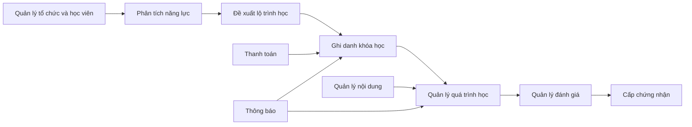

# Miền nghiệp vụ (Domain) và miền con (Subdomain)

Trong Domain-Driven Design (DDD), **domain** là lĩnh vực nghiệp vụ mà phần mềm cần phục vụ; **subdomain** là một phần nghiệp vụ có phạm vi và trách nhiệm riêng nằm bên trong domain đó. Việc phân rã domain thành các subdomain giúp đội phát triển hiểu doanh nghiệp đang làm những việc gì, phần nào tạo ra lợi thế cạnh tranh và phần nào có thể sử dụng giải pháp phổ biến.

Đây là hoạt động của **strategic design (thiết kế chiến lược)**. Nhóm khám phá và tổ chức hiểu biết về không gian vấn đề trước khi quyết định cách tổ chức mô hình và phần mềm trong không gian giải pháp. Subdomain vì thế mô tả cách doanh nghiệp chia nhỏ nghiệp vụ; nó không tự động tương ứng với một service, module, database hay bounded context.

## 1. Domain là gì?

**Domain (miền nghiệp vụ)** là lĩnh vực hoạt động, kiến thức, quy tắc và vấn đề mà tổ chức đang quan tâm và phần mềm được xây dựng để hỗ trợ. Domain có thể rộng như thương mại điện tử, ngân hàng, logistics, bảo hiểm hoặc giáo dục trực tuyến. Trong phạm vi một sản phẩm, domain cũng có thể được giới hạn theo mục tiêu cụ thể, chẳng hạn quản lý việc học và đánh giá kết quả của học viên.

Domain bao gồm nhiều khía cạnh liên kết với nhau:

- **Mục tiêu và giá trị:** tổ chức muốn tạo ra giá trị gì cho khách hàng, người dùng hoặc đối tác?
- **Hoạt động nghiệp vụ:** tổ chức thực hiện những năng lực và quy trình nào để tạo ra giá trị đó?
- **Quy tắc và chính sách:** điều kiện nào chi phối quyết định, hành động và ngoại lệ?
- **Vai trò và trách nhiệm:** những cá nhân, nhóm hoặc tổ chức nào tham gia?
- **Thuật ngữ và kiến thức chuyên môn:** các khái niệm nào có ý nghĩa trong lĩnh vực này?
- **Ràng buộc:** quy định pháp lý, hợp đồng, công nghệ hiện có và điều kiện vận hành nào ảnh hưởng đến hoạt động?

Ví dụ, domain của một nền tảng giáo dục trực tuyến có thể bao gồm tuyển sinh, tổ chức khóa học, quản lý nội dung, ghi danh, học tập, đánh giá, cấp chứng nhận và thu phí. Đây là bức tranh tổng thể về hoạt động nghiệp vụ, chưa phải cấu trúc các thành phần phần mềm.

### 1.1. Domain không đồng nghĩa với ứng dụng hoặc tổ chức

Một domain có thể được hỗ trợ bởi nhiều ứng dụng và hệ thống. Ngược lại, một ứng dụng có thể hỗ trợ nhiều domain hoặc nhiều phần nghiệp vụ khác nhau. Cơ cấu phòng ban cũng không phải cách phân rã domain đáng tin cậy: một phòng ban có thể tham gia nhiều subdomain, và một subdomain có thể cần phối hợp giữa nhiều phòng ban.

Ví dụ, quy trình ghi danh khóa học có thể cần sự tham gia của bộ phận tư vấn, bộ phận tài chính và nhóm vận hành học vụ. Dù trách nhiệm đang nằm ở ba bộ phận, doanh nghiệp vẫn có một năng lực nghiệp vụ liên quan đến việc quản lý việc ghi danh. Ngược lại, bộ phận tài chính có thể phụ trách thu phí, hoàn tiền và đối soát; đây là những năng lực có quy tắc khác nhau dù cùng một phòng ban thực hiện.

Khi khám phá domain, hãy bắt đầu từ mục tiêu, hoạt động, quy tắc và giá trị nghiệp vụ. Sơ đồ tổ chức, hệ thống hiện có và cấu trúc dữ liệu là nguồn thông tin tham khảo, không phải ranh giới mặc định.

## 2. Subdomain là gì?

**Subdomain (miền con)** là một phần của domain, tập trung vào một nhóm vấn đề hoặc năng lực nghiệp vụ có ý nghĩa riêng. Việc chia domain thành các subdomain giúp giảm độ phức tạp: thay vì cố gắng hiểu toàn bộ doanh nghiệp như một khối, nhóm có thể nghiên cứu từng phần, xác định kiến thức chuyên môn cần thiết và nhận biết quan hệ giữa chúng.

Một subdomain thường có:

- Mục đích nghiệp vụ có thể giải thích được.
- Nhóm hoạt động và quy tắc liên quan tương đối nhất quán.
- Thuật ngữ và kiến thức chuyên môn mà các bên có thể nhận diện.
- Đầu vào, đầu ra, quyết định hoặc kết quả có ý nghĩa với phần nghiệp vụ khác.
- Những người am hiểu nghiệp vụ có thể giải thích cách nó vận hành.

Subdomain là một khái niệm thuộc **problem space (không gian vấn đề)**. Nó cho biết doanh nghiệp cần giải quyết những loại vấn đề nào. Nhóm có thể nhận diện subdomain ngay cả khi chưa có phần mềm, chưa chọn công nghệ và chưa quyết định cách triển khai.

### 2.1. Ví dụ phân rã domain giáo dục trực tuyến

Giả sử một doanh nghiệp cung cấp nền tảng học trực tuyến cho cá nhân và tổ chức. Domain có thể được phân rã ban đầu như sau:

| Subdomain | Vấn đề hoặc năng lực nghiệp vụ chính |
|---|---|
| Quản lý chương trình và khóa học | Xây dựng cấu trúc khóa học, phiên bản chương trình và thông tin cung cấp cho người học |
| Quản lý nội dung học tập | Tạo, biên tập, tổ chức và phát hành bài học, video, tài liệu |
| Ghi danh | Xác định điều kiện tham gia, đăng ký học viên vào khóa học và xử lý thay đổi ghi danh |
| Học tập | Theo dõi hoạt động học, tiến độ, thời hạn và trạng thái hoàn thành |
| Đánh giá | Tổ chức bài kiểm tra, chấm điểm, xử lý lần làm bài và xác định kết quả |
| Thanh toán và hoàn tiền | Thu phí, xác nhận giao dịch, hoàn tiền và xử lý các trường hợp tài chính |
| Cấp chứng nhận | Kiểm tra điều kiện, phát hành và xác minh chứng nhận hoàn thành |
| Quản lý danh tính và truy cập | Xác thực người dùng và kiểm soát quyền truy cập |

Danh sách này là một giả thuyết phân rã để bắt đầu thảo luận. Một doanh nghiệp khác có thể gộp hoặc tách một số phần tùy mô hình kinh doanh, quy tắc và mức độ phức tạp. Chẳng hạn, một tổ chức đào tạo trực tiếp có thể xem xếp lịch lớp và phân công giảng viên là các subdomain quan trọng; một nền tảng tự học có thể không cần chúng.

## 3. Vì sao cần phân rã domain?

Một domain thực tế chứa nhiều quy tắc, vai trò, dữ liệu và mục tiêu. Nếu xem tất cả như một khối thống nhất, nhóm dễ tạo ra mô hình quá lớn, thuật ngữ mơ hồ và các thành phần phụ thuộc chặt chẽ. Phân rã thành subdomain đem lại một số lợi ích.

**Làm rõ phạm vi hiểu biết.** Mỗi subdomain giúp nhóm xác định một chủ đề nghiệp vụ cụ thể cần tìm hiểu, chuyên gia cần trao đổi và câu hỏi cần trả lời.

**Nhận biết giá trị chiến lược.** Nhóm có thể phân biệt năng lực tạo lợi thế cạnh tranh với năng lực hỗ trợ hoặc năng lực phổ biến trên thị trường. Điều này giúp doanh nghiệp quyết định nơi cần đầu tư chuyên môn và nơi có thể mua hoặc sử dụng giải pháp sẵn có.

**Quản lý độ phức tạp.** Thay vì tạo một mô hình lớn với nhiều khái niệm không liên quan, nhóm có thể hiểu từng phần và cách chúng trao đổi thông tin.

**Tạo cơ sở cho bounded context.** Khi hiểu các subdomain và quy tắc của chúng, nhóm có thêm căn cứ để xác định ranh giới mô hình trong giải pháp, ngôn ngữ thống nhất và trách nhiệm của từng bounded context.

**Hỗ trợ ưu tiên và tổ chức đội ngũ.** Phân rã domain làm rõ những phần cần domain expert, những năng lực có thể dùng dịch vụ bên ngoài và các phụ thuộc cần phối hợp. Đây là thông tin hữu ích cho lộ trình sản phẩm và tổ chức phát triển.

Phân rã không nhằm tạo ra càng nhiều subdomain càng tốt. Một cách chia có ích phải làm cho nghiệp vụ dễ hiểu và giúp ra quyết định tốt hơn. Nếu các phần được chia không có mục đích rõ, không có quy tắc hoặc trách nhiệm riêng, nhóm có thể đã chia quá nhỏ.

## 4. Ba loại subdomain trong DDD

DDD thường phân loại subdomain thành ba nhóm: **Core Domain**, **Supporting Subdomain** và **Generic Subdomain**. Việc phân loại phản ánh tầm quan trọng chiến lược và mức độ khác biệt của năng lực đối với doanh nghiệp.

**Core Domain:** Phần nghiệp vụ tạo ra lợi thế cạnh tranh hoặc giá trị khác biệt quan trọng. Doanh nghiệp cần hiểu sâu, kiểm soát và đầu tư năng lực tốt vào phần này.

**Supporting Subdomain:** Phần nghiệp vụ cần thiết để doanh nghiệp hoạt động và hỗ trợ core domain, nhưng bản thân nó không tạo ra lợi thế khác biệt đáng kể.

**Generic Subdomain:** Phần nghiệp vụ phổ biến, không phải năng lực khác biệt của doanh nghiệp và thường có thể giải quyết bằng sản phẩm, dịch vụ hoặc giải pháp tiêu chuẩn.

### 4.1. Core Domain – miền cốt lõi

**Core Domain (miền cốt lõi)** là phần nghiệp vụ có vai trò quyết định trong việc tạo ra lợi thế cạnh tranh hoặc giá trị khác biệt của doanh nghiệp. Đây là nơi tổ chức cần phát triển kiến thức chuyên môn sâu và mô hình phù hợp với chiến lược của mình.

Đặc điểm thường gặp:

- Gắn trực tiếp với lý do khách hàng chọn doanh nghiệp thay vì đối thủ.
- Chứa các quy tắc, quyết định hoặc năng lực khó sao chép.
- Có tác động đáng kể đến doanh thu, chất lượng dịch vụ, hiệu quả hoặc vị thế cạnh tranh.
- Cần domain expert tham gia thường xuyên và đội phát triển hiểu sâu nghiệp vụ.
- Thường đáng để đầu tư vào thiết kế, thử nghiệm và cải tiến liên tục.

Ví dụ, trong một nền tảng học trực tuyến chuyên cá nhân hóa lộ trình học cho từng học viên, năng lực đánh giá trình độ và đề xuất lộ trình có thể là core domain. Một nhà cung cấp khác có thể tạo lợi thế bằng phương pháp tổ chức lớp học tương tác trực tiếp, khi đó năng lực vận hành lớp và phối hợp giảng viên mới có thể là core domain.

Không có danh sách core domain đúng cho mọi doanh nghiệp trong cùng một ngành. Core domain được xác định từ chiến lược và cách doanh nghiệp tạo khác biệt. Nếu một năng lực từng là lợi thế nay đã trở thành tiêu chuẩn phổ biến, vai trò chiến lược của nó có thể thay đổi.

**Hàm ý thiết kế:** ưu tiên thời gian của domain expert, đầu tư vào mô hình nghiệp vụ chất lượng, giữ quyền kiểm soát các quyết định tạo khác biệt và tránh để phần cốt lõi bị chi phối bởi một mô hình tổng quát không phản ánh chiến lược riêng.

### 4.2. Supporting Subdomain – miền hỗ trợ

**Supporting Subdomain (miền hỗ trợ)** là phần nghiệp vụ cần thiết để core domain và doanh nghiệp hoạt động, nhưng không tạo ra lợi thế cạnh tranh nổi bật. Nó có thể chứa quy tắc riêng và vẫn cần phần mềm phù hợp, song thường không cần mức đầu tư nghiên cứu và tối ưu như core domain.

Đặc điểm thường gặp:

- Hỗ trợ một hoặc nhiều năng lực cốt lõi.
- Có yêu cầu riêng theo cách tổ chức vận hành.
- Không phải yếu tố chính khiến khách hàng lựa chọn sản phẩm.
- Có thể triển khai bằng phần mềm nội bộ đơn giản, giải pháp có sẵn được cấu hình hoặc dịch vụ thuê ngoài nếu phù hợp.

Ví dụ, với nền tảng học trực tuyến nói trên, quản lý lịch nghỉ phép nội bộ hoặc quy trình phê duyệt mua sắm có thể là miền hỗ trợ. Một số doanh nghiệp giáo dục có thể xem quản lý lớp học hoặc quản lý giảng viên là miền hỗ trợ nếu các quy tắc này không phải yếu tố tạo khác biệt chính.

**Hàm ý thiết kế:** đáp ứng đúng quy tắc và mức độ tin cậy cần thiết, giữ phạm vi vừa đủ và cân nhắc tái sử dụng hoặc mua giải pháp. Không nên hiểu “hỗ trợ” là “không quan trọng”; một miền hỗ trợ hoạt động kém vẫn có thể làm gián đoạn toàn bộ dịch vụ.

### 4.3. Generic Subdomain – miền tổng quát

**Generic Subdomain (miền tổng quát)** là phần nghiệp vụ phổ biến mà nhiều tổ chức gặp phải và thường không tạo ra sự khác biệt chiến lược. Vì vấn đề đã được giải quyết rộng rãi, doanh nghiệp có thể cân nhắc sử dụng sản phẩm thương mại, nền tảng, thư viện hoặc dịch vụ chuyên dụng.

Đặc điểm thường gặp:

- Nhu cầu tương tự xuất hiện ở nhiều doanh nghiệp hoặc ngành.
- Có giải pháp tiêu chuẩn tương đối trưởng thành trên thị trường.
- Doanh nghiệp ít cần tự phát minh thuật toán hoặc quy tắc khác biệt cho phần này.
- Giá trị chính thường nằm ở độ tin cậy, chi phí, khả năng tích hợp và tuân thủ.

Ví dụ có thể là xác thực danh tính, gửi email giao dịch hoặc xử lý thanh toán thông qua nhà cung cấp chuyên dụng. Tuy nhiên, đây chỉ là ví dụ phụ thuộc bối cảnh. Một công ty thanh toán hoặc một tổ chức có quy trình xác minh đặc thù có thể coi năng lực thanh toán hoặc xác minh là core domain của chính họ.

**Hàm ý thiết kế:** ưu tiên giải pháp đã được kiểm chứng nếu đáp ứng yêu cầu; tập trung vào tích hợp, bảo mật, vận hành, chi phí và rủi ro phụ thuộc nhà cung cấp. Nếu tự xây dựng, hãy xác định rõ lý do nghiệp vụ và lợi ích so với giải pháp có sẵn.

### 4.4. So sánh ba loại subdomain

| Tiêu chí | Core Domain | Supporting Subdomain | Generic Subdomain |
|---|---|---|---|
| Vai trò chiến lược | Tạo khác biệt và lợi thế cạnh tranh | Hỗ trợ năng lực chính | Nhu cầu phổ biến, ít khác biệt |
| Mức đầu tư kiến thức | Rất cao | Đủ sâu để đáp ứng nghiệp vụ | Tập trung hiểu yêu cầu và rủi ro sử dụng |
| Mô hình nghiệp vụ | Cần phản ánh sát chiến lược riêng | Có thể đơn giản hóa theo nhu cầu | Có thể dùng mô hình chuẩn của giải pháp |
| Cách triển khai thường cân nhắc | Phát triển và kiểm soát nội bộ | Tự xây dựng gọn, cấu hình hoặc thuê ngoài | Mua, thuê dịch vụ hoặc dùng sản phẩm phổ biến |
| Rủi ro cần chú ý | Mất lợi thế nếu mô hình không phù hợp | Chi phí vượt quá giá trị nhận được | Phụ thuộc nhà cung cấp, thiếu khả năng tùy biến hoặc không đáp ứng tuân thủ |

Đây là định hướng ra quyết định, không phải quy tắc cứng về công nghệ. Core domain không nhất thiết phải tự xây mọi thành phần kỹ thuật; generic subdomain cũng không nhất thiết luôn mua ngoài. Cần đánh giá yêu cầu, chi phí vòng đời, rủi ro và năng lực thực tế.

## 5. Phân loại subdomain dựa trên chiến lược, không dựa trên tên chức năng

Một chức năng nghe có vẻ quan trọng chưa chắc là core domain. Tương tự, một hoạt động phổ biến không tự động là generic trong mọi tổ chức. Phân loại cần trả lời câu hỏi: **Năng lực này đóng góp thế nào vào cách doanh nghiệp tạo giá trị và cạnh tranh?**

Hãy xem xét các khía cạnh sau:

1. **Khác biệt với đối thủ:** khách hàng có chọn doanh nghiệp nhờ năng lực này không? Đối thủ có dễ dàng cung cấp điều tương tự không?
2. **Tác động đến chiến lược:** năng lực này có liên quan trực tiếp đến định vị sản phẩm, mô hình kinh doanh hoặc lợi thế dài hạn không?
3. **Mức độ đặc thù:** quy tắc có phản ánh kiến thức riêng, dữ liệu riêng hoặc cách vận hành khó sao chép không?
4. **Khả năng mua hoặc thuê:** thị trường có sản phẩm tiêu chuẩn đáp ứng tốt yêu cầu không? Phần nào cần tùy chỉnh?
5. **Chi phí và rủi ro:** tự phát triển, mua hoặc thuê ngoài tạo ra chi phí, phụ thuộc và rủi ro nào?
6. **Xu hướng theo thời gian:** năng lực này có thể trở thành tiêu chuẩn phổ biến hoặc trở nên khác biệt trong tương lai không?

Một cách đánh giá hữu ích là yêu cầu lãnh đạo nghiệp vụ và domain expert nêu bằng chứng cho vai trò chiến lược của từng subdomain. Ví dụ, nếu họ nói “quản lý nội dung là cốt lõi”, hãy hỏi nội dung được tuyển chọn hoặc tổ chức theo cách nào tạo khác biệt, khách hàng nhận được giá trị gì và đối thủ khó sao chép ở điểm nào.

### 5.1. Phân loại có thể thay đổi

Phân loại subdomain không phải nhãn bất biến. Một năng lực có thể chuyển từ core sang generic khi thị trường tiêu chuẩn hóa; một năng lực hỗ trợ có thể trở thành cốt lõi khi chiến lược doanh nghiệp thay đổi.

Ví dụ, ban đầu một nền tảng học trực tuyến có thể tạo khác biệt bằng thư viện nội dung độc quyền. Khi nhiều đối thủ có nội dung tương tự, lợi thế có thể chuyển sang khả năng phân tích tiến độ và cá nhân hóa lộ trình. Khi đó, doanh nghiệp cần đánh giá lại nơi đầu tư và nơi có thể sử dụng dịch vụ tiêu chuẩn.

Vì vậy, nên ghi lại lý do phân loại, người xác nhận và thời điểm đánh giá. Khi chiến lược hoặc thị trường thay đổi, hãy xem xét lại các giả định đó.

## 6. Cách nhận diện domain và subdomain

Không có một kỹ thuật duy nhất tìm ra ranh giới hoàn hảo. Hãy kết hợp hiểu biết chiến lược, năng lực nghiệp vụ, luồng giá trị, quy tắc và trao đổi với domain expert.

### 6.1. Bắt đầu từ mục tiêu và giá trị của doanh nghiệp

Trước tiên, xác định doanh nghiệp phục vụ ai, cung cấp giá trị gì và dựa vào năng lực nào để tạo ra giá trị. Một số câu hỏi gợi ý:

- Khách hàng hoặc người thụ hưởng chính là ai?
- Họ nhận được kết quả gì từ sản phẩm hoặc dịch vụ?
- Những hoạt động nào trực tiếp tạo ra kết quả đó?
- Năng lực nào làm doanh nghiệp khác biệt?
- Điều gì xảy ra nếu một năng lực bị gián đoạn hoặc thực hiện kém?

Thông tin này giúp nhóm không phân rã theo danh sách màn hình hoặc cấu trúc hệ thống hiện có.

### 6.2. Liệt kê business capability

**Business capability (năng lực nghiệp vụ)** mô tả điều tổ chức có khả năng thực hiện, chẳng hạn quản lý ghi danh, đánh giá học viên, xử lý thanh toán hoặc phân phối nội dung. Năng lực thường ổn định hơn cơ cấu tổ chức và các bước quy trình cụ thể.

Nhóm có thể lập danh sách các năng lực ở mức cao, sau đó phân rã những năng lực phức tạp thành phần nhỏ hơn. Hãy tránh tạo danh sách quá chi tiết như “nhấn nút lưu bài học” hoặc quá chung như “quản lý doanh nghiệp”. Một năng lực tốt thường diễn đạt được bằng một động từ và đối tượng nghiệp vụ, ví dụ “quản lý kết quả đánh giá”.

Danh sách capability là một góc nhìn để tìm subdomain, không phải ánh xạ tự động. Một subdomain có thể bao gồm nhiều capability liên quan; một capability cũng có thể cần phân tích sâu hơn nếu chứa các quy tắc khác biệt.

### 6.3. Theo dõi value stream và luồng nghiệp vụ

**Value stream (luồng giá trị)** mô tả các bước hoặc hoạt động phối hợp để tạo ra kết quả mà khách hàng hoặc người thụ hưởng cần. Ví dụ, luồng giá trị của nền tảng giáo dục có thể là: khách hàng chọn chương trình, học viên ghi danh, học viên tham gia học, hoàn thành đánh giá và nhận chứng nhận.

Hãy tìm những năng lực được sử dụng ở nhiều bước, các điểm ra quyết định, nơi bàn giao trách nhiệm và nơi phát sinh ngoại lệ. Điều này giúp thấy được subdomain nào tham gia vào luồng giá trị và phụ thuộc vào phần nào.

Không nên nhầm một bước trong quy trình với một subdomain. Một subdomain có thể hỗ trợ nhiều luồng giá trị; một luồng giá trị thường đi qua nhiều subdomain.

### 6.4. Trao đổi với domain expert

Domain expert có thể chỉ ra các quy tắc, ngoại lệ, thuật ngữ và khác biệt mà sơ đồ quy trình không thể hiện. Hãy hỏi về trường hợp cụ thể:

- Quyết định nghiệp vụ nào cần được đưa ra?
- Ai chịu trách nhiệm và dựa trên quy tắc nào?
- Những trường hợp ngoại lệ nào thường gặp?
- Thuật ngữ nào có ý nghĩa riêng trong phần nghiệp vụ này?
- Phần nào có thể thay đổi độc lập mà không làm thay đổi quy tắc của phần khác?
- Khi có sự cố, bộ phận nào chịu trách nhiệm xử lý?

Nếu các chuyên gia dùng cùng một từ nhưng mô tả các quy tắc khác nhau, hãy ghi nhận sự khác biệt. Đó có thể là dấu hiệu của những mô hình hoặc subdomain riêng biệt.

### 6.5. Xem xét dữ liệu, chính sách và hệ thống hiện có

Tài liệu nghiệp vụ, báo cáo, dữ liệu vận hành, hợp đồng và ứng dụng hiện tại cung cấp bằng chứng về cách doanh nghiệp đang hoạt động. Hãy dùng chúng để kiểm tra giả thuyết, tìm quy tắc và xác định phụ thuộc.

Tuy nhiên, không nên lấy bảng dữ liệu, service hiện có hoặc tên phòng ban làm ranh giới subdomain. Những cấu trúc này thường phản ánh quyết định lịch sử hoặc giới hạn kỹ thuật, trong khi DDD cần hiểu các vấn đề và quy tắc nghiệp vụ trước.

## 7. Quy trình phân rã domain từng bước

Có thể thực hiện hoạt động phân rã theo trình tự sau và lặp lại khi xuất hiện thông tin mới.

1. **Xác định domain:** mô tả lĩnh vực, khách hàng, giá trị và mục tiêu mà sản phẩm hoặc tổ chức phục vụ.
2. **Liệt kê năng lực cấp cao:** ghi lại các khả năng nghiệp vụ cần có để tạo ra và duy trì giá trị.
3. **Nhóm các năng lực liên quan:** tìm những hoạt động có chung mục đích, quy tắc, kiến thức và kết quả.
4. **Kiểm tra với chuyên gia:** xác minh phạm vi, thuật ngữ, ngoại lệ và trách nhiệm thực tế.
5. **Đặt tên subdomain:** dùng tên thể hiện rõ năng lực hoặc vấn đề nghiệp vụ, tránh tên công nghệ hay tên đội ngũ.
6. **Xác định quan hệ:** ghi nhận đầu vào, đầu ra, sự kiện, phụ thuộc và điểm bàn giao giữa các subdomain.
7. **Phân loại chiến lược:** đánh giá từng subdomain là core, supporting hay generic dựa trên chiến lược và bằng chứng.
8. **Xác nhận và ghi giả định:** thống nhất kết quả với stakeholder, ghi các điểm chưa rõ và lên kế hoạch kiểm chứng.

Không nhất thiết phải phân rã toàn bộ doanh nghiệp đến mức chi tiết ngay từ đầu. Hãy tập trung vào phần domain liên quan đến mục tiêu sản phẩm hoặc vấn đề đang giải quyết. Khi hiểu biết sâu hơn, nhóm có thể tách, gộp hoặc đổi tên subdomain.

## 8. Ví dụ tổng hợp: phân rã domain của nền tảng học trực tuyến

Giả sử một doanh nghiệp cung cấp nền tảng học trực tuyến cho nhân viên của các công ty. Điểm khác biệt mà doanh nghiệp muốn xây dựng là khả năng xác định khoảng trống kỹ năng và đề xuất lộ trình học phù hợp với vai trò công việc.

### 8.1. Domain và các subdomain

Domain là cung cấp dịch vụ học tập và phát triển năng lực cho tổ chức và người học. Một bản phân rã ban đầu có thể gồm:

| Subdomain | Trách nhiệm nghiệp vụ | Phân loại giả định |
|---|---|---|
| Phân tích năng lực và đề xuất lộ trình | Xác định khoảng trống kỹ năng, đánh giá năng lực và đề xuất lộ trình học | Core Domain |
| Quản lý quá trình học | Theo dõi tiến độ, hoạt động và trạng thái hoàn thành của học viên | Core hoặc Supporting, tùy chiến lược |
| Quản lý đánh giá | Tạo đánh giá, chấm điểm và xác định kết quả học tập | Core hoặc Supporting, tùy mức độ khác biệt |
| Quản lý nội dung | Tổ chức, phát hành và duy trì nội dung khóa học | Supporting; có thể là Core nếu nội dung độc quyền tạo lợi thế |
| Ghi danh và phân bổ khóa học | Xác định điều kiện, đăng ký học viên và phân bổ chương trình | Supporting |
| Quản lý thanh toán | Thu phí, hoàn tiền và đối soát | Generic nếu dùng quy trình tiêu chuẩn |
| Xác thực và quản lý truy cập | Xác minh danh tính và kiểm soát quyền truy cập | Generic nếu không có yêu cầu đặc thù |
| Gửi thông báo | Gửi email hoặc thông báo về hoạt động học tập | Generic hoặc Supporting tùy yêu cầu |

Phân loại trong bảng chỉ là giả thuyết dựa trên chiến lược đã nêu. Nhóm cần hỏi lãnh đạo và domain expert để xác định năng lực nào thực sự tạo ra lợi thế. Ví dụ, nếu doanh nghiệp sở hữu phương pháp đánh giá độc quyền, quản lý đánh giá có thể là một phần cốt lõi. Nếu họ chỉ sử dụng bài kiểm tra tiêu chuẩn, phần này có thể là supporting.

### 8.2. Quan hệ giữa các subdomain

Các subdomain thường phối hợp để tạo ra một kết quả hoàn chỉnh. Một luồng minh họa:

Sơ đồ chỉ diễn tả một số quan hệ nghiệp vụ ở mức khái quát. Nó không quy định chiều gọi API, giao thức tích hợp hay cấu trúc triển khai. Khi phân tích sâu hơn, nhóm cần xác định chính xác thông tin nào được trao đổi, sự kiện nào được phát sinh và quy tắc nào thuộc về từng phần.

### 8.3. Dùng phân loại để đưa ra quyết định đầu tư

Với giả định phân loại trên, doanh nghiệp có thể:

- Dành domain expert và thời gian thiết kế nhiều hơn cho phân tích năng lực và đề xuất lộ trình.
- Đánh giá liệu quản lý quá trình học và đánh giá có chứa quy tắc tạo khác biệt cần kiểm soát nội bộ hay không.
- Dùng giải pháp quản lý danh tính hoặc cổng thanh toán phù hợp để giảm công sức phát triển phần phổ biến.
- Xây dựng phần quản lý nội dung vừa đủ theo quy trình biên tập và phát hành riêng của tổ chức.
- Theo dõi rủi ro phụ thuộc ở các dịch vụ generic, như khả năng thay nhà cung cấp, dữ liệu, bảo mật và tính sẵn sàng.

Quyết định cuối cùng cần tính đến chi phí vòng đời, năng lực đội ngũ, yêu cầu tuân thủ, trải nghiệm người dùng và khả năng tích hợp. Phân loại subdomain giúp đặt đúng câu hỏi đầu tư; nó không tự đưa ra quyết định mua hay tự xây dựng.

## 9. Phân biệt Subdomain và Bounded Context

Đây là một trong những điểm dễ nhầm lẫn nhất khi học DDD. **Subdomain** và **Bounded Context** có liên hệ nhưng thuộc hai góc nhìn khác nhau.

| Khía cạnh | Subdomain | Bounded Context |
|---|---|---|
| Thuộc về | Problem space – không gian vấn đề | Solution space – không gian giải pháp |
| Trả lời câu hỏi | Doanh nghiệp có những phần nghiệp vụ nào? | Mô hình và ngôn ngữ nào có hiệu lực trong ranh giới nào? |
| Mục đích | Phân rã và hiểu domain | Xác định ranh giới mô hình, ngôn ngữ và trách nhiệm trong giải pháp |
| Cơ sở nhận diện | Năng lực, mục tiêu, quy tắc và kiến thức nghiệp vụ | Mô hình nhất quán, ubiquitous language, quyền sở hữu và cách triển khai |
| Quan hệ với code | Không bắt buộc có một thành phần phần mềm tương ứng | Thường được phản ánh trong tổ chức mã và ranh giới giải pháp; cách triển khai cụ thể có thể khác nhau |

**Subdomain không đồng nghĩa với bounded context.** Một subdomain có thể cần nhiều bounded context khi có các mô hình, ngôn ngữ hoặc trách nhiệm khác nhau. Ngược lại, trong một giải pháp đơn giản, một bounded context có thể hỗ trợ phần lớn hoặc toàn bộ một subdomain.

Ví dụ, subdomain “Quản lý học tập” có thể chứa mô hình theo dõi tiến độ cá nhân và mô hình báo cáo kết quả cho doanh nghiệp. Hai bên có thể dùng khái niệm “hoàn thành” với tiêu chí khác nhau: người học hoàn thành hoạt động học, trong khi khách hàng doanh nghiệp chỉ ghi nhận hoàn thành khi đáp ứng một tập điều kiện bắt buộc. Nếu các quy tắc và ngôn ngữ khác biệt đủ lớn, nhóm có thể cần các bounded context riêng hoặc một ranh giới mô hình rõ ràng giữa hai cách nhìn.

Một ví dụ khác: subdomain thanh toán có thể được hỗ trợ bởi một bounded context nội bộ để quản lý trạng thái thanh toán và một dịch vụ nhà cung cấp bên ngoài để xử lý giao dịch. Cách chia cụ thể phụ thuộc vào quyền kiểm soát nghiệp vụ, tích hợp và mức độ phức tạp.

### 9.1. Vì sao không nên ánh xạ máy móc một-một?

Ranh giới subdomain được khám phá từ nghiệp vụ. Ranh giới bounded context được thiết kế để bảo vệ tính nhất quán của mô hình và ngôn ngữ. Hai ranh giới có thể gần nhau, nhưng không có lý do để luôn trùng khớp.

Nếu ép mỗi subdomain thành một bounded context, nhóm có thể tạo quá nhiều ranh giới kỹ thuật hoặc tách mô hình dù các quy tắc vẫn thống nhất. Nếu gộp nhiều subdomain vào một bounded context lớn, mô hình có thể chứa nhiều thuật ngữ và chính sách xung đột. Hãy dùng hiểu biết về subdomain làm đầu vào, sau đó xác định ranh giới context dựa trên ngôn ngữ, mô hình và trách nhiệm.

## 10. Mối liên hệ với các khái niệm chiến lược khác

Phân rã domain và phân loại subdomain là bước nền cho các hoạt động strategic design tiếp theo.

**Ubiquitous Language (ngôn ngữ chung):** trong mỗi bounded context, nhóm cần thống nhất cách dùng thuật ngữ để chuyên gia và đội phát triển cùng hiểu mô hình. Khi phân tích subdomain, hãy ghi nhận thuật ngữ đặc thù và những từ có nghĩa khác nhau giữa các phần nghiệp vụ.

**Bounded Context:** sau khi hiểu các phần nghiệp vụ, nhóm xác định ranh giới mà một mô hình và ngôn ngữ nhất quán có hiệu lực. Đây là bước chuyển từ hiểu vấn đề sang tổ chức giải pháp.

**Context Map:** khi có nhiều bounded context, context map mô tả quan hệ và cách phối hợp giữa chúng, chẳng hạn upstream/downstream, Shared Kernel, Customer-Supplier, Conformist hoặc Anti-Corruption Layer. Subdomain giúp hiểu lý do nghiệp vụ đằng sau các context, còn context map tập trung vào quan hệ giữa các mô hình trong giải pháp.

**Core Domain và đội ngũ:** xác định phần cốt lõi giúp tổ chức tập trung người có kiến thức phù hợp, ưu tiên đầu tư và tránh dành nguồn lực ngang nhau cho mọi phần của hệ thống.

## 11. Những sai lầm thường gặp

**Đồng nhất domain với một hệ thống.** Một hệ thống cũ có thể chứa nhiều phần nghiệp vụ, còn một domain có thể trải qua nhiều ứng dụng. Hãy phân rã theo vấn đề và quy tắc.

**Chia subdomain theo phòng ban.** Cơ cấu tổ chức có thể thay đổi và không luôn phản ánh ranh giới kiến thức. Hãy tìm năng lực, mục tiêu và trách nhiệm nghiệp vụ.

**Chia theo bảng dữ liệu hoặc service hiện có.** Đây là cấu trúc kỹ thuật có thể phản ánh lịch sử triển khai. Hãy dùng chúng làm bằng chứng tham khảo, không làm tiêu chí quyết định.

**Coi mọi phần quan trọng là core domain.** Nhiều năng lực đều cần thiết để vận hành, nhưng chỉ một số tạo ra khác biệt chiến lược. Hãy yêu cầu bằng chứng về giá trị và lợi thế cạnh tranh.

**Coi generic là không quan trọng.** Một dịch vụ xác thực hoặc thanh toán có thể không tạo lợi thế nhưng vẫn ảnh hưởng lớn đến an toàn, tuân thủ và hoạt động. Cần quản lý rủi ro và chất lượng phù hợp.

**Coi supporting là phần có thể làm qua loa.** Miền hỗ trợ vẫn có quy tắc và trách nhiệm. Thiết kế đơn giản có nghĩa là vừa đủ, không có nghĩa là bỏ qua nghiệp vụ.

**Giả định loại subdomain là cố định.** Chiến lược và thị trường thay đổi có thể làm vai trò của năng lực thay đổi. Hãy xem xét lại phân loại theo thời gian.

**Đồng nhất subdomain với bounded context hoặc microservice.** Subdomain thuộc problem space; bounded context là ranh giới mô hình trong solution space; microservice là một lựa chọn triển khai. Không có ánh xạ tự động giữa ba khái niệm.

**Phân rã quá chi tiết quá sớm.** Một danh sách dài các hoạt động nhỏ không giúp hiểu domain hơn nếu chúng không có trách nhiệm hoặc quy tắc riêng. Bắt đầu ở mức năng lực có ý nghĩa và chỉ tách khi có bằng chứng.

## 12. Checklist đánh giá kết quả phân rã

Trước khi dùng kết quả phân rã làm đầu vào cho bounded context, hãy kiểm tra:

- Domain đã mô tả rõ lĩnh vực, mục tiêu và giá trị mà doanh nghiệp cung cấp chưa?
- Danh sách subdomain có xuất phát từ năng lực và vấn đề nghiệp vụ không?
- Mỗi subdomain có mục đích, phạm vi và trách nhiệm đủ rõ để giải thích không?
- Các domain expert và stakeholder liên quan đã xác nhận thuật ngữ và quy tắc chính chưa?
- Những quan hệ, đầu vào, đầu ra và phụ thuộc giữa các subdomain đã được ghi nhận chưa?
- Việc phân loại core, supporting và generic có căn cứ chiến lược và bằng chứng không?
- Nhóm có ghi lại giả định, điểm chưa rõ và những phân loại cần đánh giá lại không?
- Các ranh giới nghiệp vụ có đang bị nhầm với phòng ban, ứng dụng, database hoặc service hiện có không?
- Nhóm có hiểu rằng subdomain và bounded context không bắt buộc ánh xạ một-một không?

Nếu chưa trả lời được một số câu hỏi, hãy quay lại trao đổi với chuyên gia hoặc thu thập thêm bằng chứng. Phân rã domain là mô hình hiểu biết đang được hoàn thiện, không phải sơ đồ phải đúng ngay từ lần đầu.

## 13. Câu hỏi tự kiểm tra

1. Domain mô tả điều gì và vì sao domain không đồng nghĩa với một ứng dụng?
2. Subdomain giúp đội phát triển quản lý độ phức tạp nghiệp vụ như thế nào?
3. Điểm khác nhau cốt lõi giữa Core Domain, Supporting Subdomain và Generic Subdomain là gì?
4. Vì sao một năng lực như thanh toán có thể là generic ở doanh nghiệp này nhưng là core ở doanh nghiệp khác?
5. Có thể dùng sơ đồ phòng ban hoặc database hiện tại để xác định subdomain không? Vì sao?
6. Business capability và value stream hỗ trợ việc nhận diện subdomain như thế nào?
7. Subdomain và bounded context thuộc hai không gian nào? Vì sao chúng không nhất thiết ánh xạ một-một?
8. Khi chiến lược kinh doanh thay đổi, điều gì có thể xảy ra với cách phân loại subdomain?

## Kết luận

Domain mô tả lĩnh vực nghiệp vụ mà doanh nghiệp hoạt động; subdomain chia lĩnh vực đó thành các phần vấn đề và năng lực có ý nghĩa riêng. Phân loại subdomain thành core, supporting và generic giúp tổ chức hiểu nơi cần đầu tư kiến thức khác biệt, nơi cần hỗ trợ vận hành và nơi có thể dùng giải pháp phổ biến. Khi được xác nhận bằng mục tiêu, quy tắc, năng lực và hiểu biết từ domain expert, bản phân rã này tạo nền tảng cho việc xác định bounded context và context map trong các bước strategic design tiếp theo.
