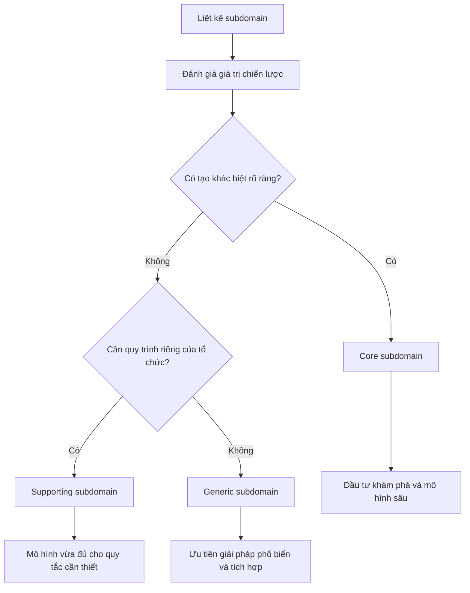

# Nhận diện lợi thế cạnh tranh và nơi cần đầu tư mô hình sâu

Domain-Driven Design (DDD) bắt đầu từ việc hiểu sâu nghiệp vụ mà phần mềm cần hỗ trợ. Tuy nhiên, không phải phần nào của nghiệp vụ cũng tạo ra giá trị chiến lược như nhau và cũng không cần cùng một mức đầu tư thiết kế. Một tổ chức có thể có nhiều quy trình quan trọng, nhưng chỉ một số năng lực thực sự giúp họ tạo khác biệt trên thị trường. DDD gọi phần nghiệp vụ có ý nghĩa chiến lược đó là **core domain** và khuyến khích đội phát triển tập trung năng lực mô hình hóa tốt nhất vào đây.

Để chọn đúng nơi đầu tư, cần hiểu domain và subdomain, phân biệt core subdomain với supporting và generic subdomain, rồi đánh giá cách tổ chức tạo lợi thế cạnh tranh. Việc phân loại phải dựa trên chiến lược và thực tế của doanh nghiệp, không chỉ dựa vào độ phức tạp kỹ thuật, quy mô mã nguồn hay sơ đồ tổ chức. Kết quả phân tích giúp đội phát triển quyết định phần nào cần mô hình nghiệp vụ giàu hành vi, phần nào nên được hỗ trợ bằng giải pháp đơn giản, và phần nào có thể dùng sản phẩm hoặc dịch vụ phổ biến.

## 1. Domain và subdomain trong DDD

### 1.1. Domain là phạm vi hoạt động nghiệp vụ

**Domain** là lĩnh vực hoạt động hoặc tri thức mà tổ chức đang tham gia và cần hiểu để đạt mục tiêu. Domain không đồng nghĩa với ứng dụng, cơ sở dữ liệu hay một nhóm chức năng trên giao diện. Nó bao gồm mục tiêu kinh doanh, quy trình, quy tắc, thuật ngữ, vai trò, quyết định và những mối quan hệ làm nên hoạt động của tổ chức.

Ví dụ, với một doanh nghiệp bán lẻ trực tuyến, domain có thể bao gồm việc lựa chọn danh mục hàng hóa, tiếp nhận đơn, quản lý tồn kho, định giá, thanh toán, giao hàng, chăm sóc khách hàng và xử lý hoàn trả. Đây là các hoạt động nghiệp vụ liên kết để tạo ra giá trị cho khách hàng.

### 1.2. Subdomain là phần nhỏ của domain

Khi domain lớn, nhóm cần chia nó thành các phần nghiệp vụ nhỏ hơn để dễ khám phá và phân tích. Những phần đó được gọi là **subdomain**. Một subdomain có mục tiêu, kiến thức và các quy tắc nghiệp vụ tương đối rõ ràng.

Ví dụ, domain bán lẻ có thể được chia thành các subdomain:

- Quản lý danh mục và thông tin sản phẩm.
- Dự báo nhu cầu và lập kế hoạch tồn kho.
- Định giá và khuyến mãi.
- Tiếp nhận và xử lý đơn hàng.
- Thanh toán và đối soát.
- Phân phối và giao hàng.
- Chăm sóc khách hàng và hoàn trả.

Phân rã domain giúp đội ngũ nhìn thấy các năng lực cần có để vận hành doanh nghiệp. Nó cũng tạo cơ sở để đánh giá năng lực nào tạo khác biệt, năng lực nào chỉ hỗ trợ hoạt động và năng lực nào là tiện ích phổ biến.

### 1.3. Phân biệt domain, subdomain và bounded context

Ba khái niệm này có liên quan nhưng mô tả những góc nhìn khác nhau:

| Khái niệm | Trả lời câu hỏi | Thuộc góc nhìn |
|---|---|---|
| Domain | Tổ chức đang hoạt động trong lĩnh vực nghiệp vụ nào? | Phạm vi tri thức và hoạt động của doanh nghiệp |
| Subdomain | Domain gồm những phần nghiệp vụ nào? | Phân rã vấn đề nghiệp vụ (problem space) |
| Bounded context | Một mô hình miền có hiệu lực trong ranh giới nào? | Ranh giới của mô hình trong giải pháp (solution space) |

Subdomain giúp hiểu và phân loại bài toán. Bounded context xác định nơi một mô hình, ngôn ngữ và các quy tắc có ý nghĩa nhất quán. Hai khái niệm thường có quan hệ gần nhau, nhưng không nên mặc định chúng luôn tương ứng một-một. Một subdomain có thể cần nhiều mô hình trong những ngữ cảnh khác nhau; ranh giới context cần được xác định qua ngôn ngữ, quy tắc, quyền sở hữu dữ liệu và cách các phần trao đổi với nhau.

Ví dụ, “khách hàng” trong subdomain bán hàng có thể là người đặt mua, trong chăm sóc khách hàng là người liên hệ, còn trong kế toán là bên chịu trách nhiệm thanh toán. Các bounded context tương ứng có thể cần những mô hình riêng dù cùng tham chiếu đến một khách hàng trong thế giới thực.

## 2. Ba loại subdomain

DDD thường phân loại subdomain thành **core**, **supporting** và **generic**. Cách phân loại này phản ánh vai trò chiến lược của nghiệp vụ đối với một tổ chức cụ thể.

### 2.1. Core subdomain — miền lõi

Core subdomain là phần nghiệp vụ tạo nên khác biệt có ý nghĩa của doanh nghiệp và góp phần trực tiếp vào lợi thế cạnh tranh. Đây thường là năng lực mà tổ chức muốn làm tốt hơn đối thủ, khó sao chép hoặc gắn chặt với tri thức và cách vận hành riêng.

Ví dụ:

- Một hãng vận tải có năng lực tối ưu mạng lưới và điều phối đội xe theo nhu cầu thực tế.
- Một nền tảng tuyển dụng có phương pháp ghép ứng viên với vị trí dựa trên dữ liệu và tri thức ngành riêng.
- Một doanh nghiệp bán lẻ có khả năng dự báo nhu cầu địa phương và phân bổ hàng hóa chính xác hơn đối thủ.
- Một công ty bảo hiểm có phương pháp đánh giá rủi ro đặc thù cho phân khúc thị trường mà họ phục vụ.

Core subdomain thường xứng đáng được đầu tư mạnh vào hiểu biết nghiệp vụ, thiết kế mô hình, chất lượng kỹ thuật và khả năng thay đổi. Đội phát triển nên làm việc sát với chuyên gia miền để biến tri thức quan trọng thành mô hình và hành vi phần mềm rõ ràng.

### 2.2. Supporting subdomain — miền hỗ trợ

Supporting subdomain cần thiết để doanh nghiệp vận hành core domain, nhưng bản thân nó không tạo ra khác biệt cạnh tranh nổi bật. Nó có thể chứa nhiều quy tắc riêng do cách tổ chức hoạt động, yêu cầu nội bộ hoặc quy trình đặc thù.

Ví dụ:

- Quy trình duyệt nhà cung cấp nội bộ.
- Quản lý lịch làm việc của nhân viên vận hành.
- Quy trình nhập liệu hoặc kiểm tra hồ sơ phục vụ hoạt động kinh doanh.
- Báo cáo quản trị theo cách tổ chức riêng.

Supporting subdomain thường cần giải pháp phù hợp với quy trình của tổ chức, nhưng không nhất thiết cần mô hình miền phức tạp như core subdomain. Có thể xây dựng phần mềm vừa đủ, tái sử dụng thư viện hoặc điều chỉnh quy trình để giảm chi phí. Nếu một supporting subdomain thay đổi vai trò chiến lược, nó có thể được phân loại lại.

### 2.3. Generic subdomain — miền phổ biến

Generic subdomain là năng lực nghiệp vụ cần có nhưng không phải nguồn tạo khác biệt riêng. Nhiều tổ chức gặp cùng một bài toán và có thể sử dụng giải pháp phổ biến đã được kiểm chứng.

Ví dụ thường gặp:

- Xác thực người dùng và quản lý phiên đăng nhập.
- Gửi email hoặc tin nhắn thông báo thông thường.
- Lưu trữ tệp và quản lý tài liệu cơ bản.
- Chức năng lập hóa đơn hoặc kế toán phổ thông, tùy bối cảnh doanh nghiệp.
- Xử lý thanh toán qua nhà cung cấp chuyên dụng, trong một doanh nghiệp mà thanh toán không phải năng lực tạo khác biệt.

Với generic subdomain, tổ chức thường có thể mua, thuê dịch vụ, dùng sản phẩm có sẵn hoặc áp dụng thư viện tiêu chuẩn. Đầu tư xây dựng lại từ đầu thường không tạo thêm lợi thế tương xứng với chi phí. Dù vậy, việc tích hợp vẫn phải bảo vệ các quy tắc và yêu cầu quan trọng của doanh nghiệp.

### 2.4. So sánh ba loại subdomain

| Tiêu chí | Core | Supporting | Generic |
|---|---|---|---|
| Vai trò chiến lược | Tạo khác biệt và lợi thế cạnh tranh | Giúp core domain hoạt động | Năng lực phổ biến cần có |
| Tri thức nghiệp vụ | Thường độc đáo, quan trọng và khó sao chép | Có thể riêng theo tổ chức | Phổ biến, có thể chuẩn hóa |
| Đầu tư mô hình | Cao, cần khám phá sâu và liên tục | Vừa đủ với quy tắc cần thiết | Thường ưu tiên giải pháp có sẵn |
| Cách triển khai thường cân nhắc | Xây dựng và sở hữu năng lực cốt lõi | Giải pháp đơn giản, phù hợp quy trình | Mua, thuê dịch vụ hoặc tái sử dụng |
| Ưu tiên đội ngũ | Chuyên gia miền và kỹ sư mạnh | Nhóm hiểu quy trình và tối ưu chi phí | Tập trung tích hợp, vận hành và tuân thủ |

Đây là định hướng phân bổ đầu tư, không phải quy tắc cứng. Một generic subdomain vẫn có thể có yêu cầu bảo mật hoặc tuân thủ cao; một core subdomain vẫn có thể dùng dịch vụ bên ngoài cho một số chức năng phụ trợ. Phân loại chiến lược không thay thế đánh giá rủi ro, chất lượng và trách nhiệm vận hành.

## 3. Lợi thế cạnh tranh đến từ đâu?

### 3.1. Lợi thế cạnh tranh là khả năng tạo giá trị khác biệt

Lợi thế cạnh tranh là khả năng giúp doanh nghiệp tạo ra hoặc giữ lại giá trị tốt hơn đối thủ trong một thị trường hay phân khúc cụ thể. Nó có thể đến từ giá thành, tốc độ, chất lượng, trải nghiệm, độ tin cậy, khả năng cá nhân hóa, mạng lưới, dữ liệu, chuyên môn hoặc mô hình kinh doanh.

Không phải mọi năng lực quan trọng đều là lợi thế cạnh tranh. Ví dụ, doanh nghiệp cần kế toán chính xác để hoạt động hợp pháp, nhưng nếu các đối thủ đều có thể dùng cùng một sản phẩm kế toán phổ biến, năng lực đó thường không phải điểm khác biệt cốt lõi.

Ngược lại, một thuật toán dự báo nhu cầu có thể là core subdomain nếu nó giúp doanh nghiệp giảm thiếu hàng, giảm hàng tồn dư và phục vụ khách hàng tốt hơn đối thủ. Giá trị chiến lược đến từ tác động của năng lực lên kết quả kinh doanh, không đến từ việc thuật toán có vẻ phức tạp.

### 3.2. Xác định cách doanh nghiệp thắng trên thị trường

Trước khi phân loại subdomain, cần hiểu chiến lược cạnh tranh của doanh nghiệp. Hãy đặt câu hỏi:

- Khách hàng chọn doanh nghiệp vì lý do nào?
- Doanh nghiệp phục vụ phân khúc nào và nhu cầu nào chưa được đáp ứng tốt?
- Giá trị khác biệt được tạo ra ở khâu nào trong chuỗi hoạt động?
- Năng lực nào giúp giảm chi phí, tăng doanh thu, tăng độ tin cậy hoặc tạo trải nghiệm tốt hơn?
- Đối thủ có thể sao chép năng lực đó dễ đến mức nào?
- Năng lực nào doanh nghiệp muốn tiếp tục cải thiện trong vài năm tới?
- Nếu năng lực đó suy giảm, lợi thế hoặc lời hứa với khách hàng nào sẽ mất đi?

Không nên chỉ hỏi lãnh đạo về chiến lược trên giấy. Hãy đối chiếu với hành vi mua hàng, phản hồi khách hàng, kết quả kinh doanh, cách nhân viên ra quyết định và những khoản đầu tư thực tế của tổ chức.

### 3.3. Tìm năng lực tạo ra khác biệt, không chỉ chức năng nổi bật

Một chức năng được nhiều người dùng chưa chắc là core domain. Năng lực phía sau chức năng mới là điều cần đánh giá. Chẳng hạn, nút “gợi ý sản phẩm” có thể chỉ là giao diện gọi một dịch vụ đề xuất chung. Nhưng nếu doanh nghiệp sở hữu tri thức độc đáo về nhu cầu, mối quan hệ sản phẩm và hành vi mua hàng, khả năng tạo đề xuất phù hợp có thể là một core subdomain.

Hãy lần theo chuỗi:

1. Khách hàng nhận được giá trị cụ thể nào?
2. Năng lực nghiệp vụ nào tạo ra giá trị đó?
3. Quy tắc, dữ liệu và tri thức nào làm năng lực này khác biệt?
4. Phần nào trong năng lực cần được doanh nghiệp sở hữu và cải tiến?
5. Phần nào chỉ là tiện ích phổ biến để hỗ trợ năng lực đó?

Ví dụ, một nền tảng giao hàng nhanh có thể xem khả năng dự đoán thời gian giao và phân công tài xế trong điều kiện biến động là core domain. Gửi SMS báo trạng thái có thể là generic subdomain. Cả hai đều xuất hiện trong trải nghiệm khách hàng, nhưng mức độ đóng góp chiến lược khác nhau.

## 4. Cách nhận diện core subdomain

Không có một phép đo duy nhất có thể tự động xác định core domain. Nhóm cần kết hợp góc nhìn chiến lược, bằng chứng thực tế và hiểu biết từ chuyên gia nghiệp vụ.

### 4.1. Đánh giá theo các câu hỏi chiến lược

Với từng subdomain, hãy thảo luận các câu hỏi sau:

**Mức độ khác biệt:** Năng lực này có giúp doanh nghiệp làm điều mà đối thủ khó làm tốt tương đương không? Nếu mọi đối thủ đều có thể mua cùng giải pháp, khả năng nó là core sẽ thấp hơn.

**Tác động đến giá trị khách hàng:** Năng lực này có ảnh hưởng đáng kể đến lý do khách hàng chọn, tiếp tục sử dụng hoặc sẵn sàng trả tiền không?

**Tính độc đáo của tri thức:** Năng lực có dựa vào kinh nghiệm, dữ liệu, quy tắc, thuật toán, quan hệ hoặc cách vận hành riêng của tổ chức không?

**Tính chiến lược trong tương lai:** Doanh nghiệp có kế hoạch đầu tư để năng lực này trở thành điểm mạnh hơn nữa không? Một năng lực chưa tạo lợi thế lớn hôm nay có thể là trọng tâm chiến lược ngày mai.

**Khả năng thay thế:** Nếu chuyển năng lực cho một sản phẩm phổ thông hoặc nhà cung cấp khác, doanh nghiệp có mất quyền kiểm soát một yếu tố tạo khác biệt không?

**Hệ quả khi làm kém:** Nếu năng lực hoạt động không tốt, doanh nghiệp có mất khách hàng, biên lợi nhuận, uy tín hoặc khả năng thực hiện cam kết quan trọng không?

Các câu trả lời cần có dẫn chứng. “Đây là phần phức tạp nhất” hoặc “đội chúng ta đã viết nhiều mã nhất ở đây” không phải bằng chứng đủ để gọi nó là core domain.

### 4.2. Dùng ma trận đánh giá để so sánh

Nhóm có thể chấm từng tiêu chí theo thang 1–5 để tạo cuộc thảo luận có cấu trúc. Điểm số chỉ hỗ trợ so sánh tương đối, không thay thế quyết định chiến lược.

| Tiêu chí | Điểm thấp | Điểm cao |
|---|---|---|
| Khác biệt cạnh tranh | Giống năng lực phổ biến của thị trường | Tạo khác biệt rõ ràng so với đối thủ |
| Giá trị với khách hàng | Ít ảnh hưởng đến lựa chọn hoặc trải nghiệm | Là lý do quan trọng để khách hàng chọn doanh nghiệp |
| Tri thức độc đáo | Dễ mua hoặc sao chép | Dựa trên tri thức, dữ liệu hoặc quy tắc riêng |
| Ưu tiên chiến lược | Ít được đầu tư trong định hướng tương lai | Là năng lực doanh nghiệp muốn phát triển mạnh |
| Khó thay thế | Có nhiều sản phẩm tương đương | Thay thế sẽ làm suy giảm lợi thế đáng kể |
| Tác động kinh doanh | Hậu quả nhỏ khi thực hiện kém | Ảnh hưởng lớn đến doanh thu, chi phí, uy tín hoặc cam kết |

Một bảng chấm điểm có thể ghi thêm cột “bằng chứng”, “mức độ tin cậy” và “người xác nhận”. Nếu một tiêu chí chưa có dữ liệu, hãy đánh dấu chưa biết thay vì tự điền điểm cao hoặc thấp.

### 4.3. Phân biệt năng lực cốt lõi hiện tại và năng lực chiến lược tương lai

Một doanh nghiệp mới có thể chưa có lợi thế rõ rệt nhưng đã chọn một năng lực để đầu tư nhằm tạo khác biệt. Nhóm nên ghi nhận hai góc nhìn:

- **Core hiện tại:** năng lực đang tạo giá trị khác biệt đã được kiểm chứng.
- **Core mục tiêu:** năng lực mà chiến lược doanh nghiệp muốn phát triển thành lợi thế trong tương lai.

Khoảng cách giữa hai trạng thái giúp xác định lộ trình. Có thể cần thử nghiệm, thu thập dữ liệu hoặc cải tiến quy trình trước khi đủ hiểu biết để xây dựng mô hình ổn định. Không nên tuyên bố một giả thuyết chiến lược là lợi thế đã được chứng minh.

## 5. Xác định nơi cần đầu tư mô hình sâu

Sau khi xác định core subdomain, nhóm cần quyết định phần nào cần mô hình miền chi tiết. Mô hình sâu có nghĩa là diễn đạt chính xác khái niệm, hành vi, quy tắc, trạng thái, bất biến và các quyết định nghiệp vụ. Nó không có nghĩa là tạo thật nhiều lớp, pattern hoặc abstraction.

### 5.1. Tập trung vào quy tắc tạo khác biệt

Hãy tìm những quyết định mà chuyên gia miền phải cân nhắc để tạo ra kết quả tốt hơn đối thủ. Ví dụ, trong năng lực dự báo nhu cầu, tri thức có thể nằm ở cách kết hợp mùa vụ, khu vực, chương trình khuyến mãi, thời gian cung ứng và mức độ không chắc chắn. Mô hình cần làm rõ các khái niệm này và quy tắc quyết định, thay vì chỉ lưu một trường `predictedQuantity`.

Những phần đáng đầu tư thường có một hoặc nhiều dấu hiệu:

- Nhiều quy tắc nghiệp vụ tương tác với nhau.
- Có nhiều trạng thái và chuyển trạng thái với điều kiện rõ ràng.
- Một quyết định ảnh hưởng đến tiền, tồn kho, quyền hạn hoặc cam kết khách hàng.
- Chính sách thay đổi thường xuyên và cần được điều chỉnh có kiểm soát.
- Chuyên gia sử dụng thuật ngữ riêng mà hệ thống cần phản ánh chính xác.
- Sai sót khó phát hiện, gây hậu quả lớn hoặc khó khôi phục.
- Năng lực cần thử nghiệm và cải tiến liên tục để giữ lợi thế.

### 5.2. Đầu tư theo mức độ phức tạp và rủi ro nghiệp vụ

Không phải mọi phần của core subdomain đều có độ phức tạp giống nhau. Một phép tính đơn giản, ổn định trong core domain có thể chỉ cần một value object hoặc hàm thuần rõ ràng. Một quy trình hỗ trợ có nhiều ràng buộc pháp lý có thể cần mô hình trạng thái chặt chẽ dù không phải nguồn tạo khác biệt.

Hãy đánh giá ít nhất bốn chiều:

1. **Giá trị chiến lược:** mức đóng góp vào lợi thế cạnh tranh.
2. **Độ phức tạp nghiệp vụ:** số lượng quy tắc, trạng thái, ngoại lệ và mối quan hệ.
3. **Rủi ro khi sai:** tác động đến khách hàng, tài chính, pháp lý, dữ liệu và vận hành.
4. **Mức độ thay đổi:** tần suất và mức độ khó của việc điều chỉnh chính sách.

Giá trị chiến lược cao cùng với độ phức tạp, rủi ro hoặc tốc độ thay đổi cao là tín hiệu mạnh để đầu tư mô hình sâu. Nếu giá trị chiến lược thấp và quy tắc ổn định, giải pháp đơn giản thường hợp lý hơn. Rủi ro tuân thủ và an toàn vẫn có thể đòi hỏi kiểm soát chặt dù subdomain không phải core.

### 5.3. Mô hình hóa hành vi, không chỉ cấu trúc dữ liệu

Một mô hình miền có chiều sâu thể hiện điều gì được phép xảy ra và vì sao. Thay vì chỉ có các bảng dữ liệu với nhiều trạng thái dạng chuỗi, nhóm cần làm rõ:

- Entity nào có danh tính và vòng đời riêng?
- Value object nào biểu diễn giá trị có ý nghĩa, như khoảng thời gian, tiền tệ, địa chỉ hoặc mức rủi ro?
- Quy tắc nào phải luôn đúng trong một ranh giới nhất quán (invariant)?
- Aggregate nào bảo vệ các invariant đó trong một giao dịch?
- Hành vi nào thuộc về đối tượng miền, domain service hay chính sách?
- Sự kiện miền nào thông báo một thay đổi có ý nghĩa?
- Repository cần cung cấp những thao tác nào để nạp và lưu aggregate?

Các khái niệm tactical design này là công cụ để diễn đạt nghiệp vụ. Không nên quyết định trước rằng mọi core subdomain đều phải có nhiều aggregate, domain event hay repository phức tạp. Hãy để quy tắc và ranh giới nhất quán dẫn dắt cấu trúc mô hình.

### 5.4. Giữ mô hình gọn ở supporting và generic subdomain

Với supporting subdomain, hãy mô hình hóa đủ để phản ánh quy trình và các quy tắc thực sự cần thiết. Nếu quy trình đơn giản, một mô hình CRUD rõ ràng có thể phù hợp. Nếu có các trạng thái hoặc điều kiện phê duyệt quan trọng, hãy bảo vệ chúng mà không cần sao chép toàn bộ độ phức tạp của core domain.

Với generic subdomain, ưu tiên đánh giá sản phẩm có sẵn, dịch vụ bên ngoài hoặc thư viện được duy trì tốt. Đội ngũ vẫn cần hiểu hợp đồng tích hợp, dữ liệu, quyền sở hữu, bảo mật, khả năng phục hồi và chi phí thay đổi. Dùng sản phẩm có sẵn không có nghĩa là bỏ qua thiết kế; trọng tâm chuyển sang lựa chọn, tích hợp và quản trị ranh giới.

## 6. Quy trình thực tế để phân loại subdomain

Có thể thực hiện theo các bước sau trong một workshop chiến lược với chuyên gia nghiệp vụ, lãnh đạo sản phẩm và đội phát triển.

### Bước 1: Xác định mục tiêu và phạm vi domain

Mô tả doanh nghiệp phục vụ ai, cung cấp giá trị gì, hoạt động trong thị trường nào và mục tiêu chiến lược là gì. Nếu phạm vi quá rộng, hãy chọn một dòng giá trị hoặc một nhóm khách hàng cụ thể để khảo sát trước.

### Bước 2: Liệt kê năng lực nghiệp vụ

Liệt kê các năng lực cần có để tạo và cung cấp giá trị. Có thể bắt đầu từ hành trình khách hàng, chuỗi giá trị, quy trình đầu-cuối hoặc các quyết định nghiệp vụ quan trọng. Dùng tên năng lực nghiệp vụ thay vì tên màn hình, bảng dữ liệu hay dịch vụ kỹ thuật.

### Bước 3: Chia thành subdomain

Nhóm các hoạt động có mục tiêu và tri thức liên quan. Mỗi subdomain nên có mô tả ngắn về trách nhiệm, đầu vào, kết quả và các quy tắc đặc trưng. Đừng chia quá nhỏ theo từng thao tác hoặc quá lớn thành một khối không thể phân tích.

### Bước 4: Xác định cách tạo khác biệt

Với mỗi subdomain, hỏi năng lực này đóng góp gì vào giá trị khách hàng và mục tiêu cạnh tranh. Kiểm tra bằng dữ liệu, phản hồi khách hàng, kết quả kinh doanh, quyết định đầu tư và hiểu biết của chuyên gia.

### Bước 5: Phân loại và ghi độ tin cậy

Đánh dấu core, supporting hoặc generic. Ghi lý do, bằng chứng, người xác nhận và những giả định còn mở. Nếu các bên chưa thống nhất, hãy ghi lại các cách hiểu và tác động thay vì ép một kết luận sớm.

### Bước 6: Chọn mức đầu tư mô hình

Đánh giá giá trị chiến lược, độ phức tạp, rủi ro và tốc độ thay đổi. Từ đó xác định nơi cần phỏng vấn sâu, Event Storming, làm rõ ngôn ngữ chung, mô hình hóa invariant và xây dựng kiểm thử nghiệp vụ.

### Bước 7: Xem xét ranh giới bounded context

Khi đã hiểu subdomain và ngôn ngữ của nó, hãy xác định ranh giới mô hình. Tìm các thuật ngữ có nghĩa khác nhau, các quy tắc được sở hữu bởi những nhóm khác nhau, dữ liệu có vòng đời riêng và nhu cầu tích hợp. Sau đó mô tả quan hệ giữa các context bằng context map.

### Bước 8: Rà soát định kỳ

Chiến lược doanh nghiệp, thị trường và công nghệ thay đổi. Một supporting subdomain có thể trở thành core khi tổ chức đầu tư và tạo ra năng lực khác biệt. Một năng lực từng là core có thể trở nên phổ thông khi đối thủ bắt kịp hoặc thị trường chuẩn hóa. Cần xem xét lại phân loại khi chiến lược, mô hình kinh doanh hoặc bằng chứng thực tế thay đổi.

## 7. Ví dụ: doanh nghiệp bán lẻ trực tuyến

Giả sử một doanh nghiệp bán lẻ trực tuyến phục vụ khách hàng ở nhiều khu vực. Doanh nghiệp muốn cạnh tranh bằng khả năng cung cấp đúng sản phẩm, đúng nơi và đúng thời điểm, đồng thời giảm hàng tồn dư. Đây là tình huống giả định để minh họa cách phân tích; kết luận thực tế cần được xác nhận với chiến lược và dữ liệu của doanh nghiệp.

### 7.1. Liệt kê các subdomain

| Subdomain | Mô tả năng lực | Phân loại giả định | Lý do |
|---|---|---|---|
| Dự báo nhu cầu địa phương | Dự đoán nhu cầu theo khu vực, thời gian và danh mục | Core | Là năng lực khác biệt giúp giảm thiếu hàng và tồn dư |
| Phân bổ hàng hóa | Quyết định hàng nào được đưa đến kho hoặc điểm bán nào | Core | Kết hợp dự báo, chi phí và cam kết phục vụ |
| Quản lý danh mục sản phẩm | Duy trì thông tin và phân loại sản phẩm | Supporting | Cần cho vận hành nhưng có thể dùng quy trình chuẩn |
| Xử lý đơn hàng | Tiếp nhận và điều phối đơn theo quy trình | Supporting hoặc Core | Phụ thuộc việc trải nghiệm xử lý đơn có phải điểm khác biệt không |
| Thanh toán | Thu tiền qua các phương thức được hỗ trợ | Generic trong giả định này | Có thể dùng nhà cung cấp chuyên dụng |
| Xác thực người dùng | Đăng nhập và quản lý danh tính | Generic | Năng lực phổ biến, có nhiều giải pháp đã được kiểm chứng |
| Gửi thông báo | Gửi email, SMS và thông báo trạng thái | Generic | Thường có thể dùng dịch vụ bên ngoài |

Phân loại “xử lý đơn hàng” cho thấy một subdomain không có nhãn cố định cho mọi doanh nghiệp. Nếu doanh nghiệp cạnh tranh bằng khả năng giao đơn siêu nhanh với quy trình điều phối độc đáo, xử lý đơn có thể trở thành core. Nếu nó chỉ thực hiện quy trình phổ biến, supporting có thể phù hợp hơn.

### 7.2. Tìm nơi cần mô hình hóa sâu

Trong dự báo nhu cầu và phân bổ hàng hóa, nhóm có thể cần khám phá các khái niệm:

- Nhu cầu cơ sở, nhu cầu theo mùa và tác động của khuyến mãi.
- Mức độ tin cậy của dự báo và cách xử lý dữ liệu thiếu.
- Thời gian cung ứng, mức tồn an toàn và chi phí lưu kho.
- Cam kết phục vụ theo khu vực và mức ưu tiên khách hàng.
- Quy tắc phân bổ khi nhiều điểm bán cùng cần một lượng hàng hạn chế.
- Quyết định điều chỉnh thủ công, người có thẩm quyền và lý do phải lưu.

Những khái niệm này có thể làm thay đổi quyết định kinh doanh. Nhóm nên làm việc thường xuyên với chuyên gia cung ứng, người lập kế hoạch và người vận hành kho để xây dựng ngôn ngữ chung, ví dụ, quy tắc và mô hình hành vi.

Trong xác thực người dùng hoặc gửi email, phần lớn quy tắc có thể được cung cấp bởi dịch vụ tiêu chuẩn. Nhóm cần xác định yêu cầu tích hợp, bảo mật và vận hành, nhưng thường không cần phát triển một mô hình miền độc đáo cho các chức năng này.

### 7.3. Minh họa cách ưu tiên

Sơ đồ là cách hỗ trợ thảo luận, không phải bộ phân loại tự động. Một năng lực có thể cần đánh giá lại khi chiến lược hoặc điều kiện thị trường thay đổi.

## 8. Từ phân loại subdomain đến chiến lược thiết kế

### 8.1. Phân bổ chuyên gia và thời gian

Core subdomain cần sự tham gia liên tục của chuyên gia nghiệp vụ và những kỹ sư có khả năng hiểu, diễn đạt và bảo vệ quy tắc miền. Các buổi khám phá nên tập trung vào quyết định khó, trường hợp ngoại lệ và ví dụ làm lộ ra sự khác biệt trong cách hiểu.

Supporting subdomain cần người hiểu quy trình và có thể chốt những quy tắc vận hành. Có thể chuẩn hóa quy trình và giới hạn phạm vi tùy chỉnh để giảm chi phí duy trì.

Generic subdomain thường cần người chịu trách nhiệm lựa chọn giải pháp, quản lý hợp đồng dịch vụ, tích hợp, bảo mật và theo dõi chất lượng. Không cần phân bổ quá nhiều thời gian của chuyên gia miền hiếm hoi vào việc tái tạo một năng lực phổ biến.

### 8.2. Chọn cách triển khai phù hợp

| Loại subdomain | Cách tiếp cận thường phù hợp | Điều cần chú ý |
|---|---|---|
| Core | Xây dựng năng lực riêng, mô hình miền rõ và có thể tiến hóa | Bảo vệ tri thức, kiểm thử quy tắc, khả năng thay đổi và quyền sở hữu |
| Supporting | Xây dựng giải pháp vừa đủ, cấu hình hoặc tái sử dụng khi hợp lý | Tránh tùy chỉnh quá mức và tránh để quy trình hỗ trợ làm phình hệ thống |
| Generic | Mua sản phẩm, thuê dịch vụ hoặc dùng thư viện phổ biến | Hợp đồng tích hợp, dữ liệu, bảo mật, chi phí và khả năng thay thế |

Việc chọn sản phẩm bên ngoài cần xét tổng chi phí sở hữu, khả năng đáp ứng quy tắc, mức phụ thuộc nhà cung cấp, khả năng xuất dữ liệu và tác động khi dịch vụ gián đoạn. Với core subdomain, doanh nghiệp có thể vẫn dùng dịch vụ bên ngoài cho hạ tầng hoặc tiện ích, nhưng cần giữ quyền kiểm soát đối với tri thức và quyết định tạo khác biệt.

### 8.3. Tập trung chiến lược vào core, nhưng không bỏ qua toàn hệ thống

Core domain là nơi ưu tiên đầu tư mô hình sâu, nhưng supporting và generic vẫn cần chất lượng phù hợp. Một dịch vụ thanh toán không phải core vẫn có thể gây thiệt hại lớn nếu tích hợp sai. Một quy trình nhân sự không tạo lợi thế cạnh tranh vẫn cần bảo vệ quyền riêng tư và tuân thủ. Chiến lược DDD giúp chọn nơi cần đầu tư hiểu biết và thiết kế chuyên sâu; nó không phải lý do để chấp nhận chất lượng thấp ở các phần còn lại.

## 9. Các sai lầm thường gặp

| Sai lầm | Vì sao không phù hợp | Cách xử lý |
|---|---|---|
| Gọi phần phức tạp nhất là core | Độ phức tạp có thể đến từ hệ thống cũ hoặc quy trình kém | Đánh giá tác động đến khách hàng và lợi thế cạnh tranh |
| Gọi mọi phần quan trọng là core | Làm mất khả năng ưu tiên và phân bổ nguồn lực | Phân biệt điều kiện cần để vận hành với năng lực tạo khác biệt |
| Phân loại theo cơ cấu phòng ban | Ranh giới tổ chức không nhất thiết phản ánh ranh giới nghiệp vụ | Bắt đầu từ năng lực, quy tắc và dòng giá trị |
| Dùng số lượng mã nguồn hoặc nhân sự làm thước đo | Quy mô triển khai không phản ánh giá trị chiến lược | Dùng bằng chứng về giá trị khách hàng, tri thức và chiến lược |
| Cho rằng core luôn phải tự xây mọi thứ | Có thể dẫn đến xây lại tiện ích phổ biến và tăng chi phí | Sở hữu mô hình và tri thức tạo khác biệt, tái sử dụng phần không khác biệt |
| Cho rằng generic không cần thiết kế | Bỏ qua tích hợp, bảo mật, dữ liệu và khả năng phục hồi | Thiết kế hợp đồng và ranh giới tích hợp rõ ràng |
| Xem subdomain và bounded context là một | Dễ áp đặt ranh giới kỹ thuật trước khi hiểu mô hình | Phân tích problem space trước, solution space sau |
| Phân loại một lần rồi giữ mãi | Chiến lược và thị trường có thể thay đổi | Rà soát theo chu kỳ hoặc khi có thay đổi lớn |
| Chấm điểm không có bằng chứng | Tạo cảm giác chính xác giả | Ghi nguồn, độ tin cậy và câu hỏi còn mở |

## 10. Đầu ra cần có sau khi phân tích

Một buổi phân tích có ích nên tạo ra các kết quả có thể dùng cho quyết định tiếp theo:

1. **Mô tả domain:** doanh nghiệp phục vụ ai, tạo giá trị gì và phạm vi khảo sát.
2. **Danh sách subdomain:** tên, mục tiêu, trách nhiệm, đầu vào và kết quả chính.
3. **Bản phân loại:** core, supporting hoặc generic, kèm lý do và bằng chứng.
4. **Bản đồ năng lực tạo khác biệt:** chỉ ra năng lực nào tác động đến giá trị khách hàng và chiến lược.
5. **Danh sách câu hỏi mở:** những giả định về chiến lược, quy tắc hoặc phạm vi chưa được xác nhận.
6. **Ưu tiên đầu tư mô hình:** nơi cần khám phá sâu, nơi chỉ cần mô hình vừa đủ và nơi nên dùng giải pháp phổ biến.
7. **Đầu mối bounded context:** thuật ngữ khác nghĩa, quyền sở hữu quy tắc và nhu cầu tích hợp cần khảo sát tiếp.

Có thể dùng bảng sau làm mẫu ban đầu:

| Subdomain | Mục tiêu nghiệp vụ | Loại | Bằng chứng lợi thế | Độ phức tạp/rủi ro | Hướng đầu tư | Câu hỏi mở |
|---|---|---|---|---|---|---|
| Tên năng lực | Kết quả cần đạt | Core/Supporting/Generic | Dữ liệu hoặc nhận định đã xác nhận | Thấp/Vừa/Cao và lý do | Mô hình sâu/Vừa đủ/Dùng giải pháp có sẵn | Người phụ trách và việc cần xác minh |

## 11. Kiểm tra quyết định trước khi chuyển sang thiết kế

Trước khi dùng phân loại để quyết định kiến trúc và phân bổ nhân lực, hãy kiểm tra:

- Nhóm đã mô tả rõ chiến lược cạnh tranh và phân khúc khách hàng chưa?
- Mỗi subdomain có mục tiêu và ranh giới nghiệp vụ đủ rõ chưa?
- Lý do gọi một subdomain là core có bằng chứng từ khách hàng, dữ liệu hoặc chiến lược không?
- Nhóm đã phân biệt lợi thế hiện tại với năng lực muốn xây dựng trong tương lai chưa?
- Những phần chưa thống nhất có người chịu trách nhiệm xác minh không?
- Mức đầu tư mô hình có xét đến độ phức tạp, rủi ro và tốc độ thay đổi không?
- Các yêu cầu về bảo mật, tuân thủ, độ tin cậy và vận hành có được xem xét ở mọi loại subdomain không?
- Nhóm đã tránh đồng nhất subdomain với bounded context chưa?

Nếu các câu hỏi quan trọng vẫn chưa có câu trả lời, hãy ghi rõ giả định và giới hạn quyết định. Có thể tiếp tục khám phá trong phạm vi đã rõ, nhưng không nên để một nhãn core/supporting/generic thiếu căn cứ trở thành lý do cho một khoản đầu tư lớn.

## 12. Kết nối với các bước tiếp theo của DDD

Phân loại subdomain là một hoạt động của **strategic design**. Nó giúp tổ chức hiểu phần nào của domain cần được sở hữu và đầu tư, từ đó định hướng mức độ chuyên sâu khi xây dựng mô hình.

Sau khi nhận diện các subdomain, nhóm tiếp tục khám phá ranh giới **bounded context** và mối quan hệ giữa chúng. Context map mô tả cách các mô hình trao đổi, phụ thuộc hoặc bảo vệ quyền tự chủ. Những quyết định này cần dựa trên khác biệt về ngôn ngữ, quy tắc, dữ liệu và quyền sở hữu.

Trong từng bounded context, nhóm có thể dùng **tactical design** để diễn đạt nghiệp vụ bằng entity, value object, aggregate, repository và domain event. Core subdomain thường là nơi có nhiều cơ hội và nhu cầu để đầu tư vào mô hình giàu hành vi. Tuy nhiên, mọi lựa chọn vẫn phải xuất phát từ quy tắc thật của miền.

Mục tiêu cuối cùng là đặt công sức thiết kế vào đúng nơi giúp doanh nghiệp tạo và duy trì giá trị khác biệt. Mô hình miền tốt phải làm rõ tri thức nghiệp vụ, hỗ trợ quyết định đúng và có thể tiến hóa cùng chiến lược của tổ chức.
