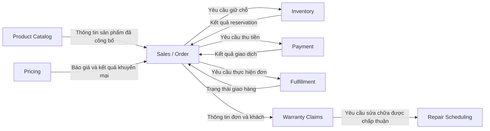
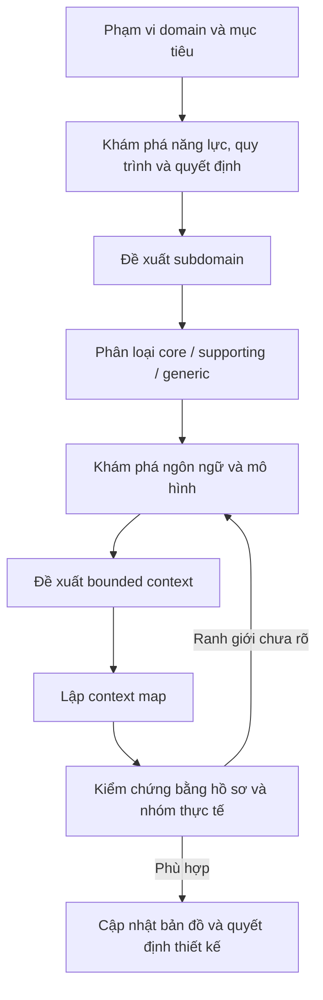

# Phân biệt miền con trong không gian vấn đề với ranh giới mô hình của giải pháp

Khi bắt đầu một dự án Domain-Driven Design (DDD), đội phát triển thường nghe hai đề xuất: chia nghiệp vụ thành các **subdomain** và chia hệ thống thành các **bounded context**. Hai việc này có liên quan chặt chẽ, nhưng chúng trả lời hai câu hỏi khác nhau. Subdomain giúp hiểu tổ chức đang giải quyết những nhóm vấn đề nghiệp vụ nào. Bounded context xác định phạm vi mà một mô hình miền và ngôn ngữ chung có thể được sử dụng nhất quán trong giải pháp.

Nếu coi hai khái niệm là một, đội dự án dễ lấy cơ cấu phòng ban làm ranh giới hệ thống, chia mỗi subdomain thành một microservice theo công thức máy móc, hoặc cố ép mọi nhóm dùng chung một mô hình dữ liệu. Kết quả thường là các khái niệm bị trộn lẫn, quy tắc nằm sai nơi và việc tích hợp ngày càng khó hiểu.

Trong `DOMAIN_DRIVEN_DESIGN`, strategic design sử dụng subdomain, bounded context và context map để nhìn toàn cảnh nghiệp vụ cũng như các ranh giới mô hình. Tactical design tiếp tục đi sâu vào entity, value object, aggregate, repository và domain event bên trong một ngữ cảnh cụ thể. Bài này tập trung làm rõ ranh giới giữa không gian vấn đề và không gian giải pháp, cách tìm từng loại ranh giới, cách chúng ánh xạ với nhau và cách kiểm tra một mô hình phân rã có hợp lý hay không.

## 1. Hai câu hỏi ở hai không gian khác nhau

### 1.1. Không gian vấn đề: tổ chức cần hiểu và giải quyết điều gì?

**Domain (miền nghiệp vụ)** là lĩnh vực hoạt động mà tổ chức đang tham gia và cần hiểu sâu để tạo ra giá trị. Ví dụ, với một doanh nghiệp bán lẻ đa kênh, miền nghiệp vụ có thể bao gồm bán hàng, quản lý danh mục sản phẩm, định giá, tồn kho, giao hàng, thanh toán và chăm sóc sau bán.

Một miền lớn thường chứa nhiều nhóm vấn đề có kiến thức, mục tiêu và quy tắc riêng. **Subdomain (miền con)** là một phần được nhận diện khi phân rã miền nghiệp vụ thành các khu vực vấn đề có ý nghĩa. Mỗi subdomain đại diện cho một năng lực hoặc mảng tri thức nghiệp vụ mà tổ chức cần hiểu và xử lý.

Khi tìm subdomain, hãy hỏi:

- Tổ chức cần thực hiện năng lực nghiệp vụ nào để đạt mục tiêu?
- Nhóm vấn đề nào có quy tắc, thuật ngữ, dữ liệu và chuyên môn riêng?
- Năng lực nào tạo ra khác biệt cạnh tranh? Năng lực nào hỗ trợ hoạt động? Năng lực nào có thể dùng giải pháp phổ biến?
- Nếu chưa có phần mềm, chuyên gia nghiệp vụ vẫn mô tả nhóm công việc này như một phần riêng của hoạt động kinh doanh không?

Subdomain tồn tại trong cách tổ chức vận hành và tạo giá trị, dù tổ chức đã có phần mềm hay chưa. Nó giúp đội dự án hiểu **điều gì cần được giải quyết**.

### 1.2. Không gian giải pháp: mô hình nào cần có ranh giới rõ ràng?

**Bounded context (ngữ cảnh được giới hạn)** là ranh giới trong đó một mô hình miền và ngôn ngữ chung có ý nghĩa nhất quán. Bên trong ranh giới đó, một thuật ngữ, quy tắc và cách biểu diễn dữ liệu được hiểu theo cùng một cách. Khi đi qua ranh giới, cùng một từ có thể mang ý nghĩa khác, dữ liệu có thể có cấu trúc khác và quy tắc có thể do một nhóm khác chịu trách nhiệm.

Bounded context là một khái niệm thiết kế giải pháp và tổ chức cộng tác. Nó cho biết **mô hình nào đúng trong phạm vi nào**, ai chịu trách nhiệm về mô hình đó và các phần khác giao tiếp với nó bằng hợp đồng nào.

Ví dụ, từ “sản phẩm” có thể xuất hiện ở nhiều nơi:

- Trong ngữ cảnh danh mục, sản phẩm có tên hiển thị, mô tả, hình ảnh, thương hiệu và biến thể.
- Trong ngữ cảnh tồn kho, thứ được theo dõi có thể là SKU tại một kho, số lượng khả dụng và số lượng đã giữ chỗ.
- Trong ngữ cảnh bán hàng, dòng hàng trong đơn cần lưu số lượng, giá tại thời điểm đặt và điều kiện khuyến mại đã áp dụng.

Ba cách biểu diễn này không nhất thiết là ba bản sao lỗi của một đối tượng `Product` toàn cục. Chúng phản ánh ba nhu cầu và quy tắc khác nhau. Bounded context cho phép mỗi mô hình giữ được ý nghĩa riêng, đồng thời quy định cách trao đổi thông tin giữa chúng.

### 1.3. So sánh trực tiếp

| Góc nhìn | Subdomain | Bounded context |
|---|---|---|
| Thuộc về | Không gian vấn đề (problem space) | Không gian giải pháp (solution space) |
| Câu hỏi chính | Tổ chức cần giải quyết những nhóm vấn đề nghiệp vụ nào? | Mô hình miền và ngôn ngữ nào có hiệu lực trong ranh giới nào? |
| Trọng tâm | Năng lực, mục tiêu, chính sách và tri thức nghiệp vụ | Tính nhất quán của mô hình, ngôn ngữ, trách nhiệm và tích hợp |
| Cách tìm | Khám phá chiến lược, quy trình, quyết định, chuyên gia và năng lực kinh doanh | Phân tích thuật ngữ, quy tắc, vòng đời, mô hình và nhu cầu cộng tác |
| Kết quả | Bản đồ miền và các miền con | Ranh giới mô hình cùng các quan hệ giữa ngữ cảnh |
| Ví dụ | Định giá, tồn kho, hậu mãi | Pricing Context, Inventory Context, Warranty Context |
| Thay đổi khi | Chiến lược hoặc cách tổ chức tạo giá trị thay đổi | Mô hình, trách nhiệm, ngôn ngữ hoặc cách triển khai thay đổi |

Một subdomain có thể được hỗ trợ bởi một hoặc nhiều bounded context. Một bounded context cũng có thể chứa mô hình phục vụ nhiều phần nghiệp vụ gần nhau nếu chúng thực sự chia sẻ ngôn ngữ và quy tắc nhất quán. Mối quan hệ cần được khám phá từ thực tế, không được quyết định trước bằng một quy tắc ánh xạ cứng.

## 2. Phân rã miền thành các subdomain

### 2.1. Bắt đầu từ mục tiêu và năng lực nghiệp vụ

Đừng bắt đầu bằng danh sách màn hình, bảng cơ sở dữ liệu, nhóm lập trình hoặc tên phòng ban. Hãy bắt đầu từ cách tổ chức tạo ra giá trị và những năng lực cần có để thực hiện điều đó.

Với một doanh nghiệp bán lẻ, có thể đặt câu hỏi:

- Làm thế nào khách hàng tìm thấy và hiểu sản phẩm?
- Làm thế nào doanh nghiệp xác định giá và chương trình khuyến mại?
- Làm thế nào doanh nghiệp biết có thể cam kết bán bao nhiêu hàng?
- Làm thế nào đơn hàng được tiếp nhận, xác nhận và hoàn tất?
- Làm thế nào doanh nghiệp thu tiền và đối soát?
- Làm thế nào xử lý bảo hành, sửa chữa và yêu cầu sau bán?

Mỗi câu hỏi có thể mở ra một khu vực tri thức. Tiếp tục tìm các quy tắc, quyết định và dữ liệu khiến khu vực đó có ý nghĩa riêng. Ví dụ, tồn kho không chỉ là bảng số lượng. Nó có thể bao gồm nhập hàng, điều chuyển kho, kiểm kê, giữ chỗ, hàng lỗi, tồn khả dụng và quy tắc phân bổ hàng cho đơn.

### 2.2. Dấu hiệu nhận diện một subdomain

Một nhóm vấn đề có thể là subdomain khi có một hoặc nhiều dấu hiệu sau:

- Có mục tiêu nghiệp vụ riêng và kết quả đầu ra có thể mô tả được.
- Có các quyết định, chính sách hoặc phép tính đặc thù.
- Cần kiến thức chuyên môn mà người ở khu vực khác không thể mặc nhiên thay thế.
- Có thuật ngữ và cách phân loại được sử dụng lặp lại.
- Có vòng đời công việc hoặc tập sự kiện nghiệp vụ tương đối rõ.
- Có thể đánh giá kết quả bằng các chỉ số hoặc tiêu chí riêng.

Không có một dấu hiệu đơn lẻ nào đủ để kết luận. Chẳng hạn, một phòng ban có thể thực hiện nhiều năng lực nghiệp vụ; ngược lại, một năng lực có thể được nhiều phòng ban cùng tham gia. Ranh giới subdomain nên phản ánh cấu trúc của vấn đề và tri thức nghiệp vụ, không chỉ phản ánh sơ đồ tổ chức.

### 2.3. Phân loại Core, Supporting và Generic Subdomain

DDD thường phân loại subdomain theo vai trò chiến lược để giúp tổ chức quyết định nơi cần đầu tư năng lực và tri thức.

| Loại | Ý nghĩa | Dấu hiệu nhận biết | Cách tiếp cận thường phù hợp |
|---|---|---|---|
| **Core subdomain** (miền con cốt lõi) | Năng lực tạo lợi thế cạnh tranh hoặc khác biệt đáng kể cho doanh nghiệp | Quy tắc phức tạp, gắn với chiến lược riêng, khó thay thế bằng cách làm phổ thông | Đầu tư chuyên gia, khám phá sâu và xây dựng mô hình phù hợp với chiến lược |
| **Supporting subdomain** (miền con hỗ trợ) | Năng lực cần thiết cho hoạt động nhưng không phải nguồn khác biệt chính | Có quy tắc riêng của tổ chức nhưng không tạo lợi thế cạnh tranh nổi bật | Xây dựng vừa đủ theo nhu cầu; tránh làm phức tạp quá mức |
| **Generic subdomain** (miền con phổ dụng) | Năng lực có cách giải quyết tương đối phổ biến trên thị trường | Có sản phẩm, dịch vụ hoặc giải pháp tiêu chuẩn đáp ứng tốt | Cân nhắc mua, thuê hoặc tái sử dụng giải pháp có sẵn |

Phân loại này phụ thuộc vào chiến lược và bối cảnh của từng tổ chức. Cùng một năng lực có thể là core ở doanh nghiệp này nhưng chỉ là supporting hoặc generic ở doanh nghiệp khác. Ví dụ, định giá có thể là năng lực cốt lõi của một nhà bán lẻ tối ưu giá theo thời gian thực, trong khi một doanh nghiệp khác áp dụng bảng giá cố định và coi định giá là năng lực hỗ trợ.

Không nên dùng nhãn core để khẳng định một nhóm quan trọng hơn về mặt tổ chức hoặc dùng nhãn generic để xem nhẹ yêu cầu tích hợp, bảo mật và vận hành. Phân loại nhằm định hướng đầu tư và chiến lược mô hình hóa, không phải thước đo giá trị con người hay độ ưu tiên của mọi công việc.

### 2.4. Bản đồ subdomain là bản đồ vấn đề, không phải sơ đồ triển khai

Một bản đồ subdomain có thể ghi tên miền con, mục tiêu, chính sách quan trọng, chuyên gia, mức độ khác biệt và câu hỏi còn mở. Nó chưa cần chỉ ra mỗi phần sẽ là một service, một database hay một nhóm triển khai.

Ví dụ sơ bộ:

| Subdomain | Mục tiêu nghiệp vụ | Một số quyết định tiêu biểu | Phân loại giả định |
|---|---|---|---|
| Danh mục sản phẩm | Giúp khách hiểu và chọn đúng mặt hàng | Biến thể nào được bán, thông tin nào cần công bố | Supporting; có thể là core nếu danh mục tuyển chọn tạo khác biệt |
| Định giá và khuyến mại | Xác định mức giá và ưu đãi áp dụng | Ưu đãi nào được kết hợp, giá nào có hiệu lực | Core trong ví dụ nhà bán lẻ cạnh tranh bằng giá |
| Quản lý tồn kho | Biết và kiểm soát lượng hàng có thể sử dụng | Có thể giữ chỗ bao nhiêu, xử lý chênh lệch thế nào | Supporting |
| Bán hàng và đơn hàng | Tiếp nhận cam kết mua bán | Đơn có đủ điều kiện xác nhận không, trạng thái nào tiếp theo | Core hoặc supporting tùy chiến lược |
| Hoàn tất đơn hàng | Đưa hàng đến đúng nơi, đúng hạn | Kho nào xử lý, cách phân bổ và giao hàng | Supporting |
| Thanh toán | Thu và xác nhận tiền | Giao dịch nào được xem là thành công, xử lý hoàn tiền ra sao | Generic hoặc supporting tùy mức độ đặc thù |
| Hậu mãi và bảo hành | Duy trì cam kết sau khi bán | Yêu cầu nào đủ điều kiện bảo hành, cần sửa hay đổi | Supporting; có thể là core trong mô hình dịch vụ |

Các nhãn trong bảng chỉ là giả định để thảo luận. Một cuộc khám phá thực tế cần xác nhận chiến lược, phạm vi trách nhiệm và cách vận hành của chính tổ chức.

## 3. Tìm bounded context trong không gian giải pháp

Sau khi có hiểu biết về các khu vực vấn đề, đội dự án có thể khảo sát cách mô hình hóa chúng. Không nên tự động đặt một bounded context cho mỗi subdomain rồi dừng lại. Cần tìm nơi mà một mô hình có thể giữ được ngôn ngữ và quy tắc nhất quán.

### 3.1. Ngôn ngữ chung là tín hiệu quan trọng

**Ubiquitous Language (ngôn ngữ chung)** là ngôn ngữ được chuyên gia nghiệp vụ và đội phát triển cùng sử dụng trong một bounded context. Ngôn ngữ này xuất hiện trong trao đổi, tài liệu, tên mô hình, code và kiểm thử. Nó không có nghĩa toàn doanh nghiệp phải dùng một từ điển duy nhất cho mọi khái niệm.

Hãy tìm những từ có vẻ giống nhau nhưng mang ý nghĩa khác nhau:

- “Sản phẩm” trong danh mục là mặt hàng được mô tả và trưng bày; trong tồn kho có thể là SKU cần kiểm soát số lượng.
- “Khách hàng” trong bán hàng có thể là người đặt đơn; trong kế toán có thể là chủ thể thanh toán và nhận hóa đơn.
- “Đã giao” trong vận chuyển có thể là hãng vận chuyển báo phát thành công; trong chăm sóc khách hàng có thể chỉ được xác nhận sau khi khách phản hồi.
- “Hủy đơn” trong bán hàng có thể chấm dứt cam kết đơn hàng; trong thanh toán còn có thể cần hủy ủy quyền hoặc hoàn tiền.

Nếu một thuật ngữ được định nghĩa khác nhau theo vai trò và quy tắc, đừng vội ép các nhóm dùng chung một entity hoặc một enum. Sự khác biệt có thể là dấu hiệu của các mô hình cần ranh giới riêng.

### 3.2. Các câu hỏi để xác định ranh giới mô hình

Khi khảo sát một bounded context ứng viên, hãy xem xét đồng thời:

1. **Ngôn ngữ:** các thuật ngữ chính có cùng ý nghĩa trong phạm vi này không? Có khái niệm nào cần dịch hoặc chuyển đổi khi trao đổi với nhóm khác?
2. **Quy tắc và bất biến:** những điều kiện nào phải luôn đúng? Ai có quyền thay đổi chúng và ở thời điểm nào?
3. **Vòng đời:** đối tượng nghiệp vụ được tạo, thay đổi, kết thúc theo những trạng thái và sự kiện nào?
4. **Trách nhiệm:** vai trò hoặc nhóm nào sở hữu mô hình, chính sách và quyết định?
5. **Tốc độ thay đổi:** các quy tắc thường thay đổi cùng nhau hay theo những nhịp khác nhau?
6. **Tích hợp:** phần nào cần thông tin từ bên ngoài, cần phản hồi đồng bộ hay có thể nhận sự kiện bất đồng bộ?
7. **Tính nhất quán:** dữ liệu nào phải được cập nhật cùng nhau trong một giao dịch nghiệp vụ? Dữ liệu nào có thể đồng bộ sau?

Một ranh giới tốt giúp mô hình bên trong rõ ràng và giảm việc các phần khác truy cập trực tiếp vào chi tiết nội bộ. Bên ngoài nhận thông tin qua hợp đồng có ý nghĩa, chẳng hạn API, sự kiện miền được công bố hoặc một ngôn ngữ trao đổi đã thống nhất.

### 3.3. Bounded context không đồng nghĩa với phòng ban, database hay microservice

Các ranh giới tổ chức và kỹ thuật có thể cung cấp manh mối, nhưng không tự động xác định bounded context:

- **Phòng ban:** một phòng ban có thể phụ trách nhiều mô hình; một bounded context có thể cần nhiều vai trò cùng tham gia. Cơ cấu nhân sự còn thay đổi theo thời gian.
- **Nhóm phát triển:** một nhóm có thể sở hữu nhiều context nhỏ; một context lớn cũng có thể cần nhiều nhóm cộng tác. Cần làm rõ quyền sở hữu mô hình và cách phối hợp.
- **Database hoặc schema:** tách cơ sở dữ liệu không tự tạo ra ngôn ngữ chung hay ranh giới mô hình. Một database có thể lưu dữ liệu của nhiều context, và một context có thể dùng nhiều kho lưu trữ.
- **Microservice:** microservice là lựa chọn kiến trúc triển khai. Bounded context là ranh giới mô hình và ngôn ngữ. Một context có thể được triển khai bằng một hoặc nhiều thành phần; cũng có thể bắt đầu bằng modular monolith.
- **Một bảng hoặc một entity:** việc có bảng riêng không chứng minh đã có một context riêng. Ranh giới cần được biện minh bằng mô hình và trách nhiệm nghiệp vụ.

Nếu một nhóm đề xuất “mỗi phòng ban một microservice”, hãy quay lại câu hỏi về mô hình, quy tắc và ngôn ngữ. Cấu trúc triển khai nên hỗ trợ ranh giới miền đã hiểu, không thay thế quá trình khám phá.

## 4. Quan hệ giữa subdomain và bounded context

Hai khái niệm có liên hệ nhưng không có ánh xạ một-một bắt buộc. Subdomain cho biết khu vực vấn đề; bounded context cho biết nơi một mô hình được áp dụng. Tùy quy mô, lịch sử hệ thống, mức độ phức tạp và cấu trúc đội ngũ, quan hệ có thể có nhiều dạng.

### 4.1. Một subdomain được hiện thực hóa bằng một bounded context

Đây là trường hợp tương đối dễ hiểu khi một năng lực có mô hình và ngôn ngữ rõ ràng. Ví dụ, subdomain Định giá có thể được hỗ trợ bởi `Pricing Context`, nơi sở hữu chính sách giá, điều kiện khuyến mại, thời hạn hiệu lực và kết quả tính giá.

Đây thường là giả thuyết khởi đầu hữu ích. Tuy nhiên, nó cần được kiểm tra khi hệ thống phát triển hoặc khi phát hiện nhiều mô hình khác nhau trong cùng khu vực vấn đề.

### 4.2. Một subdomain có thể cần nhiều bounded context

Một subdomain có thể chứa nhiều mô hình với ngôn ngữ, vòng đời và quy tắc khác nhau. Ví dụ, subdomain Hậu mãi có thể gồm:

- `Warranty Claims Context`: tiếp nhận và đánh giá điều kiện bảo hành, xác định quyền lợi và kết quả yêu cầu.
- `Repair Scheduling Context`: lập lịch kỹ thuật viên, phân bổ năng lực sửa chữa và quản lý lịch hẹn.

Hai context cùng hỗ trợ năng lực hậu mãi nhưng mô hình trung tâm và quy tắc của chúng khác nhau. Một yêu cầu bảo hành được chấp thuận có thể tạo thông tin để lập lịch sửa chữa, nhưng lịch làm việc của kỹ thuật viên không cần trở thành một phần của mô hình đánh giá quyền lợi bảo hành.

Một subdomain cũng có thể bị chia thành nhiều context do một hệ thống cũ, hai mô hình được hình thành ở các thời điểm khác nhau hoặc các nhóm có trách nhiệm khác nhau. Khi đó, cần ghi nhận chi phí tích hợp và xem xét liệu các ranh giới hiện tại có còn phù hợp.

### 4.3. Một bounded context có thể phục vụ nhiều subdomain gần nhau

Trong một hệ thống nhỏ hoặc giai đoạn đầu, nhiều năng lực gần nhau có thể dùng chung một mô hình và một ngôn ngữ mà không gây mơ hồ. Ví dụ, một `Billing Context` ban đầu có thể xử lý cả lập hóa đơn và theo dõi khoản phải thu nếu hai nhóm quy tắc này cùng chia sẻ vòng đời và trách nhiệm trong phạm vi sản phẩm.

Điều đó không làm các vấn đề nghiệp vụ trở thành một. Subdomain vẫn có thể được phân biệt trong bản đồ vấn đề để giữ góc nhìn chiến lược. Bounded context chỉ cho biết hiện tại chúng đang được mô hình hóa chung trong một ranh giới giải pháp. Nếu quy tắc, ngôn ngữ hoặc nhu cầu thay đổi độc lập về sau, có thể cần tách mô hình.

### 4.4. Một bounded context không phải bản sao của một subdomain

Bounded context có thể tập trung vào một phần mô hình hoặc một vai trò cụ thể. Nó cũng có thể cung cấp một mô hình phối hợp sử dụng kết quả từ nhiều context khác. Điều quan trọng là xác định context đó sở hữu quy tắc nào, và quy tắc nào thuộc về context khác.

Ví dụ, `Order Context` có thể điều phối trạng thái đơn hàng và ghi nhận kết quả giữ chỗ tồn kho, thanh toán. Nó không vì thế mà sở hữu toàn bộ quy tắc phân bổ hàng trong kho hay xử lý giao dịch thanh toán. Những quyết định đó vẫn thuộc các mô hình tương ứng.

### 4.5. Bảng minh họa quan hệ ánh xạ

| Subdomain trong không gian vấn đề | Bounded context ứng viên | Quan hệ | Lý do |
|---|---|---|---|
| Định giá | Pricing Context | Một - một ở giai đoạn đầu | Một mô hình chính sở hữu quy tắc tính giá |
| Hậu mãi | Warranty Claims Context; Repair Scheduling Context | Một - nhiều | Đánh giá quyền lợi và lập lịch sửa chữa có mô hình, vòng đời riêng |
| Bán hàng | Sales Context | Có thể một - một | Đơn hàng và cam kết bán có ngôn ngữ nhất quán trong phạm vi hiện tại |
| Lập hóa đơn; theo dõi khoản phải thu | Billing Context | Nhiều - một trong một sản phẩm nhỏ | Hai năng lực gần nhau đang dùng chung mô hình và trách nhiệm |

Đây là các ví dụ về khả năng ánh xạ, không phải khuôn mẫu tổ chức bắt buộc. Mỗi quan hệ cần có bằng chứng từ nghiệp vụ và thiết kế mô hình.

## 5. Ví dụ xuyên suốt: doanh nghiệp bán lẻ đa kênh

Giả sử một doanh nghiệp bán lẻ bán hàng qua website và cửa hàng. Khách có thể xem sản phẩm, áp dụng khuyến mại, đặt hàng, thanh toán, nhận hàng tại nhà hoặc tại cửa hàng, sau đó gửi yêu cầu đổi trả hoặc bảo hành.

### 5.1. Nhìn từ không gian vấn đề

Đội khám phá cùng chuyên gia nghiệp vụ nhận diện các subdomain sau:

| Subdomain | Câu hỏi nghiệp vụ | Tri thức và quyết định cần khám phá |
|---|---|---|
| Danh mục sản phẩm | Khách hàng cần biết gì để chọn hàng? | Cấu trúc sản phẩm, biến thể, thuộc tính, trạng thái công bố |
| Định giá và khuyến mại | Giá nào áp dụng cho giao dịch này? | Giá theo kênh, điều kiện kết hợp ưu đãi, thời hạn, giới hạn sử dụng |
| Tồn kho | Có thể cam kết bao nhiêu hàng? | Tồn thực tế, tồn khả dụng, giữ chỗ, điều chuyển, hàng lỗi |
| Bán hàng | Đơn hàng có thể được xác nhận như thế nào? | Điều kiện tiếp nhận, thay đổi đơn, hủy đơn, cam kết với khách |
| Hoàn tất đơn hàng | Đơn được lấy và giao ra sao? | Chọn kho, đóng gói, bàn giao vận chuyển, giao thất bại |
| Thanh toán | Tiền đã được thu hoặc hoàn như thế nào? | Ủy quyền, ghi nhận giao dịch, đối soát, hoàn tiền |
| Hậu mãi | Cam kết sau bán được thực hiện thế nào? | Đổi trả, bảo hành, sửa chữa, đánh giá điều kiện và lịch hẹn |

Đây là bản đồ vấn đề. Nó mô tả năng lực và câu hỏi cần hiểu, chưa nói mỗi năng lực phải có một service riêng.

### 5.2. Nhìn từ không gian giải pháp

Sau khi phân tích thuật ngữ, vòng đời và trách nhiệm, đội dự án đề xuất một số bounded context:

| Bounded context | Mô hình và trách nhiệm chính | Một số khái niệm có ý nghĩa trong context |
|---|---|---|
| Product Catalog | Quản lý nội dung và cấu trúc mặt hàng được công bố | Product, Variant, Attribute, Publication Status |
| Pricing | Tính giá và áp dụng khuyến mại | Price Rule, Promotion, Eligibility, Price Quote |
| Inventory | Quản lý số lượng và giữ chỗ theo kho | Stock Item, Warehouse, Reservation, Available Quantity |
| Sales / Order | Quản lý đơn và cam kết bán với khách | Order, Order Line, Order Status, Cancellation |
| Fulfillment | Thực hiện lấy, đóng gói và giao hàng | Fulfillment, Shipment, Package, Delivery Attempt |
| Payment | Quản lý giao dịch thu tiền và hoàn tiền | Payment Intent, Transaction, Refund, Reconciliation |
| Warranty Claims | Đánh giá và xử lý yêu cầu bảo hành | Warranty Claim, Coverage, Evidence, Claim Decision |
| Repair Scheduling | Lập lịch và phân bổ năng lực sửa chữa | Service Appointment, Technician, Work Slot |

Một số subdomain có một context tương ứng trong đề xuất ban đầu. Subdomain Hậu mãi được tách thành hai context vì việc đánh giá quyền lợi bảo hành và lập lịch kỹ thuật viên có quy tắc, vòng đời và ngôn ngữ riêng.

### 5.3. Cùng một khái niệm có thể có mô hình khác nhau

Hãy xem cách từ “sản phẩm” thay đổi theo context:

| Context | Mô hình phù hợp | Điều cần bảo vệ |
|---|---|---|
| Product Catalog | `Product` với mô tả, hình ảnh, thương hiệu và biến thể | Thông tin công bố nhất quán và đúng trạng thái |
| Inventory | `StockItem` hoặc `InventoryItem` theo SKU và kho | Không giữ chỗ vượt quá lượng có thể phân bổ theo chính sách |
| Sales / Order | `OrderLine` với mặt hàng, số lượng và giá được chốt | Đơn hàng giữ được nội dung cam kết tại thời điểm đặt |
| Fulfillment | `FulfillmentItem` gắn với yêu cầu lấy và giao | Việc thực hiện phản ánh đúng số lượng cần giao và trạng thái vận chuyển |

Không nên tạo một entity `Product` toàn cục rồi để tất cả context cùng sửa mọi thuộc tính. Mỗi context có thể nhận một phần dữ liệu được công bố và chuyển đổi nó thành mô hình cục bộ phục vụ quy tắc của mình.

### 5.4. Context map thể hiện cách các context phối hợp

Sau khi xác định bounded context, đội dự án cần mô tả quan hệ giữa chúng. **Context map** là bản đồ các context và cách chúng tích hợp, phụ thuộc hoặc cộng tác với nhau. Nó không phải bản đồ subdomain; nó mô tả quan hệ giữa các ranh giới mô hình trong giải pháp.

Ví dụ luồng phối hợp đơn giản:



Sơ đồ cho thấy hướng trao đổi ở mức khái quát. Trong thiết kế thực tế, cần xác định ai là bên cung cấp dữ liệu, ai là bên tiêu thụ, hợp đồng nào được công bố, cách xử lý lỗi và dữ liệu nào được xem là nguồn có thẩm quyền.

Một số mẫu quan hệ trong context map thường được dùng:

- **Customer-Supplier:** context cung cấp có trách nhiệm đáp ứng nhu cầu đã thống nhất với context tiêu thụ; hai bên cần trao đổi về ưu tiên và hợp đồng.
- **Conformist:** context tiêu thụ chấp nhận mô hình do bên cung cấp quyết định, thường khi ít khả năng ảnh hưởng đến bên đó.
- **Anti-Corruption Layer (ACL):** lớp chuyển đổi giúp bảo vệ mô hình nội bộ khỏi ngôn ngữ hoặc cấu trúc không phù hợp từ hệ thống bên ngoài.
- **Open Host Service và Published Language:** bên cung cấp công bố giao diện hoặc ngôn ngữ trao đổi ổn định để nhiều context có thể tích hợp.
- **Shared Kernel:** hai nhóm chia sẻ một phần mô hình nhỏ và cần phối hợp chặt chẽ khi thay đổi phần dùng chung.
- **Partnership:** hai nhóm phụ thuộc lẫn nhau và cùng điều phối kế hoạch, thay đổi.
- **Separate Ways:** hai phần có thể không cần tích hợp nếu chi phí tích hợp lớn hơn giá trị nhận được.

Không cần gắn tên mẫu quan hệ vào mọi mũi tên. Hãy dùng context map để làm rõ sự phụ thuộc, quyền sở hữu, hợp đồng và rủi ro thay đổi.

## 6. Quy trình thực tế để đi từ subdomain đến bounded context

Hai loại ranh giới nên được khám phá theo trình tự có phản hồi qua lại. Các bước dưới đây tạo ra một điểm khởi đầu có thể kiểm chứng.

### Bước 1: Xác định phạm vi domain và mục tiêu kinh doanh

Ghi rõ tổ chức đang hoạt động trong lĩnh vực nào, phục vụ ai, tạo giá trị gì và mục tiêu của dự án là gì. Nếu phạm vi quá rộng, chọn một luồng nghiệp vụ có tác động rõ để bắt đầu.

### Bước 2: Khám phá năng lực và nhóm vấn đề

Phỏng vấn chuyên gia, quan sát quy trình, đọc biểu mẫu, bảng tính và tài liệu vận hành. Ghi lại các quyết định, chính sách, sự kiện và kết quả. Có thể dùng Event Storming hoặc bản đồ năng lực nghiệp vụ để nhìn ra các khu vực kiến thức.

### Bước 3: Đề xuất subdomain

Nhóm các quyết định và năng lực có mục tiêu hoặc tri thức liên quan. Đặt tên theo nghiệp vụ, mô tả vấn đề mà nhóm đó giải quyết và ghi rõ phần nào nằm ngoài phạm vi. Đừng dùng tên của hệ thống hiện có làm bằng chứng duy nhất.

### Bước 4: Phân loại vai trò chiến lược

Đánh giá mỗi subdomain là core, supporting hay generic dựa trên chiến lược cạnh tranh và bối cảnh thực tế. Ghi lý do, mức độ tin cậy và điều kiện khiến phân loại có thể thay đổi.

### Bước 5: Tìm ngôn ngữ và mô hình ứng viên

Trong từng khu vực, thu thập thuật ngữ, quy tắc, trạng thái, vòng đời và ví dụ thực tế. Tìm các từ đồng âm khác nghĩa, các quy tắc thay đổi độc lập và các nhóm dữ liệu cần nhất quán. Đây là cơ sở để đề xuất bounded context.

### Bước 6: Kiểm tra ranh giới với các nhóm liên quan

Đưa một số hồ sơ thực tế đi qua ranh giới dự kiến. Hỏi context nào sở hữu quyết định, dữ liệu nào được chia sẻ, bên nào có quyền thay đổi và điều gì xảy ra khi hai mô hình không đồng ý. Nếu phải giải thích liên tục bằng ngoại lệ, có thể ranh giới hoặc hợp đồng chưa đúng.

### Bước 7: Lập context map

Vẽ các bounded context, quan hệ phụ thuộc, hướng dữ liệu và cách tích hợp. Ghi rõ hợp đồng, bên cung cấp, bên tiêu thụ và mẫu quan hệ nếu có. Đặc biệt chú ý context phụ thuộc vào hệ thống cũ hoặc nhà cung cấp bên ngoài.

### Bước 8: Kiểm chứng và điều chỉnh

Đối chiếu bản đồ với chuyên gia nghiệp vụ, kiến trúc sư và đội phát triển. Thử mô tả một quy trình xuyên context bằng ngôn ngữ của từng bên. Cập nhật khi phát hiện mô hình bị trộn, quyền sở hữu mơ hồ hoặc ranh giới không phản ánh cách thay đổi nghiệp vụ.



## 7. Kiểm tra chất lượng của các ranh giới

Một bản đồ đẹp chưa chắc phản ánh đúng nghiệp vụ. Hãy kiểm tra từng loại ranh giới bằng câu hỏi cụ thể.

### 7.1. Kiểm tra subdomain

- Có thể diễn đạt mục tiêu nghiệp vụ bằng một câu rõ ràng không?
- Có những quyết định và kiến thức đặc thù nào chứng minh khu vực này có ý nghĩa riêng?
- Phạm vi có dựa trên vấn đề nghiệp vụ hay chỉ dựa trên tên phòng ban, hệ thống hoặc màn hình?
- Việc phân loại core/supporting/generic có gắn với chiến lược hiện tại không?
- Có phần nào bị bỏ sót hoặc bị tính vào hai subdomain mà chưa rõ quyền sở hữu không?

### 7.2. Kiểm tra bounded context

- Các thuật ngữ quan trọng có nghĩa nhất quán trong context không?
- Có thể xác định mô hình nào chịu trách nhiệm cho từng quy tắc không?
- Các bất biến có được bảo vệ trong một ranh giới rõ ràng không?
- Có nhóm sở hữu và duy trì ngôn ngữ chung không?
- Context có giao tiếp qua hợp đồng rõ ràng thay vì truy cập tùy tiện vào dữ liệu nội bộ không?
- Nếu một quy tắc thay đổi, có biết context nào cần thay đổi và context nào chỉ cần nhận thông tin mới không?

### 7.3. Kiểm tra quan hệ giữa hai bản đồ

- Mỗi subdomain quan trọng đã có cách hỗ trợ trong giải pháp chưa?
- Có bounded context nào đang ôm nhiều mô hình không liên quan chỉ vì tiện triển khai không?
- Có subdomain nào cần tách context do ngôn ngữ, vòng đời hoặc chính sách khác nhau không?
- Có context nào được tạo chỉ để khớp sơ đồ tổ chức mà chưa có lý do từ mô hình không?
- Các phụ thuộc giữa context có được thể hiện trong context map và có người chịu trách nhiệm không?

Không nhất thiết phải tối ưu mọi ranh giới ngay từ đầu. Một mô hình tốt cần đủ rõ để hỗ trợ quyết định hiện tại và đủ minh bạch để điều chỉnh khi kiến thức nghiệp vụ tăng lên.

## 8. Những sai lầm thường gặp

**Đánh đồng subdomain với bounded context.** Điều này khiến bản đồ vấn đề và bản đồ giải pháp bị nhập làm một. Hãy duy trì hai góc nhìn riêng rồi ghi lại quan hệ ánh xạ giữa chúng.

**Chia subdomain theo phòng ban.** Cơ cấu tổ chức thường phản ánh lịch sử quản lý, không nhất thiết phản ánh cấu trúc tri thức nghiệp vụ. Hãy theo dấu quyết định và năng lực xuyên phòng ban.

**Chia mỗi subdomain thành một microservice.** Đây là quyết định triển khai quá sớm. Trước hết cần xác định mô hình, ngôn ngữ, trách nhiệm và nhu cầu độc lập; sau đó mới cân nhắc cách triển khai phù hợp.

**Cố tạo một mô hình dùng chung toàn doanh nghiệp.** Một thuật ngữ có thể mang nghĩa khác nhau trong các context. Ép dùng chung một entity hoặc schema có thể tạo ra nhiều trường tùy chọn, trạng thái khó hiểu và quy tắc phụ thuộc chéo.

**Tách context chỉ vì có database hoặc nhóm riêng.** Hạ tầng và cơ cấu nhóm là yếu tố triển khai. Chúng cần được xem xét cùng ngôn ngữ, bất biến và quyền sở hữu mô hình.

**Cho rằng core luôn đồng nghĩa với hệ thống tự xây.** Core subdomain cần tri thức và khả năng kiểm soát chiến lược. Việc mua hay tự xây còn phụ thuộc vào khả năng sản phẩm, chi phí, rủi ro và năng lực vận hành; quyết định cần được đánh giá riêng.

**Coi context map chỉ là sơ đồ mũi tên.** Mũi tên không nói rõ ai sở hữu dữ liệu, hợp đồng nào được dùng, cách xử lý lỗi và ai chịu trách nhiệm khi thay đổi. Bổ sung những thông tin này để bản đồ có giá trị thực tế.

**Coi ranh giới là bất biến.** Chiến lược, tổ chức và mô hình có thể thay đổi. Hãy quản lý bản đồ như một giả thuyết được kiểm chứng liên tục, có ghi lý do và thời điểm điều chỉnh.

## 9. Đầu ra nên có

Sau một đợt strategic design, nhóm nên có các đầu ra sau:

1. **Mô tả domain:** phạm vi, mục tiêu, khách hàng và giá trị mà tổ chức tạo ra.
2. **Bản đồ subdomain:** tên, mục tiêu, phạm vi, quyết định tiêu biểu và mối quan hệ giữa các miền con.
3. **Phân loại chiến lược:** core, supporting, generic cùng lý do và mức độ tin cậy.
4. **Danh mục thuật ngữ:** những từ quan trọng, định nghĩa theo nghiệp vụ và các nghĩa khác nhau đã phát hiện.
5. **Danh sách bounded context:** mô hình chính, trách nhiệm, ngôn ngữ, quy tắc và chủ sở hữu của từng context.
6. **Context map:** các quan hệ tích hợp, hướng phụ thuộc, hợp đồng và rủi ro.
7. **Câu hỏi còn mở:** các giả thuyết cần chuyên gia xác nhận và các quyết định kiến trúc chưa thể chốt.

Mẫu ghi nhận ngắn cho một subdomain:

```yaml
subdomain: Pricing
business_goal: "Xác định mức giá và ưu đãi phù hợp cho giao dịch"
scope:
  includes:
    - "Quy tắc giá theo kênh và thời hạn"
    - "Điều kiện áp dụng và kết hợp khuyến mại"
  excludes:
    - "Ghi nhận giao dịch thanh toán"
strategic_classification: Core
reason: "Khả năng tối ưu giá tạo khác biệt cạnh tranh trong mô hình kinh doanh giả định"
experts:
  - "Chủ sở hữu chính sách giá"
candidate_bounded_contexts:
  - Pricing
open_questions:
  - "Giá đã báo có được giữ trong bao lâu?"
  - "Khi chính sách thay đổi, đơn hàng đã xác nhận có bị ảnh hưởng không?"
```

Mẫu ghi nhận ngắn cho một bounded context:

```yaml
bounded_context: Pricing
purpose: "Sở hữu mô hình và quy tắc tính giá"
ubiquitous_language:
  - "Price Rule"
  - "Promotion"
  - "Eligibility"
  - "Price Quote"
owned_rules:
  - "Điều kiện áp dụng khuyến mại"
  - "Thứ tự kết hợp các ưu đãi"
published_contracts:
  - "Kết quả báo giá cho Sales / Order"
upstream_contexts:
  - "Product Catalog"
downstream_contexts:
  - "Sales / Order"
open_questions:
  - "Cách xử lý khi báo giá hết hiệu lực trong lúc khách thanh toán"
```

Các mẫu trên chỉ là khung trao đổi, không phải schema kỹ thuật bắt buộc. Điều quan trọng là người đọc hiểu được phạm vi, trách nhiệm, bằng chứng và câu hỏi chưa giải quyết.

## 10. Tự kiểm tra mức độ hiểu

1. Một doanh nghiệp có subdomain Quản lý tồn kho. Vì sao chưa thể kết luận doanh nghiệp phải tạo một microservice Inventory?
2. Từ “khách hàng” có nghĩa khác nhau giữa bán hàng và kế toán. Đây là dấu hiệu liên quan đến subdomain hay bounded context? Cần tìm thêm bằng chứng nào?
3. Subdomain Hậu mãi được triển khai bằng hai bounded context là Bảo hành và Lập lịch sửa chữa. Điều gì có thể biện minh cho cách chia này?
4. Một nhóm nhỏ dùng chung mô hình lập hóa đơn và khoản phải thu. Điều đó có làm hai subdomain biến thành một không? Hãy giải thích.
5. Định giá là core subdomain của doanh nghiệp A nhưng generic subdomain của doanh nghiệp B. Vì sao hai cách phân loại có thể cùng hợp lý?
6. Context map có mũi tên từ Sales sang Payment. Cần ghi thêm thông tin gì để hiểu quan hệ tích hợp và trách nhiệm của hai bên?

**Gợi ý trả lời:**

- Câu 1: Subdomain mô tả vấn đề nghiệp vụ. Cần kiểm tra mô hình, ngôn ngữ, bất biến, trách nhiệm và nhu cầu triển khai trước khi quyết định bounded context hay microservice.
- Câu 2: Khác biệt ngôn ngữ là dấu hiệu có thể cần các bounded context riêng. Cần tìm hiểu quy tắc, vòng đời, quyền sở hữu và cách chuyển đổi dữ liệu; một khác biệt từ ngữ đơn lẻ chưa đủ kết luận.
- Câu 3: Đánh giá điều kiện bảo hành và lập lịch nguồn lực có mục tiêu, vòng đời, dữ liệu và quy tắc riêng; hai phần chỉ trao đổi kết quả cần thiết.
- Câu 4: Không. Hai subdomain vẫn mô tả hai nhóm vấn đề. Một bounded context có thể tạm thời hỗ trợ cả hai nếu mô hình và trách nhiệm được chia sẻ nhất quán.
- Câu 5: Phân loại phản ánh chiến lược và lợi thế cạnh tranh của từng tổ chức, không phải thuộc tính cố định của một năng lực trong mọi doanh nghiệp.
- Câu 6: Cần biết bên nào cung cấp và tiêu thụ, hợp đồng hoặc sự kiện nào được trao đổi, nguồn dữ liệu có thẩm quyền, cách xử lý lỗi và ai chịu trách nhiệm khi hợp đồng thay đổi.

## Kết luận

Subdomain và bounded context bổ sung cho nhau nhưng thuộc hai góc nhìn khác nhau. Subdomain giúp tổ chức hiểu cấu trúc vấn đề và ưu tiên đầu tư vào năng lực nghiệp vụ. Bounded context giúp đội phát triển bảo vệ tính nhất quán của mô hình và ngôn ngữ trong từng phạm vi giải pháp. Khi giữ rõ hai góc nhìn, đội dự án có thể thiết kế context map phù hợp, tránh mô hình toàn cục mơ hồ và đưa ra quyết định triển khai dựa trên hiểu biết nghiệp vụ đã được kiểm chứng.
