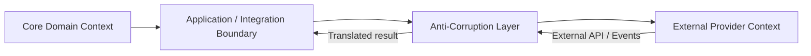
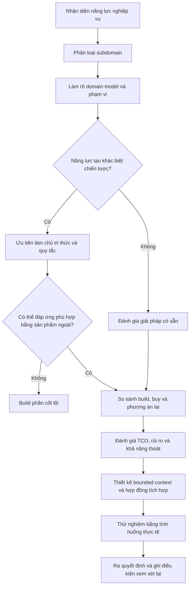

# Lựa chọn tự xây dựng, mua hoặc tích hợp theo đặc điểm miền con

Khi thiết kế một hệ thống doanh nghiệp, đội phát triển thường phải quyết định phần năng lực nào nên tự phát triển, phần nào nên mua từ nhà cung cấp và phần nào nên kết nối với một hệ thống hoặc dịch vụ bên ngoài. Đây là quyết định về sản phẩm, nghiệp vụ và kiến trúc cùng lúc. Chọn sai có thể khiến doanh nghiệp đầu tư nhiều năm vào một năng lực phổ thông, hoặc giao phần tạo lợi thế cạnh tranh cho một sản phẩm không thể phản ánh các quy tắc riêng của mình.

Domain-Driven Design (DDD) cung cấp một góc nhìn hữu ích cho quyết định này: phân loại miền con (subdomain) theo vai trò của chúng trong hoạt động kinh doanh. Một miền con cốt lõi (core subdomain) thường cần được đầu tư hiểu biết và năng lực phát triển riêng. Miền con hỗ trợ (supporting subdomain) cần thiết cho hoạt động nhưng thường không tạo ra khác biệt cạnh tranh trực tiếp. Miền con phổ thông (generic subdomain) giải quyết một vấn đề phổ biến mà nhiều doanh nghiệp cùng gặp. Sự phân loại này giúp đặt câu hỏi đúng trước khi chọn cách triển khai.

Không có quy tắc máy móc rằng mọi core subdomain đều phải tự xây dựng hoặc mọi generic subdomain đều phải mua. Quyết định còn phụ thuộc vào chiến lược, mức độ phù hợp của sản phẩm có sẵn, năng lực đội ngũ, tổng chi phí sở hữu, rủi ro và khả năng thay đổi trong tương lai. Mục tiêu là dành nguồn lực nội bộ cho những năng lực đáng tạo khác biệt, đồng thời kiểm soát tốt các phụ thuộc bên ngoài.

## 1. Xác định miền con trước khi chọn cách triển khai

### Domain, subdomain và bounded context có vai trò khác nhau

**Domain** là lĩnh vực hoạt động mà doanh nghiệp đang giải quyết, bao gồm mục tiêu, quy tắc, quy trình và thuật ngữ của lĩnh vực đó. **Subdomain** là một phần của domain, thường tương ứng với một nhóm vấn đề hoặc năng lực nghiệp vụ có mục tiêu và logic riêng. Việc chia domain thành các subdomain giúp đội ngũ hiểu doanh nghiệp đang làm những công việc gì và phần nào tạo ra giá trị.

**Bounded context** là ranh giới trong đó một mô hình miền và ngôn ngữ chung có ý nghĩa nhất quán. Một subdomain có thể được hiện thực hóa trong một hoặc nhiều bounded context; một bounded context cũng có thể bao gồm phần mô hình phục vụ một số năng lực liên quan. Vì vậy, không nên xem subdomain và bounded context là hai tên gọi cho cùng một khái niệm.

Phân loại core, supporting và generic mô tả vai trò chiến lược của một phần nghiệp vụ. Bounded context mô tả ranh giới mô hình và ngôn ngữ. Quyết định build, buy hoặc integrate là quyết định về cách doanh nghiệp sở hữu và cung cấp năng lực đó. Ba góc nhìn này bổ sung cho nhau nhưng trả lời ba câu hỏi khác nhau.

### Ba loại subdomain

| Loại miền con | Đặc điểm | Câu hỏi chiến lược | Hướng cân nhắc thường gặp |
|---|---|---|---|
| **Core subdomain (miền con cốt lõi)** | Chứa năng lực, quy tắc hoặc tri thức tạo khác biệt đáng kể; thường phức tạp và gắn với lợi thế cạnh tranh | “Năng lực nào khiến khách hàng chọn doanh nghiệp hoặc giúp doanh nghiệp vận hành tốt hơn đối thủ?” | Ưu tiên làm chủ tri thức và mô hình; thường cân nhắc tự xây dựng phần tạo khác biệt |
| **Supporting subdomain (miền con hỗ trợ)** | Cần thiết để core subdomain hoạt động nhưng bản thân thường không tạo khác biệt chiến lược | “Năng lực này hỗ trợ hoạt động nào và có yêu cầu riêng đến mức nào?” | Có thể tự xây dựng phần đặc thù, mua sản phẩm phù hợp hoặc đơn giản hóa quy trình |
| **Generic subdomain (miền con phổ thông)** | Bài toán phổ biến, có cách giải tương đối chuẩn hóa và nhiều giải pháp trên thị trường | “Doanh nghiệp có lý do cạnh tranh rõ ràng để tự giải quyết bài toán phổ thông này không?” | Thường cân nhắc mua, thuê dịch vụ hoặc dùng giải pháp có sẵn |

Ví dụ trong doanh nghiệp bán lẻ trực tuyến, thuật toán lựa chọn danh mục sản phẩm và khuyến mại cá nhân hóa có thể là core subdomain nếu đây là lợi thế cạnh tranh. Quản lý lịch làm việc của nhân viên kho có thể là supporting subdomain. Gửi email giao dịch có thể là generic subdomain. Nhưng với một công ty chuyên cung cấp nền tảng email, gửi email lại có thể là core subdomain. Phân loại luôn phụ thuộc vào chiến lược và bối cảnh của doanh nghiệp.

Một năng lực có thể thay đổi loại theo thời gian. Khi thị trường phát triển, một quy trình từng tạo khác biệt có thể trở thành chuẩn phổ thông. Ngược lại, một năng lực hỗ trợ có thể trở nên chiến lược khi doanh nghiệp mở rộng mô hình kinh doanh. Vì vậy, cần xem phân loại là nhận định có căn cứ tại một thời điểm, không phải nhãn cố định suốt vòng đời hệ thống.

## 2. Hiểu đúng ba lựa chọn: build, buy và integrate

### Build — tự xây dựng

Build nghĩa là doanh nghiệp tự thiết kế, phát triển và chịu trách nhiệm duy trì phần mềm hoặc năng lực nghiệp vụ. Đội ngũ có thể xây dựng toàn bộ giải pháp hoặc chỉ xây phần mô hình và quy tắc đặc thù, sau đó dùng các thư viện, nền tảng hạ tầng hay dịch vụ bên ngoài cho những phần phổ thông.

Tự xây dựng phù hợp khi quy tắc riêng có ý nghĩa chiến lược, sản phẩm có sẵn không thể đáp ứng mà không làm biến dạng nghiệp vụ, hoặc doanh nghiệp cần quyền kiểm soát sâu đối với hành vi và lộ trình phát triển. Đổi lại, doanh nghiệp phải đầu tư nhân lực, thời gian, vận hành, bảo mật, hỗ trợ, nâng cấp và xử lý các tình huống hiếm gặp.

Build không có nghĩa là tự viết mọi thứ từ đầu. Một hệ thống core có thể dùng cơ sở dữ liệu được quản lý, dịch vụ định danh, nền tảng quan sát hệ thống và thư viện phổ thông. Phần cần tự sở hữu là mô hình, quyết định và quy tắc tạo khác biệt; các thành phần kỹ thuật dùng chung có thể được tiêu chuẩn hóa.

### Buy — mua giải pháp có sẵn

Buy nghĩa là sử dụng sản phẩm thương mại, SaaS, nền tảng hoặc giải pháp có sẵn để đáp ứng một năng lực. Doanh nghiệp trả phí bản quyền, thuê bao, phí sử dụng hoặc chi phí triển khai theo điều khoản của nhà cung cấp.

Mua phù hợp khi quy trình tương đối phổ thông, sản phẩm đã trưởng thành, chức năng cần thiết có sẵn và lợi ích nhận được lớn hơn chi phí cùng rủi ro phụ thuộc. Giải pháp mua có thể giúp rút ngắn thời gian đưa năng lực vào sử dụng và tiếp cận kinh nghiệm vận hành mà doanh nghiệp chưa có.

Tuy vậy, giá thuê bao không phản ánh toàn bộ chi phí. Cần tính chi phí cấu hình, tùy biến, tích hợp, chuyển đổi dữ liệu, đào tạo, nâng cấp, hỗ trợ và thoát khỏi nhà cung cấp. Nếu sản phẩm buộc doanh nghiệp thay đổi quy tắc cốt lõi hoặc tạo ra quá nhiều ngoại lệ, lợi ích triển khai nhanh ban đầu có thể bị triệt tiêu.

### Integrate — tích hợp năng lực hoặc hệ thống

Integrate nghĩa là kết nối một năng lực do hệ thống khác, đối tác hoặc nhà cung cấp cung cấp vào hoạt động của doanh nghiệp. Tích hợp có thể dùng API, sự kiện, hàng đợi, trao đổi tệp, giao thức tiêu chuẩn hoặc một cơ chế khác tùy bối cảnh.

Tích hợp thường đi cùng buy: doanh nghiệp mua dịch vụ thanh toán rồi tích hợp nó vào quy trình đặt hàng. Tuy nhiên, tích hợp cũng có thể kết nối một hệ thống nội bộ đã tồn tại, một đối tác logistics hoặc một nền tảng dùng chung của tập đoàn. Do đó, integrate mô tả cách kết nối và sử dụng năng lực bên ngoài; nó không nhất thiết là lựa chọn thay thế hoàn toàn cho build hoặc buy.

Tích hợp không chỉ là gọi API thành công. Hai bên phải thống nhất ý nghĩa dữ liệu, trạng thái, quyền sở hữu, xử lý lỗi, thời điểm đồng bộ, bảo mật và trách nhiệm khi xảy ra sự cố. Nếu mô hình bên ngoài khác với ngôn ngữ nghiệp vụ nội bộ, cần có ranh giới chuyển đổi rõ ràng để mô hình của doanh nghiệp không bị phụ thuộc trực tiếp vào cấu trúc của nhà cung cấp.

## 3. Ghép loại subdomain với chiến lược triển khai

### Core subdomain: làm chủ năng lực tạo khác biệt

Với core subdomain, câu hỏi đầu tiên không phải là “có sản phẩm nào bán sẵn không?” mà là “doanh nghiệp cần làm chủ tri thức và quyết định nào để giữ lợi thế cạnh tranh?”. Nếu lợi thế nằm ở thuật toán, quy tắc, cách phân bổ nguồn lực hoặc trải nghiệm độc đáo, doanh nghiệp thường cần tự xây dựng và duy trì phần mô hình đó.

Tự xây dựng giúp đội ngũ thử nghiệm quy tắc mới, phản hồi nhanh trước thay đổi của thị trường và giữ tri thức nghiệp vụ trong tổ chức. Chuyên gia nghiệp vụ có thể cùng đội phát triển tinh chỉnh domain model, ubiquitous language và các quy tắc quan trọng mà không phải chờ lộ trình của một nhà cung cấp.

Tuy nhiên, không nên tự xây dựng chỉ vì một năng lực được gắn nhãn core. Nếu doanh nghiệp chưa có năng lực kỹ thuật, chưa hiểu rõ nghiệp vụ hoặc cần giải pháp khẩn cấp, có thể sử dụng một sản phẩm nền tảng hay đối tác để hỗ trợ giai đoạn đầu. Khi đó cần xác định phần nào là tri thức cốt lõi phải giữ quyền kiểm soát, dữ liệu nào phải truy cập được và điều kiện nào cho phép chuyển đổi sau này.

Một phương án thường hữu ích là tự xây domain model và quy tắc cốt lõi, nhưng dùng dịch vụ bên ngoài cho các chức năng hạ tầng hoặc tác vụ phổ thông. Ví dụ, doanh nghiệp tự quyết định cách xếp hạng sản phẩm và tính ưu đãi, nhưng dùng nền tảng cloud, công cụ phân tích hoặc dịch vụ gửi thông báo.

### Supporting subdomain: chọn theo mức độ đặc thù

Supporting subdomain cần được thực hiện tốt để hoạt động kinh doanh diễn ra, nhưng không nhất thiết phải tự tạo lợi thế cạnh tranh. Nếu quy trình gần với chuẩn thị trường, giải pháp có sẵn có thể giảm chi phí và rút ngắn thời gian. Nếu có quy định nội bộ, quy trình liên phòng ban hoặc cách vận hành đặc thù, tự xây một phần nhỏ có thể hợp lý hơn việc tùy biến sâu một sản phẩm lớn.

Đội ngũ nên phân biệt phần quy trình thực sự tạo giá trị với thói quen hoặc ngoại lệ phát sinh do hệ thống cũ. Không phải mọi yêu cầu được người dùng đề xuất đều là đặc thù không thể thay đổi. Workshop với chuyên gia nghiệp vụ có thể giúp loại bỏ bước thừa, thống nhất quy trình và thu hẹp phạm vi cần phát triển riêng.

Một supporting subdomain cũng có thể được triển khai theo mô hình lai: mua sản phẩm quản lý nhân sự tiêu chuẩn, sau đó tự xây một dịch vụ nhỏ để kết nối lịch làm việc với quy trình phân ca đặc thù. Phần tự xây cần có phạm vi rõ và không sao chép toàn bộ chức năng mà sản phẩm đã cung cấp tốt.

### Generic subdomain: tận dụng giải pháp phổ thông

Với generic subdomain, doanh nghiệp thường không thu được lợi thế tương xứng nếu tự phát triển một giải pháp đã phổ biến. Mua dịch vụ hoặc dùng sản phẩm có sẵn giúp đội ngũ tập trung vào các năng lực chiến lược.

Trước khi chọn, vẫn cần xác minh sản phẩm đáp ứng yêu cầu pháp lý, bảo mật, vận hành và tích hợp. Một năng lực có vẻ phổ thông như định danh, thanh toán, thuế hay lưu trữ hồ sơ có thể chịu quy định rất khác nhau giữa quốc gia, ngành nghề và loại giao dịch. “Generic” không có nghĩa là không quan trọng hoặc không cần kiểm soát.

Nếu không có sản phẩm phù hợp, có thể dùng một thư viện hoặc giải pháp mã nguồn mở đã được kiểm chứng, thuê đối tác hoặc tự xây phần tối thiểu. Quyết định cần xét cả chi phí duy trì và năng lực hỗ trợ lâu dài, không chỉ chi phí ban đầu.

### Ma trận định hướng ban đầu

| Loại subdomain | Build | Buy | Integrate |
|---|---|---|---|
| Core | Thường là lựa chọn ưu tiên cho quy tắc và tri thức tạo khác biệt | Cân nhắc khi sản phẩm chỉ đóng vai trò nền tảng hoặc doanh nghiệp chấp nhận giới hạn chiến lược | Dùng dịch vụ bổ trợ, nhưng bảo vệ mô hình và quyền quyết định cốt lõi |
| Supporting | Phù hợp khi quy trình có đặc thù đáng kể hoặc sản phẩm sẵn có không phù hợp | Phù hợp khi quy trình gần chuẩn thị trường và sản phẩm có khả năng cấu hình tốt | Phù hợp để kết nối công cụ chuyên biệt với quy trình nội bộ |
| Generic | Chỉ nên tự xây khi có yêu cầu đặc biệt hoặc không có giải pháp phù hợp | Thường là hướng cân nhắc đầu tiên nếu sản phẩm đáp ứng yêu cầu | Thường cần để đưa năng lực mua ngoài vào quy trình và mô hình nội bộ |

Ma trận này chỉ đưa ra hướng bắt đầu cho cuộc thảo luận. Quyết định cuối cùng cần dựa trên bằng chứng về chiến lược, mức độ phù hợp, tổng chi phí và rủi ro của từng phương án.

## 4. Các tiêu chí đánh giá trước khi quyết định

### Mức độ ảnh hưởng đến chiến lược

Xác định năng lực có tạo khác biệt cho khách hàng, doanh thu, chi phí, tốc độ vận hành hoặc khả năng thích ứng hay không. Nếu năng lực là một phần của lợi thế cạnh tranh, doanh nghiệp cần giữ khả năng định hình mô hình và lộ trình phát triển. Nếu năng lực chỉ hỗ trợ hoạt động theo cách phổ biến, tự đầu tư sâu có thể không đem lại giá trị tương xứng.

### Mức độ phù hợp với domain model

So sánh quy tắc và thuật ngữ thực tế với mô hình mà sản phẩm cung cấp. Kiểm tra các luồng chuẩn, ngoại lệ, quyền quyết định, trạng thái và bất biến nghiệp vụ. Một sản phẩm có nhiều chức năng chưa chắc phù hợp nếu các khái niệm nền tảng khác với cách doanh nghiệp vận hành.

Đặc biệt, cần phân biệt **cấu hình** với **tùy biến**. Cấu hình thường sử dụng những điểm mở mà nhà cung cấp đã hỗ trợ; tùy biến có thể đòi hỏi mã riêng, plugin hoặc sửa lõi sản phẩm. Tùy biến sâu làm tăng chi phí nâng cấp và khiến doanh nghiệp phụ thuộc vào nhà cung cấp hoặc đối tác triển khai.

### Độ phức tạp và mức độ thay đổi

Một quy trình nhiều quy tắc, ngoại lệ và quyết định liên tục thay đổi có thể khó phù hợp với sản phẩm đóng. Ngược lại, một quy trình ổn định và chuẩn hóa thường dễ mua hơn. Hãy xem xét không chỉ độ phức tạp hiện tại mà cả tốc độ thay đổi dự kiến trong chiến lược kinh doanh.

### Năng lực tổ chức và khả năng vận hành

Build đòi hỏi đội ngũ có kiến thức nghiệp vụ, kỹ thuật, bảo mật, kiểm thử, vận hành và hỗ trợ. Buy vẫn cần người quản lý nhà cung cấp, cấu hình, tích hợp, dữ liệu và sự cố. Không có lựa chọn nào loại bỏ trách nhiệm vận hành; chúng chỉ phân chia trách nhiệm giữa doanh nghiệp và đối tác theo cách khác nhau.

### Tổng chi phí sở hữu (Total Cost of Ownership — TCO)

Không so sánh chi phí tự xây trong một lần với phí thuê bao hàng tháng. Cần ước tính tổng chi phí trong một khoảng thời gian đủ dài, chẳng hạn ba đến năm năm, theo vòng đời dự kiến của năng lực.

| Nhóm chi phí | Build | Buy / Integrate |
|---|---|---|
| Ban đầu | Khám phá nghiệp vụ, thiết kế, phát triển, hạ tầng, kiểm thử | Phí bản quyền ban đầu, tư vấn, cấu hình, triển khai, tích hợp, chuyển đổi dữ liệu |
| Định kỳ | Lương đội ngũ, hạ tầng, giám sát, bảo mật, hỗ trợ, nâng cấp | Thuê bao, phí theo giao dịch, hỗ trợ, vận hành tích hợp, nâng cấp và tùy biến |
| Khi thay đổi | Phát triển tính năng, sửa mô hình, di chuyển dữ liệu | Phí thay đổi, giới hạn roadmap, tương thích phiên bản, thay đổi API và tái cấu hình |
| Khi kết thúc | Duy trì hoặc chuyển giao hệ thống, lưu trữ và di chuyển dữ liệu | Phí thoát hợp đồng, xuất dữ liệu, thay nhà cung cấp, viết lại tích hợp và đào tạo lại |

Một cách ước lượng đơn giản:

```text
TCO trong kỳ đánh giá =
    chi phí triển khai ban đầu
  + chi phí vận hành định kỳ
  + chi phí thay đổi và nâng cấp
  + chi phí tích hợp và quản lý phụ thuộc
  + chi phí rủi ro có thể ước lượng
  + chi phí chuyển đổi hoặc kết thúc
```

Ngoài chi phí trực tiếp, cần xem xét chi phí cơ hội. Thời gian đội ngũ dành để tự xây một chức năng phổ thông là thời gian không dành cho core subdomain. Ngược lại, phụ thuộc vào sản phẩm mua ngoài có thể làm chậm khả năng thử nghiệm một quy tắc quan trọng. Những tác động này nên được mô tả rõ thay vì cố gán một con số chính xác khi chưa có dữ liệu.

### Rủi ro nhà cung cấp và khả năng thoát

Với sản phẩm bên ngoài, hãy đánh giá độ ổn định của nhà cung cấp, SLA, hỗ trợ, lộ trình sản phẩm, tần suất thay đổi API, khả năng xuất dữ liệu, điều khoản chấm dứt và phương án thay thế. Kiểm tra mức độ phụ thuộc vào định dạng dữ liệu độc quyền, ngôn ngữ truy vấn riêng, plugin hoặc quy trình không thể chuyển đổi.

Khả năng thoát không nhất thiết có nghĩa là phải có thể thay nhà cung cấp ngay lập tức. Điều quan trọng là biết chi phí, thời gian, dữ liệu cần chuyển và những phần nghiệp vụ bị ảnh hưởng nếu phải rời đi.

### Bảo mật, pháp lý và quyền sở hữu dữ liệu

Xác định dữ liệu nào được gửi ra ngoài, lưu ở đâu, ai có thể truy cập, thời hạn lưu trữ, cách mã hóa, khả năng kiểm toán và nghĩa vụ pháp lý. Với dữ liệu cá nhân, tài chính hoặc dữ liệu thuộc ngành có quy định, cần có bộ phận phụ trách bảo mật và pháp chế tham gia đánh giá theo chính sách của tổ chức.

Làm rõ ai là chủ sở hữu dữ liệu và hệ thống nào là nguồn sự thật (system of record). Một nhà cung cấp có thể xử lý giao dịch hoặc lưu bản sao dữ liệu, nhưng điều đó không tự động khiến hệ thống của họ trở thành nơi quyết định mọi trạng thái nghiệp vụ nội bộ.

### Khả năng tích hợp và độ tin cậy

Đánh giá giao thức, API, webhook, thông điệp, giới hạn tốc độ, cơ chế xác thực, khả năng truy vấn trạng thái và hỗ trợ phiên bản. Xem xét độ trễ, thời gian gián đoạn, xử lý trùng lặp, thứ tự thông điệp, retry, timeout, đối soát và phục hồi khi hai hệ thống mất kết nối.

Nếu một giao dịch cần phản hồi đồng bộ, phải biết thời gian phản hồi và phương án khi dịch vụ không sẵn sàng. Nếu dùng xử lý bất đồng bộ, cần thiết kế trạng thái trung gian, cơ chế theo dõi và cách xử lý sự kiện đến muộn. Tích hợp tốt cần bao gồm cả tình huống lỗi, không chỉ luồng thành công.

## 5. Bảo vệ ranh giới bounded context khi dùng sản phẩm bên ngoài

Khi mua hoặc tích hợp một giải pháp, mô hình dữ liệu và thuật ngữ của nhà cung cấp có thể khác với mô hình nội bộ. Nếu đưa trực tiếp các kiểu dữ liệu, trạng thái và quy tắc của nhà cung cấp vào domain model, doanh nghiệp sẽ khó thay đổi sản phẩm và dễ làm ngôn ngữ nghiệp vụ bị chi phối bởi cấu trúc bên ngoài.

DDD khuyến khích xác định rõ ranh giới bounded context và cách các context giao tiếp. Có thể đặt một lớp chống tham nhũng (Anti-Corruption Layer — ACL) ở ranh giới để chuyển đổi mô hình bên ngoài sang mô hình nội bộ và ngược lại.



ACL có thể thực hiện các nhiệm vụ như:

- Chuyển đổi thuật ngữ và cấu trúc dữ liệu giữa hai mô hình.
- Ánh xạ trạng thái của nhà cung cấp sang trạng thái có ý nghĩa trong domain model nội bộ.
- Kiểm tra dữ liệu đầu vào và bảo vệ bất biến nghiệp vụ nội bộ.
- Che giấu chi tiết giao thức, phiên bản API và mã lỗi của nhà cung cấp.
- Xử lý retry, timeout, idempotency, đối soát và ghi nhận lỗi tích hợp.
- Cung cấp điểm thay thế adapter khi đổi nhà cung cấp hoặc kết nối hệ thống khác.

Không phải tích hợp nào cũng cần một ACL lớn. Nếu hai mô hình gần nhau, hợp đồng ổn định và rủi ro thấp, một adapter mỏng có thể đủ. Mức độ chuyển đổi nên tương xứng với khác biệt ngữ nghĩa và mức độ quan trọng của ranh giới.

### Một số quan hệ trong Context Map

Context Map giúp mô tả quan hệ giữa bounded context và cách mô hình được chia sẻ hoặc chuyển đổi. Khi tích hợp giải pháp ngoài, cần hiểu rõ bên nào định nghĩa hợp đồng và bên nào phải thích nghi.

| Quan hệ | Ý nghĩa khi tích hợp | Điều cần cân nhắc |
|---|---|---|
| Customer-Supplier | Context cung cấp có thể xem xét nhu cầu của context sử dụng khi phát triển hợp đồng | Thống nhất ưu tiên, phiên bản và cơ chế thông báo thay đổi |
| Conformist | Context sử dụng chấp nhận mô hình của bên cung cấp | Có thể giảm chi phí chuyển đổi nhưng làm mô hình nội bộ phụ thuộc mạnh vào bên ngoài |
| Anti-Corruption Layer | Context sử dụng chuyển đổi mô hình bên ngoài qua một lớp bảo vệ | Tăng công sức ban đầu nhưng giúp giữ ngôn ngữ và quy tắc nội bộ |
| Open Host Service / Published Language | Bên cung cấp công bố giao diện và ngôn ngữ tích hợp ổn định | Hợp đồng cần rõ, có tài liệu, versioning và chính sách tương thích |
| Shared Kernel | Hai context chia sẻ một phần mô hình hoặc mã được thống nhất | Cần quản trị thay đổi chặt chẽ vì thay đổi có thể ảnh hưởng cả hai bên |

Các mẫu quan hệ này không phải danh sách bắt buộc phải áp dụng. Chọn cách phù hợp với quyền kiểm soát hợp đồng, mức độ khác biệt của mô hình và khả năng phối hợp giữa các bên.

### Quy định quyền sở hữu dữ liệu và trạng thái

Trước khi tích hợp, hãy trả lời rõ:

- Context nào tạo và sở hữu dữ liệu nghiệp vụ?
- Hệ thống nào được quyền xác nhận một trạng thái đã hoàn tất?
- Bên ngoài được phép cập nhật những trường nào?
- Khi hai hệ thống có dữ liệu khác nhau, quy tắc đối soát là gì?
- Sự kiện nào được phát đi, có thể gửi lặp không và consumer phải xử lý ra sao?
- Làm thế nào để truy vết một giao dịch qua nhiều hệ thống?

Ví dụ, nhà cung cấp thanh toán có thể trả về trạng thái giao dịch `authorized`, `captured` hoặc `refunded`. Context đơn hàng nội bộ cần diễn giải các trạng thái này theo ngôn ngữ của nghiệp vụ và xác định chúng ảnh hưởng đến vòng đời đơn hàng như thế nào. Không nên để một mã trạng thái của nhà cung cấp tự động quyết định mọi quy tắc của đơn hàng.

## 6. Ví dụ: lựa chọn cách triển khai cho một doanh nghiệp bán lẻ trực tuyến

Giả sử doanh nghiệp bán hàng trực tuyến có ba năng lực cần đưa vào nền tảng mới: cá nhân hóa danh mục và khuyến mại, quản lý ca làm việc tại kho, và gửi thông báo giao dịch.

| Năng lực | Phân loại giả định | Đặc điểm cần kiểm tra | Hướng lựa chọn có thể phù hợp |
|---|---|---|---|
| Cá nhân hóa danh mục và khuyến mại | Core | Thuật toán và quy tắc ảnh hưởng trực tiếp đến trải nghiệm, tỷ lệ chuyển đổi và chiến lược bán hàng | Tự xây domain model và quy tắc cốt lõi; có thể dùng nền tảng dữ liệu hoặc hạ tầng bên ngoài |
| Quản lý ca làm việc tại kho | Supporting | Quy trình cần thiết, có thể có một số quy định riêng nhưng thường không phải lợi thế cạnh tranh chính | Mua sản phẩm phù hợp hoặc xây phần mở rộng nhỏ nếu quy trình đặc thù đã được xác minh |
| Gửi thông báo giao dịch | Generic | Có nhiều dịch vụ phổ biến hỗ trợ email, SMS hoặc push notification | Mua dịch vụ và tích hợp qua adapter; nội bộ quản lý nội dung và quy tắc thời điểm gửi nếu đó là logic nghiệp vụ |

Với năng lực cá nhân hóa, nhóm cần làm việc với chuyên gia nghiệp vụ để xác định quy tắc phân nhóm khách hàng, ưu tiên sản phẩm, giới hạn khuyến mại và các trường hợp không được áp dụng ưu đãi. Những quy tắc này tạo ra domain model riêng, vì vậy cần được doanh nghiệp làm chủ. Nền tảng phân tích hoặc dịch vụ tính toán có thể hỗ trợ nhưng không nên tự ý thay thế các quyết định nghiệp vụ.

Với quản lý ca làm việc, nhóm nên khảo sát các sản phẩm có sẵn và so sánh với quy trình thực tế. Nếu chỉ cần phân ca, đổi ca và theo dõi giờ làm theo chuẩn, mua sản phẩm có thể hợp lý. Nếu kho có quy tắc phân bổ nhân lực dựa trên loại hàng, năng lực xử lý hoặc cam kết giao hàng, có thể xây một thành phần bổ trợ kết nối với sản phẩm quản lý nhân sự.

Với thông báo, nhóm có thể dùng nhà cung cấp chuyên biệt. Bounded context nội bộ phát ra yêu cầu gửi thông báo theo sự kiện nghiệp vụ đã xác định; adapter chuyển yêu cầu sang giao thức của nhà cung cấp. Nếu sau này đổi dịch vụ, domain model và quy trình đơn hàng không cần biết chi tiết API cũ.

Đây là phân loại và hướng triển khai giả định. Nếu chiến lược, quy mô, quy định hoặc mô hình vận hành thay đổi, nhóm cần đánh giá lại thay vì sao chép lựa chọn của ví dụ.

## 7. Quy trình ra quyết định build, buy hoặc integrate

Một quyết định tốt nên bắt đầu từ năng lực nghiệp vụ và kết thúc bằng phương án có thể kiểm chứng. Có thể thực hiện theo các bước sau:

### Bước 1: Mô tả năng lực và kết quả mong muốn

Viết rõ năng lực phục vụ ai, giải quyết vấn đề nào, tạo kết quả gì và có liên hệ với mục tiêu kinh doanh nào. Tránh bắt đầu bằng tên sản phẩm hoặc yêu cầu mua một công cụ cụ thể.

### Bước 2: Phân loại subdomain

Xác định năng lực thuộc core, supporting hay generic. Ghi lại lý do dựa trên chiến lược và giá trị tạo ra. Nếu chưa đủ thông tin, đánh dấu phân loại là giả định và lên kế hoạch xác minh với chuyên gia nghiệp vụ.

### Bước 3: Làm rõ domain model và phạm vi

Thu thập thuật ngữ, quy tắc, luồng chính, ngoại lệ, dữ liệu và quyết định. Xác định bounded context nào sở hữu mô hình và những context nào cần trao đổi. Điều này giúp tránh đánh giá sản phẩm chỉ dựa trên danh sách chức năng.

### Bước 4: Khảo sát các phương án thực tế

Xem xét tự xây, mua sản phẩm, dùng dịch vụ, tận dụng hệ thống hiện có, hợp tác với đối tác hoặc kết hợp các phương án. Với sản phẩm bên ngoài, dùng kịch bản nghiệp vụ thực tế để kiểm tra mức độ phù hợp; không chỉ dựa vào bản trình diễn hoặc danh sách tính năng.

### Bước 5: So sánh tổng chi phí, rủi ro và khả năng thay đổi

Đánh giá TCO, thời gian triển khai, năng lực đội ngũ, bảo mật, pháp lý, độ tin cậy, phụ thuộc nhà cung cấp và chi phí thoát. Ghi rõ giả định của ước lượng và khoảng thời gian đánh giá.

### Bước 6: Thiết kế ranh giới và hợp đồng tích hợp

Nếu dùng hệ thống bên ngoài, xác định nguồn sự thật, quyền sở hữu dữ liệu, API hoặc event contract, mô hình chuyển đổi, xử lý lỗi, giám sát và versioning. Xác định có cần ACL hay adapter mỏng.

### Bước 7: Thử nghiệm với phạm vi nhỏ

Thực hiện proof of concept hoặc pilot bằng các tình huống đại diện, bao gồm luồng lỗi và ngoại lệ. Đo thời gian xử lý, độ chính xác, công sức vận hành và khả năng thay đổi. Thử nghiệm phải trả lời được những rủi ro quan trọng đã nêu trong quyết định.

### Bước 8: Ghi quyết định và điều kiện xem xét lại

Lưu lựa chọn, lý do, bằng chứng, người chịu trách nhiệm, rủi ro được chấp nhận và điều kiện khiến nhóm cần đánh giá lại. Một quyết định build/buy không nên trở thành cam kết vĩnh viễn nếu chiến lược hoặc thị trường thay đổi.

Sơ đồ dưới đây tóm tắt luồng ra quyết định:



Sơ đồ chỉ là luồng hỗ trợ thảo luận. Trong thực tế, nhóm có thể quay lại bước phân loại hoặc làm rõ domain model khi phát hiện thông tin mới.

## 8. Ghi lại quyết định để có thể xem xét về sau

Quyết định build/buy/integrate thường ảnh hưởng lâu dài đến chi phí, kiến trúc và năng lực tổ chức. Vì vậy, nên lưu lại lý do và bối cảnh thay vì chỉ ghi tên sản phẩm đã chọn.

Một bản ghi quyết định có thể gồm:

| Trường | Nội dung |
|---|---|
| Mã quyết định | Mã tham chiếu ổn định |
| Năng lực / subdomain | Phần nghiệp vụ đang được đánh giá và phân loại hiện tại |
| Bounded context liên quan | Context sở hữu mô hình và các context cần tích hợp |
| Phương án được chọn | Build, buy, integrate hoặc phương án kết hợp |
| Phương án đã cân nhắc | Các lựa chọn khác và lý do không chọn |
| Bằng chứng | Kết quả khảo sát, pilot, phỏng vấn, báo giá và đánh giá kỹ thuật |
| Chi phí và lợi ích | TCO dự kiến, thời gian triển khai, chi phí cơ hội và giá trị mong đợi |
| Rủi ro và biện pháp | Phụ thuộc, bảo mật, vận hành, dữ liệu, khả năng thoát và cách giảm thiểu |
| Chủ sở hữu | Người hoặc nhóm chịu trách nhiệm nghiệp vụ và kỹ thuật |
| Điều kiện xem xét lại | Thay đổi chiến lược, chi phí, sản phẩm, quy định hoặc mức độ phù hợp |
| Ngày và trạng thái | Ngày quyết định, thời điểm rà soát tiếp theo và trạng thái hiện tại |

Ví dụ mẫu ở dạng YAML:

```yaml
decision:
  id: ADR-024
  capability: "Gửi thông báo giao dịch"
  subdomain_type: "generic"
  bounded_contexts:
    - "Order Management"
    - "Notification"
  selected_approach: "buy-and-integrate"
  rationale:
    - "Năng lực gửi email và SMS có nhiều dịch vụ trưởng thành trên thị trường."
    - "Quy tắc chọn thời điểm và nội dung thông báo vẫn do domain nội bộ quản lý."
  alternatives:
    - "Tự xây toàn bộ dịch vụ gửi thông báo"
    - "Dùng trực tiếp API nhà cung cấp trong Order Management"
  integration:
    boundary: "Notification adapter"
    data_owner: "Notification context"
    contract: "Internal notification request"
  risks:
    - "Phụ thuộc SLA và giới hạn tốc độ của nhà cung cấp"
    - "Thay đổi API có thể ảnh hưởng adapter"
  mitigations:
    - "Theo dõi lỗi và tỷ lệ gửi thất bại"
    - "Lưu mã tham chiếu để đối soát"
    - "Đánh giá khả năng chuyển nhà cung cấp"
  review_when:
    - "Chi phí theo giao dịch vượt ngưỡng đã thống nhất"
    - "Yêu cầu pháp lý hoặc chiến lược kênh thông báo thay đổi"
```

Đây là ví dụ minh họa, không phải cấu trúc bắt buộc. Tổ chức có thể sử dụng Architecture Decision Record (ADR), tài liệu mua sắm hoặc hệ thống quản lý quyết định hiện có, miễn là thông tin quan trọng có thể truy tìm và cập nhật.

## 9. Những sai lầm thường gặp

- **Cho rằng core luôn phải tự xây toàn bộ:** cần xác định chính xác phần tri thức tạo khác biệt. Hạ tầng, lưu trữ hoặc chức năng phổ thông vẫn có thể dùng dịch vụ bên ngoài.
- **Cho rằng generic là không quan trọng:** năng lực phổ thông vẫn có thể ảnh hưởng lớn đến an toàn, tuân thủ và hoạt động kinh doanh. Cần đánh giá chất lượng và rủi ro như mọi năng lực khác.
- **Đồng nhất subdomain với bounded context:** phân loại chiến lược không tự động xác định ranh giới mô hình hoặc ranh giới triển khai. Cần phân tích ngôn ngữ, quy tắc và quyền sở hữu riêng.
- **Chọn sản phẩm theo số lượng tính năng:** tính năng nhiều không đảm bảo phù hợp với domain model. Hãy kiểm tra các quy tắc và ngoại lệ thực tế.
- **Đánh giá theo giá mua ban đầu:** bỏ qua tích hợp, tùy biến, nâng cấp, vận hành và thoát nhà cung cấp sẽ làm sai lệch TCO.
- **Tùy biến quá sâu sản phẩm bên ngoài:** thay đổi lõi hoặc tạo nhiều plugin riêng có thể khiến việc nâng cấp khó khăn và làm tăng phụ thuộc.
- **Để mô hình nhà cung cấp tràn vào domain model:** dùng trực tiếp mã trạng thái, kiểu dữ liệu và thuật ngữ bên ngoài khiến mô hình nội bộ khó thay đổi. Cần ranh giới chuyển đổi phù hợp.
- **Không xác định nguồn sự thật:** nhiều hệ thống cùng được phép sửa trạng thái có thể tạo dữ liệu mâu thuẫn và khó đối soát.
- **Chỉ thử luồng thành công:** bỏ qua timeout, gửi lặp, lỗi mạng, sự kiện đến muộn và phục hồi sẽ khiến tích hợp thiếu độ tin cậy.
- **Không đánh giá lại quyết định:** phân loại subdomain và thị trường sản phẩm có thể thay đổi. Cần xem lại khi có tín hiệu rõ ràng.

## 10. Khi nào cần xem xét lại lựa chọn?

Một phương án từng hợp lý có thể trở nên không phù hợp khi bối cảnh thay đổi. Các tín hiệu nên kích hoạt việc đánh giá lại gồm:

- Năng lực bắt đầu ảnh hưởng trực tiếp đến lợi thế cạnh tranh hoặc trải nghiệm khách hàng.
- Quy tắc nghiệp vụ thay đổi thường xuyên nhưng sản phẩm bên ngoài không hỗ trợ kịp.
- Chi phí thuê bao, phí theo giao dịch hoặc chi phí tùy biến tăng vượt dự kiến.
- Nhà cung cấp thay đổi SLA, API, điều khoản, chính sách dữ liệu hoặc lộ trình sản phẩm.
- Tỷ lệ lỗi tích hợp, độ trễ hoặc thời gian phục hồi ảnh hưởng đến cam kết nghiệp vụ.
- Doanh nghiệp mở rộng sang thị trường mới với yêu cầu pháp lý hoặc quy trình khác.
- Đội ngũ nội bộ đã có năng lực mới hoặc xuất hiện sản phẩm thay thế phù hợp hơn.
- Việc sử dụng hệ thống cũ tạo ra nhiều bản sao dữ liệu hoặc làm mờ quyền sở hữu giữa các bounded context.

Đánh giá lại không có nghĩa là phải thay đổi ngay. Nhóm có thể tiếp tục phương án hiện tại, điều chỉnh hợp đồng, giảm tùy biến, bổ sung ACL hoặc lập kế hoạch chuyển đổi theo giai đoạn. Quyết định cần dựa trên bằng chứng và so sánh chi phí thay đổi với lợi ích dự kiến.

## 11. Checklist trước khi chốt phương án

Trước khi phê duyệt build, buy hoặc integrate, hãy xác nhận:

- Năng lực và kết quả nghiệp vụ mong muốn đã được mô tả rõ chưa?
- Phân loại core, supporting hay generic có lý do và bằng chứng chưa?
- Nhóm đã phân biệt subdomain với bounded context chưa?
- Các quy tắc, thuật ngữ, ngoại lệ và phạm vi dữ liệu đã được làm rõ chưa?
- Sản phẩm có sẵn đã được thử với kịch bản nghiệp vụ đại diện chưa?
- TCO đã tính chi phí tích hợp, vận hành, thay đổi và thoát chưa?
- Năng lực nội bộ và trách nhiệm vận hành đã được xác định chưa?
- Rủi ro bảo mật, pháp lý, dữ liệu và nhà cung cấp đã được đánh giá chưa?
- Nguồn sự thật, quyền sở hữu dữ liệu và hợp đồng tích hợp đã rõ chưa?
- Có cơ chế xử lý lỗi, đối soát, giám sát và thay đổi phiên bản không?
- Quyết định có người sở hữu, bằng chứng và điều kiện xem xét lại không?

Lựa chọn build, buy hay integrate không chỉ là quyết định tiết kiệm chi phí phát triển. Đó là cách doanh nghiệp quyết định tri thức nào cần tự làm chủ, năng lực nào nên tận dụng từ thị trường và các hệ thống sẽ phối hợp với nhau ra sao. Khi quyết định dựa trên đặc điểm subdomain, được đặt trong ranh giới bounded context rõ ràng và có thể xem xét lại bằng bằng chứng, kiến trúc có cơ hội hỗ trợ chiến lược kinh doanh lâu dài mà không tạo ra những khoản đầu tư không cần thiết.
