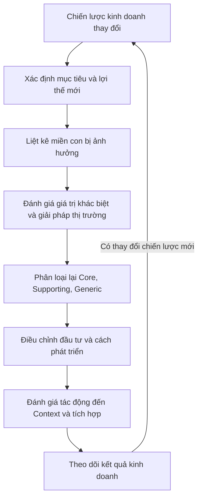

# Điều chỉnh phân loại miền con khi chiến lược kinh doanh thay đổi

Trong Domain-Driven Design (DDD), việc phân loại miền con thành **Core Subdomain**, **Supporting Subdomain** và **Generic Subdomain** giúp doanh nghiệp quyết định nên tập trung năng lực phát triển vào đâu. Tuy nhiên, giá trị chiến lược của một năng lực không cố định mãi mãi. Khi doanh nghiệp thay đổi khách hàng mục tiêu, mô hình doanh thu, cách cạnh tranh hoặc vai trò của sản phẩm, một miền con từng là phần hỗ trợ có thể trở thành năng lực cốt lõi; một miền con từng tạo khác biệt cũng có thể trở thành năng lực phổ biến mà thị trường đã chuẩn hóa.

Vì vậy, phân loại miền con cần được xem là một nhận định chiến lược có thể kiểm chứng và điều chỉnh. Nhóm cần xem lại nó khi có thay đổi đáng kể trong chiến lược, đánh giá năng lực nào đang tạo ra lợi thế cạnh tranh, xác định phạm vi miền con bị ảnh hưởng rồi điều chỉnh mức đầu tư, cách phát triển và các quyết định kiến trúc tương ứng. Việc đổi nhãn tự nó không làm mô hình phần mềm tốt hơn; giá trị nằm ở những quyết định cụ thể được thay đổi dựa trên hiểu biết mới.

## 1. Ôn lại miền nghiệp vụ và ba loại miền con

**Domain (miền nghiệp vụ)** là lĩnh vực vấn đề mà doanh nghiệp hoạt động và phần mềm được xây dựng để hỗ trợ. Một miền lớn thường gồm nhiều nhóm năng lực hoặc vấn đề nhỏ hơn, được gọi là **Subdomain (miền con)**.

Ví dụ, một doanh nghiệp thương mại điện tử có thể có các miền con như quản lý danh mục, tìm kiếm sản phẩm, định giá, đặt hàng, thanh toán, quản lý tồn kho, giao nhận và chăm sóc khách hàng. Việc chia miền con giúp nhóm nói về các phần nghiệp vụ có mục tiêu riêng, phân tích độ phức tạp và xác định nơi cần đầu tư.

DDD thường phân loại miền con theo vai trò của chúng đối với chiến lược kinh doanh:

| Loại miền con | Vai trò chiến lược | Cách tiếp cận thường phù hợp |
| --- | --- | --- |
| **Core Subdomain (miền lõi)** | Năng lực tạo khác biệt có ý nghĩa và góp phần quyết định khả năng cạnh tranh của doanh nghiệp. | Đầu tư vào chuyên gia giỏi, hiểu biết sâu về nghiệp vụ, mô hình phù hợp và đội phát triển có trách nhiệm rõ ràng. |
| **Supporting Subdomain (miền hỗ trợ)** | Năng lực cần thiết để vận hành mô hình kinh doanh nhưng không phải nguồn khác biệt chính. | Xây dựng vừa đủ theo quy trình riêng của doanh nghiệp; tránh đầu tư quá mức nếu không tạo thêm lợi thế. |
| **Generic Subdomain (miền tổng quát)** | Năng lực phổ biến, nhiều doanh nghiệp có nhu cầu tương tự và có thể dùng giải pháp tiêu chuẩn. | Cân nhắc mua, thuê dịch vụ, dùng sản phẩm có sẵn hoặc áp dụng giải pháp phổ biến. |

Ví dụ, xác thực người dùng thường là năng lực tổng quát vì có nhiều giải pháp trưởng thành. Nhưng với một doanh nghiệp mà công nghệ xác minh danh tính là yếu tố tạo lợi thế và tuân thủ đặc thù, phần năng lực đó có thể mang vai trò chiến lược khác. Việc phân loại phụ thuộc vào chiến lược và thị trường của doanh nghiệp, không chỉ phụ thuộc vào tên chức năng.

## 2. Vì sao phân loại miền con có thể thay đổi?

Phân loại miền con trả lời câu hỏi: **Năng lực này quan trọng như thế nào đối với lợi thế cạnh tranh hiện tại và định hướng sắp tới của doanh nghiệp?** Khi câu trả lời thay đổi, cách phân loại cũng cần được xem lại.

### 2.1. Doanh nghiệp thay đổi mô hình kinh doanh

Một nhà bán lẻ trực tuyến có thể chuyển thành sàn thương mại điện tử kết nối nhiều người bán. Trước đây, năng lực quản lý kho và vận hành bán lẻ có thể là phần quan trọng nhất. Sau khi chuyển mô hình, năng lực kết nối người bán với người mua, xếp hạng độ tin cậy, xử lý tranh chấp và tối ưu giao dịch giữa nhiều bên có thể trở thành phần tạo khác biệt.

Những năng lực mới có thể trở thành Core Subdomain; một số quy trình kho vận cũ có thể chuyển thành Supporting Subdomain hoặc được cung cấp bởi đối tác.

### 2.2. Khách hàng mục tiêu và nhu cầu thị trường thay đổi

Một sản phẩm phần mềm ban đầu phục vụ doanh nghiệp nhỏ có thể chuyển sang nhóm khách hàng lớn với yêu cầu kiểm soát, phân quyền, tích hợp và tuân thủ cao hơn. Khả năng quản trị quyền truy cập hoặc kiểm toán, vốn từng được xem là chức năng hỗ trợ, có thể trở thành yếu tố quyết định khách hàng lựa chọn sản phẩm.

### 2.3. Đối thủ cạnh tranh làm năng lực cũ trở nên phổ biến

Một thuật toán hoặc quy trình từng tạo lợi thế có thể được chuẩn hóa, trở thành tính năng phổ biến hoặc có thể mua từ nhà cung cấp. Khi khách hàng không còn xem nó là lý do để chọn sản phẩm, doanh nghiệp cần đánh giá liệu năng lực đó còn là Core Subdomain hay đã trở thành Generic Subdomain.

### 2.4. Công nghệ hoặc hệ sinh thái thay đổi

Một dịch vụ nền tảng mới có thể làm một năng lực trước đây phải tự xây dựng trở nên dễ mua và đáng tin cậy. Ngược lại, công nghệ mới có thể mở ra cách tạo giá trị mà đối thủ chưa làm tốt, khiến năng lực khai thác công nghệ đó trở thành miền lõi.

### 2.5. Quy định và rủi ro làm thay đổi ưu tiên

Thay đổi pháp lý, yêu cầu kiểm toán, bảo mật hoặc trách nhiệm với khách hàng có thể làm một năng lực trở nên quan trọng hơn. Điều này không tự động biến mọi chức năng tuân thủ thành Core Subdomain. Nhóm cần xác định phần nào tạo khác biệt, phần nào là điều kiện bắt buộc để hoạt động và phần nào có thể đáp ứng bằng giải pháp tiêu chuẩn.

### 2.6. Doanh nghiệp học được điều mới từ vận hành

Dữ liệu sử dụng, phản hồi khách hàng, chi phí phục vụ và các thử nghiệm có thể cho thấy một năng lực đang đóng góp vào kết quả kinh doanh theo cách trước đây nhóm chưa nhận ra. Phân loại nên được điều chỉnh dựa trên bằng chứng này thay vì giữ nguyên nhận định ban đầu.

## 3. Dấu hiệu cần xem xét lại phân loại

Không cần phân loại lại chỉ vì có một yêu cầu tính năng mới. Nhóm nên mở một lần đánh giá khi xuất hiện tín hiệu cho thấy vai trò của năng lực đối với chiến lược đã thay đổi.

| Dấu hiệu | Câu hỏi cần kiểm tra | Ví dụ |
| --- | --- | --- |
| Chiến lược hoặc mô hình doanh thu đổi hướng | Năng lực nào hiện tạo ra giá trị và doanh thu chính? | Doanh nghiệp chuyển từ bán hàng trực tiếp sang nền tảng nhiều người bán. |
| Khách hàng coi một năng lực là lý do mua sản phẩm | Năng lực đó có ảnh hưởng rõ đến khả năng thắng hoặc giữ khách không? | Khách hàng doanh nghiệp chọn sản phẩm vì khả năng kiểm toán chi tiết. |
| Đối thủ đã cung cấp năng lực tương đương | Khả năng này còn tạo khác biệt hay đã thành kỳ vọng cơ bản? | Tính năng tìm kiếm phổ thông đã có thể dùng dịch vụ tiêu chuẩn. |
| Chi phí tự phát triển tăng nhưng giá trị khác biệt thấp | Có giải pháp bên ngoài đáng tin cậy đáp ứng tốt không? | Tích hợp gửi email và thông báo được cung cấp như dịch vụ. |
| Năng lực cũ không còn phù hợp với định hướng | Có nên giảm đầu tư, chuyển giao hoặc loại bỏ? | Doanh nghiệp ngừng tự vận hành kho và chuyển sang đối tác logistics. |
| Năng lực mới trở thành trọng tâm | Có cần đội ngũ, dữ liệu và mô hình chuyên sâu hơn không? | Nền tảng bắt đầu cạnh tranh bằng thuật toán ghép nối cung cầu. |
| Các quyết định đầu tư không còn khớp phân loại | Nguồn lực có đang được phân bổ theo giá trị chiến lược thực tế? | Đội ngũ dành phần lớn thời gian cho chức năng ít ảnh hưởng đến lựa chọn của khách hàng. |

Một dấu hiệu đơn lẻ chỉ là lý do để đặt câu hỏi. Trước khi đổi phân loại, nhóm cần xác minh mức độ ảnh hưởng, phạm vi năng lực và tính bền vững của thay đổi.

## 4. Quy trình đánh giá và điều chỉnh phân loại miền con

Có thể tổ chức việc đánh giá thành bảy bước. Người tham gia nên bao gồm người hiểu chiến lược kinh doanh, chuyên gia nghiệp vụ của các miền liên quan, người phụ trách sản phẩm và đại diện đội phát triển. Mục tiêu là thống nhất vai trò của năng lực, sau đó xác định hệ quả đối với sản phẩm và phần mềm.

### Bước 1: Xác định thay đổi chiến lược

Mô tả điều gì đã thay đổi và vì sao thay đổi đó quan trọng. Tránh bắt đầu bằng kết luận “miền con X phải trở thành Core”. Hãy ghi nhận mục tiêu kinh doanh mới, khách hàng mục tiêu, nguồn doanh thu, lợi thế cần xây dựng và các năng lực cần có.

Ví dụ:

- Trước đây doanh nghiệp tối ưu lợi nhuận bằng cách bán sản phẩm của chính mình.
- Hiện tại doanh nghiệp muốn trở thành nền tảng kết nối nhiều nhà bán hàng.
- Thành công phụ thuộc vào số lượng người bán chất lượng, khả năng tạo niềm tin, tỷ lệ giao dịch thành công và hiệu quả giải quyết tranh chấp.

Những thay đổi này tạo cơ sở để đánh giá lại các năng lực liên quan.

### Bước 2: Xác định các miền con bị ảnh hưởng

Liệt kê các năng lực nghiệp vụ liên quan trực tiếp hoặc gián tiếp đến chiến lược mới. Không nên chỉ nhìn vào tên hệ thống hoặc module kỹ thuật. Hãy mô tả năng lực bằng kết quả mà doanh nghiệp cần đạt.

Ví dụ với nền tảng nhiều người bán:

- Thu hút và tiếp nhận người bán.
- Xác minh và đánh giá độ tin cậy của người bán.
- Quản lý danh mục và chất lượng thông tin sản phẩm.
- Ghép nối người mua với sản phẩm phù hợp.
- Quản lý giao dịch và thanh toán giữa nhiều bên.
- Giải quyết khiếu nại và tranh chấp.
- Hỗ trợ giao nhận và đối soát.

Sau đó xác định ranh giới từng miền con đủ rõ để không gom các năng lực khác nhau vào một nhãn quá rộng.

### Bước 3: Đánh giá giá trị khác biệt và mức độ phổ biến

Với từng miền con, hãy trả lời các câu hỏi:

1. Năng lực này có đóng góp trực tiếp vào lý do khách hàng chọn doanh nghiệp không?
2. Doanh nghiệp có cách làm, dữ liệu, quy trình hoặc tri thức đặc thù mà đối thủ khó sao chép không?
3. Năng lực này có liên quan đến mục tiêu chiến lược trong vài chu kỳ tiếp theo không?
4. Thị trường đã có giải pháp tiêu chuẩn đủ tốt để đáp ứng chưa?
5. Nếu năng lực này yếu đi, lợi thế cạnh tranh hoặc khả năng vận hành bị ảnh hưởng ở mức nào?
6. Phần nào là khác biệt riêng, phần nào chỉ là yêu cầu vận hành phổ biến?

Không nên đánh giá Core Subdomain chỉ bằng độ phức tạp kỹ thuật, số lượng dòng code hoặc quy mô đội ngũ. Một quy trình có thể rất phức tạp nhưng vẫn là năng lực phổ biến. Ngược lại, một thuật toán tương đối nhỏ có thể là phần cốt lõi nếu nó tạo ra lợi thế quan trọng.

### Bước 4: Phân loại lại và ghi rõ lý do

Đặt từng miền con vào một trong ba nhóm, đồng thời ghi nhận bằng chứng và mức độ tin cậy của nhận định. Nếu một năng lực gồm cả phần khác biệt và phần phổ biến, hãy xem có thể tách miền con hoặc tách phạm vi trách nhiệm để phân loại chính xác hơn không.

Ví dụ về kết quả đánh giá:

| Miền con | Phân loại trước | Phân loại sau | Lý do thay đổi |
| --- | --- | --- | --- |
| Quản lý tồn kho nội bộ | Core | Supporting | Doanh nghiệp không còn tự vận hành kho; năng lực này hỗ trợ mô hình nhưng không còn tạo khác biệt chính. |
| Ghép nối người mua và người bán | Chưa tồn tại như năng lực riêng | Core | Hiệu quả ghép nối ảnh hưởng trực tiếp đến tỷ lệ giao dịch và giá trị nền tảng. |
| Gửi thông báo | Supporting | Generic | Dịch vụ thị trường đáp ứng đủ nhu cầu phổ biến với chi phí và độ tin cậy phù hợp. |
| Xác minh người bán | Supporting | Core | Niềm tin và chất lượng người bán trở thành yếu tố quyết định khả năng thu hút người mua. |

Không cần ép mọi miền con phải thay đổi nhãn. Những năng lực không bị ảnh hưởng vẫn có thể giữ nguyên phân loại nếu bằng chứng và chiến lược hiện tại tiếp tục ủng hộ nhận định đó.

### Bước 5: Xác định cách đầu tư và nguồn cung cấp

Phân loại chỉ có ý nghĩa khi dẫn đến quyết định. Với Core Subdomain, doanh nghiệp thường cần đầu tư vào hiểu biết nghiệp vụ, dữ liệu, năng lực thiết kế và đội phát triển có thể cải tiến liên tục. Với Supporting Subdomain, mục tiêu là đáp ứng quy trình riêng với mức đầu tư hợp lý. Với Generic Subdomain, cần đánh giá giải pháp có sẵn, dịch vụ bên ngoài hoặc chuẩn phổ biến.

Việc chọn mua hay tự xây không nên chỉ dựa trên nhãn. Một miền con tổng quát vẫn có thể cần tích hợp hoặc kiểm soát dữ liệu chặt chẽ; một miền lõi vẫn có thể dùng thư viện hoặc hạ tầng tiêu chuẩn. Điều quan trọng là doanh nghiệp giữ quyền làm chủ phần tri thức tạo khác biệt.

### Bước 6: Đánh giá tác động đến mô hình và kiến trúc

Sau khi phân loại, xem lại các Bounded Context, hợp đồng tích hợp, quyền sở hữu dữ liệu và trách nhiệm đội ngũ. Hỏi xem năng lực mới có cần mô hình chuyên biệt, có cần giảm phụ thuộc vào nhà cung cấp hay có cần thay đổi cách các ngữ cảnh phối hợp không.

Không được suy ra rằng đổi nhãn miền con đồng nghĩa phải đổi Bounded Context hoặc tách microservice. Có thể chiến lược đã đổi nhưng mô hình và ranh giới hiện tại vẫn phù hợp. Chỉ điều chỉnh ranh giới khi quy tắc, ngôn ngữ, quyền sở hữu hoặc nhu cầu thay đổi thực sự đòi hỏi.

### Bước 7: Theo dõi và đánh giá lại

Ghi nhận giả định, bằng chứng, người xác nhận, quyết định đầu tư và kết quả kỳ vọng. Sau khi thực hiện, theo dõi chỉ số kinh doanh và phản hồi vận hành để biết việc phân loại có phản ánh đúng giá trị thực tế không.

Nên xem xét lại khi có sự kiện chiến lược như đổi phân khúc khách hàng, ra mắt mô hình doanh thu mới, mua bán hoặc hợp tác chiến lược, thay đổi quy định lớn hay đối thủ đưa ra năng lực thay thế. Việc đánh giá định kỳ cũng hữu ích, nhưng không nên biến thành thủ tục chỉ đổi nhãn mà không có quyết định thực tế.

## 5. Ví dụ xuyên suốt: từ nhà bán lẻ sang sàn thương mại điện tử

Giả sử doanh nghiệp ban đầu bán sản phẩm do mình sở hữu. Hệ thống được xây dựng xoay quanh danh mục hàng hóa, định giá, tồn kho, đặt hàng, thanh toán và giao nhận. Lợi thế của doanh nghiệp đến từ khả năng chọn nguồn hàng, quản lý tồn kho và giao hàng nhanh.

Trong giai đoạn đó, nhóm chiến lược xác định:

| Miền con | Phân loại ban đầu | Giải thích |
| --- | --- | --- |
| Quản lý nguồn hàng và tồn kho | Core | Khả năng chọn hàng và bảo đảm có hàng tạo lợi thế. |
| Định giá và khuyến mãi | Core | Chính sách giá giúp thu hút khách và tối ưu biên lợi nhuận. |
| Quản lý đơn hàng | Supporting | Cần thiết để thực hiện giao dịch nhưng không phải khác biệt chính. |
| Gửi email thông báo | Generic | Năng lực phổ biến, có nhiều dịch vụ cung cấp. |
| Thanh toán trực tuyến | Generic hoặc Supporting | Có thể dựa vào cổng thanh toán tiêu chuẩn và quy trình tích hợp riêng. |

Sau một thời gian, doanh nghiệp quyết định chuyển thành sàn thương mại điện tử. Người bán bên ngoài có thể đăng sản phẩm và tự quản lý lượng hàng của họ. Nền tảng kiếm doanh thu từ phí giao dịch và dịch vụ dành cho người bán. Khách hàng chọn nền tảng vì có nhiều nhà bán uy tín, tìm được sản phẩm phù hợp và được bảo vệ khi có tranh chấp.

### 5.1. Khám phá lại năng lực tạo lợi thế

Nhóm nhận ra các câu hỏi chiến lược mới:

- Làm thế nào thu hút và xác minh người bán có chất lượng?
- Làm thế nào phát hiện sản phẩm giả, mô tả sai hoặc người bán có hành vi gian lận?
- Làm thế nào xếp hạng và ghép nối sản phẩm để người mua tìm được lựa chọn phù hợp?
- Ai chịu trách nhiệm khi người bán giao hàng chậm hoặc hàng không đúng mô tả?
- Nền tảng cần xử lý hoàn tiền và tranh chấp theo chính sách nào?

Những câu hỏi này cho thấy năng lực quản lý người bán, niềm tin và chất lượng giao dịch đang trở thành yếu tố cạnh tranh. Năng lực quản lý kho nội bộ giảm vai trò vì nền tảng không còn sở hữu toàn bộ hàng hóa.

### 5.2. Phân loại lại miền con

| Miền con | Phân loại sau thay đổi | Quyết định chiến lược |
| --- | --- | --- |
| Quản lý kho nội bộ | Supporting hoặc thu hẹp phạm vi | Duy trì phần cần thiết cho hàng do doanh nghiệp trực tiếp xử lý; tích hợp với tồn kho của người bán khi phù hợp. |
| Quản lý người bán và xác minh | Core | Đầu tư vào quy trình, dữ liệu và mô hình đánh giá độ tin cậy. |
| Tìm kiếm và ghép nối cung cầu | Core | Phát triển năng lực tìm kiếm, xếp hạng và đề xuất theo dữ liệu của nền tảng. |
| Giải quyết tranh chấp | Core hoặc Supporting tùy định vị | Nếu cam kết bảo vệ giao dịch là lợi thế chính, cần đầu tư mô hình và quy tắc chuyên sâu. |
| Gửi thông báo | Generic | Sử dụng dịch vụ thông báo tiêu chuẩn và tập trung vào tích hợp. |
| Đối soát phí giao dịch | Supporting | Xây dựng theo chính sách tài chính của nền tảng, bảo đảm chính xác và kiểm toán được. |

Phân loại này phản ánh chiến lược mới, nhưng vẫn cần kiểm chứng bằng dữ liệu như tỷ lệ giao dịch thành công, tỷ lệ khiếu nại, tỷ lệ người bán quay lại và lý do khách hàng lựa chọn nền tảng.

### 5.3. Đánh giá lại Bounded Context

Nhóm có thể cần xác định rõ hơn `Seller Management Context`, `Trust and Safety Context`, `Search Context` hoặc `Dispute Resolution Context` nếu các mô hình, quy tắc và trách nhiệm đã đủ khác biệt. Tuy nhiên, tên gọi mới chưa đủ để kết luận cần tạo dịch vụ riêng. Nếu đội ngũ còn nhỏ và các quy tắc thay đổi cùng nhau, có thể bắt đầu bằng các module có ranh giới rõ trong một ứng dụng.

Context Map cũng cần phản ánh quan hệ mới: Seller Management cung cấp trạng thái người bán đã được xác minh; Catalog tiếp nhận thông tin sản phẩm; Search sử dụng dữ liệu đã được chuẩn hóa để xếp hạng; Order và Payment phối hợp với Dispute Resolution khi có tranh chấp. Nhóm cần xác định quyền sở hữu dữ liệu và hợp đồng giữa các ngữ cảnh.

### 5.4. Điều chỉnh cách đầu tư

Doanh nghiệp tăng đầu tư cho các đội hiểu sâu về người bán, chất lượng giao dịch, tìm kiếm và chống gian lận. Các năng lực phổ biến như gửi thông báo có thể dùng dịch vụ tiêu chuẩn. Phần tồn kho cũ được điều chỉnh theo mô hình mới và các cam kết còn lại với hoạt động bán lẻ trực tiếp.

Ví dụ này cho thấy phân loại miền con giúp tổ chức nguồn lực theo lợi thế kinh doanh. Nó cũng cho thấy chiến lược thay đổi có thể làm xuất hiện miền con mới, thu hẹp miền con cũ và thay đổi quan hệ giữa các Bounded Context.

## 6. Phân biệt thay đổi phân loại với thay đổi ranh giới mô hình

Một nguồn nhầm lẫn phổ biến là cho rằng khi miền con chuyển từ Supporting sang Core, nhóm phải tạo một Bounded Context mới hoặc tách thành microservice. Hai quyết định này trả lời hai câu hỏi khác nhau.

| Khái niệm | Câu hỏi trả lời | Căn cứ chính |
| --- | --- | --- |
| Phân loại Subdomain | Năng lực nghiệp vụ quan trọng thế nào đối với chiến lược? | Giá trị tạo khác biệt, thị trường, mô hình doanh thu và định hướng kinh doanh. |
| Xác định Bounded Context | Mô hình và ngôn ngữ nào cần một ranh giới nhất quán? | Sự khác nhau về thuật ngữ, quy tắc, quyền sở hữu và nhịp thay đổi. |
| Quyết định triển khai dịch vụ | Nên phân phối và vận hành phần mềm theo ranh giới nào? | Nhu cầu triển khai độc lập, quy mô, độ tin cậy, đội ngũ và chi phí vận hành. |

Một miền con có thể được hiện thực bởi một hoặc nhiều Bounded Context. Một Bounded Context cũng có thể hỗ trợ nhiều phần của một miền con tùy cách mô hình hóa. Mối quan hệ giữa chúng không bắt buộc một-một.

Khi phân loại thay đổi, hãy kiểm tra ba tình huống:

1. **Chỉ thay đổi mức ưu tiên:** chiến lược coi năng lực quan trọng hơn, nhưng thuật ngữ và quy tắc vẫn ổn định. Có thể chỉ cần tăng đầu tư và năng lực đội ngũ.
2. **Thay đổi hiểu biết và quy tắc:** năng lực mới có thêm quyết định hoặc khái niệm riêng. Cần xem lại mô hình bên trong Bounded Context.
3. **Thay đổi quyền sở hữu hoặc cách phối hợp:** năng lực được chuyển cho đối tác, một nhóm mới chịu trách nhiệm hoặc quy trình mới cần hợp đồng khác. Cần đánh giá lại Context Map và ranh giới liên quan.

Việc phân biệt này giúp nhóm tránh thay đổi kiến trúc chỉ vì nhãn chiến lược vừa được cập nhật.

## 7. Tác động đến tổ chức đội ngũ và đầu tư kỹ thuật

Phân loại miền con nên ảnh hưởng đến cách doanh nghiệp bố trí con người, ngân sách và thời gian phát triển.

### 7.1. Với Core Subdomain

Doanh nghiệp cần giữ năng lực hiểu sâu nghiệp vụ ở gần đội phát triển. Nên có sự tham gia thường xuyên của chuyên gia nghiệp vụ, người chịu trách nhiệm sản phẩm và kỹ sư hiểu mô hình. Đầu tư vào chất lượng mô hình, dữ liệu, kiểm thử quy tắc và khả năng cải tiến là cần thiết vì sai lầm ở đây có thể ảnh hưởng trực tiếp đến lợi thế cạnh tranh.

Không có nghĩa Core Subdomain phải dùng công nghệ mới nhất hoặc kiến trúc phức tạp nhất. Công nghệ nên phục vụ việc thể hiện quy tắc và thay đổi mô hình một cách an toàn.

### 7.2. Với Supporting Subdomain

Mục tiêu là hỗ trợ quy trình riêng của doanh nghiệp với chi phí hợp lý. Có thể xây dựng nội bộ nếu quy trình không phù hợp với sản phẩm tiêu chuẩn, nhưng cần kiểm soát phạm vi và tránh biến mọi yêu cầu riêng lẻ thành một hệ thống lớn.

### 7.3. Với Generic Subdomain

Nên cân nhắc giải pháp tiêu chuẩn, sản phẩm thương mại hoặc dịch vụ bên ngoài. Trước khi mua, cần đánh giá chi phí tổng thể, khả năng tích hợp, bảo mật, quyền sở hữu dữ liệu, khả năng thay thế nhà cung cấp và mức độ phù hợp với yêu cầu. Generic không có nghĩa là không quan trọng; nó chỉ nói rằng năng lực đó thường không phải nguồn khác biệt chính.

### 7.4. Giữ tri thức cốt lõi khi dùng dịch vụ bên ngoài

Doanh nghiệp có thể thuê dịch vụ cho một phần năng lực nhưng vẫn cần giữ quyền kiểm soát những quyết định tạo lợi thế. Ví dụ, nền tảng có thể dùng dịch vụ gửi thông báo, nhưng chính sách nào cần gửi, gửi cho ai và thời điểm nào vẫn là quy tắc của doanh nghiệp.

Tương tự, việc dùng một công cụ tìm kiếm có sẵn không có nghĩa doanh nghiệp phải giao toàn bộ thuật toán xếp hạng hoặc dữ liệu hành vi cho nhà cung cấp nếu đó là năng lực cốt lõi. Cần phân biệt phần hạ tầng tổng quát với phần tri thức nghiệp vụ tạo khác biệt.

## 8. Những sai lầm khi điều chỉnh phân loại

### 8.1. Gọi mọi thứ là Core

Nếu mọi miền con đều được xem là cốt lõi, phân loại không còn giúp ưu tiên nguồn lực. Nhóm cần chỉ ra năng lực nào thực sự ảnh hưởng đến lựa chọn của khách hàng, lợi thế khó sao chép hoặc mục tiêu chiến lược.

### 8.2. Đánh đồng độ phức tạp với giá trị chiến lược

Một hệ thống cũ có nhiều quy tắc và mã nguồn phức tạp chưa chắc là Core Subdomain. Độ phức tạp có thể đến từ lịch sử tích lũy hoặc giải pháp kém. Cần đánh giá giá trị tạo ra, không chỉ chi phí bảo trì.

### 8.3. Phân loại theo cơ cấu phòng ban hoặc tên hệ thống

Một phòng ban có thể chịu trách nhiệm nhiều miền con với vai trò chiến lược khác nhau. Tên ứng dụng hoặc đội ngũ hiện tại cũng không quyết định loại miền con. Hãy phân tích năng lực và kết quả nghiệp vụ trước.

### 8.4. Đổi nhãn nhưng không đổi quyết định

Nếu một miền con được gọi là Core nhưng không có thêm đầu tư, chuyên gia nghiệp vụ, quyền quyết định hoặc kế hoạch cải tiến, việc đổi nhãn không tạo ra thay đổi thực chất. Mỗi lần phân loại cần gắn với quyết định về nguồn lực, cách phát triển hoặc mức độ phụ thuộc.

### 8.5. Xem phân loại là vĩnh viễn

Thị trường và chiến lược tiếp tục thay đổi. Một quyết định đúng ở giai đoạn này có thể không còn đúng sau khi doanh nghiệp chuyển hướng hoặc đối thủ thay đổi cuộc chơi. Cần lưu ngày đánh giá và giả định để biết khi nào nên xem lại.

### 8.6. Tách microservice chỉ vì một miền con trở thành Core

Core Subdomain nói về giá trị chiến lược, còn microservice là lựa chọn triển khai. Tách dịch vụ khi có nhu cầu độc lập về triển khai, vận hành, quy mô hoặc quyền sở hữu; không tách chỉ để biểu diễn một nhãn chiến lược.

### 8.7. Bỏ qua chi phí chuyển đổi

Chuyển từ tự xây sang dùng dịch vụ, hoặc từ phụ thuộc nhà cung cấp sang tự làm, có thể tạo rủi ro dữ liệu, hợp đồng và vận hành. Quyết định cần có lộ trình, đánh giá phụ thuộc và kế hoạch chuyển đổi phù hợp.

## 9. Ghi lại quyết định phân loại và theo dõi

Một quyết định phân loại hữu ích nên đủ thông tin để người khác hiểu vì sao nhóm đưa ra kết luận và điều gì có thể khiến kết luận thay đổi.

Có thể ghi nhận các nội dung sau:

| Nội dung | Câu hỏi cần trả lời |
| --- | --- |
| Miền con | Năng lực nghiệp vụ cụ thể nào đang được đánh giá? |
| Phân loại hiện tại | Core, Supporting hay Generic? |
| Phân loại trước đó | Có thay đổi so với nhận định cũ không? |
| Lý do | Chiến lược hoặc bằng chứng nào dẫn đến quyết định? |
| Bằng chứng | Phản hồi khách hàng, kết quả kinh doanh, đối thủ hoặc dữ liệu vận hành nào hỗ trợ? |
| Phạm vi | Những quy trình, sản phẩm hoặc nhóm khách hàng nào bị ảnh hưởng? |
| Quyết định đầu tư | Tự xây, mua, thuê dịch vụ hay phối hợp? Mức đầu tư thay đổi ra sao? |
| Tác động mô hình | Có cần xem lại Bounded Context, Context Map hoặc hợp đồng không? |
| Người xác nhận | Ai chịu trách nhiệm về nhận định chiến lược và nghiệp vụ? |
| Thời điểm xem lại | Sự kiện hoặc mốc nào sẽ kích hoạt đánh giá tiếp theo? |

Không nhất thiết phải tạo một tài liệu nặng nề cho mỗi lần xem xét. Có thể lưu trong hồ sơ quyết định kiến trúc hoặc tài liệu chiến lược hiện có, miễn là lý do, hệ quả và người chịu trách nhiệm có thể truy lại.

## 10. Checklist đánh giá lại miền con

Khi chiến lược kinh doanh thay đổi, nhóm có thể dùng checklist sau để dẫn dắt buổi đánh giá:

- [ ] Mục tiêu, khách hàng mục tiêu và mô hình doanh thu mới đã được mô tả rõ.
- [ ] Các năng lực nghiệp vụ bị ảnh hưởng đã được liệt kê theo kết quả mà chúng tạo ra.
- [ ] Đã đánh giá năng lực nào tạo khác biệt và năng lực nào đã trở nên phổ biến.
- [ ] Đã phân biệt giá trị chiến lược với độ phức tạp kỹ thuật hoặc chi phí bảo trì.
- [ ] Mỗi miền con có phân loại và lý do dựa trên bằng chứng.
- [ ] Những miền con chứa nhiều loại năng lực đã được xem xét để tách phạm vi phù hợp.
- [ ] Quyết định tự xây, mua hoặc dùng dịch vụ có xét đến chi phí và phụ thuộc.
- [ ] Tác động đến Bounded Context, Context Map, quyền sở hữu dữ liệu và hợp đồng đã được đánh giá.
- [ ] Đã xác định thay đổi về nguồn lực, đội ngũ và trách nhiệm.
- [ ] Có chỉ số hoặc tín hiệu để kiểm chứng nhận định sau khi triển khai.
- [ ] Đã ghi người xác nhận, giả định và thời điểm xem xét lại.

Checklist không thay thế thảo luận chiến lược. Nếu chưa đủ bằng chứng, hãy ghi nhận đây là giả thuyết và xác định dữ liệu hoặc thử nghiệm cần có trước khi thay đổi đầu tư lớn.

## 11. Kết luận

Phân loại Core, Supporting và Generic Subdomain phản ánh vai trò của năng lực nghiệp vụ trong chiến lược kinh doanh tại một thời điểm. Khi mô hình kinh doanh, khách hàng, cạnh tranh hoặc công nghệ thay đổi, vai trò đó có thể thay đổi theo. Nhóm cần quay lại đánh giá năng lực tạo khác biệt, xác định miền con bị ảnh hưởng và phân loại dựa trên bằng chứng.

Kết quả đánh giá cần dẫn đến quyết định về đầu tư, cách tự xây hay sử dụng giải pháp bên ngoài, trách nhiệm đội ngũ và việc xem xét các Bounded Context liên quan. Phân loại miền con không tự quyết định kiến trúc triển khai; nó cung cấp góc nhìn chiến lược để nhóm đầu tư đúng nơi và giữ mô hình phần mềm phù hợp với hướng đi của doanh nghiệp.
