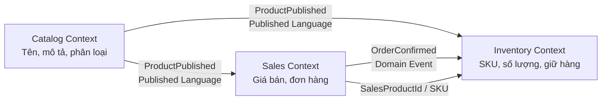

# Ngữ cảnh giới hạn (Bounded Context): ranh giới hiệu lực của một mô hình

Trong Domain-Driven Design (DDD), một mô hình miền chỉ có ý nghĩa trong một phạm vi xác định. Cùng một từ có thể mô tả những khái niệm khác nhau ở các hoạt động khác nhau; cùng một đối tượng ngoài đời có thể được nhìn nhận theo những thuộc tính và quy tắc khác nhau tùy mục đích. Nếu ép toàn bộ tổ chức dùng chung một mô hình duy nhất, mô hình dễ trở nên phức tạp, mơ hồ và khó thay đổi.

**Bounded Context** là ranh giới rõ ràng trong đó một mô hình miền và ngôn ngữ chung có hiệu lực. Bên trong ranh giới ấy, thuật ngữ, quy tắc và quan hệ được hiểu nhất quán. Khi đi qua ranh giới, thông tin cần được trao đổi bằng một hợp đồng rõ ràng và có thể phải chuyển đổi sang mô hình của bên nhận.

Bounded Context là một khái niệm trọng tâm của strategic design trong DDD. Nó giúp đội phát triển xác định phạm vi mô hình, trách nhiệm nghiệp vụ và cách các mô hình hợp tác với nhau. Đây cũng là cơ sở để tổ chức mã nguồn thành các module hoặc dịch vụ có ranh giới dễ hiểu.

## Mục tiêu học tập

Sau bài này, bạn có thể:

- Giải thích Bounded Context và lý do một mô hình cần có ranh giới hiệu lực.
- Phân biệt Bounded Context với domain, subdomain, module, service và database.
- Nhận biết dấu hiệu cho thấy các khái niệm cần thuộc những mô hình khác nhau.
- Mô tả vai trò của Context Map và các kiểu quan hệ giữa những Bounded Context.
- Chọn cách tích hợp phù hợp mà vẫn bảo vệ ngôn ngữ và quy tắc của từng mô hình.
- Phác thảo ranh giới Bounded Context cho một bài toán nghiệp vụ cụ thể.

## 1. Vì sao một mô hình cần có ranh giới?

Một tổ chức có thể dùng cùng một từ trong nhiều hoạt động nhưng không mang cùng một ý nghĩa. Ví dụ, từ “sản phẩm” trong cửa hàng trực tuyến có thể được dùng khi trình bày hàng hóa cho khách, quản lý lượng hàng trong kho, lập hóa đơn hoặc phân tích doanh thu.

Ở góc nhìn bán hàng, sản phẩm cần tên hiển thị, mô tả, giá bán, hình ảnh và trạng thái được phép chào bán. Ở góc nhìn tồn kho, điều quan trọng là mã SKU, đơn vị lưu kho, vị trí, số lượng hiện có và số lượng đã giữ. Ở góc nhìn kế toán, thông tin có thể tập trung vào mã hàng hạch toán, thuế suất và tài khoản ghi nhận.

Nếu tạo một lớp Product dùng chung cho tất cả hoạt động, lớp đó có thể dần chứa giá bán, số lượng tồn, vị trí kệ, thuế suất, mô tả marketing, trạng thái vận chuyển và nhiều quy tắc không cùng thuộc một trách nhiệm. Các đội phải thống nhất mọi thay đổi trên cùng một cấu trúc dù mỗi đội có mục tiêu khác nhau. Một thay đổi nhỏ trong cách hiển thị sản phẩm có thể ảnh hưởng đến mã tồn kho; một quy tắc lưu kho mới có thể khiến mô hình bán hàng phải mang thêm thông tin không cần thiết.

DDD đề xuất xác định những phạm vi mà trong đó một mô hình có ý nghĩa thống nhất. Mỗi phạm vi có thể có cách diễn đạt riêng cho khái niệm mà nó chịu trách nhiệm.

### Bounded Context là ranh giới của ý nghĩa

Có thể hiểu Bounded Context qua ba yếu tố:

1. **Mô hình:** tập hợp khái niệm, quan hệ, hành vi, trạng thái và quy tắc được chọn để giải quyết một nhóm vấn đề.
2. **Ngôn ngữ chung:** các thuật ngữ và định nghĩa mà chuyên gia nghiệp vụ cùng đội phát triển sử dụng thống nhất trong phạm vi đó.
3. **Ranh giới:** phạm vi xác định nơi mô hình và ngôn ngữ này có hiệu lực, đồng thời xác định nơi cần chuyển đổi khi trao đổi với mô hình khác.

Ranh giới này có tính ngữ nghĩa. Nó trả lời câu hỏi “Mô hình này đúng và có ý nghĩa ở đâu?”. Ranh giới có thể được phản ánh bằng package, module, schema, dịch vụ hoặc quyền sở hữu của đội, nhưng bản thân Bounded Context không được định nghĩa đơn thuần bằng một thư mục hay một tiến trình chạy.

## 2. Ví dụ: cùng một sản phẩm, các mô hình khác nhau

Giả sử một cửa hàng trực tuyến có ba Bounded Context: Catalog (danh mục sản phẩm), Sales (bán hàng) và Inventory (tồn kho).

| Phạm vi | Câu hỏi chính | Mô hình sản phẩm tập trung vào |
| --- | --- | --- |
| Catalog | Khách hàng có thể xem và tìm thấy mặt hàng nào? | Tên hiển thị, mô tả, hình ảnh, phân loại, nội dung giới thiệu |
| Sales | Có thể bán mặt hàng này với điều kiện và giá nào? | Giá bán, chính sách khuyến mãi, điều kiện chào bán, đơn vị tính khi bán |
| Inventory | Có bao nhiêu hàng và có thể giữ hoặc xuất bao nhiêu? | SKU, đơn vị lưu kho, vị trí, số lượng hiện có, số lượng đã giữ |

Ba mô hình có thể cùng tham chiếu một mã định danh sản phẩm hoặc SKU, nhưng không cần chia sẻ một đối tượng miền duy nhất. Catalog có thể công bố thông tin sản phẩm; Sales chuyển thông tin cần thiết thành SalesProduct; Inventory quản lý StockKeepingUnit hoặc InventoryItem theo quy tắc tồn kho.

Ví dụ, thay đổi mô tả marketing của sản phẩm có thể chỉ tác động đến Catalog. Thay đổi chính sách giữ hàng tác động đến Inventory. Thay đổi giá bán tác động đến Sales. Việc phân chia mô hình giúp mỗi thay đổi đi đến đúng nơi chịu trách nhiệm.

### Một khái niệm có thể đổi tên hoặc đổi cách biểu diễn

Trong Catalog, đối tượng có thể được gọi là Product vì nó đại diện cho mặt hàng được giới thiệu đến người mua. Trong Inventory, khái niệm quan trọng có thể là StockKeepingUnit (SKU) hoặc InventoryItem vì hệ thống cần quản lý đơn vị hàng có thể nhập, giữ và xuất. Hai đối tượng có thể liên hệ với cùng một sản phẩm thương mại, nhưng không nhất thiết đồng nhất.

Một ví dụ khác là “khách hàng”. Trong Sales, Customer có thể là người hoặc tổ chức đặt đơn, có địa chỉ nhận hàng và lịch sử mua. Trong Billing, Account hoặc BillToParty có thể là bên chịu trách nhiệm thanh toán và thông tin xuất hóa đơn. Một cá nhân mua hàng có thể yêu cầu xuất hóa đơn cho công ty. Nếu ép hai khái niệm thành một Customer duy nhất, mô hình dễ nhầm người đặt hàng với pháp nhân thanh toán.

Sự khác biệt về tên không phải mục tiêu tự thân. Hãy dùng tên khác khi ý nghĩa hoặc quy tắc khác nhau; nếu hai phạm vi thật sự dùng cùng một khái niệm với cùng định nghĩa, không cần tạo khác biệt giả tạo.

## 3. Phân biệt Bounded Context với domain và subdomain

Các khái niệm này liên quan nhưng trả lời những câu hỏi khác nhau.

| Khái niệm | Trả lời câu hỏi | Ví dụ thương mại điện tử |
| --- | --- | --- |
| **Domain** | Tổ chức đang hoạt động trong lĩnh vực nghiệp vụ nào? | Thương mại điện tử |
| **Subdomain** | Lĩnh vực đó gồm những phần bài toán hoặc năng lực nghiệp vụ nào? | Bán hàng, danh mục, tồn kho, thanh toán, vận chuyển |
| **Bounded Context** | Mô hình và ngôn ngữ nào có hiệu lực trong phạm vi nào? | Sales Context, Inventory Context, Catalog Context |

Subdomain mô tả cách phân chia bài toán nghiệp vụ. Bounded Context mô tả ranh giới của mô hình dùng để giải quyết một phần bài toán. Một subdomain có thể được hỗ trợ bởi một hoặc nhiều Bounded Context tùy độ phức tạp, lịch sử hệ thống và cách tổ chức công việc. Không nên giả định cứ có một subdomain thì phải có đúng một Bounded Context, hoặc cứ có một Bounded Context thì phải tương ứng với một microservice.

Ví dụ, subdomain bán hàng có thể cần một Bounded Context xử lý đơn hàng và một Bounded Context khác xử lý chính sách giá nếu hai nhóm quy tắc có ngôn ngữ, vòng đời và trách nhiệm đủ khác nhau. Ngược lại, một hệ thống nhỏ có thể triển khai nhiều năng lực bán hàng trong một Bounded Context nếu mô hình vẫn rõ ràng và các quy tắc thuộc cùng một phạm vi.

### Bounded Context không đồng nghĩa với microservice

Bounded Context là quyết định về phạm vi mô hình và ngôn ngữ. Microservice là một lựa chọn triển khai, thường có tiến trình, triển khai và vận hành độc lập. Một Bounded Context có thể được triển khai bằng:

- Một module trong ứng dụng nguyên khối có cấu trúc module rõ ràng.
- Một thành phần trong modular monolith với API nội bộ và quyền sở hữu dữ liệu riêng.
- Một hoặc nhiều dịch vụ triển khai độc lập khi nhu cầu vận hành và tổ chức phù hợp.

Tách mỗi Bounded Context thành một microservice ngay lập tức có thể tạo thêm chi phí mạng, giám sát, triển khai, xử lý lỗi và đồng bộ dữ liệu. Ngược lại, gộp nhiều mô hình không tương thích vào một module không có ranh giới cũng làm tăng phụ thuộc. Hãy xác định ranh giới mô hình trước, sau đó chọn cách triển khai phù hợp.

## 4. Nhận biết nơi nên đặt ranh giới

Không có một công thức tự động để tìm Bounded Context. Ranh giới cần được khám phá qua trao đổi với chuyên gia nghiệp vụ, quan sát quy trình và thử nghiệm mô hình. Một số dấu hiệu hữu ích gồm:

### Thuật ngữ thay đổi ý nghĩa

Nếu cùng một từ được định nghĩa khác nhau ở hai nhóm, đó là dấu hiệu cần kiểm tra ranh giới. Chẳng hạn, “đơn hàng” trong Sales có thể là yêu cầu mua có giá và các dòng hàng; trong Fulfillment, đối tượng công việc có thể là lệnh lấy hàng, đóng gói và giao hàng. Fulfillment không nhất thiết cần toàn bộ thông tin thương mại của đơn.

### Quy tắc và bất biến khác nhau

Nếu hai nhóm bảo vệ những quy tắc khác nhau, việc dùng chung một mô hình có thể làm ranh giới trách nhiệm không rõ. Sales kiểm tra đơn có thể được chào bán và xác nhận theo chính sách bán hàng. Inventory kiểm tra số lượng có thể giữ hoặc xuất theo chính sách kho. Không nên để đối tượng SalesProduct tự quyết định số lượng vật lý trong kho nếu trách nhiệm đó thuộc Inventory.

### Vòng đời và quyền sở hữu dữ liệu khác nhau

Hãy hỏi ai có quyền tạo, sửa và xác nhận một sự thật nghiệp vụ. Catalog có thể sở hữu tên và mô tả sản phẩm; Sales sở hữu giá chào bán; Inventory sở hữu số lượng tồn và lượng đã giữ. Các hệ thống khác có thể lưu bản sao phục vụ mục đích riêng, nhưng cần biết nguồn nào có thẩm quyền đối với từng sự thật.

### Các thay đổi thường xuyên đi cùng nhau hoặc tách rời nhau

Nếu hai nhóm quy tắc thường thay đổi cùng nhau và cần được kiểm tra trong cùng một giao dịch nghiệp vụ, có thể chúng thuộc cùng một mô hình. Nếu một nhóm thường thay đổi độc lập và ít cần biết chi tiết nội bộ của nhóm kia, đó là dấu hiệu có thể tách ranh giới. Tần suất thay đổi chỉ là bằng chứng hỗ trợ, không phải tiêu chí duy nhất.

### Quy trình và quyết định nghiệp vụ có chủ sở hữu khác nhau

Những người hoặc nhóm chịu trách nhiệm cho chính sách khác nhau có thể gợi ý ranh giới. Tuy nhiên, không nên đơn giản tạo một Bounded Context cho mỗi phòng ban. Một phòng ban có thể vận hành nhiều mô hình; một mô hình cũng có thể cần sự phối hợp của nhiều nhóm.

### Các câu hỏi khám phá ranh giới

Khi làm workshop với chuyên gia nghiệp vụ, có thể hỏi:

- Nhóm đang giải quyết quyết định hoặc mục tiêu nghiệp vụ nào?
- Những từ quan trọng trong quy trình này được định nghĩa ra sao?
- Khái niệm nào có vòng đời và quy tắc riêng?
- Ai là người có quyền thay đổi sự thật nghiệp vụ?
- Khi quy tắc thay đổi, phần nào của mô hình phải thay đổi cùng?
- Nhóm cần thông tin gì từ hệ thống khác và có thể chấp nhận độ trễ bao lâu?
- Có trường hợp nào cùng một từ được dùng với nghĩa khác ở nhóm khác không?

Câu trả lời nên được kiểm tra bằng ví dụ thực tế, đặc biệt là ngoại lệ và tình huống tranh chấp. Ranh giới tốt giúp giải thích được những trường hợp đó mà không cần các quy tắc mâu thuẫn.

## 5. Context Map: nhìn thấy quan hệ giữa các mô hình

Khi có nhiều Bounded Context, cần mô tả cách chúng liên hệ. **Context Map** là bản đồ thể hiện các Bounded Context và quan hệ tích hợp hoặc phụ thuộc giữa chúng. Nó giúp đội biết mô hình nào cung cấp thông tin, mô hình nào tiêu thụ thông tin, dữ liệu đi qua ranh giới bằng cách nào và nơi nào cần chuyển đổi ngôn ngữ.

Context Map không chỉ là sơ đồ các hộp dịch vụ. Một bản đồ hữu ích nên cho biết:

- Tên và trách nhiệm của từng Bounded Context.
- Quan hệ upstream/downstream giữa các context khi có phụ thuộc.
- Hợp đồng hoặc ngôn ngữ được dùng khi trao đổi.
- Nơi cần dịch hoặc bảo vệ mô hình bằng Anti-Corruption Layer.
- Những phụ thuộc cần phối hợp thay đổi hoặc có thể được tách rời.

Ví dụ, Catalog công bố thông tin sản phẩm qua một ngôn ngữ tích hợp đã thống nhất. Sales và Inventory nhận thông tin đó rồi chuyển thành mô hình riêng. Khi Sales xác nhận đơn, nó phát sự kiện OrderConfirmed; Inventory nhận sự kiện và thực hiện quy trình giữ hàng theo quy tắc của kho.



Trong ví dụ này, Sales không gửi toàn bộ đối tượng miền của nó sang Inventory. Nó phát thông tin cần thiết theo hợp đồng; Inventory diễn giải thông tin đó và áp dụng quy tắc tồn kho của chính mình. Nếu Catalog đổi cấu trúc nội bộ nhưng giữ nguyên hợp đồng công bố, các context tiêu thụ không nhất thiết phải đổi theo.

Context Map nên được xem là tài liệu sống. Khi một quan hệ tích hợp thay đổi, nhóm cần cập nhật bản đồ cùng hợp đồng và trách nhiệm liên quan. Một sơ đồ lỗi thời có thể khiến đội hiểu sai hướng phụ thuộc hoặc tin rằng hai mô hình còn chia sẻ một quy tắc đã thay đổi.

## 6. Các kiểu quan hệ thường gặp giữa Bounded Context

DDD mô tả một số pattern để hiểu cách các context phối hợp. Đây là từ vựng giúp thảo luận về quan hệ và lựa chọn thiết kế; không phải danh sách bắt buộc phải áp dụng đầy đủ.

| Pattern | Ý nghĩa | Khi nào cân nhắc |
| --- | --- | --- |
| **Partnership** | Hai nhóm phụ thuộc chặt và phối hợp thay đổi, lập kế hoạch cùng nhau | Hai context cần đồng bộ để hoàn thành một mục tiêu chung |
| **Shared Kernel** | Một phần nhỏ của mô hình hoặc mã được hai context cùng sở hữu và thay đổi theo thỏa thuận | Có phần khái niệm thực sự ổn định và cần dùng chung |
| **Customer-Supplier** | Context upstream cung cấp năng lực hoặc dữ liệu; downstream là bên tiêu thụ và có thể thương lượng nhu cầu | Hai nhóm có quan hệ cung cấp và sử dụng rõ ràng |
| **Conformist** | Downstream chấp nhận mô hình của upstream vì không thể hoặc không muốn tác động đến nó | Hệ thống cung cấp có quyền quyết định cao hơn |
| **Anti-Corruption Layer (ACL)** | Downstream đặt lớp chuyển đổi để bảo vệ mô hình nội bộ khỏi ngôn ngữ bên ngoài | Mô hình bên ngoài khác biệt hoặc khó kiểm soát |
| **Open Host Service (OHS)** | Upstream cung cấp một giao diện dịch vụ được thiết kế để nhiều context có thể tích hợp | Có nhiều bên tiêu thụ cần một hợp đồng ổn định |
| **Published Language** | Các bên trao đổi bằng một định dạng hoặc ngôn ngữ được công bố và thống nhất | Cần hợp đồng dữ liệu độc lập với mô hình nội bộ |
| **Separate Ways** | Hai context không tích hợp vì lợi ích tích hợp thấp hơn chi phí phụ thuộc | Có thể chấp nhận dữ liệu trùng hoặc quy trình độc lập |

### Partnership

Partnership phù hợp khi hai nhóm có phụ thuộc hai chiều hoặc phải phối hợp chặt để thay đổi một quy trình. Họ cần trao đổi thường xuyên, thống nhất kế hoạch và xử lý thay đổi đồng bộ. Nếu một nhóm thường xuyên thay đổi hợp đồng mà không báo nhóm còn lại, quan hệ Partnership sẽ thất bại.

### Shared Kernel

Shared Kernel là phần mô hình hoặc mã nhỏ được chia sẻ giữa hai Bounded Context. Vì cả hai cùng phụ thuộc vào phần này, thay đổi cần được hai bên xem xét và kiểm thử. Không nên biến Shared Kernel thành một thư viện chứa mọi entity dùng chung; nó chỉ nên giữ những khái niệm thực sự có cùng ý nghĩa và cần đồng bộ.

### Customer-Supplier và Conformist

Trong quan hệ Customer-Supplier, upstream cung cấp dữ liệu hoặc năng lực, downstream tiêu thụ và có tiếng nói về nhu cầu của mình. Hai nhóm cần thống nhất cách ưu tiên và quản lý thay đổi hợp đồng.

Nếu downstream không có khả năng ảnh hưởng đến upstream, nó có thể phải theo mô hình của upstream. Đây là Conformist. Cách này đơn giản về phối hợp nhưng có thể khiến mô hình nội bộ của downstream bị chi phối bởi thuật ngữ và cấu trúc không phù hợp với nghiệp vụ của nó.

### Anti-Corruption Layer

Anti-Corruption Layer là lớp chuyển đổi giữa mô hình bên ngoài và mô hình nội bộ. Nó có thể chuyển đổi tên trường, mã trạng thái, cấu trúc dữ liệu, khái niệm và ý nghĩa nghiệp vụ. Nhờ đó, mô hình miền bên trong vẫn dùng ngôn ngữ của chính nó.

Ví dụ, một hệ thống kho cũ gửi trạng thái **P** và **R**. Sales không nên đưa các mã đó vào OrderStatus nếu chúng có nghĩa khác với trạng thái đơn hàng. Adapter có thể chuyển chúng thành các kết quả có ý nghĩa trong Sales hoặc từ chối giá trị không được hỗ trợ.

### Open Host Service và Published Language

Open Host Service là một giao diện được upstream thiết kế để nhiều bên tiêu thụ có thể tích hợp ổn định. Published Language là ngôn ngữ hoặc định dạng công bố để các bên trao đổi, chẳng hạn schema sự kiện hoặc hợp đồng API có phiên bản.

Hai pattern thường đi cùng nhau: dịch vụ công bố một hợp đồng rõ ràng, còn downstream chuyển đổi hợp đồng đó thành mô hình riêng. Hợp đồng tích hợp cần được quản lý phiên bản và tương thích có chủ đích.

### Separate Ways

Không phải mọi hệ thống đều cần tích hợp. Nếu việc đồng bộ một thông tin ít giá trị nhưng tạo phụ thuộc lớn, hai context có thể chọn Separate Ways. Mỗi bên duy trì phần thông tin cần thiết cho trách nhiệm riêng. Quyết định này cần cân nhắc nguy cơ dữ liệu lệch nhau và chi phí vận hành, nhưng đôi khi độc lập là lựa chọn đơn giản hơn.

## 7. Bảo vệ ranh giới trong mã nguồn và kiến trúc

Sau khi thống nhất Bounded Context, cần thể hiện ranh giới trong thiết kế phần mềm. Nếu các context vẫn truy cập trực tiếp vào lớp nội bộ, bảng dữ liệu và quy tắc của nhau, ranh giới chỉ tồn tại trên sơ đồ.

### Tổ chức module theo mô hình

Trong modular monolith, có thể tổ chức package hoặc module theo context:

```text
catalog/
  domain/
  application/
  infrastructure/
sales/
  domain/
  application/
  infrastructure/
inventory/
  domain/
  application/
  infrastructure/
```

Mỗi context sở hữu mô hình và hành vi của mình. Mã bên ngoài không nên truy cập trực tiếp vào entity nội bộ; nó dùng API ứng dụng, hợp đồng sự kiện hoặc giao diện tích hợp được công bố.

### Không chia sẻ entity chỉ vì dữ liệu có vẻ giống nhau

Ví dụ, Sales có thể định nghĩa:

```java
package sales.domain;

public final class SalesProduct {
    private final SalesProductId id;
    private final String displayName;
    private final Money salePrice;
    private final boolean availableForSale;

    // Hành vi và quy tắc thuộc phạm vi bán hàng.
}
```

Inventory có thể định nghĩa:

```java
package inventory.domain;

public final class InventoryItem {
    private final Sku sku;
    private final StorageUnit storageUnit;
    private int onHandQuantity;
    private int reservedQuantity;

    // Hành vi và quy tắc thuộc phạm vi tồn kho.
}
```

Hai lớp có thể liên hệ qua SKU hoặc một định danh được thống nhất trong hợp đồng tích hợp. SalesProduct không cần chứa số lượng tồn kho chi tiết; InventoryItem không cần chứa mô tả marketing hoặc chính sách giá. Mỗi mô hình chỉ giữ thông tin cần thiết để bảo vệ quy tắc của mình.

### Trao đổi qua hợp đồng, không truyền đối tượng miền nội bộ

Một context có thể phát sự kiện hoặc cung cấp API với dữ liệu cần thiết. Ví dụ, hợp đồng tích hợp có thể là:

```java
public record OrderConfirmed(
    String orderId,
    List<ConfirmedOrderLine> lines,
    Instant occurredAt
) {}

public record ConfirmedOrderLine(
    String sku,
    int quantity
) {}
```

Inventory nhận sự kiện, chuyển dữ liệu thành lệnh xử lý nội bộ và kiểm tra khả năng giữ hàng theo quy tắc kho. Hợp đồng trên không phải InventoryItem và cũng không phải toàn bộ aggregate Order. Nó chỉ truyền đạt sự kiện cùng dữ liệu mà bên nhận cần.

Nếu việc xử lý giữa hai context diễn ra bất đồng bộ, cần xác định cách xử lý sự kiện lặp, lỗi tạm thời, thứ tự sự kiện và trạng thái chờ. Một sự kiện OrderConfirmed không tự bảo đảm rằng hàng đã được giữ thành công; kết quả giữ hàng cần được biểu diễn bằng phản hồi hoặc sự kiện riêng. Khi một quy trình trải qua nhiều context, có thể cần một quy trình điều phối hoặc Saga để quản lý tiến trình và hành động bù trừ. Không nên giả định một giao dịch cơ sở dữ liệu duy nhất bao trùm mọi context.

### Mỗi context bảo vệ bất biến của mình

Một Bounded Context nên kiểm soát những quy tắc mà nó chịu trách nhiệm. Sales có thể bảo vệ quy tắc xác nhận đơn và giá được chấp nhận. Inventory bảo vệ quy tắc số lượng có thể giữ và xuất. Sales không thể tự sửa số lượng trong kho bằng cách cập nhật bảng Inventory; nó phải yêu cầu hoặc phát thông tin qua giao diện tích hợp đã thống nhất.

Ranh giới dữ liệu cũng cần rõ. Một context có thể lưu bản sao dữ liệu bên ngoài để phục vụ tìm kiếm hoặc hiển thị, nhưng cần phân biệt bản sao đó với dữ liệu có thẩm quyền. Ví dụ, Sales có thể lưu snapshot tên sản phẩm và đơn giá tại thời điểm đặt hàng; Inventory vẫn là nơi có thẩm quyền đối với số lượng tồn.

## 8. Quy trình thiết kế Bounded Context

Có thể bắt đầu từ một bài toán cụ thể theo các bước sau:

1. **Xác định domain và mục tiêu nghiệp vụ.** Làm rõ tổ chức đang cố đạt kết quả gì và ai tham gia vào quy trình.
2. **Phân rã thành các subdomain.** Nhận diện những nhóm năng lực hoặc vấn đề như bán hàng, tồn kho, thanh toán và vận chuyển.
3. **Khám phá ngôn ngữ của từng nhóm.** Ghi lại thuật ngữ, định nghĩa, ví dụ, trạng thái, sự kiện và ngoại lệ.
4. **Tìm các điểm thay đổi ý nghĩa.** So sánh cách các nhóm dùng cùng từ, bảo vệ quy tắc và sở hữu dữ liệu.
5. **Đề xuất ranh giới mô hình.** Xác định trách nhiệm, thuật ngữ và quy tắc nằm bên trong mỗi Bounded Context.
6. **Thử mô hình với tình huống thực tế.** Kiểm tra luồng bình thường, ngoại lệ, thay đổi chính sách và các trường hợp tranh chấp.
7. **Vẽ Context Map.** Mô tả quan hệ upstream/downstream, hợp đồng, hướng phụ thuộc và nơi cần chuyển đổi.
8. **Chọn cách triển khai.** Quyết định module, API, sự kiện, schema và quyền sở hữu dữ liệu phù hợp với nhu cầu vận hành.
9. **Theo dõi và điều chỉnh.** Khi ngôn ngữ hoặc trách nhiệm thay đổi, xem lại ranh giới và cập nhật Context Map.

Ví dụ, nếu Sales cần kiểm tra tồn kho trước khi xác nhận đơn, workshop cần làm rõ kiểm tra đó là truy vấn thông tin hay cam kết giữ hàng. Truy vấn số lượng có thể chỉ cung cấp một ảnh chụp tại thời điểm đọc; giữ hàng là một hành vi có quy tắc và tác động đến số lượng có thể phân bổ. Phân biệt hai nhu cầu này giúp thiết kế hợp đồng tích hợp chính xác hơn.

## 9. Những sai lầm thường gặp

- **Đồng nhất Bounded Context với microservice:** ranh giới mô hình có thể được triển khai trong một ứng dụng duy nhất; tách dịch vụ cần có lý do vận hành.
- **Đồng nhất Bounded Context với phòng ban:** một phòng ban có thể dùng nhiều mô hình, còn một mô hình có thể cần nhiều vai trò cùng tham gia.
- **Dùng một mô hình chung cho toàn doanh nghiệp:** điều này thường tạo lớp dữ liệu quá rộng và làm mờ khác biệt về ý nghĩa.
- **Tạo quá nhiều context quá sớm:** chia nhỏ theo từng danh từ hoặc từng bảng có thể làm tăng tích hợp và độ phức tạp mà không tạo ra ranh giới nghiệp vụ hữu ích.
- **Chia sẻ entity giữa các context:** dùng chung đối tượng miền làm các quy tắc và vòng đời của một context rò rỉ sang context khác.
- **Không xác định nguồn dữ liệu có thẩm quyền:** các context có thể lưu bản sao nhưng không rõ bên nào được phép quyết định sự thật.
- **Truyền trực tiếp cấu trúc nội bộ qua API:** thay đổi một lớp hoặc bảng có thể buộc mọi bên tiêu thụ thay đổi theo.
- **Vẽ Context Map rồi để lỗi thời:** bản đồ không phản ánh hợp đồng và phụ thuộc hiện tại sẽ gây hiểu nhầm.
- **Dùng ACL cho mọi tích hợp:** lớp chuyển đổi có chi phí; hãy dùng khi cần bảo vệ mô hình khỏi sự khác biệt thực sự, không tạo lớp rỗng chỉ để thêm tầng.

## 10. Checklist review ranh giới

Khi review một thiết kế Bounded Context, hãy kiểm tra:

- [ ] Trách nhiệm và mục tiêu nghiệp vụ của context có được diễn đạt rõ không?
- [ ] Các thuật ngữ quan trọng có định nghĩa thống nhất trong phạm vi không?
- [ ] Những quy tắc và bất biến thuộc context đã có chủ sở hữu rõ ràng chưa?
- [ ] Dữ liệu nào là nguồn có thẩm quyền, dữ liệu nào chỉ là bản sao?
- [ ] Các mô hình khác có truy cập trực tiếp vào entity hoặc bảng nội bộ không?
- [ ] Hợp đồng tích hợp có thể hiểu và quản lý phiên bản độc lập không?
- [ ] Context Map có mô tả hướng phụ thuộc và kiểu quan hệ không?
- [ ] Các tình huống lỗi, độ trễ, sự kiện lặp và thay đổi hợp đồng đã được cân nhắc chưa?
- [ ] Cách triển khai có phù hợp với quy mô và nhu cầu vận hành hiện tại không?

## Kết luận

Bounded Context xác định ranh giới trong đó một mô hình miền và ngôn ngữ chung có hiệu lực. Ranh giới giúp mỗi nhóm diễn đạt đúng khái niệm, bảo vệ quy tắc thuộc trách nhiệm của mình và thay đổi mô hình mà không làm toàn bộ hệ thống phụ thuộc vào một cấu trúc chung.

Domain và subdomain giúp hiểu phạm vi bài toán; Bounded Context xác định phạm vi của mô hình; Context Map mô tả cách các mô hình hợp tác. Khi ranh giới được khám phá từ ngôn ngữ và quy tắc thực tế, rồi được thể hiện bằng hợp đồng tích hợp rõ ràng, DDD giúp tổ chức hệ thống dễ hiểu và dễ tiến hóa hơn.
