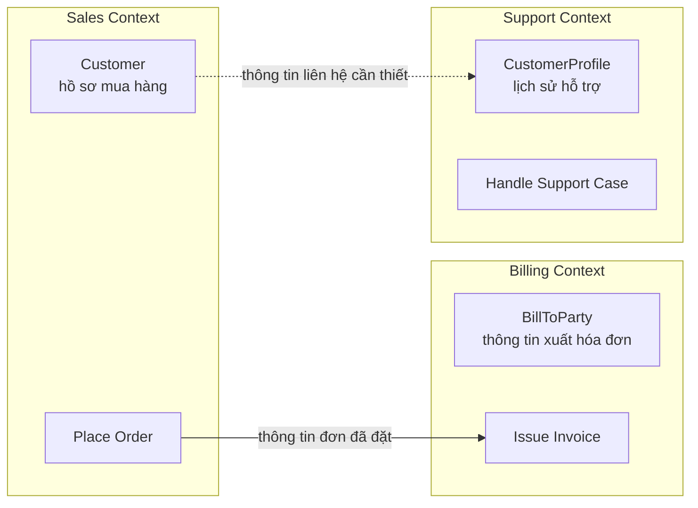
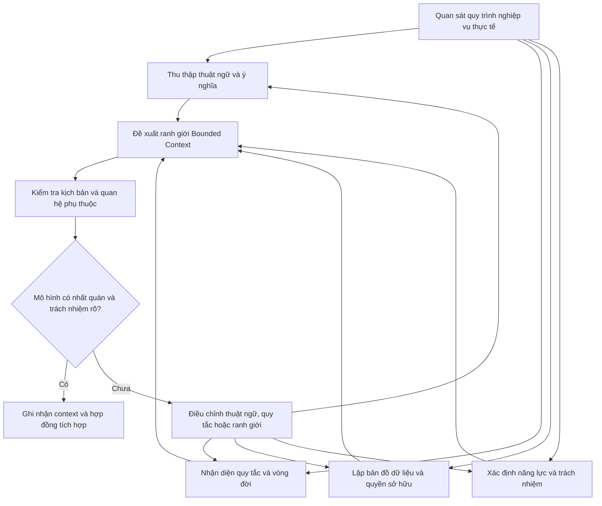
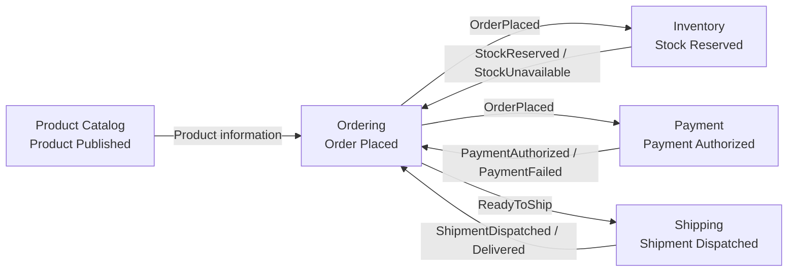

# Xác định ranh giới theo ngôn ngữ, quy tắc, dữ liệu và trách nhiệm

Trong Domain-Driven Design (DDD), **Bounded Context** là ranh giới mà bên trong đó một mô hình miền nghiệp vụ và ngôn ngữ dùng để diễn đạt mô hình ấy có ý nghĩa nhất quán. Xác định đúng ranh giới giúp đội phát triển biết thuật ngữ nào đang được dùng theo nghĩa nào, quy tắc nào phải được bảo vệ cùng nhau, dữ liệu nào thuộc quyền quản lý của phần nào và ai chịu trách nhiệm cho kết quả nghiệp vụ.

Không có một công thức máy móc để chia hệ thống thành Bounded Context. Một cách thực tế là quan sát bốn khía cạnh cùng lúc:

1. **Ngôn ngữ:** các thuật ngữ có cùng ý nghĩa và cách sử dụng không?
2. **Quy tắc:** các chính sách, vòng đời và điều kiện hợp lệ có thuộc cùng một mô hình không?
3. **Dữ liệu:** phần nào là nguồn có thẩm quyền tạo và thay đổi dữ liệu?
4. **Trách nhiệm:** năng lực nghiệp vụ và kết quả nào cần được quản lý như một phạm vi thống nhất?

Bốn khía cạnh này bổ sung cho nhau. Chỉ nhìn vào tên bảng, cấu trúc lớp hoặc sơ đồ tổ chức thường dẫn đến ranh giới sai. Cần xem chúng trong các tình huống nghiệp vụ thực tế, sau đó kiểm tra xem mô hình đề xuất có diễn đạt được hành vi và sự phối hợp giữa các phần hay không.

## 1. Bounded Context giải quyết vấn đề gì?

Trong một doanh nghiệp, cùng một thuật ngữ có thể mang ý nghĩa khác nhau tùy bộ phận và mục đích sử dụng. Chẳng hạn, từ `Customer` có thể chỉ:

- Người mua hàng và các thông tin phục vụ đặt hàng trong Sales.
- Bên nhận hóa đơn, mã số thuế và điều khoản thanh toán trong Billing.
- Người gửi yêu cầu hỗ trợ và lịch sử tương tác trong Customer Support.

Nếu gom tất cả ý nghĩa vào một mô hình `Customer` toàn cục, lớp này dễ tích lũy thuộc tính và quy tắc của nhiều bộ phận. Một thay đổi ở Billing có thể làm ảnh hưởng Sales dù hai bên chỉ cần một phần thông tin chung. Các đội cũng khó thống nhất một định nghĩa duy nhất vì mỗi bên đang giải quyết một vấn đề khác nhau.

Bounded Context cho phép mỗi phạm vi có mô hình và Ubiquitous Language phù hợp với trách nhiệm của nó. Một thuật ngữ có thể được sử dụng ở nhiều context, nhưng ý nghĩa, thuộc tính và quy tắc được xác định bên trong từng context.



Mỗi context có thể có cách biểu diễn riêng mà vẫn trao đổi thông tin với các context khác qua hợp đồng đã xác định. Bounded Context giúp giới hạn phạm vi ý nghĩa của mô hình; nó không ngăn các phần của doanh nghiệp phối hợp.

### 1.1. Bounded Context và Subdomain không phải cùng một khái niệm

**Subdomain** mô tả một phần của bài toán nghiệp vụ trong thế giới doanh nghiệp. **Bounded Context** mô tả ranh giới của mô hình phần mềm và ngôn ngữ được dùng để giải quyết một phần bài toán đó.

Hai khái niệm có liên quan nhưng không nhất thiết tương ứng một-một:

- Một Subdomain có thể được mô hình hóa qua nhiều Bounded Context khi nó chứa các mô hình hoặc trách nhiệm cần tách biệt.
- Một Bounded Context có thể hỗ trợ một phần hoặc nhiều phần năng lực nghiệp vụ có liên quan.
- Cách chia Subdomain giúp hiểu cấu trúc bài toán; cách chia Bounded Context giúp xác định nơi một mô hình có hiệu lực.

Ví dụ, Subdomain bán hàng có thể gồm các hoạt động lập danh mục sản phẩm, đặt hàng và quản lý khuyến mãi. Đội ngũ có thể quyết định Product Catalog và Ordering là hai Bounded Context vì cách biểu diễn sản phẩm, quy tắc áp dụng và vòng đời dữ liệu của chúng khác nhau. Đây là quyết định mô hình hóa dựa trên nghiệp vụ, không phải quy tắc bắt buộc rằng mỗi Subdomain phải có một context riêng.

### 1.2. Ranh giới mô hình không tự động là ranh giới triển khai

Bounded Context không đồng nghĩa với microservice, database, module Java hay một nhóm nhân sự. Những yếu tố này có thể được tổ chức tương ứng với context, nhưng là quyết định kiến trúc và tổ chức riêng.

Một Bounded Context có thể nằm trong một ứng dụng modular monolith. Nhiều context cũng có thể được triển khai trong cùng một cơ sở dữ liệu vật lý nếu quyền sở hữu mô hình và dữ liệu vẫn rõ. Khi cần triển khai độc lập, một context có thể trở thành một service. Điều quan trọng là mô hình và hợp đồng giữa các phạm vi phải được xác định trước khi chọn cách đóng gói.

## 2. Bốn khía cạnh để nhận diện ranh giới

### 2.1. Ngôn ngữ: thuật ngữ có cùng ý nghĩa không?

Hãy thu thập những từ chuyên gia thường dùng trong các cuộc trao đổi, quy trình và tình huống thực tế. Với mỗi thuật ngữ, cần làm rõ:

- Nó chỉ đối tượng, vai trò, trạng thái hay hành động nào?
- Ai sử dụng thuật ngữ này và trong hoạt động nào?
- Nó có cùng định nghĩa ở các bộ phận không?
- Các thuộc tính quan trọng và cách phân loại có giống nhau không?
- Có từ nào giống nhau nhưng biểu đạt hai khái niệm khác nhau không?

Ví dụ, `Product` trong Product Catalog có thể là mặt hàng được giới thiệu để khách tìm kiếm, với tên hiển thị, mô tả, hình ảnh và danh mục. Trong Inventory, đối tượng cần quản lý có thể là `StockKeepingUnit` hoặc `StockItem`, tập trung vào mã hàng, kho, số lượng có thể bán và lượng đã giữ.

Hai context có thể dùng cùng mã sản phẩm để đối chiếu nhưng không cần dùng chung một lớp `Product`. Một bên quan tâm sản phẩm được trình bày như thế nào; bên kia quan tâm số lượng hàng được quản lý ra sao.

Các dấu hiệu nên xem xét tách context:

- Một từ được dùng với hai định nghĩa khác nhau.
- Các trạng thái có tên giống nhau nhưng ý nghĩa hoặc điều kiện chuyển trạng thái khác nhau.
- Một nhóm cần các thuộc tính mà nhóm khác không sử dụng hoặc hiểu theo nghĩa khác.
- Một thuật ngữ thường phải được giải thích lại mỗi khi trao đổi giữa các bộ phận.

Sự khác biệt về từ ngữ là tín hiệu để điều tra, không phải lý do duy nhất để tách. Hai đội có thể dùng từ khác nhau cho cùng một khái niệm do thói quen; khi đó, có thể thống nhất ngôn ngữ thay vì tạo thêm context.

### 2.2. Quy tắc: điều kiện hợp lệ và vòng đời có cùng mô hình không?

Ngôn ngữ cho biết các bên gọi sự việc như thế nào; quy tắc cho biết sự việc được phép xảy ra khi nào. Hai phần có thể dùng chung danh từ nhưng có chính sách và invariant khác nhau.

Hãy tìm hiểu:

- Điều kiện để tạo, thay đổi, xác nhận hoặc hủy đối tượng.
- Các trạng thái và chuyển đổi hợp lệ trong vòng đời.
- Những invariant phải luôn đúng.
- Chính sách tính toán, phân loại, phê duyệt và ngoại lệ.
- Các thao tác nào cần được bảo đảm nhất quán trong cùng một giao dịch.

Ví dụ với đơn hàng:

| Phạm vi nghiệp vụ | Quy tắc tiêu biểu |
|---|---|
| Ordering | Đơn phải có ít nhất một dòng hàng trước khi được đặt; đơn đã giao không thể hủy theo quy trình thông thường |
| Payment | Một yêu cầu thu tiền phải tham chiếu khoản thanh toán hợp lệ; tổng số tiền thu không được vượt quá số tiền còn phải thu |
| Inventory | Số lượng có thể giữ không được vượt quá lượng hàng khả dụng; một reservation có thời hạn |
| Shipping | Chỉ tạo lô giao hàng khi có thông tin giao nhận cần thiết; trạng thái giao hàng tuân theo các mốc vận chuyển |

Những quy tắc này có thể liên quan đến cùng một đơn hàng nhưng không nhất thiết thuộc một mô hình. Ordering chịu trách nhiệm về việc đơn được đặt hợp lệ. Payment chịu trách nhiệm về trạng thái và giới hạn giao dịch tiền. Inventory chịu trách nhiệm về lượng hàng. Shipping chịu trách nhiệm về quá trình giao nhận.

Một cách nhận diện quan trọng là xem **quy tắc nào cần được bảo vệ cùng nhau**. Nếu một hành động cần cập nhật nhiều dữ liệu để giữ invariant của cùng một mô hình, đó có thể là dấu hiệu chúng thuộc cùng một ranh giới nhất quán. Nếu các phần có thể thay đổi độc lập và phối hợp qua sự kiện hoặc quy trình, chúng có thể thuộc các context riêng.

Cần phân biệt Bounded Context với Aggregate. Bounded Context giới hạn nơi mô hình và ngôn ngữ có hiệu lực. Aggregate xác định cụm đối tượng và ranh giới nhất quán giao dịch bên trong mô hình. Một context thường chứa nhiều Aggregate; không nên tạo một context cho mỗi Aggregate.

### 2.3. Dữ liệu: ai sở hữu nguồn dữ liệu có thẩm quyền?

Dữ liệu là một tín hiệu quan trọng vì nó cho thấy phần nào chịu trách nhiệm tạo, xác nhận và duy trì sự thật nghiệp vụ. Với từng loại dữ liệu, hãy hỏi:

- Ai tạo dữ liệu và ai được phép thay đổi?
- Hệ thống hoặc context nào là nguồn có thẩm quyền?
- Ai quyết định dữ liệu hợp lệ?
- Vòng đời dữ liệu bắt đầu và kết thúc ở đâu?
- Các phần khác cần dữ liệu này để làm gì?
- Có yêu cầu riêng về bảo mật, lưu giữ hoặc lịch sử thay đổi không?

Ví dụ:

| Dữ liệu | Context sở hữu | Context khác có thể cần |
|---|---|---|
| Nội dung đơn hàng, trạng thái đặt đơn | Ordering | Payment, Inventory, Shipping |
| Giao dịch, ủy quyền và hoàn tiền | Payment | Ordering, Customer Support |
| Số lượng khả dụng và reservation | Inventory | Ordering, Product Catalog |
| Lô hàng, mã vận đơn và trạng thái giao | Shipping | Ordering, Customer Support |
| Tên hiển thị, mô tả và danh mục sản phẩm | Product Catalog | Ordering, Search |

“Sở hữu” nghĩa là context chịu trách nhiệm duy trì ý nghĩa và tính đúng đắn của dữ liệu. Nó không có nghĩa là dữ liệu chỉ được phép tồn tại trong một nơi. Context khác có thể lưu bản sao, projection hoặc read model để phục vụ truy vấn, nhưng cần biết dữ liệu gốc đến từ đâu và bản sao được cập nhật theo cơ chế nào.

Ví dụ, Ordering có thể lưu tên và giá sản phẩm tại thời điểm khách đặt để bảo toàn nội dung đơn hàng. Product Catalog vẫn sở hữu thông tin mô tả sản phẩm hiện tại. Hai giá trị có mục đích khác nhau: snapshot trong đơn phản ánh giao dịch đã xảy ra, còn Catalog phản ánh thông tin sản phẩm đang được công bố.

Đừng chia Bounded Context chỉ bằng cách nhìn vào bảng cơ sở dữ liệu. Một bảng có thể chứa dữ liệu của nhiều khái niệm nghiệp vụ; nhiều bảng có thể cùng phục vụ một mô hình. Việc chia schema hoặc database nên theo sau quyết định về quyền sở hữu và ranh giới mô hình.

### 2.4. Trách nhiệm: phạm vi nào chịu trách nhiệm cho kết quả nào?

Trách nhiệm mô tả năng lực nghiệp vụ mà một phạm vi cần hoàn thành. Hãy diễn đạt trách nhiệm bằng kết quả có ý nghĩa với doanh nghiệp, chẳng hạn:

- Ordering chịu trách nhiệm tiếp nhận và quản lý vòng đời đơn hàng.
- Payment chịu trách nhiệm thực hiện và theo dõi giao dịch tiền.
- Inventory chịu trách nhiệm biết lượng hàng khả dụng và quản lý việc giữ hàng.
- Shipping chịu trách nhiệm đưa hàng đến địa chỉ nhận và cập nhật tiến trình giao nhận.

Một trách nhiệm rõ thường có:

- Mục tiêu nghiệp vụ có thể diễn đạt được.
- Các quyết định và quy tắc thuộc phạm vi đó.
- Dữ liệu cần sở hữu để đưa ra quyết định.
- Các hành vi mà phạm vi cung cấp cho bên khác.
- Có thể xác định đầu mối chịu trách nhiệm duy trì mô hình.

Hãy chú ý đến **quyền quyết định**. Nếu Ordering được phép đặt đơn nhưng Inventory mới có quyền quyết định lượng hàng có thể giữ, Ordering không nên tự cập nhật số tồn kho. Nó gửi yêu cầu giữ hàng và chờ kết quả từ Inventory.

Ranh giới tốt giúp một nhóm thay đổi mô hình trong phạm vi trách nhiệm của mình mà không cần phối hợp sửa mọi phần còn lại. Tuy nhiên, không nên ép ranh giới theo sơ đồ phòng ban hiện tại. Cơ cấu tổ chức có thể thay đổi; mô hình cần phản ánh năng lực và quy tắc nghiệp vụ bền vững hơn.

## 3. Kết hợp bốn khía cạnh để đề xuất Bounded Context

Bốn khía cạnh không phải bốn bước độc lập mà là bốn góc nhìn để kiểm tra cùng một giả thuyết về ranh giới.



Một ranh giới đáng tin cậy thường có các đặc điểm sau:

- Thuật ngữ bên trong context có định nghĩa rõ và nhất quán.
- Các quy tắc chính có thể được diễn đạt mà không phải liên tục mượn mô hình của context khác.
- Có thể chỉ ra dữ liệu nào context chịu trách nhiệm duy trì.
- Có thể mô tả trách nhiệm và quyết định mà context sở hữu.
- Những thay đổi thường xuyên trong context không buộc các context khác phải sửa mô hình nội bộ theo.
- Các phụ thuộc ra ngoài có thể được biểu đạt qua hợp đồng và cách tích hợp xác định.

Nếu một ranh giới chỉ hợp lý ở một khía cạnh nhưng mâu thuẫn ở các khía cạnh khác, cần xem lại. Chẳng hạn, hai bộ phận dùng từ khác nhau nhưng cùng tuân theo một chính sách, cùng sở hữu một vòng đời và không có nhu cầu thay đổi độc lập; việc tạo hai context có thể chỉ làm tăng chi phí dịch thuật.

## 4. Ví dụ thực tế: xác định context cho hệ thống thương mại điện tử

Giả sử một nền tảng thương mại điện tử hỗ trợ khách tìm sản phẩm, đặt đơn, thanh toán, giữ hàng và giao hàng. Ban đầu, đội phát triển có thể nhìn thấy các danh từ `Customer`, `Product`, `Order`, `Payment`, `Stock` và `Shipment`.

Nếu chỉ dựa trên danh từ, ta dễ tạo một mô hình lớn có các lớp liên kết chặt. Hãy áp dụng bốn khía cạnh để tìm ranh giới.

### 4.1. Thu thập ngôn ngữ và hành vi

Các chuyên gia mô tả một số hành động:

- Merchandising **publish** sản phẩm lên danh mục.
- Khách hàng **place** đơn hàng.
- Payment **authorize** hoặc **capture** khoản thanh toán.
- Inventory **reserve** hoặc **release** hàng.
- Shipping **dispatch** và **deliver** lô hàng.

Các động từ cho thấy những phần nghiệp vụ khác nhau đang thực hiện những quyết định riêng. Chúng cũng gợi ý rằng một khái niệm chung như `Order` không nên tự mình quyết định mọi việc từ thanh toán đến giữ hàng và giao nhận.

### 4.2. Xác định quy tắc và quyền sở hữu

| Context đề xuất | Ngôn ngữ và mô hình | Quy tắc và trách nhiệm | Dữ liệu sở hữu |
|---|---|---|---|
| Product Catalog | Product, Category, PublishedProduct | Quản lý thông tin và trạng thái công bố sản phẩm | Tên, mô tả, hình ảnh, danh mục |
| Ordering | Order, OrderLine, PlaceOrder | Kiểm tra nội dung và vòng đời đơn hàng | Đơn hàng, dòng hàng, snapshot giá tại lúc đặt |
| Payment | Payment, Authorization, Capture, Refund | Quản lý ủy quyền, thu và hoàn tiền | Giao dịch và trạng thái thanh toán |
| Inventory | StockItem, Reservation, AvailableQuantity | Quản lý số lượng khả dụng và thời hạn giữ hàng | Số lượng, vị trí kho, reservation |
| Shipping | Shipment, Parcel, Delivery | Lập lô giao và theo dõi trạng thái vận chuyển | Mã vận đơn, lô hàng, tiến trình giao |

Bảng này là một giả thuyết ban đầu. Đội ngũ cần xác nhận với chuyên gia rằng các thuật ngữ, chính sách và trách nhiệm thực sự tồn tại như mô tả. Chẳng hạn, một doanh nghiệp có thể gộp Product Catalog và Merchandising nếu cùng một mô hình và nhóm chịu trách nhiệm; doanh nghiệp khác có thể tách chúng khi chính sách và vòng đời khác biệt rõ ràng.

### 4.3. Vẽ ranh giới và hợp đồng trao đổi



Sơ đồ cho thấy mỗi context công bố thông tin cần thiết để phần khác tiếp tục công việc. Ordering có thể phát `OrderPlaced`; Inventory xử lý yêu cầu giữ hàng và trả kết quả; Payment thực hiện chính sách thanh toán; Shipping nhận thông tin cần thiết khi đơn đủ điều kiện giao.

Các thông điệp trên chỉ là tên minh họa cho hợp đồng tích hợp. Trong triển khai thực tế, cần xác định payload, định danh, phiên bản, thời điểm phát, cách xử lý lặp và trạng thái lỗi. Đặc biệt, không nên giả định các context cùng cập nhật thành công trong một giao dịch cơ sở dữ liệu.

### 4.4. Không dùng chung Entity chỉ vì có cùng một danh từ

Ordering và Payment đều có thể nhắc đến đơn hàng, nhưng chúng cần những mô hình khác nhau. Payment thường chỉ cần mã tham chiếu đơn, số tiền cần xử lý và thông tin cần thiết cho giao dịch. Nó không cần sở hữu toàn bộ danh sách sản phẩm, địa chỉ giao hàng hay quy tắc chỉnh sửa đơn.

Ví dụ minh họa:

```java
// Ordering Context
public record OrderId(String value) {}

public class Order {
    private final OrderId id;
    private OrderStatus status;
    private final List<OrderLine> lines;

    public OrderId id() {
        return id;
    }

    public boolean isPlaced() {
        return status == OrderStatus.PLACED;
    }
}
```

```java
// Payment Context
public record PaymentId(String value) {}

public class Payment {
    private final PaymentId id;
    private final String orderReference;
    private final Money amount;
    private PaymentStatus status;

    public void authorize() {
        if (status != PaymentStatus.PENDING) {
            throw new IllegalStateException(
                "Only a pending payment can be authorized"
            );
        }
        // Gọi hoặc điều phối chính sách ủy quyền theo mô hình Payment.
    }
}
```

Hai mô hình có thể liên hệ bằng `OrderId` hoặc một mã tham chiếu được trao đổi qua hợp đồng. Payment không cần import Entity `Order` từ Ordering. Trong mã thực tế, kiểu định danh và DTO tích hợp nên được thiết kế rõ theo hợp đồng; ví dụ trên chỉ minh họa nguyên tắc độc lập mô hình.

## 5. Quy trình thực hành để xác định ranh giới

Có thể áp dụng quy trình sau cho một luồng nghiệp vụ cụ thể. Hãy làm theo vòng lặp và điều chỉnh giả thuyết khi có thêm thông tin.

### Bước 1: Chọn một luồng nghiệp vụ có ý nghĩa

Chọn một luồng có mục tiêu rõ, chẳng hạn đặt đơn, xử lý hoàn tiền hoặc tiếp nhận yêu cầu bảo hành. Đừng bắt đầu bằng việc phân chia toàn bộ hệ thống theo các module kỹ thuật hiện tại.

Ghi lại tác nhân, điểm bắt đầu, kết quả mong đợi và những nhánh ngoại lệ quan trọng.

### Bước 2: Thu thập danh từ, động từ và trạng thái

Ghi lại các thuật ngữ chuyên gia sử dụng. Với mỗi danh từ, mô tả ý nghĩa; với mỗi động từ, ghi tác nhân, điều kiện và kết quả; với mỗi trạng thái, xác định sự kiện hoặc hành vi đưa đối tượng vào trạng thái đó.

Ví dụ:

| Thuật ngữ | Ý nghĩa trong quy trình | Câu hỏi cần xác nhận |
|---|---|---|
| Order | Đơn khách gửi để mua hàng | Đơn bắt đầu có hiệu lực từ lúc nào? |
| Place order | Hành động đặt đơn | Điều kiện nào phải thỏa mãn? |
| Reserve stock | Giữ lượng hàng cho một đơn | Reservation có thời hạn không? |
| Authorize payment | Xác nhận khả năng thu tiền | Có khác với capture không? |
| Shipment | Lô hàng được giao cho đơn vị vận chuyển | Ai tạo và ai cập nhật trạng thái? |

### Bước 3: Nhóm các quy tắc có cùng ngữ cảnh

Liệt kê invariant, chính sách và vòng đời. Nhóm những quy tắc cần được hiểu và thay đổi cùng nhau. Đánh dấu các quy tắc chỉ liên quan qua kết quả hoặc dữ liệu trao đổi.

Nếu một thao tác thường xuyên cần kiểm tra và thay đổi nhiều đối tượng để bảo vệ cùng một invariant, đó có thể là dấu hiệu các đối tượng thuộc cùng mô hình hoặc Aggregate. Nếu thao tác chỉ phối hợp giữa nhiều chính sách độc lập, có thể cần một quy trình ứng dụng hoặc quy trình nghiệp vụ điều phối các context.

### Bước 4: Lập bản đồ dữ liệu và quyền quyết định

Với mỗi loại dữ liệu, xác định nơi tạo, nơi sửa và nơi đưa ra quyết định hợp lệ. Phân biệt nguồn dữ liệu có thẩm quyền với bản sao phục vụ đọc hoặc báo cáo.

Nếu hai context cùng cập nhật một sự thật nghiệp vụ mà không có quy tắc phân quyền, ranh giới chưa rõ. Hãy thống nhất một nơi sở hữu và định nghĩa cách các phần khác gửi yêu cầu hoặc nhận thông tin.

### Bước 5: Gom trách nhiệm thành các phạm vi có ý nghĩa

Viết trách nhiệm của từng nhóm dưới dạng “chịu trách nhiệm cho kết quả nào?”. Tránh tên phạm vi chỉ mô tả công nghệ như `DatabaseModule`, `RESTLayer` hoặc `CommonService`.

Một context nên có phạm vi đủ rõ để đội ngũ có thể trả lời: nó quyết định điều gì, sở hữu dữ liệu nào, cung cấp hành vi gì và cần phối hợp với ai?

### Bước 6: Đề xuất ranh giới và kiểm tra bằng tình huống

Vẽ các context dự kiến. Sau đó lấy một số tình huống thực tế để kiểm tra:

- Một quy tắc thay đổi thì context nào chịu trách nhiệm?
- Một thuật ngữ có được hiểu nhất quán bên trong từng context không?
- Dữ liệu có nguồn sở hữu rõ không?
- Một context có cần biết chi tiết mô hình nội bộ của context khác không?
- Khi một context tạm thời không sẵn sàng, phần còn lại cần xử lý thế nào?
- Hai context có đang bị tách chỉ vì khác tên gọi hoặc khác công nghệ không?

Nếu không trả lời được, hãy điều chỉnh ranh giới hoặc làm rõ thêm quy tắc.

### Bước 7: Xác định hợp đồng tích hợp và ghi lại Context Map

Với mỗi quan hệ giữa hai context, ghi rõ bên cung cấp, bên tiêu thụ, dữ liệu hoặc sự kiện trao đổi và cách chuyển đổi mô hình. Có thể dùng API, message, event hoặc một cơ chế đồng bộ phù hợp.

Nếu mô hình bên ngoài không phù hợp với ngôn ngữ nội bộ, cân nhắc Anti-Corruption Layer (ACL) để chuyển đổi. Không nên để các lớp domain của context này phụ thuộc trực tiếp vào lớp domain của context kia.

### Bước 8: Kiểm chứng qua triển khai và điều chỉnh

Dùng một luồng đầu-cuối để kiểm tra xem ranh giới có giúp mô hình rõ ràng và thay đổi độc lập không. Theo dõi những nơi phải truy cập chéo dữ liệu, dùng chung lớp domain hoặc sửa nhiều context chỉ vì một quy tắc nội bộ thay đổi.

Ranh giới Bounded Context là kết quả của quá trình khám phá. Nó có thể thay đổi khi doanh nghiệp hiểu rõ hơn về domain hoặc khi trách nhiệm và chiến lược thay đổi.

## 6. Khi nào nên tách, gộp hoặc giữ nguyên context?

### 6.1. Dấu hiệu nên xem xét tách

Cân nhắc tách khi có nhiều tín hiệu cùng xuất hiện:

- Thuật ngữ trung tâm có ý nghĩa khác nhau và không thể thống nhất thành một định nghĩa hữu ích.
- Quy tắc và vòng đời thay đổi theo những lý do nghiệp vụ khác nhau.
- Dữ liệu có chủ sở hữu và quyền quyết định khác nhau.
- Một nhóm cần thay đổi mô hình thường xuyên mà không nên ảnh hưởng nhóm khác.
- Mô hình chung đang chứa nhiều nhánh điều kiện chỉ để phục vụ các bộ phận khác nhau.
- Các tích hợp có thể được mô tả bằng hợp đồng rõ ràng thay vì chia sẻ cấu trúc nội bộ.

### 6.2. Dấu hiệu nên gộp hoặc chưa cần tách

Một số context dự kiến có thể đang bị chia quá nhỏ:

- Hai phần dùng cùng ngôn ngữ, cùng quy tắc và cùng vòng đời.
- Chúng luôn phải thay đổi cùng nhau để bảo đảm một kết quả nghiệp vụ.
- Ranh giới tạo ra nhiều hợp đồng tích hợp nhưng không đem lại quyền sở hữu hoặc khả năng thay đổi độc lập.
- Sự khác nhau chỉ là cách tổ chức code, framework hoặc database.
- Không có lý do nghiệp vụ rõ ràng để duy trì hai mô hình riêng.

Không cần tách một context chỉ vì nó có nhiều lớp hoặc nhiều bảng. Có thể tổ chức mã nguồn bên trong context thành package, module hoặc Aggregate phù hợp.

### 6.3. Cảnh giác với context quá lớn

Một context quá lớn thường có các dấu hiệu:

- Ngôn ngữ chứa nhiều thuật ngữ chồng chéo.
- Một lớp hoặc service phục vụ nhiều quy trình có chính sách khác nhau.
- Thay đổi nhỏ ở một nhóm gây tác động đến nhiều phần không liên quan.
- Quyền sở hữu dữ liệu và quyết định không rõ.
- Các đội thường xuyên tranh luận về định nghĩa của cùng một thuật ngữ.

Hãy tìm các mô hình con và trách nhiệm có thể tách biệt. Tuy nhiên, cần kiểm tra quan hệ nghiệp vụ trước khi tách để tránh biến một context lớn thành nhiều context nhỏ nhưng phụ thuộc chặt.

### 6.4. Cảnh giác với context quá nhỏ

Một context quá nhỏ có thể tạo ra:

- Quá nhiều giao tiếp và chuyển đổi dữ liệu.
- Nhiều hợp đồng khó duy trì.
- Một quy trình đơn giản phải đi qua nhiều context.
- Không có khả năng tự quyết định hoặc sở hữu dữ liệu có ý nghĩa.
- Các thay đổi luôn cần triển khai đồng thời ở nhiều nơi.

Nếu ranh giới chỉ làm tăng chi phí phối hợp mà không làm rõ mô hình, hãy xem xét gộp lại.

## 7. Những sai lầm thường gặp khi xác định ranh giới

**Chia context theo bảng dữ liệu.** Cấu trúc bảng không tự xác định ý nghĩa nghiệp vụ. Hãy bắt đầu từ ngôn ngữ, quy tắc và quyền sở hữu dữ liệu.

**Chia context theo phòng ban một cách máy móc.** Một phòng ban có thể phụ trách nhiều năng lực khác nhau; nhiều phòng ban cũng có thể cùng tham gia một năng lực. Hãy xác định trách nhiệm nghiệp vụ trước.

**Dùng chung một mô hình vì các bên có cùng danh từ.** `Customer`, `Product` hoặc `Order` có thể mang ý nghĩa khác nhau. Hãy so sánh thuộc tính, hành vi, vòng đời và quy tắc trước khi quyết định chia sẻ.

**Tách context chỉ vì khác công nghệ.** Hai phần dùng database hoặc framework khác nhau chưa chắc cần hai mô hình nghiệp vụ. Công nghệ là một yếu tố triển khai, không phải căn cứ duy nhất để xác định Bounded Context.

**Để nhiều context cùng sở hữu một dữ liệu.** Nếu không rõ nơi nào có quyền quyết định, dữ liệu có thể mâu thuẫn. Hãy xác định nguồn có thẩm quyền và cách cập nhật các bản sao.

**Nhầm context với Aggregate.** Một context có thể có nhiều Aggregate. Aggregate bảo vệ invariant trong một ranh giới nhất quán nhỏ hơn; context bảo vệ tính nhất quán của mô hình và ngôn ngữ.

**Tách quá sớm thành microservice.** Phân tách triển khai tạo thêm chi phí giao tiếp, giám sát, triển khai và xử lý lỗi. Hãy kiểm chứng ranh giới mô hình trước rồi chọn cách triển khai phù hợp.

**Không xác định hợp đồng giữa các context.** Nếu các phần vẫn truy cập trực tiếp lớp domain hoặc bảng dữ liệu của nhau, ranh giới chỉ tồn tại trên sơ đồ. Hãy định nghĩa API, message, event hoặc ACL phù hợp.

## 8. Checklist đánh giá Bounded Context

Dùng các câu hỏi sau khi rà soát một ranh giới đề xuất.

**Ngôn ngữ**

- Các thuật ngữ trung tâm có định nghĩa rõ trong context không?
- Từ giống nhau nhưng khác nghĩa đã được phân biệt chưa?
- Các hành vi được diễn đạt bằng động từ có ý nghĩa nghiệp vụ không?
- Ngôn ngữ của context có thể được chuyên gia nghiệp vụ xác nhận không?

**Quy tắc**

- Các invariant và chính sách chính có được xác định không?
- Ai chịu trách nhiệm quyết định một hành vi có hợp lệ không?
- Các trạng thái và chuyển đổi có rõ không?
- Những quy tắc cần nhất quán cùng nhau có nằm trong mô hình phù hợp không?

**Dữ liệu**

- Context nào sở hữu nguồn dữ liệu có thẩm quyền?
- Ai được phép tạo và thay đổi dữ liệu?
- Bản sao và read model được cập nhật từ đâu?
- Có nơi nào nhiều context cùng ghi vào một sự thật nghiệp vụ không?

**Trách nhiệm và tích hợp**

- Context chịu trách nhiệm cho kết quả nghiệp vụ nào?
- Quyền quyết định và trách nhiệm có rõ không?
- Các context khác tương tác qua hợp đồng nào?
- Có cần ACL để bảo vệ ngôn ngữ nội bộ không?
- Thay đổi trong một context có thể được giới hạn trong phạm vi hợp lý không?

**Tính phù hợp của ranh giới**

- Ranh giới có dựa trên nghiệp vụ thay vì cấu trúc kỹ thuật không?
- Có quá nhiều context nhỏ phải phối hợp chặt chẽ không?
- Có một context quá lớn đang gom nhiều mô hình khác nhau không?
- Ranh giới có thể được kiểm chứng qua một luồng nghiệp vụ thực tế không?

## 9. Kết luận

Xác định Bounded Context là quá trình tìm nơi một mô hình nghiệp vụ có thể giữ được ngôn ngữ, quy tắc, dữ liệu và trách nhiệm nhất quán. Ngôn ngữ giúp nhận ra sự khác biệt về ý nghĩa; quy tắc cho biết những quyết định nào cần được bảo vệ; dữ liệu cho biết nguồn sự thật thuộc về đâu; trách nhiệm làm rõ phạm vi nào chịu trách nhiệm cho kết quả nghiệp vụ.

Hãy bắt đầu từ quy trình thực tế, thu thập thuật ngữ và hành vi, làm rõ invariant, xác định quyền sở hữu dữ liệu, rồi nhóm các năng lực có liên quan thành những phạm vi có ý nghĩa. Sau đó kiểm tra các ranh giới bằng kịch bản đầu-cuối và hợp đồng tích hợp. Một Bounded Context tốt giúp mô hình dễ hiểu trong phạm vi của nó, đồng thời giúp các phần khác hợp tác mà không phải phụ thuộc vào chi tiết nội bộ của nhau.

