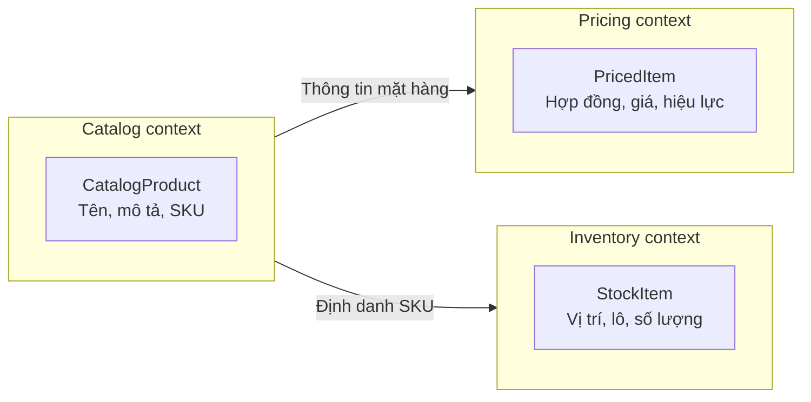
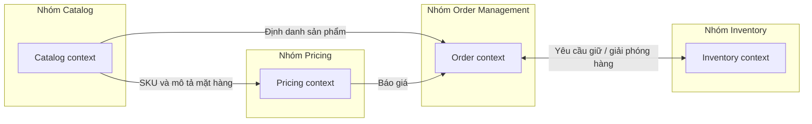

# Quan hệ giữa ranh giới mô hình và quyền sở hữu của nhóm

Trong Domain-Driven Design (DDD), bounded context xác định phạm vi mà một mô hình và ngôn ngữ nghiệp vụ có ý nghĩa nhất quán. Ranh giới này cũng là một cơ sở quan trọng để xác định nhóm nào chịu trách nhiệm phát triển và duy trì phần nghiệp vụ đó. Khi quyền sở hữu của nhóm phù hợp với ranh giới mô hình, nhóm có thể hiểu sâu nghiệp vụ, đưa ra quyết định nhất quán và thay đổi hệ thống với ít phụ thuộc không cần thiết hơn.

Ranh giới mô hình và ranh giới nhóm có liên hệ chặt chẽ nhưng không đồng nhất. Một nhóm có thể sở hữu nhiều bounded context có liên quan; một bounded context lớn có thể cần nhiều nhóm cộng tác, nhưng vẫn cần một cơ chế chịu trách nhiệm rõ ràng cho mô hình và các quyết định chung. DDD không yêu cầu mỗi context phải trở thành một microservice hoặc một nhóm riêng. Điều cần thiết là xác định rõ ai sở hữu mô hình, ai quyết định thay đổi và các nhóm trao đổi với nhau bằng hợp đồng nào.

## 1. Bounded context xác định ranh giới của mô hình

Một bounded context là phạm vi trong đó thuật ngữ, quy tắc và mô hình miền được hiểu theo một cách nhất quán. Bên trong ranh giới đó, đội phát triển và chuyên gia nghiệp vụ có thể dùng cùng một ngôn ngữ để mô tả các khái niệm và hành vi.

Ví dụ, trong một nền tảng thương mại B2B, từ “sản phẩm” có thể mang những ý nghĩa khác nhau:

- Trong **Danh mục sản phẩm (Catalog)**, sản phẩm là mặt hàng được mô tả bằng tên, hình ảnh, thông số và mã SKU để người mua tìm kiếm.
- Trong **Định giá (Pricing)**, sản phẩm được xét cùng hợp đồng, thị trường, bậc số lượng, tiền tệ và thời hạn hiệu lực của giá.
- Trong **Kho vận (Inventory)**, sản phẩm gắn với đơn vị lưu kho, vị trí, lô hàng, số lượng khả dụng và lượng đã được giữ.

Nếu các nhóm cùng cố dùng một lớp `Product` với mọi thuộc tính và quy tắc của cả ba lĩnh vực, mô hình sẽ chứa nhiều trường không liên quan và nhiều điều kiện phụ thuộc vào nơi sử dụng. Thay đổi trong kho vận có thể ảnh hưởng ngoài dự kiến đến danh mục hoặc định giá.

Bounded context cho phép mỗi phạm vi có mô hình riêng:

Các mô hình có thể cùng tham chiếu một mã SKU, nhưng ý nghĩa và quy tắc bên trong từng context do chính context đó xác định. Dữ liệu được trao đổi qua hợp đồng có chủ sở hữu rõ ràng, thay vì để các phần truy cập trực tiếp vào cấu trúc nội bộ của nhau.

## 2. Vì sao ranh giới mô hình liên quan đến quyền sở hữu của nhóm?

Mô hình miền luôn thay đổi khi doanh nghiệp học thêm về nghiệp vụ, thay đổi chính sách hoặc mở rộng quy trình. Một nhóm cần có đủ hiểu biết và quyền quyết định để duy trì mô hình mà nhóm chịu trách nhiệm.

Khi một bounded context có chủ sở hữu rõ ràng, nhóm đó có thể:

- Trao đổi thường xuyên với chuyên gia nghiệp vụ của lĩnh vực.
- Duy trì định nghĩa thuật ngữ, quy tắc và bất biến của mô hình.
- Quyết định cách tổ chức mã nguồn, dữ liệu và các hành vi nội bộ.
- Thiết kế, công bố và duy trì API hoặc domain event mà context cung cấp.
- Đánh giá tác động của yêu cầu mới và lên kế hoạch thay đổi.
- Chịu trách nhiệm về chất lượng, khả năng vận hành và hỗ trợ của phần mềm trong phạm vi sở hữu.

Nếu nhiều nhóm cùng sửa một mô hình mà không có cơ chế quyết định rõ ràng, các vấn đề thường xuất hiện: tên gọi bị diễn giải khác nhau, quy tắc bị sao chép, thay đổi phải chờ nhiều bên phê duyệt và lỗi phát sinh khó xác định trách nhiệm. Một nhóm có thể cần thay đổi mô hình nhưng không có quyền quyết định, trong khi nhóm khác có quyền sửa mã nhưng thiếu hiểu biết nghiệp vụ.

Quyền sở hữu vì vậy không chỉ là quyền commit vào một thư mục. Nó bao gồm trách nhiệm hiểu nghiệp vụ, quyết định mô hình, duy trì hợp đồng tích hợp và tiếp nhận phản hồi khi phần đó gặp vấn đề.

## 3. Nguyên tắc căn chỉnh nhóm với bounded context

Một nguyên tắc hữu ích là tổ chức nhóm quanh những năng lực nghiệp vụ có ranh giới tương đối rõ, thay vì chỉ chia theo tầng kỹ thuật.

Ví dụ, nếu một nhóm phụ trách toàn bộ backend, một nhóm khác phụ trách frontend và nhóm thứ ba phụ trách cơ sở dữ liệu, một thay đổi đơn giản trong quy trình định giá có thể phải đi qua cả ba nhóm. Không nhóm nào chịu trách nhiệm đầy đủ cho kết quả nghiệp vụ. Các quyết định thường được tối ưu theo tầng kỹ thuật thay vì theo năng lực mà doanh nghiệp cần.

Khi tổ chức nhóm theo phạm vi nghiệp vụ, nhóm Catalog có thể phụ trách trải nghiệm và quy tắc danh mục; nhóm Pricing phụ trách chính sách và tính giá; nhóm Inventory phụ trách số lượng, giữ hàng và giải phóng hàng. Mỗi nhóm có thể phát triển các phần cần thiết trong phạm vi của mình và phối hợp qua hợp đồng đã thống nhất.

Một số nguyên tắc thực tế:

1. **Một context cần có chủ sở hữu chịu trách nhiệm chính.** Người dùng và nhóm khác phải biết nơi nào có thẩm quyền thay đổi mô hình, quy tắc và hợp đồng của context.
2. **Một nhóm có thể sở hữu nhiều context.** Điều này phù hợp khi các context nhỏ, có liên hệ nghiệp vụ gần nhau hoặc chưa cần tách thành các đơn vị tổ chức riêng.
3. **Không chia context chỉ để khớp sơ đồ tổ chức hiện tại.** Ranh giới phải bắt nguồn từ sự khác biệt về ngôn ngữ, quy tắc và trách nhiệm nghiệp vụ. Cơ cấu nhóm có thể được điều chỉnh để hỗ trợ ranh giới đó.
4. **Tránh nhiều nhóm cùng sở hữu một mô hình mà không có quy ước.** Nếu cần cộng tác, hãy xác định nhóm chịu trách nhiệm cuối cùng và cách các nhóm khác đề xuất hoặc đóng góp thay đổi.
5. **Trao quyền quyết định đi cùng trách nhiệm.** Nhóm cần có khả năng thay đổi và phát hành phần mềm trong phạm vi sở hữu, đồng thời chịu trách nhiệm về chất lượng và tác động của thay đổi.

Đây là hướng dẫn để giảm phụ thuộc, không phải công thức cứng. Quy mô nhóm, năng lực chuyên môn, yêu cầu pháp lý và mức độ liên kết nghiệp vụ có thể khiến một tổ chức chọn cách phân công khác. Điều quan trọng là cơ chế sở hữu phải rõ ràng và phù hợp với cách mô hình thực sự được thay đổi.

## 4. Một nhóm không nhất thiết tương ứng một microservice

Bounded context là ranh giới của mô hình và ngôn ngữ. Microservice là một lựa chọn triển khai và vận hành. Hai khái niệm có thể tương ứng trong một số hệ thống, nhưng không đồng nghĩa.

Một nhóm Pricing có thể sở hữu bounded context Pricing được triển khai dưới dạng module bên trong một ứng dụng nguyên khối có tổ chức (modular monolith). Module có API nội bộ rõ ràng, giữ dữ liệu và quy tắc riêng, trong khi nhóm vẫn triển khai cùng ứng dụng với các nhóm khác. Khi nhu cầu mở rộng, phát hành độc lập hoặc cô lập vận hành xuất hiện, tổ chức có thể xem xét tách module thành service.

Ngược lại, một microservice có thể chứa nhiều mô hình hoặc ranh giới chưa rõ. Việc tách một tiến trình triển khai riêng không tự động tạo ra bounded context tốt. Nếu các nhóm vẫn truy cập chung bảng dữ liệu, phụ thuộc vào class nội bộ hoặc cùng thay đổi một mô hình không có chủ sở hữu, sự phụ thuộc vẫn còn dù hệ thống đã được chia thành nhiều service.

Hãy đánh giá ranh giới theo các câu hỏi:

- Các thuật ngữ và quy tắc trong phạm vi này có nhất quán không?
- Có thể xác định rõ dữ liệu và hành vi nào thuộc trách nhiệm của nó không?
- Nhóm sở hữu có thể thay đổi phần nội bộ mà không buộc nhóm khác sửa mã không?
- Những gì cần chia sẻ đã được mô tả qua hợp đồng ổn định chưa?
- Việc tách triển khai có đem lại lợi ích vận hành đủ lớn để bù chi phí phân tán không?

Nếu câu trả lời cho các câu hỏi về mô hình và quyền sở hữu chưa rõ, tách microservice thường làm tăng số điểm tích hợp mà chưa giải quyết được vấn đề gốc.

## 5. Context map và bản đồ quyền sở hữu nhóm

Context map mô tả quan hệ giữa các bounded context: context nào cung cấp thông tin, context nào tiêu thụ, nơi nào có phụ thuộc và hai bên phối hợp theo cách nào. Bản đồ quyền sở hữu nhóm trả lời câu hỏi khác: nhóm nào chịu trách nhiệm cho từng context và ai là đầu mối khi cần thay đổi.

Hai bản đồ nên được xem cùng nhau. Nếu một context có nhiều phụ thuộc nhưng nhóm sở hữu không có kênh trao đổi rõ với các nhóm tiêu thụ, thay đổi sẽ khó phối hợp. Nếu một nhóm phụ thuộc vào nhiều context do nhiều nhóm khác nhau sở hữu, cần thiết kế hợp đồng và lịch trao đổi phù hợp.

Ví dụ:

Trong ví dụ này, mỗi nhóm sở hữu một mô hình và công bố thông tin cần thiết cho nhóm khác. Nhóm Order Management không cần biết cách Pricing tính từng thành phần của giá hoặc cách Inventory tổ chức vị trí kho. Nó chỉ cần hiểu hợp đồng báo giá và kết quả giữ hàng.

Có thể ghi lại bản đồ sở hữu dưới dạng bảng:

| Bounded context | Nhóm sở hữu chính | Trách nhiệm chính | Hợp đồng liên nhóm |
| --- | --- | --- | --- |
| Catalog | Nhóm Catalog | Thông tin mặt hàng, SKU, phân loại và khả năng hiển thị | API hoặc sự kiện cập nhật sản phẩm |
| Pricing | Nhóm Pricing | Chính sách giá, báo giá, hiệu lực và chiết khấu | API tạo báo giá hoặc sự kiện thay đổi chính sách |
| Order Management | Nhóm Order Management | Vòng đời đơn hàng và điều kiện xác nhận, hủy | API lệnh đơn hàng và sự kiện trạng thái đơn |
| Inventory | Nhóm Inventory | Số lượng khả dụng, giữ hàng và giải phóng hàng | API giữ hàng và kết quả giữ hàng |

Đây là ví dụ minh họa. Trong một tổ chức nhỏ, một nhóm có thể sở hữu cả Catalog và Pricing; khi đó vẫn cần giữ rõ ranh giới mô hình nếu hai lĩnh vực có ngôn ngữ và quy tắc khác nhau.

## 6. Phối hợp giữa các nhóm qua hợp đồng và quan hệ context

Các bounded context thường cần trao đổi dữ liệu hoặc phản ứng với sự kiện từ context khác. DDD mô tả những quan hệ này trong context map. Cách tổ chức nhóm cần hỗ trợ các quan hệ đó bằng trách nhiệm và quy trình phối hợp rõ ràng.

### 6.1. Customer-Supplier

Trong quan hệ Customer-Supplier, một context tiêu thụ khả năng hoặc dữ liệu do context khác cung cấp. Nhóm downstream (khách hàng) cần một hợp đồng đáp ứng nhu cầu của mình; nhóm upstream (nhà cung cấp) chịu trách nhiệm cung cấp và duy trì hợp đồng đó.

Ví dụ, Order Management cần báo giá để xác nhận đơn. Pricing là upstream vì nó sở hữu chính sách và kết quả định giá; Order Management là downstream vì nó sử dụng báo giá. Hai nhóm nên thống nhất dữ liệu cần thiết, cách xử lý báo giá hết hạn và cách thông báo khi hợp đồng thay đổi.

Nếu hai nhóm thường xuyên phải thương lượng thay đổi, mô hình Customer-Supplier khuyến khích một mối quan hệ có trách nhiệm hai chiều: nhóm tiêu thụ diễn đạt nhu cầu, nhóm cung cấp cân nhắc và lên kế hoạch đáp ứng. Không nên để nhóm downstream âm thầm phụ thuộc vào chi tiết nội bộ của upstream.

### 6.2. Partnership

Quan hệ Partnership phù hợp khi hai context phụ thuộc chặt chẽ vào nhau và thành công của mỗi bên cần sự phối hợp của bên kia. Các nhóm phải cùng lập kế hoạch, trao đổi thường xuyên và đồng bộ những thay đổi có ảnh hưởng qua lại.

Ví dụ, trong một giai đoạn tái thiết kế quy trình đặt hàng và giữ hàng, nhóm Order Management và Inventory có thể cần phối hợp để thống nhất cách xử lý giữ hàng hết hạn, hủy đơn và thử lại khi có xung đột. Hai nhóm cần cùng xác định trình tự và hợp đồng sự kiện.

Partnership không có nghĩa là cùng sở hữu mọi mã nguồn. Mỗi nhóm vẫn nên có phạm vi trách nhiệm và đầu mối quyết định rõ; quan hệ cộng tác tập trung vào các phần giao nhau.

### 6.3. Anti-Corruption Layer và Conformist

Khi một context tích hợp với hệ thống bên ngoài có mô hình không phù hợp, nhóm có thể xây dựng **Anti-Corruption Layer (ACL)** để chuyển đổi dữ liệu và ý nghĩa sang mô hình nội bộ. Nhóm sở hữu context cần chịu trách nhiệm về lớp chuyển đổi đó, vì nó bảo vệ ngôn ngữ và quy tắc của context.

Nếu nhóm chấp nhận mô hình của upstream mà không cần bảo vệ một mô hình riêng, quan hệ có thể là **Conformist**. Đây có thể là lựa chọn hợp lý khi lợi ích của việc duy trì mô hình riêng thấp hơn chi phí chuyển đổi. Quyết định này cần được hiểu rõ để tránh vô tình phụ thuộc vào mô hình bên ngoài mà không nhận thức được.

### 6.4. Shared Kernel

Shared Kernel là một phần nhỏ của mô hình được hai context cùng chia sẻ. Cách này tạo ra sự phụ thuộc trực tiếp và đòi hỏi các nhóm thống nhất cách thay đổi, kiểm thử và phát hành phần dùng chung.

Nếu dùng Shared Kernel, cần xác định rõ:

- Phần mô hình nào thực sự được chia sẻ và vì sao.
- Nhóm nào chịu trách nhiệm duy trì phần dùng chung.
- Thay đổi cần được xem xét và kiểm thử bởi những bên nào.
- Cách phát hành tương thích để không làm hỏng context còn lại.

Không nên biến Shared Kernel thành một thư viện chứa mọi kiểu dữ liệu mà các nhóm cùng sử dụng. Khi phần dùng chung phình to, các nhóm sẽ khó thay đổi độc lập và mô hình của từng context dễ bị ràng buộc vào nhau.

## 7. Dấu hiệu ranh giới mô hình và quyền sở hữu đang lệch nhau

Một số dấu hiệu thường gặp cho thấy ranh giới bounded context và tổ chức nhóm chưa phù hợp:

- **Nhiều nhóm cùng sửa một mô hình nhưng không có người quyết định cuối cùng.** Các thay đổi nhỏ phải chờ thống nhất hoặc tạo ra cách diễn giải không nhất quán.
- **Một nhóm phải xin phép nhóm khác cho hầu hết thay đổi nội bộ.** Điều này có thể cho thấy hợp đồng chưa rõ, dữ liệu bị chia sẻ trực tiếp hoặc context chưa có quyền tự chủ cần thiết.
- **Nhóm được tổ chức theo tầng kỹ thuật.** Một thay đổi nghiệp vụ phải lần lượt đi qua nhiều nhóm frontend, backend, database hoặc integration.
- **Một context có nhiều thuật ngữ mâu thuẫn.** Các nhóm dùng cùng tên nhưng định nghĩa và quy tắc khác nhau, hoặc dùng nhiều tên cho cùng một khái niệm.
- **Một nhóm sở hữu quá nhiều lĩnh vực không liên quan.** Nhóm khó duy trì hiểu biết chuyên sâu và phải xử lý nhiều quy trình có nhịp thay đổi khác nhau.
- **Hợp đồng tích hợp thay đổi thường xuyên mà không có phối hợp.** Nhóm tiêu thụ bị bất ngờ bởi thay đổi từ nhóm cung cấp.
- **Trách nhiệm vận hành không đi cùng quyền sở hữu.** Nhóm bị yêu cầu xử lý lỗi nhưng không có quyền sửa mô hình hoặc hợp đồng gây ra lỗi.

Những dấu hiệu này không tự động chứng minh bounded context được chia sai. Nguyên nhân cũng có thể nằm ở quy trình phát hành, thiếu tự động hóa, thiếu năng lực hoặc giao tiếp chưa hiệu quả. Hãy xem xét cả mô hình, hợp đồng, cấu trúc nhóm và luồng công việc trước khi thay đổi ranh giới.

## 8. Cách thiết kế và điều chỉnh quyền sở hữu

Có thể bắt đầu bằng một quy trình thực tế:

1. **Xác định các năng lực nghiệp vụ:** mô tả kết quả mà doanh nghiệp cần, các quy trình chính và những quy tắc tạo ra khác biệt.
2. **Khám phá bounded context:** tìm nơi thuật ngữ, mô hình và quy tắc có ý nghĩa nhất quán. Ghi lại những khái niệm trùng tên nhưng khác nghĩa.
3. **Lập context map:** xác định các quan hệ upstream/downstream, phụ thuộc, hợp đồng và điểm cần phối hợp.
4. **Đối chiếu với nhóm hiện tại:** xác định nhóm nào có tri thức, quyền quyết định và khả năng duy trì từng context. Tìm các điểm một thay đổi phải đi qua quá nhiều nhóm.
5. **Chỉ định chủ sở hữu chính:** công bố nhóm chịu trách nhiệm cho mô hình, dữ liệu, hợp đồng, chất lượng và lộ trình của mỗi context.
6. **Thiết kế cơ chế cộng tác:** quy định cách đề xuất thay đổi, phiên bản hợp đồng, kiểm thử tương thích, xử lý sự cố và phối hợp khi có phụ thuộc.
7. **Điều chỉnh dần:** theo dõi thời gian chờ giữa các nhóm, số lần thay đổi phải sửa nhiều context, lỗi tích hợp và mức độ tự chủ. Điều chỉnh ranh giới hoặc cơ cấu nhóm khi có bằng chứng thực tế.

Không nhất thiết tái tổ chức toàn bộ công ty ngay sau khi vẽ context map. Có thể bắt đầu bằng cách làm rõ chủ sở hữu, thống nhất hợp đồng và giảm truy cập trực tiếp vào dữ liệu của context khác. Khi phụ thuộc vẫn gây cản trở đáng kể, mới cân nhắc thay đổi phạm vi nhóm hoặc cách triển khai.

## 9. Ví dụ lựa chọn quyền sở hữu theo quy mô tổ chức

Giả sử một sản phẩm thương mại có bốn bounded context: Catalog, Pricing, Order Management và Inventory.

**Tổ chức nhỏ:** một nhóm sản phẩm gồm sáu người có thể sở hữu cả bốn context. Các context vẫn có module, mô hình và hợp đồng nội bộ riêng. Việc phân ranh giới giúp mã nguồn không trộn lẫn quy tắc dù chưa cần chia nhóm hoặc service.

**Tổ chức đang phát triển:** có thể hình thành hai nhóm. Nhóm Commerce sở hữu Catalog và Pricing; nhóm Order sở hữu Order Management và phối hợp với một nhóm Inventory chuyên trách. Khi đó cần làm rõ hợp đồng giữa Order và Inventory, đặc biệt với thao tác giữ hàng và giải phóng hàng.

**Tổ chức lớn:** mỗi năng lực có thể có nhóm sở hữu riêng. Context map và bản đồ nhóm giúp xác định nơi cần quan hệ Customer-Supplier, Partnership hoặc ACL. Cần chú ý chi phí phối hợp tăng lên khi số nhóm và số hợp đồng tăng.

Trong cả ba trường hợp, bounded context vẫn được xác định bởi ý nghĩa nghiệp vụ. Quy mô tổ chức quyết định cách phân công và triển khai, chứ không làm thay đổi định nghĩa nghiệp vụ chỉ để khớp số lượng nhóm.

## 10. Nguyên tắc cần ghi nhớ

Ranh giới bounded context giúp xác định nơi một mô hình và ngôn ngữ có ý nghĩa nhất quán. Quyền sở hữu nhóm giúp bảo đảm có người hiểu, duy trì và chịu trách nhiệm về mô hình đó. Khi hai yếu tố được căn chỉnh, nhóm có thể phát triển năng lực nghiệp vụ sâu hơn, giảm phụ thuộc và thay đổi phần mềm với phạm vi ảnh hưởng dễ dự đoán.

Hãy dùng context map để hiểu các mô hình phụ thuộc vào nhau thế nào, và dùng bản đồ quyền sở hữu để hiểu ai chịu trách nhiệm cho từng mô hình. Một nhóm có thể sở hữu nhiều context; một context có thể cần nhiều nhóm cộng tác, nhưng phải có cơ chế quyết định và trách nhiệm rõ ràng. Chỉ tách service khi lợi ích triển khai và vận hành phù hợp. Mục tiêu là để cấu trúc phần mềm, cách phối hợp và trách nhiệm của tổ chức cùng hỗ trợ việc phát triển nghiệp vụ.
