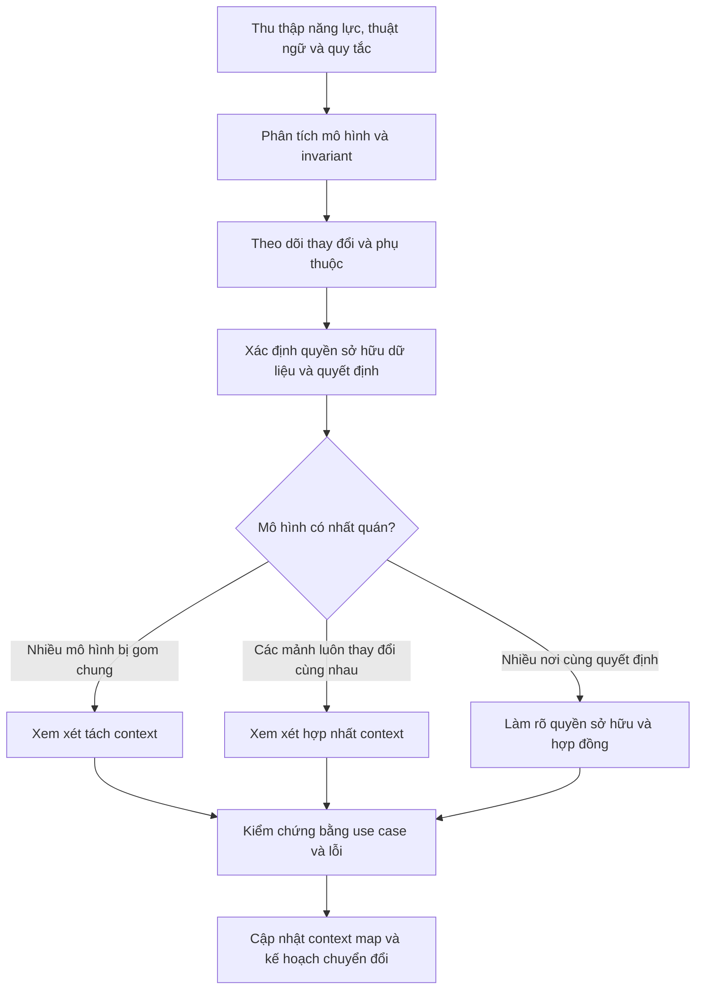

# Nhận diện ngữ cảnh quá lớn, quá nhỏ hoặc bị chồng lấn trách nhiệm

Trong Domain-Driven Design (DDD), Bounded Context là ranh giới mà bên trong đó một mô hình miền và ngôn ngữ nghiệp vụ có ý nghĩa nhất quán. Ranh giới này giúp đội ngũ biết mô hình nào đang được sử dụng, quy tắc nào áp dụng và ai chịu trách nhiệm thay đổi nó. Xác định ranh giới không đơn giản là chia hệ thống thành nhiều module hoặc microservice. Một bounded context có thể được triển khai bằng một module trong ứng dụng nguyên khối, một dịch vụ độc lập hoặc nhiều thành phần kỹ thuật; điều quan trọng trước hết là ranh giới mô hình và trách nhiệm nghiệp vụ.

Nếu một context bao gồm quá nhiều năng lực và mô hình khác nhau, nó có thể trở nên quá lớn. Nếu một năng lực bị chia thành quá nhiều context nhỏ, đội ngũ phải phối hợp qua nhiều hợp đồng cho những thay đổi vốn nên được xử lý cùng nhau. Một vấn đề khác xuất hiện khi hai context cùng quyết định hoặc cập nhật một phần nghiệp vụ, khiến quyền sở hữu bị chồng lấn. Những vấn đề này làm tăng chi phí thay đổi, gây hiểu nhầm và khiến hệ thống khó tiến hóa.

Bài học này trình bày các dấu hiệu để nhận diện ba tình huống trên, cách điều tra nguyên nhân và cách điều chỉnh ranh giới dựa trên mô hình, quy tắc, quyền sở hữu và luồng thay đổi thực tế.

## 1. Bounded Context là ranh giới của một mô hình nhất quán

Một miền nghiệp vụ lớn thường chứa nhiều subdomain và nhiều góc nhìn. Cùng một khái niệm trong đời sống có thể được mô tả khác nhau tùy theo mục tiêu của bộ phận sử dụng. Ví dụ, Catalog quan tâm cách sản phẩm được mô tả và niêm yết; Inventory quan tâm số lượng có thể bán tại từng kho; Fulfillment quan tâm đơn vị hàng hóa cần lấy, đóng gói và giao.

Bounded Context xác định phạm vi mà một mô hình cụ thể có hiệu lực. Trong phạm vi đó:

- Thuật ngữ có ý nghĩa đủ rõ và nhất quán để chuyên gia nghiệp vụ cùng đội phát triển sử dụng.
- Các quy tắc và hành vi liên quan được diễn đạt bằng một mô hình có chủ đích.
- Có thể xác định trách nhiệm nghiệp vụ và quyền quyết định đối với dữ liệu, trạng thái và thay đổi.
- Các phần bên ngoài tương tác thông qua hợp đồng hoặc cơ chế tích hợp đã xác định.

Bounded Context không đồng nghĩa với một entity, một bảng dữ liệu, một team, một repository mã nguồn hay một microservice. Những yếu tố đó có thể giúp triển khai hoặc quản lý ranh giới, nhưng không tự tạo ra ranh giới miền đúng.

Một context có thể chứa nhiều entity và nhiều use case nếu chúng cùng phục vụ một mô hình nhất quán. Ngược lại, một entity có tên quen thuộc như `Customer`, `Product` hoặc `Order` có thể có những mô hình khác nhau ở các context khác nhau. Không nên quyết định ranh giới chỉ bằng số lượng class hoặc số lượng bảng.

## 2. Dấu hiệu một bounded context quá lớn

Context quá lớn thường xuất hiện khi nhiều năng lực nghiệp vụ khác nhau bị đặt chung dưới một mô hình, dù chúng có thuật ngữ, quy tắc, vòng đời hoặc nhịp thay đổi khác nhau. Ban đầu, cách gom này có thể giúp nhóm triển khai nhanh. Khi hệ thống phát triển, chi phí phối hợp và tác động dây chuyền bắt đầu tăng.

### 2.1. Một thuật ngữ mang nhiều ý nghĩa trong cùng context

Một dấu hiệu đáng chú ý là cùng một tên gọi phải phục vụ nhiều nhóm với các cách hiểu khác nhau. Chẳng hạn, `Product` trong một context vừa là nội dung hiển thị trên cửa hàng, vừa là đơn vị lưu kho, vừa là mặt hàng được định giá và vừa là đối tượng dùng để lập báo cáo doanh thu.

Khi đó, class `Product` thường tích lũy nhiều thuộc tính và phương thức không liên quan trực tiếp. Một thay đổi về mô tả sản phẩm có thể ảnh hưởng đến xử lý tồn kho; thay đổi quy tắc định giá có thể buộc nhóm kho phải cập nhật dù nghiệp vụ của họ không đổi.

Hãy xem xét liệu các nhóm có đang dùng cùng một từ cho những khái niệm khác nhau hay không. Nếu mỗi nhóm cần một định nghĩa, vòng đời và quy tắc riêng, mô hình có thể đang vượt quá phạm vi nhất quán của nó.

### 2.2. Nhiều nhóm có lý do thay đổi độc lập

Context lớn thường có nhiều nhóm hoặc nhiều bên liên quan thay đổi cùng một khu vực mã nguồn vì các mục tiêu khác nhau. Ví dụ:

- Nhóm Catalog thay đổi thuộc tính mô tả, danh mục và nội dung niêm yết.
- Nhóm Inventory thay đổi quy tắc giữ hàng, điều chỉnh tồn kho và kiểm kê.
- Nhóm Pricing thay đổi chính sách giá, chiết khấu và thời hạn hiệu lực.
- Nhóm Fulfillment thay đổi cách phân bổ hàng, đóng gói và xử lý lô giao.

Nếu mọi thay đổi đều đi qua một context và cùng tác động lên mô hình `Product`, việc phát hành và kiểm thử trở nên nặng nề. Đây là dấu hiệu của nhiều năng lực nghiệp vụ bị gom chung, đặc biệt khi các nhóm có thể mô tả rõ những lý do thay đổi độc lập.

### 2.3. Quy tắc và trạng thái trở nên khó hiểu

Một context có thể trở nên quá lớn khi một đối tượng phải mang trạng thái phục vụ nhiều quy trình khác nhau. Ví dụ, một trường `status` của sản phẩm lần lượt chứa `DRAFT`, `PUBLISHED`, `OUT_OF_STOCK`, `RESERVED`, `DISCONTINUED`, `DAMAGED` và `ARCHIVED`. Các trạng thái này có thể thuộc các vòng đời khác nhau: nội dung niêm yết, tồn kho, phân bổ và vòng đời thương mại.

Nếu một chuyển trạng thái cần kiểm tra quy tắc của nhiều bộ phận, cần hỏi xem những quy tắc đó có thực sự thuộc cùng một mô hình và cùng một đơn vị nhất quán hay không. Không nên tạo một state machine khổng lồ chỉ để phản ánh tất cả quy trình của doanh nghiệp.

### 2.4. Thay đổi nhỏ tạo ra phạm vi ảnh hưởng lớn

Một thay đổi cục bộ thường đòi hỏi nhiều nhóm cùng sửa code, cập nhật dữ liệu, chạy kiểm thử và phối hợp phát hành. Những lỗi hồi quy xảy ra ở khu vực không liên quan trực tiếp cũng là tín hiệu cần điều tra.

Tuy nhiên, phạm vi ảnh hưởng lớn không tự động chứng minh context sai. Một quy tắc xuyên suốt hoặc một hợp đồng dùng chung có thể hợp lý. Cần tìm nguyên nhân: sự phụ thuộc đó xuất phát từ quy tắc nghiệp vụ thực sự hay từ việc các mô hình khác nhau đang bị ghép vào nhau?

### 2.5. Một mô hình cố gắng phục vụ nhiều mức độ chi tiết

Mô hình dùng cho màn hình catalog có thể cần tên, hình ảnh, mô tả và thuộc tính tìm kiếm. Mô hình phục vụ kho cần SKU, kích thước, vị trí lưu trữ và số lượng. Mô hình tài chính cần mã hàng, giá vốn và cách ghi nhận doanh thu. Nếu một context cố cung cấp tất cả các góc nhìn này bằng cùng một mô hình, nó có thể đã trở thành một vùng chứa dữ liệu tổng hợp hơn là mô hình miền có ranh giới rõ.

## 3. Dấu hiệu một bounded context quá nhỏ

Chia nhỏ context có thể giúp tách mô hình và trách nhiệm. Nhưng nếu ranh giới được đặt quá chi li, hệ thống phải trả chi phí tích hợp và phối hợp cho những khái niệm vốn thay đổi cùng nhau.

### 3.1. Các thao tác đơn giản phải đi qua nhiều context

Một use case thông thường cần gọi tuần tự nhiều context chỉ để hoàn thành một quy tắc nghiệp vụ nhỏ. Ví dụ, khi tạo một dòng hàng trong đơn, hệ thống phải gọi một context để kiểm tra mã sản phẩm, một context để kiểm tra đơn vị tính, một context để kiểm tra giá hiển thị và một context khác để kiểm tra chính sách bán; các context này không có trách nhiệm nghiệp vụ độc lập rõ ràng.

Giao tiếp qua ranh giới có chi phí: định nghĩa hợp đồng, xử lý lỗi, timeout, retry, quan sát hệ thống, tương thích phiên bản và nhất quán dữ liệu. Nếu nhiều lời gọi chỉ để ghép các mảnh của một mô hình duy nhất, ranh giới có thể quá nhỏ.

### 3.2. Nhiều context luôn phải thay đổi cùng nhau

Nếu một thay đổi nghiệp vụ nhỏ luôn yêu cầu cập nhật đồng thời nhiều context, schema, event và hợp đồng, hãy kiểm tra xem chúng có đang cùng thực hiện một năng lực nghiệp vụ hay không.

Ví dụ, ba context riêng biệt cùng sở hữu các bước của một quy tắc duy nhất về điều kiện đủ tư cách mua hàng. Mỗi lần chính sách thay đổi, cả ba phải phát hành đồng bộ. Nếu không có lý do về quyền sở hữu hoặc vòng đời để tách chúng, có thể hợp nhất thành một context với mô hình nhất quán hơn.

### 3.3. Ranh giới được tạo theo cấu trúc kỹ thuật

Chia `CustomerEntity`, `CustomerAddress`, `CustomerContact` và `CustomerPreference` thành các context riêng chỉ vì chúng là các bảng hoặc module khác nhau thường là dấu hiệu phân ranh giới theo cấu trúc dữ liệu. Nếu các phần đó cùng phục vụ một mô hình khách hàng trong cùng phạm vi nghiệp vụ và thay đổi cùng nhau, việc tách context không mang lại lợi ích rõ ràng.

Tương tự, tách mỗi CRUD endpoint hoặc mỗi entity thành một dịch vụ độc lập không phải là cách xác định bounded context. Ranh giới cần bắt nguồn từ năng lực, ngôn ngữ và quy tắc nghiệp vụ.

### 3.4. Nhiều context chỉ là lớp chuyển tiếp dữ liệu

Một context nhỏ có thể không có quy tắc, chính sách hoặc vòng đời riêng; nó chỉ nhận một yêu cầu, đổi tên vài trường rồi chuyển nguyên dữ liệu sang context khác. Nếu vai trò này không phải là một ACL, adapter hoặc thành phần tích hợp có chủ đích, hãy kiểm tra xem nó có thực sự cần tồn tại như một bounded context.

Không phải mọi thành phần chuyển đổi đều vô ích. Adapter và ACL có thể bảo vệ mô hình nội bộ trước hệ thống ngoài. Điểm cần xem xét là liệu thành phần đó có đại diện cho một mô hình và trách nhiệm nghiệp vụ độc lập hay chỉ là một ranh giới bị tạo ra không có lý do.

### 3.5. Chi phí vận hành vượt lợi ích độc lập

Quá nhiều context được triển khai thành các dịch vụ nhỏ có thể làm tăng số pipeline phát hành, cấu hình, dashboard, cảnh báo, secrets, quyền truy cập và quy trình xử lý sự cố. Nếu các context không cần khả năng triển khai hoặc mở rộng độc lập, việc tách thành nhiều dịch vụ có thể gây thêm chi phí mà không cải thiện mô hình nghiệp vụ.

Có thể giữ các bounded context như module độc lập trong một modular monolith. Tính độc lập của mô hình không bắt buộc phải đi kèm triển khai phân tán.

## 4. Dấu hiệu trách nhiệm giữa các context bị chồng lấn

Chồng lấn trách nhiệm xảy ra khi nhiều context cùng cho rằng mình có quyền quyết định, thay đổi hoặc sở hữu cùng một phần nghiệp vụ. Đây là vấn đề về quyền sở hữu mô hình và chính sách, khác với việc hai context cùng lưu một bản sao dữ liệu để phục vụ nhu cầu đọc.

### 4.1. Có nhiều nguồn quyết định cho cùng một sự thật

Ví dụ, Ordering và Payment đều có thể cập nhật trường `paymentStatus` của một đơn hàng. Ordering cho rằng trạng thái là `PAID` khi nhận phản hồi thành công; Payment cho rằng chỉ được chuyển sang `PAID` sau khi xử lý đối soát. Nếu cả hai có quyền quyết định, các giá trị có thể mâu thuẫn và không rõ bên nào là nguồn có thẩm quyền.

Hãy xác định context sở hữu vòng đời và quy tắc của sự thật đó. Context khác có thể giữ projection hoặc bản sao phục vụ truy vấn, nhưng cần biết dữ liệu đến từ đâu, cập nhật theo cơ chế nào và không tự ý trở thành nơi quyết định thay cho chủ sở hữu.

### 4.2. Hai context thực thi cùng một quy tắc theo cách khác nhau

Giả sử Ordering và Promotion đều tự tính điều kiện áp dụng giảm giá. Một bên kiểm tra thời hạn và nhóm khách hàng; bên kia còn kiểm tra số lượng tối đa và khả năng kết hợp khuyến mãi. Hai nơi có thể đưa ra kết quả khác nhau cho cùng một đơn.

Nếu chính sách thuộc trách nhiệm của Promotion, Ordering nên sử dụng kết quả qua hợp đồng đã xác định thay vì tự sao chép toàn bộ quy tắc. Nếu chính sách thực sự gồm hai phần có chủ sở hữu riêng, cần tách rõ phần nào do mỗi context quyết định và cách kết hợp kết quả.

### 4.3. Cùng một hành động có nhiều nơi thực hiện

Ví dụ, thao tác “hủy đơn” có thể được xử lý ở Ordering, Payment và Fulfillment. Việc cả ba cùng tham gia không có nghĩa là trách nhiệm bị chồng lấn. Vấn đề xuất hiện nếu mỗi context đều tự quyết định toàn bộ đơn đã bị hủy hay chưa, tự thay đổi trạng thái của các context khác hoặc tự phát sinh hoàn tiền và giải phóng hàng mà không có quy tắc phối hợp rõ.

Hãy phân biệt:

- Context nào nhận và quyết định yêu cầu hủy đơn?
- Context nào quyết định giao dịch có thể void hoặc refund?
- Context nào quyết định hàng đã giữ có thể được giải phóng?
- Sự kiện nào thông báo kết quả cho các bên liên quan?
- Nếu một bước thất bại, ai điều phối xử lý tiếp theo?

Một quy trình có thể đi qua nhiều context, nhưng mỗi quyết định cần có chủ sở hữu rõ.

### 4.4. Quyền sở hữu dữ liệu không rõ ràng

Nếu nhiều nhóm cùng sửa trực tiếp một bảng hoặc một bản ghi mà không có quy tắc phân quyền, việc thay đổi schema và xử lý lỗi trở nên rủi ro. Mỗi context cần biết dữ liệu nào là nguồn có thẩm quyền của mình, dữ liệu nào chỉ là bản sao và dữ liệu nào được nhận từ context khác.

Một database vật lý có thể chứa dữ liệu của nhiều context trong giai đoạn triển khai ban đầu. Điều đó vẫn có thể chấp nhận được nếu quyền sở hữu logic, quyền ghi và hợp đồng giữa các context rõ ràng. Ngược lại, tách database riêng cũng không tự giải quyết được chồng lấn nếu hai bên vẫn cùng quyết định một quy tắc.

## 5. So sánh ba tình huống

| Tình huống | Dấu hiệu điển hình | Câu hỏi chẩn đoán | Hướng xử lý thường gặp |
|---|---|---|---|
| Context quá lớn | Nhiều ngôn ngữ, quy tắc, vòng đời và lý do thay đổi khác nhau trong một mô hình | Các phần có thực sự cần cùng một mô hình và cùng thay đổi nhất quán không? | Tách theo năng lực, mô hình và quyền sở hữu nghiệp vụ |
| Context quá nhỏ | Nhiều lời gọi và hợp đồng cho một quy tắc; các context luôn thay đổi cùng nhau | Ranh giới này có bảo vệ một mô hình hoặc trách nhiệm độc lập không? | Hợp nhất các context có cùng mô hình và nhịp thay đổi |
| Trách nhiệm chồng lấn | Nhiều nơi cùng ghi hoặc quyết định một sự thật; quy tắc bị sao chép | Ai có quyền quyết định và ai chỉ tiêu thụ kết quả? | Chỉ định chủ sở hữu, định nghĩa hợp đồng và chuyển đổi dữ liệu |

Một context có thể vừa quá lớn vừa có vùng trách nhiệm chồng lấn. Một hệ thống cũng có thể có các context nhỏ nhưng hợp lý vì chúng thuộc những nhóm nghiệp vụ độc lập. Không nên áp dụng quy tắc kích thước cố định hoặc đếm số class, endpoint, bảng để kết luận.

## 6. Quy trình chẩn đoán ranh giới bounded context

Khi nghi ngờ ranh giới hiện tại không phù hợp, hãy điều tra bằng bằng chứng từ nghiệp vụ, thay đổi và vận hành. Các bước dưới đây có thể thực hiện trong workshop hoặc qua một chuỗi buổi làm việc với các nhóm.

### Bước 1: Liệt kê năng lực và quy trình nghiệp vụ

Ghi lại những việc doanh nghiệp cần thực hiện, ai tham gia và kết quả nào cần được tạo ra. Ví dụ trong thương mại điện tử: quản lý catalog, định giá, đặt hàng, thu tiền, quản lý tồn kho, giao hàng và chăm sóc sau bán.

Phân biệt năng lực nghiệp vụ với màn hình, bảng dữ liệu hoặc endpoint. Một màn hình có thể phục vụ nhiều năng lực; một năng lực cũng có thể được thực hiện qua nhiều màn hình.

### Bước 2: Thu thập thuật ngữ và mô hình của từng nhóm

Hỏi từng nhóm về khái niệm quan trọng, trạng thái, sự kiện, quy tắc và các ngoại lệ họ xử lý. Đặt cùng một thuật ngữ cạnh nhau để phát hiện sự khác biệt về ý nghĩa.

Nếu các nhóm có cách hiểu khác nhau, ghi nhận định nghĩa theo từng nhóm trước khi kết luận cần hợp nhất hay tách context. Đừng ép mọi người dùng chung một glossary khi mô hình chưa được làm rõ.

### Bước 3: Xác định invariant và ranh giới nhất quán

Invariant là điều kiện nghiệp vụ phải luôn được bảo vệ trong phạm vi một thao tác nhất quán. Hãy xác định ai chịu trách nhiệm bảo vệ điều kiện đó, dữ liệu nào cần được cập nhật cùng nhau và khi nào có thể chấp nhận nhất quán cuối cùng.

Nếu nhiều quy tắc cần được thực thi cùng nhau trong một transaction hoặc một ranh giới nhất quán, đó là một tín hiệu để xem xét thiết kế mô hình và aggregate bên trong context. Tuy nhiên, aggregate và bounded context là hai loại ranh giới khác nhau; không nên suy ra rằng mỗi aggregate cần một context riêng.

### Bước 4: Theo dõi thay đổi và phụ thuộc

Chọn một số thay đổi nghiệp vụ gần đây và theo dõi những module, nhóm, hợp đồng và dữ liệu bị ảnh hưởng. Hỏi:

- Những phần nào thường thay đổi cùng nhau?
- Những phần nào có thể thay đổi độc lập?
- Thay đổi nào phải phát hành đồng bộ và vì sao?
- Có phụ thuộc nào chỉ tồn tại vì các nhóm đang dùng chung một mô hình kỹ thuật?
- Có logic nào bị sao chép ở nhiều nơi?

Lịch sử thay đổi thường cung cấp bằng chứng tốt hơn sơ đồ kiến trúc chỉ phản ánh thiết kế dự kiến.

### Bước 5: Xác định quyền sở hữu và nguồn dữ liệu có thẩm quyền

Với mỗi khái niệm và quy tắc quan trọng, ghi rõ context nào là chủ sở hữu, context nào tiêu thụ và nơi nào chỉ giữ bản sao. Xác định ai có quyền thay đổi trạng thái, ai phát ra sự kiện và ai chịu trách nhiệm khi dữ liệu không nhất quán.

Nếu hai nhóm đều cho rằng mình sở hữu cùng một quyết định, cần giải quyết trách nhiệm ở cấp nghiệp vụ trước khi chọn công nghệ tích hợp.

### Bước 6: So sánh lợi ích và chi phí của việc tách hoặc hợp nhất

Đánh giá cả chi phí bên trong và bên ngoài ranh giới:

- Bên trong: độ phức tạp mô hình, số lượng quy tắc, mức độ phụ thuộc giữa các phần, khả năng hiểu và kiểm thử.
- Bên ngoài: số hợp đồng, lời gọi mạng, xử lý lỗi, đồng bộ dữ liệu, điều phối transaction, phát hành và vận hành.

Tách context có lợi khi giúp mô hình rõ hơn, quyền sở hữu độc lập hơn và giảm tác động thay đổi. Hợp nhất có lợi khi các phần thực sự cùng phục vụ một mô hình, cùng chịu một quy tắc và thường xuyên phải phối hợp như một đơn vị.

### Bước 7: Đề xuất ranh giới và kiểm chứng bằng kịch bản

Vẽ context map thể hiện các context, quan hệ và luồng thông tin. Sau đó kiểm tra bằng một số use case quan trọng, trường hợp lỗi và thay đổi dự kiến. Nếu ranh giới mới làm rõ quyền sở hữu và giảm phụ thuộc không cần thiết mà vẫn thể hiện được quy tắc, đó là một ứng viên tốt.



## 7. Ví dụ: điều chỉnh ranh giới trong nền tảng thương mại điện tử

Giả sử ban đầu hệ thống có một context tên `Commerce` với các chức năng catalog, pricing, inventory, ordering và fulfillment. Một mô hình `Product` được dùng chung cho mọi chức năng. Theo thời gian, class này chứa thông tin mô tả, giá, tồn kho, vị trí kho, trạng thái niêm yết và dữ liệu đóng gói.

### 7.1. Nhận diện context quá lớn

Khi khảo sát, đội ngũ nhận thấy:

- Catalog thay đổi mô tả, hình ảnh, danh mục và nội dung hiển thị.
- Pricing thay đổi bảng giá, quy tắc chiết khấu và thời hạn áp dụng.
- Inventory thay đổi số lượng khả dụng, giữ hàng và điều chỉnh tồn kho.
- Ordering quản lý yêu cầu mua và trạng thái đơn.
- Fulfillment quản lý phân bổ, lấy hàng, đóng gói và giao hàng.

Các năng lực có thuật ngữ và vòng đời riêng. Nhóm đề xuất tách thành các bounded context tương ứng. Đây là một giả thuyết cần kiểm chứng bằng quy tắc và trách nhiệm thực tế, không phải kết luận chỉ vì có năm nhóm chức năng.

### 7.2. Mô hình riêng theo context

Catalog có thể mô hình hóa một sản phẩm được niêm yết với thông tin khách nhìn thấy:

```java
package catalog;

record CatalogProductId(String value) {}

record CatalogProduct(
    CatalogProductId id,
    String displayName,
    String description,
    boolean published
) {}
```

Inventory có thể mô hình hóa đơn vị lưu kho và số lượng tại một địa điểm:

```java
package inventory;

record Sku(String value) {}
record WarehouseId(String value) {}

record StockPosition(
    Sku sku,
    WarehouseId warehouse,
    int onHand,
    int reserved
) {
    int available() {
        return onHand - reserved;
    }
}
```

Hai mô hình có thể liên hệ thông qua mã SKU hoặc một hợp đồng sản phẩm được công bố. Catalog không cần biết chi tiết số lượng đang giữ ở từng kho để quản lý nội dung mô tả. Inventory cũng không cần mang toàn bộ mô tả tiếp thị để thực hiện việc giữ hàng.

Pricing có thể sở hữu chính sách giá và thời hạn hiệu lực; Ordering sử dụng kết quả báo giá theo hợp đồng đã thống nhất. Fulfillment có thể nhận yêu cầu xử lý hàng dựa trên SKU, số lượng và địa điểm lấy hàng. Các context trao đổi thông tin cần thiết mà không phải dùng chung toàn bộ mô hình nội bộ.

### 7.3. Nhận diện context quá nhỏ

Trong lần thiết kế tiếp theo, nhóm lại chia `ProductDescription`, `ProductImage` và `ProductCategory` thành ba dịch vụ riêng. Mỗi lần cập nhật một sản phẩm phải gọi cả ba dịch vụ; các thay đổi nội dung luôn phải phát hành cùng nhau và không có quy tắc hay quyền sở hữu độc lập. Đây có thể là dấu hiệu chia quá nhỏ. Những khái niệm đó có thể được hợp nhất trở lại thành mô hình Catalog.

Điều này không có nghĩa Catalog phải quản lý luôn tồn kho hoặc giá. Quyết định hợp nhất chỉ áp dụng cho các phần cùng thuộc một mô hình nội dung sản phẩm; những năng lực có quy tắc và vòng đời riêng vẫn có thể là context khác.

### 7.4. Nhận diện trách nhiệm chồng lấn

Giả sử Ordering và Inventory đều cho phép cập nhật số lượng đã giữ. Ordering giảm số lượng khi khách đặt đơn; Inventory cũng giảm số lượng khi nhận thông báo từ kho. Nếu hai bên cùng cập nhật nguồn dữ liệu có thẩm quyền, số lượng có thể bị trừ hai lần hoặc không được hoàn lại khi đơn bị hủy.

Đội ngũ cần xác định Inventory là nơi sở hữu số lượng tồn và quyết định giữ/giải phóng hàng. Ordering gửi yêu cầu giữ hàng và nhận kết quả qua hợp đồng. Ordering có thể lưu trạng thái xử lý của đơn để phục vụ use case, nhưng không tự quyết định số lượng tồn trong Inventory.

## 8. Điều chỉnh ranh giới: tách, hợp nhất và làm rõ quyền sở hữu

Sau khi chẩn đoán, có ba hướng điều chỉnh chính. Không có hướng nào nên được thực hiện chỉ vì muốn tăng hoặc giảm số lượng dịch vụ.

### 8.1. Tách một context quá lớn

Khi một context chứa nhiều mô hình có ý nghĩa khác nhau, có thể tách theo năng lực nghiệp vụ, ngôn ngữ, vòng đời hoặc quyền sở hữu. Cần xác định:

1. Mô hình và quy tắc nào sẽ thuộc context mới?
2. Dữ liệu nào là nguồn có thẩm quyền và ai có quyền ghi?
3. Các context sẽ trao đổi qua event, API hay cơ chế nào?
4. Dữ liệu cũ sẽ được chuyển đổi hoặc đồng bộ ra sao?
5. Những use case nào cần xử lý nhất quán và những use case nào chấp nhận nhất quán cuối cùng?

Tách ranh giới logic trước có thể giúp nhóm đánh giá mô hình mà chưa phải phân tán triển khai. Khi có nhu cầu độc lập về phát hành, mở rộng hoặc cô lập lỗi, có thể xem xét tách thành dịch vụ sau.

### 8.2. Hợp nhất các context quá nhỏ

Khi nhiều context cùng phục vụ một mô hình, thay đổi cùng nhau và không có trách nhiệm độc lập rõ ràng, có thể hợp nhất chúng. Việc hợp nhất giúp giảm số hợp đồng và luồng điều phối, nhưng cần giữ lại các module hoặc thành phần nội bộ nếu chúng vẫn giúp tổ chức code rõ ràng.

Hợp nhất context không nhất thiết là gom mọi class vào một package. Có thể duy trì các module con bên trong một bounded context, miễn là thuật ngữ và quy tắc nhất quán, quyền sở hữu rõ và không tạo ra các mô hình cạnh tranh.

### 8.3. Làm rõ quyền sở hữu khi trách nhiệm chồng lấn

Không phải mọi chồng lấn đều cần tách hoặc hợp nhất context. Đôi khi chỉ cần xác định một context là chủ sở hữu quyết định, các context còn lại là bên yêu cầu hoặc tiêu thụ kết quả.

Ví dụ, Payment sở hữu trạng thái giao dịch; Ordering sở hữu trạng thái đơn hàng. Payment có thể phát `PaymentCaptured`; Ordering tiêu thụ sự kiện đó để cập nhật trạng thái đơn theo quy tắc của mình. Hai context cùng lưu một thông tin về thanh toán ở hai dạng khác nhau để phục vụ truy vấn vẫn có thể hợp lý, miễn là quyền sở hữu và cơ chế cập nhật rõ ràng.

### 8.4. Chuyển đổi dần thay vì thay đổi toàn bộ cùng lúc

Với hệ thống đang vận hành, việc đổi ranh giới có thể ảnh hưởng dữ liệu, API, event và khách hàng tích hợp. Có thể chuyển đổi theo từng bước:

- Xác định context đích và hợp đồng mới.
- Tạo mô hình mới và adapter để đọc dữ liệu cũ khi cần.
- Chuyển quyền ghi về một nơi có thẩm quyền.
- Đồng bộ hoặc di chuyển dữ liệu có kiểm soát.
- Chuyển từng consumer sang hợp đồng mới.
- Đối chiếu kết quả và loại bỏ đường ghi cũ sau khi không còn consumer phụ thuộc.

Trong quá trình chuyển đổi, tránh để hai context cùng ghi nguồn dữ liệu có thẩm quyền. Nếu cần chạy song song tạm thời, phải có quy tắc đồng bộ, đối soát và thời điểm kết thúc rõ ràng.

## 9. Những sai lầm khi thiết kế bounded context

- **Chọn ranh giới theo số lượng class hoặc bảng:** cấu trúc kỹ thuật không phản ánh đầy đủ mô hình và trách nhiệm nghiệp vụ.
- **Đồng nhất bounded context với microservice:** tạo thêm hạ tầng phân tán trước khi hiểu ranh giới làm tăng chi phí vận hành.
- **Tách theo phòng ban một cách máy móc:** một phòng ban có thể làm việc trên nhiều context; một context cũng có thể cần nhiều vai trò phối hợp.
- **Gộp mọi thứ quanh một entity trung tâm:** `Customer`, `Product` hoặc `Order` có thể mang ý nghĩa khác nhau trong các context.
- **Dùng chung database như bằng chứng về mô hình chung:** các context vẫn có thể có mô hình riêng dù đang dùng một database vật lý.
- **Tạo nhiều nguồn có thẩm quyền:** nhiều nơi cùng quyết định một trạng thái hoặc quy tắc sẽ gây mâu thuẫn và khó đối soát.
- **Chia nhỏ chỉ để nhóm có quyền sở hữu riêng:** ranh giới cần phục vụ mô hình và năng lực nghiệp vụ; quyền tổ chức là một yếu tố nhưng không phải yếu tố duy nhất.
- **Hợp nhất vì muốn giảm số dịch vụ:** nếu mô hình và vòng đời thực sự khác nhau, hợp nhất có thể làm context trở nên quá lớn.
- **Bỏ qua chi phí tích hợp:** mỗi ranh giới phân tán kéo theo hợp đồng, lỗi mạng, retry, quan sát và xử lý nhất quán.
- **Không xem lại ranh giới:** khi sản phẩm, tổ chức hoặc quy tắc thay đổi, context map và quyền sở hữu có thể cần điều chỉnh.

## 10. Checklist đánh giá ranh giới

Khi xem xét một bounded context, hãy dùng các câu hỏi sau để thu thập bằng chứng:

- [ ] Thuật ngữ và mô hình bên trong context có ý nghĩa nhất quán không?
- [ ] Có nhiều nhóm đang dùng cùng một từ cho các khái niệm hoặc quy tắc khác nhau không?
- [ ] Các năng lực bên trong có lý do thay đổi và vòng đời độc lập không?
- [ ] Một thay đổi nhỏ có thường xuyên buộc nhiều nhóm sửa và phát hành cùng nhau không?
- [ ] Các use case có phải đi qua quá nhiều context cho một quy tắc đơn giản không?
- [ ] Các context có thực sự có trách nhiệm và mô hình riêng không?
- [ ] Có nhiều nơi cùng ghi hoặc quyết định một sự thật nghiệp vụ không?
- [ ] Nguồn dữ liệu có thẩm quyền và quyền sở hữu đã được xác định chưa?
- [ ] Hợp đồng tích hợp có diễn đạt rõ ý nghĩa của dữ liệu và sự kiện không?
- [ ] Chi phí vận hành và tích hợp có tương xứng với lợi ích của ranh giới không?
- [ ] Đã kiểm chứng ranh giới bằng use case bình thường, ngoại lệ và thay đổi dự kiến chưa?

Không nên cộng điểm checklist để tự động quyết định tách hay hợp nhất. Hãy dùng câu trả lời làm bằng chứng cho cuộc thảo luận với chuyên gia nghiệp vụ và các nhóm sở hữu hệ thống.

## 11. Câu hỏi tự kiểm tra

1. Bounded Context là ranh giới của điều gì? Vì sao nó không đồng nghĩa với microservice?
2. Những dấu hiệu nào cho thấy một context đang chứa nhiều mô hình nghiệp vụ khác nhau?
3. Vì sao một trường `status` có thể là dấu hiệu của nhiều vòng đời bị gom chung?
4. Khi nào nhiều lời gọi giữa các context cho thấy ranh giới có thể quá nhỏ?
5. Phân biệt việc nhiều context cùng tham gia một quy trình với việc chồng lấn quyền quyết định như thế nào?
6. Vì sao hai context có thể cùng lưu một bản sao dữ liệu mà vẫn không chồng lấn trách nhiệm?
7. Làm thế nào để xác định nguồn dữ liệu có thẩm quyền cho một khái niệm?
8. Aggregate và Bounded Context khác nhau ở phạm vi và mục đích như thế nào?
9. Khi tách một context lớn, cần xử lý quyền ghi, dữ liệu và hợp đồng tích hợp ra sao?
10. Khi nào nên hợp nhất các context nhỏ và khi nào nên giữ chúng độc lập?

## Kết luận

Bounded Context phù hợp khi nó bảo vệ được một mô hình và ngôn ngữ nhất quán, đồng thời làm rõ trách nhiệm nghiệp vụ. Context quá lớn thường chứa nhiều mô hình, vòng đời và lý do thay đổi độc lập. Context quá nhỏ thường tạo nhiều hợp đồng và phụ thuộc cho những phần vốn cần được thay đổi cùng nhau. Trách nhiệm chồng lấn xuất hiện khi nhiều nơi cùng quyết định hoặc ghi một sự thật mà không có quyền sở hữu rõ ràng.

Để điều chỉnh ranh giới, hãy bắt đầu từ năng lực nghiệp vụ, thuật ngữ, invariant, lịch sử thay đổi và quyền sở hữu dữ liệu. Sau đó kiểm chứng phương án tách, hợp nhất hoặc phân định trách nhiệm bằng các use case thực tế. Mục tiêu là tạo ra các mô hình có thể hiểu, thay đổi và tích hợp với nhau một cách có chủ đích; số lượng context hay dịch vụ tự nó không phải thước đo chất lượng.
