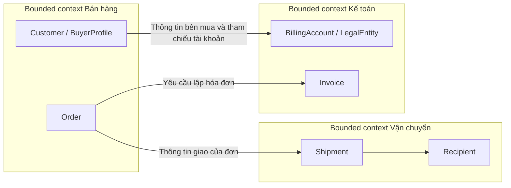

# Quản lý một khái niệm nghiệp vụ có nhiều mô hình biểu diễn

Trong một doanh nghiệp, cùng một người hoặc một sự vật có thể được nhiều bộ phận nhìn nhận theo những mục đích khác nhau. Bộ phận bán hàng quan tâm người mua, lịch sử giao dịch và chương trình thành viên. Kế toán quan tâm chủ thể chịu trách nhiệm thanh toán, hóa đơn và công nợ. Vận chuyển quan tâm người nhận, số điện thoại và địa chỉ giao hàng. Tất cả có thể đang nói về một khách hàng ngoài đời thực, nhưng mỗi bộ phận cần một mô hình khác nhau để thực hiện công việc của mình.

Domain-Driven Design (DDD) giải quyết tình huống này bằng cách xác định **bounded context (ngữ cảnh giới hạn)**: ranh giới mà trong đó một mô hình và ngôn ngữ có ý nghĩa nhất quán. Mỗi bounded context có thể biểu diễn cùng một khái niệm đời thực theo cách phù hợp với trách nhiệm, quy tắc và vòng đời của nó. Khi các ngữ cảnh trao đổi, chúng cần hợp đồng và cơ chế chuyển đổi rõ ràng để giữ đúng ý nghĩa.

Điều này không có nghĩa mỗi nhóm được tùy ý tạo dữ liệu trùng lặp. Mỗi mô hình cần có chủ sở hữu, nguồn dữ liệu có thẩm quyền cho từng loại thông tin và cách đồng bộ được xác định. Mục tiêu là bảo vệ ngữ nghĩa của từng miền, đồng thời quản lý mối liên hệ giữa các mô hình.

## Sau bài học này

Bạn có thể:

- Giải thích vì sao một khái niệm ngoài đời thực có thể có nhiều mô hình hợp lệ trong các bounded context khác nhau.
- Phân biệt khái niệm đời thực, mô hình miền và hợp đồng tích hợp.
- Xác định chủ sở hữu mô hình và nguồn dữ liệu có thẩm quyền cho từng loại thông tin.
- Thiết kế cách ánh xạ định danh, thuộc tính và sự kiện giữa các ngữ cảnh.
- Lựa chọn cách tích hợp phù hợp như Anti-Corruption Layer, Published Language hoặc Shared Kernel.
- Nhận diện các rủi ro của mô hình dùng chung toàn cục, cơ sở dữ liệu dùng chung và đồng bộ dữ liệu thiếu quy tắc.

## 1. Một khái niệm đời thực không bắt buộc chỉ có một mô hình

Hãy xét khái niệm “khách hàng”. Trong hội thoại hằng ngày, mọi người có thể dùng từ này như thể nó chỉ một đối tượng duy nhất. Nhưng khi đưa vào phần mềm, câu hỏi cần đặt ra là: khách hàng trong công việc cụ thể này là ai, có trách nhiệm gì và được quản lý theo quy tắc nào?

Ví dụ, một người mua hàng có thể đặt hàng cho công ty. Khi đó:

- Bán hàng cần biết người đặt hàng, tài khoản đăng nhập, hạng thành viên và lịch sử mua.
- Kế toán cần biết pháp nhân chịu trách nhiệm trả tiền, thông tin xuất hóa đơn, mã số thuế và hạn mức công nợ.
- Vận chuyển cần biết người nhận một kiện hàng cụ thể, số điện thoại liên hệ và địa chỉ giao tại thời điểm giao.

Một bản ghi `Customer` khổng lồ có thể chứa tất cả trường trên, nhưng không tự giải quyết được khác biệt về ý nghĩa. Nó còn khiến thay đổi trong một bộ phận ảnh hưởng đến các bộ phận khác. DDD cho phép mỗi bounded context xây dựng mô hình riêng:

| Bounded context | Mô hình có thể dùng | Câu hỏi nghiệp vụ chính |
| --- | --- | --- |
| Bán hàng | `Customer`, `BuyerProfile`, `Membership` | Ai đang mua hàng và quyền lợi mua hàng của họ là gì? |
| Kế toán | `BillingAccount`, `LegalEntity`, `Debtor` | Ai chịu trách nhiệm thanh toán và xuất hóa đơn cho ai? |
| Vận chuyển | `Recipient`, `DeliveryAddress`, `DeliveryContact` | Ai nhận kiện hàng này, ở đâu và liên hệ bằng cách nào? |
| Chăm sóc khách hàng | `SupportContact`, `CustomerCase` | Ai đang yêu cầu hỗ trợ và vấn đề cần được xử lý là gì? |

Các mô hình này có thể liên hệ đến cùng một cá nhân hoặc tổ chức. Tuy nhiên, chúng không nhất thiết có cùng thuộc tính, định danh, vòng đời hay quy tắc. Một người mua có thể chọn địa chỉ nhận hàng khác địa chỉ đăng ký hóa đơn; người đặt hàng có thể không phải pháp nhân thanh toán; người nhận có thể thay đổi theo từng lần giao.

### Phân biệt sự vật, mô hình và cách trao đổi

Ba thứ sau thường bị nhầm lẫn:

- **Khái niệm ngoài đời thực:** người, tổ chức, sản phẩm, đơn hàng hoặc sự kiện mà doanh nghiệp quan sát và xử lý.
- **Mô hình miền:** cách một bounded context biểu diễn những khía cạnh cần thiết của khái niệm đó để thực hiện quy tắc nghiệp vụ.
- **Hợp đồng tích hợp:** cấu trúc và ý nghĩa dữ liệu được công bố để một ngữ cảnh khác có thể trao đổi với ngữ cảnh hiện tại.

Ví dụ, một cá nhân có thể có tên pháp lý ngoài đời. Bán hàng có thể lưu tên hiển thị và tùy chọn liên hệ trong `CustomerProfile`; Kế toán lưu tên trên hóa đơn trong `LegalEntity`; Vận chuyển lưu tên người nhận trên từng `Shipment`. Hợp đồng gửi thông tin từ Bán hàng sang Kế toán cần nói rõ trường nào là tên pháp lý, trường nào là tên hiển thị. Không thể chỉ gửi một trường `name` rồi mong bên nhận tự suy ra ý nghĩa.

## 2. Bounded context bảo vệ ý nghĩa của mô hình

**Bounded context** là ranh giới mà trong đó một mô hình miền và ngôn ngữ chung được định nghĩa nhất quán. Bên trong ranh giới, thuật ngữ cần có ý nghĩa đủ rõ để chuyên gia nghiệp vụ, lập trình viên và kiểm thử cùng hiểu.

Nếu Bán hàng dùng `Customer` để chỉ người mua, mọi hành vi trong ngữ cảnh đó cần tuân theo cách hiểu này. Kế toán có thể dùng `BillingAccount` để chỉ tài khoản chịu trách nhiệm thanh toán. Hai mô hình có thể liên hệ qua một định danh hoặc hợp đồng, nhưng không cần hợp nhất thành một lớp dùng chung.

Ranh giới bounded context không đồng nghĩa với:

- Một bảng cơ sở dữ liệu.
- Một schema hoặc một package Java.
- Một nhóm màn hình trên giao diện.
- Một microservice bắt buộc có tiến trình và máy chủ riêng.

Một bounded context có thể được triển khai thành module trong modular monolith hoặc thành một dịch vụ độc lập. Điều cốt lõi là quyền sở hữu mô hình và sự nhất quán của ngôn ngữ. Cách triển khai cần được lựa chọn dựa trên nhu cầu thực tế.

### Ngôn ngữ chung có phạm vi

Trong DDD, Ubiquitous Language được phát triển bên trong bounded context. Một thuật ngữ có thể mang nghĩa khác ở context khác; điều đó không nhất thiết là lỗi. Lỗi xuất hiện khi đội không biết thuật ngữ đang được dùng theo nghĩa nào hoặc khi hợp đồng trao đổi không làm rõ sự khác biệt.

Ví dụ, “khách hàng hoạt động” ở Bán hàng có thể là người đã mua trong 12 tháng gần nhất. Ở Kế toán, “tài khoản hoạt động” có thể là tài khoản chưa bị khóa và vẫn có thể phát sinh giao dịch. Hai định nghĩa phục vụ hai quy tắc khác nhau. Nếu ép dùng một cờ `active` chung, các bên dễ hiểu sai trạng thái của nhau.

### Một bounded context có thể chứa nhiều mô hình liên quan

Việc có nhiều mô hình không chỉ xảy ra giữa các bộ phận. Trong cùng một bounded context, một khái niệm có thể được biểu diễn bằng mô hình ghi (write model), mô hình đọc (read model) hoặc cấu trúc phục vụ một use case cụ thể. Tuy nhiên, cần phân biệt điều đó với ranh giới bounded context: các read model khác nhau không tự động tạo thành những bounded context mới. Ranh giới context gắn với ngôn ngữ, trách nhiệm và mô hình nghiệp vụ nhất quán.

## 3. Xác định chủ sở hữu và nguồn dữ liệu có thẩm quyền

Khi nhiều mô hình biểu diễn những khía cạnh liên quan của cùng một khái niệm, câu hỏi quan trọng là: ai có quyền quyết định thông tin nào là đúng?

Không nhất thiết một hệ thống sở hữu mọi dữ liệu về một khách hàng. Quyền sở hữu nên được xác định theo từng loại thông tin hoặc quyết định nghiệp vụ:

| Thông tin | Nơi có thể sở hữu | Lý do |
| --- | --- | --- |
| Hạng thành viên và điểm thưởng | Bán hàng hoặc Loyalty | Được xác định bởi chính sách khách hàng thân thiết. |
| Thông tin pháp lý trên hóa đơn | Kế toán | Phải tuân theo quy tắc hóa đơn và nghĩa vụ thanh toán. |
| Địa chỉ nhận của một lần giao | Vận chuyển hoặc đơn giao hàng | Có thể khác địa chỉ hồ sơ và cần được giữ theo từng lần giao. |
| Thông tin đăng nhập | Identity / Access | Phục vụ xác thực và quản lý quyền truy cập. |
| Lịch sử yêu cầu hỗ trợ | Chăm sóc khách hàng | Phục vụ quy trình tiếp nhận và giải quyết vấn đề. |

Đây là ví dụ về cách phân chia; chủ sở hữu thực tế phụ thuộc tổ chức và quy trình. Một bounded context có thể tham chiếu thông tin từ context khác, nhưng cần biết nguồn nào có thẩm quyền để thay đổi thông tin đó.

### Nguồn dữ liệu có thẩm quyền không phải bản sao duy nhất

Một context có thể giữ bản sao hoặc projection của dữ liệu do context khác sở hữu để phục vụ truy vấn nhanh hoặc hoạt động độc lập. Bản sao đó có thể chậm cập nhật và cần ghi rõ nguồn, thời điểm cập nhật, cũng như cách xử lý khi nhận sự kiện mới.

Ví dụ, Bán hàng có thể giữ bản chiếu tên pháp lý và trạng thái tài khoản thanh toán để hiển thị cho nhân viên. Kế toán vẫn là nơi có thẩm quyền thay đổi thông tin pháp lý. Nếu nhân viên Bán hàng cần sửa tên trên hóa đơn, ứng dụng phải gửi yêu cầu đến quy trình của Kế toán thay vì âm thầm cập nhật bản sao cục bộ.

### Tránh mô hình khách hàng toàn cục

Một `GlobalCustomer` dùng chung cho mọi module thường bắt đầu với ý định tránh trùng lặp. Theo thời gian, nó có thể chứa hàng chục trường và trạng thái chỉ một vài nhóm hiểu. Mỗi nhóm phải chờ các nhóm khác thống nhất trước khi thay đổi, trong khi một trường có thể mang ý nghĩa khác nhau ở từng nơi.

Chỉ chia sẻ dữ liệu khi có ý nghĩa thực sự chung và quyền sở hữu rõ. Nếu cần một định danh xuyên hệ thống, có thể dùng một mã tham chiếu hoặc dịch vụ định danh phù hợp; điều đó không bắt buộc tất cả context phải dùng chung một mô hình miền.

## 4. Giữ liên hệ giữa các mô hình bằng định danh và ánh xạ

Các mô hình riêng vẫn cần biết chúng liên quan đến nhau như thế nào. Có hai vấn đề cần giải quyết: nhận diện đối tượng và chuyển đổi ý nghĩa.

### Định danh nội bộ và định danh tham chiếu

Mỗi bounded context có thể cấp định danh riêng theo nhu cầu của mình:

```text
Sales Customer ID:       C-1042
Billing Account ID:      BA-7781
Shipping Recipient ID:   R-5509
```

Các mã trên có thể liên hệ đến cùng một người hoặc tổ chức, nhưng chúng không phải cùng một định danh và không nhất thiết có quan hệ một-một. Một khách hàng Bán hàng có thể có nhiều tài khoản thanh toán; một tài khoản thanh toán có thể phục vụ nhiều người mua; một đơn giao có thể có người nhận khác chủ tài khoản.

Khi cần liên kết, hợp đồng có thể mang định danh tham chiếu mà bên nhận hiểu được. Một bảng ánh xạ hoặc dịch vụ liên kết có thể quản lý quan hệ giữa các ID nếu nghiệp vụ yêu cầu. Cần xác định ai tạo liên kết, khi nào liên kết có hiệu lực, có thể thay đổi hay không và cách xử lý khi một đối tượng bị hợp nhất hoặc tách.

Không nên dùng email hoặc số điện thoại làm định danh ổn định nếu nghiệp vụ cho phép chúng thay đổi, được dùng chung hoặc được tái cấp. Định danh nên phản ánh chính sách nhận diện của hệ thống.

### Ánh xạ không chỉ là đổi tên trường

Giả sử Bán hàng gửi:

```json
{
  "customerId": "C-1042",
  "displayName": "Nguyen Van A",
  "contactEmail": "a@example.test"
}
```

Kế toán có thể cần một hợp đồng khác:

```json
{
  "billingAccountId": "BA-7781",
  "legalName": "Cong ty ABC",
  "taxCode": "0312345678"
}
```

Hai payload không thể thay thế trực tiếp cho nhau. `displayName` không tự động là `legalName`; `customerId` cũng không tự động là `billingAccountId`. Bên gửi và bên nhận cần quy tắc ánh xạ dựa trên ý nghĩa, nguồn dữ liệu và quan hệ định danh đã thống nhất.

### Dữ liệu theo thời điểm và dữ liệu hiện tại

Một số thông tin cần được lưu như ảnh chụp tại thời điểm giao dịch. Ví dụ, địa chỉ nhận hàng của một đơn đã xác nhận có thể phải được giữ lại dù hồ sơ khách hàng sau đó thay đổi địa chỉ mặc định. Nếu mọi đơn đều đọc địa chỉ hiện tại từ hồ sơ khách hàng, lịch sử giao dịch có thể bị thay đổi ngoài ý muốn.

Vì vậy, khi ánh xạ mô hình, cần xác định dữ liệu nào là tham chiếu đến thông tin hiện tại và dữ liệu nào là snapshot có ý nghĩa lịch sử. Đây là quyết định nghiệp vụ về vòng đời và trách nhiệm, không chỉ là tối ưu lưu trữ.

## 5. Chọn cách tích hợp phù hợp giữa các bounded context

DDD cung cấp nhiều cách tổ chức quan hệ giữa các context. Lựa chọn phụ thuộc vào quyền kiểm soát, mức độ phụ thuộc và khả năng phối hợp của các đội.

### Anti-Corruption Layer (ACL)

**Anti-Corruption Layer** là lớp chuyển đổi bảo vệ mô hình của một bounded context khỏi mô hình hoặc hợp đồng bên ngoài không phù hợp. ACL nhận dữ liệu từ hệ thống khác, diễn giải ý nghĩa và chuyển thành khái niệm nội bộ. Khi gửi dữ liệu ra ngoài, nó cũng có thể chuyển mô hình nội bộ sang hợp đồng mà bên nhận hiểu.

Ví dụ, đối tác thanh toán trả về `CAPTURED`, `AUTHORIZED` và `VOIDED`. Bán hàng có thể chỉ cần các khái niệm nghiệp vụ như “đã thu tiền”, “đã được cấp phép thanh toán” và “đã hủy ủy quyền”. Adapter/ACL chuyển đổi mã trạng thái và xử lý khác biệt về cấu trúc mà không buộc mọi entity trong Bán hàng phụ thuộc vào API của đối tác.

ACL đặc biệt hữu ích khi tích hợp hệ thống cũ, nhà cung cấp bên ngoài hoặc upstream có mô hình không phù hợp với miền nội bộ. Nó cần được đặt gần ranh giới tích hợp và có kiểm thử ánh xạ rõ ràng. Nếu chuyển đổi nằm rải rác khắp ứng dụng, đội sẽ khó biết nơi nào chịu trách nhiệm về ý nghĩa.

### Published Language và Open Host Service

Một bounded context có thể công bố **Published Language** (ngôn ngữ trao đổi được công bố) thông qua một hợp đồng ổn định. **Open Host Service** là giao diện hoặc tập dịch vụ mà context cung cấp để nhiều consumer tích hợp.

Ví dụ, Kế toán công bố sự kiện `BillingAccountStatusChanged` với định nghĩa rõ về trạng thái tài khoản và phiên bản schema. Bán hàng có thể tiêu thụ sự kiện đó để cập nhật bản chiếu phục vụ nhân viên. Hợp đồng nên mô tả ý nghĩa, định danh, thời điểm phát sinh và quy tắc tương thích, không chỉ liệt kê tên trường.

### Customer-Supplier và Conformist

Trong quan hệ **Customer-Supplier**, upstream cung cấp dữ liệu hoặc khả năng cho downstream. Downstream là bên tiêu thụ và có thể nêu nhu cầu; hai đội cần thống nhất mức độ ưu tiên và cách thay đổi hợp đồng.

Trong quan hệ **Conformist**, downstream chấp nhận mô hình hoặc hợp đồng của upstream vì không có đủ quyền kiểm soát để yêu cầu thay đổi. Khi đó, downstream có thể dùng ACL để bảo vệ mô hình nội bộ khỏi sự phụ thuộc trực tiếp.

### Shared Kernel

**Shared Kernel** là phần nhỏ của mô hình hoặc mã nguồn mà hai context/đội cùng chia sẻ và cùng chịu trách nhiệm. Nó có thể giảm việc định nghĩa lại một số khái niệm thật sự chung, nhưng tạo ra chi phí phối hợp: thay đổi cần được hai bên xem xét, kiểm thử và phát hành phù hợp.

Shared Kernel không phải lý do để đưa mọi entity vào một thư viện `common` hoặc tạo một mô hình khách hàng toàn cục. Chỉ chia sẻ phần nhỏ, ổn định và có ý nghĩa chung; nếu hai context có quy tắc khác nhau, hãy giữ mô hình riêng.

### Partnership hoặc Separate Ways

Trong **Partnership**, hai đội phụ thuộc lẫn nhau và cần phối hợp thường xuyên để cùng đạt mục tiêu. Trong **Separate Ways**, hai phần nghiệp vụ ít cần tích hợp; duy trì độc lập có thể rẻ và đơn giản hơn việc xây dựng một kết nối chỉ để chia sẻ dữ liệu không cần thiết.

Không có một kiểu quan hệ đúng cho mọi context. Context map cần phản ánh quan hệ thực tế, quyền sở hữu và chi phí phối hợp giữa các đội.

## 6. Ví dụ xuyên suốt: một khách hàng qua Bán hàng, Kế toán và Vận chuyển

Giả sử một cá nhân mua hàng cho Công ty ABC. Người này đăng nhập bằng tài khoản cá nhân, chọn công ty làm bên thanh toán và nhập địa chỉ nhận hàng tại văn phòng.

Mỗi context có một mô hình phù hợp:



Luồng xử lý có thể diễn ra như sau:

1. Bán hàng xác định người đang đặt hàng là `Customer C-1042` và tạo `Order`.
2. Khách hàng chọn Công ty ABC làm bên thanh toán. Bán hàng gửi yêu cầu lập hóa đơn với tham chiếu tài khoản thanh toán đã được liên kết.
3. Kế toán tải `BillingAccount BA-7781`, kiểm tra tên pháp lý, mã số thuế và điều kiện xuất hóa đơn theo quy tắc của mình.
4. Bán hàng tạo thông tin giao hàng cho đơn. Vận chuyển nhận người nhận và địa chỉ giao của lần giao đó, rồi tạo `Shipment`.
5. Khi địa chỉ mặc định trong hồ sơ khách hàng thay đổi, thông tin snapshot của đơn đã được xác nhận vẫn giữ theo chính sách lịch sử. Đơn mới có thể dùng địa chỉ mặc định mới.

Trong ví dụ này, một cá nhân có thể là người mua và người liên hệ, Công ty ABC là bên chịu trách nhiệm thanh toán, còn một nhân viên khác có thể là người nhận. Nếu hệ thống gộp cả ba vai trò thành một `Customer`, mô hình sẽ không diễn đạt được các trường hợp thực tế.

### Cập nhật thông tin và phản hồi giữa các context

Giả sử Kế toán thay đổi trạng thái tài khoản thanh toán vì hồ sơ pháp lý hết hiệu lực. Kế toán sở hữu quy tắc và dữ liệu tài khoản, vì vậy có thể phát một integration event:

```json
{
  "eventType": "BillingAccountStatusChanged",
  "eventId": "evt-9001",
  "billingAccountId": "BA-7781",
  "status": "SUSPENDED",
  "occurredAt": "2026-11-18T02:00:00Z"
}
```

Bán hàng tiếp nhận sự kiện, ánh xạ trạng thái sang mô hình của mình và cập nhật bản chiếu tài khoản. Ví dụ, Bán hàng có thể hiển thị “không thể sử dụng tài khoản thanh toán” và chặn đơn mới theo chính sách đã thống nhất. Bán hàng không cần sao chép toàn bộ mô hình Kế toán hoặc tự quyết định khi nào tài khoản được mở lại.

Nếu một đơn đang xử lý tại thời điểm tài khoản bị tạm ngưng, quy trình cần có quyết định nghiệp vụ rõ: đơn có bị chặn, cần người kiểm tra hay vẫn tiếp tục vì nghĩa vụ thanh toán đã được xác lập trước đó? Không thể suy ra câu trả lời chỉ từ tên trạng thái.

## 7. Minh họa cách ánh xạ trong mã nguồn

Các kiểu dữ liệu của từng context nên thể hiện ngôn ngữ riêng. Ví dụ sau minh họa một adapter chuyển hợp đồng từ Kế toán sang mô hình mà Bán hàng sử dụng:

```java
// Hợp đồng nhận từ bounded context Kế toán
public record BillingAccountStatusChanged(
    String billingAccountId,
    String status
) {}

// Kiểu trạng thái nội bộ của bounded context Bán hàng
public enum PaymentAccountAvailability {
    AVAILABLE,
    UNAVAILABLE,
    REVIEW_REQUIRED
}

public record SalesAccountReference(
    String billingAccountId,
    PaymentAccountAvailability availability
) {}

// Adapter/ACL chuyển ngữ nghĩa từ hợp đồng bên ngoài
public final class BillingEventTranslator {
    public SalesAccountReference translate(BillingAccountStatusChanged event) {
        PaymentAccountAvailability availability = switch (event.status()) {
            case "ACTIVE" -> PaymentAccountAvailability.AVAILABLE;
            case "SUSPENDED", "CLOSED" -> PaymentAccountAvailability.UNAVAILABLE;
            default -> PaymentAccountAvailability.REVIEW_REQUIRED;
        };

        return new SalesAccountReference(
            event.billingAccountId(),
            availability
        );
    }
}
```

Đây là ví dụ rút gọn. Trong hệ thống thực tế, nên dùng kiểu dữ liệu hoặc schema đã được xác thực cho hợp đồng; xử lý phiên bản, giá trị không nhận diện, sự kiện trùng lặp và lỗi chuyển đổi; đồng thời kiểm thử mọi trường hợp ánh xạ. Giá trị `UNKNOWN` hoặc trạng thái cần rà soát thường an toàn hơn việc âm thầm coi một giá trị chưa biết là hợp lệ.

Điều quan trọng là `PaymentAccountAvailability` diễn đạt nhu cầu của Bán hàng. Nếu Kế toán bổ sung trạng thái mới, adapter quyết định cách Bán hàng hiểu trạng thái đó; mô hình Bán hàng không phải thay đổi theo mọi tên enum nội bộ của Kế toán.

## 8. Đồng bộ dữ liệu mà không làm mất quyền sở hữu

Khi nhiều context giữ bản sao hoặc projection của dữ liệu, hệ thống cần quy tắc đồng bộ rõ ràng.

### Đồng bộ bằng API hoặc command

Nếu cần yêu cầu một context thực hiện hành động, hãy gửi command hoặc gọi API có ý nghĩa nghiệp vụ. Ví dụ, Bán hàng yêu cầu Kế toán xác minh tài khoản thanh toán. Kế toán có thể chấp nhận, từ chối hoặc trả kết quả cần xử lý thêm.

Command biểu diễn điều cần thực hiện; nó không khẳng định hành động đã thành công. Kết quả nên được phản hồi bằng response hoặc sự kiện sau khi context sở hữu xử lý xong.

### Đồng bộ bằng integration event

Khi một sự thật đã xảy ra và context khác cần biết, integration event có thể cập nhật bản chiếu hoặc kích hoạt quy trình tiếp theo. Ví dụ, `BillingAccountStatusChanged` cho biết trạng thái tài khoản đã đổi.

Consumer nên xử lý sự kiện theo cách idempotent (có thể nhận lặp mà không tạo ra kết quả sai), lưu dấu sự kiện đã xử lý khi cần và cân nhắc thứ tự sự kiện. Nếu cần bảo đảm thay đổi dữ liệu và thông điệp được phát nhất quán, transactional outbox là một kỹ thuật triển khai thường dùng.

### Chấp nhận độ trễ của dữ liệu

Với tích hợp bất đồng bộ, bản sao ở consumer có thể chưa cập nhật ngay. Giao diện và quy trình cần biết thời điểm dữ liệu được cập nhật và cách xử lý khi thông tin chưa sẵn sàng. Nếu nghiệp vụ yêu cầu quyết định ngay trên dữ liệu có thẩm quyền, cần gọi context sở hữu hoặc thiết kế một quy trình xác nhận phù hợp.

Không nên dùng một bản sao có thể trễ để đưa ra quyết định có hậu quả lớn mà không đánh giá mức độ chấp nhận độ trễ. Ngược lại, gọi đồng bộ mọi context cho mọi màn hình cũng có thể tạo phụ thuộc thời gian chạy và làm hệ thống dễ lỗi dây chuyền.

### Không ghi trực tiếp vào dữ liệu do context khác sở hữu

Nếu Bán hàng cần đổi địa chỉ pháp lý trên hóa đơn, Bán hàng nên gửi yêu cầu đến Kế toán. Sửa trực tiếp bảng của Kế toán sẽ bỏ qua quy tắc, kiểm tra và lịch sử thay đổi mà context đó chịu trách nhiệm bảo vệ.

Một cơ sở dữ liệu vật lý có thể được dùng chung trong một số kiến trúc, nhưng quyền sở hữu logic vẫn cần rõ. Context khác không nên phụ thuộc vào cấu trúc bảng nội bộ hoặc tự cập nhật dữ liệu của chủ sở hữu.

## 9. Khi nào nên dùng chung mô hình, khi nào nên giữ riêng?

Không cần tạo một mô hình riêng cho mọi cách gọi. Đội nên dựa vào ý nghĩa, quy tắc và quyền sở hữu để quyết định.

| Tình huống | Hướng xử lý thường phù hợp |
| --- | --- |
| Hai context có cùng một khái niệm, cùng ý nghĩa, cùng quy tắc và thay đổi phối hợp được | Có thể cân nhắc Shared Kernel nhỏ với quyền sở hữu chung rõ ràng. |
| Một context tiêu thụ dữ liệu từ hệ thống bên ngoài có mô hình khác biệt | Dùng Published Language hoặc hợp đồng tích hợp, kết hợp ACL khi cần bảo vệ mô hình nội bộ. |
| Upstream kiểm soát hợp đồng, downstream phải chấp nhận mô hình của upstream | Quan hệ Conformist; cân nhắc lớp dịch để hạn chế lan truyền phụ thuộc. |
| Các context có trách nhiệm và quy tắc khác nhau dù cùng nói về một người hoặc tổ chức | Giữ mô hình riêng, liên kết qua định danh và hợp đồng. |
| Hai phần nghiệp vụ ít cần trao đổi thông tin | Cân nhắc Separate Ways thay vì tạo tích hợp không cần thiết. |

Một số câu hỏi giúp đưa ra quyết định:

- Các bên có đang nói về cùng một khái niệm với cùng quy tắc không?
- Ai có quyền thay đổi dữ liệu và ai chịu trách nhiệm khi dữ liệu sai?
- Nếu một bên thay đổi mô hình, bên còn lại có cần thay đổi theo không?
- Phần dùng chung có nhỏ và ổn định không?
- Chi phí phối hợp để duy trì mô hình chung có thấp hơn chi phí ánh xạ không?
- Hợp đồng trao đổi có thể ổn định dù mô hình nội bộ thay đổi không?

Nếu các context có ngôn ngữ và quy tắc khác nhau, việc giữ mô hình riêng thường giúp ranh giới rõ hơn. Chi phí ánh xạ là chi phí có chủ đích để bảo vệ tính độc lập của mô hình; nó cần được so sánh với chi phí phụ thuộc và phối hợp do chia sẻ một mô hình.

## 10. Những sai lầm thường gặp

- **Tạo một lớp `Customer` toàn cục:** mọi context phải mang theo trường và quy tắc không liên quan đến trách nhiệm của mình.
- **Cho rằng cùng một người thì phải có cùng ID và cấu trúc:** các context có thể có định danh và quan hệ một-nhiều khác nhau.
- **Đổi tên trường nhưng không đổi ý nghĩa:** `displayName` được gửi sang nơi cần `legalName`, khiến dữ liệu có vẻ hợp lệ nhưng sai nghiệp vụ.
- **Dùng chung database đồng nghĩa với chia sẻ mô hình:** truy cập được cùng bảng không có nghĩa các context có cùng quyền sở hữu hoặc ngôn ngữ.
- **Để consumer cập nhật dữ liệu của producer:** quy tắc và lịch sử của context sở hữu bị bỏ qua.
- **Tạo một thư viện `common` quá lớn:** các mô hình riêng bị gắn chặt vào một bộ kiểu dữ liệu thay đổi theo nhiều nhóm.
- **Ánh xạ ngầm trong nhiều nơi:** cùng một trạng thái bên ngoài được hiểu khác nhau ở các service hoặc module.
- **Đồng bộ bất đồng bộ mà không xử lý sự kiện lặp hoặc sai thứ tự:** projection và quy trình có thể bị cập nhật sai.
- **Dùng snapshot như dữ liệu hiện tại:** thông tin lịch sử của giao dịch bị ghi đè khi hồ sơ nguồn thay đổi.
- **Tách context chỉ vì có hai nhóm hoặc hai bảng:** ranh giới mô hình cần dựa trên ngôn ngữ, trách nhiệm và quy tắc nghiệp vụ.

## 11. Quy trình thực hành

Khi phát hiện một khái niệm có nhiều cách biểu diễn, đội có thể tiến hành theo trình tự:

1. **Thu thập ví dụ thực tế:** ghi lại cách các bộ phận dùng thuật ngữ, hành động, trạng thái và dữ liệu.
2. **Xác định ngữ nghĩa theo từng nơi:** hỏi mỗi nhóm khái niệm đó có nghĩa gì, ai sử dụng và quy tắc nào áp dụng.
3. **Xác định bounded context:** làm rõ ranh giới, chủ sở hữu mô hình và ngôn ngữ chung của từng context.
4. **Xác định nguồn dữ liệu có thẩm quyền:** quyết định context nào sở hữu từng loại thông tin hoặc quyết định nghiệp vụ.
5. **Thiết kế mối liên hệ:** chọn định danh tham chiếu, snapshot, API, command hoặc integration event phù hợp.
6. **Thiết kế chuyển đổi:** đặt mapping hoặc ACL ở ranh giới tích hợp; định nghĩa cách xử lý dữ liệu thiếu, không hợp lệ và chưa biết.
7. **Kiểm thử hợp đồng và quy tắc:** kiểm tra ánh xạ, quyền sở hữu, sự kiện lặp, độ trễ và các trường hợp nghiệp vụ quan trọng.
8. **Ghi lại context map và quyết định:** giúp các nhóm biết phụ thuộc, hợp đồng và người chịu trách nhiệm.
9. **Theo dõi khi mô hình thay đổi:** rà soát consumer, phiên bản hợp đồng và dữ liệu lịch sử khi một context cập nhật ngôn ngữ.

## Kết luận

Trong DDD, một khái niệm đời thực có thể được biểu diễn bằng nhiều mô hình trong các bounded context khác nhau vì mỗi context có ngôn ngữ, trách nhiệm và quy tắc riêng. Để các mô hình phối hợp chính xác, đội cần xác định chủ sở hữu dữ liệu, định danh liên kết, hợp đồng trao đổi và nơi thực hiện chuyển đổi. Giữ ranh giới ngữ nghĩa rõ ràng giúp mỗi context phát triển phù hợp với nghiệp vụ của mình, trong khi context map và các cơ chế tích hợp duy trì mối liên hệ cần thiết giữa chúng.
