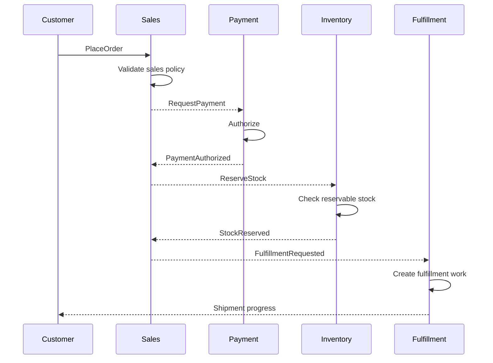

# Kiểm tra ranh giới bằng các luồng nghiệp vụ xuyên ngữ cảnh

Một Bounded Context được xem là có ranh giới tốt khi mô hình bên trong nó có thể giữ được ý nghĩa và trách nhiệm rõ ràng trong khi vẫn phối hợp được với các context khác để hoàn thành nghiệp vụ. Vì vậy, chỉ nhìn vào package, database schema hoặc danh sách service chưa đủ để biết ranh giới đã hợp lý hay chưa. Cách kiểm chứng thực tế hơn là chạy những **luồng nghiệp vụ xuyên ngữ cảnh** (*cross context business flows*) qua mô hình.

Một luồng nghiệp vụ xuyên ngữ cảnh bắt đầu từ một mục tiêu mà người dùng hoặc doanh nghiệp thực sự quan tâm, sau đó đi qua các quyết định, trạng thái và thông điệp thuộc nhiều Bounded Context. Ví dụ, “khách đặt hàng và nhận hàng” có thể liên quan đến Sales, Payment, Inventory và Fulfillment. Mỗi context nên chịu trách nhiệm cho phần quyết định của mình, còn luồng tổng thể phải có cách phối hợp rõ ràng.

Trong Domain Driven Design, cách kiểm tra này nối strategic design với tactical design. Strategic design giúp ta xác định context và quan hệ giữa chúng; luồng nghiệp vụ cho thấy các ranh giới đó hoạt động thế nào khi có yêu cầu thật. Nếu một luồng đơn giản buộc nhiều context cùng sửa một đối tượng, chia sẻ nhiều bảng hoặc cùng quyết định một quy tắc, đó là tín hiệu cần xem lại boundary. Ngược lại, nếu mỗi context có một trách nhiệm rõ, giao tiếp qua hợp đồng ổn định và thay đổi nội bộ ít lan sang nơi khác, boundary có cơ sở tốt hơn.

## 1. Vì sao phải kiểm tra bằng luồng nghiệp vụ?

Một context có thể trông rất đẹp trên sơ đồ nhưng vẫn có ranh giới sai. Chẳng hạn, kiến trúc có các service `order-service`, `payment-service` và `shipping-service`, nhưng cả ba cùng đọc bảng `orders`, cùng sửa `order.status` và cùng chứa quy tắc “khi nào đơn được xác nhận”. Nhìn vào tên service, ta có vẻ đã tách context. Nhìn vào luồng nghiệp vụ, ta thấy quyền quyết định vẫn bị chia sẻ.

Luồng nghiệp vụ giúp phát hiện những vấn đề mà cấu trúc kỹ thuật khó cho thấy:

| Dấu hiệu trong luồng | Câu hỏi về boundary |
|---|---|
| Một quy tắc bị thực hiện ở nhiều context | Context nào thực sự sở hữu quyết định? |
| Một context phải gọi quá nhiều context khác để hoàn thành hành vi cơ bản | Ranh giới có đang chia một năng lực gắn kết thành quá nhiều phần không? |
| Nhiều context cùng sửa một dữ liệu | Ai là owner của dữ liệu và quyết định? |
| Một thay đổi nghiệp vụ kéo theo sửa nhiều model nội bộ | Hợp đồng giữa context có quá chặt không? |
| Context nhận trực tiếp kiểu domain của context khác | Mô hình có đang bị rò qua boundary không? |
| Một luồng luôn cần giao dịch phân tán | Có đang đặt transaction boundary sai không? |
| Tên sự kiện có nghĩa khác nhau ở hai phía | Ubiquitous Language giữa các context đã được chuyển đổi rõ chưa? |
| Một failure ở context A làm context B không thể hoạt động dù không cần dữ liệu mới | Dependency có thực sự cần đồng bộ không? |

Điểm quan trọng là kiểm tra **hành vi**, không chỉ kiểm tra topology. Một hệ thống có thể có ít service nhưng boundary rõ; cũng có thể có nhiều service nhưng domain model bị trộn lẫn.

## 2. Bắt đầu từ một business flow hoàn chỉnh

Hãy chọn một luồng có giá trị nghiệp vụ rõ ràng. Đừng bắt đầu bằng endpoint hoặc class. Một flow tốt có:

- **Trigger:** điều gì khởi động luồng, chẳng hạn khách gửi yêu cầu đặt hàng.
- **Business goal:** kết quả doanh nghiệp muốn đạt được.
- **Actors:** người dùng, nhân viên hoặc hệ thống liên quan.
- **Business decisions:** các quyết định có quy tắc domain.
- **State changes:** trạng thái có ý nghĩa trong từng context.
- **Cross context messages:** command, event hoặc query đi qua boundary.
- **Failure paths:** những cách luồng có thể bị từ chối, trì hoãn hoặc thất bại.
- **Completion criteria:** điều kiện để nói rằng mục tiêu nghiệp vụ đã đạt được.

Ví dụ với thương mại điện tử:

> Khách gửi yêu cầu đặt một Order. Sales kiểm tra và chấp nhận đơn nếu các điều kiện bán hàng hợp lệ. Payment xử lý khoản tiền cần thu. Inventory giữ hoặc xác nhận số lượng có thể bán. Fulfillment tiếp nhận yêu cầu thực hiện khi đủ điều kiện. Cuối cùng hệ thống thông báo trạng thái phù hợp cho khách.

Đây là một flow đủ lớn để kiểm tra boundary vì không có một context nào nên sở hữu toàn bộ các quyết định trên.

### Flow không phải là một transaction

Một business flow có thể kéo dài nhiều transaction và nhiều context. Đừng mặc định rằng toàn bộ flow phải được bọc trong một transaction database duy nhất. Trong DDD, mỗi context có thể có transaction boundary riêng; các context phối hợp bằng command, event hoặc cơ chế khác.

Ví dụ, Sales có thể commit việc tạo Order trước khi Payment hoàn tất. Payment sau đó phát `PaymentAuthorized` hoặc `PaymentFailed`. Sales cập nhật trạng thái dựa trên thông tin nhận được. Đây là một business flow liên tục nhưng không phải một transaction ACID xuyên toàn bộ hệ thống.

## 3. Vẽ flow theo context trước khi nhìn vào code

Một cách hữu ích là viết flow thành các bước nghiệp vụ và gắn mỗi bước với context sở hữu nó.

| Bước | Hành vi nghiệp vụ | Context sở hữu | Kết quả giao tiếp |
|---|---|---|---|
| 1 | Tiếp nhận yêu cầu mua | Sales | Order được tạo ở trạng thái phù hợp |
| 2 | Kiểm tra chính sách bán | Sales | Order được chấp nhận hoặc từ chối |
| 3 | Yêu cầu thu tiền | Payment | Payment được tạo |
| 4 | Xác nhận tiền đã được thu/ủy quyền | Payment | `PaymentAuthorized` hoặc `PaymentFailed` |
| 5 | Giữ số lượng cần giao | Inventory | `StockReserved` hoặc `StockUnavailable` |
| 6 | Tạo yêu cầu thực hiện | Fulfillment | `FulfillmentRequested` |
| 7 | Chuẩn bị và giao | Fulfillment | Trạng thái giao hàng được cập nhật |

Sau khi có bảng này, mới đối chiếu với implementation. Nếu bước 3 yêu cầu Payment gọi vào private class của Sales để thay đổi `Order`, đó là một tín hiệu boundary có vấn đề. Nếu Payment chỉ nhận một command hoặc dữ liệu hợp đồng rõ và phát event kết quả, ownership rõ hơn.

## 4. Một flow xuyên context nên có một owner cho mỗi quyết định

Một trong những tiêu chí mạnh nhất để kiểm tra boundary là **decision ownership**.

Giả sử có quy tắc:

> “Một Order chỉ được xác nhận khi giá cuối cùng hợp lệ, các điều kiện bán được đáp ứng và doanh nghiệp chấp nhận việc bán cho khách này.”

Nếu Sales là context chịu trách nhiệm bán hàng, Sales nên sở hữu quyết định “Order có được chấp nhận hay không”. Payment có thể quyết định “Payment có được authorize hay không”. Inventory có thể quyết định “stock có thể reserve hay không”. Fulfillment quyết định “yêu cầu thực hiện có thể được nhận vào quy trình giao hàng hay không”.

Các context có thể phụ thuộc kết quả của nhau, nhưng không nên cùng sửa một quyết định thuộc domain của context khác.

Một flow có thể biểu diễn như sau:

```text
Customer
   |
   | PlaceOrder
   v
[Sales Context]
   | OrderAccepted
   +---------------------> [Payment Context]
   |                         | PaymentAuthorized
   |                         v
   +---------------------- [Sales / Order state]
   |
   +---------------------> [Inventory Context]
                             | StockReserved
                             v
                       [Fulfillment Context]
                             |
                             | FulfillmentRequested
                             v
                         Shipment flow
```

Sơ đồ này chỉ là một mô hình khái niệm. Một hệ thống thật có thể dùng event broker, command trực tiếp hoặc orchestration. Điều cần kiểm tra là mỗi mũi tên có ý nghĩa nghiệp vụ và owner rõ ràng.

## 5. Phân biệt command, event và dữ liệu tham chiếu

Khi kiểm tra boundary, hãy hỏi mỗi thông điệp đang nói điều gì.

**Command** yêu cầu một context thực hiện hành vi. Ví dụ `ReserveStock` có ý nghĩa “hãy thử giữ hàng”. Context nhận command có quyền chấp nhận hoặc từ chối.

**Event** thông báo một sự việc đã xảy ra. Ví dụ `StockReserved` có nghĩa Inventory đã xác nhận việc giữ hàng. Context khác có thể phản ứng nhưng không được coi event như lời yêu cầu sửa dữ liệu nội bộ của Inventory.

**Reference data** là dữ liệu mà context cần để ra quyết định nhưng không sở hữu. Ví dụ Payment có thể cần `orderId`, `amount` và currency để tạo Payment. Nó không cần nhận toàn bộ đối tượng `Order` của Sales.

Một boundary thường rõ hơn khi thông điệp truyền **ý nghĩa nghiệp vụ cần thiết** thay vì truyền cả object graph nội bộ.

Ví dụ không tốt:

```java
paymentService.createPayment(order);
```

Nếu `order` là aggregate của Sales và Payment bắt đầu dựa vào hàng chục field của nó, mô hình Sales đang rò sang Payment.

Một cách rõ hơn có thể là:

```java
paymentService.requestPayment(
    new PaymentRequest(orderId, amount, currency, customerReference)
);
```

Ở đây `PaymentRequest` là contract của Payment. Payment có thể thay đổi mô hình nội bộ mà không buộc Sales biết chi tiết implementation.

## 6. Kiểm tra bằng happy path trước

Hãy chạy flow thành công từ đầu đến cuối. Mỗi bước nên trả lời được bốn câu hỏi:

1. Context nào đang quyết định?
2. Context đó sở hữu dữ liệu nào để quyết định?
3. Nó gửi thông tin gì ra ngoài boundary?
4. Context nhận có thể xử lý mà không biết chi tiết nội bộ của context gửi không?

Ví dụ:

```text
PlaceOrder
  -> Sales tạo Order
  -> Sales phát OrderAccepted
  -> Payment tạo Payment
  -> Payment phát PaymentAuthorized
  -> Inventory nhận ReserveStock
  -> Inventory phát StockReserved
  -> Fulfillment nhận FulfillmentRequested
  -> Fulfillment bắt đầu chuẩn bị hàng
```

Nếu flow này chỉ hoạt động khi Payment trực tiếp gọi `Order.markPaid()` hoặc Fulfillment truy cập bảng `orders`, hãy dừng lại và kiểm tra boundary. Có thể đó là một lựa chọn kỹ thuật hợp lệ trong một modular monolith, nhưng nếu các context thật sự sở hữu mô hình riêng thì quyền truy cập trực tiếp cần được xem xét.

## 7. Failure path mới là bài kiểm tra mạnh hơn

Một boundary có thể trông ổn trên happy path nhưng lộ ra vấn đề khi có lỗi. Hãy chủ động chạy các trường hợp:

| Tình huống | Câu hỏi cần kiểm tra |
|---|---|
| Payment bị từ chối | Sales context sở hữu quyết định trạng thái Order thế nào? |
| Stock không đủ | Có hoàn tác Payment không, và context nào điều phối? |
| Fulfillment không nhận yêu cầu | Sales có cần biết chi tiết lỗi vận hành không? |
| Event bị giao lại | Consumer có idempotent không? |
| Event đến muộn | Context có dựa vào thứ tự message một cách không an toàn không? |
| Payment thành công nhưng response bị mất | Có thể truy vấn hoặc xử lý lại mà không thu tiền hai lần không? |
| Một context tạm thời không khả dụng | Flow có thể chờ, retry hoặc chuyển sang trạng thái chờ không? |

Ví dụ, nếu Payment authorize thành công nhưng Inventory báo hết hàng, không nên giả định có một `rollback()` xuyên tất cả database. Thay vào đó, domain cần có chính sách bù trừ rõ ràng: Sales có thể chuyển Order sang trạng thái chờ xử lý hoặc hủy; Payment có thể tạo refund hoặc void authorization tùy mô hình thanh toán; Inventory giữ nguyên quyền quyết định về stock.

Đây là lúc boundary được kiểm tra bằng **business policy**, không chỉ bằng cơ chế retry.

## 8. Kiểm tra consistency boundary

Hỏi xem mỗi bất biến (*invariant*) cần nhất quán ở đâu.

Ví dụ:

> “Một Order không thể chứa dòng hàng có số lượng nhỏ hơn 1.”

Đây là invariant của Order trong Sales và nên được bảo vệ trong aggregate hoặc domain model của Sales.

Một quy tắc khác:

> “Không được reserve nhiều stock hơn số lượng có thể bán.”

Đây là invariant của Inventory. Sales không nên tự đọc số lượng rồi quyết định rằng stock đủ, vì giữa thời điểm đọc và reserve có thể có thay đổi. Sales gửi yêu cầu; Inventory quyết định.

Một flow tốt thường có dạng:

```text
Sales: quyết định Order hợp lệ
        |
        | request
        v
Inventory: quyết định Stock có thể reserve
        |
        | result event
        v
Sales: cập nhật tiến trình Order theo policy của Sales
```

Nếu Sales phải copy toàn bộ invariant của Inventory để tự xác nhận trước, có nguy cơ duplication rule. Sales có thể thực hiện các kiểm tra trải nghiệm hoặc pre-check hữu ích, nhưng quyết định cuối cùng về invariant Inventory vẫn thuộc Inventory.

## 9. Kiểm tra ownership của dữ liệu

Mỗi flow nên giúp xác định ai sở hữu dữ liệu. Một dữ liệu có thể được sao chép giữa context để đọc nhanh, nhưng bản sao không biến thành nguồn quyết định.

Ví dụ, Sales có thể lưu `customerDisplayName` trong Order để giữ lịch sử hiển thị. Customer hoặc Identity Context vẫn có thể sở hữu danh tính chính. Fulfillment có thể lưu địa chỉ giao hàng đã chốt tại thời điểm Order được xác nhận. Việc sao chép snapshot là hợp lý nếu domain cần nó.

Dấu hiệu đáng xem lại:

- Hai context cùng cập nhật một thuộc tính và không có owner rõ.
- Một context phải mở database của context khác để biết trạng thái mới nhất.
- Một context dùng foreign key trực tiếp vào bảng thuộc context khác như một phần invariant nội bộ.
- Thay đổi schema nội bộ của một context buộc context khác phải sửa code dù contract nghiệp vụ không thay đổi.

Hãy hỏi: **“Nếu hai context không còn chia sẻ database vào ngày mai, quy tắc nào sẽ mất?”** Nếu câu trả lời là một business rule quan trọng, boundary hiện tại có thể đang phụ thuộc vào storage thay vì domain.

## 10. Kiểm tra ngôn ngữ giữa các context

Cross context flow cũng là cách kiểm tra Ubiquitous Language. Một từ có thể được chuyển thành thuật ngữ khác ở boundary.

Ví dụ:

| Sales | Inventory | Ý nghĩa |
|---|---|---|
| OrderLine | StockItem | Sales nói về dòng hàng trong đơn; Inventory nói về đơn vị tồn kho |
| quantity | reservableQuantity | Hai context quan tâm những khía cạnh khác nhau |
| OrderAccepted | ReservationRequest | Một bên là sự kiện nghiệp vụ, một bên là yêu cầu hành vi |
| Customer | AccountHolder / Recipient | Tên có thể khác theo trách nhiệm domain |

Không cần ép mọi context dùng cùng một class hoặc cùng một tên. Điều quan trọng là mapping ở boundary phải rõ.

Một Anti-Corruption Layer (ACL) có thể chuyển đổi mô hình:

```java
class InventoryOrderTranslator {
    ReservationRequest toReservationRequest(SalesOrderAccepted event) {
        return new ReservationRequest(
            event.orderId(),
            event.lines().stream()
                .map(line -> new StockRequest(line.sku(), line.quantity()))
                .toList()
        );
    }
}
```

Đoạn code không có ý nghĩa là mọi event phải được map bằng class riêng. Ý chính là transformation nằm ở boundary, nơi quyết định cách một context hiểu thông tin của context kia.

## 11. Dùng flow để kiểm tra kích thước của Bounded Context

Một context quá lớn thường bộc lộ qua flow có quá nhiều trách nhiệm khác nhau.

Ví dụ một `OrderContext` vừa:

- quyết định giá bán,
- giữ stock,
- authorize payment,
- lập kế hoạch giao hàng,
- quản lý quan hệ với carrier.

Nếu một thay đổi về carrier buộc domain model của Order thay đổi, hoặc một quy tắc stock phải nằm trong aggregate Order, context có thể đang bao phủ nhiều mô hình khác nhau.

Ngược lại, context quá nhỏ có thể tạo flow như:

```text
Order -> OrderLine -> Price -> Discount -> Tax -> Customer -> Address
```

với hàng chục network call chỉ để hoàn thành một hành vi nghiệp vụ. Khi đó, việc chia boundary có thể đã đi quá xa. Các khái niệm cùng thay đổi, cùng một nhóm sở hữu và cùng một transaction boundary có thể là dấu hiệu nên hợp nhất hoặc tái tổ chức.

### Heuristic hữu ích

Đừng hỏi “có bao nhiêu class trong context?”. Hãy hỏi:

- Bao nhiêu quyết định domain khác nhau?
- Bao nhiêu lý do thay đổi độc lập?
- Bao nhiêu thuật ngữ có nghĩa khác nhau?
- Bao nhiêu giao tiếp bắt buộc giữa các phần?
- Một thay đổi nghiệp vụ đi qua bao nhiêu boundary?

Các con số này không phải ngưỡng cứng. Chúng chỉ giúp đặt câu hỏi khi flow cho thấy coupling bất thường.

## 12. Kiểm tra bằng các biến thể của cùng một flow

Một flow tốt nên được kiểm tra theo ma trận tình huống thay vì chỉ một happy path.

| Flow case | Sales | Payment | Inventory | Fulfillment | Điều cần xác minh |
|---|---|---|---|---|---|
| Thành công | Accepted | Authorized | Reserved | Started | Flow hoàn tất |
| Payment fail | Accepted | Failed | Chưa reserve | Chưa start | Policy hủy/chờ rõ |
| Stock fail | Accepted | Authorized | Unavailable | Chưa start | Compensation rõ |
| Fulfillment delay | Accepted | Authorized | Reserved | Pending | Không làm mất Order |
| Duplicate event | Đã xử lý | Đã xử lý | Đã reserve | Chưa start | Consumer idempotent |
| Event đến muộn | State mới | State mới | State mới | State cũ | Có version/guard phù hợp |

Nếu mỗi case đòi hỏi các context truy cập trực tiếp database của nhau, boundary có thể đang quá chặt. Nếu tất cả case đều có thể biểu diễn bằng các contract rõ và state machine của từng context, boundary có cơ sở tốt hơn.

## 13. Kiểm tra flow bằng acceptance test

Một acceptance test xuyên context nên mô tả **kết quả nghiệp vụ**, không khóa chặt implementation.

Ví dụ:

```gherkin
Feature: Đặt hàng có thanh toán và giữ hàng

  Scenario: Đơn được chấp nhận khi thanh toán và tồn kho đều thành công
    Given khách hàng có thể mua SKU "A-100"
    And SKU "A-100" có thể bán 3 đơn vị
    When khách đặt 2 đơn vị SKU "A-100"
    And thanh toán được authorize thành công
    And tồn kho xác nhận giữ 2 đơn vị
    Then Order được xem là sẵn sàng để Fulfillment xử lý
    And 2 đơn vị được giữ cho Order
```

Test này có thể được thực hiện bằng message broker thật, contract test hoặc test harness trong modular monolith. Cách chạy là quyết định kỹ thuật; tiêu chí thành công nên giữ ở mức nghiệp vụ.

Một test tốt cũng có thể kiểm tra ownership gián tiếp. Ví dụ, nếu thay đổi thuật toán reserve của Inventory mà acceptance test của Sales không cần sửa contract, boundary đang có tính ổn định tốt hơn.

## 14. Phân biệt contract test với end-to-end test

Cross context flow không có nghĩa mọi thứ đều phải kiểm thử bằng một end-to-end test chậm.

**Unit test** kiểm tra invariant và rule bên trong từng context.

**Component test** kiểm tra context với adapter, database hoặc message handler của chính nó.

**Contract test** kiểm tra hai bên thống nhất về schema, semantics và hành vi tối thiểu của giao tiếp.

**Integration test** kiểm tra việc kết nối với broker, database hoặc hệ thống thật.

**End-to-end business flow test** kiểm tra một hành trình nghiệp vụ quan trọng từ đầu đến cuối.

Một chiến lược hợp lý là giữ nhiều kiểm thử gần boundary của từng context và một số ít flow xuyên hệ thống cho những hành trình có giá trị cao. Mục tiêu là bảo vệ semantics của flow mà không biến mọi thay đổi nội bộ thành một bài test toàn hệ thống.

## 15. Kiểm tra versioning và khả năng thay đổi độc lập

Một boundary tốt cho phép context thay đổi implementation mà không buộc context khác sửa theo. Hãy lấy một flow đang chạy và mô phỏng thay đổi.

Ví dụ Payment muốn thêm phương thức `wallet`. Nếu contract giữa Sales và Payment chỉ nói “yêu cầu thu `amount` cho `orderId`” và Payment tự quản lý phương thức thanh toán, Sales có thể không cần thay đổi.

Ngược lại, nếu Sales phải truyền:

```json
{
  "paymentProviderClass": "StripeWalletAdapter",
  "gatewayEndpoint": "...",
  "retryCount": 3
}
```

thì implementation detail của Payment đã rò sang Sales.

Khi kiểm tra flow, hãy thử thay đổi:

- tên class nội bộ,
- database schema,
- payment provider,
- thuật toán tính phí,
- cách lưu trạng thái,
- cách xử lý retry.

Nếu contract nghiệp vụ vẫn giữ nguyên, context kia không nên phải biết chi tiết thay đổi.

## 16. Kiểm tra asynchronous flow và eventual consistency

Nhiều Bounded Context giao tiếp bất đồng bộ. Khi đó flow không còn là chuỗi gọi hàm tuyến tính.

Ví dụ:

```text
Sales
  | OrderAccepted
  v
Message Broker
  +---------> Payment
  |             |
  |             +---- PaymentAuthorized
  |
  +---------> Inventory
                |
                +---- StockReserved
```

Hãy kiểm tra các trường hợp:

- message bị giao lại,
- message bị giao sai thứ tự,
- consumer xử lý chậm,
- producer phát message nhưng database commit thất bại,
- consumer commit database nhưng acknowledgement message thất bại,
- một context tạm thời không hoạt động.

Các tình huống này không nhất thiết chứng minh boundary sai. Chúng kiểm tra xem boundary có được thiết kế với consistency model phù hợp hay chưa.

Nếu domain yêu cầu “không thể phát hành hàng trước khi thanh toán chắc chắn thành công”, flow phải biểu diễn rõ trạng thái chờ và điều kiện chuyển trạng thái. Không nên che giấu yêu cầu đó bằng một retry vô hạn.

## 17. Orchestration và choreography qua cùng một flow

Hai context có thể phối hợp theo nhiều cách.

Trong **orchestration**, một process manager hoặc application service điều phối:

```text
Order Process Manager
   |
   +--> Request Payment
   +--> Request Stock Reservation
   +--> Request Fulfillment
```

Trong **choreography**, mỗi context phản ứng với event:

```text
OrderAccepted
   +--> Payment -> PaymentAuthorized
   +--> Inventory -> StockReserved

PaymentAuthorized + StockReserved
   --> Fulfillment
```

Cả hai đều có thể phù hợp. Khi kiểm tra boundary, đừng tập trung vào tên pattern; hãy xem process manager có bắt đầu chứa business rule thuộc các context khác không, hoặc choreography có tạo ra một mạng event khó hiểu khiến không ai biết owner của quyết định không.

Một orchestration tốt điều phối tiến trình nhưng để domain decision ở context sở hữu. Một choreography tốt giữ event có ý nghĩa và consumer rõ trách nhiệm.

## 18. Một ví dụ đầy đủ: Order đến Fulfillment

Giả sử hệ thống có bốn Bounded Context:

| Context | Trách nhiệm chính | Không nên quyết định thay |
|---|---|---|
| Sales | Chính sách bán và vòng đời Order | Quy tắc reserve stock |
| Payment | Thu, authorize, refund tiền | Order có hợp lệ về bán hàng không |
| Inventory | Tồn kho và reservation | Có nên chấp nhận giao dịch bán không |
| Fulfillment | Chuẩn bị và giao hàng | Số lượng stock có thể reserve |

Flow:



Hãy thử ba câu hỏi.

**Ai sở hữu `Order.status`?** Sales. Payment và Inventory phát kết quả của chính mình; Sales quyết định cách các kết quả đó ảnh hưởng đến vòng đời Order.

**Ai sở hữu `StockReservation`?** Inventory. Sales có thể biết reservation đã thành công, nhưng không nên tự quản lý invariant bên trong reservation.

**Ai sở hữu `FulfillmentOrder`?** Fulfillment. Sales gửi thông tin cần thiết; Fulfillment chuyển nó thành mô hình riêng.

Nếu implementation đúng với ownership này, các context có thể thay đổi nội bộ tương đối độc lập.

### Trường hợp Payment thất bại

Payment phát `PaymentFailed`. Sales nhận event và áp dụng policy. Sales có thể chuyển Order sang `PaymentFailed`, cho phép khách thử lại hoặc hủy Order. Inventory chưa được yêu cầu reserve nếu flow thiết kế theo thứ tự này.

### Trường hợp Stock thất bại sau khi Payment thành công

Sales nhận `StockUnavailable`. Tùy domain, Sales có thể hủy Order và yêu cầu Payment void/refund. Payment quyết định cách xử lý khoản tiền theo policy của Payment. Inventory không cần biết chi tiết hoàn tiền.

Điểm đáng chú ý là “hủy Order” và “refund Payment” là hai quyết định ở hai context. Flow có thể điều phối chúng mà không biến chúng thành một transaction chung.

## 19. Dấu hiệu boundary cần được tách, hợp nhất hoặc làm rõ

Sau khi chạy nhiều flow, hãy phân loại kết quả.

### Nên xem xét tách

- Hai nhóm thuật ngữ khác nhau nhưng đang dùng chung model.
- Một phần có lifecycle và release cadence riêng.
- Một context chứa nhiều lý do thay đổi độc lập.
- Một flow liên tục phải tránh truy cập trực tiếp vào nội bộ của một phần khác.
- Một nhóm nghiệp vụ có owner rõ và có thể xác định contract ổn định.

### Nên xem xét hợp nhất

- Hai context luôn thay đổi cùng nhau.
- Hầu hết flow phải đi qua lại giữa chúng để hoàn thành một quyết định đơn giản.
- Chúng dùng cùng một model và cùng một ngôn ngữ với rất ít khác biệt.
- Việc tách tạo ra network call nhưng không tạo ra autonomy nghiệp vụ.

### Nên làm rõ boundary trước khi tách hoặc hợp nhất

- Không rõ context nào sở hữu quyết định.
- Cùng một thuật ngữ được dùng nhưng chưa thống nhất nghĩa.
- Dữ liệu được sao chép nhưng không biết bản nào là source of truth.
- Failure policy chưa được xác định.
- Chưa biết flow nào thực sự quan trọng với doanh nghiệp.

DDD không yêu cầu ranh giới phải hoàn hảo ngay lần đầu. Boundary là một giả thuyết kiến trúc có thể được kiểm chứng và điều chỉnh bằng hiểu biết domain.

## 20. Quy trình thực hành từ discovery đến code

Có thể dùng quy trình sau cho một flow mới.

**Bước 1: Chọn business goal.** Viết một câu như “Khách đặt hàng thành công và đơn được đưa vào thực hiện”.

**Bước 2: Liệt kê business steps.** Viết các quyết định và kết quả bằng ngôn ngữ của chuyên gia nghiệp vụ.

**Bước 3: Gắn context.** Mỗi step cần có owner. Nếu một step có hai owner, hãy hỏi vì sao.

**Bước 4: Xác định contract.** Với mỗi boundary, ghi rõ command, event hoặc query; dữ liệu tối thiểu cần truyền và semantics.

**Bước 5: Kiểm tra invariant.** Xác định mỗi rule thuộc context nào và nơi nào bảo vệ rule đó.

**Bước 6: Chạy failure paths.** Payment fail, stock fail, timeout, duplicate message, message đến muộn, consumer unavailable.

**Bước 7: Kiểm tra thay đổi.** Thử một thay đổi nội bộ ở từng context và xem context còn lại có phải sửa không.

**Bước 8: Chọn mức test.** Bảo vệ rule bằng unit/component test, contract bằng contract test và những business journey quan trọng bằng flow test.

**Bước 9: Ghi lại quyết định.** Context Map, contract và ownership nên đủ rõ để một thành viên mới hiểu flow mà không cần đọc toàn bộ code.

## 21. Checklist kiểm tra một cross context flow

Trước khi kết luận boundary tốt, hãy hỏi:

- [ ] Flow bắt đầu từ một mục tiêu nghiệp vụ cụ thể.
- [ ] Mỗi business decision có một owner rõ ràng.
- [ ] Mỗi context bảo vệ invariant thuộc trách nhiệm của mình.
- [ ] Dữ liệu được sở hữu bởi một context xác định.
- [ ] Context không cần truy cập trực tiếp model nội bộ của context khác.
- [ ] Contract truyền ý nghĩa nghiệp vụ cần thiết thay vì object graph nội bộ.
- [ ] Command và event được phân biệt rõ.
- [ ] Có mapping khi cùng một khái niệm được hiểu khác nhau ở hai context.
- [ ] Happy path hoạt động xuyên flow.
- [ ] Failure paths có policy rõ.
- [ ] Duplicate và out-of-order message được xem xét nếu dùng asynchronous messaging.
- [ ] Eventual consistency được phản ánh trong trạng thái nghiệp vụ.
- [ ] Thay đổi implementation nội bộ không buộc context khác sửa nếu contract không đổi.
- [ ] Có test bảo vệ contract và ít nhất những business flow quan trọng.
- [ ] Ranh giới được đánh giá theo domain thay vì theo số lượng class, bảng hoặc service.

Nếu nhiều ô còn trống, chưa nên vội kết luận rằng cần thêm microservice. Trước hết hãy làm rõ domain, ownership và contract.

## 22. Những anti pattern thường gặp

**Kiểm tra boundary bằng sơ đồ service.** Hai box nối bằng mũi tên không cho biết ai sở hữu quyết định. Hãy chạy một business flow thật.

**Dùng database chung như integration contract.** Việc đọc bảng của context khác tạo coupling vào schema và làm mất quyền sở hữu dữ liệu.

**Truyền aggregate qua boundary.** Aggregate là mô hình nội bộ của context. Contract nên mang dữ liệu và ý nghĩa mà phía nhận cần.

**Để một context quyết định thay context khác.** Ví dụ Sales tự tính xem stock đủ rồi gọi một API “confirm” chỉ để lưu kết quả. Inventory vẫn phải là nơi quyết định reservation.

**Chỉ test happy path.** Boundary thường lộ vấn đề ở timeout, duplicate, compensation và eventual consistency.

**Dùng event như remote setter.** Event `OrderUpdated` rồi bắt context khác sao chép mọi field của Order có thể biến event thành một cơ chế đồng bộ mô hình. Hãy xác định event mô tả sự kiện nghiệp vụ nào và consumer cần thông tin gì.

**Tách context theo đội hoặc endpoint một cách máy móc.** Team boundary có thể cung cấp manh mối nhưng domain model mới là cơ sở để quyết định Bounded Context.

## 23. Bài tập tự kiểm tra

Một nền tảng giao đồ ăn có các context: Ordering, Payment, Restaurant, Delivery. Flow chính là “khách đặt món và nhận hàng”.

Hãy lập bảng gồm các cột `Step`, `Decision`, `Owner`, `Message`, `Failure` cho các bước:

1. Khách gửi Order.
2. Ordering kiểm tra món và giá.
3. Payment authorize tiền.
4. Restaurant chấp nhận hoặc từ chối đơn.
5. Delivery nhận yêu cầu giao.
6. Restaurant báo món đã sẵn sàng.
7. Delivery hoàn thành giao hàng.

Sau đó trả lời:

1. `Order.status` nên thuộc context nào?
2. Restaurant có nên cập nhật trực tiếp trạng thái Payment không?
3. Nếu Restaurant từ chối sau khi Payment đã authorize, context nào quyết định refund hoặc void?
4. Delivery có cần toàn bộ `Order` hay chỉ cần một contract về delivery request?
5. Nếu Delivery không hoạt động trong 10 phút, flow nên biểu diễn trạng thái nào?
6. Nếu event `FoodReady` bị giao hai lần, context nào cần idempotency?
7. Nếu đổi nhà cung cấp payment, context nào nên phải sửa?

Gợi ý trả lời: Ordering nên sở hữu vòng đời Order; Payment sở hữu authorization/refund; Restaurant sở hữu quyết định chấp nhận và trạng thái chuẩn bị món; Delivery sở hữu delivery work. Ordering có thể điều phối kết quả nhưng không nên thay các context quyết định domain của chúng. Contract giữa các context nên đủ nhỏ để thay đổi implementation bên trong mà không làm lan truyền coupling.

## Kết luận

Kiểm tra Bounded Context bằng luồng nghiệp vụ xuyên ngữ cảnh là cách biến một boundary từ giả thuyết trên sơ đồ thành một thiết kế có thể quan sát. Hãy bắt đầu từ mục tiêu nghiệp vụ, đi qua từng quyết định, xác định owner, dữ liệu, contract và failure policy. Sau đó chạy cùng flow với những biến thể thành công, thất bại, retry và thay đổi.

Một boundary có giá trị khi mỗi context có mô hình và trách nhiệm đủ rõ để tự bảo vệ domain của mình, đồng thời có hợp đồng đủ rõ để các context phối hợp. Business flow cho thấy chính xác nơi hai yêu cầu đó gặp nhau. Khi flow liên tục phá vỡ ownership, buộc chia sẻ model hoặc kéo theo thay đổi không liên quan, hãy xem đó là bằng chứng để điều chỉnh boundary.
