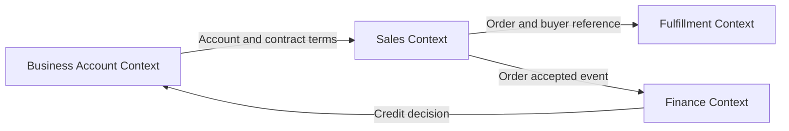

# Rà soát và điều chỉnh ranh giới dựa trên bằng chứng thay đổi

Trong Domain-Driven Design (DDD), **bounded context** xác định ranh giới mà bên trong đó một mô hình miền và ngôn ngữ chung có ý nghĩa nhất quán. Ranh giới này giúp đội ngũ biết khái niệm nào thuộc về mô hình nào, quy tắc nào được bảo vệ ở đâu và các phần của hệ thống trao đổi với nhau bằng hợp đồng nào.

Ranh giới bounded context không phải quyết định bất biến. Khi chiến lược, sản phẩm, quy trình, dữ liệu, tổ chức hoặc thị trường thay đổi, mô hình cũ có thể không còn phản ánh đúng cách nghiệp vụ vận hành. Dấu hiệu như thuật ngữ bị dùng với nhiều nghĩa, thay đổi nhỏ phải sửa nhiều context, quy tắc bị sao chép hoặc các nhóm liên tục tranh chấp quyền sở hữu là lý do để điều tra lại. Tuy nhiên, không nên tách hay gộp context chỉ vì một chỉ số kỹ thuật hoặc một thay đổi trong sơ đồ tổ chức. Cần thu thập bằng chứng, xác định nguyên nhân gốc và đánh giá tác động trước khi điều chỉnh.

Bài học này trình bày cách rà soát ranh giới theo bằng chứng, phân biệt triệu chứng với nguyên nhân, chọn phương án thay đổi và chuyển đổi an toàn từ mô hình hiện tại sang mô hình mục tiêu.

## 1. Vì sao cần rà soát bounded context?

Bounded context được hình thành từ hiểu biết về ngôn ngữ, quy tắc và trách nhiệm nghiệp vụ ở một thời điểm. Theo thời gian, doanh nghiệp có thể mở rộng thị trường, thêm sản phẩm, thay đổi cách phục vụ khách hàng, mua lại một công ty, thuê ngoài một năng lực hoặc tái tổ chức đội ngũ. Những thay đổi này có thể làm xuất hiện kiến thức mới và khiến ranh giới cũ trở nên không phù hợp.

Rà soát nhằm trả lời những câu hỏi thực tế:

- Mô hình hiện tại còn phản ánh đúng cách chuyên gia nghiệp vụ suy nghĩ và ra quyết định không?
- Một context có đang chứa nhiều mô hình với quy tắc hoặc ngôn ngữ mâu thuẫn không?
- Hai context có đang lặp lại cùng một trách nhiệm và phải đồng bộ thủ công không?
- Các nhóm có thể thay đổi phần mình sở hữu mà không gây ảnh hưởng ngoài dự kiến không?
- Hợp đồng tích hợp có phản ánh đúng nhu cầu và quyền sở hữu dữ liệu của các bên không?
- Có bằng chứng mới cho thấy một năng lực cần quyền tự chủ hoặc ranh giới khác không?

Mục tiêu không phải tạo ra nhiều context hơn. Mục tiêu là giữ cho mỗi mô hình có phạm vi rõ, quy tắc được sở hữu đúng nơi và quan hệ giữa các mô hình đủ rõ để hệ thống có thể tiến hóa.

## 2. Ranh giới tốt được nhận biết qua điều gì?

Một bounded context hợp lý thường có một số đặc điểm sau:

1. **Ngôn ngữ nhất quán:** thuật ngữ quan trọng có ý nghĩa rõ trong phạm vi context. Nếu một từ có nghĩa khác ở nơi khác, sự khác biệt được thể hiện qua mô hình hoặc hợp đồng.
2. **Quy tắc có chủ sở hữu:** có thể xác định context và vai trò chịu trách nhiệm cho từng quy tắc nghiệp vụ.
3. **Mô hình có tính nhất quán:** dữ liệu và hành vi cần thay đổi cùng nhau được bảo vệ trong một ranh giới phù hợp.
4. **Phụ thuộc có chủ đích:** context trao đổi qua hợp đồng rõ ràng, thay vì truy cập tùy tiện vào cấu trúc nội bộ của nhau.
5. **Thay đổi có phạm vi:** một thay đổi nghiệp vụ thường có thể được thực hiện trong context sở hữu nó mà không phải sửa hàng loạt nơi không liên quan.
6. **Phù hợp với trách nhiệm nghiệp vụ:** ranh giới phản ánh năng lực và tri thức miền, không chỉ phản ánh tầng kỹ thuật hoặc tên phòng ban.

Không có context nào hoàn toàn độc lập. Một hệ thống luôn có các quan hệ phụ thuộc. Điều cần đánh giá là những phụ thuộc đó có được hiểu, kiểm soát và quản lý theo hợp đồng hay không.

## 3. Khi nào nên mở một đợt rà soát?

Không cần tổ chức workshop lớn sau mỗi thay đổi nhỏ. Rà soát nên được kích hoạt khi xuất hiện bằng chứng cho thấy mô hình hoặc quan hệ giữa các context đang gây trở ngại lặp lại.

### 3.1. Thay đổi chiến lược hoặc sản phẩm

Những thay đổi sau có thể làm biến đổi phạm vi nghiệp vụ:

- Doanh nghiệp mở rộng sang phân khúc khách hàng hoặc thị trường mới.
- Một năng lực từng là phần hỗ trợ trở thành lợi thế cạnh tranh cần đầu tư riêng.
- Sản phẩm mới cần các quy tắc khác đáng kể so với sản phẩm hiện tại.
- Doanh nghiệp thay đổi mô hình doanh thu, kênh phân phối hoặc lời hứa dịch vụ.
- Một năng lực được mua từ nhà cung cấp bên ngoài được đưa trở lại nội bộ, hoặc ngược lại.

Ví dụ, hệ thống bán lẻ ban đầu chỉ phục vụ người mua cá nhân. Khi doanh nghiệp bổ sung bán hàng cho khách hàng doanh nghiệp, khái niệm “khách hàng”, báo giá, hạn mức tín dụng, hợp đồng và quy trình đặt hàng có thể cần một mô hình khác. Đây là tín hiệu cần khám phá lại ngôn ngữ và quy tắc, chưa phải bằng chứng rằng phải tách một context ngay lập tức.

### 3.2. Ngôn ngữ và quy tắc bắt đầu lệch nhau

Các dấu hiệu thường gặp:

- Cùng một thuật ngữ được các nhóm định nghĩa khác nhau nhưng vẫn dùng chung một schema hoặc API.
- Một nhóm thêm trường hoặc trạng thái để phục vụ ý nghĩa mà nhóm khác không hiểu.
- Tài liệu nghiệp vụ và mã nguồn mô tả cùng khái niệm theo cách khác nhau.
- Một quy tắc được sao chép vào nhiều nơi vì không rõ nơi nào là nguồn có thẩm quyền.
- Các nhóm tranh luận kéo dài về việc một khái niệm thuộc quy trình nào hoặc ai được phép thay đổi nó.

Khác biệt ngôn ngữ có thể phản ánh hai mô hình hợp lệ. Đừng ép các nhóm dùng cùng một định nghĩa chỉ để schema trông thống nhất. Hãy tìm hiểu liệu họ đang nói về cùng một khái niệm trong hai góc nhìn hay thực sự là hai khái niệm khác nhau.

### 3.3. Thay đổi nghiệp vụ lan rộng ngoài dự kiến

Một thay đổi trong một năng lực thường buộc nhiều context sửa mã, cập nhật dữ liệu hoặc triển khai đồng thời. Đây có thể là dấu hiệu phụ thuộc chặt, mô hình dùng chung quá rộng hoặc quyền sở hữu chưa rõ.

Ví dụ, thay đổi cách tính giá bán khiến hệ thống quản lý đơn hàng, kho, báo cáo, chăm sóc khách hàng và thanh toán đều phải đọc trực tiếp cùng một bảng giá nội bộ. Cần điều tra xem các context có đang phụ thuộc vào chi tiết triển khai của nhau hay không, và liệu mỗi context có cần một biểu diễn giá riêng phù hợp với mục đích của nó.

### 3.4. Quyền sở hữu dữ liệu và quy tắc không rõ

Rà soát khi xảy ra các tình huống:

- Nhiều context cùng cập nhật một bản ghi hoặc cùng được xem là nguồn sự thật.
- Không xác định được ai chịu trách nhiệm sửa dữ liệu sai.
- Một quy tắc bị kiểm tra ở nhiều nơi nhưng kết quả không nhất quán.
- Các nhóm phải gọi trực tiếp cơ sở dữ liệu của nhau để hoàn thành quy trình.
- Việc thay đổi schema buộc các nhóm phối hợp thủ công và thường xuyên làm gián đoạn nhau.

Đây thường là vấn đề quyền sở hữu mô hình và dữ liệu. Tách dịch vụ mà vẫn để nhiều bên ghi vào cùng một kho dữ liệu không tự động giải quyết được vấn đề.

### 3.5. Bối cảnh tổ chức hoặc vận hành thay đổi

Sáp nhập, tách nhóm, thay đổi trách nhiệm, thuê ngoài, thay đổi yêu cầu pháp lý hoặc chuyển sang mô hình vận hành mới có thể tạo bằng chứng mới về ranh giới. Tuy vậy, cơ cấu tổ chức không nên là tiêu chí duy nhất. Một nhóm có thể sở hữu nhiều context; một context cũng có thể cần phối hợp nhiều nhóm.

## 4. Thu thập bằng chứng trước khi kết luận

Một triệu chứng đơn lẻ thường có nhiều nguyên nhân. Ví dụ, triển khai đồng thời có thể do ranh giới context không phù hợp, nhưng cũng có thể do pipeline phát hành, quản lý phiên bản API hoặc cách tổ chức kiểm thử chưa tốt. Vì vậy, cần kết hợp nhiều nguồn bằng chứng.

### 4.1. Bằng chứng từ nghiệp vụ

Trao đổi với chuyên gia và người trực tiếp thực hiện để hiểu:

- Thuật ngữ nào đã thay đổi nghĩa hoặc phát sinh nghĩa mới?
- Quyết định nào hiện do nhiều vai trò cùng tham gia?
- Quy tắc nào khác nhau theo phân khúc, sản phẩm, khu vực hoặc hợp đồng?
- Quy trình nào thường xuyên cần ngoại lệ hoặc thao tác thủ công?
- Năng lực nào có mục tiêu, thước đo và lộ trình thay đổi riêng?
- Ai chịu trách nhiệm cuối cùng khi kết quả sai?

Yêu cầu người tham gia kể tình huống cụ thể thay vì chỉ đưa nhận xét như “hệ thống đang rối” hoặc “context này quá lớn”. Ghi nhận ví dụ, thời điểm, vai trò và hậu quả.

### 4.2. Bằng chứng từ thay đổi phần mềm

Có thể xem xét lịch sử thay đổi và quy trình phát hành:

- Những thay đổi nghiệp vụ nào thường chạm đến nhiều context?
- Các pull request có thường phải sửa các module không cùng trách nhiệm không?
- Có cần phát hành nhiều thành phần cùng lúc để một thay đổi có hiệu lực không?
- Những lỗi hồi quy thường xuất hiện ở ranh giới nào?
- Có nhiều bản chuyển đổi dữ liệu hoặc mapping thủ công lặp lại không?
- Nhóm có thường phải sửa mô hình của bên khác để hoàn thành yêu cầu không?

Số lượng file thay đổi hoặc số lần triển khai chỉ là tín hiệu. Hãy đọc nội dung thay đổi để phân biệt phụ thuộc nghiệp vụ thật với phụ thuộc do cấu trúc mã nguồn, công cụ hoặc quy trình phát hành.

### 4.3. Bằng chứng từ dữ liệu và tích hợp

Kiểm tra:

- Hệ thống nào tạo và sở hữu từng dữ liệu quan trọng?
- Có nhiều bản sao với ý nghĩa hoặc thời điểm cập nhật khác nhau không?
- Các bên có hiểu cùng một schema theo cùng một nghĩa không?
- API hoặc event có công bố chi tiết nội bộ không cần thiết không?
- Tích hợp có thường xuyên thất bại do khác biệt về trạng thái, đơn vị, thời gian hoặc định danh không?
- Có quy trình đối soát để phát hiện dữ liệu lệch giữa các context không?

Đừng coi mọi bản sao dữ liệu là sai. Một context có thể lưu bản chiếu (projection) hoặc dữ liệu tham chiếu để phục vụ truy vấn của mình. Điều cần rõ là nguồn có thẩm quyền, mục đích của bản sao, độ trễ chấp nhận được và cách xử lý khi dữ liệu không đồng bộ.

### 4.4. Bằng chứng từ quan hệ giữa các nhóm

Phỏng vấn các nhóm liên quan để hiểu:

- Nhóm nào quyết định hợp đồng tích hợp?
- Khi một quy tắc thay đổi, ai phải thông báo cho ai?
- Có nhóm nào thường xuyên phải chờ nhóm khác mới phát hành được không?
- Có tranh chấp lặp lại về trách nhiệm dữ liệu hoặc lỗi vận hành không?
- Một nhóm có đủ quyền và hiểu biết để thay đổi mô hình mà không cần phê duyệt từ quá nhiều bên không?

Khó khăn phối hợp có thể đến từ ranh giới sai, nhưng cũng có thể do thiếu chủ sở hữu sản phẩm, thiếu quy trình quản lý thay đổi hoặc năng lực đội ngũ chưa phù hợp. Phải xác định nguyên nhân trước khi dùng thay đổi kiến trúc để giải quyết.

## 5. Phân biệt triệu chứng, nguyên nhân và bằng chứng

Bảng dưới đây gợi ý cách điều tra một số triệu chứng phổ biến:

| Triệu chứng quan sát được | Nguyên nhân có thể | Bằng chứng cần tìm |
|---|---|---|
| Một thuật ngữ có nhiều nghĩa | Hai mô hình nghiệp vụ bị gộp hoặc glossary chưa rõ | Định nghĩa của chuyên gia, ví dụ và quy tắc theo từng vai trò |
| Thay đổi nhỏ chạm nhiều context | Phụ thuộc chặt, hợp đồng rò rỉ chi tiết nội bộ hoặc phân loại trách nhiệm sai | Lịch sử thay đổi, sơ đồ phụ thuộc và nội dung API/event |
| Quy tắc bị lặp ở nhiều nơi | Chưa xác định nguồn có thẩm quyền hoặc mỗi context cần chính sách riêng | Chủ sở hữu quy tắc, các biến thể và sai lệch thực tế |
| Một context có nhiều trạng thái khó hiểu | Context chứa nhiều vòng đời hoặc khái niệm khác nhau | State transition, use case và người ra quyết định |
| Nhóm thường xuyên xung đột | Ranh giới quyền sở hữu không rõ hoặc quy trình phối hợp yếu | Quyết định bị tranh chấp, trách nhiệm và thời gian chờ |
| Triển khai phải đồng bộ | Ràng buộc giao dịch xuyên context hoặc phụ thuộc phiên bản | Trình tự phát hành, hợp đồng, invariant và cách xử lý lỗi |
| Dữ liệu không đồng nhất | Nhiều nơi ghi dữ liệu hoặc định nghĩa khác nhau | Data lineage, nguồn ghi, thời điểm đồng bộ và quy trình đối soát |

Một kết luận đáng tin cần có chuỗi lập luận: quan sát cụ thể, bằng chứng độc lập, nguyên nhân được kiểm chứng, tác động và giả thuyết thay đổi. Nếu chưa có đủ bằng chứng, hãy ghi rõ điều chưa biết và đề xuất cách xác minh.

## 6. Các tiêu chí đánh giá ranh giới hiện tại

Để so sánh có cấu trúc, nhóm có thể đánh giá từng context theo các chiều sau. Không cần chấm điểm máy móc; mục đích là làm rõ điểm mạnh, điểm yếu và bằng chứng.

### 6.1. Tính nhất quán của ngôn ngữ và mô hình

Hãy xem thuật ngữ cốt lõi có định nghĩa rõ không, có nhiều khái niệm khác nhau đang dùng chung một kiểu dữ liệu không, và các quy tắc có mâu thuẫn trong cùng context không. Nếu một context có hai nhóm chuyên gia cùng dùng một từ nhưng không thể thống nhất ví dụ và hành vi, có thể mô hình đang bao phủ nhiều ngữ cảnh.

### 6.2. Mức độ gắn kết của quy tắc và vòng đời

Các khái niệm phải thay đổi cùng nhau có nằm trong cùng ranh giới không? Một giao dịch có cần bảo vệ invariant của nhiều nhóm dữ liệu không? Có quy tắc nào bị chia đôi khiến mỗi bên chỉ nhìn thấy một phần trạng thái không?

Nếu hai phần có vòng đời, quyền quyết định và tốc độ thay đổi khác nhau, đó có thể là lý do tách. Nếu chúng luôn phải được cập nhật nhất quán và cùng phục vụ một mục tiêu nghiệp vụ, việc tách có thể làm tăng độ phức tạp.

### 6.3. Quyền tự chủ và mức độ phụ thuộc

Đánh giá khả năng của một context trong việc:

- Thay đổi mô hình nội bộ mà không yêu cầu bên khác sửa theo.
- Phát hành phiên bản mới theo nhịp riêng khi hợp đồng vẫn tương thích.
- Sở hữu và sửa dữ liệu của mình.
- Xử lý lỗi tích hợp và phục hồi mà không làm mất trạng thái nghiệp vụ.
- Giải thích rõ trách nhiệm khi một quy trình xuyên context thất bại.

Quyền tự chủ không đồng nghĩa không có phụ thuộc. Một context có thể phụ thuộc vào thông tin do context khác cung cấp, nhưng cần hợp đồng và cách xử lý độ trễ rõ ràng.

### 6.4. Mức độ thay đổi và mục tiêu chiến lược

Các phần có tần suất thay đổi rất khác nhau có thể cần ranh giới khác nhau, đặc biệt khi một phần là core subdomain và phần kia là tiện ích phổ biến. Nhưng tần suất thay đổi cao một mình không đủ để tách context. Cần kiểm tra xem ngôn ngữ, quy tắc và quyền sở hữu có thực sự khác nhau hay không.

### 6.5. Chi phí vận hành và độ phức tạp phân tán

Tách context thường làm tăng số hợp đồng, giao tiếp mạng, giám sát, xử lý lỗi, triển khai và đối soát. Gộp context có thể giảm chi phí tích hợp nhưng làm tăng độ phức tạp nội bộ hoặc xung đột quyền sở hữu. Hãy so sánh tổng chi phí và rủi ro của cả hai hướng, không chỉ đếm số service.

## 7. Những phương án điều chỉnh có thể cân nhắc

Rà soát không nhất thiết kết thúc bằng việc tạo context mới. Có nhiều phương án với mức độ thay đổi khác nhau.

### 7.1. Giữ nguyên ranh giới và làm rõ hợp đồng

Chọn phương án này khi mô hình và quyền sở hữu vẫn hợp lý, còn vấn đề nằm ở API, tài liệu, phiên bản hoặc quy trình phối hợp. Có thể:

- Làm rõ định nghĩa thuật ngữ và schema.
- Tách hợp đồng công khai khỏi cấu trúc nội bộ.
- Bổ sung versioning, quy tắc tương thích và quy trình thông báo thay đổi.
- Bổ sung kiểm thử hợp đồng và ví dụ tích hợp.
- Làm rõ chủ sở hữu dữ liệu và người chịu trách nhiệm vận hành.

Đây thường là lựa chọn ít rủi ro khi chưa có bằng chứng cho thấy ranh giới mô hình sai.

### 7.2. Tách một bounded context

Tách khi một phần đang chứa mô hình, ngôn ngữ, quy tắc hoặc quyền sở hữu đủ khác biệt để cần ranh giới riêng. Ví dụ, một context “Customer Management” ban đầu phục vụ cả bán hàng và chăm sóc khách hàng. Khi quy trình khách hàng doanh nghiệp phát triển với hợp đồng, hạn mức và phê duyệt riêng, có thể cần tách mô hình quản lý tài khoản doanh nghiệp khỏi mô hình hồ sơ người mua.

Trước khi tách, hãy xác định:

- Mục tiêu và phạm vi nghiệp vụ của context mới.
- Thuật ngữ, quy tắc và dữ liệu mà context mới sở hữu.
- Những dữ liệu nào chỉ là tham chiếu từ context cũ.
- Hợp đồng mà các context sử dụng để trao đổi.
- Quy trình chuyển đổi dữ liệu và trách nhiệm vận hành.
- Những use case cần tính nhất quán ngay và những use case chấp nhận nhất quán cuối cùng.

Không nên tách chỉ để giảm kích thước codebase hoặc vì một nhóm muốn tự triển khai độc lập. Ranh giới cần có lý do nghiệp vụ và mô hình rõ ràng.

### 7.3. Gộp các context

Gộp có thể phù hợp khi hai context trên thực tế cùng sử dụng một ngôn ngữ, cùng sở hữu một vòng đời và thường xuyên phải thực hiện thay đổi hoặc giao dịch đồng bộ. Việc tách chúng có thể tạo ra hợp đồng và quy trình điều phối không đem lại giá trị.

Trước khi gộp, hãy kiểm tra các nhóm có thực sự dùng cùng ý nghĩa cho các thuật ngữ không, quy tắc có cùng thẩm quyền không và liệu việc gộp có tạo ra một context quá lớn hay không. Gộp không đồng nghĩa phải hợp nhất mọi bảng dữ liệu hoặc xóa bỏ các mô-đun nội bộ.

### 7.4. Chuyển quyền sở hữu một khái niệm hoặc quy tắc

Đôi khi ranh giới tổng thể vẫn đúng nhưng một khái niệm bị đặt sai chỗ. Có thể chuyển quyền sở hữu quy tắc hoặc dữ liệu sang context có thẩm quyền hơn, rồi cung cấp thông tin qua hợp đồng. Cần phân biệt quyền sở hữu với quyền sử dụng: nhiều context có thể dùng dữ liệu khách hàng, nhưng chỉ một context có thể chịu trách nhiệm cho một loại thông tin cụ thể.

### 7.5. Giữ hai mô hình riêng và dùng lớp chuyển đổi

Nếu hai context cần biểu diễn cùng một đối tượng theo cách khác nhau, không nhất thiết phải thống nhất schema. Có thể dùng **Anti-Corruption Layer (ACL)** để chuyển đổi mô hình, thuật ngữ và giao thức giữa hai bên. ACL bảo vệ mô hình nội bộ khỏi những khái niệm hoặc cấu trúc không phù hợp từ hệ thống bên ngoài.

Ví dụ, context bán hàng dùng `CustomerAccount` với thông tin hợp đồng và hạn mức; context giao hàng chỉ cần người nhận, địa chỉ và chỉ dẫn giao hàng. ACL hoặc một hợp đồng tích hợp có thể chuyển dữ liệu cần thiết mà không buộc context giao hàng phụ thuộc vào toàn bộ mô hình tài khoản.

## 8. Đánh giá tác động lên Context Map

Điều chỉnh một bounded context thường làm thay đổi quan hệ với các context khác. Vì vậy, sau khi đề xuất ranh giới mới, cần cập nhật context map và kiểm tra từng quan hệ.

### 8.1. Xác định upstream và downstream

Trong một quan hệ tích hợp, hãy xác định bên cung cấp năng lực hoặc mô hình (upstream) và bên tiêu thụ (downstream). Hỏi:

- Ai quyết định nội dung và nhịp thay đổi của hợp đồng?
- Bên tiêu thụ có thể yêu cầu upstream thay đổi theo nhu cầu của mình không?
- Bên nào chịu trách nhiệm chuyển đổi khi hai mô hình khác nhau?
- Nếu upstream ngừng hoạt động hoặc thay đổi schema, downstream xử lý ra sao?

Việc gọi một bên là upstream không có nghĩa bên đó quan trọng hơn về kinh doanh. Nó mô tả hướng phụ thuộc trong quan hệ tích hợp.

### 8.2. Chọn quan hệ phù hợp

Một số mẫu quan hệ thường gặp:

| Mẫu quan hệ | Khi phù hợp | Điều cần quản lý |
|---|---|---|
| Customer-Supplier | Downstream có thể đưa yêu cầu và hai bên phối hợp theo hợp đồng | Ưu tiên, lịch thay đổi và trách nhiệm tương thích |
| Conformist | Downstream chấp nhận mô hình của upstream vì không thể ảnh hưởng hoặc không đáng chuyển đổi | Phạm vi phụ thuộc và rủi ro khi upstream thay đổi |
| Anti-Corruption Layer | Downstream cần bảo vệ mô hình riêng trước mô hình bên ngoài | Mapping, lỗi chuyển đổi và khả năng tiến hóa |
| Open Host Service / Published Language | Nhiều bên cần dùng một giao diện hoặc ngôn ngữ tích hợp công khai | Phiên bản, tài liệu, tương thích và quản trị schema |
| Shared Kernel | Hai nhóm thực sự chia sẻ một phần mô hình và chấp nhận cùng quản lý | Quyền thay đổi, kiểm thử và đồng bộ phát hành |
| Separate Ways | Chi phí tích hợp lớn hơn giá trị phối hợp | Trùng lặp có chủ đích và rủi ro dữ liệu không liên kết |

Không có mẫu nào tốt nhất trong mọi trường hợp. Ví dụ, Shared Kernel có thể giảm trùng lặp nhưng làm tăng phối hợp và ràng buộc phát hành. ACL thêm chi phí mapping nhưng giúp hai mô hình tiến hóa độc lập. Cần chọn theo mức độ phụ thuộc và giá trị nghiệp vụ.

### 8.3. Kiểm tra lại các luồng nghiệp vụ xuyên context

Với mỗi luồng quan trọng, hãy vẽ các lệnh, sự kiện, dữ liệu và phản hồi đi qua ranh giới. Xác định:

- Bên nào khởi tạo hành động?
- Bên nào đưa ra quyết định có thẩm quyền?
- Khi nào một thay đổi được xem là đã hoàn tất?
- Nếu một bước thất bại, trạng thái nghiệp vụ nào được giữ lại?
- Có cần thử lại, đối soát, bù trừ hoặc yêu cầu con người xử lý không?
- Thông tin nào có thể đến trễ hoặc trùng lặp?

Ranh giới tốt cần làm rõ các câu hỏi này. Một sơ đồ context map chỉ có tên các context và mũi tên mà không thể hiện trách nhiệm hoặc hợp đồng sẽ khó hỗ trợ quyết định kiến trúc.

## 9. Quy trình rà soát và quyết định điều chỉnh

Một quy trình có thể áp dụng trong thực tế gồm các bước sau.

### Bước 1: Ghi lại trạng thái hiện tại

Lập danh sách context, mục tiêu, chủ sở hữu, mô hình chính, dữ liệu được sở hữu, các hợp đồng và quan hệ tích hợp. Dùng context map hiện có làm điểm bắt đầu, sau đó xác minh với nhóm đang vận hành. Đừng giả định sơ đồ cũ vẫn đúng.

### Bước 2: Mô tả tín hiệu và vấn đề cụ thể

Ghi nhận ví dụ thay đổi lan rộng, xung đột thuật ngữ, dữ liệu sai lệch, lỗi tích hợp, chờ đợi giữa nhóm hoặc quy tắc trùng lặp. Mỗi vấn đề cần có thời điểm, phạm vi, tác động và nguồn bằng chứng.

### Bước 3: Tìm nguyên nhân gốc

Đối chiếu bằng chứng nghiệp vụ, dữ liệu, mã nguồn, lịch sử phát hành và quan hệ tổ chức. Xác định vấn đề đến từ mô hình, hợp đồng, quyền sở hữu, công cụ hay quy trình. Tránh nhảy thẳng từ một triệu chứng sang đề xuất tách service.

### Bước 4: Đưa ra các giả thuyết ranh giới

Ví dụ: “Mô hình khách hàng doanh nghiệp có vòng đời và quy tắc khác với hồ sơ người mua; do đó nên có bounded context riêng”. Viết rõ bằng chứng hỗ trợ, bằng chứng phản bác, điều chưa biết và tác động kỳ vọng.

### Bước 5: So sánh các phương án

Ít nhất hãy cân nhắc giữ nguyên và cải thiện hợp đồng, tách, gộp, chuyển quyền sở hữu hoặc giữ hai mô hình với ACL. So sánh theo giá trị nghiệp vụ, độ nhất quán, quyền tự chủ, chi phí tích hợp, rủi ro chuyển đổi và chi phí vận hành.

### Bước 6: Xác nhận với các bên liên quan

Mời chuyên gia nghiệp vụ, chủ sở hữu sản phẩm, kiến trúc sư và các nhóm vận hành liên quan xem xét. Người có thẩm quyền nghiệp vụ cần xác nhận ý nghĩa và trách nhiệm; đội kỹ thuật đánh giá tính khả thi và rủi ro. Ghi lại quyết định, lý do và những bất đồng còn tồn tại.

### Bước 7: Thử nghiệm trước khi chuyển đổi rộng

Nếu rủi ro cao, hãy thử ranh giới mới trên một luồng hoặc một nhóm chức năng có thể quan sát. Đo thời gian thay đổi, số phụ thuộc, độ trễ, lỗi tích hợp, chất lượng dữ liệu và phản hồi của người dùng. Xem kết quả thử nghiệm như bằng chứng mới để xác nhận hoặc điều chỉnh giả thuyết.

### Bước 8: Lập lộ trình chuyển đổi và rà soát lại

Xác định các bước, người phụ trách, điều kiện hoàn tất, phương án quay lui và thời điểm đánh giá. Sau khi thay đổi, kiểm tra xem vấn đề ban đầu đã giảm chưa và có vấn đề mới nào xuất hiện không.

## 10. Ví dụ xuyên suốt: tách mô hình khách hàng doanh nghiệp

Giả sử một nền tảng bán lẻ ban đầu chỉ phục vụ người mua cá nhân. Một context `Sales` quản lý hồ sơ khách hàng, giỏ hàng và đơn hàng. Khi doanh nghiệp mở rộng sang bán sỉ, khách hàng doanh nghiệp cần hợp đồng, nhiều người dùng thuộc một tài khoản, hạn mức tín dụng, bảng giá theo thỏa thuận và quy trình phê duyệt đơn.

### 10.1. Bằng chứng xuất hiện

Trong vài tháng, nhóm ghi nhận:

- Nhân viên bán hàng dùng từ “khách hàng” để chỉ tài khoản doanh nghiệp; chăm sóc khách hàng vẫn dùng từ này để chỉ cá nhân liên hệ.
- Một tài khoản doanh nghiệp có nhiều người đặt hàng và nhiều địa chỉ giao nhận.
- Hạn mức tín dụng được quản lý theo tài khoản và hợp đồng, trong khi hồ sơ người mua cá nhân không có khái niệm này.
- Các thay đổi về hợp đồng thường xuyên khiến nhóm bán hàng phải sửa mô hình hồ sơ người mua.
- Bộ phận tài chính chịu trách nhiệm phê duyệt hạn mức và điều khoản thanh toán.

Các bằng chứng này cho thấy mô hình hiện tại đang gộp nhiều khái niệm. Tuy nhiên, nhóm vẫn cần xác minh xem đây là khác biệt trong cùng một context hay là một năng lực bán hàng doanh nghiệp với vòng đời và quyền sở hữu riêng.

### 10.2. Đặt giả thuyết và đánh giá phương án

Giả thuyết: quản lý tài khoản doanh nghiệp và hợp đồng có thể trở thành bounded context riêng. Context này sở hữu tài khoản tổ chức, thành viên, hợp đồng, hạn mức và trạng thái phê duyệt. Context bán hàng cá nhân tiếp tục sở hữu hồ sơ người mua cá nhân và trải nghiệm đặt hàng cá nhân.

Nhóm so sánh:

| Phương án | Lợi ích | Chi phí hoặc rủi ro |
|---|---|---|
| Giữ chung context, làm rõ mô hình nội bộ | Ít thay đổi tích hợp, chuyển đổi dữ liệu đơn giản hơn | Có thể tiếp tục xung đột nếu quy tắc và quyền sở hữu thực sự khác nhau |
| Tách context tài khoản doanh nghiệp | Mô hình và quyền sở hữu rõ hơn; quy tắc hợp đồng tiến hóa độc lập | Cần hợp đồng tích hợp, chuyển dữ liệu và xử lý quan hệ giữa tài khoản với người mua |
| Dùng dịch vụ bên ngoài cho quản lý hợp đồng | Có thể tận dụng năng lực sẵn có | Rủi ro mô hình nhà cung cấp không phù hợp, phụ thuộc và giới hạn tùy chỉnh |

Quyết định chỉ được đưa ra sau khi kiểm tra quy trình, dữ liệu, quyền phê duyệt và lộ trình chiến lược. Nếu tách, context bán hàng có thể nhận một định danh tài khoản doanh nghiệp cùng thông tin cần thiết qua hợp đồng, thay vì đọc trực tiếp toàn bộ dữ liệu hợp đồng.

### 10.3. Minh họa context map sau điều chỉnh



Sơ đồ là một giả thuyết quan hệ để thảo luận. Cần xác định rõ ai là upstream trong từng hợp đồng, dữ liệu nào được công bố, sự kiện nào là nguồn sự thật và cách xử lý khi quyết định tín dụng đến muộn.

### 10.4. Chuyển đổi theo từng bước

1. Thống nhất định nghĩa `BusinessAccount`, `Buyer`, `Contract` và `CreditLimit` với chuyên gia nghiệp vụ.
2. Xác định context mới sở hữu dữ liệu nào và context bán hàng cần tham chiếu dữ liệu nào.
3. Công bố hợp đồng tích hợp có phiên bản và ví dụ rõ ràng.
4. Chuyển một nhóm khách hàng doanh nghiệp thử nghiệm sang luồng mới.
5. Đối soát dữ liệu, kiểm tra quyền hạn, hạn mức và trạng thái đơn.
6. Mở rộng chuyển đổi khi kết quả đạt tiêu chí đã thống nhất.
7. Ngừng đường xử lý cũ sau khi xác nhận không còn người dùng hoặc quy trình phụ thuộc.

Ví dụ này cho thấy quyết định ranh giới cần xuất phát từ khác biệt về ngôn ngữ, vòng đời, quy tắc và quyền sở hữu. Việc tạo một service riêng chỉ là một lựa chọn triển khai sau khi mô hình đã được làm rõ.

## 11. Chuyển đổi ranh giới mà không làm gián đoạn nghiệp vụ

Thay đổi context có thể ảnh hưởng đến dữ liệu, hợp đồng và luồng đang chạy. Cần lập kế hoạch chuyển đổi phù hợp với mức độ rủi ro.

### 11.1. Dùng Strangler pattern khi thay thế dần

Nếu một phần của context cũ cần được tách hoặc thay thế, có thể chuyển từng use case sang mô hình mới. Một lớp định tuyến hoặc facade quyết định yêu cầu đi vào đường xử lý cũ hay mới. Khi phạm vi mới đã bao phủ đầy đủ và dữ liệu được xác minh, đường cũ có thể được loại bỏ.

Không nên duy trì hai đường xử lý song song lâu hơn cần thiết. Cần có tiêu chí kết thúc, chủ sở hữu và kế hoạch ngừng hệ thống cũ.

### 11.2. Thiết lập nguồn dữ liệu có thẩm quyền

Trong quá trình chuyển đổi, hãy chỉ rõ hệ thống nào được phép ghi dữ liệu nào tại từng giai đoạn. Tránh để hai context cùng ghi một loại dữ liệu mà không có cơ chế phân xử. Nếu cần sao chép dữ liệu, xác định hướng đồng bộ, độ trễ chấp nhận được và cách phát hiện sai lệch.

Đặc biệt thận trọng với dual write: một quy trình ghi vào hai hệ thống độc lập có thể thành công ở một bên và thất bại ở bên kia. Hãy cân nhắc phát sự kiện từ nơi sở hữu dữ liệu, transactional outbox, quy trình đối soát hoặc cơ chế bù trừ phù hợp thay vì giả định hai lần ghi luôn cùng thành công.

### 11.3. Giữ tương thích trong thời gian chuyển tiếp

Hợp đồng có thể cần hỗ trợ cả consumer cũ và mới trong một giai đoạn. Nên dùng thay đổi tương thích ngược, versioning hoặc adapter khi phù hợp. Theo dõi consumer thực tế trước khi loại bỏ field, event hoặc endpoint cũ.

### 11.4. Xác định phương án phục hồi

Trước khi chuyển đổi, hãy xác định:

- Điều kiện dừng hoặc quay lui.
- Cách khôi phục dữ liệu và trạng thái nghiệp vụ.
- Cách xử lý sự kiện đến trễ hoặc trùng lặp.
- Người có quyền quyết định khi xảy ra sai lệch.
- Cách đối soát các giao dịch phát sinh trong giai đoạn chuyển tiếp.
- Thông tin cần lưu để truy vết và giải thích quyết định.

Không phải lúc nào cũng có thể quay lui đơn giản sau khi dữ liệu đã được ghi theo mô hình mới. Vì vậy, cần thiết kế chuyển đổi theo từng giai đoạn và kiểm tra dữ liệu trước khi mở rộng.

## 12. Những sai lầm thường gặp khi điều chỉnh ranh giới

| Sai lầm | Hệ quả | Cách cải thiện |
|---|---|---|
| Tách context chỉ vì codebase lớn | Tạo thêm hợp đồng và chi phí vận hành nhưng không cải thiện mô hình | Xác minh khác biệt về ngôn ngữ, quy tắc và quyền sở hữu |
| Gộp context chỉ để giảm số service | Trộn các mô hình có ý nghĩa khác nhau và tăng xung đột | Đánh giá vòng đời, invariant và tốc độ thay đổi |
| Dùng cơ cấu tổ chức làm ranh giới duy nhất | Context thay đổi mỗi lần tái tổ chức | Bắt đầu từ tri thức và trách nhiệm nghiệp vụ |
| Dùng một schema chung cho mọi context | Ép các mô hình khác nhau dùng cùng một ý nghĩa | Cho phép mô hình riêng và chuyển đổi qua hợp đồng |
| Dựa vào một triệu chứng | Chẩn đoán sai nguyên nhân và tạo thay đổi không cần thiết | Thu thập bằng chứng từ nhiều nguồn và kiểm tra giả thuyết |
| Bỏ qua chi phí phân tán | Tăng độ trễ, lỗi mạng, giám sát và khó phục hồi | So sánh tổng chi phí vận hành trước và sau |
| Tách service nhưng dùng chung cơ sở dữ liệu tùy tiện | Quyền sở hữu dữ liệu vẫn mơ hồ | Xác định nguồn ghi và hợp đồng dữ liệu rõ ràng |
| Không có kế hoạch chuyển đổi | Gián đoạn nghiệp vụ hoặc dữ liệu sai lệch | Chuyển dần, đối soát, đặt điều kiện dừng và phương án phục hồi |
| Không cập nhật context map | Tài liệu và cách hiểu của nhóm nhanh chóng lỗi thời | Cập nhật sơ đồ, hợp đồng, chủ sở hữu và quyết định kiến trúc |

## 13. Mẫu hồ sơ rà soát bounded context

Nhóm có thể dùng mẫu sau để lưu lại kết quả một đợt rà soát.

```text
Mã đợt rà soát:
Ngày và người tham gia:
Context được xem xét:
Mục tiêu nghiệp vụ hiện tại:
Mô hình và thuật ngữ chính:
Chủ sở hữu nghiệp vụ/kỹ thuật:

Tín hiệu kích hoạt:
Ví dụ và thời điểm:
Tác động quan sát được:
Nguồn bằng chứng:

Nguyên nhân được xác nhận:
Giả thuyết ranh giới:
Bằng chứng ủng hộ:
Bằng chứng phản bác:
Điều chưa biết:

Các phương án đã cân nhắc:
Phương án được chọn:
Lý do và đánh đổi:
Quan hệ Context Map bị ảnh hưởng:
Dữ liệu và hợp đồng bị ảnh hưởng:

Kế hoạch chuyển đổi:
Tiêu chí thành công:
Điều kiện dừng/quay lui:
Người chịu trách nhiệm:
Ngày rà soát tiếp theo:
Trạng thái quyết định:
```

Hồ sơ cần phân biệt quan sát, giả thuyết và quyết định. Nếu một quyết định mới chỉ được chấp thuận tạm thời, hãy ghi phạm vi áp dụng và thời điểm đánh giá lại.

## 14. Đo lường kết quả sau khi thay đổi

Sau khi điều chỉnh, không nên chỉ đánh giá thành công bằng việc đã tạo hoặc xóa được service. Hãy quay lại vấn đề ban đầu và đo xem nó có cải thiện không.

Một số chỉ số và bằng chứng có thể theo dõi:

- **Phạm vi thay đổi:** số context phải sửa cho một thay đổi nghiệp vụ điển hình.
- **Thời gian hoàn thành thay đổi:** từ khi thống nhất yêu cầu đến khi đưa vào sử dụng.
- **Phụ thuộc phát hành:** số lần cần triển khai đồng bộ hoặc chờ nhóm khác.
- **Chất lượng hợp đồng:** số lỗi tích hợp, lỗi tương thích và sự cố do hiểu sai schema.
- **Tính nhất quán dữ liệu:** số sai lệch, thời gian phát hiện và thời gian đối soát.
- **Quyền sở hữu:** tỷ lệ quy tắc và dữ liệu quan trọng có chủ sở hữu rõ ràng.
- **Tác động nghiệp vụ:** mức cải thiện về thời gian xử lý, chất lượng dịch vụ, chi phí hoặc trải nghiệm khách hàng.
- **Chi phí vận hành:** công sức giám sát, xử lý sự cố, hỗ trợ tích hợp và duy trì hạ tầng.

Không nên tối ưu một chỉ số riêng lẻ. Ví dụ, giảm số context bị chạm có thể đi kèm với tăng mạnh số lời gọi mạng hoặc độ trễ. Hãy đánh giá đồng thời chất lượng mô hình, tốc độ thay đổi, độ tin cậy và chi phí.

## 15. Duy trì ranh giới như một quyết định có thể tiến hóa

Ranh giới context nên được rà soát khi có thay đổi chiến lược đáng kể, khi xuất hiện bằng chứng lặp lại về mô hình không còn phù hợp hoặc theo chu kỳ kiến trúc đã thống nhất. Không cần tái thiết kế toàn hệ thống theo lịch cố định nếu không có tín hiệu mới.

Một cách quản lý thực tế là duy trì hồ sơ ngắn cho từng context: mục tiêu, ngôn ngữ, quy tắc quan trọng, dữ liệu được sở hữu, chủ sở hữu, hợp đồng tích hợp và các giả định còn mở. Khi một thay đổi lớn xảy ra, nhóm cập nhật hồ sơ và xem xét các quan hệ liên quan trên context map.

Quyết định ranh giới cũng nên được lưu cùng lý do và bằng chứng. Điều này giúp nhóm sau hiểu vì sao mô hình được tách hoặc gộp, biết điều kiện nào có thể khiến quyết định cần xem xét lại và tránh lặp lại những tranh luận đã có câu trả lời.

## 16. Kết nối với các phần khác của DDD

Rà soát bounded context là một hoạt động của **strategic design**. Nó dựa trên hiểu biết về domain, subdomain, ngôn ngữ chung và cách các mô hình liên hệ với nhau. Khi một ranh giới thay đổi, context map cần được cập nhật để thể hiện quan hệ upstream/downstream, hợp đồng và cách chuyển đổi giữa các mô hình.

Ở bên trong mỗi context, **tactical design** giúp diễn đạt quy tắc bằng entity, value object, aggregate, repository và domain event. Khi ranh giới thay đổi, cần xem lại aggregate nào thực sự sở hữu invariant, sự kiện nào được công bố và dữ liệu nào chỉ là tham chiếu. Không nên chuyển nguyên mô hình cũ sang context mới mà chưa kiểm tra ý nghĩa và trách nhiệm.

Một bounded context tốt không được xác định bởi kích thước hay công nghệ triển khai. Nó được xác định bởi mô hình và ngôn ngữ có ý nghĩa nhất quán, quy tắc có chủ sở hữu, cùng một ranh giới tích hợp mà các bên có thể hiểu và quản lý. Rà soát dựa trên bằng chứng giúp ranh giới tiếp tục phục vụ nghiệp vụ khi tổ chức thay đổi.
