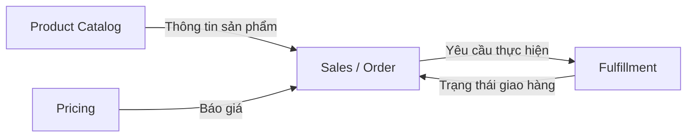
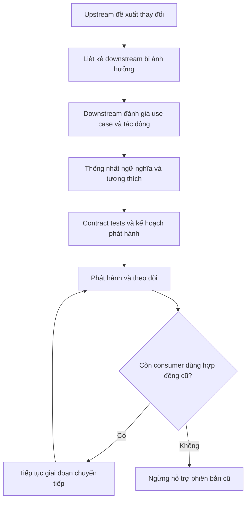

# Thượng nguồn, hạ nguồn và quyền ảnh hưởng đến hợp đồng

Khi nhiều bounded context cần phối hợp, mỗi context phải biết mình đang phụ thuộc vào mô hình hoặc dịch vụ nào, ai cung cấp thông tin, ai sử dụng thông tin và hai bên có thể tác động đến cách tích hợp ra sao. Trong Domain-Driven Design (DDD), các khái niệm **upstream (thượng nguồn)** và **downstream (hạ nguồn)** giúp diễn đạt quan hệ phụ thuộc đó. Chúng cũng giúp đội dự án nhìn ra sự chênh lệch quyền ảnh hưởng: một nhóm có thể kiểm soát mô hình và hợp đồng mà nhóm khác phải tuân theo, hoặc hai nhóm có thể cùng thương lượng để bảo vệ nhu cầu của nhau.

Hiểu đúng quan hệ này rất quan trọng khi xây dựng **context map**. Một mũi tên giữa hai bounded context chỉ có ích khi người đọc hiểu nó biểu diễn điều gì, ai chịu trách nhiệm về hợp đồng, thay đổi được thông báo như thế nào và bên tiêu thụ có cơ chế phản hồi nào. Nếu bỏ qua những câu hỏi đó, một thay đổi nhỏ ở thượng nguồn có thể làm hỏng quy trình ở hạ nguồn mà không ai nhận ra cho đến khi hệ thống chạy lỗi.

Trong `DOMAIN_DRIVEN_DESIGN`, strategic design sử dụng subdomain, bounded context và context map để mô tả các mô hình cũng như quan hệ giữa chúng; tactical design đi sâu vào entity, value object, aggregate, repository và domain event bên trong từng context. Bài này tập trung vào quan hệ thượng nguồn/hạ nguồn, quyền sở hữu và ảnh hưởng đến hợp đồng, các mẫu tích hợp thường gặp và cách quản lý thay đổi giữa các nhóm.

## 1. Thượng nguồn và hạ nguồn là gì?

### 1.1. Upstream: bên cung cấp năng lực hoặc thông tin

Một bounded context được xem là **upstream** đối với context khác khi mô hình, dữ liệu, dịch vụ hoặc quyết định do nó sở hữu được context kia sử dụng. Thượng nguồn là nơi phát sinh hoặc quản lý một phần thông tin có ý nghĩa đối với bên tiêu thụ.

Ví dụ, `Product Catalog` quản lý tên hiển thị, mô tả, hình ảnh và trạng thái công bố của sản phẩm. `Sales / Order` cần những thông tin đó để khách hàng có thể chọn mặt hàng và tạo đơn. Trong quan hệ này, Product Catalog là upstream của Sales / Order đối với thông tin danh mục được công bố.

Thượng nguồn thường chịu trách nhiệm:

- Duy trì mô hình và quy tắc thuộc phạm vi của mình.
- Xác định thông tin nào được công bố ra bên ngoài.
- Định nghĩa ý nghĩa, cấu trúc và điều kiện sử dụng của hợp đồng được cung cấp.
- Thông báo thay đổi có ảnh hưởng đến bên tiêu thụ theo thỏa thuận.
- Giữ chất lượng, tính đúng đắn và khả năng vận hành của năng lực được cung cấp.

Upstream không có nghĩa là một hệ thống luôn gọi API của hệ thống kia. Thông tin có thể đi qua API đồng bộ, message broker, sự kiện, tệp trao đổi hoặc một quy trình tích hợp khác. Quan hệ upstream/downstream nói về sự phụ thuộc mô hình và trách nhiệm, không chỉ về chiều gọi mạng.

### 1.2. Downstream: bên tiêu thụ và phụ thuộc

Một bounded context là **downstream** khi nó sử dụng thông tin hoặc năng lực từ context thượng nguồn để thực hiện trách nhiệm của mình. Hạ nguồn có thể cần dữ liệu, kết quả tính toán, sự kiện hoặc hành vi do upstream cung cấp.

Ví dụ, `Sales / Order` dùng thông tin sản phẩm được công bố từ `Product Catalog`. Sales / Order cần biết mã mặt hàng, tên hiển thị, biến thể và trạng thái bán để xử lý đơn. Sales / Order là downstream của Product Catalog trong quan hệ này.

Hạ nguồn thường chịu trách nhiệm:

- Làm rõ thông tin và hành vi mình thực sự cần từ bên cung cấp.
- Hiểu đúng ngữ nghĩa của hợp đồng và xử lý các trạng thái, lỗi hoặc trường hợp thiếu dữ liệu.
- Chuyển đổi dữ liệu bên ngoài thành mô hình cục bộ phù hợp với ngôn ngữ của mình khi cần.
- Quản lý tác động khi upstream thay đổi hoặc ngừng cung cấp một phần hợp đồng.
- Thông báo cho upstream về nhu cầu, lỗi tích hợp và các thay đổi dự kiến ở phía tiêu thụ.

Downstream không nhất thiết là bên thụ động. Trong quan hệ cộng tác tốt, nó có thể đề xuất trường dữ liệu, yêu cầu ngữ nghĩa rõ hơn, thương lượng thời điểm phát hành hoặc cùng định hình hợp đồng. Mức độ ảnh hưởng thực tế phụ thuộc vào quan hệ tổ chức và mẫu tích hợp đã chọn.

### 1.3. Quan hệ phụ thuộc không đồng nhất với luồng dữ liệu

Một context có thể là upstream đối với context thứ hai, đồng thời là downstream đối với context thứ ba. Quan hệ phải được xét theo từng cặp context và từng năng lực được trao đổi.

Ví dụ:

- `Product Catalog` là upstream của `Sales / Order` khi công bố thông tin sản phẩm.
- `Pricing` là upstream của `Sales / Order` khi cung cấp báo giá.
- `Sales / Order` có thể là upstream của `Fulfillment` khi phát hành yêu cầu thực hiện đơn.
- `Fulfillment` lại có thể là upstream của `Sales / Order` đối với sự kiện cập nhật trạng thái giao hàng.

Trong ví dụ cuối, hai context trao đổi thông tin theo cả hai hướng ở những thời điểm khác nhau. Có thể mô tả hai quan hệ cung cấp/tiêu thụ riêng, thay vì cố gán một nhãn upstream/downstream tuyệt đối cho cả hai context.



Khi vẽ context map, hãy ghi rõ nội dung được trao đổi và ý nghĩa của mũi tên. Nếu chỉ vẽ một đường nối mà không nói rõ quan hệ, người đọc có thể nhầm chiều dữ liệu với chiều phụ thuộc hoặc chiều quyền sở hữu.

## 2. Hợp đồng giữa các bounded context

### 2.1. Hợp đồng không chỉ là cấu trúc API

**Contract (hợp đồng tích hợp)** là thỏa thuận về cách một context cung cấp thông tin hoặc hành vi cho context khác và cách bên tiêu thụ sử dụng chúng. Hợp đồng có thể được thể hiện bằng OpenAPI, AsyncAPI, schema sự kiện, tài liệu giao thức, quy tắc trao đổi tệp hoặc thỏa thuận nghiệp vụ giữa hai nhóm.

Một hợp đồng đầy đủ thường có nhiều lớp:

| Lớp | Nội dung cần thống nhất | Ví dụ câu hỏi |
|---|---|---|
| Ngữ nghĩa nghiệp vụ | Ý nghĩa của thuật ngữ, trạng thái, số liệu và sự kiện | `AvailableQuantity` là tồn vật lý hay tồn có thể cam kết bán? |
| Cấu trúc dữ liệu | Trường, kiểu dữ liệu, định dạng, đơn vị, trường bắt buộc và tùy chọn | Số tiền là số nguyên theo đơn vị nhỏ nhất hay số thập phân? |
| Hành vi | Điều kiện gọi, kết quả, chuyển trạng thái, quy tắc nghiệp vụ được công bố | Yêu cầu giữ chỗ có thể bị từ chối trong trường hợp nào? |
| Thời gian | Thời điểm có hiệu lực, thời hạn, thứ tự, độ trễ và thời điểm hết hạn | Báo giá được giữ trong bao lâu? |
| Lỗi và phục hồi | Mã lỗi, retry, timeout, idempotency, xử lý trùng và bù trừ | Gửi lại yêu cầu thanh toán có tạo giao dịch thứ hai không? |
| Vận hành và bảo mật | Xác thực, phân quyền, giới hạn tải, SLA/SLO, giám sát và hỗ trợ | Ai được truy cập dữ liệu và ai nhận cảnh báo khi dịch vụ lỗi? |
| Quản lý thay đổi | Phiên bản, tương thích ngược, thông báo, thời gian chuyển đổi và ngừng hỗ trợ | Khi bỏ một trường, downstream có bao lâu để chuyển đổi? |

Một API có schema hợp lệ vẫn có thể phá vỡ nghiệp vụ nếu hai bên hiểu khác nhau về ý nghĩa. Chẳng hạn, upstream đổi `Delivered` từ “đơn vị vận chuyển báo phát thành công” sang “khách hàng xác nhận đã nhận hàng” nhưng không đổi tên trường. Về kỹ thuật, schema không thay đổi; về nghiệp vụ, hành vi của downstream có thể thay đổi nghiêm trọng.

### 2.2. Ai sở hữu hợp đồng?

Thông thường, upstream sở hữu mô hình nội bộ và chịu trách nhiệm công bố hợp đồng mà nó có thể bảo đảm. Downstream sở hữu mô hình nội bộ của mình và quyết định cách tiêu thụ, chuyển đổi hoặc lưu trữ thông tin nhận được.

Quyền sở hữu cần được phân biệt theo phạm vi:

- **Mô hình nội bộ:** do bounded context tương ứng quản lý. Context khác không nên tự ý thay đổi dữ liệu nội bộ của nó.
- **Hợp đồng công bố:** upstream chịu trách nhiệm về tính đúng đắn và cam kết tương thích của phần mình cung cấp.
- **Nhu cầu tiêu thụ:** downstream chịu trách nhiệm mô tả nhu cầu, kiểm thử cách sử dụng và phản hồi tác động của thay đổi.
- **Phần dùng chung:** nếu hai bên thật sự chia sẻ một phần mô hình, phạm vi đó cần có quy trình đồng quản trị và đồng bộ thay đổi rõ ràng.

Việc upstream sở hữu hợp đồng không có nghĩa upstream luôn được quyền đơn phương thay đổi bất cứ điều gì. Nếu downstream phụ thuộc vào hợp đồng để thực hiện cam kết với khách hàng, thay đổi có thể cần thương lượng, thông báo, giai đoạn chuyển tiếp và kế hoạch tương thích. Ngược lại, downstream cũng không nên yêu cầu upstream công bố mọi trường nội bộ chỉ vì có thể hữu ích trong một trường hợp riêng.

### 2.3. Quyền ảnh hưởng khác với quyền sở hữu

**Quyền sở hữu** trả lời ai chịu trách nhiệm duy trì và bảo đảm hợp đồng. **Quyền ảnh hưởng** trả lời ai có tiếng nói trong việc xác định nội dung, ưu tiên, lịch phát hành và cách thay đổi hợp đồng.

Một nhóm downstream có thể không sở hữu dịch vụ upstream nhưng vẫn ảnh hưởng đến hợp đồng bằng cách:

- Nêu rõ trường hợp sử dụng và tác động nghiệp vụ khi thiếu một khả năng.
- Đề xuất ngữ nghĩa hoặc trường dữ liệu cần thiết, kèm ví dụ cụ thể.
- Cung cấp kiểm thử hợp đồng phía consumer để chỉ ra kỳ vọng thực tế.
- Tham gia review thay đổi, thống nhất mức tương thích và thời điểm chuyển đổi.
- Thỏa thuận ưu tiên phát triển trong quan hệ customer-supplier hoặc partnership.
- Đề xuất một lớp chuyển đổi ở phía downstream khi upstream không thể đáp ứng yêu cầu riêng.

Ảnh hưởng không đồng nghĩa với việc downstream có quyền áp đặt mô hình nội bộ lên upstream. Một yêu cầu tốt mô tả nhu cầu nghiệp vụ và kết quả mong đợi, để upstream quyết định cách đáp ứng mà vẫn bảo vệ được tính nhất quán của mô hình.

## 3. Mức độ ảnh hưởng trong các quan hệ context mapping

DDD cung cấp nhiều mẫu quan hệ để diễn tả cách các nhóm cộng tác. Chúng giúp dự đoán mức độ ảnh hưởng và cách bảo vệ mô hình, nhưng không thay thế việc thỏa thuận cụ thể giữa các bên.

### 3.1. Customer-Supplier: hạ nguồn có tiếng nói về ưu tiên

Trong quan hệ **Customer-Supplier**, upstream đóng vai trò supplier (nhà cung cấp) và downstream là customer (khách hàng nội bộ). Supplier cung cấp năng lực hoặc dữ liệu; customer nêu nhu cầu và tác động để hai bên thống nhất ưu tiên.

Đây là quan hệ hữu ích khi upstream có thể đáp ứng nhu cầu của downstream và cả hai có động lực cộng tác. Downstream có thể tham gia lập kế hoạch, làm rõ yêu cầu, đề xuất thứ tự ưu tiên và thống nhất tiêu chí chấp nhận. Supplier vẫn chịu trách nhiệm về thiết kế và chất lượng mô hình của mình.

Ví dụ: `Inventory` cung cấp khả năng giữ chỗ hàng cho `Sales / Order`. Sales cần biết kết quả giữ chỗ đủ nhanh để quyết định đơn có thể được xác nhận hay không. Hai nhóm thống nhất rằng phản hồi phải phân biệt `Reserved`, `InsufficientStock` và `TemporarilyUnavailable`, đồng thời thống nhất thời gian phản hồi và cách xử lý yêu cầu gửi lại.

Quan hệ này chỉ hiệu quả khi supplier thực sự lắng nghe nhu cầu downstream và có cơ chế xử lý ưu tiên. Nếu upstream không có khả năng đáp ứng hoặc không có động lực cộng tác, chỉ gọi downstream là customer không tạo ra quyền ảnh hưởng thực tế.

### 3.2. Partnership: hai bên cùng điều phối

**Partnership** phù hợp khi hai context phụ thuộc chặt chẽ vào nhau và không bên nào có thể thay đổi một cách an toàn mà không phối hợp với bên kia. Các nhóm cùng lập kế hoạch, chia sẻ thông tin và điều chỉnh hợp đồng theo lịch thống nhất.

Ví dụ, `Sales / Order` và `Fulfillment` cùng thay đổi quy trình giao nhận tại cửa hàng. Một thay đổi trạng thái đơn có thể ảnh hưởng đến cách nhân viên kho lấy hàng và cách nhân viên bán hàng thông báo cho khách. Hai nhóm cần cùng định nghĩa sự kiện, trạng thái, thời điểm phát và cách xử lý khi cửa hàng không thể hoàn tất việc giao.

Partnership đòi hỏi phối hợp liên tục. Nếu không có trách nhiệm rõ ràng, việc đồng thuận có thể trở thành điểm nghẽn và mọi thay đổi nhỏ đều cần họp chung. Cần thống nhất phạm vi cùng quản trị và cách xử lý khi hai bên không đồng ý.

### 3.3. Conformist: hạ nguồn chấp nhận mô hình thượng nguồn

Trong quan hệ **Conformist**, downstream chấp nhận mô hình và hợp đồng của upstream vì không có đủ khả năng hoặc lý do để thay đổi chúng. Hạ nguồn điều chỉnh cách biểu diễn và quy tắc của mình để phù hợp với nguồn cung cấp.

Ví dụ, một dịch vụ vận chuyển bên ngoài chỉ cung cấp các trạng thái `PICKED_UP`, `IN_TRANSIT`, `DELIVERED`, `FAILED`. Context Fulfillment chấp nhận bộ trạng thái đó để tích hợp, dù mô hình nội bộ có thể cần phân biệt thêm các trạng thái chi tiết.

Conformist giảm chi phí thương lượng nhưng làm downstream phụ thuộc vào cách diễn đạt và nhịp thay đổi của upstream. Nếu ngữ nghĩa bên ngoài không phù hợp, downstream cần cân nhắc ACL để tránh đưa cách hiểu đó lan vào mô hình miền nội bộ.

### 3.4. Anti-Corruption Layer: hạ nguồn tự bảo vệ mô hình

**Anti-Corruption Layer (ACL)** là lớp chuyển đổi ở ranh giới giúp mô hình nội bộ của downstream không bị nhiễm các khái niệm, cấu trúc hoặc quy tắc không phù hợp từ upstream. ACL có thể dịch tên trường, ánh xạ trạng thái, chuyển đổi đơn vị, kết hợp dữ liệu hoặc che giấu những chi tiết đặc thù của hệ thống ngoài.

Ví dụ, nhà cung cấp vận chuyển trả về `DELIVERED` khi tài xế đánh dấu đã giao. Context Chăm sóc khách hàng chỉ coi đơn là “khách đã nhận” khi có thêm bằng chứng xác nhận. ACL có thể chuyển trạng thái bên ngoài thành `CarrierReportedDelivered`, để mô hình chăm sóc khách hàng tự áp dụng quy tắc xác nhận riêng.

ACL không phải cách để che giấu mọi vấn đề tích hợp. Nó cần có quy tắc chuyển đổi rõ, được kiểm thử và có người sở hữu. Nếu logic trong ACL ngày càng lớn, đội cần đánh giá xem đang bảo vệ một mô hình khác biệt có chủ ý hay đang bù đắp cho một hợp đồng không ổn định.

### 3.5. Open Host Service và Published Language: upstream chủ động công bố hợp đồng

Với **Open Host Service (OHS)**, upstream cung cấp một giao diện được thiết kế để nhiều consumer có thể sử dụng. Thay vì tạo một giao diện riêng cho từng downstream, upstream công bố một dịch vụ có quy tắc truy cập và khả năng tương thích rõ.

**Published Language** là ngôn ngữ trao đổi được định nghĩa và công bố để các context có thể hiểu dữ liệu theo cùng một quy ước. Nó có thể là schema JSON, định dạng sự kiện, bộ thuật ngữ hoặc một mô hình trao đổi độc lập với mô hình nội bộ của upstream.

Ví dụ, Pricing công bố `PriceQuote` với mã báo giá, số tiền, đơn vị tiền tệ, thời điểm tạo và thời điểm hết hiệu lực. Sales, Kiosk và Mobile App đều có thể sử dụng hợp đồng này. Pricing vẫn sở hữu mô hình và quy tắc tính giá; Published Language chỉ mô tả cách kết quả được trao đổi.

OHS và Published Language giúp giảm sự phụ thuộc vào cấu trúc nội bộ, nhưng upstream phải đầu tư vào thiết kế, tài liệu và quản lý phiên bản của giao diện công bố.

### 3.6. Shared Kernel: cùng sở hữu một phần mô hình

**Shared Kernel** là phần mô hình hoặc mã nguồn được hai context cùng chia sẻ và cùng quản lý. Nó có thể giúp tránh chuyển đổi lặp lại cho một phần khái niệm thực sự ổn định và có ý nghĩa chung.

Ví dụ, hai context có thể thống nhất dùng chung một thư viện nhỏ chứa kiểu `Currency` và quy tắc biểu diễn đơn vị tiền tệ. Tuy nhiên, việc chia sẻ cả entity `Customer` hay `Product` toàn cục có thể kéo theo phụ thuộc không mong muốn nếu hai bên có vòng đời và quy tắc khác nhau.

Shared Kernel làm giảm quyền tự chủ: một thay đổi có thể ảnh hưởng đồng thời đến các bên. Vì vậy, phải xác định chính xác phần được chia sẻ, người phê duyệt, quy trình review, phiên bản và cách kiểm thử tương thích.

### 3.7. Separate Ways: không tích hợp khi giá trị không đủ lớn

**Separate Ways** là lựa chọn hai context không tích hợp trực tiếp khi lợi ích nhận được thấp hơn chi phí duy trì quan hệ. Hai bên có thể giữ dữ liệu hoặc quy trình riêng, chấp nhận một số thao tác trùng lặp nếu điều đó đơn giản và an toàn hơn.

Ví dụ, một báo cáo nội bộ ít quan trọng có thể nhập dữ liệu định kỳ từ nguồn được công bố thay vì xây dựng tích hợp thời gian thực. Tuy nhiên, cần xác định rõ độ trễ được chấp nhận và tránh dùng Separate Ways khi hai bên phải bảo đảm cùng một cam kết nghiệp vụ tức thời.

### 3.8. So sánh nhanh các mẫu quan hệ

| Mẫu quan hệ | Vai trò và quyền ảnh hưởng | Cách xử lý hợp đồng | Rủi ro chính |
|---|---|---|---|
| Customer-Supplier | Downstream có tiếng nói về nhu cầu và ưu tiên; upstream cung cấp | Thương lượng yêu cầu, lịch và tiêu chí chấp nhận | Supplier không thực sự đáp ứng ưu tiên của customer |
| Partnership | Hai bên phối hợp và cùng điều phối | Cùng thiết kế, phát hành và quản lý thay đổi | Phụ thuộc quá chặt, khó ra quyết định |
| Conformist | Downstream chấp nhận mô hình upstream | Theo hợp đồng do upstream công bố | Ngữ nghĩa bên ngoài lan vào mô hình nội bộ |
| Anti-Corruption Layer | Downstream tự bảo vệ mô hình | Dịch và kiểm soát hợp đồng ở biên | Lớp chuyển đổi phức tạp, khó bảo trì |
| Open Host Service / Published Language | Upstream chủ động công bố cho nhiều consumer | Giao diện và ngôn ngữ trao đổi có quản lý | Hợp đồng chung không đáp ứng hết nhu cầu hoặc thay đổi khó khăn |
| Shared Kernel | Các bên cùng sở hữu một phần nhỏ | Thay đổi cần review và phối hợp chung | Phụ thuộc chéo và phát hành đồng bộ |
| Separate Ways | Không có quan hệ tích hợp cần duy trì | Không có hợp đồng trực tiếp | Dữ liệu hoặc quy trình bị lệch nếu thực tế cần đồng bộ |

## 4. Ví dụ xuyên suốt: hợp đồng giữ chỗ tồn kho

Giả sử `Sales / Order` cần kiểm tra và giữ chỗ hàng trước khi xác nhận đơn. `Inventory` sở hữu số lượng theo kho và quy tắc phân bổ. Hai context cần thống nhất hợp đồng giữ chỗ.

### 4.1. Làm rõ trách nhiệm của mỗi bên

`Inventory` chịu trách nhiệm:

- Tính toán lượng có thể giữ chỗ theo quy tắc tồn kho.
- Bảo vệ bất biến không phân bổ vượt quá khả năng cho phép.
- Tạo và quản lý vòng đời reservation.
- Công bố kết quả và trạng thái giữ chỗ.

`Sales / Order` chịu trách nhiệm:

- Gửi yêu cầu giữ chỗ phù hợp với đơn hàng.
- Quyết định cách xử lý đơn dựa trên kết quả từ Inventory.
- Không tự sửa số lượng tồn kho hoặc đánh dấu reservation thành công.
- Xử lý timeout, kết quả đến muộn và yêu cầu gửi lại theo hợp đồng.

Inventory là upstream đối với năng lực giữ chỗ; Sales / Order là downstream. Sales có thể ảnh hưởng đến hợp đồng bằng cách mô tả nhu cầu xác nhận đơn, thời gian chờ và cách xử lý thiếu hàng. Inventory quyết định cách bảo vệ bất biến bên trong mô hình tồn kho.

### 4.2. Định nghĩa hợp đồng ứng viên

Một yêu cầu giữ chỗ có thể được biểu diễn như sau:

```json
{
  "reservationRequestId": "rr-2026-00042",
  "orderId": "ord-10082",
  "items": [
    {
      "sku": "SKU-RED-M",
      "warehouseId": "WH-HCM-01",
      "quantity": 2
    }
  ],
  "expiresAt": "2026-11-18T10:30:00+07:00"
}
```

Kết quả có thể được công bố dưới dạng phản hồi hoặc sự kiện:

```json
{
  "reservationId": "res-50018",
  "reservationRequestId": "rr-2026-00042",
  "status": "RESERVED",
  "items": [
    {
      "sku": "SKU-RED-M",
      "warehouseId": "WH-HCM-01",
      "reservedQuantity": 2
    }
  ],
  "expiresAt": "2026-11-18T10:30:00+07:00"
}
```

Đây chỉ là ví dụ minh họa. Hợp đồng thực tế cần được thống nhất về các điểm sau:

- `reservationRequestId` có duy nhất trong phạm vi nào và được dùng ra sao để chống tạo reservation trùng khi retry?
- `quantity` là số lượng nguyên, có cho phép đơn vị lẻ không và đơn vị tính được xác định ở đâu?
- `warehouseId` do Sales chọn hay Inventory tự phân bổ? Nếu Inventory tự chọn, phản hồi có cần trả về kho đã chọn không?
- `expiresAt` do bên nào xác định? Reservation hết hạn tự động hay cần lệnh giải phóng?
- `RESERVED`, `INSUFFICIENT_STOCK`, `REJECTED` và `EXPIRED` có ý nghĩa chính xác thế nào?
- Nếu yêu cầu timeout nhưng Inventory đã giữ chỗ thành công, Sales tra cứu kết quả bằng cách nào?
- Nếu đơn bị hủy sau khi giữ chỗ, Sales yêu cầu giải phóng bằng hành vi nào?

Những câu hỏi này thuộc ngữ nghĩa và hành vi hợp đồng, không thể giải quyết chỉ bằng việc thống nhất tên JSON field.

### 4.3. Thương lượng hợp đồng và quyền ảnh hưởng

Sales có thể nêu nhu cầu: “Khi tạo đơn, chúng tôi cần biết trong thời gian ngắn liệu hàng đã được giữ chỗ hay chưa; nếu không đủ hàng, cần biết có thể thử kho khác hay không.” Inventory có thể phản hồi rằng việc phân bổ kho là quy tắc thuộc quyền sở hữu của Inventory và đề xuất trả về một trong các kết quả `RESERVED`, `INSUFFICIENT_STOCK` hoặc `NO_ELIGIBLE_WAREHOUSE`.

Hai bên tiếp tục thống nhất:

1. Sales không chỉ định trực tiếp số lượng tồn hay ghi vào bảng Inventory.
2. Inventory chịu trách nhiệm quyết định có thể giữ chỗ hay không và trả về reservation ID.
3. Sales cung cấp order ID và mã yêu cầu duy nhất để hỗ trợ truy vết, retry.
4. Hai bên xác định timeout, thời hạn reservation, thao tác giải phóng và cách xử lý kết quả đến muộn.
5. Hai bên thống nhất lịch phát hành và cách thông báo nếu trường hoặc trạng thái hợp đồng thay đổi.

Kết quả là một hợp đồng đáp ứng mục tiêu của Sales mà vẫn giữ quyền sở hữu quy tắc tồn kho ở Inventory. Downstream đã có ảnh hưởng thực tế đến giao diện, ngữ nghĩa và vận hành; upstream vẫn chịu trách nhiệm về mô hình của mình.

### 4.4. Khi upstream thay đổi hợp đồng

Giả sử Inventory cần thêm trạng thái `PENDING_REVIEW` khi một mặt hàng phải được nhân viên kho xác minh. Nếu thêm trạng thái mới mà không thông báo, Sales có thể xử lý trạng thái chưa biết như lỗi hoặc nhầm nó thành `REJECTED`.

Quy trình thay đổi nên gồm:

- Inventory mô tả lý do, ngữ nghĩa và tác động của trạng thái mới.
- Sales đánh giá ảnh hưởng đến luồng xác nhận đơn và đưa ra yêu cầu xử lý.
- Hai bên thống nhất hành vi tương thích, ví dụ Sales coi `PENDING_REVIEW` là trạng thái chưa kết thúc và chờ sự kiện tiếp theo.
- Hợp đồng, tài liệu, kiểm thử và dashboard được cập nhật.
- Phát hành theo lộ trình đã thống nhất; theo dõi lỗi và khả năng tương thích sau triển khai.

Nếu thay đổi phá vỡ tương thích, cần phiên bản mới hoặc giai đoạn chuyển tiếp. Không nên buộc downstream phải đoán ý nghĩa của một giá trị mới.

## 5. Quản lý thay đổi hợp đồng một cách có kiểm soát

### 5.1. Phân biệt thay đổi tương thích và thay đổi phá vỡ

Một thay đổi là tương thích hay phá vỡ còn phụ thuộc vào cách consumer sử dụng hợp đồng, không chỉ vào schema.

| Thay đổi | Có thể tương thích khi | Có thể phá vỡ khi |
|---|---|---|
| Thêm trường tùy chọn | Consumer bỏ qua trường chưa biết và producer không yêu cầu consumer gửi trường đó | Consumer sinh code hoặc validation từ schema đóng, từ chối trường mới |
| Thêm giá trị enum hoặc trạng thái | Consumer có nhánh xử lý giá trị chưa biết | Consumer giả định enum chỉ có tập giá trị cũ và lỗi khi gặp giá trị mới |
| Đổi tên hoặc xóa trường | Thường cần phiên bản hoặc chuyển tiếp | Consumer vẫn đọc trường cũ |
| Đổi kiểu hoặc đơn vị | Có quy tắc chuyển đổi và thời gian tương thích | Consumer hiểu số tiền, thời gian hoặc số lượng theo đơn vị cũ |
| Đổi ngữ nghĩa nhưng giữ schema | Chỉ tương thích nếu ý nghĩa thực tế không thay đổi với consumer | Consumer dựa vào ý nghĩa cũ để đưa ra quyết định nghiệp vụ |
| Đổi thứ tự hoặc thời điểm phát sự kiện | Consumer không phụ thuộc thứ tự hoặc hợp đồng quy định thứ tự mới | Consumer giả định sự kiện luôn đến đúng thứ tự hoặc ngay lập tức |

Thay đổi ngữ nghĩa là rủi ro đặc biệt vì công cụ kiểm tra schema có thể không phát hiện. Cần review bằng ngôn ngữ nghiệp vụ và ví dụ cụ thể.

### 5.2. Một quy trình thay đổi hợp đồng

Có thể áp dụng quy trình sau cho API, sự kiện hoặc định dạng trao đổi:

1. **Đề xuất:** upstream mô tả vấn đề, lý do thay đổi, phạm vi và context tiêu thụ bị ảnh hưởng.
2. **Đánh giá:** downstream đối chiếu hợp đồng với các use case, quy tắc và kiểm thử hiện tại.
3. **Thống nhất:** hai bên quyết định ngữ nghĩa, tương thích, phiên bản, thời điểm phát hành và thời hạn chuyển đổi.
4. **Cập nhật kiểm thử:** bổ sung kiểm thử schema, contract test, kiểm thử tích hợp và ví dụ nghiệp vụ.
5. **Phát hành:** triển khai theo trình tự tương thích; khi cần, producer hỗ trợ song song hợp đồng cũ và mới trong giai đoạn chuyển tiếp.
6. **Theo dõi:** giám sát consumer còn sử dụng phiên bản cũ, lỗi chuyển đổi và sự kiện bất thường.
7. **Ngừng hỗ trợ:** chỉ loại bỏ hợp đồng cũ khi các consumer liên quan đã chuyển đổi hoặc có quyết định chấp nhận rủi ro.



### 5.3. Contract testing và consumer-driven contracts

**Contract testing** kiểm tra sự phù hợp giữa cách producer công bố hợp đồng và cách consumer sử dụng hợp đồng. Nó giúp phát hiện sớm những thay đổi khiến tích hợp không còn hoạt động.

Một số hình thức thường gặp:

- **Provider contract test:** xác nhận upstream thực sự đáp ứng cấu trúc và hành vi đã công bố.
- **Consumer contract test:** ghi lại những trường, trạng thái và hành vi downstream cần để thực hiện use case của mình.
- **Consumer-driven contract:** consumer chủ động công bố kỳ vọng cụ thể; provider dùng các kỳ vọng đó để đánh giá khả năng tương thích trước khi phát hành.
- **Schema compatibility check:** kiểm tra thay đổi schema theo quy tắc tương thích đã chọn.
- **End-to-end hoặc integration test:** xác minh một luồng phối hợp quan trọng giữa nhiều context.

Consumer-driven contract giúp downstream có tiếng nói rõ ràng bằng ví dụ có thể chạy tự động. Tuy nhiên, không nên để mỗi consumer ép upstream giữ lại mọi chi tiết riêng. Provider cần tổng hợp nhu cầu, phân biệt nhu cầu chung với ngoại lệ và bảo vệ mô hình của mình.

Contract test cũng không thay thế kiểm thử ngữ nghĩa. Một phản hồi có thể đúng schema nhưng sai ý nghĩa. Vì vậy, test nên bao gồm các trường hợp nghiệp vụ tiêu biểu, trạng thái biên, lỗi, timeout, retry và sự kiện đến trễ.

### 5.4. Versioning và thời gian chuyển đổi

Không phải mọi thay đổi đều cần tăng phiên bản major. Điều quan trọng là chọn chính sách phiên bản rõ ràng và phù hợp với kiểu hợp đồng:

- API có thể dùng version trong URL, header hoặc media type.
- Event schema có thể có `schemaVersion` và quy tắc tương thích tiến/lùi.
- Tệp trao đổi có thể mang version trong metadata hoặc tên định dạng.
- Ngôn ngữ nghiệp vụ cần tài liệu hóa thay đổi ngữ nghĩa ngay cả khi cấu trúc kỹ thuật không đổi.

Kế hoạch deprecation nên nêu rõ hợp đồng cũ còn được hỗ trợ đến ngày nào, consumer nào cần chuyển đổi, cách kiểm tra tiến độ và ai phê duyệt việc ngừng hỗ trợ. Một khoảng thời gian chuyển tiếp hữu ích phải dựa trên chu kỳ phát hành và khả năng nâng cấp thực tế của các consumer.

## 6. Quyền ảnh hưởng trong những tình huống khó

### 6.1. Downstream cần dữ liệu upstream không muốn công bố

Hãy bắt đầu bằng câu hỏi downstream cần đưa ra quyết định nào. Có thể consumer đang yêu cầu quá nhiều trường nội bộ trong khi chỉ cần một kết quả đã được upstream tính toán. Upstream có thể cung cấp một operation hoặc view chuyên biệt, thay vì mở toàn bộ mô hình.

Ví dụ, Sales không nhất thiết cần đọc toàn bộ bảng tồn kho. Nó có thể chỉ cần kết quả `CanReserve` cùng lý do và thời hạn reservation. Cách này giữ quyền sở hữu quy tắc phân bổ ở Inventory.

### 6.2. Upstream thay đổi nhanh hơn downstream có thể theo kịp

Nếu upstream phát hành liên tục còn downstream cần chu kỳ kiểm thử dài, hai bên cần thỏa thuận cửa sổ phát hành, cảnh báo trước, phiên bản ổn định và cơ chế tương thích. Có thể dùng adapter ở downstream để giảm tác động, nhưng adapter không xóa bỏ nhu cầu quản lý hợp đồng.

### 6.3. Downstream có nhiều consumer khác nhau

Một upstream có thể phục vụ nhiều downstream với nhu cầu khác nhau. Nếu một hợp đồng duy nhất ngày càng phức tạp, upstream nên tìm phần ngôn ngữ và dữ liệu chung, sau đó cân nhắc OHS, Published Language hoặc các view công bố khác nhau có mục đích rõ. Tránh tạo một API tổng hợp với hàng chục trường tùy chọn chỉ để thỏa mãn mọi consumer.

### 6.4. Không có quyền thương lượng ngang bằng

Khi upstream là nhà cung cấp bên ngoài hoặc hệ thống cũ, downstream có thể không thay đổi được hợp đồng. Khi đó, lựa chọn thực tế gồm Conformist, ACL, mua dịch vụ thay thế hoặc giảm phụ thuộc. Hãy ghi nhận rủi ro, chi phí chuyển đổi và giới hạn vận hành thay vì giả định hai bên có thể thương lượng như đối tác.

### 6.5. Một context vừa là upstream vừa là downstream

Trong hệ sinh thái nhiều context, một context thường có nhiều quan hệ khác nhau. Hãy ghi từng quan hệ theo nội dung hợp đồng và use case. Đừng gắn một nhãn duy nhất lên context rồi cho rằng nhãn đó áp dụng với mọi hệ thống khác.

## 7. Cách ghi quan hệ vào context map

Context map nên giúp người đọc trả lời được: context nào cung cấp điều gì, context nào tiêu thụ, quan hệ theo mẫu nào, hợp đồng do ai sở hữu và thay đổi được điều phối ra sao.

Một bản ghi quan hệ có thể gồm:

| Trường | Ý nghĩa |
|---|---|
| Upstream context | Context sở hữu năng lực hoặc thông tin được cung cấp |
| Downstream context | Context tiêu thụ năng lực hoặc thông tin |
| Contract / Published Language | API, event, schema hoặc quy tắc trao đổi |
| Business meaning | Ý nghĩa nghiệp vụ của thông tin và hành vi |
| Relationship pattern | Customer-Supplier, Conformist, ACL, Partnership, OHS, Shared Kernel hoặc mẫu phù hợp khác |
| Contract owner | Vai trò chịu trách nhiệm công bố và duy trì hợp đồng |
| Consumer expectations | Nhu cầu và use case quan trọng của downstream |
| Change policy | Cách review, version, thông báo và deprecation |
| Operational agreement | Timeout, retry, SLA/SLO, bảo mật, giám sát và hỗ trợ |
| Open risks | Điểm phụ thuộc, giới hạn và câu hỏi chưa giải quyết |

Ví dụ một bản ghi rút gọn:

```yaml
relationship: Inventory_to_SalesOrder
upstream_context: Inventory
downstream_context: SalesOrder
pattern: CustomerSupplier
contract:
  name: Reservation API
  purpose: "Yêu cầu giữ chỗ và nhận kết quả reservation"
  owner: Inventory
  consumer: SalesOrder
business_semantics:
  - "Reserved nghĩa là số lượng đã được giữ cho một order trong thời hạn xác định"
  - "InsufficientStock nghĩa là không thể giữ đủ số lượng theo yêu cầu"
consumer_expectations:
  - "Có thể tra cứu kết quả bằng reservationRequestId"
  - "Yêu cầu gửi lại không tạo reservation trùng"
change_policy:
  - "Thông báo thay đổi phá vỡ tương thích trước khi phát hành"
  - "Consumer contract tests phải pass trước khi triển khai"
operational_agreement:
  - "Thống nhất timeout, retry và cách giải phóng reservation"
open_risks:
  - "Cần xác định hành vi khi reservation hết hạn trong lúc thanh toán"
```

Mẫu này là tài liệu cộng tác, không phải cấu hình triển khai bắt buộc. Có thể liên kết nó với OpenAPI, AsyncAPI, schema registry, tài liệu kiến trúc hoặc kho kiểm thử hợp đồng của tổ chức.

## 8. Sai lầm thường gặp

**Hiểu upstream là hệ thống được gọi trước.** Upstream/downstream diễn tả quan hệ phụ thuộc và cung cấp/tiêu thụ mô hình. Hãy ghi rõ năng lực nào được cung cấp thay vì suy ra từ thứ tự gọi API.

**Cho rằng upstream sở hữu hợp đồng nên được thay đổi tùy ý.** Upstream sở hữu và bảo đảm phần công bố, nhưng cần tôn trọng consumer đã phụ thuộc vào cam kết. Thay đổi cần đánh giá tác động và lộ trình.

**Cho rằng downstream không có quyền ảnh hưởng.** Consumer có thể cung cấp bằng chứng, use case, contract test và tham gia thương lượng. Mức độ ảnh hưởng cần được ghi nhận thực tế.

**Đưa mô hình nội bộ thành hợp đồng công khai.** Điều này khiến upstream khó thay đổi và downstream phụ thuộc vào chi tiết không cần thiết. Hãy thiết kế Published Language hoặc API view phù hợp.

**Dùng Shared Kernel quá rộng.** Chia sẻ nhiều entity và quy tắc tạo phụ thuộc chéo. Chỉ chia sẻ phần nhỏ có ý nghĩa thực sự chung và có quy trình đồng quản trị.

**Dùng ACL để che mọi thay đổi.** ACL cần phản ánh quy tắc chuyển đổi rõ ràng. Nếu upstream thay đổi thường xuyên hoặc ngữ nghĩa mơ hồ, cần xử lý nguyên nhân ở quan hệ và hợp đồng.

**Chỉ kiểm tra schema.** Schema đúng không đảm bảo trạng thái, đơn vị, thời điểm và ý nghĩa nghiệp vụ đúng. Bổ sung ví dụ và kiểm thử hành vi.

**Không có chính sách ngừng hỗ trợ.** Hợp đồng cũ tồn tại mãi làm tăng chi phí vận hành. Hãy xác định consumer, thời hạn chuyển đổi và tiêu chí loại bỏ.

**Không biết ai chịu trách nhiệm khi tích hợp lỗi.** Mỗi quan hệ cần có đầu mối upstream, downstream và quy trình phối hợp sự cố.

## 9. Checklist và câu hỏi tự kiểm tra

Trước khi xem một quan hệ giữa hai context là đã được thiết kế rõ, hãy kiểm tra:

- [ ] Đã xác định rõ năng lực hoặc thông tin được cung cấp.
- [ ] Đã xác định upstream và downstream theo từng hợp đồng cụ thể.
- [ ] Đã phân biệt chiều phụ thuộc với chiều gọi hoặc chiều dữ liệu.
- [ ] Đã thống nhất ngữ nghĩa của trường, trạng thái, sự kiện và đơn vị.
- [ ] Đã làm rõ ai sở hữu mô hình, ai sở hữu hợp đồng và ai tiêu thụ.
- [ ] Đã ghi nhận nhu cầu và khả năng ảnh hưởng của downstream.
- [ ] Đã chọn mẫu quan hệ phù hợp với khả năng cộng tác thực tế.
- [ ] Đã xác định cách xử lý lỗi, timeout, retry và dữ liệu đến muộn.
- [ ] Đã có kiểm thử hợp đồng và ví dụ nghiệp vụ quan trọng.
- [ ] Đã thống nhất versioning, thông báo, deprecation và hỗ trợ consumer.
- [ ] Đã ghi người chịu trách nhiệm và rủi ro còn mở.

Câu hỏi tự kiểm tra:

1. `Inventory` công bố sự kiện `StockReserved` cho `Sales / Order`. Context nào là upstream đối với sự kiện này và vì sao?
2. Sales yêu cầu Inventory công bố toàn bộ số lượng tồn theo từng kho. Có cách nào đáp ứng nhu cầu nghiệp vụ mà vẫn giữ quyền sở hữu quy tắc tồn kho ở Inventory?
3. Một nhà cung cấp vận chuyển chỉ hỗ trợ bộ trạng thái cố định. Khi nào nên dùng Conformist và khi nào nên đặt ACL?
4. Vì sao thêm một giá trị enum có thể là thay đổi phá vỡ dù schema vẫn hợp lệ?
5. Consumer-driven contract test giúp downstream ảnh hưởng đến hợp đồng bằng cách nào? Nó có giới hạn gì?
6. Khi hai context cùng sở hữu một phần model, cần thêm cơ chế nào để tránh Shared Kernel trở thành nguồn phụ thuộc chéo?

**Gợi ý trả lời:**

- Câu 1: Inventory là upstream vì nó sở hữu và công bố kết quả giữ chỗ; Sales / Order tiêu thụ sự kiện để cập nhật quy trình đơn hàng. Chiều phát sự kiện không phải tiêu chí duy nhất; quyền sở hữu và ý nghĩa của dữ liệu mới là cơ sở.
- Câu 2: Làm rõ Sales cần quyết định gì. Inventory có thể cung cấp kết quả khả dụng hoặc khả năng giữ chỗ thay vì mở toàn bộ dữ liệu và quy tắc nội bộ.
- Câu 3: Conformist phù hợp khi downstream chấp nhận được ngữ nghĩa bên ngoài. ACL phù hợp khi cần dịch hoặc bảo vệ mô hình nội bộ khỏi cách biểu diễn không phù hợp.
- Câu 4: Consumer có thể giả định chỉ tồn tại các giá trị cũ và không biết cách xử lý trạng thái mới. Cần có chính sách giá trị chưa biết và kiểm thử tương thích.
- Câu 5: Consumer công bố kỳ vọng có thể kiểm thử; provider dùng chúng để xác nhận hợp đồng đáp ứng use case. Nó không cho phép consumer áp đặt mọi chi tiết nội bộ hoặc thay thế thương lượng ngữ nghĩa.
- Câu 6: Giới hạn Shared Kernel ở phần nhỏ, quy định chủ sở hữu chung, review bắt buộc, versioning và kiểm thử ảnh hưởng đến tất cả bên sử dụng.

## Kết luận

Upstream và downstream làm rõ quan hệ cung cấp, tiêu thụ và phụ thuộc giữa các bounded context. Hợp đồng là cam kết về ngữ nghĩa, dữ liệu, hành vi, thời gian, vận hành và thay đổi. Upstream thường sở hữu mô hình và hợp đồng công bố; downstream sở hữu cách sử dụng và mô hình cục bộ, đồng thời có thể ảnh hưởng thông qua nhu cầu, kiểm thử và thương lượng. Context map có giá trị khi thể hiện được cả quan hệ lẫn trách nhiệm này, giúp các nhóm thay đổi hệ thống mà vẫn giữ được tính nhất quán của mô hình miền.
