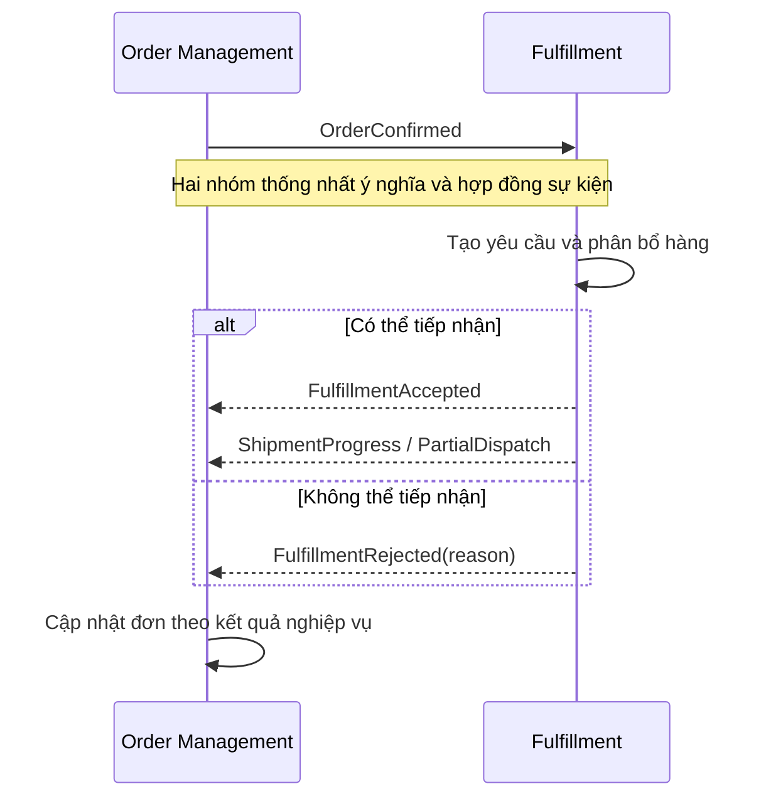

# Partnership: hai nhóm phối hợp và cùng chịu trách nhiệm

Trong một hệ thống doanh nghiệp, nhiều bounded context có thể cùng tham gia tạo ra một kết quả mà khách hàng hoặc người vận hành quan tâm. Một nhóm phụ trách đơn hàng, nhóm khác phụ trách thực hiện đơn; một nhóm quản lý hợp đồng, nhóm khác quản lý thanh toán; một nhóm cung cấp dữ liệu sản phẩm, nhóm khác dùng dữ liệu đó để đưa ra quyết định bán hàng. Mỗi nhóm có mô hình và quy tắc riêng, nhưng kết quả cuối cùng phụ thuộc vào cách các nhóm phối hợp.

Trong Domain-Driven Design (DDD), **Partnership** là một kiểu quan hệ trong Context Map, mô tả hai nhóm phát triển phối hợp chặt chẽ và cùng chịu trách nhiệm đối với kết quả tích hợp giữa các context. Hai nhóm cần đồng bộ kế hoạch, trao đổi thay đổi và cùng giải quyết vấn đề phát sinh. Thành công của một bên phụ thuộc đáng kể vào khả năng hợp tác của bên kia.

Partnership đặc biệt hữu ích khi hai bounded context có mức độ phụ thuộc hai chiều hoặc cùng tham gia một năng lực kinh doanh quan trọng, và không bên nào có thể đơn phương quyết định mọi thay đổi mà không ảnh hưởng đến bên còn lại. Quan hệ này cần được thể hiện trong cách tổ chức công việc, thiết kế hợp đồng tích hợp và quản lý thay đổi, chứ không chỉ là một đường nối trên sơ đồ.

## 1. Partnership trong Context Map là gì?

Context Map mô tả các bounded context, ranh giới mô hình và quan hệ giữa chúng. Ngoài việc xác định context nào giao tiếp với context nào, bản đồ còn cho biết các nhóm liên quan phối hợp ra sao, bên nào có quyền định hình hợp đồng và mức độ phụ thuộc giữa các mô hình.

Trong quan hệ Partnership, hai nhóm xem kết quả chung là trách nhiệm chung. Họ cùng lập kế hoạch cho những thay đổi có ảnh hưởng đến tích hợp, thống nhất cách phát triển hợp đồng và phối hợp khi một bên cần thay đổi mô hình hoặc hành vi. Không nhóm nào được xem là khách hàng thụ động chỉ gửi yêu cầu cho nhóm còn lại.

Ví dụ, nhóm Order Management sở hữu mô hình đơn hàng và nhóm Fulfillment sở hữu mô hình thực hiện đơn. Khi doanh nghiệp muốn hỗ trợ giao một phần đơn hàng, thay đổi này có thể ảnh hưởng đến cả hai context. Nhóm Order Management cần biểu diễn lựa chọn giao một phần và trạng thái cam kết với khách hàng; nhóm Fulfillment cần tiếp nhận số lượng được phép giao, phân bổ hàng và phản hồi kết quả thực hiện. Hai nhóm phải cùng xác định ý nghĩa của các trạng thái và sự kiện liên quan.

Partnership không có nghĩa là hai nhóm phải dùng chung một domain model, một cơ sở dữ liệu hoặc một codebase. Mỗi bounded context vẫn giữ ngôn ngữ, dữ liệu và quy tắc nội bộ của mình. Điều hai nhóm cùng chịu trách nhiệm là sự phối hợp và kết quả tại ranh giới giữa các context.

### Các dấu hiệu của quan hệ Partnership

- Hai nhóm có mục tiêu kinh doanh liên quan chặt chẽ và cùng chịu ảnh hưởng khi luồng tích hợp thất bại.
- Thay đổi ở một context thường yêu cầu điều chỉnh hoặc phối hợp ở context còn lại.
- Hai nhóm có khả năng cùng tham gia quyết định về hợp đồng, lịch phát hành và cách xử lý thay đổi.
- Kế hoạch phát triển được đồng bộ ở những phần có phụ thuộc, thay vì mỗi nhóm tự tối ưu backlog của mình.
- Hai nhóm cùng điều tra sự cố xuyên context và theo dõi chất lượng của kết quả đầu cuối.
- Giao tiếp thường xuyên giúp phát hiện sớm khác biệt về thuật ngữ, quy tắc và giả định nghiệp vụ.

Một mối quan hệ chỉ có tên gọi “partnership” trong tài liệu nhưng không có cơ chế phối hợp thực tế thì chưa tạo ra lợi ích của mẫu này. Cần có sự cam kết về thời gian, quyền quyết định và trách nhiệm của cả hai nhóm.

## 2. Partnership khác gì các quan hệ Context Map khác?

Điểm quan trọng khi chọn quan hệ trong Context Map là hiểu cách các nhóm ảnh hưởng đến nhau. Partnership không đơn giản là hai hệ thống có API gọi qua lại. Nó mô tả cách hai nhóm tổ chức quan hệ phát triển.

| Quan hệ | Cách phối hợp | Quyền định hình mô hình và hợp đồng | Khi nào thường phù hợp |
|---|---|---|---|
| **Partnership** | Hai nhóm phối hợp và cùng chịu trách nhiệm về kết quả chung | Cùng thảo luận và đồng bộ thay đổi có ảnh hưởng đến cả hai | Phụ thuộc hai chiều, mục tiêu chung và cả hai bên có khả năng phối hợp thực chất |
| **Customer-Supplier** | Nhóm downstream đưa nhu cầu; nhóm upstream cân nhắc và lên kế hoạch đáp ứng | Upstream có quyền chủ động đáng kể; nhu cầu của downstream cần được đưa vào ưu tiên | Một nhóm cung cấp năng lực cho nhiều nhóm sử dụng và có thể quản lý quan hệ theo kế hoạch cung cấp |
| **Conformist** | Nhóm downstream chấp nhận mô hình do upstream định nghĩa | Downstream thích nghi với mô hình upstream | Chi phí đàm phán hoặc chuyển đổi cao, mô hình upstream có thể được chấp nhận |
| **Anti-Corruption Layer (ACL)** | Nhóm downstream bảo vệ mô hình nội bộ bằng lớp chuyển đổi | Downstream kiểm soát mô hình của mình và chuyển đổi dữ liệu từ upstream | Mô hình bên ngoài khác biệt hoặc thay đổi có thể làm nhiễu domain model nội bộ |
| **Shared Kernel** | Hai nhóm thống nhất chia sẻ một phần mô hình hoặc mã nguồn | Phần được chia sẻ cần có quy trình thay đổi chung | Phần mô hình thực sự ổn định và hai nhóm chấp nhận chi phí phối hợp chặt chẽ |

### Partnership và Customer-Supplier

Trong quan hệ Customer-Supplier, một nhóm cung cấp dịch vụ hoặc mô hình, nhóm còn lại sử dụng. Nhóm downstream cần truyền đạt nhu cầu và có thể thương lượng ưu tiên, nhưng upstream vẫn có quyền tổ chức roadmap của mình. Nếu upstream phục vụ nhiều khách hàng nội bộ, không phải yêu cầu nào cũng có thể được ưu tiên.

Trong Partnership, hai nhóm cùng lập kế hoạch cho phần công việc phụ thuộc lẫn nhau. Một thay đổi lớn ở một bên cần được xem xét cùng bên kia để đảm bảo cả hai có thể phát hành và vận hành thành công. Trách nhiệm phối hợp có tính hai chiều rõ ràng hơn.

### Partnership và Shared Kernel

Partnership là quan hệ hợp tác giữa các nhóm; Shared Kernel là cách hai context chia sẻ một phần mô hình hoặc mã. Hai nhóm có thể là đối tác mà không chia sẻ bất kỳ entity, value object hay thư viện domain nào. Ngược lại, hai nhóm có thể dùng chung một thư viện nhưng thiếu cơ chế hợp tác thực chất.

Nếu chọn Shared Kernel, mọi thay đổi ở phần được chia sẻ đều có thể ảnh hưởng đến cả hai context. Cần thống nhất quyền sửa, quy trình review, phiên bản và cách phát hành. Không nên tạo Shared Kernel chỉ để thể hiện rằng hai nhóm đang phối hợp.

### Partnership và ACL

ACL là một mẫu thiết kế ở ranh giới tích hợp nhằm chuyển đổi mô hình bên ngoài sang mô hình nội bộ. Partnership là quan hệ tổ chức và phối hợp giữa các nhóm. Hai nhóm có thể duy trì Partnership nhưng vẫn dùng ACL ở một phía nếu mô hình của hai context có khác biệt đáng kể. Việc cùng hợp tác không yêu cầu hai mô hình phải giống nhau.

## 3. Khi nào nên sử dụng Partnership?

Partnership phù hợp khi có đủ cơ sở để tin rằng hai nhóm cần phối hợp liên tục và lợi ích của việc đồng bộ lớn hơn chi phí phối hợp.

### Hai context cùng tạo ra một kết quả nghiệp vụ

Một quy trình đầu cuối có thể đi qua nhiều context. Khách hàng quan tâm đơn hàng được giao đúng và đủ, không quan tâm nội bộ có bao nhiêu hệ thống. Nếu Order Management và Fulfillment cùng ảnh hưởng đến khả năng thực hiện cam kết đó, hai nhóm cần nhìn vào kết quả chung.

### Thay đổi ở một bên thường tác động đến bên kia

Ví dụ, bổ sung giao một phần, thay đổi cách giữ chỗ tồn kho hoặc cho phép hủy sau khi bắt đầu đóng gói có thể làm thay đổi hợp đồng và quy tắc của cả hai context. Nếu các thay đổi như vậy xảy ra thường xuyên, phối hợp sớm giúp tránh việc một nhóm phát triển xong rồi mới phát hiện nhóm kia không thể hỗ trợ.

### Cả hai bên đều có quyền và năng lực đóng góp

Partnership hiệu quả khi hai nhóm có người hiểu nghiệp vụ, có quyền quyết định trong phạm vi của mình và có thể bố trí nguồn lực để phối hợp. Nếu một nhóm không thể tham gia lập kế hoạch hoặc không có quyền điều chỉnh roadmap, quan hệ Customer-Supplier có thể phản ánh thực tế tốt hơn.

### Mục tiêu và ưu tiên có thể được thống nhất

Hai nhóm cần thống nhất điều gì quan trọng đối với doanh nghiệp: tỷ lệ thực hiện đơn, thời gian phản hồi, độ chính xác dữ liệu, khả năng phục hồi hay trải nghiệm khách hàng. Nếu mỗi nhóm chỉ tối ưu chỉ số cục bộ, họ có thể đạt KPI riêng nhưng làm giảm chất lượng kết quả đầu cuối.

Không nên chọn Partnership chỉ vì hai hệ thống có kết nối kỹ thuật hoặc hai nhóm thường xuyên trao đổi. Nếu giao diện ổn định, phụ thuộc ít thay đổi và một nhóm chỉ sử dụng dịch vụ chuẩn của nhóm kia, Customer-Supplier hoặc một quan hệ đơn giản hơn có thể đủ.

## 4. Cách tổ chức hai nhóm trong Partnership

Partnership cần được chuyển thành các thỏa thuận vận hành cụ thể. Hai nhóm không cần gộp thành một đội, nhưng phải biết lúc nào cần cùng ra quyết định và ai chịu trách nhiệm cho từng phần.

### Thống nhất mục tiêu chung

Hãy xác định một hoặc một số kết quả đầu cuối mà cả hai nhóm cùng chịu trách nhiệm. Ví dụ:

- Tỷ lệ đơn hàng được thực hiện đúng cam kết.
- Tỷ lệ yêu cầu thực hiện được tiếp nhận thành công.
- Thời gian từ khi đơn được xác nhận đến khi quá trình thực hiện bắt đầu.
- Tỷ lệ sai lệch giữa số lượng đã cam kết và số lượng thực tế có thể giao.
- Thời gian phát hiện và phục hồi khi tích hợp gặp sự cố.

Chỉ số cần phản ánh kết quả nghiệp vụ. Không nên chỉ đo số lượng API call thành công hoặc số ticket mỗi nhóm đóng được, vì các chỉ số đó không cho biết khách hàng có nhận được kết quả mong muốn hay không.

### Đồng bộ kế hoạch và roadmap

Hai nhóm nên chia sẻ kế hoạch phát triển ở mức đủ để nhận diện phụ thuộc. Khi một thay đổi có thể tác động đến hợp đồng tích hợp, nhóm đề xuất cần thông báo sớm, nêu mục tiêu, thời điểm mong muốn và những quyết định cần nhóm còn lại tham gia.

Không nhất thiết mọi công việc trong hai backlog đều phải được lập kế hoạch cùng nhau. Chỉ các thay đổi có ảnh hưởng đến mô hình, hợp đồng, dữ liệu, vận hành hoặc cam kết đầu cuối mới cần đồng bộ sâu. Điều này giúp duy trì tính chủ động của từng nhóm.

### Cùng làm rõ thuật ngữ và quy tắc tại ranh giới

Hai nhóm có thể dùng cùng một từ nhưng ý nghĩa khác nhau. Ví dụ, “đã nhận đơn” có thể nghĩa là Order Management đã chấp nhận đơn, còn Fulfillment hiểu là đã tiếp nhận yêu cầu vào quy trình kho. Nếu không làm rõ, hai nhóm có thể hiểu sai trạng thái và cam kết với nhau.

Hãy thống nhất định nghĩa của các thuật ngữ xuất hiện trong hợp đồng tích hợp, các điều kiện chuyển trạng thái và ý nghĩa của từng sự kiện. Phần mô hình nội bộ của mỗi context vẫn do nhóm sở hữu context đó quản lý.

### Thiết lập cách ra quyết định

Nên phân biệt quyết định thuộc phạm vi một context và quyết định cần đồng thuận giữa hai nhóm.

| Loại quyết định | Cách xử lý gợi ý |
|---|---|
| Quy tắc nội bộ của một context | Nhóm sở hữu context quyết định sau khi tham vấn chuyên gia nghiệp vụ liên quan |
| Thay đổi hợp đồng tích hợp | Hai nhóm cùng đánh giá tác động, thống nhất phiên bản và kế hoạch chuyển đổi |
| Thay đổi ảnh hưởng đến quy trình đầu cuối | Cùng chuyên gia nghiệp vụ và các bên liên quan xác định hành vi mong muốn |
| Lịch phát hành có phụ thuộc | Hai nhóm thống nhất thứ tự, thời điểm, khả năng tương thích và phương án quay lui |
| Sự cố xuyên context | Hai nhóm cùng điều tra; một người điều phối chịu trách nhiệm cập nhật tiến độ và kết quả |

Không cần mọi quyết định đều có sự đồng ý của tất cả thành viên. Cần xác định trước ai có quyền quyết định cuối cùng khi không đạt đồng thuận, đặc biệt với vấn đề ngân sách, ưu tiên sản phẩm hoặc chấp nhận rủi ro.

## 5. Phối hợp thiết kế hợp đồng giữa các context

Partnership thể hiện ở cách hai nhóm cùng phát triển và duy trì hợp đồng. Hợp đồng có thể là API đồng bộ, thông điệp bất đồng bộ, domain event được công bố hoặc kết hợp nhiều cơ chế.

### Bắt đầu từ ngữ nghĩa nghiệp vụ

Trước khi chọn JSON field hay endpoint, hãy thống nhất:

- Sự kiện hoặc yêu cầu đại diện cho điều gì trong nghiệp vụ?
- Ai phát sinh và sở hữu thông tin đó?
- Điều kiện nào phải đúng trước khi gửi?
- Bên nhận cần làm gì khi tiếp nhận?
- Kết quả được phản hồi dưới dạng nào?
- Điều gì xảy ra khi yêu cầu bị từ chối, hết hạn hoặc được xử lý một phần?

Ví dụ, `OrderConfirmed` nên diễn tả một sự kiện có ý nghĩa rõ trong Order Management. Nó không nên được phát ra chỉ vì một HTTP request trả về mã 200. Nhóm cần xác định đơn hàng đã thực sự được xác nhận theo quy tắc nghiệp vụ nào và thời điểm nào sự kiện đó trở thành sự thật.

### Cùng thiết kế schema và phiên bản

Hai nhóm cùng xem xét cấu trúc message, trường bắt buộc, trường tùy chọn, định dạng, mã định danh, thời điểm phát sinh, correlation ID và chính sách versioning. Cần thống nhất cách bổ sung field, thay đổi ý nghĩa, ngừng hỗ trợ phiên bản cũ và thông báo cho consumer.

Một thay đổi tương thích thường dễ triển khai hơn thay đổi phá vỡ hợp đồng, nhưng thêm field cũng có thể làm thay đổi ngữ nghĩa nếu consumer diễn giải sai. Vì vậy, cần review cả tên trường, định nghĩa và ví dụ nghiệp vụ, không chỉ kiểm tra schema có hợp lệ hay không.

### Bảo đảm xử lý lỗi và gửi lặp

Với tích hợp bất đồng bộ, thông điệp có thể đến trễ, đến lặp hoặc sai thứ tự. Hai nhóm cần thống nhất:

- Consumer xử lý idempotent như thế nào khi nhận cùng một message nhiều lần?
- Cách retry, backoff, timeout và dead-letter queue được quản lý ra sao?
- Làm thế nào để phát hiện message bị mất hoặc không được xử lý?
- Khi một yêu cầu chỉ được thực hiện một phần, bên gửi nhận biết bằng cách nào?
- Có cần đối soát định kỳ giữa hai context không?
- Khi một bên ngừng hoạt động, bên còn lại giữ trạng thái chờ, từ chối hay cho phép tiếp tục quy trình nào?

Không nên hứa hẹn xử lý “exactly once” ở mức toàn hệ thống nếu hạ tầng thực tế chỉ bảo đảm giao ít nhất một lần. Thiết kế cần dựa trên ngữ nghĩa giao nhận thực tế và khả năng chống xử lý trùng.

### Duy trì khả năng tương thích khi phát hành

Hai nhóm nên thống nhất quy tắc phát hành như hỗ trợ song song phiên bản cũ và mới, thời gian thông báo ngừng hỗ trợ, kiểm thử contract trong pipeline và kế hoạch rollback. Nếu một thay đổi bắt buộc phải triển khai đồng thời, cần ghi rõ cửa sổ phát hành và người điều phối.

Trong nhiều trường hợp, có thể triển khai theo trình tự an toàn: mở rộng consumer để hiểu cả định dạng cũ và mới, sau đó producer bắt đầu phát định dạng mới, theo dõi kết quả rồi mới loại bỏ định dạng cũ. Cách triển khai cụ thể phụ thuộc công nghệ và mức độ tương thích của hợp đồng.

## 6. Ví dụ: Order Management và Fulfillment cùng thực hiện đơn hàng

Giả sử một doanh nghiệp bán lẻ có hai bounded context:

- **Order Management:** quản lý đơn hàng, lựa chọn của khách hàng, giá trị cam kết và vòng đời đơn hàng.
- **Fulfillment:** quản lý yêu cầu thực hiện, phân bổ hàng, đóng gói, bàn giao vận chuyển và kết quả thực hiện.

Hai nhóm nhận thấy doanh nghiệp cần hỗ trợ giao một phần đơn hàng. Khách hàng có thể đồng ý nhận những mặt hàng hiện có trước, phần còn lại được xử lý sau hoặc hủy theo chính sách. Thay đổi này ảnh hưởng đến trạng thái đơn, số lượng được cam kết, cách kho phân bổ hàng và thông tin phản hồi.

Nếu nhóm Order Management tự thay đổi mô hình rồi yêu cầu Fulfillment tiếp nhận, nhóm kho có thể không đủ thời gian hoặc không có khả năng hỗ trợ trạng thái mới. Nếu Fulfillment tự quyết định chỉ giao toàn bộ đơn, hệ thống đặt hàng có thể hiển thị cam kết không chính xác. Hai nhóm cần cùng khám phá quy tắc trước khi triển khai.

### Xác định trách nhiệm của từng context

| Nội dung | Order Management | Fulfillment |
|---|---|---|
| Mô hình sở hữu | Đơn hàng, lựa chọn giao hàng, cam kết với khách hàng | Yêu cầu thực hiện, phân bổ, đóng gói, lô giao |
| Quy tắc nội bộ | Điều kiện xác nhận, hủy, chấp nhận giao một phần | Khả năng thực hiện, phân bổ số lượng, xử lý thiếu hàng |
| Thông tin gửi qua ranh giới | Đơn đã xác nhận và các dòng hàng được phép thực hiện | Kết quả tiếp nhận, số lượng thực hiện, ngoại lệ và trạng thái giao |
| Trách nhiệm phối hợp | Cung cấp yêu cầu đúng ngữ nghĩa và xử lý kết quả từ Fulfillment | Tiếp nhận theo hợp đồng và phản hồi kết quả có thể đối soát |

Hai nhóm cùng quyết định cách biểu diễn giao một phần ở hợp đồng tích hợp, nhưng mỗi nhóm vẫn sở hữu quy tắc nội bộ của mình. Order Management quyết định khách hàng đã chấp thuận phương án nào; Fulfillment quyết định cách phân bổ và thực hiện trong giới hạn yêu cầu đã nhận.

### Thiết kế luồng sự kiện minh họa

Một luồng trao đổi có thể như sau:

1. Order Management xác nhận đơn theo quy tắc của mình và phát sự kiện `OrderConfirmed`.
2. Fulfillment tiếp nhận sự kiện, tạo yêu cầu thực hiện và kiểm tra khả năng phân bổ.
3. Fulfillment phát `FulfillmentAccepted` khi yêu cầu được tiếp nhận, hoặc một kết quả từ chối có lý do nghiệp vụ rõ ràng.
4. Trong quá trình thực hiện, Fulfillment phát các sự kiện tiến độ như `ItemsAllocated`, `ShipmentPartiallyDispatched` hoặc sự kiện tương đương theo ngôn ngữ đã thống nhất.
5. Order Management diễn giải kết quả để cập nhật thông tin đơn hàng và thông báo phù hợp cho khách hàng.

Tên sự kiện trên chỉ là ví dụ. Hai nhóm cần thống nhất ý nghĩa và thời điểm phát sinh. `FulfillmentAccepted` không nhất thiết có nghĩa hàng đã được đóng gói hoặc giao cho đơn vị vận chuyển. Nếu không phân biệt rõ các mốc, hệ thống có thể hiển thị trạng thái hoàn tất quá sớm.



### Phối hợp khi có thay đổi và sự cố

Khi thêm khả năng giao một phần, hai nhóm cùng lập kế hoạch phát hành. Nhóm Order Management có thể triển khai khả năng lưu lựa chọn của khách hàng trước; nhóm Fulfillment bổ sung cách phân bổ một phần và phản hồi số lượng. Hợp đồng được mở rộng sao cho consumer cũ không bị lỗi trong giai đoạn chuyển tiếp.

Nếu Fulfillment ngừng xử lý thông điệp, hai nhóm cùng xác định đơn nào đang chờ, thông điệp nào cần gửi lại và cách đối soát. Order Management không tự kết luận rằng hàng đã được giao chỉ vì đã gửi yêu cầu. Fulfillment cung cấp trạng thái thực tế và mã tham chiếu để hai bên truy vết.

Hai nhóm cũng cùng theo dõi chỉ số đầu cuối như tỷ lệ đơn được thực hiện đúng cam kết, số lượng đơn bị lệch trạng thái và thời gian xử lý ngoại lệ. Mỗi nhóm vẫn có chỉ số nội bộ riêng, nhưng không dùng chúng để che khuất vấn đề ở ranh giới.

## 7. Cách duy trì Partnership trong vòng đời phát triển

### Trong discovery và phân tích nghiệp vụ

Mời đại diện hai nhóm cùng tham gia các buổi khám phá những luồng có ảnh hưởng đến cả hai context. Sử dụng ví dụ cụ thể, event storming hoặc workshop để làm rõ sự kiện, lệnh, quy tắc, ngoại lệ và thuật ngữ. Ghi lại những điểm chưa thống nhất thay vì tự chọn một cách hiểu.

Chuyên gia nghiệp vụ cần tham gia khi quyết định liên quan đến cam kết với khách hàng hoặc chính sách kinh doanh. Hai nhóm kỹ thuật có thể đề xuất cách biểu diễn và tích hợp, nhưng không tự thay đổi ý nghĩa nghiệp vụ để thuận tiện cho API.

### Trong thiết kế và phát triển

Thực hiện review chung cho hợp đồng tích hợp và các thay đổi có ảnh hưởng hai phía. Có thể dùng contract-first, consumer-driven contract testing hoặc ví dụ message để hai nhóm hiểu cùng một hành vi. Mỗi nhóm tiếp tục phát triển nội bộ theo nhịp riêng nếu không ảnh hưởng đến hợp đồng.

Khi một thay đổi chạm đến bất biến nghiệp vụ của cả hai context, tổ chức một buổi thiết kế chung để làm rõ trách nhiệm. Không nên giải quyết mâu thuẫn bằng cách tạo một mô hình chung cho tất cả nếu nghiệp vụ của hai bên thực sự khác nhau.

### Trong kiểm thử và phát hành

Hai nhóm cùng xác định kịch bản tích hợp bao gồm luồng thành công, từ chối, xử lý một phần, timeout, gửi lặp, message đến trễ, dữ liệu không hợp lệ và phục hồi. Kiểm thử contract có thể chạy độc lập trong pipeline; kiểm thử đầu cuối xác minh rằng các context phối hợp đúng trong môi trường gần thực tế.

Trước phát hành, rà soát thứ tự triển khai, khả năng tương thích ngược, dashboard, cảnh báo và phương án rollback. Nếu một bên phát hành chậm, cần có cách giữ hệ thống hoạt động an toàn trong giai đoạn chuyển tiếp.

### Trong vận hành

Thiết lập kênh điều phối sự cố và quy tắc phân loại lỗi. Khi sự cố xảy ra, hai nhóm cùng xác định giao dịch bị ảnh hưởng, trạng thái của từng context và hành động phục hồi. Báo cáo sau sự cố nên tập trung vào nguyên nhân hệ thống, thiếu sót trong hợp đồng hoặc quy trình phối hợp, cùng hành động phòng ngừa có người chịu trách nhiệm.

Partnership cũng cần được xem xét định kỳ. Nếu mức độ phụ thuộc giảm, hợp đồng trở nên ổn định hoặc một nhóm chuyển sang cung cấp dịch vụ chuẩn cho nhiều nhóm, có thể điều chỉnh quan hệ sang Customer-Supplier. Nếu hai nhóm không còn cùng mục tiêu hoặc không thể duy trì nguồn lực phối hợp, cần xem lại cách tổ chức thay vì giữ nhãn Partnership theo quán tính.

## 8. Những thỏa thuận nên có giữa hai nhóm

Một thỏa thuận vận hành ngắn giúp biến quan hệ hợp tác thành hành động có thể kiểm tra. Nội dung có thể gồm:

| Chủ đề | Thỏa thuận cần làm rõ |
|---|---|
| Mục tiêu chung | Kết quả nghiệp vụ và chỉ số đầu cuối mà hai nhóm cùng chịu trách nhiệm |
| Phạm vi sở hữu | Quy tắc, dữ liệu, mô hình và quyết định nội bộ thuộc từng context |
| Hợp đồng tích hợp | API, event, schema, ngữ nghĩa, phiên bản và chính sách tương thích |
| Quản lý thay đổi | Cách thông báo, đánh giá tác động, review và phê duyệt thay đổi |
| Lập kế hoạch | Nhịp đồng bộ roadmap, thời gian cần báo trước và cách xử lý phụ thuộc |
| Kiểm thử | Contract test, integration test, dữ liệu thử và kịch bản ngoại lệ |
| Phát hành | Thứ tự triển khai, hỗ trợ phiên bản, rollback và người điều phối |
| Vận hành | Dashboard, cảnh báo, phân loại sự cố, đối soát và phục hồi |
| Giải quyết bất đồng | Người có thẩm quyền quyết định và cách nâng cấp vấn đề khi không đạt đồng thuận |

Không cần tạo một quy trình nặng nề cho mọi cặp context. Hãy điều chỉnh mức độ chính thức theo tầm quan trọng, tần suất thay đổi và rủi ro của mối quan hệ.

### Mẫu thỏa thuận Partnership

```yaml
partnership:
  name: "Order Management - Fulfillment"
  contexts:
    - "Order Management"
    - "Fulfillment"
  shared_outcome: "Thực hiện đơn hàng đúng cam kết với khách hàng"
  ownership:
    order_management:
      - "Đơn hàng và lựa chọn của khách hàng"
      - "Điều kiện xác nhận và hủy đơn"
    fulfillment:
      - "Yêu cầu thực hiện và phân bổ hàng"
      - "Đóng gói và trạng thái bàn giao"
  joint_responsibilities:
    - "Thiết kế và thay đổi hợp đồng tích hợp"
    - "Lập kế hoạch cho thay đổi ảnh hưởng hai context"
    - "Kiểm thử và xử lý sự cố xuyên context"
  contract:
    style: "Events"
    version_policy: "Tương thích ngược trong giai đoạn chuyển tiếp"
    duplicate_handling: "Consumer xử lý idempotent"
  coordination:
    cadence: "Đồng bộ khi có thay đổi liên context và rà soát định kỳ"
    escalation_owner: "Đại diện sản phẩm của hai nhóm"
  shared_metrics:
    - "Tỷ lệ đơn được thực hiện đúng cam kết"
    - "Thời gian xử lý ngoại lệ xuyên context"
```

Đây là mẫu tham khảo. Tên nhóm, hợp đồng, chỉ số và nhịp phối hợp cần phản ánh tổ chức thực tế. Không nên sao chép nguyên mẫu nếu hai context có cách vận hành khác.

## 9. Rủi ro và sai lầm thường gặp

### Dùng tên Partnership nhưng không có trách nhiệm chung

Hai nhóm họp thường xuyên nhưng mỗi nhóm chỉ quan tâm KPI riêng. Khi tích hợp thất bại, họ đổ lỗi cho nhau vì không có ai chịu trách nhiệm về kết quả đầu cuối. Cần xác định mục tiêu chung, cách điều tra và người điều phối.

### Đồng thuận mọi thứ khiến phát triển chậm

Nếu mọi thay đổi nhỏ đều cần cả hai nhóm phê duyệt, Partnership tạo ra nút thắt. Hãy giới hạn quyết định chung vào hợp đồng, ngữ nghĩa, dữ liệu hoặc hành vi có ảnh hưởng hai phía. Quy tắc nội bộ vẫn do nhóm sở hữu context quyết định.

### Xóa nhòa ranh giới bounded context

Hợp tác không đồng nghĩa với việc dùng chung mọi entity, database hoặc domain service. Chia sẻ mô hình quá rộng làm hai context mất khả năng phát triển độc lập và khiến thay đổi ở một bên gây tác động dây chuyền. Chỉ chia sẻ những phần thật sự cần thiết và có lý do rõ ràng.

### Lập kế hoạch cùng nhau nhưng không quản lý hợp đồng

Hai nhóm có thể đồng bộ lịch họp nhưng vẫn hiểu khác nhau về trạng thái, thời điểm phát sự kiện hoặc ý nghĩa field. Hợp đồng cần có định nghĩa, ví dụ, phiên bản, kiểm thử và quy tắc thay đổi được duy trì như một sản phẩm chung ở ranh giới.

### Phụ thuộc vào giao tiếp miệng

Thỏa thuận chỉ tồn tại trong cuộc họp dễ bị mất khi thành viên thay đổi. Ghi lại quyết định, ví dụ nghiệp vụ, hợp đồng và trách nhiệm ở nơi cả hai nhóm có thể truy cập.

### Không xử lý bất đồng về ưu tiên

Khi hai nhóm có roadmap khác nhau, việc trì hoãn quyết định có thể làm đình trệ cả luồng nghiệp vụ. Cần có tiêu chí ưu tiên, người có thẩm quyền giải quyết và cách ghi nhận rủi ro nếu một thay đổi bị hoãn.

### Bỏ qua chi phí phối hợp

Partnership cần thời gian của chuyên gia, kỹ sư và người quản lý sản phẩm ở cả hai bên. Nếu lợi ích của việc phối hợp không tương xứng với chi phí, một quan hệ Customer-Supplier với hợp đồng ổn định có thể hiệu quả hơn.

## 10. Đánh giá Partnership có đang hoạt động hiệu quả không?

Có thể xem xét cả kết quả nghiệp vụ lẫn chất lượng phối hợp. Một số câu hỏi đánh giá:

- Hai nhóm có cùng hiểu mục tiêu và các chỉ số đầu cuối không?
- Thay đổi có ảnh hưởng hai phía được phát hiện trước khi triển khai không?
- Hợp đồng tích hợp có được cập nhật, review và kiểm thử bởi các bên liên quan không?
- Mỗi context có giữ rõ quyền sở hữu mô hình và dữ liệu của mình không?
- Khi sự cố xảy ra, hai nhóm có thể truy vết và phục hồi mà không đổ lỗi vòng quanh không?
- Các quyết định bị chặn có người chịu trách nhiệm và thời hạn giải quyết không?
- Chi phí phối hợp có tương xứng với mức độ phụ thuộc và lợi ích đầu cuối không?

Một Partnership tốt thường giảm bất ngờ khi phát hành, giảm lỗi do hiểu sai hợp đồng và giúp hai nhóm xử lý thay đổi nhanh hơn. Nếu số cuộc họp tăng nhưng lỗi tích hợp, thời gian chờ và xung đột ưu tiên không giảm, cần điều chỉnh cơ chế phối hợp.

## 11. Checklist khi đưa Partnership vào Context Map

Trước khi chọn Partnership cho hai bounded context, hãy xác nhận:

- Hai nhóm có kết quả nghiệp vụ chung hoặc phụ thuộc hai chiều đủ lớn không?
- Cả hai có người đại diện hiểu nghiệp vụ và có quyền quyết định trong phạm vi của mình không?
- Hai nhóm có thể đồng bộ roadmap và bố trí nguồn lực cho thay đổi liên context không?
- Quyền sở hữu domain model, dữ liệu và quy tắc nội bộ của từng context đã rõ chưa?
- Hợp đồng tích hợp có ngữ nghĩa, phiên bản, ví dụ và chính sách thay đổi rõ ràng không?
- Có cách xử lý message trùng, đến trễ, lỗi, đối soát và phục hồi không?
- Hai nhóm có kiểm thử chung và chỉ số đầu cuối không?
- Có quy trình giải quyết bất đồng và điều phối sự cố không?
- Chi phí phối hợp có hợp lý so với lợi ích của Partnership không?
- Quan hệ có được xem xét lại khi mức độ phụ thuộc hoặc cấu trúc tổ chức thay đổi không?

Partnership giúp các nhóm biến sự phụ thuộc giữa bounded context thành một quan hệ hợp tác có chủ đích. Hai nhóm cùng chịu trách nhiệm về phần giao nhau và kết quả đầu cuối, đồng thời vẫn duy trì quyền sở hữu mô hình và quy tắc của từng context. Khi mục tiêu chung, hợp đồng, kế hoạch và cách xử lý sự cố được thống nhất rõ, Context Map phản ánh được cách tổ chức thực sự làm việc cùng nhau, chứ không chỉ mô tả các đường kết nối kỹ thuật.
