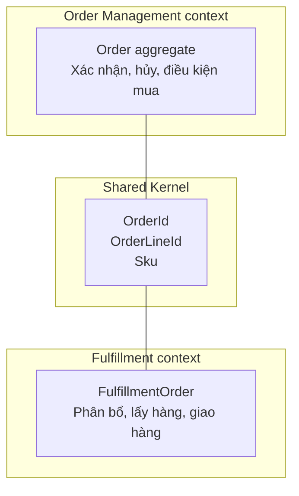

# Shared Kernel: chia sẻ phần mô hình có giới hạn

Trong Domain-Driven Design (DDD), **Shared Kernel** là một phần nhỏ của mô hình miền được hai hoặc nhiều bounded context cùng thống nhất và sử dụng. Các nhóm chia sẻ những khái niệm có cùng ý nghĩa, quy tắc và cách diễn giải, đồng thời cùng chịu trách nhiệm khi phần mô hình đó thay đổi.

Shared Kernel giúp tránh việc nhiều context tự xây dựng những định nghĩa gần giống nhau cho cùng một khái niệm thực sự cần thống nhất. Đổi lại, các nhóm phải phối hợp chặt chẽ hơn: một thay đổi trong phần dùng chung có thể ảnh hưởng đến tất cả context sử dụng nó. Vì vậy, Shared Kernel chỉ phù hợp với phần mô hình nhỏ, ổn định và có giá trị rõ ràng khi được chia sẻ.

## 1. Shared Kernel là gì?

Bounded context có mô hình và ngôn ngữ riêng. Một khái niệm ở context này có thể khác ý nghĩa hoặc có quy tắc khác với khái niệm có tên tương tự ở context khác. Tuy nhiên, đôi khi hai context có một phần khái niệm thực sự giống nhau và cần duy trì cách hiểu thống nhất.

Shared Kernel là phần giao nhau được các nhóm chủ động lựa chọn. Phần này có thể bao gồm:

- Một số khái niệm miền có cùng định nghĩa trong các context.
- Các kiểu định danh hoặc value object có cùng ý nghĩa và bất biến.
- Một phần nhỏ quy tắc hoặc cấu trúc mô hình mà các nhóm cùng cam kết duy trì.
- Mã nguồn hiện thực phần mô hình chung, nếu các nhóm chọn cách dùng chung code.

Ví dụ, Order Management và Fulfillment có thể cùng cần nhận diện một đơn hàng và từng dòng hàng của đơn. Hai context có thể thống nhất dùng `OrderId`, `OrderLineId` và `Sku` với cùng định nghĩa. Đây là phần mô hình nhỏ có thể dùng chung. Nhưng toàn bộ `Order` aggregate không nên tự động được chia sẻ: Order Management quan tâm đến xác nhận, hủy và điều kiện mua; Fulfillment quan tâm đến phân bổ, lấy hàng, đóng gói và giao hàng.

Shared Kernel không xóa bỏ ranh giới bounded context. Mỗi context vẫn sở hữu mô hình và quy tắc riêng ngoài phần giao nhau đã thống nhất.

## 2. Vì sao cần chia sẻ một phần mô hình?

Khi các context có một số khái niệm giống nhau, mỗi nhóm có thể tự định nghĩa lại chúng. Cách này giúp nhóm tự chủ, nhưng nếu hai định nghĩa cần mang cùng một ý nghĩa, chúng có thể dần lệch nhau.

Ví dụ, Order Management gọi một mã đơn là `OrderId`, trong khi Fulfillment gọi là `ShipmentOrderKey` và tự chuyển đổi qua nhiều lớp. Nếu hai tên thực sự đại diện cho cùng một định danh và không có khác biệt ngữ nghĩa, việc duy trì hai định nghĩa có thể tạo thêm mapping, kiểm thử và nguy cơ sai sót.

Shared Kernel có thể đem lại các lợi ích sau:

- **Giảm trùng lặp có ý nghĩa:** tránh duy trì nhiều định nghĩa cho cùng một khái niệm miền.
- **Giữ nhất quán các bất biến chung:** những quy tắc được thống nhất chỉ cần được định nghĩa và kiểm tra tại phần mô hình dùng chung.
- **Làm rõ hợp đồng giữa các nhóm:** các nhóm nhìn thấy phần khái niệm mà họ cùng cam kết sử dụng.
- **Giảm chuyển đổi không cần thiết:** hạn chế mapping giữa những kiểu dữ liệu thực sự có cùng ý nghĩa.

Những lợi ích này chỉ xuất hiện khi khái niệm được chia sẻ thật sự giống nhau. Nếu hai nhóm dùng một từ giống nhau nhưng quy tắc khác nhau, ép chúng dùng chung một lớp chỉ che giấu sự khác biệt và làm mô hình khó hiểu hơn.

## 3. Chọn phần nào để đưa vào Shared Kernel?

Không nên bắt đầu bằng câu hỏi “Có thư viện nào hai nhóm cùng dùng không?”. Hãy bắt đầu bằng việc tìm các khái niệm miền mà hai context cần cùng hiểu và cùng bảo vệ.

Một phần mô hình phù hợp thường có những đặc điểm:

1. **Ý nghĩa giống nhau ở các context.** Các nhóm có thể giải thích khái niệm bằng cùng một định nghĩa và ví dụ.
2. **Quy tắc và bất biến giống nhau.** Không có nhóm nào cần thay đổi ý nghĩa của khái niệm để phục vụ quy trình riêng.
3. **Phạm vi nhỏ và có thể nhận diện.** Nhóm có thể chỉ rõ kiểu dữ liệu, quy tắc và mã nguồn nào thuộc Shared Kernel.
4. **Tương đối ổn định.** Khái niệm không thay đổi liên tục theo chính sách riêng của một context.
5. **Có lợi ích lớn hơn chi phí phối hợp.** Việc dùng chung giúp giảm sai lệch hoặc chi phí duy trì nhiều hơn phần phụ thuộc mà nó tạo ra.

Ví dụ trong hệ thống thương mại:

| Khái niệm | Có nên chia sẻ? | Lý do |
| --- | --- | --- |
| `OrderId` | Có thể | Nếu hai context cùng dùng nó để nhận diện đúng một đơn hàng |
| `OrderLineId` | Có thể | Nếu định danh dòng hàng có cùng ý nghĩa và vòng đời |
| `Sku` | Có thể | Nếu cùng tuân theo một định nghĩa về mã nhận diện mặt hàng |
| `Order` aggregate | Thường không | Mỗi context có hành vi và quy tắc riêng đối với đơn hàng |
| `Quantity` | Cần xem xét | Số lượng đặt mua, số lượng có thể lấy và số lượng đã giao có thể khác ý nghĩa |
| `OrderStatus` | Thường không | Fulfillment có vòng đời thực hiện đơn riêng, không nhất thiết trùng trạng thái đơn hàng |

Không có danh sách loại dữ liệu nào mặc nhiên phải đưa vào Shared Kernel. Ngay cả một kiểu `Money` cũng chỉ nên chia sẻ nếu các context thực sự thống nhất cách biểu diễn, đơn vị tiền tệ, phép toán và quy tắc làm tròn. Nếu chính sách thuế hoặc quy tắc định giá khác nhau, hãy giữ chúng trong context sở hữu.

## 4. Ví dụ: Order Management và Fulfillment

Giả sử một hệ thống thương mại có hai bounded context:

- **Order Management:** quản lý đơn hàng, kiểm tra điều kiện mua, xác nhận hoặc hủy đơn.
- **Fulfillment:** thực hiện đơn đã xác nhận, phân bổ hàng, lấy hàng, đóng gói và giao hàng.

Hai context cùng cần tham chiếu đơn hàng và dòng hàng. Các nhóm thống nhất một Shared Kernel nhỏ gồm `OrderId`, `OrderLineId` và `Sku`. Mỗi context vẫn có mô hình riêng cho quy trình của mình.



Ví dụ về phần kiểu dữ liệu dùng chung trong Java:

```java
package com.example.sharedkernel.order;

import java.util.UUID;

public record OrderId(UUID value) {
    public OrderId {
        if (value == null) {
            throw new IllegalArgumentException("OrderId is required");
        }
    }
}
```

Đây là nội dung của file `OrderId.java`; `OrderLineId` và `Sku` có thể được định nghĩa tương tự trong các file riêng nếu các nhóm thống nhất ý nghĩa và bất biến của chúng. Chỉ đưa quy tắc chuẩn hóa vào kiểu dùng chung khi mọi context đều chấp nhận quy tắc đó.

Order Management có thể dùng `OrderId` trong aggregate `Order`; Fulfillment dùng cùng định danh đó trong `FulfillmentOrder`. Nhưng Fulfillment không cần dùng chung `OrderStatus` hoặc các hành vi `confirm()` và `cancel()` của Order Management. Context này có thể có trạng thái `PENDING_PICKING`, `PICKING`, `PACKED` và `SHIPPED` theo vòng đời thực hiện hàng.

Điều được chia sẻ là một phần ngôn ngữ và mô hình đã thống nhất. Trách nhiệm nghiệp vụ còn lại vẫn thuộc từng context.

## 5. Shared Kernel cần cơ chế sở hữu và thay đổi chung

Vì nhiều context phụ thuộc vào cùng một phần mô hình, không nhóm nào nên tự ý thay đổi Shared Kernel mà không đánh giá tác động đến nhóm còn lại.

Trước khi sử dụng, các nhóm cần thống nhất:

- **Phạm vi:** những khái niệm, quy tắc và file nào thuộc Shared Kernel.
- **Định nghĩa:** ý nghĩa, ví dụ hợp lệ, bất biến và trường hợp biên của từng khái niệm.
- **Quyền thay đổi:** ai có thể đề xuất, ai cần review và cách giải quyết khi các nhóm bất đồng.
- **Kiểm thử:** bộ kiểm thử nào bảo vệ hành vi chung và nhóm nào phải xác nhận khi thay đổi.
- **Phát hành:** cách quản lý phiên bản, tương thích ngược và thời điểm các context nâng cấp.
- **Thông báo:** cách báo trước thay đổi có ảnh hưởng và cách xử lý khi một context chưa thể nâng cấp.

Một quy trình thay đổi có thể gồm các bước:

1. Nhóm đề xuất nêu lý do nghiệp vụ và ví dụ cho thay đổi.
2. Các nhóm đang sử dụng Shared Kernel cùng xem xét tác động lên mô hình và hợp đồng.
3. Cập nhật định nghĩa, mã nguồn và kiểm thử chung.
4. Chạy kiểm thử của Shared Kernel và kiểm thử tích hợp của các context bị ảnh hưởng.
5. Phát hành phiên bản phù hợp và phối hợp nâng cấp.
6. Xác nhận các context vẫn diễn giải khái niệm theo cùng một nghĩa.

Nếu các nhóm không thể thống nhất hoặc một context cần thay đổi quy tắc thường xuyên, đó là tín hiệu nên thu hẹp Shared Kernel hoặc để mỗi context sở hữu mô hình riêng.

## 6. Triển khai Shared Kernel trong mã nguồn

Shared Kernel có thể được tổ chức dưới dạng một package hoặc module dùng chung, một thư viện nội bộ có phiên bản, hoặc một phần mã nguồn được quản lý cùng repository. Lựa chọn phụ thuộc vào cấu trúc build, cách phát hành và mức độ độc lập của các nhóm.

Ví dụ cấu trúc module:

```text
commerce/
├── shared-kernel/
│   └── src/main/java/.../sharedkernel/
│       ├── OrderId.java
│       ├── OrderLineId.java
│       └── Sku.java
├── order-management/
│   └── src/main/java/.../order/
│       ├── Order.java
│       └── OrderRepository.java
└── fulfillment/
    └── src/main/java/.../fulfillment/
        ├── FulfillmentOrder.java
        └── FulfillmentService.java
```

Một số nguyên tắc triển khai:

- Shared Kernel chỉ chứa phần mô hình đã được thống nhất; tránh biến nó thành module `common` chứa mọi thứ tiện dùng.
- Không đưa controller, repository truy cập cơ sở dữ liệu, cấu hình hạ tầng hoặc tiện ích không thuộc mô hình miền vào Shared Kernel chỉ vì nhiều module cần chúng.
- Giữ phụ thuộc một chiều: các context sử dụng phần dùng chung, còn Shared Kernel không phụ thuộc ngược vào context cụ thể.
- Không để một context sửa trực tiếp dữ liệu nội bộ của context khác chỉ vì chúng dùng chung kiểu dữ liệu.
- Nếu dùng thư viện có phiên bản, cần quản lý tương thích và tránh phát hành breaking change bất ngờ.

Trong modular monolith, các module có thể tham chiếu cùng một module Shared Kernel. Trong hệ thống nhiều service, Shared Kernel có thể được đóng gói thành thư viện được các service sử dụng. Tuy nhiên, chia sẻ thư viện không có nghĩa là chia sẻ cơ sở dữ liệu hoặc để các service cùng sở hữu một aggregate.

## 7. Phân biệt Shared Kernel với các quan hệ khác trong context map

Shared Kernel là một lựa chọn trong context mapping. Nó khác với những quan hệ thường gặp khác:

| Quan hệ | Cách phối hợp | Điểm khác với Shared Kernel |
| --- | --- | --- |
| Customer-Supplier | Upstream cung cấp khả năng hoặc dữ liệu; downstream đưa ra nhu cầu | Hai bên phối hợp qua hợp đồng, không nhất thiết dùng chung mô hình nội bộ |
| Conformist | Downstream chấp nhận mô hình của upstream | Downstream đi theo mô hình bên ngoài thay vì cùng định nghĩa một phần mô hình |
| Anti-Corruption Layer | Một context chuyển đổi mô hình bên ngoài sang mô hình của mình | Mục tiêu là bảo vệ mô hình nội bộ khỏi ảnh hưởng không phù hợp |
| Partnership | Các nhóm phối hợp chặt chẽ để đồng bộ thay đổi | Quan hệ cộng tác không đòi hỏi phải chia sẻ code hoặc mô hình |
| Shared Kernel | Các nhóm cùng duy trì một phần mô hình nhỏ | Có sự chia sẻ trực tiếp và phụ thuộc vào thay đổi của phần chung |

Một context có thể dùng nhiều kiểu quan hệ với các context khác nhau. Chẳng hạn, Order Management có thể dùng Shared Kernel với Fulfillment cho một số định danh, đồng thời dùng quan hệ Customer-Supplier với Pricing để nhận báo giá. Hãy chọn quan hệ theo cách các nhóm thực sự cộng tác và theo mức độ chia sẻ mô hình cần thiết.

## 8. Rủi ro khi Shared Kernel mở rộng quá mức

Shared Kernel làm tăng sự phụ thuộc giữa các nhóm. Nếu phạm vi không được kiểm soát, những vấn đề sau có thể xuất hiện:

- **Mô hình chung trở thành nơi chứa mọi thứ.** Các kiểu dữ liệu, enum và tiện ích được thêm vào vì tiện sử dụng, dù chúng không có cùng ý nghĩa miền.
- **Thay đổi nhỏ cũng cần nhiều nhóm phê duyệt.** Nhóm mất khả năng thay đổi độc lập và thời gian phối hợp tăng lên.
- **Quy tắc của một context bị áp đặt lên context khác.** Một kiểu dữ liệu chung chứa các điều kiện chỉ đúng trong một quy trình.
- **Phiên bản thư viện gây khóa phát hành.** Một context không thể nâng cấp vì context khác chưa sẵn sàng.
- **Ranh giới bị xóa mờ.** Các context bắt đầu truy cập class, repository hoặc dữ liệu nội bộ của nhau.
- **Không rõ ai chịu trách nhiệm.** Khi có lỗi, các nhóm tranh luận xem thay đổi thuộc về ai hoặc ai phải sửa.

Khi Shared Kernel có quá nhiều thay đổi hoặc chứa những khái niệm khác nghĩa, hãy xem xét tách phần đó về lại các context. Có thể giữ một hợp đồng tích hợp nhỏ, dùng mapping hoặc công bố sự kiện thay vì chia sẻ mô hình nội bộ.

## 9. Checklist quyết định có nên dùng Shared Kernel

Trước khi đưa một khái niệm vào Shared Kernel, các nhóm có thể kiểm tra:

- Hai context có dùng khái niệm này với cùng ý nghĩa nghiệp vụ không?
- Các quy tắc và bất biến có giống nhau trong cả hai context không?
- Nếu thay đổi định nghĩa, tất cả nhóm có sẵn sàng phối hợp và kiểm thử không?
- Phần chia sẻ có đủ nhỏ để xác định rõ phạm vi và trách nhiệm không?
- Lợi ích giảm trùng lặp và sai lệch có lớn hơn chi phí phụ thuộc không?
- Có thể chia sẻ một định danh hoặc hợp đồng nhỏ hơn thay vì chia sẻ cả mô hình không?

Nếu không trả lời rõ được những câu hỏi này, hãy giữ mô hình riêng ở từng context. Trùng lặp một lượng nhỏ mã chuyển đổi đôi khi rẻ hơn chi phí phối hợp và ràng buộc dài hạn do Shared Kernel tạo ra.

## 10. Nguyên tắc cần ghi nhớ

Shared Kernel chỉ nên chứa phần mô hình nhỏ mà nhiều bounded context thực sự cùng hiểu, cùng sử dụng và cùng có trách nhiệm duy trì. Nó có thể giảm sai lệch và trùng lặp, nhưng đồng thời tạo ra phụ thuộc trực tiếp giữa các nhóm. Muốn dùng hiệu quả, cần thống nhất phạm vi, định nghĩa, quyền thay đổi, kiểm thử và phát hành ngay từ đầu.

Hãy giữ mô hình riêng cho những quy tắc và vòng đời đặc thù của từng context. Chia sẻ đúng phần giao nhau có ý nghĩa, và thu hẹp hoặc loại bỏ Shared Kernel khi chi phí phối hợp vượt quá giá trị mà nó mang lại.
