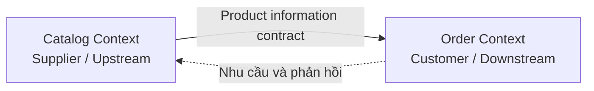
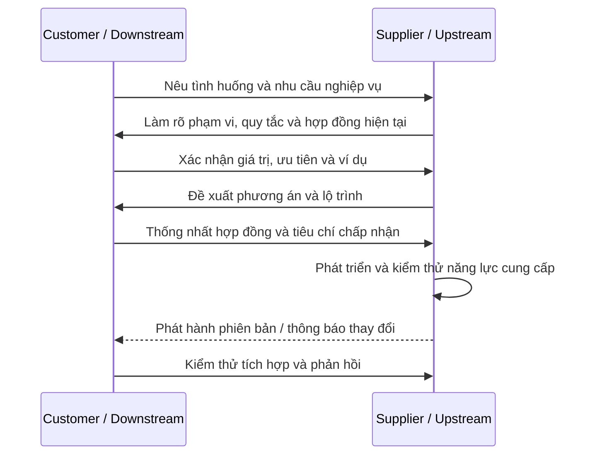

# Customer–Supplier: thương lượng nhu cầu giữa bên cung cấp và bên dùng

Trong Domain-Driven Design (DDD), **Customer–Supplier** là một kiểu quan hệ giữa hai Bounded Context trong đó một bên cung cấp năng lực, dữ liệu hoặc mô hình cho bên còn lại sử dụng. Bên cung cấp được gọi là **upstream (thượng nguồn, Supplier)**; bên sử dụng là **downstream (hạ nguồn, Customer)**. Điểm quan trọng của quan hệ này là hai bên có sự phụ thuộc và cần phối hợp để nhu cầu của bên dùng được cân nhắc trong kế hoạch, hợp đồng và thay đổi của bên cung cấp.

Tên Customer ở đây chỉ vai trò của một ngữ cảnh tiêu thụ đầu ra của ngữ cảnh khác, không nhất thiết là khách hàng mua sản phẩm của doanh nghiệp. Tương tự, Supplier không nhất thiết là nhà cung cấp thương mại bên ngoài. Hai bên có thể là hai đội nội bộ cùng phát triển một hệ thống lớn.

Customer–Supplier giúp làm rõ ai cung cấp, ai tiêu thụ, bên nào có thể ảnh hưởng đến ưu tiên phát triển và cách hai bên thương lượng khi nhu cầu hoặc mô hình thay đổi. Quan hệ này đặc biệt hữu ích khi một Bounded Context cần dựa vào dữ liệu hoặc dịch vụ do một Bounded Context khác sở hữu.

## 1. Customer–Supplier trong Context Map là gì?

**Context Map (bản đồ ngữ cảnh)** mô tả các Bounded Context và quan hệ giữa chúng. Trong một quan hệ Customer–Supplier:

- **Supplier / upstream:** sở hữu mô hình, dữ liệu hoặc năng lực được cung cấp; chịu trách nhiệm phát triển và duy trì đầu ra theo hợp đồng đã thống nhất.
- **Customer / downstream:** phụ thuộc vào đầu ra của Supplier để thực hiện nghiệp vụ của mình; nêu nhu cầu, làm rõ cách sử dụng và kiểm chứng đầu ra có đáp ứng nhu cầu hay không.

Ví dụ, `Catalog Context` sở hữu thông tin sản phẩm và cung cấp dữ liệu sản phẩm cho `Order Context`. Order cần một số thông tin như mã sản phẩm, tên hiển thị và thông tin giá phù hợp với thời điểm đặt hàng. Catalog là upstream vì cung cấp dữ liệu; Order là downstream vì tiêu thụ dữ liệu đó.



Mũi tên liền thể hiện hướng cung cấp dữ liệu hoặc năng lực. Mũi tên nét đứt thể hiện việc downstream đưa nhu cầu và phản hồi để upstream cân nhắc. Đây là quan hệ phối hợp giữa hai nhóm; không phải cứ có một API gọi từ A sang B là đã có Customer–Supplier hiệu quả.

### 1.1. Vì sao cần phân biệt upstream và downstream?

Khi không xác định rõ vai trò, nhóm dễ gặp các tình huống như:

- Downstream chờ một trường dữ liệu mới nhưng không biết đội nào có quyền quyết định thêm trường đó.
- Upstream thay đổi cấu trúc dữ liệu mà không nhận ra các nhóm khác đang phụ thuộc.
- Hai đội tranh luận về lỗi tích hợp nhưng không thống nhất hợp đồng nào là chuẩn.
- Downstream phải liên tục viết mã chuyển đổi hoặc workaround vì nhu cầu không được đưa vào kế hoạch của upstream.
- Upstream nhận nhiều yêu cầu riêng lẻ nhưng không biết nhu cầu nào thực sự quan trọng đối với khách hàng của mình.

Việc gọi tên vai trò giúp nhóm xác định nơi bắt đầu cuộc trao đổi, ai sở hữu quyết định và cơ chế nào cần có để xử lý thay đổi.

### 1.2. Phân biệt khách hàng nghiệp vụ và Customer trong quan hệ này

Một doanh nghiệp có thể có khách hàng mua hàng, nhưng trong Context Map, Customer là vai trò của một Bounded Context tiêu thụ mô hình hoặc dịch vụ từ Bounded Context khác. Ví dụ:

- `Order Context` có thể là Customer của `Catalog Context`.
- `Payment Context` có thể là Customer của `Order Context` nếu cần nhận yêu cầu thanh toán cùng thông tin đơn.
- Một đội nội bộ có thể là Customer của nền tảng dữ liệu do đội khác vận hành.

Do đó, Customer–Supplier mô tả quan hệ phụ thuộc giữa các ngữ cảnh hoặc đội ngũ, không mô tả quan hệ bán hàng giữa doanh nghiệp với người mua cuối cùng.

## 2. Hai bên có trách nhiệm gì?

Customer–Supplier chỉ hoạt động tốt khi cả hai bên chủ động thực hiện trách nhiệm của mình. Downstream không thể chỉ gửi danh sách yêu cầu rồi chờ upstream đoán ý nghĩa; upstream cũng không thể chỉ công bố một mô hình kỹ thuật rồi mặc định downstream phải tự thích nghi.

### 2.1. Trách nhiệm của Supplier (upstream)

Supplier sở hữu mô hình và năng lực mà mình cung cấp. Các trách nhiệm thường gồm:

- Làm rõ dữ liệu, hành vi và giới hạn của năng lực được cung cấp.
- Công bố hợp đồng tích hợp, bao gồm cấu trúc, ngữ nghĩa, lỗi có thể xảy ra và cách thay đổi.
- Hiểu các nhu cầu quan trọng của downstream và cân nhắc chúng trong kế hoạch phát triển.
- Thông báo thay đổi có ảnh hưởng, cung cấp lộ trình chuyển đổi và hỗ trợ kiểm thử khi cần.
- Bảo đảm đầu ra nhất quán với mô hình mà Supplier chịu trách nhiệm.
- Trao đổi khi yêu cầu của downstream mâu thuẫn với quy tắc hoặc mục tiêu của upstream.

Supplier không nhất thiết phải chấp nhận mọi yêu cầu. Supplier cần giải thích tác động và thương lượng phạm vi, thời điểm hoặc cách đáp ứng để tránh làm hỏng mô hình mà mình sở hữu.

### 2.2. Trách nhiệm của Customer (downstream)

Customer sử dụng năng lực của Supplier để giải quyết bài toán riêng. Các trách nhiệm thường gồm:

- Mô tả nhu cầu bằng tình huống nghiệp vụ, không chỉ bằng yêu cầu thêm trường hoặc endpoint.
- Giải thích mức độ ưu tiên, tác động nếu không được đáp ứng và thời điểm cần có.
- Hiểu hợp đồng hiện tại, kiểm tra đầu ra và phản hồi vấn đề bằng ví dụ có thể tái hiện.
- Không giả định rằng dữ liệu nội bộ của Supplier có thể được truy cập hoặc sửa trực tiếp.
- Phối hợp kiểm thử tương thích khi Supplier thay đổi hợp đồng.
- Chịu trách nhiệm ánh xạ dữ liệu sang mô hình nội bộ của mình khi cần.

Downstream cần giữ quyền quyết định về cách sử dụng dữ liệu trong mô hình của mình. Việc phụ thuộc vào Supplier không có nghĩa phải sao chép toàn bộ mô hình của upstream.

### 2.3. Trách nhiệm chung

Hai bên cần thống nhất:

- Mục tiêu nghiệp vụ mà tích hợp hỗ trợ.
- Thuật ngữ và ngữ nghĩa của dữ liệu trao đổi.
- Hợp đồng, quy tắc tương thích và cách thông báo thay đổi.
- Mức độ ưu tiên và lộ trình đáp ứng yêu cầu.
- Cách kiểm thử, xử lý sự cố và giải quyết bất đồng.

Đây là quan hệ cộng tác có sự phụ thuộc. Nếu chỉ một bên hiểu hợp đồng, hoặc hợp đồng chỉ tồn tại trong đầu một vài lập trình viên, rủi ro tích hợp sẽ tăng theo thời gian.

## 3. Thương lượng nhu cầu giữa Customer và Supplier

Từ “thương lượng” trong Customer–Supplier không chỉ nói đến việc mặc cả thời gian hoặc chi phí. Hai bên cần làm rõ nhu cầu, giá trị, ảnh hưởng đến mô hình, khả năng thực hiện và thứ tự ưu tiên.

### 3.1. Downstream trình bày nhu cầu bằng ngữ cảnh nghiệp vụ

Một yêu cầu như “Catalog thêm trường `availableQuantity` vào API” chưa cho Supplier biết vì sao downstream cần dữ liệu đó, số lượng có ý nghĩa gì và có thể thay đổi theo thời điểm nào.

Yêu cầu nên được diễn đạt đầy đủ hơn:

“Khi khách xác nhận đơn, Order cần biết sản phẩm có thể được bán hay không. Số lượng trong kho có thể thay đổi đồng thời do nhiều đơn hàng, vì vậy Order cần một kết quả giữ hàng có hiệu lực trong một khoảng thời gian, thay vì chỉ đọc một con số tồn kho tại thời điểm truy vấn.”

Mô tả này giúp hai bên nhận ra rằng nhu cầu thực sự có thể là một hành vi `reserveInventory()` do Inventory sở hữu, chứ không phải chỉ thêm một trường số lượng vào Catalog.

### 3.2. Supplier đánh giá nhu cầu theo mô hình và năng lực của mình

Supplier cần xem yêu cầu có phù hợp với trách nhiệm và mô hình của mình không. Có thể hỏi:

- Yêu cầu có phản ánh một quy tắc mà Supplier sở hữu không?
- Có khách hàng downstream nào khác cần cùng khả năng không?
- Thêm trường hoặc hành vi mới có làm lộ chi tiết nội bộ không?
- Có ảnh hưởng đến hiệu năng, bảo mật, dữ liệu hoặc khả năng tương thích không?
- Có thể đáp ứng bằng hợp đồng hiện có hoặc một cách diễn đạt khác tốt hơn không?
- Thời điểm nào có thể triển khai mà không gây rủi ro cho các bên đang sử dụng?

Supplier có thể đề xuất giải pháp khác với yêu cầu ban đầu nếu giải pháp đó đáp ứng mục tiêu nghiệp vụ và giữ được tính nhất quán của mô hình.

### 3.3. Đánh giá mức độ ưu tiên và chi phí

Hai bên nên làm rõ giá trị và chi phí của yêu cầu. Một cách trao đổi hữu ích là so sánh:

| Tiêu chí | Câu hỏi |
| --- | --- |
| Giá trị nghiệp vụ | Nếu đáp ứng, quy trình hoặc kết quả nào được cải thiện? |
| Mức độ khẩn cấp | Có mốc kinh doanh, quy định hoặc phụ thuộc nào cần đáp ứng không? |
| Phạm vi ảnh hưởng | Có bao nhiêu luồng và Bounded Context sử dụng khả năng này? |
| Chi phí thay đổi | Cần thay đổi mô hình, dữ liệu, API, kiểm thử và vận hành ở đâu? |
| Rủi ro | Nếu thay đổi sai hoặc chậm, hậu quả là gì? |
| Phương án thay thế | Có thể điều chỉnh quy trình downstream hoặc dùng một hợp đồng hiện tại không? |

Không nên ưu tiên chỉ dựa trên số lượng yêu cầu hoặc tiếng nói của đội lớn hơn. Mức ưu tiên cần dựa trên tác động nghiệp vụ, trách nhiệm của Supplier và ảnh hưởng đến các downstream khác.

### 3.4. Thống nhất kết quả thương lượng

Kết quả có thể là:

- Supplier cam kết cung cấp khả năng mới trong một phiên bản hoặc mốc cụ thể.
- Hai bên thống nhất một giải pháp khác đáp ứng cùng nhu cầu.
- Yêu cầu được chia thành nhiều giai đoạn để giảm rủi ro.
- Downstream thay đổi quy trình hoặc mô hình của mình.
- Yêu cầu được hoãn hoặc từ chối, kèm lý do và phương án thay thế nếu có.

Điều quan trọng là quyết định phải rõ ràng: ai chịu trách nhiệm, hợp đồng thay đổi ra sao, bên nào cần sửa và cách xác nhận kết quả.

## 4. Quyền ảnh hưởng và sự cân bằng trong quan hệ

Tên Customer–Supplier gợi ý rằng downstream có thể tác động đến kế hoạch của upstream, nhưng mức độ ảnh hưởng thực tế phụ thuộc vào quyền kiểm soát và bối cảnh tổ chức.

### 4.1. Khi Customer có ảnh hưởng lớn

Nếu Supplier được xây dựng chủ yếu để phục vụ một downstream quan trọng, Customer có thể có ảnh hưởng đáng kể đến thứ tự ưu tiên. Ví dụ, một nền tảng thanh toán nội bộ được xây để phục vụ hệ thống bán hàng chủ lực; thay đổi ở Order có thể là ưu tiên cao trong kế hoạch của Payment.

Trong tình huống này, Supplier cần chủ động hiểu lộ trình của Customer và đưa nhu cầu vào kế hoạch. Tuy nhiên, Customer vẫn cần tôn trọng trách nhiệm của Supplier đối với mô hình và chất lượng dịch vụ.

### 4.2. Khi Supplier phục vụ nhiều Customer

Một nền tảng danh mục dùng chung có thể phục vụ Order, Search, Recommendation và Reporting. Mỗi downstream có nhu cầu khác nhau. Supplier phải cân bằng các yêu cầu, tránh thiết kế mô hình chỉ tối ưu cho một bên rồi gây khó cho những bên còn lại.

Customer cần mô tả giá trị và phạm vi của yêu cầu để Supplier có thể so sánh với nhu cầu chung. Có thể cần một đại diện sản phẩm hoặc cơ chế quản trị API để quyết định ưu tiên.

### 4.3. Khi Supplier có quyền kiểm soát lớn

Nếu downstream không có nhiều lựa chọn thay thế, Supplier có thể quyết định mô hình và lịch phát hành mà ít cân nhắc nhu cầu của downstream. Downstream thường phải thích nghi, tự xây lớp chuyển đổi hoặc trì hoãn tính năng.

Đây là dấu hiệu quan hệ Customer–Supplier chưa cân bằng. Hai bên có thể cần thương lượng lại mức cam kết, cơ chế tham gia lập kế hoạch, lộ trình thay đổi hoặc xem xét một cách bảo vệ mô hình downstream.

### 4.4. Khi quan hệ không còn phù hợp

Nếu hai bên không thể thống nhất ưu tiên, Supplier liên tục thay đổi hợp đồng hoặc Customer phải phụ thuộc vào các chi tiết nội bộ không ổn định, nhóm nên đánh giá lại kiểu quan hệ trong Context Map. Có thể cần một cơ chế khác như Conformist, Anti-Corruption Layer hoặc Partnership tùy quyền kiểm soát và mức độ cộng tác thực tế.

Không nên gắn nhãn Customer–Supplier chỉ vì một bên gọi API của bên kia. Nhãn cần phản ánh cách hai đội phối hợp và quyền ảnh hưởng đến kế hoạch phát triển.

## 5. Hợp đồng tích hợp giữa hai bên

Customer–Supplier cần một hợp đồng đủ rõ để downstream sử dụng năng lực mà không phải đoán cấu trúc hoặc ngữ nghĩa. Hợp đồng có thể là API, sự kiện, message schema, file trao đổi hoặc một giao diện nội bộ. Công nghệ cụ thể không quyết định bản chất của quan hệ.

### 5.1. Hợp đồng cần mô tả điều gì?

Tùy loại tích hợp, hợp đồng thường cần xác định:

- **Ngữ nghĩa:** mỗi trường, trạng thái, lệnh và sự kiện đại diện cho điều gì.
- **Định dạng:** kiểu dữ liệu, cấu trúc, đơn vị đo, múi giờ, quy tắc mã hóa và trường bắt buộc.
- **Định danh:** cách nhận diện thực thể và cách tham chiếu qua ranh giới.
- **Điều kiện:** tiền đề, bất biến, giới hạn và quy tắc xác thực.
- **Kết quả:** phản hồi thành công, từ chối nghiệp vụ và lỗi kỹ thuật.
- **Thời gian:** thời hạn phản hồi, độ trễ dữ liệu, thời điểm hiệu lực và cách xử lý dữ liệu đến muộn.
- **Tương thích:** cách thêm, bỏ hoặc đổi trường; phiên bản và thời gian hỗ trợ phiên bản cũ.
- **Vận hành:** giới hạn tải, bảo mật, khả năng quan sát, retry và xử lý sự cố.

Hợp đồng tốt phải giúp downstream hiểu được ý nghĩa của dữ liệu, không chỉ biết JSON có những thuộc tính nào.

### 5.2. Ví dụ hợp đồng giữ hàng

Giả sử Order cần yêu cầu Inventory giữ một số lượng sản phẩm. Hợp đồng minh họa có thể là:

```json
{
  "reservationId": "res-123",
  "orderId": "ord-456",
  "items": [
    {
      "productId": "sku-789",
      "quantity": 2
    }
  ],
  "expiresAt": "2026-11-18T10:30:00Z"
}
```

Đầu ra có thể cho biết việc giữ hàng đã được chấp nhận hoặc bị từ chối vì không đủ lượng hàng. Trong hợp đồng thực tế, cần quy định rõ `expiresAt` là thời điểm hết hạn theo UTC, `reservationId` dùng để truy vấn hoặc giải phóng giữ hàng, và yêu cầu lặp có được xử lý idempotent hay không.

Điểm quan trọng là Order không tự đọc hoặc sửa bảng tồn kho của Inventory. Order gửi yêu cầu theo hợp đồng, còn Inventory quyết định có thể giữ hàng hay không vì Inventory sở hữu quy tắc và dữ liệu tồn kho.

### 5.3. Phân biệt hợp đồng công khai và mô hình nội bộ

Supplier không cần công khai toàn bộ Entity, bảng dữ liệu hoặc cấu trúc nội bộ. Hợp đồng chỉ nên cung cấp thông tin và hành vi cần thiết cho downstream. Việc này giúp Supplier thay đổi cách lưu trữ hoặc tổ chức nội bộ mà không buộc mọi Customer thay đổi theo.

Downstream có thể chuyển đổi hợp đồng sang mô hình riêng bằng adapter hoặc lớp ánh xạ. Ví dụ, Inventory trả về `ReservationAccepted`; Order có thể chuyển thành trạng thái nội bộ `WAITING_FOR_PAYMENT` nếu quy tắc của Order yêu cầu thanh toán sau khi giữ hàng.

### 5.4. Kiểm soát thay đổi hợp đồng

Thay đổi hợp đồng cần được xem xét theo mức ảnh hưởng:

- Thêm trường tùy chọn có thể tương thích với downstream hiện tại nếu các bên xử lý đúng trường chưa biết.
- Đổi tên hoặc xóa trường thường là thay đổi phá vỡ tương thích.
- Thay đổi ý nghĩa của một trạng thái có thể nguy hiểm ngay cả khi cấu trúc JSON không đổi.
- Thay đổi thứ tự hoặc thời điểm phát sự kiện có thể làm sai quy trình downstream.

Supplier nên công bố kế hoạch thay đổi và thời hạn hỗ trợ phiên bản cũ. Downstream nên kiểm thử hợp đồng và tránh phụ thuộc vào chi tiết không được cam kết.

## 6. Quy trình phối hợp Customer–Supplier

Một quy trình phối hợp có thể triển khai theo các bước sau:

### Bước 1: Downstream ghi nhận nhu cầu

Customer mô tả tình huống nghiệp vụ, kết quả mong muốn, dữ liệu cần dùng, thời điểm cần có và ảnh hưởng nếu không đáp ứng. Kèm theo ví dụ thực tế hoặc kiểm thử mong đợi.

### Bước 2: Hai bên xác nhận phạm vi sở hữu

Xác định quy tắc nào thuộc Supplier, quy tắc nào thuộc Customer và dữ liệu nào là nguồn sự thật. Nếu yêu cầu liên quan đến quyết định mà Supplier không sở hữu, cần chuyển đúng bên hoặc thiết kế hợp tác với ngữ cảnh có trách nhiệm.

### Bước 3: Cùng phân tích hợp đồng và phương án

Hai bên làm rõ ngữ nghĩa, cách trao đổi, lỗi, tính nhất quán và ảnh hưởng đến các Customer khác. Supplier đề xuất phương án; Customer xác nhận phương án đó đáp ứng tình huống nghiệp vụ.

### Bước 4: Thương lượng ưu tiên và lộ trình

Thống nhất mức ưu tiên, phiên bản, mốc phát hành, khả năng tương thích và nguồn lực cần thiết. Nếu chưa thể đáp ứng, ghi rõ phương án tạm thời và rủi ro.

### Bước 5: Phát triển và kiểm thử hợp đồng

Supplier triển khai thay đổi trong phạm vi của mình. Hai bên dùng ví dụ chung, contract test hoặc môi trường tích hợp để kiểm chứng ngữ nghĩa và hành vi. Downstream kiểm tra khả năng tương thích của mô hình nội bộ.

### Bước 6: Phát hành và theo dõi

Supplier thông báo thay đổi, hướng dẫn nâng cấp và theo dõi lỗi tích hợp. Customer triển khai theo lộ trình, quan sát kết quả và phản hồi các trường hợp chưa được xử lý.

### Bước 7: Rút kinh nghiệm và điều chỉnh quan hệ

Sau một số lần tích hợp, hai bên đánh giá cơ chế thương lượng có hiệu quả không, nhu cầu có được phản hồi đúng mức không và hợp đồng có ổn định không. Nếu cách phối hợp không còn phù hợp, cập nhật Context Map hoặc thỏa thuận vận hành.



Quy trình không nhất thiết cần một cuộc họp riêng cho mỗi yêu cầu. Có thể dùng backlog chung, tài liệu API, contract test và kênh trao đổi kỹ thuật. Điều quan trọng là có nơi ghi nhận quyết định và người chịu trách nhiệm.

## 7. Ví dụ xuyên suốt: Catalog cung cấp dữ liệu cho Order

Giả sử một hệ thống thương mại điện tử có hai Bounded Context:

- `Catalog Context` quản lý thông tin sản phẩm để hiển thị và tìm kiếm.
- `Order Context` quản lý đơn hàng và cần ghi nhận sản phẩm mà khách đã chọn.

Ban đầu Order lấy trực tiếp thông tin từ Catalog, gồm `productId`, tên và giá hiện tại. Khi Catalog cập nhật tên hoặc giá, lịch sử đơn hàng cũ cũng bị hiển thị theo dữ liệu mới. Nhóm phát hiện vấn đề khi bộ phận hỗ trợ cần giải thích số tiền khách đã đồng ý thanh toán tại thời điểm đặt hàng.

### 7.1. Customer nêu nhu cầu

Order là downstream và mô tả tình huống:

“Khi khách đặt hàng, Order cần lưu lại mô tả sản phẩm và giá đã được áp dụng cho giao dịch đó. Sau này Catalog có thể đổi tên, hình ảnh hoặc giá niêm yết, nhưng lịch sử đơn phải phản ánh thông tin tại thời điểm đặt.”

Yêu cầu này cho thấy Order cần một ảnh chụp dữ liệu phù hợp cho giao dịch, chứ không cần Catalog ngừng cập nhật sản phẩm.

### 7.2. Supplier làm rõ trách nhiệm

Catalog xác nhận mình sở hữu thông tin sản phẩm hiện tại, bao gồm tên hiển thị và giá niêm yết. Catalog không sở hữu giá cuối cùng mà Order áp dụng sau khuyến mãi hoặc điều kiện của giao dịch. Hai bên thống nhất hợp đồng cung cấp thông tin cần thiết tại thời điểm tạo đơn.

Order lưu `productId`, tên sản phẩm tại thời điểm đặt và giá giao dịch được xác định theo chính sách Order. Catalog tiếp tục quản lý thông tin hiện tại của sản phẩm.

### 7.3. Thống nhất hợp đồng và mô hình

Hợp đồng có thể cung cấp dữ liệu sản phẩm theo phiên bản hoặc một kết quả báo giá có thời hạn. Hai bên cần làm rõ giá nào do Catalog cung cấp, giá nào do Pricing hoặc Order tính, thời điểm dữ liệu có hiệu lực và cách xử lý khi sản phẩm ngừng bán.

Mô hình Order có thể dùng Value Object như `OrderLineSnapshot` hoặc các thuộc tính bất biến trên `OrderLine` để giữ dữ liệu giao dịch. Catalog không cần biết toàn bộ cấu trúc nội bộ của Order.

### 7.4. Kiểm chứng kết quả

Hai bên thống nhất các trường hợp:

| Tình huống | Kết quả mong đợi |
| --- | --- |
| Khách đặt hàng với giá hiện tại | Order lưu giá được áp dụng cho giao dịch. |
| Catalog đổi tên sản phẩm sau khi đặt | Đơn hàng cũ vẫn hiển thị tên đã ghi nhận tại thời điểm đặt. |
| Catalog thay đổi giá niêm yết | Giá giao dịch của đơn cũ không tự thay đổi. |
| Sản phẩm ngừng bán trước khi đặt | Order không thể tạo đơn hợp lệ cho sản phẩm đó theo chính sách. |

Các ví dụ này có thể trở thành kiểm thử hợp đồng và kiểm thử nghiệp vụ của Order. Kết quả là hai ngữ cảnh có hợp đồng rõ ràng, mỗi bên giữ quyền sở hữu mô hình và dữ liệu của mình.

## 8. Customer–Supplier và các kiểu quan hệ Context Map khác

Customer–Supplier có thể bị nhầm với một số quan hệ khác vì đều mô tả việc một ngữ cảnh phụ thuộc ngữ cảnh khác. Tuy nhiên, điểm khác biệt nằm ở mức độ hợp tác và quyền ảnh hưởng.

| Quan hệ | Đặc điểm chính | Khi nào phù hợp |
| --- | --- | --- |
| **Customer–Supplier** | Downstream nêu nhu cầu và có thể ảnh hưởng đến ưu tiên của upstream; hai bên thương lượng hợp đồng và kế hoạch. | Hai đội có khả năng phối hợp và Supplier có thể cân nhắc nhu cầu của Customer. |
| **Conformist** | Downstream chấp nhận mô hình và hợp đồng của upstream, ít có khả năng tác động đến quyết định của upstream. | Supplier có quyền kiểm soát lớn hoặc là nền tảng bên ngoài mà Customer khó thay đổi. |
| **Partnership** | Hai đội phụ thuộc lẫn nhau và phối hợp chặt để đạt mục tiêu chung; kế hoạch thay đổi cần được đồng bộ. | Hai ngữ cảnh có thể cùng ảnh hưởng đến kết quả và cần điều chỉnh theo nhau. |
| **Anti-Corruption Layer (ACL)** | Downstream tạo lớp chuyển đổi để bảo vệ mô hình nội bộ khỏi mô hình upstream không phù hợp. | Cần tiêu thụ một mô hình bên ngoài nhưng không muốn để mô hình đó chi phối ngôn ngữ nội bộ. |

Các quan hệ này không nhất thiết loại trừ nhau ở mọi cấp độ. Ví dụ, hai đội có thể có cơ chế Customer–Supplier trong lập kế hoạch nhưng downstream vẫn dùng ACL để chuyển đổi mô hình. Tuy nhiên, khi vẽ Context Map, cần mô tả đúng quan hệ chi phối giữa hai ngữ cảnh thay vì gắn nhiều nhãn mà không giải thích.

## 9. Rủi ro và cách xử lý khi phối hợp không hiệu quả

### 9.1. Supplier không phản hồi nhu cầu của Customer

Downstream liên tục gửi yêu cầu nhưng không biết yêu cầu có được xem xét hay không. Hai bên nên thống nhất kênh tiếp nhận, người quyết định, tiêu chí ưu tiên và cách thông báo khi từ chối hoặc trì hoãn. Nếu Supplier không thể phục vụ nhu cầu riêng, downstream cần đánh giá mức độ phụ thuộc và phương án bảo vệ mô hình.

### 9.2. Customer yêu cầu chi tiết nội bộ

Downstream có thể yêu cầu truy cập bảng dữ liệu, trường nội bộ hoặc trạng thái kỹ thuật của Supplier. Supplier nên hỏi mục tiêu nghiệp vụ phía sau yêu cầu và cung cấp một hợp đồng ổn định phù hợp hơn. Hợp đồng không nên biến chi tiết triển khai thành cam kết công khai nếu downstream không thực sự cần.

### 9.3. Hợp đồng thay đổi mà không thông báo

Một thay đổi nhỏ về ngữ nghĩa có thể làm downstream xử lý sai dù API vẫn trả mã HTTP thành công. Hai bên cần versioning hoặc chính sách tương thích, thông báo trước, contract test và thời gian chuyển đổi.

### 9.4. Downstream phụ thuộc vào nhiều Supplier

Một ngữ cảnh có thể tiêu thụ dữ liệu từ nhiều upstream. Khi các nguồn cung cấp có độ trễ hoặc định nghĩa khác nhau, downstream cần xác định nguồn sự thật cho từng khái niệm, cách hợp nhất dữ liệu và cách xử lý khi một nguồn không sẵn sàng.

### 9.5. Supplier có nhiều Customer với nhu cầu xung đột

Supplier cần tránh thêm mọi yêu cầu thành một mô hình chung phức tạp. Có thể cung cấp một hợp đồng lõi ổn định và các khả năng mở rộng có kiểm soát. Nếu nhu cầu thực sự thuộc các miền khác nhau, cần đánh giá việc tách mô hình hoặc Bounded Context.

### 9.6. Không có người chịu trách nhiệm cho quyết định

Khi hai bên cùng tham gia nhưng không ai có quyền chốt ngữ nghĩa hoặc lịch thay đổi, quyết định dễ bị trì hoãn. Cần xác định người sở hữu mô hình, người phê duyệt hợp đồng và người chịu trách nhiệm cho mỗi lần phát hành.

## 10. Checklist thiết lập quan hệ Customer–Supplier

Trước khi đưa một quan hệ vào Context Map hoặc thay đổi hợp đồng, nhóm có thể kiểm tra:

- [ ] Đã xác định rõ Bounded Context upstream và downstream.
- [ ] Đã mô tả năng lực hoặc dữ liệu mà Supplier cung cấp.
- [ ] Đã làm rõ nhu cầu nghiệp vụ và tình huống sử dụng của Customer.
- [ ] Hai bên hiểu ai sở hữu dữ liệu và quy tắc liên quan.
- [ ] Ngữ nghĩa của các trường, trạng thái, lệnh và sự kiện đã được thống nhất.
- [ ] Hợp đồng nêu rõ lỗi, điều kiện, thời gian và khả năng tương thích.
- [ ] Có cơ chế để Customer nêu nhu cầu và ảnh hưởng đến ưu tiên của Supplier.
- [ ] Có cách đánh giá yêu cầu xung đột giữa nhiều Customer.
- [ ] Có kế hoạch thông báo, kiểm thử và chuyển đổi khi hợp đồng thay đổi.
- [ ] Có người chịu trách nhiệm cho quyết định và xử lý sự cố.
- [ ] Context Map phản ánh đúng quan hệ phối hợp thực tế.

Checklist là điểm bắt đầu cho cuộc trao đổi. Một quan hệ chỉ thực sự hiệu quả khi hai bên duy trì được sự minh bạch về nhu cầu, quyền sở hữu, cam kết và thay đổi.

## 11. Kết luận

Customer–Supplier mô tả quan hệ giữa một Bounded Context cung cấp năng lực và một Bounded Context sử dụng năng lực đó. Supplier là upstream, sở hữu mô hình và hợp đồng cung cấp; Customer là downstream, diễn đạt nhu cầu và kiểm chứng đầu ra trong nghiệp vụ của mình. Hai bên cần thương lượng về giá trị, phạm vi, ưu tiên, hợp đồng và lộ trình thay đổi.

Quan hệ này hiệu quả khi nhu cầu của downstream được cân nhắc, upstream giữ được tính nhất quán của mô hình và cả hai hiểu rõ trách nhiệm của mình. Context Map vì thế không chỉ là sơ đồ các mũi tên phụ thuộc; nó còn thể hiện cách các đội phối hợp và quản lý thay đổi. Khi quyền ảnh hưởng hoặc mức độ cộng tác thay đổi, nhóm cần đánh giá lại quan hệ Customer–Supplier và lựa chọn cách bảo vệ mô hình phù hợp.
