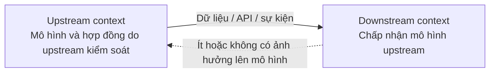
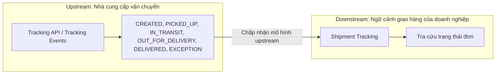

# Conformist: chấp nhận mô hình của ngữ cảnh thượng nguồn

Trong một hệ thống có nhiều bounded context, không phải lúc nào hai đội cũng có thể cùng thiết kế hợp đồng tích hợp theo nhu cầu của cả hai bên. Có trường hợp một đội phụ thuộc vào dữ liệu hoặc dịch vụ do đội khác cung cấp, nhưng không có đủ quyền thương lượng để yêu cầu thay đổi mô hình. Khi đó, đội tiêu thụ có thể chọn **Conformist**: chấp nhận mô hình và ngôn ngữ của ngữ cảnh thượng nguồn, rồi tổ chức phần mềm của mình theo cách biểu diễn ấy.

Trong Domain-Driven Design (DDD), Conformist là một kiểu quan hệ giữa các bounded context được thể hiện trên context map. Nó mô tả sự phụ thuộc về mô hình và khả năng ảnh hưởng giữa các bên. Đội downstream giảm chi phí chuyển đổi và có thể tích hợp nhanh, nhưng phải chấp nhận những khái niệm, cấu trúc và thay đổi do upstream quyết định.

Ví dụ, một doanh nghiệp dùng nền tảng vận chuyển của nhà cung cấp. Nhà cung cấp định nghĩa các trạng thái `CREATED`, `PICKED_UP`, `IN_TRANSIT`, `DELIVERED` và `EXCEPTION`. Đội vận hành của doanh nghiệp có thể dùng chính những trạng thái đó trong mô hình theo dõi giao hàng vì không thể yêu cầu nhà cung cấp thay đổi API. Đây là lựa chọn Conformist nếu mô hình bên ngoài được chấp nhận trực tiếp trong ngữ cảnh tiêu thụ.

Conformist không phải lựa chọn mặc định cho mọi tích hợp. Đội cần hiểu lợi ích ngắn hạn, chi phí phụ thuộc dài hạn và những điều kiện khiến việc chấp nhận mô hình bên ngoài trở nên hợp lý.

## Sau bài học này

Bạn có thể:

- Giải thích Conformist và vai trò của upstream, downstream trong context map.
- Phân biệt Conformist với Customer-Supplier, Partnership và Anti-Corruption Layer.
- Nhận diện khi nào đội downstream có lý do thực tế để chấp nhận mô hình upstream.
- Phân tích lợi ích, rủi ro và chi phí phụ thuộc của quan hệ Conformist.
- Tổ chức mã nguồn, hợp đồng và kiểm thử để kiểm soát ảnh hưởng từ upstream.
- Xây dựng lộ trình khi mô hình upstream thay đổi hoặc khi downstream cần giành lại quyền tự chủ.

## 1. Conformist là gì?

**Conformist (bên tuân theo mô hình thượng nguồn)** là quan hệ trong đó bounded context downstream chấp nhận mô hình, ngôn ngữ và hợp đồng do bounded context upstream cung cấp. Downstream không duy trì một mô hình miền độc lập được bảo vệ đầy đủ khỏi ảnh hưởng của upstream; nó điều chỉnh cách biểu diễn của mình để phù hợp với bên cung cấp.

Hai vai trò trong quan hệ:

- **Upstream (thượng nguồn):** context cung cấp dữ liệu, khả năng hoặc dịch vụ mà context khác phụ thuộc. Upstream có quyền kiểm soát mô hình và thường quyết định cách thay đổi nó.
- **Downstream (hạ nguồn):** context tiêu thụ dữ liệu hoặc dịch vụ từ upstream. Downstream chịu tác động khi mô hình, hợp đồng hoặc cách vận hành của upstream thay đổi.

Sơ đồ khái quát:



Điểm cốt lõi không nằm ở việc hai hệ thống có gọi API hay dùng chung thư viện hay không. Điều quan trọng là downstream chấp nhận cách upstream định nghĩa các khái niệm và không có một lớp dịch miền nhằm bảo vệ mô hình riêng khỏi ngôn ngữ upstream.

### Vì sao một đội chọn Conformist?

Một số tình huống thường gặp:

- Upstream là nhà cung cấp SaaS hoặc dịch vụ bên thứ ba, không cho phép khách hàng tùy chỉnh mô hình.
- Upstream là hệ thống cũ do một tổ chức hoặc bộ phận khác quản lý; downstream không có quyền yêu cầu thay đổi.
- Upstream là nền tảng dùng chung trong doanh nghiệp và đã trở thành nguồn dữ liệu chuẩn.
- Chi phí xây dựng và duy trì một mô hình dịch riêng lớn hơn lợi ích của việc giữ mô hình độc lập.
- Nghiệp vụ downstream đủ gần với mô hình upstream, nên việc chấp nhận mô hình không làm sai lệch các quy tắc quan trọng.
- Đội cần tích hợp nhanh và chấp nhận một mức phụ thuộc có thể kiểm soát.

Conformist có thể là quyết định thực dụng. Tuy nhiên, quyết định đó nên được đưa ra sau khi đánh giá mức độ phù hợp của mô hình upstream, tầm quan trọng của miền nghiệp vụ và khả năng thay đổi nhà cung cấp hoặc hệ thống nguồn.

## 2. Conformist khác gì Customer-Supplier?

Conformist và Customer-Supplier đều có upstream và downstream, nhưng khác nhau ở mức độ ảnh hưởng của bên tiêu thụ.

Trong quan hệ **Customer-Supplier**, downstream là khách hàng của upstream theo nghĩa tổ chức: downstream có thể nêu nhu cầu, thương lượng ưu tiên hoặc tham gia thống nhất kế hoạch thay đổi. Upstream vẫn cung cấp khả năng, nhưng có cơ chế phối hợp để cân nhắc nhu cầu của downstream.

Trong quan hệ **Conformist**, downstream chấp nhận mô hình upstream vì ít có khả năng tác động đến nó. Upstream không có động lực hoặc nghĩa vụ điều chỉnh mô hình để phù hợp với nhu cầu riêng của downstream.

| Tiêu chí | Customer-Supplier | Conformist |
| --- | --- | --- |
| Quyền ảnh hưởng của downstream | Có thể nêu nhu cầu và thương lượng ưu tiên | Rất hạn chế hoặc không có |
| Quyết định mô hình | Upstream kiểm soát, nhưng có phối hợp với downstream | Chủ yếu do upstream quyết định |
| Cách xử lý khác biệt | Hai bên có thể điều chỉnh hợp đồng qua trao đổi | Downstream điều chỉnh theo mô hình upstream |
| Chi phí chính | Phối hợp, lập kế hoạch và duy trì hợp đồng | Phụ thuộc, thích nghi và xử lý thay đổi từ upstream |
| Ví dụ | Hai đội nội bộ thống nhất API theo nhu cầu của cả hai | Ứng dụng phải dùng schema cố định của nhà cung cấp bên ngoài |

Không nên gọi một quan hệ là Customer-Supplier chỉ vì có API request/response hoặc có hợp đồng dịch vụ. Cần xem downstream có khả năng ảnh hưởng đến ưu tiên và cách upstream cung cấp khả năng hay không.

## 3. Conformist khác gì Anti-Corruption Layer?

**Anti-Corruption Layer (ACL)** là một lớp chuyển đổi giúp bảo vệ mô hình của downstream khỏi mô hình upstream. ACL dịch ngôn ngữ, cấu trúc và quy tắc bên ngoài thành mô hình nội bộ phù hợp với bounded context downstream.

Conformist chọn hướng ngược lại: downstream chấp nhận mô hình upstream và dùng nó trong ngữ cảnh của mình. Vì vậy, hai lựa chọn thể hiện hai mức độ tự chủ khác nhau.

| Khía cạnh | Conformist | ACL |
| --- | --- | --- |
| Mô hình downstream | Chấp nhận và sử dụng mô hình upstream | Giữ mô hình nội bộ riêng |
| Vai trò chuyển đổi | Ít hoặc không dịch ngữ nghĩa miền | Dịch rõ ràng ở ranh giới tích hợp |
| Mức phụ thuộc | Cao hơn vào tên gọi, cấu trúc và thay đổi upstream | Giảm phụ thuộc ngữ nghĩa; vẫn phụ thuộc vào hợp đồng kỹ thuật bên ngoài |
| Chi phí ban đầu | Thường thấp hơn | Cao hơn do phải thiết kế và duy trì mapping |
| Khả năng giữ ngôn ngữ riêng | Hạn chế | Tốt hơn |
| Phù hợp khi | Mô hình upstream đủ phù hợp và chi phí phụ thuộc chấp nhận được | Mô hình upstream khác biệt, không phù hợp hoặc có nguy cơ làm sai lệch miền downstream |

Ví dụ, nhà cung cấp vận chuyển dùng trạng thái `IN_TRANSIT`. Nếu doanh nghiệp cũng dùng `IN_TRANSIT` và chấp nhận đúng ý nghĩa, downstream có thể theo Conformist. Nếu doanh nghiệp cần phân biệt “đã rời kho”, “đang trung chuyển” và “đang giao đến người nhận”, nhưng nhà cung cấp gộp tất cả vào `IN_TRANSIT`, một ACL có thể chuyển trạng thái chung thành các khái niệm nội bộ dựa trên dữ liệu bổ sung hoặc quy tắc riêng.

Một adapter kỹ thuật không tự động là ACL. Adapter có thể chỉ chuyển HTTP response thành object, đổi định dạng ngày hoặc xử lý xác thực trong khi vẫn giữ nguyên ý nghĩa và mô hình upstream. Khi lớp chuyển đổi bắt đầu bảo vệ ngôn ngữ miền bằng cách ánh xạ khái niệm upstream sang khái niệm riêng, thiết kế đã tiến về ACL.

## 4. Lợi ích của Conformist

### Tích hợp nhanh và ít chi phí chuyển đổi

Downstream không cần thiết kế một mô hình miền thay thế, duy trì bảng ánh xạ lớn hoặc giải quyết mọi khác biệt thuật ngữ. Đội có thể dùng trực tiếp schema, enum và quy tắc mà upstream công bố.

Điều này đặc biệt hữu ích khi tích hợp dịch vụ phổ biến, miền không phải năng lực cạnh tranh cốt lõi hoặc chức năng có phạm vi hẹp. Ví dụ, một ứng dụng nội bộ có thể chấp nhận mô hình xác thực của nền tảng danh tính dùng chung thay vì xây dựng một miền quản lý danh tính riêng.

### Giảm nguy cơ hiểu sai do dịch không cần thiết

Nếu mô hình upstream đã phù hợp với nghiệp vụ downstream, việc tạo thêm lớp dịch có thể chỉ làm tăng số lượng khái niệm và lỗi mapping. Chấp nhận mô hình chung giúp hai bên trao đổi trực tiếp bằng cùng thuật ngữ.

### Tận dụng năng lực và quy trình có sẵn

Downstream có thể dựa vào quy tắc, dữ liệu chuẩn và vận hành của upstream. Đội không phải tái xây dựng những khả năng đã được quản lý ở nơi khác, miễn là trách nhiệm và giới hạn của nguồn đó được hiểu rõ.

### Giảm số lượng mô hình phải duy trì

Khi khác biệt ngữ nghĩa không đáng kể, một mô hình được chấp nhận chung có thể đơn giản hóa code, tài liệu và kiểm thử. Đội có thêm thời gian tập trung vào phần nghiệp vụ tạo giá trị riêng.

## 5. Rủi ro và chi phí của Conformist

Lợi ích ban đầu thường đi cùng sự phụ thuộc dài hạn. Trước khi chọn Conformist, đội cần nhìn rõ những rủi ro sau.

### Mô hình upstream có thể làm sai lệch ngôn ngữ downstream

Upstream được thiết kế cho mục tiêu riêng. Một trường hoặc trạng thái phù hợp với upstream có thể không diễn đạt đúng nghiệp vụ downstream. Nếu downstream dùng nguyên mô hình đó, các quy tắc nội bộ có thể trở nên khó hiểu hoặc bị bóp méo.

Ví dụ, nhà cung cấp dùng `CANCELLED` cho cả trường hợp người mua hủy và nhà vận chuyển từ chối nhận kiện. Doanh nghiệp cần phân biệt hai nguyên nhân vì chính sách hoàn tiền khác nhau. Nếu downstream dùng một trạng thái `CANCELLED` mà không giữ được nguyên nhân, mô hình sẽ mất thông tin quan trọng.

### Thay đổi upstream có thể lan vào nhiều phần của hệ thống

Nếu tên enum, trường dữ liệu hoặc trạng thái upstream xuất hiện trực tiếp trong domain model, API nội bộ, cơ sở dữ liệu và kiểm thử, một thay đổi nhỏ từ upstream có thể tạo ra đợt sửa đổi lớn.

### Downstream bị giới hạn bởi quyết định của upstream

Upstream có thể bỏ một trường, thay đổi quy tắc hoặc ngừng hỗ trợ một phiên bản. Downstream phải thích nghi theo thời hạn và lộ trình của upstream. Điều này làm giảm khả năng tự chủ và có thể ảnh hưởng đến kế hoạch phát hành của đội.

### Mô hình phụ thuộc có thể lan rộng ngoài ranh giới tích hợp

Nếu các kiểu dữ liệu của nhà cung cấp được dùng trong mọi module, việc thay nhà cung cấp hoặc nâng phiên bản sẽ khó khăn. Mã nghiệp vụ có thể biết quá nhiều về schema, lỗi và quy ước kỹ thuật của hệ thống ngoài.

### Khó thay thế upstream

Khi mô hình upstream đã trở thành ngôn ngữ nội bộ, chi phí chuyển sang nhà cung cấp khác có thể cao. Đội không chỉ thay endpoint mà còn phải chuyển đổi dữ liệu, trạng thái, báo cáo, kiểm thử và cách nhân viên vận hành hiểu hệ thống.

### Chất lượng và độ sẵn sàng của dữ liệu phụ thuộc upstream

Downstream có thể phải chấp nhận dữ liệu thiếu, độ trễ, mã lỗi hoặc cách xử lý không phù hợp. Nếu không có quy tắc xử lý, lỗi của upstream có thể làm hỏng quy trình downstream.

## 6. Ví dụ xuyên suốt: doanh nghiệp chấp nhận mô hình của nhà cung cấp vận chuyển

Giả sử doanh nghiệp bán hàng trực tuyến sử dụng dịch vụ vận chuyển bên ngoài. Nhà cung cấp quản lý trạng thái kiện hàng và công bố API:

| Mã trạng thái upstream | Ý nghĩa do nhà cung cấp mô tả |
| --- | --- |
| `CREATED` | Đã tạo yêu cầu giao hàng |
| `PICKED_UP` | Đơn vị vận chuyển đã nhận kiện |
| `IN_TRANSIT` | Kiện đang di chuyển trong mạng lưới vận chuyển |
| `OUT_FOR_DELIVERY` | Kiện đang được giao đến người nhận |
| `DELIVERED` | Đã giao thành công |
| `EXCEPTION` | Có sự cố cần xử lý |

Đội doanh nghiệp xác định các trạng thái này đủ phù hợp với nghiệp vụ theo dõi giao hàng. Doanh nghiệp không cần quản lý một quy trình vận chuyển riêng phức tạp và không thể yêu cầu nhà cung cấp đổi schema. Đội chọn Conformist và chấp nhận các trạng thái trên trong mô hình theo dõi.

Context map ở mức khái niệm:



### Mô hình và mã nguồn downstream

Vì downstream chọn Conformist, enum nội bộ có thể dùng cùng các giá trị và ý nghĩa của upstream:

```java
public enum CarrierTrackingStatus {
    CREATED,
    PICKED_UP,
    IN_TRANSIT,
    OUT_FOR_DELIVERY,
    DELIVERED,
    EXCEPTION
}

public record CarrierTrackingUpdate(
    String trackingNumber,
    CarrierTrackingStatus status,
    Instant occurredAt,
    String exceptionCode
) {}
```

Ứng dụng có thể nhận webhook hoặc gọi API rồi cập nhật trạng thái theo mô hình đã chấp nhận. Tên và ý nghĩa trạng thái được dùng trong code, kiểm thử và tài liệu vận hành. Nếu nhà cung cấp có tài liệu định nghĩa `EXCEPTION`, downstream cần tuân theo định nghĩa đó và không tự hiểu nó là “giao thất bại” trong mọi trường hợp.

Ví dụ xử lý rút gọn:

```java
public final class ShipmentTracking {
    private CarrierTrackingStatus status;

    public void apply(CarrierTrackingUpdate update) {
        this.status = update.status();
    }

    public CarrierTrackingStatus status() {
        return status;
    }
}
```

Đây chỉ minh họa việc dùng mô hình upstream. Hệ thống thực tế còn cần xác minh tracking number thuộc shipment nào, xác thực webhook, kiểm tra thứ tự sự kiện, xử lý thông điệp trùng lặp, lưu thời điểm nhận và thời điểm phát sinh, cũng như quyết định cách xử lý trạng thái không nhận diện.

### Điều gì xảy ra khi nhà cung cấp thêm trạng thái?

Giả sử upstream bổ sung `RETURNING_TO_SENDER`. Downstream cần:

1. Đọc định nghĩa và thời điểm áp dụng của trạng thái mới.
2. Xác định phiên bản API hoặc webhook nào có thể gửi trạng thái đó.
3. Cập nhật enum, xử lý, giao diện, kiểm thử và hướng dẫn vận hành.
4. Kiểm tra các phiên bản ứng dụng cũ có thể nhận giá trị mới hay không.
5. Xác định cách xử lý nếu trạng thái xuất hiện trước khi downstream được nâng cấp.

Nếu hệ thống deserialize trực tiếp một enum Java và gặp giá trị không tồn tại, quá trình xử lý có thể thất bại. Có thể dùng DTO ở ranh giới với trường trạng thái dạng chuỗi, sau đó kiểm tra và chuyển sang kiểu nội bộ đã chấp nhận. Đây là biện pháp chống lỗi kỹ thuật; nó chưa phải ACL nếu downstream vẫn dùng nguyên ngữ nghĩa của nhà cung cấp.

Ví dụ:

```java
public record CarrierWebhookPayload(
    String trackingNumber,
    String status,
    String occurredAt
) {}

public CarrierTrackingStatus parseStatus(String rawStatus) {
    try {
        return CarrierTrackingStatus.valueOf(rawStatus);
    } catch (IllegalArgumentException ex) {
        throw new UnsupportedCarrierStatusException(rawStatus, ex);
    }
}
```

Việc ném lỗi, cách lưu thông điệp chưa xử lý và quy trình cập nhật enum cần được quyết định theo yêu cầu vận hành. Không nên tự động ánh xạ trạng thái lạ thành `DELIVERED` hoặc một trạng thái thành công mặc định.

## 7. Tổ chức mã nguồn để kiểm soát phụ thuộc

Chọn Conformist không có nghĩa phải để mọi chi tiết kỹ thuật của upstream lan khắp hệ thống. Đội có thể chấp nhận mô hình miền của upstream nhưng vẫn giới hạn nơi phụ thuộc vào giao thức, SDK và cách xác thực.

Một cấu trúc module có thể là:

```text
shipping/
  application/
    UpdateShipmentTracking.java
  domain/
    ShipmentTracking.java
    CarrierTrackingStatus.java
  infrastructure/
    carrier/
      CarrierClient.java
      CarrierWebhookController.java
      CarrierPayload.java
```

Trong ví dụ này:

- `CarrierPayload` biểu diễn cấu trúc nhận từ API hoặc webhook.
- `CarrierClient` và controller xử lý giao tiếp, xác thực, retry và chuyển đổi định dạng kỹ thuật.
- `CarrierTrackingStatus` chấp nhận trực tiếp ngôn ngữ trạng thái của nhà cung cấp theo quyết định Conformist.
- Application service điều phối việc cập nhật shipment.

Ranh giới infrastructure giúp giới hạn phụ thuộc vào SDK và giao thức. Tuy nhiên, vì domain vẫn dùng trạng thái của upstream, khi ý nghĩa nghiệp vụ upstream thay đổi, downstream vẫn phải đánh giá và thích nghi.

Nếu đội quyết định chuyển sang ACL, lúc đó có thể giới thiệu mô hình nội bộ riêng, chẳng hạn `DeliveryProgress`, rồi ánh xạ `IN_TRANSIT` của nhà cung cấp sang một hoặc nhiều trạng thái nội bộ. Đó là thay đổi chiến lược về quan hệ giữa hai context, không chỉ là di chuyển một class.

## 8. Kiểm soát thay đổi từ upstream

Conformist cần một quy trình tiếp nhận thay đổi có kỷ luật vì downstream không kiểm soát nguồn thay đổi.

### Theo dõi hợp đồng và phiên bản

Đội cần biết upstream công bố phiên bản nào, thời hạn hỗ trợ, chính sách ngừng phiên bản và quy tắc tương thích. Với API, cần theo dõi schema, enum, mã lỗi, quy tắc xác thực và giới hạn tốc độ. Với event, cần theo dõi schema, thứ tự, khả năng gửi lặp và chính sách lưu giữ.

Không nên chỉ dựa vào thông báo phát hành. Có thể dùng contract test hoặc schema validation để phát hiện thay đổi trước khi đưa vào môi trường production. Những kiểm thử này nên dựa trên hợp đồng chính thức hoặc ví dụ đã được upstream xác nhận.

### Xử lý trường và trạng thái mới

Một trường mới có thể là optional, bắt buộc hoặc chỉ xuất hiện trong một phiên bản. Một enum mới có thể biểu thị trạng thái trung gian hoặc ngoại lệ. Downstream cần quy định rõ:

- Giá trị nào được chấp nhận?
- Giá trị chưa biết được lưu, cách ly hay từ chối?
- Có thể tiếp tục xử lý một phần hay phải chờ cập nhật?
- Ai nhận cảnh báo và ai quyết định cách thích nghi?

Không nên bỏ qua giá trị lạ một cách im lặng nếu nó có thể làm sai trạng thái nghiệp vụ. Cũng không nên làm hỏng toàn bộ luồng nếu có thể lưu thông điệp vào vùng cách ly và xử lý sau một cách an toàn.

### Kiểm soát thay đổi phá vỡ tương thích

Nếu upstream đổi tên hoặc xóa trường, downstream cần lập kế hoạch chuyển đổi. Một quy trình thường gặp:

1. Đánh giá thay đổi và xác định phần code, dữ liệu, báo cáo, consumer bị ảnh hưởng.
2. Cập nhật client hoặc DTO để hỗ trợ phiên bản mới.
3. Kiểm thử song song với phiên bản hiện tại nếu upstream cho phép.
4. Triển khai theo lịch và theo dõi lỗi tích hợp.
5. Ngừng dùng phiên bản cũ trước hạn upstream công bố.

Nếu upstream không cung cấp giai đoạn tương thích, đội cần chuẩn bị thời gian nâng cấp, phương án rollback và xử lý dữ liệu phát sinh trong thời gian chuyển đổi.

### Quan sát vận hành

Nên theo dõi tỷ lệ lỗi API, độ trễ webhook, số lượng trạng thái chưa nhận diện, thông điệp bị cách ly, số lần retry và thời điểm đồng bộ cuối cùng. Những chỉ số này giúp phát hiện khi mô hình upstream thay đổi hoặc upstream không còn đáp ứng hợp đồng đã thống nhất.

## 9. Khi nào nên chọn hoặc tránh Conformist?

Conformist thường phù hợp khi:

- Mô hình upstream phản ánh đủ tốt nghiệp vụ downstream.
- Downstream không có khả năng thương lượng hoặc thay đổi upstream.
- Miền tích hợp không phải nơi tạo lợi thế cạnh tranh quan trọng.
- Chi phí ACL và duy trì hai mô hình lớn hơn lợi ích của sự độc lập.
- Upstream có hợp đồng tương đối ổn định, tài liệu tốt và lịch thay đổi có thể theo dõi.
- Có thể giới hạn phạm vi phụ thuộc và xử lý thay đổi với chi phí chấp nhận được.

Nên cân nhắc ACL hoặc thay đổi quan hệ khi:

- Mô hình upstream không diễn đạt đúng các khái niệm cốt lõi của downstream.
- Các trạng thái hoặc quy tắc upstream gộp những khác biệt quan trọng với nghiệp vụ nội bộ.
- Downstream cần phát triển nhanh và độc lập trong miền có giá trị chiến lược.
- Upstream thay đổi thường xuyên hoặc có chất lượng hợp đồng thấp.
- Việc thay nhà cung cấp trong tương lai là yêu cầu có khả năng xảy ra.
- Tên gọi và kiểu dữ liệu upstream đã lan vào quá nhiều phần của domain model.

Không nên tự động dựng ACL cho mọi tích hợp. Nếu mô hình upstream phù hợp, một lớp dịch phức tạp có thể tạo chi phí mà không bảo vệ được giá trị đáng kể. Ngược lại, nếu mô hình không phù hợp, chấp nhận nó chỉ để tiết kiệm vài dòng mapping có thể khiến chi phí sửa chữa về sau lớn hơn.

### Bảng quyết định nhanh

| Câu hỏi | Nếu câu trả lời là “có” | Gợi ý |
| --- | --- | --- |
| Mô hình upstream có đúng ý nghĩa nghiệp vụ downstream? | Có | Conformist có thể hợp lý. |
| Downstream có thể thương lượng ưu tiên với upstream? | Có | Xem xét Customer-Supplier. |
| Hai đội cùng kiểm soát một phần mô hình nhỏ? | Có | Cân nhắc Shared Kernel. |
| Mô hình upstream khác biệt hoặc làm sai lệch miền nội bộ? | Có | Cân nhắc ACL. |
| Hai phần nghiệp vụ hầu như không cần tích hợp? | Có | Cân nhắc Separate Ways. |

## 10. Chuyển từ Conformist sang ACL khi cần tự chủ hơn

Một quan hệ Conformist có thể phù hợp ở giai đoạn đầu nhưng không còn phù hợp khi nghiệp vụ downstream phát triển. Chẳng hạn, doanh nghiệp ban đầu chỉ hiển thị trạng thái của hãng vận chuyển. Sau này, doanh nghiệp cần phân tích nguyên nhân giao thất bại, điều phối giao nhiều lần và áp dụng chính sách hoàn tiền riêng. Mô hình trạng thái của nhà cung cấp có thể không còn đủ để diễn đạt quy tắc nội bộ.

Khi đó, đội có thể chuyển dần sang ACL:

1. Xác định những khái niệm nội bộ cần có ý nghĩa khác với upstream.
2. Thiết kế mô hình miền downstream dựa trên nghiệp vụ của doanh nghiệp.
3. Tạo translator tại ranh giới tích hợp để ánh xạ trạng thái và dữ liệu upstream sang mô hình mới.
4. Cập nhật use case và kiểm thử để domain chỉ dùng mô hình nội bộ.
5. Giữ client, DTO và xử lý giao thức trong infrastructure.
6. Theo dõi các trường hợp không ánh xạ được và bổ sung quy tắc với chuyên gia nghiệp vụ.

Ví dụ, upstream chỉ có `EXCEPTION`, trong khi downstream cần phân biệt `DELIVERY_ATTEMPT_FAILED`, `ADDRESS_UNREACHABLE` và `PACKAGE_DAMAGED`. Nếu dữ liệu upstream có mã nguyên nhân đủ chi tiết, ACL có thể ánh xạ sang các trạng thái nội bộ. Nếu không có dữ liệu, không được bịa ra phân loại; cần giữ trạng thái chưa xác định hoặc yêu cầu bổ sung thông tin.

Chuyển sang ACL làm tăng công sức mapping và kiểm thử. Đổi lại, downstream có thể bảo vệ ngôn ngữ và quy tắc cốt lõi, giảm ảnh hưởng khi upstream thay đổi cách biểu diễn.

## 11. Những sai lầm thường gặp

- **Coi Conformist là cách tích hợp tốt nhất trong mọi trường hợp:** lựa chọn này chỉ hợp lý khi mức độ phù hợp và chi phí phụ thuộc được chấp nhận.
- **Nhầm Conformist với Customer-Supplier:** có API không đồng nghĩa downstream có tiếng nói trong kế hoạch và mô hình upstream.
- **Gọi mọi adapter là ACL:** đổi định dạng hoặc gọi HTTP chưa phải dịch ngữ nghĩa miền.
- **Đưa SDK và DTO upstream vào toàn bộ domain:** chi tiết giao thức lan rộng làm thay đổi nhà cung cấp trở nên tốn kém.
- **Chấp nhận trạng thái mới mà không hiểu ý nghĩa:** hệ thống có thể hiển thị hoặc xử lý sai một sự kiện nghiệp vụ.
- **Bỏ qua phiên bản và thời hạn ngừng hỗ trợ:** downstream có thể bị buộc nâng cấp gấp khi upstream loại bỏ hợp đồng cũ.
- **Tự ánh xạ giá trị chưa biết thành trạng thái thành công:** dữ liệu không hiểu được bị che giấu và tạo kết quả sai.
- **Dùng Conformist cho miền cốt lõi dù mô hình upstream không phù hợp:** đội đánh đổi quyền kiểm soát nghiệp vụ dài hạn để giảm chi phí tích hợp ban đầu.

## 12. Quy trình đánh giá một quan hệ Conformist

Trước khi quyết định chấp nhận mô hình upstream, đội có thể thực hiện các bước sau:

1. **Xác định phụ thuộc:** upstream cung cấp dữ liệu, API, sự kiện hay năng lực nào?
2. **Xác nhận quyền ảnh hưởng:** downstream có thể thương lượng hoặc yêu cầu thay đổi không?
3. **Đánh giá độ phù hợp ngữ nghĩa:** thuật ngữ, trạng thái và quy tắc upstream có phản ánh đúng nhu cầu downstream không?
4. **Đánh giá tầm quan trọng miền:** đây là năng lực phổ biến, hỗ trợ hay phần cốt lõi tạo khác biệt?
5. **Ước lượng chi phí phụ thuộc:** nếu upstream thay đổi, những module, dữ liệu và quy trình nào bị ảnh hưởng?
6. **Chọn cách tổ chức:** Conformist, Customer-Supplier, ACL, Shared Kernel hoặc Separate Ways.
7. **Giới hạn phạm vi kỹ thuật:** đặt client, DTO, xác thực và retry ở ranh giới phù hợp.
8. **Thiết lập kiểm soát:** contract test, giám sát phiên bản, xử lý giá trị mới và quy trình nâng cấp.
9. **Rà soát định kỳ:** khi nghiệp vụ hoặc upstream thay đổi, đánh giá xem quan hệ hiện tại còn phù hợp không.

## Kết luận

Conformist là lựa chọn trong context mapping khi downstream chấp nhận mô hình và ngôn ngữ của upstream vì khả năng ảnh hưởng đến bên cung cấp bị hạn chế hoặc vì chi phí thích nghi thấp hơn lợi ích của việc giữ mô hình riêng. Cách tiếp cận này giúp tích hợp nhanh và giảm công sức chuyển đổi, nhưng tạo phụ thuộc vào cấu trúc, quy tắc và lịch thay đổi của upstream. Đội cần xác nhận mô hình có đủ phù hợp, giới hạn nơi phụ thuộc kỹ thuật, kiểm thử hợp đồng và theo dõi thay đổi. Khi mô hình upstream bắt đầu làm sai lệch nghiệp vụ cốt lõi, downstream nên cân nhắc chuyển sang ACL để bảo vệ ngôn ngữ và mô hình của mình.
