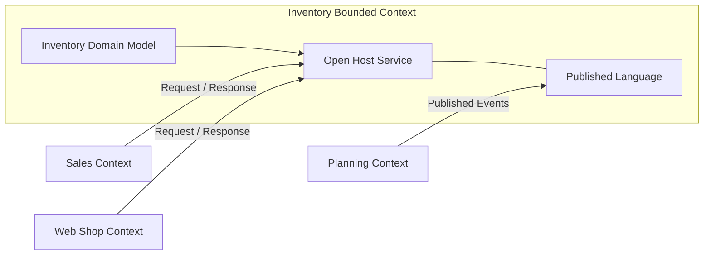
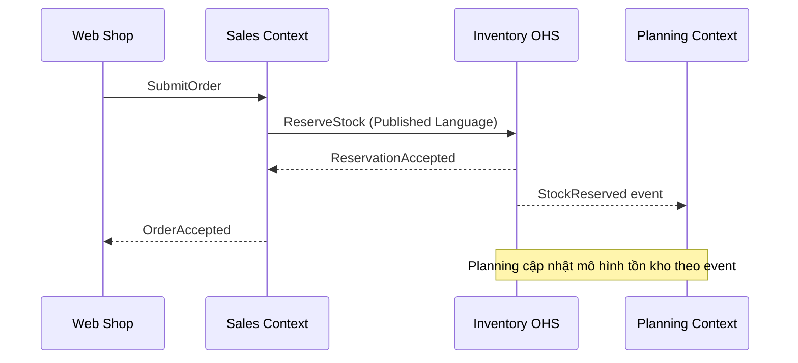

# Open Host Service và Published Language: công bố cách tích hợp

Trong Domain-Driven Design (DDD), mỗi **bounded context** sở hữu một mô hình miền và ngôn ngữ riêng. Khi các context cần trao đổi, chúng phải thống nhất cách gửi yêu cầu, công bố sự kiện và diễn giải dữ liệu. Nếu mỗi bên tự suy đoán cấu trúc nội bộ của bên kia, thay đổi nhỏ trong một mô hình có thể làm hỏng nhiều tích hợp.

Hai mẫu trong Context Mapping giúp giải quyết vấn đề này là **Open Host Service (OHS)** và **Published Language (PL)**. Open Host Service công bố một giao diện hoặc giao thức có chủ đích để nhiều hệ thống khác sử dụng. Published Language cung cấp một ngôn ngữ trao đổi được định nghĩa và tài liệu hóa rõ ràng để các bên diễn giải thông tin thống nhất. Chúng thường được dùng cùng nhau: OHS cung cấp cách truy cập, còn PL định nghĩa hình thức và ý nghĩa thông tin được trao đổi.

Hai mẫu này đặc biệt hữu ích khi một bounded context cần phục vụ nhiều consumer, khi tích hợp trở thành năng lực dùng chung hoặc khi tổ chức muốn giảm phụ thuộc vào cấu trúc nội bộ của một hệ thống. Bài học này giải thích cách phân biệt, thiết kế, quản trị và áp dụng chúng trong một Context Map.

## 1. Bối cảnh: vì sao cần công bố cách tích hợp?

Giả sử một hệ thống quản lý kho cần cung cấp thông tin tồn kho cho bán hàng, thương mại điện tử, chăm sóc khách hàng và hệ thống lập kế hoạch. Nếu mỗi consumer truy cập trực tiếp cơ sở dữ liệu hoặc gọi những API được tạo riêng mà không có quy ước chung, các vấn đề có thể xuất hiện:

- Mỗi consumer tự diễn giải trạng thái tồn kho theo một cách.
- Một thay đổi tên cột hoặc cấu trúc bảng làm hỏng nhiều hệ thống.
- Các API trả về cùng một khái niệm nhưng khác đơn vị, cách làm tròn hoặc ý nghĩa.
- Consumer phải biết quá nhiều về cách provider lưu trữ và xử lý dữ liệu.
- Provider không biết ai đang sử dụng hợp đồng nào và không thể thay đổi an toàn.
- Những quy tắc chuyển đổi bị sao chép ở nhiều nơi và dần trở nên không nhất quán.

Vấn đề cốt lõi là ranh giới giữa các bounded context chưa được bảo vệ bằng một hợp đồng tích hợp rõ ràng. OHS và PL giúp provider công bố cách giao tiếp có chủ đích, để consumer phụ thuộc vào hợp đồng đó thay vì phụ thuộc vào chi tiết triển khai.

## 2. Open Host Service là gì?

**Open Host Service** là mẫu Context Mapping trong đó một bounded context cung cấp một giao diện hoặc tập giao thức được xác định rõ để các context hoặc hệ thống khác có thể truy cập năng lực của nó. “Open” ở đây có nghĩa là giao diện được công bố cho các consumer được phép sử dụng theo hợp đồng; không có nghĩa là mọi người đều được truy cập không cần xác thực.

Một OHS thường có các đặc điểm:

- Có mục đích và phạm vi nghiệp vụ rõ ràng.
- Được thiết kế cho nhiều consumer hoặc nhiều tình huống sử dụng.
- Che giấu mô hình nội bộ và chi tiết lưu trữ của provider.
- Công bố giao thức, cấu trúc dữ liệu, lỗi và quy tắc sử dụng.
- Có cơ chế quản lý thay đổi và tương thích.
- Có chủ sở hữu chịu trách nhiệm về chất lượng, bảo mật và vận hành.

OHS có thể được triển khai bằng HTTP API, RPC, message broker, event stream hoặc một giao thức phù hợp khác. Mẫu này không đồng nghĩa với microservice, API Gateway hay một sản phẩm công nghệ cụ thể. Nó là quyết định về cách một bounded context cung cấp năng lực cho các bên khác.

### 2.1. OHS phục vụ năng lực nghiệp vụ

Một OHS tốt công bố những thao tác hoặc thông tin mà consumer cần theo ngôn ngữ của hợp đồng tích hợp. Ví dụ, Inventory Context có thể cung cấp:

- Tra cứu lượng hàng có thể bán tại một địa điểm.
- Tạo yêu cầu giữ hàng cho một đơn.
- Hủy yêu cầu giữ hàng.
- Công bố sự kiện khi lượng hàng được giữ hoặc giải phóng.

Consumer không cần biết provider dùng bảng nào, thuật toán phân bổ nội bộ ra sao hoặc aggregate được lưu như thế nào. Provider có thể thay đổi cách triển khai miễn là vẫn giữ đúng ý nghĩa và cam kết của hợp đồng.

### 2.2. Một OHS có thể có nhiều kênh giao tiếp

Một context có thể công bố nhiều kiểu giao tiếp cho các nhu cầu khác nhau:

| Kênh | Ví dụ | Khi phù hợp |
|---|---|---|
| API đồng bộ | `GET /availability` hoặc `POST /reservations` | Consumer cần phản hồi ngay để tiếp tục tương tác |
| Message command | `ReserveStock` | Consumer gửi yêu cầu xử lý bất đồng bộ |
| Domain/integration event | `StockReserved`, `ReservationExpired` | Consumer cần biết một sự kiện đã xảy ra để cập nhật mô hình riêng |
| Batch/file exchange | Tệp đối soát theo lịch | Tích hợp theo lô, dữ liệu lớn hoặc hệ thống đối tác hạn chế giao thức thời gian thực |

Điểm quan trọng là mỗi kênh cần có hợp đồng và ngữ nghĩa rõ ràng. Không nên tạo một API hoặc topic chỉ vì công nghệ hỗ trợ; hãy bắt đầu từ nhu cầu nghiệp vụ và mức độ đồng bộ cần thiết.

## 3. Published Language là gì?

**Published Language** là một ngôn ngữ trao đổi được định nghĩa, công bố và tài liệu hóa để các bounded context có thể giao tiếp mà không phải phụ thuộc trực tiếp vào mô hình nội bộ của nhau.

Published Language có thể bao gồm:

- Tên và định nghĩa của các khái niệm được trao đổi.
- Cấu trúc thông điệp, field, kiểu dữ liệu và đơn vị đo.
- Ý nghĩa của trạng thái, mã kết quả và giá trị enum.
- Quy tắc bắt buộc, tùy chọn, mặc định và điều kiện hợp lệ.
- Cách biểu diễn thời gian, tiền tệ, định danh và số lượng.
- Quy tắc lỗi, phiên bản và khả năng tương thích.
- Ví dụ thông điệp hợp lệ và không hợp lệ.

Published Language không chỉ là một file JSON hoặc tên field trong API. Hai bên có thể gửi cùng một JSON nhưng hiểu khác nhau về ý nghĩa của `availableQuantity`, `confirmedAt` hoặc `cancelled`. Ngôn ngữ được công bố phải giải thích cả cấu trúc lẫn ngữ nghĩa.

### 3.1. Ví dụ về ngôn ngữ trao đổi

Giả sử Inventory Context công bố thông điệp về việc giữ hàng:

```json
{
  "eventId": "evt-8f21",
  "eventType": "StockReserved",
  "occurredAt": "2026-11-18T02:15:30Z",
  "reservationId": "res-1042",
  "orderReference": "ord-7821",
  "warehouseId": "wh-hcm-01",
  "items": [
    {
      "sku": "SKU-RED-42",
      "quantity": 2,
      "unit": "piece"
    }
  ]
}
```

Tài liệu Published Language cần giải thích thêm:

- `eventId` là định danh duy nhất của lần phát sự kiện, consumer có thể dùng để chống xử lý lặp.
- `occurredAt` là thời điểm sự kiện nghiệp vụ xảy ra theo UTC, không phải thời điểm consumer nhận được thông điệp.
- `reservationId` xác định yêu cầu giữ hàng trong Inventory Context.
- `orderReference` là mã tham chiếu do bên gọi cung cấp; nó không trao quyền sở hữu đơn hàng cho Inventory Context.
- `quantity` là số lượng nguyên theo `unit`; cách biểu diễn đơn vị phải được quy định rõ.
- `StockReserved` chỉ được phát khi provider đã xác nhận giữ hàng thành công theo quy tắc của mình.

Nếu không có các định nghĩa này, consumer có thể hiểu sai thời điểm, quyền sở hữu hoặc trạng thái dù cấu trúc JSON hợp lệ.

### 3.2. Công nghệ có thể hỗ trợ Published Language

Một số định dạng và công cụ thường dùng:

| Công cụ/định dạng | Vai trò có thể đảm nhận |
|---|---|
| OpenAPI | Mô tả endpoint HTTP, request, response, xác thực và mã lỗi |
| JSON Schema | Mô tả cấu trúc, kiểu dữ liệu và ràng buộc của JSON |
| Protocol Buffers | Định nghĩa thông điệp có schema, thường dùng trong RPC hoặc messaging |
| Avro | Định nghĩa schema thông điệp, thường dùng trong hệ thống event/data streaming |
| AsyncAPI | Mô tả API bất đồng bộ, channel, message và operation |
| Tài liệu glossary và ví dụ | Giải thích ý nghĩa nghiệp vụ, thuật ngữ và cách dùng |

Các công cụ trên giúp kiểm tra và chia sẻ cấu trúc, nhưng không tự tạo ra ngôn ngữ nghiệp vụ chung. Đội ngũ vẫn phải thống nhất định nghĩa, đơn vị, vòng đời, quyền sở hữu và ngữ nghĩa của thông điệp.

## 4. Phân biệt Open Host Service và Published Language

Hai mẫu giải quyết hai khía cạnh khác nhau của tích hợp:

| Góc nhìn | Open Host Service | Published Language |
|---|---|---|
| Câu hỏi chính | Consumer truy cập năng lực của provider bằng cách nào? | Các bên biểu diễn và hiểu thông tin trao đổi như thế nào? |
| Trọng tâm | Giao diện, giao thức, điểm truy cập và cam kết dịch vụ | Thuật ngữ, schema, cấu trúc và ngữ nghĩa thông điệp |
| Nội dung công bố | Endpoint, operation, topic, quyền truy cập, lỗi, giới hạn | Field, kiểu dữ liệu, ý nghĩa, đơn vị, trạng thái, ví dụ |
| Giá trị | Nhiều consumer có cách truy cập ổn định | Nhiều consumer diễn giải dữ liệu nhất quán |
| Rủi ro nếu thiếu | Consumer tự tạo tích hợp riêng, phụ thuộc nội bộ | Cùng schema nhưng hiểu khác nhau, mapping sai |

Một OHS có thể dùng Published Language để mô tả request, response và event. Nhưng Published Language cũng có thể được sử dụng qua file trao đổi hoặc tích hợp không có một OHS dạng API. Vì vậy, hai mẫu thường bổ trợ nhau nhưng không phải là một khái niệm.

## 5. Kết hợp OHS và Published Language

Khi một context phục vụ nhiều consumer, cách kết hợp phổ biến là:

1. Provider xác định năng lực và trách nhiệm nghiệp vụ mình sở hữu.
2. Provider công bố OHS với các operation hoặc channel cần thiết.
3. Provider định nghĩa Published Language cho request, response và event.
4. Consumer đọc hợp đồng và chuyển đổi thông tin sang mô hình riêng khi cần.
5. Provider quản lý phiên bản, tương thích, vận hành và thông báo thay đổi.

Sơ đồ khái quát:



Provider giữ quyền kiểm soát mô hình nội bộ. Consumer phụ thuộc vào hợp đồng đã công bố và có thể chuyển đổi sang mô hình của mình. Nếu consumer có ngôn ngữ hoặc quy tắc khác, có thể dùng Anti-Corruption Layer (ACL) để bảo vệ mô hình phía consumer.

## 6. Thiết kế OHS từ nhu cầu nghiệp vụ

### 6.1. Xác định consumer và use case

Trước khi thiết kế endpoint hoặc topic, hãy lập danh sách consumer và điều họ cần làm:

- Ai cần truy vấn thông tin?
- Ai cần yêu cầu provider thực hiện hành động?
- Ai cần biết một sự kiện đã xảy ra?
- Họ cần phản hồi ngay hay có thể xử lý bất đồng bộ?
- Khối lượng, tần suất và độ trễ mong muốn là bao nhiêu?
- Hành động có cần idempotency hoặc khả năng thử lại không?
- Consumer có yêu cầu quyền truy cập hoặc phạm vi dữ liệu khác nhau không?

Không nên bắt đầu bằng việc sao chép toàn bộ model hoặc database thành API. Hãy thiết kế operation theo mục đích nghiệp vụ của consumer và trách nhiệm mà provider có thể cam kết.

### 6.2. Công bố hợp đồng ổn định

Một OHS cần mô tả ít nhất:

- Danh sách operation hoặc channel và mục đích sử dụng.
- Cấu trúc request, response và message.
- Các mã lỗi, điều kiện từ chối và trạng thái có thể xảy ra.
- Xác thực, phân quyền và phạm vi dữ liệu.
- Timeout, retry, rate limit và giới hạn kích thước.
- Quy tắc idempotency cho operation có tác động ghi.
- Cam kết khả dụng, độ trễ và hỗ trợ vận hành nếu có.
- Chính sách phiên bản và thông báo thay đổi.

Hợp đồng cần mô tả cả hành vi khi thành công lẫn thất bại. Ví dụ, `ReserveStock` cần xác định kết quả khi thiếu hàng, khi cùng một yêu cầu được gửi lại, khi reservation đã hết hạn và khi provider chưa thể xác định kết quả.

### 6.3. Không công bố mô hình nội bộ một cách máy móc

Một lỗi phổ biến là tạo API trực tiếp từ entity hoặc bảng dữ liệu. Cách làm này khiến hợp đồng công khai bị ràng buộc với cấu trúc nội bộ:

```json
{
  "inventoryRowId": 98123,
  "qty_on_hand": 12,
  "qty_allocated": 3,
  "row_status": 1,
  "last_updated_by_job": "nightly-sync"
}
```

Consumer phải hiểu ý nghĩa của từng cột và trạng thái nội bộ để suy ra lượng hàng có thể bán. Nếu provider thay đổi cách tính hoặc lưu trữ, consumer có thể bị ảnh hưởng.

Một hợp đồng hướng nghiệp vụ có thể công bố:

```json
{
  "sku": "SKU-RED-42",
  "locationId": "wh-hcm-01",
  "availableToPromise": 9,
  "unit": "piece",
  "asOf": "2026-11-18T02:15:30Z"
}
```

Provider chịu trách nhiệm định nghĩa `availableToPromise` và cách tính nó. Consumer không cần biết các cột hoặc thuật toán nội bộ để sử dụng kết quả.

### 6.4. Phân biệt query, command và event

Không nên dùng một loại message cho mọi mục đích:

- **Query:** hỏi thông tin hiện có, không yêu cầu thay đổi trạng thái nghiệp vụ.
- **Command:** yêu cầu provider thực hiện một hành động; provider có thể chấp nhận hoặc từ chối.
- **Event:** thông báo một sự kiện đã xảy ra; event mô tả sự thật đã được ghi nhận, không phải yêu cầu thực hiện hành động.

Ví dụ:

| Loại | Tên ví dụ | Ý nghĩa |
|---|---|---|
| Query | `GetAvailability` | Tra cứu lượng hàng có thể đáp ứng |
| Command | `ReserveStock` | Yêu cầu giữ một lượng hàng cho tham chiếu đơn |
| Event | `StockReserved` | Thông báo việc giữ hàng đã được xác nhận |
| Event | `ReservationExpired` | Thông báo reservation đã hết hiệu lực |

Không đặt tên event như một mệnh lệnh (`ReserveStock`) nếu nó chỉ là thông báo. Sự khác biệt giữa yêu cầu và sự kiện giúp consumer hiểu liệu provider đã thực hiện hành động hay mới nhận được đề nghị.

## 7. Thiết kế Published Language có ngữ nghĩa rõ ràng

### 7.1. Thống nhất thuật ngữ và định nghĩa

Với mỗi khái niệm được công bố, cần trả lời:

- Nó đại diện cho khái niệm nghiệp vụ nào?
- Context nào sở hữu và có quyền thay đổi nó?
- Nó khác khái niệm gần giống ở đâu?
- Giá trị có đơn vị, múi giờ, tiền tệ hoặc quy tắc làm tròn nào?
- Trạng thái nào có thể xuất hiện và chuyển đổi ra sao?
- Field nào bắt buộc, tùy chọn, nullable hoặc có giá trị mặc định?
- Thông tin phản ánh thời điểm xảy ra, thời điểm ghi nhận hay thời điểm đồng bộ?

Ví dụ, `createdAt` và `occurredAt` có thể đều là timestamp nhưng ý nghĩa khác nhau. `occurredAt` là lúc sự kiện nghiệp vụ xảy ra; `publishedAt` là lúc provider đưa thông điệp ra kênh; `receivedAt` là lúc consumer nhận được. Không nên dùng chung một field nếu các thời điểm này có ý nghĩa khác nhau.

### 7.2. Định nghĩa đơn vị và quy tắc biểu diễn

Các kiểu dữ liệu cần được định nghĩa cụ thể:

- Tiền: đơn vị tiền tệ, số chữ số thập phân, cách làm tròn và ý nghĩa của giá trị âm.
- Số lượng: đơn vị đo, độ chính xác, cách quy đổi và giới hạn.
- Thời gian: UTC hay múi giờ địa phương, timestamp hay ngày nghiệp vụ, độ chính xác.
- Định danh: phạm vi duy nhất, bên cấp phát và thời gian tồn tại.
- Trạng thái: tập giá trị hợp lệ, ý nghĩa và điều kiện chuyển trạng thái.
- Giá trị thiếu: phân biệt không biết, không áp dụng, chưa có và rỗng.

Nếu provider công bố giá trị tiền `100000`, consumer cần biết đó là VND, đơn vị nhỏ nhất hay một đơn vị quy ước khác. Một schema chỉ ghi `integer` không đủ để diễn đạt ý nghĩa.

### 7.3. Thiết kế message theo nhu cầu, không theo entity

Một event nên mang đủ thông tin để consumer hiểu sự kiện trong phạm vi trách nhiệm của nó, nhưng không cần công bố toàn bộ aggregate. Có thể dùng định danh tham chiếu và các thuộc tính cần thiết thay vì gửi cả object nội bộ.

Ví dụ, `OrderAccepted` có thể công bố mã đơn, thời điểm chấp nhận, tổng tiền đã thống nhất và tham chiếu khách hàng cần thiết. Không nên gửi thông tin xác thực, ghi chú nội bộ hoặc dữ liệu cá nhân không liên quan chỉ vì chúng có sẵn trong entity.

### 7.4. Tài liệu hóa bằng ví dụ

Mỗi message quan trọng nên có:

- Một ví dụ hợp lệ tối thiểu.
- Một ví dụ đầy đủ với các field tùy chọn.
- Ví dụ lỗi hoặc dữ liệu bị từ chối.
- Giải thích các field và giá trị enum.
- Quy tắc tương thích khi thêm, bỏ hoặc thay đổi field.
- Ví dụ theo từng phiên bản nếu có chuyển đổi.

Ví dụ giúp người tiêu thụ phát hiện cách hiểu khác nhau sớm hơn một mô tả schema chỉ có kiểu dữ liệu.

## 8. Consumer thích nghi với Published Language

Provider công bố ngôn ngữ chung không có nghĩa mọi consumer phải dùng nó làm mô hình miền nội bộ. Mỗi bounded context vẫn có quyền sở hữu mô hình riêng.

Ví dụ, Inventory Context công bố `StockReserved`. Sales Context có thể cần hiểu nó là một bước trong vòng đời đơn hàng; Planning Context có thể chỉ quan tâm lượng hàng đã được phân bổ; Reporting Context có thể dùng sự kiện để tổng hợp số liệu. Mỗi consumer có thể chuyển đổi thông điệp sang mô hình phù hợp với mục đích của mình.

### 8.1. Khi nào cần Anti-Corruption Layer?

ACL hữu ích khi:

- Ngôn ngữ công bố khác đáng kể với ngôn ngữ của consumer.
- Consumer cần bảo vệ mô hình khỏi các khái niệm không phù hợp.
- Provider là hệ thống bên ngoài hoặc legacy có hợp đồng khó thay đổi.
- Việc chuyển đổi có quy tắc, kiểm tra hoặc xử lý lỗi đủ phức tạp để cần một lớp riêng.

ACL thực hiện chuyển đổi từ contract sang mô hình nội bộ và có thể chuyển ngược khi gửi yêu cầu. Nó không chỉ là một DTO mapper đơn giản nếu còn phải diễn giải trạng thái, đơn vị, định danh hoặc quy tắc nghiệp vụ.

### 8.2. Khi nào consumer có thể dùng trực tiếp Published Language?

Nếu ngôn ngữ công bố đã phù hợp với mục đích của consumer, cấu trúc ổn định và không làm lộ mô hình nội bộ không phù hợp, consumer có thể dùng trực tiếp các kiểu dữ liệu trao đổi ở lớp tích hợp. Tuy nhiên, không nên để schema bên ngoài lan sâu vào toàn bộ domain model nếu điều đó tạo phụ thuộc khó kiểm soát.

## 9. Quản lý phiên bản và khả năng tương thích

Một OHS được nhiều consumer sử dụng sẽ thay đổi theo thời gian. Nếu không quản lý phiên bản, provider có thể vô tình phá vỡ hệ thống của consumer khi sửa một field hoặc đổi ngữ nghĩa.

### 9.1. Phân biệt thay đổi tương thích và không tương thích

| Thay đổi | Mức rủi ro thường gặp | Lưu ý |
|---|---|---|
| Thêm field tùy chọn | Thường tương thích nếu consumer bỏ qua field lạ | Consumer và parser phải hỗ trợ field không biết |
| Thêm giá trị enum | Có thể phá consumer giả định tập giá trị đóng | Consumer nên có xử lý giá trị chưa biết |
| Đổi tên hoặc xóa field | Không tương thích | Cần phiên bản hoặc giai đoạn chuyển tiếp |
| Đổi kiểu dữ liệu | Thường không tương thích | Cần mapping hoặc version mới |
| Đổi đơn vị hoặc ngữ nghĩa | Rủi ro rất cao dù schema không đổi | Phải xem là thay đổi hợp đồng và thông báo rõ |
| Đổi ý nghĩa trạng thái | Có thể làm sai quyết định nghiệp vụ | Cần phân tích tác động đến mọi consumer |
| Thay đổi thứ tự hoặc thời điểm phát event | Có thể ảnh hưởng consumer dựa vào trình tự | Định nghĩa rõ bảo đảm thứ tự và tính nhất quán |

Không phải mọi thay đổi thêm field đều an toàn. Nếu consumer từ chối field lạ, hoặc field mới làm thay đổi ý nghĩa của message, vẫn có thể phát sinh lỗi. Tương thích phải được đánh giá theo cả cấu trúc lẫn ngữ nghĩa.

### 9.2. Chính sách phiên bản

Một chính sách phiên bản nên trả lời:

- Phiên bản được thể hiện ở URL, header, schema registry hay metadata message?
- Provider duy trì đồng thời những phiên bản nào?
- Thời gian hỗ trợ phiên bản cũ là bao lâu?
- Consumer được thông báo và thử nghiệm phiên bản mới như thế nào?
- Điều kiện nào cho phép ngừng phiên bản cũ?
- Ai phê duyệt thay đổi phá vỡ tương thích?

Versioning không thay thế quản trị thay đổi. Tăng số phiên bản cho mọi chỉnh sửa nhỏ có thể tạo gánh nặng. Ngược lại, giữ một phiên bản duy nhất trong khi thay đổi ngữ nghĩa có thể gây lỗi âm thầm. Cần phân biệt thay đổi tương thích và thay đổi cần migration.

### 9.3. Quy trình deprecation

Khi cần bỏ một operation hoặc field:

1. Công bố phần tử thay thế và hướng dẫn chuyển đổi.
2. Đánh dấu phần cũ là deprecated trong tài liệu và schema.
3. Thông báo cho consumer đang sử dụng.
4. Theo dõi traffic hoặc message để xác định consumer còn hoạt động.
5. Hỗ trợ thời gian chuyển tiếp đã thống nhất.
6. Ngừng phần cũ khi đạt tiêu chí và có phương án xử lý consumer còn lại.

Không nên xóa một hợp đồng chỉ vì provider đã triển khai phiên bản mới. Cần xác minh consumer đã chuyển đổi hoặc có thỏa thuận ngừng sử dụng.

## 10. Kiểm thử hợp đồng và chất lượng tích hợp

Hợp đồng được công bố cần có kiểm thử để đảm bảo implementation và tài liệu không bị lệch nhau.

### 10.1. Kiểm thử phía provider

Provider có thể kiểm tra:

- Response và message tuân thủ schema công bố.
- Operation thực hiện đúng ý nghĩa và điều kiện trong hợp đồng.
- Mã lỗi và trạng thái trả về phù hợp.
- Quy tắc xác thực, phân quyền và giới hạn được thực thi.
- Phiên bản mới không phá các consumer được hỗ trợ.
- Event chỉ được phát khi sự kiện nghiệp vụ thực sự đã xảy ra.

### 10.2. Kiểm thử phía consumer

Consumer cần kiểm tra:

- Có thể phân tích message hợp lệ và xử lý field không biết nếu chính sách cho phép.
- Xử lý giá trị enum chưa biết theo cách an toàn.
- Mapping đúng đơn vị, thời gian, định danh và trạng thái.
- Chống xử lý lặp khi nhận lại cùng event.
- Xử lý được timeout, retry, message sai thứ tự và lỗi tạm thời.
- Không giả định provider luôn trả dữ liệu đầy đủ hoặc thành công.

### 10.3. Consumer-driven contract testing

Consumer-driven contract testing cho phép consumer mô tả phần hợp đồng mà nó thực sự sử dụng. Provider chạy kiểm thử để xác minh thay đổi của mình vẫn đáp ứng những kỳ vọng đó.

Cách này hữu ích khi một OHS phục vụ nhiều consumer với các nhu cầu khác nhau. Tuy nhiên, các contract test không thay thế đặc tả chính thức hoặc kiểm thử ngữ nghĩa nghiệp vụ. Chúng chứng minh một số kỳ vọng cụ thể, không đảm bảo mọi hành vi của provider đều đúng.

### 10.4. Kiểm thử sự kiện bất đồng bộ

Với message hoặc event, hãy kiểm tra:

- Message trùng lặp.
- Message đến trễ hoặc sai thứ tự.
- Consumer ngừng hoạt động rồi xử lý lại message tồn đọng.
- Schema mới xuất hiện trong khi consumer cũ vẫn chạy.
- Provider phát event nhưng consumer không xử lý được.
- Event bị gửi lại sau khi provider phục hồi.

Nếu consumer phải xử lý event đúng một lần về mặt tác động nghiệp vụ, cần thiết kế idempotency và lưu dấu xử lý. Không nên dựa vào giả định mạng hoặc message broker luôn bảo đảm một lần giao duy nhất.

## 11. Bảo mật và vận hành OHS

OHS là điểm tiếp xúc giữa các bounded context, do đó cần được vận hành như một hợp đồng sản phẩm nội bộ hoặc đối tác.

### 11.1. Xác thực và phân quyền

Hãy xác định consumer nào được phép gọi operation nào, trên phạm vi dữ liệu nào và với mục đích gì. Có thể dùng service identity, OAuth2, mTLS hoặc cơ chế phù hợp với hạ tầng. Không đưa dữ liệu nhạy cảm vào message chỉ vì consumer có quyền gọi OHS.

Phân quyền cần xét cả tenant, tổ chức, địa điểm, tài khoản hoặc phạm vi nghiệp vụ. Một consumer có quyền xem tồn kho của kho A không tự động được xem kho B.

### 11.2. Giới hạn và bảo vệ dịch vụ

OHS nên công bố hoặc quản lý:

- Rate limit và quota theo consumer.
- Timeout và giới hạn kích thước request/response.
- Pagination hoặc streaming cho dữ liệu lớn.
- Chính sách retry và backoff.
- Cơ chế chống lạm dụng và bảo vệ trước payload không hợp lệ.
- Quy tắc lưu trữ, che giấu và kiểm toán dữ liệu nhạy cảm.

### 11.3. Quan sát và hỗ trợ vận hành

Nên theo dõi độ khả dụng, độ trễ, tỷ lệ lỗi, số request bị giới hạn, backlog message và độ trễ tiêu thụ event. Log cần có correlation ID hoặc trace ID để truy vết một quy trình xuyên nhiều context. Không ghi token, thông tin xác thực hoặc dữ liệu cá nhân không cần thiết vào log.

Provider cần có kênh công bố sự cố, bảo trì, thay đổi hợp đồng và hướng dẫn xử lý. Một OHS có nhiều consumer cần được quản trị với trách nhiệm rõ ràng, tương tự một sản phẩm nền tảng.

## 12. Ví dụ xuyên suốt: Inventory Context công bố dịch vụ tồn kho

Giả sử một nền tảng bán lẻ có các bounded context:

- **Inventory Context:** sở hữu tồn kho, reservation và quy tắc giữ/giải phóng hàng.
- **Sales Context:** sở hữu đơn hàng và quyết định chấp nhận đơn.
- **Web Shop Context:** cung cấp trải nghiệm mua sắm trực tuyến.
- **Planning Context:** phân tích nhu cầu và đề xuất bổ sung hàng.

Inventory Context cần phục vụ nhiều consumer. Nhóm quyết định công bố một OHS cho tra cứu và yêu cầu giữ hàng, đồng thời sử dụng Published Language cho request, response và event.

### 12.1. Thiết kế giao diện công khai

Một hợp đồng minh họa có thể gồm:

| Operation/Message | Mục đích | Kết quả hoặc ngữ nghĩa |
|---|---|---|
| `GetAvailability` | Tra cứu lượng hàng có thể đáp ứng | Trả số lượng, đơn vị, địa điểm và thời điểm tính |
| `ReserveStock` | Yêu cầu giữ hàng cho một tham chiếu đơn | Trả reservation được chấp nhận hoặc lý do từ chối |
| `ReleaseReservation` | Yêu cầu giải phóng reservation | Trả trạng thái xử lý và định danh reservation |
| `StockReserved` | Thông báo giữ hàng thành công | Sự kiện đã xảy ra, không phải yêu cầu giữ hàng |
| `ReservationReleased` | Thông báo reservation đã được giải phóng | Sự kiện đã xảy ra |
| `ReservationExpired` | Thông báo reservation hết hạn | Consumer có thể cập nhật quy trình của mình |

### 12.2. Ví dụ request và response

Request `ReserveStock`:

```json
{
  "requestId": "req-9912",
  "orderReference": "ord-7821",
  "locationId": "wh-hcm-01",
  "items": [
    { "sku": "SKU-RED-42", "quantity": 2, "unit": "piece" }
  ],
  "expiresAt": "2026-11-18T02:25:00Z"
}
```

Response khi được chấp nhận:

```json
{
  "requestId": "req-9912",
  "reservationId": "res-1042",
  "status": "ACCEPTED",
  "acceptedAt": "2026-11-18T02:15:30Z",
  "expiresAt": "2026-11-18T02:25:00Z"
}
```

Hợp đồng phải làm rõ `expiresAt` do bên nào quyết định, provider có thể điều chỉnh hay từ chối không, và điều gì xảy ra khi request được gửi lại với cùng `requestId`. Nếu provider là bên quyết định thời hạn giữ hàng, consumer có thể chỉ gửi yêu cầu về thời gian mong muốn; provider trả lại thời hạn có hiệu lực.

### 12.3. Dòng tích hợp



Sơ đồ minh họa một luồng giả định. Trong thực tế, Sales Context cần xác định khi nào đơn được chấp nhận, cách xử lý nếu giữ hàng thất bại và cách phục hồi nếu response bị mất sau khi provider đã tạo reservation. Không nên giả định một lời gọi mạng thất bại đồng nghĩa với hành động nghiệp vụ chưa xảy ra.

### 12.4. Consumer chuyển đổi mô hình riêng

Sales Context có thể chuyển response `ReservationAccepted` thành trạng thái nội bộ như `OrderInventoryConfirmed`. Planning Context có thể tiêu thụ `StockReserved` để cập nhật lượng hàng đã phân bổ. Hai consumer không cần dùng cùng entity hoặc cùng trạng thái với Inventory Context.

Nếu Published Language của Inventory sử dụng thuật ngữ không phù hợp với nghiệp vụ Sales, Sales có thể đặt ACL ở lớp tích hợp để chuyển đổi. Điều này giữ cho mô hình của mỗi context phản ánh trách nhiệm riêng.

## 13. Quy trình xây dựng và công bố hợp đồng

Một quy trình thực tế có thể gồm:

1. **Xác định năng lực:** mô tả năng lực provider sở hữu và lý do consumer cần sử dụng.
2. **Khám phá consumer:** liệt kê use case, dữ liệu, mức đồng bộ, khối lượng và yêu cầu vận hành.
3. **Thiết kế ngôn ngữ:** thống nhất thuật ngữ, schema, đơn vị, trạng thái và ví dụ.
4. **Thiết kế OHS:** chọn operation/channel, giao thức, bảo mật, lỗi, retry và giới hạn.
5. **Xác nhận với consumer:** kiểm tra hợp đồng bằng ví dụ thực tế và contract test.
6. **Công bố tài liệu:** lưu schema, mô tả ngữ nghĩa, hướng dẫn, phiên bản và người liên hệ.
7. **Triển khai và quan sát:** theo dõi traffic, lỗi, độ trễ và hành vi consumer.
8. **Quản lý thay đổi:** đánh giá tương thích, thông báo, hỗ trợ migration và deprecation.

Nên có chủ sở hữu cho cả hợp đồng và ngôn ngữ. Nếu không ai chịu trách nhiệm cập nhật glossary, schema và ví dụ, Published Language sẽ nhanh chóng lệch khỏi implementation.

## 14. Các sai lầm thường gặp

| Sai lầm | Hệ quả | Cách cải thiện |
|---|---|---|
| Xem OHS chỉ là một API endpoint | Thiếu hợp đồng vận hành, lỗi, bảo mật và quản lý consumer | Thiết kế năng lực và cam kết dịch vụ đầy đủ |
| Công bố database schema | Consumer phụ thuộc cấu trúc nội bộ | Công bố mô hình trao đổi theo nhu cầu nghiệp vụ |
| Nghĩ JSON Schema tự tạo Published Language | Schema có cấu trúc nhưng thiếu ngữ nghĩa | Bổ sung glossary, đơn vị, trạng thái và ví dụ |
| Ép mọi context dùng chung domain model | Làm mất ý nghĩa riêng của từng mô hình | Chỉ chia sẻ ngôn ngữ trao đổi cần thiết, giữ mô hình nội bộ riêng |
| Không quản lý phiên bản | Thay đổi provider làm hỏng consumer | Có chính sách tương thích, thông báo và deprecation |
| Đổi ngữ nghĩa nhưng giữ nguyên schema | Lỗi nghiệp vụ âm thầm, khó phát hiện | Xem thay đổi ngữ nghĩa là thay đổi hợp đồng |
| Event mang tên command | Consumer hiểu nhầm yêu cầu là sự kiện đã xảy ra | Phân biệt command, query và event |
| Giả định message chỉ đến một lần | Tác động bị thực hiện lặp | Dùng event ID, idempotency và cơ chế đối soát |
| Bỏ qua bảo mật vì chỉ tích hợp nội bộ | Dữ liệu và năng lực bị truy cập quá mức | Xác thực, phân quyền và kiểm toán theo consumer |
| Không có chủ sở hữu hợp đồng | Tài liệu, schema và implementation lệch nhau | Chỉ định owner và quy trình thay đổi |

## 15. Checklist rà soát OHS và Published Language

Trước khi công bố hoặc thay đổi một hợp đồng, nhóm có thể kiểm tra:

- [ ] Provider và các consumer đã được xác định rõ.
- [ ] Năng lực công bố thuộc trách nhiệm của provider.
- [ ] Operation và channel phản ánh use case, không lộ cấu trúc lưu trữ nội bộ.
- [ ] Request, response và event có ngữ nghĩa riêng, tên gọi chính xác.
- [ ] Field có định nghĩa, kiểu, đơn vị, múi giờ và quy tắc nullability.
- [ ] Trạng thái, lỗi, timeout, retry và idempotency được mô tả.
- [ ] Có ví dụ hợp lệ, không hợp lệ và trường hợp biên.
- [ ] Có chính sách xác thực, phân quyền, quota và bảo vệ dữ liệu.
- [ ] Có quy tắc phiên bản, tương thích và deprecation.
- [ ] Provider và consumer có kiểm thử hợp đồng phù hợp.
- [ ] Có chủ sở hữu, kênh thông báo và cơ chế hỗ trợ vận hành.
- [ ] Consumer có thể chuyển đổi sang mô hình riêng mà không phụ thuộc vào domain model nội bộ của provider.

## 16. Kết nối với các mẫu Context Mapping khác

OHS và Published Language thường xuất hiện trong các quan hệ mà một context cung cấp năng lực cho nhiều consumer. Tuy nhiên, cách consumer sử dụng hợp đồng còn phụ thuộc vào quan hệ giữa các bên.

- Với **Customer-Supplier**, provider và consumer có thể phối hợp để công bố hợp đồng đáp ứng nhu cầu downstream.
- Với **Conformist**, consumer có thể chấp nhận Published Language của upstream mà không có khả năng tác động đến thiết kế.
- Với **Anti-Corruption Layer**, consumer chuyển đổi ngôn ngữ công bố sang mô hình nội bộ để bảo vệ domain model.
- Với **Shared Kernel**, hai nhóm có thể chia sẻ một phần mô hình hoặc schema nhưng cần quản trị quyền thay đổi chặt chẽ.
- Với **Separate Ways**, hai context có thể chọn không tích hợp nếu chi phí phối hợp lớn hơn giá trị nhận được.

Không nên chọn OHS chỉ vì có nhiều consumer nếu nhu cầu thực tế cần một quan hệ khác. Hãy xem xét quyền ảnh hưởng đến hợp đồng, mức độ phụ thuộc và trách nhiệm chuyển đổi của từng bên.

## 17. Kết luận

Open Host Service giúp một bounded context công bố cách truy cập năng lực của mình qua giao diện và giao thức có chủ đích. Published Language giúp các bên trao đổi thông tin bằng cấu trúc và ngữ nghĩa được thống nhất, tài liệu hóa. Khi kết hợp, chúng tạo ra một ranh giới tích hợp ổn định để provider có thể tiến hóa mô hình nội bộ và consumer vẫn hiểu đúng thông tin nhận được.

Giá trị của hai mẫu không nằm ở số lượng API hay schema được tạo ra. Giá trị nằm ở việc bảo vệ quyền sở hữu mô hình, giảm phụ thuộc không cần thiết, làm rõ ngữ nghĩa và giúp các bounded context phối hợp có kiểm soát. Hợp đồng tốt cần được thiết kế cùng chuyên gia nghiệp vụ, kiểm thử với consumer, quản lý phiên bản và vận hành như một sản phẩm có chủ sở hữu.
