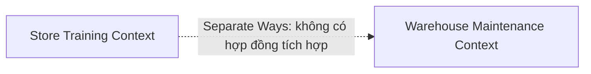
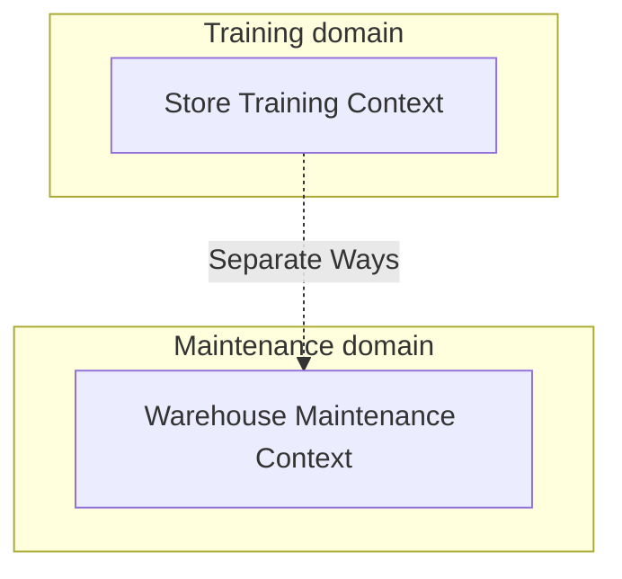

# Separate Ways: chủ động không tích hợp khi không đem lại giá trị

Khi lập bản đồ các bounded context trong Domain-Driven Design (DDD), đội dự án thường tập trung vào những đường kết nối: context nào cung cấp dữ liệu, context nào tiêu thụ, API hoặc sự kiện nào cần được thiết kế. Nhưng không phải hai context có liên quan trong cùng một tổ chức đều cần tích hợp. Đôi khi, cách thiết kế tốt nhất là để chúng hoạt động độc lập và **chủ động không xây dựng quan hệ tích hợp**.

Trong DDD, lựa chọn này được gọi là **Separate Ways**. Đây là một mẫu quan hệ trong context mapping: hai bounded context không thiết lập tích hợp trực tiếp vì lợi ích của việc kết nối không đủ bù đắp chi phí xây dựng, vận hành và duy trì sự phụ thuộc. Mỗi context tiếp tục phát triển mô hình, ngôn ngữ và quy trình của mình.

Separate Ways không phải là bỏ qua một phụ thuộc nghiệp vụ quan trọng hoặc trì hoãn một tích hợp bắt buộc. Đó là một quyết định kiến trúc có chủ đích, dựa trên việc hiểu rõ hai bên cần gì ở nhau, giá trị nào sẽ xuất hiện nếu tích hợp và rủi ro nào được tạo ra khi giữ độc lập. Bài này giải thích ý nghĩa của Separate Ways, cách đánh giá, cách ghi nhận trên context map và các dấu hiệu cho biết quyết định cần được xem xét lại.

Trong `DOMAIN_DRIVEN_DESIGN`, strategic design giúp nhận diện subdomain, bounded context và quan hệ giữa các mô hình; tactical design giúp xây dựng entity, value object, aggregate, repository và domain event bên trong từng context. Separate Ways thuộc góc nhìn strategic design: nó giúp nhóm quyết định ranh giới nào cần giao tiếp và ranh giới nào có thể duy trì độc lập.

## 1. Separate Ways là gì?

### 1.1. Định nghĩa

**Separate Ways** là lựa chọn để hai bounded context không tích hợp trực tiếp với nhau khi không có đủ giá trị nghiệp vụ để biện minh cho chi phí và sự phụ thuộc do tích hợp tạo ra. Mỗi context tự quản lý mô hình, dữ liệu, quy tắc, vòng đời và cách phát triển trong phạm vi của mình.

Ví dụ, một doanh nghiệp bán lẻ có context `Store Training` quản lý chương trình đào tạo nhân viên cửa hàng và context `Warehouse Maintenance` quản lý lịch bảo trì thiết bị kho. Nếu hai năng lực này không cần trao đổi dữ liệu để thực hiện quyết định nghiệp vụ, doanh nghiệp có thể giữ chúng độc lập. Việc cả hai cùng thuộc một công ty hoặc cùng dùng thông tin về địa điểm không tự tạo ra lý do để tích hợp.

Separate Ways không có nghĩa hai context không bao giờ được con người nhắc đến cùng nhau. Nó nói rằng nhóm quyết định không cần duy trì một hợp đồng tích hợp giữa các mô hình đó. Nếu một báo cáo quản trị tổng hợp dữ liệu từ cả hai, báo cáo có thể được tạo bằng một quy trình riêng mà không biến hai context thành một mô hình miền dùng chung. Cần đánh giá riêng liệu quy trình báo cáo đó có trở thành một nhu cầu tích hợp có giá trị hay không.

### 1.2. Separate Ways nằm ở đâu trong context map?

Context map mô tả các bounded context và quan hệ giữa chúng. Với Separate Ways, nhóm ghi nhận rằng hai context đã được xem xét nhưng không thiết lập quan hệ tích hợp trực tiếp trong phạm vi hiện tại.



Đường nét đứt trong hình chỉ biểu thị rằng hai context đã được đánh giá và quyết định không tích hợp; nó không biểu diễn luồng dữ liệu, API hay sự kiện. Nếu không có quan hệ nghiệp vụ nào đáng kể, context map cũng có thể trình bày chúng như các context độc lập kèm ghi chú quyết định Separate Ways.

### 1.3. Separate Ways khác với những lựa chọn nào?

| Lựa chọn | Bản chất | Khi nào phù hợp |
|---|---|---|
| Separate Ways | Không thiết lập tích hợp giữa hai context | Không có nhu cầu trao đổi có giá trị đủ lớn hoặc chi phí phụ thuộc vượt lợi ích |
| Conformist | Downstream chấp nhận mô hình của upstream | Có phụ thuộc cần thiết nhưng downstream không thể ảnh hưởng đáng kể đến mô hình upstream |
| Anti-Corruption Layer (ACL) | Chuyển đổi mô hình ở biên để bảo vệ mô hình nội bộ | Có phụ thuộc nhưng ngôn ngữ hoặc cấu trúc bên ngoài không phù hợp |
| Customer-Supplier | Upstream cung cấp, downstream có tiếng nói về nhu cầu và ưu tiên | Hai bên cần hợp tác để đáp ứng use case của downstream |
| Partnership | Hai bên cùng điều phối thay đổi và kế hoạch | Hai context phụ thuộc chặt chẽ, cần phối hợp thường xuyên |
| Shared Kernel | Hai bên cùng quản lý một phần mô hình nhỏ | Có phần mô hình thực sự chung và có thể đồng quản trị |

Điểm phân biệt quan trọng là: Separate Ways được chọn khi **không cần quan hệ tích hợp**. Conformist, ACL, Customer-Supplier hay Partnership đều giả định có một dạng phụ thuộc hoặc trao đổi cần quản lý.

## 2. Vì sao chủ động không tích hợp có thể là lựa chọn đúng?

Tích hợp tạo ra giá trị khi nó giúp các bên đưa ra quyết định tốt hơn, giảm thao tác, nâng chất lượng dịch vụ hoặc đáp ứng một nghĩa vụ nghiệp vụ. Nhưng tích hợp cũng tạo ra chi phí và ràng buộc lâu dài. Một đường kết nối mới cần được thiết kế, bảo mật, kiểm thử, giám sát, hỗ trợ, nâng cấp và phối hợp khi có lỗi.

Nếu hai context ít trao đổi, hoặc thông tin trao đổi không làm thay đổi quyết định của bên nhận, tích hợp có thể chỉ tạo thêm điểm phụ thuộc.

### 2.1. Giá trị của tích hợp cần được chỉ ra cụ thể

Trước khi đề xuất tích hợp, hãy xác định kết quả nghiệp vụ nào sẽ tốt hơn:

- Một quyết định có thể được đưa ra nhanh hơn hoặc chính xác hơn không?
- Khách hàng có nhận được trải nghiệm liền mạch hơn không?
- Có giảm được nhập liệu lặp lại, sai lệch hoặc chi phí vận hành đáng kể không?
- Có đáp ứng yêu cầu pháp lý, kiểm soát, kiểm toán hoặc cam kết dịch vụ nào không?
- Có dữ liệu nào cần đồng bộ để tránh hai bên đưa ra quyết định mâu thuẫn không?
- Có quy trình nào thực sự không thể hoàn thành nếu thiếu thông tin từ context kia không?

Nếu không thể nêu rõ ai cần thông tin gì, vào thời điểm nào và sẽ quyết định điều gì dựa trên thông tin đó, nhu cầu tích hợp có thể chưa đủ rõ.

### 2.2. Chi phí tích hợp không chỉ là chi phí lập trình

Hãy tính đến toàn bộ vòng đời của một quan hệ tích hợp:

| Nhóm chi phí | Ví dụ |
|---|---|
| Phát triển ban đầu | Thiết kế API hoặc event, mapping dữ liệu, xử lý lỗi, bảo mật, triển khai |
| Vận hành | Hạ tầng, giám sát, cảnh báo, trực hỗ trợ, xử lý sự cố và phục hồi |
| Phối hợp | Họp thống nhất ngữ nghĩa, lập kế hoạch phát hành, điều tra lỗi liên nhóm |
| Thay đổi | Versioning, tương thích ngược, migration, deprecation và cập nhật consumer |
| Phụ thuộc | Chậm trễ khi upstream lỗi, thay đổi lịch phát hành, giới hạn năng lực của bên cung cấp |
| Chất lượng dữ liệu | Đồng bộ trễ, bản ghi trùng, dữ liệu thiếu, sai đơn vị hoặc khác cách hiểu |
| Bảo mật và tuân thủ | Phân quyền, chia sẻ dữ liệu cá nhân, lưu vết truy cập, thời hạn lưu trữ |

Một tích hợp có vẻ nhỏ ở thời điểm đầu có thể trở thành cam kết phải duy trì trong nhiều năm. Vì vậy, hãy so sánh giá trị dự kiến với tổng chi phí sở hữu và rủi ro phụ thuộc, thay vì chỉ so sánh số ngày lập trình.

### 2.3. Độc lập có thể bảo vệ khả năng thay đổi

Khi hai context không phụ thuộc vào hợp đồng của nhau, mỗi nhóm có thể:

- Thay đổi mô hình và quy tắc trong phạm vi riêng với ít phối hợp hơn.
- Lựa chọn công nghệ và nhịp phát hành phù hợp với nhu cầu của mình.
- Tránh đưa thuật ngữ của context khác vào mô hình nội bộ.
- Hạn chế sự cố lan truyền qua chuỗi tích hợp.
- Giữ quyền sở hữu dữ liệu và trách nhiệm rõ ràng.

Độc lập không tự động làm hệ thống đơn giản. Mỗi context vẫn phải vận hành tốt và có thể phát sinh chi phí trùng lặp. Nhưng nếu các bên không cần chia sẻ quyết định hoặc dữ liệu ở thời gian thực, việc tránh tích hợp có thể giảm đáng kể độ phức tạp tổng thể.

## 3. Khi nào nên cân nhắc Separate Ways?

Separate Ways thường phù hợp khi phần lớn các điều kiện sau được đáp ứng:

### 3.1. Không có phụ thuộc nghiệp vụ trực tiếp

Hai context có mục tiêu và quy trình độc lập. Kết quả của context này không phải đầu vào cần thiết cho quyết định của context kia. Một context có thể tiếp tục hoạt động ngay cả khi context còn lại ngừng hoạt động.

Ví dụ, lịch đào tạo nhân viên cửa hàng không cần biết trạng thái bảo trì từng máy đóng gói trong kho trung tâm để quyết định nhân viên nào cần học khóa an toàn bán hàng. Hai quy trình có thể cùng dùng danh sách địa điểm, nhưng nếu không cần cập nhật hoặc kiểm soát chéo, chưa có lý do để tạo tích hợp.

### 3.2. Thông tin trao đổi ít thay đổi quyết định

Một context có thể quan tâm đến dữ liệu của context khác, nhưng sự quan tâm đó chưa chắc tạo thành nhu cầu tích hợp. Nếu thông tin chỉ hữu ích cho một báo cáo tham khảo không thường xuyên, một quy trình tổng hợp định kỳ có thể đủ. Cần xác định liệu báo cáo đó là một nhu cầu riêng hay đang che giấu một phụ thuộc vận hành thực sự.

### 3.3. Lợi ích thấp hơn tổng chi phí

Tích hợp có thể giảm một vài thao tác thủ công nhưng lại cần duy trì schema, mapping, giám sát và lịch phát hành giữa hai nhóm. Nếu số lần sử dụng ít, tác động nhỏ và có cách xử lý độc lập chấp nhận được, không tích hợp có thể là lựa chọn hợp lý.

### 3.4. Hai bên cần mô hình và nhịp thay đổi khác nhau

Một context có thể thay đổi thuật ngữ, cấu trúc hoặc quy trình thường xuyên; context còn lại có thể cần ổn định lâu dài. Nếu việc kết nối buộc hai bên phải đồng bộ thay đổi mà không tạo giá trị tương xứng, giữ độc lập giúp bảo vệ quyền tự chủ.

### 3.5. Có thể chấp nhận sự độc lập về dữ liệu và quy trình

Separate Ways phù hợp khi mỗi context có thể duy trì nguồn dữ liệu có thẩm quyền của mình mà không phải đồng bộ trạng thái nghiệp vụ liên tục với bên kia. Nếu hai bên cùng chịu trách nhiệm cho một cam kết với khách hàng hoặc một nghĩa vụ pháp lý, cần kiểm tra rất kỹ trước khi quyết định không tích hợp.

### 3.6. Không có yêu cầu bắt buộc phải kết nối

Một số yêu cầu pháp lý, kiểm soát nội bộ, bảo mật, kiểm toán hoặc hợp đồng dịch vụ có thể bắt buộc dữ liệu phải được trao đổi. Nếu có nghĩa vụ như vậy, không thể chỉ dựa trên chi phí để bỏ qua. Cần xác minh yêu cầu và tìm cách đáp ứng với mức tích hợp tối thiểu cần thiết.

## 4. Ví dụ: hai năng lực độc lập trong doanh nghiệp bán lẻ

Giả sử một doanh nghiệp bán lẻ có hai bounded context:

- `Store Training` quản lý khóa học, lịch học, tài liệu, đăng ký và kết quả đào tạo nhân viên cửa hàng.
- `Warehouse Maintenance` quản lý thiết bị kho, kế hoạch bảo trì, lịch kỹ thuật viên, vật tư thay thế và biên bản hoàn thành.

Hai context cùng thuộc doanh nghiệp và đều có thể lưu mã địa điểm. Tuy nhiên, quy trình đào tạo không cần đọc lịch bảo trì thiết bị để quyết định nhân viên nào tham gia khóa học. Quy trình bảo trì cũng không cần đọc điểm học tập để lên lịch bảo dưỡng máy móc.

### 4.1. Mô hình và dữ liệu riêng

| Góc nhìn | Store Training | Warehouse Maintenance |
|---|---|---|
| Mục tiêu | Bảo đảm nhân viên có kiến thức và kỹ năng cần thiết | Bảo đảm thiết bị kho được bảo trì và sẵn sàng vận hành |
| Đối tượng trung tâm | Nhân viên, khóa học, lần đăng ký, kết quả học | Thiết bị, kế hoạch bảo trì, lệnh công việc, lần thực hiện |
| Quy tắc tiêu biểu | Điều kiện tham gia, thời hạn hoàn thành, điều kiện đạt | Chu kỳ bảo trì, mức độ ưu tiên, điều kiện nghiệm thu |
| Nguồn dữ liệu có thẩm quyền | Hồ sơ đào tạo | Hồ sơ thiết bị và bảo trì |
| Nhịp thay đổi | Theo chương trình đào tạo và chính sách nhân sự | Theo tình trạng thiết bị và kế hoạch vận hành kho |
| Quyết định từ context kia cần dùng | Không có trong phạm vi hiện tại | Không có trong phạm vi hiện tại |

Hai mô hình có thể cùng chứa `LocationId`, nhưng điều đó không đòi hỏi phải chia sẻ một entity `Location` hoặc tích hợp trực tiếp. Nếu cần, mỗi context có thể lưu mã địa điểm theo hợp đồng hoặc quy ước tổ chức đã thống nhất, với định nghĩa và quyền sở hữu được ghi nhận ở nơi phù hợp.

### 4.2. Context map với Separate Ways



Không có API để đồng bộ khóa học sang lịch bảo trì, không có sự kiện đào tạo làm thay đổi lệnh bảo trì, và không có quy trình ghi trực tiếp dữ liệu từ context này vào context kia. Mỗi context có thể triển khai, kiểm thử và phát hành theo lịch riêng.

### 4.3. Nếu quản lý muốn xem báo cáo tổng hợp thì sao?

Nhu cầu báo cáo tổng hợp cần được đánh giá riêng. Có thể có một hệ thống phân tích nhận các tập dữ liệu được phê duyệt theo lịch để tổng hợp chỉ số nhân sự và vận hành. Hệ thống báo cáo đó là một nhu cầu dữ liệu riêng, với mục tiêu, quyền truy cập, độ trễ và trách nhiệm khác.

Việc tạo một luồng dữ liệu phục vụ báo cáo không nhất thiết có nghĩa hai bounded context phải phụ thuộc trực tiếp vào nhau. Tuy nhiên, nếu báo cáo bắt đầu điều khiển quyết định vận hành theo thời gian thực hoặc yêu cầu đồng bộ trạng thái, quan hệ đã thay đổi và cần xem xét lại context map.

## 5. Phân tích một quyết định Separate Ways

Để tránh biến Separate Ways thành cảm tính, hãy ghi nhận cả giá trị của tích hợp và chi phí của việc duy trì nó.

### 5.1. Xác định nhu cầu trước khi chọn giải pháp

Hãy mô tả nhu cầu theo mẫu:

> Vai trò nào cần thông tin gì từ context nào, vào thời điểm nào, để đưa ra quyết định hoặc hoàn thành công việc gì?

Nếu không thể hoàn thành câu này bằng một tình huống thực tế, chưa nên thiết kế API hoặc sự kiện. Có thể yêu cầu tích hợp chỉ xuất phát từ mong muốn “mọi hệ thống đều phải kết nối” mà chưa có use case cụ thể.

### 5.2. So sánh giá trị và chi phí

Một bảng đánh giá có thể dùng các tiêu chí sau:

| Tiêu chí | Câu hỏi đánh giá | Dấu hiệu nghiêng về Separate Ways |
|---|---|---|
| Giá trị nghiệp vụ | Tích hợp cải thiện kết quả nào? | Không xác định được quyết định hoặc kết quả sẽ tốt hơn |
| Tần suất | Nhu cầu trao đổi xảy ra bao lâu một lần? | Hiếm khi cần hoặc chỉ phục vụ tham khảo |
| Độ kịp thời | Thông tin cần mới đến mức nào? | Không cần đồng bộ tức thời hoặc gần thời gian thực |
| Tính nhất quán | Hai bên có phải cùng giữ một trạng thái không? | Không có bất biến hoặc cam kết xuyên hai context |
| Chi phí vòng đời | Phát triển, vận hành, bảo mật và nâng cấp tốn bao nhiêu? | Chi phí duy trì lớn hơn lợi ích dự kiến |
| Quyền tự chủ | Tích hợp có làm chậm thay đổi của một bên không? | Hai bên cần phát triển độc lập |
| Rủi ro | Không tích hợp có gây vi phạm, sai lệch hoặc ảnh hưởng khách hàng không? | Rủi ro có thể kiểm soát và được chấp nhận |
| Phương án khác | Có cách xử lý đơn giản hơn không? | Có thể dùng quy trình độc lập hoặc báo cáo riêng |

Có thể dùng một phép so sánh định tính:

```text
Giá trị ròng của tích hợp
  = Lợi ích nghiệp vụ dự kiến
    - Chi phí phát triển và vận hành
    - Chi phí phối hợp và thay đổi
    - Rủi ro do phụ thuộc và chia sẻ dữ liệu
```

Đây là khung suy nghĩ, không phải công thức tài chính chính xác. Với quyết định có tác động lớn, nên lượng hóa lợi ích, xác suất sự cố, chi phí vận hành và nghĩa vụ tuân thủ theo dữ liệu thực tế.

### 5.3. Ghi rõ phạm vi của quyết định

Separate Ways nên có phạm vi và giả định cụ thể:

- Hai context nào được giữ độc lập?
- Những use case nào đã được xem xét?
- Dữ liệu hoặc năng lực nào hiện không cần trao đổi?
- Có ngoại lệ hoặc nghĩa vụ nào cần một kênh phối hợp khác không?
- Ai sở hữu quyết định và khi nào cần xem xét lại?

Điều này giúp người khác không hiểu nhầm rằng hai context bị cấm tích hợp trong mọi tình huống tương lai.

## 6. Điều gì cần làm rõ trước khi quyết định không tích hợp?

### 6.1. Phụ thuộc ẩn qua con người

Hai hệ thống có thể không gọi API của nhau nhưng nhân viên thường xuyên xuất dữ liệu từ bên này rồi nhập vào bên kia. Đây vẫn là một dạng phối hợp và có chi phí, rủi ro sai sót, độ trễ và trách nhiệm dữ liệu.

Hãy quan sát quy trình thực tế:

- Ai xuất dữ liệu, ai nhận và ai xác minh?
- Có sửa hoặc chuyển đổi dữ liệu trước khi nhập không?
- Nếu file thiếu hoặc sai, ai phát hiện và xử lý?
- Công việc có dừng lại khi người phụ trách vắng mặt không?
- Có cam kết thời gian hoặc kiểm soát pháp lý nào gắn với việc chuyển dữ liệu không?

Nếu thao tác thủ công diễn ra thường xuyên và ảnh hưởng đến quyết định quan trọng, nhóm cần đánh giá lại giá trị tích hợp. Không nên gọi đó là Separate Ways mà bỏ qua một đường phụ thuộc đang tồn tại.

### 6.2. Dữ liệu trùng lặp và nguồn có thẩm quyền

Hai context độc lập có thể lưu những dữ kiện giống nhau, nhưng cần phân biệt:

- **Dữ liệu cục bộ:** dữ liệu được context quản lý để phục vụ mô hình và quy tắc riêng.
- **Dữ liệu tham chiếu:** mã hoặc giá trị được dùng để nhận diện đối tượng bên ngoài, có thể được cung cấp qua một quy ước hoặc nguồn chung.
- **Bản sao dữ liệu:** thông tin được sao chép để phục vụ một mục tiêu cụ thể; cần biết ai sở hữu nguồn gốc và bản sao có cần cập nhật hay không.

Nếu hai context cùng tự nhận sở hữu một thuộc tính có ý nghĩa toàn tổ chức, chẳng hạn trạng thái pháp lý của một nhân viên, có thể phát sinh mâu thuẫn. Cần xác định nguồn có thẩm quyền hoặc xem xét một quan hệ tích hợp tối thiểu. Separate Ways không phải lý do để tạo hai nguồn sự thật cạnh tranh cho cùng một cam kết nghiệp vụ.

### 6.3. Nghĩa vụ pháp lý, kiểm soát và bảo mật

Không tích hợp có thể giảm phạm vi chia sẻ dữ liệu, nhưng không tự động giải quyết mọi nghĩa vụ quản trị. Hãy xác minh yêu cầu lưu trữ, kiểm toán, phân quyền, thời hạn lưu giữ và báo cáo. Nếu cần trao đổi dữ liệu, chỉ chia sẻ phần tối thiểu cần thiết với mục đích và trách nhiệm rõ ràng.

### 6.4. Cam kết xuyên context

Nếu hai context cùng tham gia vào một hành trình khách hàng hoặc một cam kết kinh doanh, cần xác định xem chúng có phải phối hợp để bảo đảm kết quả hay không. Ví dụ, nếu trạng thái bảo trì thiết bị kho quyết định liệu đơn hàng có thể được giao đúng hạn, hai năng lực có thể đã có phụ thuộc vận hành. Khi đó, cần đánh giá một hợp đồng trạng thái hoặc quy trình điều phối phù hợp thay vì giả định chúng hoàn toàn độc lập.

### 6.5. Không nhầm Separate Ways với việc thiếu khả năng tích hợp

Đôi khi nhóm chọn không tích hợp chỉ vì thiếu ngân sách, quyền truy cập hoặc công nghệ. Đó có thể là một quyết định tạm thời hoặc một ràng buộc, không phải kết luận rằng tích hợp không đem lại giá trị.

Hãy ghi rõ lý do:

- Không có nhu cầu nghiệp vụ đủ lớn: Separate Ways có thể là lựa chọn chiến lược.
- Có nhu cầu nhưng chi phí hiện tại quá cao: ghi nhận trade-off và điều kiện xem xét lại.
- Có nhu cầu bắt buộc nhưng chưa thể thực hiện: ghi nhận rủi ro, biện pháp tạm thời và người chịu trách nhiệm.

## 7. Cách duy trì các context độc lập

Chọn Separate Ways không kết thúc trách nhiệm kiến trúc. Mỗi context vẫn cần ranh giới, quyền sở hữu và vận hành rõ ràng.

### 7.1. Duy trì ngôn ngữ và mô hình riêng

Mỗi context duy trì Ubiquitous Language, quy tắc và mô hình nội bộ của mình. Không tạo một lớp domain chung chỉ để chia sẻ tên gọi khi ý nghĩa nghiệp vụ khác nhau. Nếu cùng dùng một mã tham chiếu, hãy thống nhất cách nhận diện mà không kéo theo việc chia sẻ toàn bộ mô hình.

### 7.2. Giữ quyền sở hữu dữ liệu

Mỗi context chịu trách nhiệm về dữ liệu có thẩm quyền trong phạm vi của mình. Các nhóm không ghi trực tiếp vào cơ sở dữ liệu của nhau. Nếu có nhu cầu sử dụng dữ liệu tham khảo, xác định rõ nguồn, mục đích và giới hạn sử dụng.

### 7.3. Quản lý quy trình thủ công nếu có

Nếu hai bên vẫn cần trao đổi thông tin qua con người, hãy ghi rõ ai thực hiện, tần suất, định dạng, kiểm tra lỗi và cách lưu vết. Một quy trình thủ công không nên trở thành đường tích hợp không được ai sở hữu.

### 7.4. Theo dõi dấu hiệu phụ thuộc mới

Khi nghiệp vụ phát triển, hai context có thể bắt đầu cần thông tin của nhau. Theo dõi các dấu hiệu như:

- Nhân viên thường xuyên nhập cùng một dữ liệu vào hai nơi.
- Một quyết định bị trì hoãn vì phải hỏi nhóm khác.
- Các báo cáo thủ công trở thành đầu vào cho vận hành hằng ngày.
- Sai lệch giữa hai nguồn dữ liệu gây ảnh hưởng khách hàng hoặc tài chính.
- Một thay đổi ở context này liên tục buộc context kia phải điều chỉnh quy trình.

Những dấu hiệu này là lý do để đánh giá lại quan hệ, không phải chỉ thị tự động phải xây API.

## 8. Khi nào nên xem xét lại Separate Ways?

Quyết định Separate Ways có thể đúng ở thời điểm hiện tại nhưng không nhất thiết đúng mãi mãi. Hãy xem xét lại khi:

1. Hai context bắt đầu tham gia cùng một hành trình hoặc cam kết nghiệp vụ.
2. Một context cần dữ liệu từ context kia để ra quyết định có tác động lớn.
3. Thao tác thủ công giữa hai bên trở nên thường xuyên, tốn kém hoặc dễ sai.
4. Sai lệch dữ liệu gây thiệt hại, khiếu nại hoặc vi phạm kiểm soát.
5. Có yêu cầu pháp lý hoặc hợp đồng mới về chia sẻ dữ liệu.
6. Chi phí tích hợp giảm đáng kể nhờ nền tảng hoặc năng lực dùng chung.
7. Một thay đổi chiến lược khiến hai năng lực cần phối hợp chặt chẽ hơn.

Khi xem xét lại, không nhất thiết phải chuyển ngay sang tích hợp trực tiếp. Có thể so sánh các lựa chọn: giữ độc lập, quy trình trao đổi có kiểm soát, báo cáo định kỳ, Published Language, Open Host Service, Customer-Supplier hoặc ACL. Chọn phương án nhỏ nhất đáp ứng được nhu cầu và giữ được quyền sở hữu mô hình.

## 9. Mẫu ghi nhận quyết định Separate Ways

Một quyết định không tích hợp nên được ghi lại như một quyết định kiến trúc có căn cứ. Mẫu sau giúp nhóm sau này hiểu vì sao hai context được giữ độc lập:

```yaml
decision_id: STORE_TRAINING_AND_WAREHOUSE_MAINTENANCE
relationship_pattern: SeparateWays
contexts:
  - StoreTraining
  - WarehouseMaintenance
business_scope:
  - "Quản lý đào tạo nhân viên cửa hàng"
  - "Quản lý bảo trì thiết bị kho"
integration_need:
  statement: "Không có quyết định nghiệp vụ cần dữ liệu trực tiếp từ context còn lại trong phạm vi hiện tại"
  use_cases_reviewed:
    - "Lập lịch đào tạo và ghi nhận kết quả học"
    - "Lập kế hoạch và nghiệm thu bảo trì thiết bị"
decision: "Không xây dựng hợp đồng tích hợp trực tiếp"
rationale:
  - "Hai context có mục tiêu, vòng đời và quy tắc độc lập"
  - "Trao đổi dữ liệu không cải thiện đáng kể quyết định nghiệp vụ hiện tại"
  - "Tích hợp tạo thêm chi phí vận hành và phối hợp"
data_ownership:
  StoreTraining: "Hồ sơ đào tạo và kết quả học"
  WarehouseMaintenance: "Hồ sơ thiết bị và lệnh bảo trì"
constraints:
  - "Không ghi trực tiếp dữ liệu vào context còn lại"
  - "Nếu phát sinh báo cáo tổng hợp, đánh giá nhu cầu dữ liệu riêng"
review_triggers:
  - "Xuất hiện quy trình cần trạng thái bảo trì để quyết định lịch đào tạo"
  - "Có nghĩa vụ pháp lý hoặc kiểm soát yêu cầu trao đổi dữ liệu"
owner: "Kiến trúc sư miền và đại diện nghiệp vụ của hai context"
review_date: "Chưa xác định"
open_questions: []
```

Mẫu này chỉ là tài liệu quyết định minh họa, không phải schema bắt buộc. Cần điều chỉnh theo cách tổ chức quản lý quyết định kiến trúc và ghi rõ người chịu trách nhiệm thực tế.

## 10. Checklist và câu hỏi tự kiểm tra

Trước khi chốt Separate Ways, hãy kiểm tra:

- [ ] Đã xác định rõ hai bounded context và mục tiêu của mỗi context.
- [ ] Đã tìm hiểu các use case có thể cần trao đổi dữ liệu hoặc hành vi.
- [ ] Đã xác minh không có cam kết nghiệp vụ quan trọng bị phụ thuộc ẩn.
- [ ] Đã đánh giá giá trị của tích hợp và tổng chi phí vòng đời.
- [ ] Đã xác định nguồn dữ liệu có thẩm quyền và trách nhiệm của từng context.
- [ ] Đã kiểm tra quy trình thủ công, file trao đổi và báo cáo đang tồn tại.
- [ ] Đã xem xét yêu cầu pháp lý, bảo mật, kiểm toán và lưu trữ.
- [ ] Đã ghi rõ lý do chọn Separate Ways và phạm vi áp dụng.
- [ ] Đã xác định dấu hiệu hoặc sự kiện khiến quyết định cần được xem xét lại.
- [ ] Đã có người chịu trách nhiệm cho việc rà soát quyết định.

Câu hỏi tự kiểm tra:

1. Hai bounded context cùng thuộc một công ty. Vì sao điều đó chưa đủ để kết luận chúng cần tích hợp?
2. Một nhóm thường xuyên xuất CSV từ context A rồi nhập vào context B. Có thể coi hai context là Separate Ways không? Cần tìm hiểu điều gì?
3. Khi nào một bản báo cáo định kỳ không làm mất đi quyết định Separate Ways giữa hai context nguồn?
4. Nếu hai context cùng lưu `LocationId`, có bắt buộc phải dùng chung entity `Location` không?
5. Một yêu cầu pháp lý mới bắt buộc trao đổi dữ liệu giữa hai context. Đội cần làm gì với quyết định Separate Ways cũ?
6. Tại sao thiếu ngân sách tích hợp không tự động chứng minh rằng Separate Ways là lựa chọn chiến lược tốt nhất?

**Gợi ý trả lời:**

- Câu 1: Quan hệ tổ chức không chứng minh có phụ thuộc mô hình hoặc use case. Cần tìm xem dữ liệu hay hành vi của bên kia có cần thiết cho quyết định nghiệp vụ nào không.
- Câu 2: CSV là một kênh trao đổi thủ công và có thể là phụ thuộc ẩn. Cần xem tần suất, người chịu trách nhiệm, tác động khi sai hoặc trễ và quyết định nào dùng dữ liệu đó.
- Câu 3: Khi báo cáo phục vụ phân tích, có độ trễ được chấp nhận và không điều khiển quyết định vận hành tức thời; cần quản lý mục tiêu, quyền truy cập và nguồn dữ liệu riêng.
- Câu 4: Không. Có thể dùng cùng mã tham chiếu theo quy ước mà mỗi context vẫn giữ mô hình cục bộ. Chỉ chia sẻ mô hình khi có lý do và cơ chế đồng quản trị phù hợp.
- Câu 5: Xác minh phạm vi nghĩa vụ, đánh giá dữ liệu tối thiểu cần trao đổi, cập nhật context map và thay quyết định cũ bằng phương án tích hợp phù hợp.
- Câu 6: Đó có thể chỉ là ràng buộc tạm thời. Cần ghi nhận nhu cầu, rủi ro, phương án tạm thời và điều kiện xem xét lại để không nhầm giới hạn nguồn lực với kết luận về giá trị nghiệp vụ.

## Kết luận

Separate Ways là lựa chọn có chủ đích để giữ hai bounded context độc lập khi không có đủ giá trị nghiệp vụ để biện minh cho việc tích hợp. Quyết định này cần dựa trên use case, giá trị, chi phí vòng đời, quyền sở hữu dữ liệu, phụ thuộc ẩn và nghĩa vụ của tổ chức. Ghi rõ lý do cùng điều kiện xem xét lại giúp context map phản ánh đúng lựa chọn chiến lược và tránh tạo ra những kết nối không cần thiết. Khi nhu cầu nghiệp vụ thay đổi, nhóm có thể đánh giá lại và chọn một quan hệ tích hợp phù hợp với mô hình mới.
