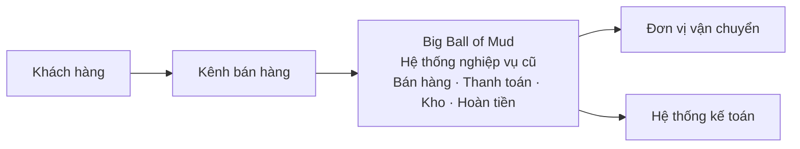
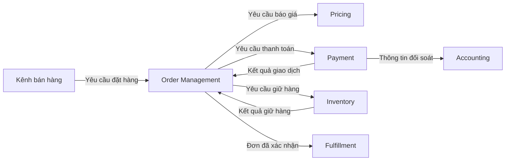

# Big Ball of Mud: nhận diện vùng thiếu ranh giới và hướng cô lập

## Vì sao cần nhận diện Big Ball of Mud khi lập bản đồ ngữ cảnh?

Trong một hệ thống phát triển qua nhiều năm, các chức năng mới thường được thêm vào để đáp ứng nhu cầu trước mắt. Khi thiếu ranh giới rõ ràng, mã nguồn, dữ liệu và quy tắc nghiệp vụ dần phụ thuộc chéo. Một thay đổi nhỏ có thể lan sang nhiều phần, cùng một khái niệm được hiểu theo nhiều cách, và không ai chắc chắn thành phần nào thực sự sở hữu một quyết định nghiệp vụ. Đây là tình trạng thường được gọi là **Big Ball of Mud**.

Trong Domain-Driven Design (DDD), bản đồ ngữ cảnh (Context Map) giúp mô tả các bounded context và quan hệ giữa chúng. Nhưng khi khảo sát một hệ thống cũ, nhóm có thể chưa tìm thấy những ranh giới đủ rõ để gọi là bounded context. Khi đó, việc ghi nhận một vùng Big Ball of Mud trên bản đồ là cách trung thực để thể hiện phần chưa có mô hình nhất quán, các phụ thuộc đan xen và nhu cầu cần khảo sát hoặc cô lập dần.

Big Ball of Mud không chỉ là vấn đề mã nguồn khó đọc. Nó có thể phản ánh việc nhiều mô hình nghiệp vụ bị trộn lẫn, quyền sở hữu dữ liệu không rõ, các nhóm dùng thuật ngữ khác nhau hoặc quy trình thay đổi không có chủ sở hữu. Vì vậy, hướng xử lý cần kết hợp hiểu nghiệp vụ, xác định ranh giới và cải thiện kiến trúc theo từng bước.

Sau bài học, người học có thể:

- Giải thích Big Ball of Mud và phân biệt nó với một ứng dụng nguyên khối có cấu trúc tốt.
- Nhận diện dấu hiệu thiếu ranh giới ở mã nguồn, dữ liệu, ngôn ngữ nghiệp vụ và quy trình thay đổi.
- Biểu diễn vùng chưa rõ ranh giới trên Context Map với giả định và mức độ tin cậy minh bạch.
- Tìm các điểm tiếp giáp phù hợp để cô lập từng phần mà không cần viết lại toàn bộ hệ thống.
- Chọn cách bảo vệ mô hình mới bằng hợp đồng tích hợp, Published Language hoặc Anti-Corruption Layer.

## Big Ball of Mud là gì?

Thuật ngữ **Big Ball of Mud** mô tả một hệ thống phần mềm có cấu trúc lộn xộn, khó nhận ra kiến trúc và ranh giới trách nhiệm. Các thành phần phụ thuộc lẫn nhau theo cách thiếu kiểm soát; logic nghiệp vụ có thể nằm rải rác trong giao diện, dịch vụ, truy vấn dữ liệu, thủ tục lưu trữ hoặc các tiến trình nền. Hệ thống vẫn có thể chạy và tạo ra giá trị, nhưng chi phí hiểu, thay đổi và kiểm soát rủi ro ngày càng cao.

Một Big Ball of Mud thường hình thành dần qua những quyết định riêng lẻ có vẻ hợp lý tại thời điểm thực hiện: thêm một nhánh điều kiện để xử lý khách hàng đặc biệt, dùng chung một bảng để tránh đồng bộ dữ liệu, gọi trực tiếp một hàm nội bộ để kịp tiến độ, hoặc sao chép quy tắc từ một màn hình sang một tiến trình khác. Khi những đường nối này tăng lên mà không có ranh giới và quyền sở hữu, hệ thống trở nên khó thay đổi một cách an toàn.

**Big Ball of Mud là một mô tả về tình trạng cấu trúc**, không phải tên của một công nghệ, một kiểu triển khai hay một cấp độ trưởng thành chính thức. Một ứng dụng nguyên khối (monolith) có thể có module rõ ràng, phụ thuộc một chiều và mô hình miền nhất quán. Ngược lại, một hệ thống gồm nhiều microservice vẫn có thể là Big Ball of Mud nếu các dịch vụ phụ thuộc vòng, dùng chung cơ sở dữ liệu, chia sẻ mô hình không thống nhất và cần triển khai đồng thời.

### Những dấu hiệu thường gặp

| Nhóm dấu hiệu | Biểu hiện | Rủi ro đối với nghiệp vụ và thay đổi |
|---|---|---|
| Phụ thuộc mã nguồn | Module gọi trực tiếp lẫn nhau, vòng phụ thuộc, lớp tiện ích chứa nhiều quy tắc không liên quan | Thay đổi ở một vùng gây lỗi ngoài dự kiến |
| Quy tắc nghiệp vụ | Cùng một chính sách được cài đặt ở nhiều nơi; quy tắc quan trọng nằm trong câu lệnh điều kiện rải rác | Kết quả xử lý không nhất quán giữa các kênh |
| Ngôn ngữ miền | Một từ như “khách hàng”, “đơn hàng” hoặc “trạng thái” có nhiều ý nghĩa nhưng dùng chung cấu trúc | Mô hình bị nhập nhằng, nhóm hiểu khác nhau |
| Dữ liệu | Nhiều thành phần cùng sửa một bảng; không rõ ai sở hữu dữ liệu; khóa ngoại xuyên qua các vùng | Khó thay đổi schema, khó xác định nguồn dữ liệu đáng tin cậy |
| Tích hợp | Gọi trực tiếp cơ sở dữ liệu hoặc hàm nội bộ của vùng khác; hợp đồng không ổn định | Các thành phần bị khóa chặt vào cách triển khai của nhau |
| Tổ chức | Nhiều nhóm cùng sửa một vùng; không rõ ai quyết định quy tắc | Thay đổi chậm, xung đột và trách nhiệm bị phân tán |
| Vận hành | Triển khai một chức năng buộc phát hành nhiều phần không liên quan; lỗi khó khoanh vùng | Rủi ro phát hành và chi phí phục hồi tăng |

Không nên kết luận Big Ball of Mud chỉ từ một dấu hiệu. Một module lớn chưa chắc đã mất ranh giới; một bảng được dùng chung có thể là lựa chọn có chủ đích; một lần triển khai đồng bộ có thể do yêu cầu vận hành. Cần xem xét nhiều bằng chứng và hỏi vì sao cấu trúc đó tồn tại.

### Phân biệt triệu chứng với nguyên nhân

Một số triệu chứng kỹ thuật có thể bắt nguồn từ vấn đề nghiệp vụ hoặc tổ chức:

- Một bảng `customer` được nhiều nhóm cập nhật có thể cho thấy chưa thống nhất ai chịu trách nhiệm về thông tin định danh, thông tin liên hệ, hồ sơ tín dụng hoặc quan hệ khách hàng.
- Một lớp `OrderService` khổng lồ có thể đang chứa nhiều quy trình khác nhau như bán hàng, thanh toán, giao hàng, hoàn tiền và chăm sóc sau bán.
- Một API trả về hàng trăm trường có thể phản ánh việc một mô hình dữ liệu nội bộ đang bị dùng làm hợp đồng chung cho nhiều nhu cầu.
- Một thay đổi phải phát hành đồng thời nhiều ứng dụng có thể cho thấy hợp đồng giữa chúng chưa ổn định hoặc quyền sở hữu chưa rõ.

Mục tiêu khám phá không phải là gắn nhãn một nhóm hay một đoạn mã là “xấu”. Mục tiêu là hiểu phần nào đang trộn lẫn những trách nhiệm khác nhau, phụ thuộc nào khiến việc thay đổi khó khăn và ai có thể xác nhận quy tắc nghiệp vụ liên quan.

## Big Ball of Mud trên Context Map

Context Map thường mô tả các bounded context và quan hệ giữa chúng, ví dụ Customer-Supplier, Conformist, Shared Kernel, Anti-Corruption Layer, Open Host Service hoặc Published Language. Một vùng Big Ball of Mud cho biết nhóm chưa thể mô tả phần hệ thống đó bằng các bounded context có ranh giới và mô hình rõ ràng.

Vì vậy, **Big Ball of Mud không đồng nghĩa với một bounded context đã được xác định tốt**. Có thể đánh dấu một vùng nghi vấn trên bản đồ hiện trạng (as-is), ghi lại các hệ thống hoặc nhóm liên quan, các luồng dữ liệu đã biết và những điểm chưa rõ. Sau khi khảo sát, vùng đó có thể được tách thành nhiều bounded context, được tổ chức lại thành một context có ranh giới rõ, hoặc vẫn được giữ nguyên trong một giai đoạn nếu chi phí thay đổi quá lớn.

Không có một ký hiệu đồ họa duy nhất bắt buộc cho Big Ball of Mud trong mọi cách biểu diễn Context Map. Nhóm nên chọn một quy ước dễ hiểu, chẳng hạn vùng nền gạch chéo hoặc khung nét đứt có nhãn `Big Ball of Mud`, và ghi chú rõ đây là ranh giới tạm thời. Điều quan trọng là người đọc không nhầm vùng nghi vấn với một bounded context đã được xác nhận.

Ví dụ sơ đồ hiện trạng dưới đây chỉ minh họa cách ghi nhận vùng chưa rõ ranh giới:

Sơ đồ này chưa khẳng định bên trong `Mud` có bao nhiêu bounded context. Nó ghi lại những kết nối quan sát được và đặt câu hỏi cần khảo sát: ai sở hữu trạng thái đơn hàng, ai quyết định giá, ai chịu trách nhiệm ghi nhận thanh toán, ai quản lý tồn kho và ai quyết định hoàn tiền?

### Những gì cần ghi chú khi đánh dấu vùng Big Ball of Mud

Để bản đồ có ích cho quyết định tiếp theo, hãy ghi tối thiểu:

- **Phạm vi quan sát:** ứng dụng, module, cơ sở dữ liệu, quy trình hoặc nhóm nào đang nằm trong vùng nghi vấn.
- **Chức năng nghiệp vụ đã biết:** các năng lực hoặc quy trình được phục vụ, kèm thuật ngữ đang được sử dụng.
- **Các điểm tiếp giáp:** người dùng, hệ thống bên ngoài, API, tệp trao đổi, hàng đợi, bảng dữ liệu hoặc quy trình thủ công kết nối với vùng đó.
- **Phụ thuộc quan trọng:** thành phần nào gọi hoặc sửa dữ liệu của thành phần nào; điều gì buộc các phần phải phát hành cùng nhau.
- **Chủ sở hữu và chuyên gia:** nhóm vận hành, người quyết định chính sách và người có thể xác nhận cách xử lý thực tế.
- **Mức độ chắc chắn:** điều đã quan sát, điều do người khác mô tả và giả thuyết cần kiểm chứng.
- **Rủi ro thay đổi:** phần nào thường xuyên thay đổi, phần nào dễ gây sự cố hoặc có tác động kinh doanh lớn.

Không nên tự vẽ ranh giới cứng chỉ dựa trên tên thư mục, tên bảng hoặc cấu trúc triển khai. Ranh giới bounded context phải được xác nhận bằng mô hình và ngôn ngữ nghiệp vụ nhất quán.

## Quy trình nhận diện vùng thiếu ranh giới

### Bước 1: Bắt đầu từ một luồng nghiệp vụ có thật

Chọn một luồng đầu-cuối có giá trị đối với doanh nghiệp, ví dụ từ lúc khách đặt hàng đến khi đơn được giao hoặc hủy. Hỏi những vai trò nào tham gia, quyết định nào được đưa ra, trạng thái nào thay đổi và thông tin được chuyển qua đâu.

Không bắt đầu bằng việc phân loại toàn bộ repository hoặc vẽ sơ đồ tất cả ứng dụng. Một luồng có thật giúp nhóm tập trung vào nơi phụ thuộc đang ảnh hưởng đến kết quả kinh doanh.

### Bước 2: Ghi nhận thuật ngữ và quy tắc ở từng nơi

Với mỗi bộ phận hoặc hệ thống tham gia, ghi lại cách họ định nghĩa các khái niệm như khách hàng, đơn hàng, sản phẩm, thanh toán và hoàn tiền. Hỏi cùng một từ có mang cùng ý nghĩa, vòng đời và quy tắc ở các nơi hay không.

Ví dụ, “khách hàng” trong bán hàng có thể là người đặt mua; trong kế toán có thể là pháp nhân chịu trách nhiệm thanh toán; trong vận chuyển có thể là người nhận kiện hàng. Việc dùng chung tên không chứng minh ba mô hình này giống nhau.

### Bước 3: Lần theo quyền sở hữu dữ liệu và quyết định

Với mỗi dữ liệu quan trọng, xác định ai có quyền tạo, sửa, xác nhận và thay đổi trạng thái. Tìm nguồn dữ liệu được xem là đáng tin cậy cho từng quyết định. Nếu nhiều thành phần cùng ghi một dữ liệu, hỏi quy tắc giải quyết xung đột là gì.

Quyền sở hữu không chỉ là quyền ghi vào một bảng. Nó bao gồm trách nhiệm giải thích ý nghĩa dữ liệu, bảo vệ bất biến và quyết định khi quy tắc thay đổi.

### Bước 4: Theo dõi phụ thuộc và tác động thay đổi

Quan sát luồng gọi, truy vấn, sự kiện, tệp trao đổi và các bước triển khai. Chọn một thay đổi gần đây, lần theo những thành phần phải sửa hoặc phát hành cùng nhau. Hỏi điều gì khiến thay đổi lan rộng: dùng chung mô hình, truy cập dữ liệu trực tiếp, hợp đồng chưa ổn định hay quy tắc bị sao chép?

Các chỉ số như số thành phần bị ảnh hưởng, tần suất phát hành phối hợp, số lỗi hồi quy và thời gian khoanh vùng sự cố có thể giúp đánh giá mức độ liên kết. Chúng là bằng chứng hỗ trợ, không tự động xác định ranh giới miền.

### Bước 5: Phân biệt vùng có mô hình rõ với vùng chưa rõ

Tìm nơi có ngôn ngữ, quy tắc, trách nhiệm và vòng đời nhất quán. Đó có thể là ứng viên bounded context. Phần còn lại có nhiều mô hình chồng lấn, phụ thuộc không kiểm soát hoặc chưa có chủ sở hữu rõ ràng có thể được đánh dấu là vùng Big Ball of Mud tạm thời.

Nếu một vùng có cấu trúc kỹ thuật chưa tốt nhưng nghiệp vụ và mô hình vẫn nhất quán, hãy ghi nhận vấn đề kiến trúc cụ thể thay vì mặc định toàn vùng là Big Ball of Mud. Ngược lại, một vùng có nhiều ứng dụng tách biệt vẫn có thể thiếu ranh giới miền.

### Bước 6: Xác nhận với chuyên gia và nhóm vận hành

Đọc lại bản đồ với những người hiểu công việc thực tế. Xác nhận thuật ngữ, quyền quyết định, ngoại lệ và điểm bàn giao. Ghi rõ bất đồng thay vì ép thành một câu trả lời duy nhất. Những bất đồng về ý nghĩa thường là tín hiệu quan trọng để khám phá bounded context.

### Bước 7: Chọn một điểm cô lập có giá trị

Ưu tiên một vùng có ranh giới nghiệp vụ tương đối rõ, phụ thuộc có thể kiểm soát và giá trị cải thiện đo được. Tránh chọn điểm tách chỉ vì một module có ít dòng mã. Hãy cân nhắc rủi ro vận hành, mức độ quan trọng, tần suất thay đổi và khả năng sở hữu của nhóm.

## Ví dụ: Hệ thống thương mại điện tử phát triển lâu năm

Giả sử một doanh nghiệp có một ứng dụng cũ phục vụ nhiều năm. Theo thời gian, ứng dụng bổ sung bán hàng, khuyến mãi, thanh toán, kho, giao hàng và hoàn tiền. Một số kênh bán hàng cập nhật trực tiếp cùng bảng đơn hàng; quy tắc tính giá xuất hiện trong cả màn hình bán hàng và tiến trình xử lý đơn; bộ phận kho tự sửa trạng thái đơn khi thiếu hàng; kế toán đọc dữ liệu đơn hàng để suy ra khoản phải thu.

### Dấu hiệu được quan sát

| Quan sát | Câu hỏi khám phá |
|---|---|
| Bảng đơn hàng chứa thông tin giá, thanh toán, kho và giao hàng | Những thông tin này có cùng chủ sở hữu và vòng đời không? |
| Nhiều thành phần cập nhật trạng thái đơn | Ai có quyền quyết định trạng thái và điều kiện chuyển trạng thái? |
| Quy tắc khuyến mãi được sao chép ở nhiều nơi | Ai sở hữu chính sách giá và cách các kênh áp dụng chính sách? |
| Hoàn tiền được xử lý bằng cách sửa trực tiếp dữ liệu thanh toán | Ai chịu trách nhiệm về giao dịch tài chính và lịch sử điều chỉnh? |
| Một thay đổi về đơn hàng buộc phát hành cả kho và kế toán | Các bên phụ thuộc vào hợp đồng nào và có thể thay đổi độc lập đến đâu? |

Nhóm chưa nên kết luận ngay rằng cần tạo năm microservice. Trước tiên, hãy xác minh các năng lực và mô hình: quản lý đơn hàng, định giá/khuyến mãi, thanh toán, quản lý tồn kho, thực hiện giao hàng và kế toán. Chúng là ứng viên để khảo sát; không mặc định mỗi năng lực phải tương ứng với một bounded context hoặc một dịch vụ triển khai riêng.

### Từ bản đồ hiện trạng đến hướng cô lập

Sau workshop, nhóm có thể nhận thấy một số ranh giới nghiệp vụ tương đối rõ:

- **Order Management:** chịu trách nhiệm về vòng đời đơn hàng và các quyết định chấp nhận, xác nhận hoặc hủy đơn.
- **Pricing:** chịu trách nhiệm xác định giá áp dụng và điều kiện khuyến mãi.
- **Payment:** chịu trách nhiệm về yêu cầu thanh toán, kết quả giao dịch và hoàn tiền.
- **Inventory:** chịu trách nhiệm về lượng hàng có thể đáp ứng và việc giữ hoặc giải phóng hàng.
- **Fulfillment:** chịu trách nhiệm chuẩn bị và bàn giao hàng để giao.

Đây là mô hình mục tiêu giả định để minh họa. Doanh nghiệp cần xác nhận các ranh giới này bằng ngôn ngữ, quy tắc và quyền sở hữu thực tế. Chẳng hạn, có nơi xem giữ hàng là trách nhiệm của Order Management, nơi khác lại thuộc Inventory. Quyết định phải xuất phát từ nghiệp vụ và khả năng vận hành.

Một sơ đồ mục tiêu có thể được biểu diễn như sau:

Sơ đồ cho thấy các trách nhiệm và điểm trao đổi dự kiến. Nó chưa quy định giao thức đồng bộ hay bất đồng bộ, cũng chưa chứng minh rằng mọi context cần một tiến trình riêng. Hợp đồng, dữ liệu và quan hệ tích hợp cần được thiết kế sau khi các bên xác nhận mô hình.

## Hướng cô lập Big Ball of Mud theo từng bước

Mục tiêu thực tế thường là giảm phạm vi ảnh hưởng của thay đổi, làm rõ quyền sở hữu và tạo ranh giới có thể bảo vệ. Không nên mặc định phải viết lại toàn bộ hệ thống. Một cuộc viết lại lớn có thể kéo dài nhiều năm, trong khi nghiệp vụ vẫn phải tiếp tục vận hành và các quy tắc cũ có thể chưa được hiểu đầy đủ.

### 1. Tạo bản đồ hiện trạng và chọn lát cắt

Ghi lại các luồng nghiệp vụ, phụ thuộc, nguồn dữ liệu và nhóm sở hữu. Chọn một lát cắt theo năng lực nghiệp vụ hoặc một hành vi đầu-cuối có thể quan sát được. Lát cắt nên có đầu vào, kết quả và tiêu chí hoàn thành rõ ràng.

Một điểm bắt đầu tốt thường có các đặc điểm:

- Có nhu cầu thay đổi hoặc rủi ro đang gây ảnh hưởng rõ.
- Có chuyên gia nghiệp vụ và nhóm chịu trách nhiệm xác nhận quy tắc.
- Có thể xác định dữ liệu đầu vào, kết quả và các ngoại lệ chính.
- Có một điểm tiếp giáp kỹ thuật để chuyển hướng lưu lượng hoặc trao đổi dữ liệu.
- Phạm vi đủ nhỏ để kiểm soát nhưng đủ có ý nghĩa để chứng minh lợi ích.

### 2. Xác định quyền sở hữu và hợp đồng

Trước khi tách mã nguồn, hãy thống nhất thành phần nào sở hữu quyết định và dữ liệu của lát cắt. Các phần khác nên tương tác qua một hợp đồng có ý nghĩa nghiệp vụ, chẳng hạn API, thông điệp hoặc Published Language. Hợp đồng cần xác định ý nghĩa trường dữ liệu, trạng thái, lỗi, phiên bản và trách nhiệm khi thay đổi.

Không nên chỉ đổi tên một bảng hoặc bọc một hàm cũ bằng API rồi tuyên bố đã có bounded context. Nếu thành phần mới vẫn phải hiểu toàn bộ cấu trúc nội bộ và quy tắc của vùng cũ, ranh giới chưa thực sự được bảo vệ.

### 3. Bảo vệ mô hình mới bằng Anti-Corruption Layer

**Anti-Corruption Layer (ACL)** là lớp chuyển đổi giúp mô hình của một bounded context không bị chi phối bởi mô hình hoặc hợp đồng của context khác. ACL dịch dữ liệu, thuật ngữ và ý nghĩa giữa hai phía. Nó đặc biệt hữu ích khi phải tích hợp với hệ thống cũ có mô hình không ổn định hoặc không phù hợp với ngôn ngữ miền mới.

Ví dụ, hệ thống cũ trả về một bản ghi `Customer` chứa cả người mua, người nhận hàng và bên thanh toán. Context Order Management có thể chỉ cần thông tin người đặt và người nhận; Context Accounting lại cần pháp nhân chịu trách nhiệm thanh toán. ACL chuyển đổi dữ liệu từ mô hình cũ sang các khái niệm đúng với từng context.

ACL cần có phạm vi rõ, quy tắc chuyển đổi được kiểm thử và người sở hữu. Nếu mọi logic nghiệp vụ mới đều bị dồn vào ACL, lớp này sẽ trở thành một Big Ball of Mud mới. Hãy giữ chính sách nghiệp vụ bên trong context sở hữu chính sách đó; ACL chủ yếu làm nhiệm vụ dịch và bảo vệ ranh giới.

### 4. Tạo cấu trúc module và kiểm soát phụ thuộc

Nếu hệ thống hiện tại là monolith, có thể bắt đầu bằng modular monolith: chia module theo trách nhiệm nghiệp vụ, kiểm soát quyền truy cập và hướng phụ thuộc, rồi thay thế các lời gọi trực tiếp bằng giao diện nội bộ rõ ràng. Cơ sở dữ liệu có thể vẫn dùng chung trong giai đoạn đầu, nhưng cần xác định module nào sở hữu bảng hoặc vùng dữ liệu nào và ngăn các module khác ghi trực tiếp.

Chỉ khi ranh giới và nhu cầu triển khai độc lập đã rõ, nhóm mới cân nhắc tách tiến trình hoặc dịch vụ. Tách module và tách dịch vụ là hai quyết định khác nhau; tách dịch vụ sớm có thể thêm chi phí mạng, vận hành, nhất quán dữ liệu và xử lý lỗi phân tán.

### 5. Chuyển dần luồng xử lý

Có thể áp dụng **Strangler Fig Pattern**: đặt một điểm định tuyến trước hệ thống cũ, sau đó chuyển từng chức năng hoặc luồng nghiệp vụ sang phần mới. Trong thời gian chuyển tiếp, phần cũ vẫn xử lý các luồng chưa được thay thế.

Một chiến lược khác là **Branch by Abstraction**: tạo một giao diện ổn định trước phần triển khai hiện tại, chuyển các caller sang giao diện đó, rồi thay thế từng phần triển khai phía sau. Cách này hữu ích khi chưa thể thay đổi điểm gọi cùng lúc.

Khi chuyển luồng, phải xác định rõ:

- Hệ thống nào là nơi xử lý chính tại thời điểm chuyển đổi?
- Làm sao tránh hai phía cùng thực hiện một hành động có tác động tài chính hoặc tồn kho?
- Cách xử lý yêu cầu đang chạy dở và thông điệp đến trễ là gì?
- Có cơ chế đối soát để phát hiện chênh lệch không?
- Điều kiện nào cho phép chuyển tiếp, dừng hoặc quay lại luồng cũ?

Tránh để hai hệ thống cùng ghi một nguồn dữ liệu mà không có quy tắc phân xử. Nếu cần chạy song song để so sánh, hãy giới hạn phía ghi phụ ở chế độ quan sát hoặc thiết kế rõ cơ chế đồng bộ, idempotency và đối soát.

### 6. Chuyển quyền sở hữu dữ liệu có kiểm soát

Tách quyền sở hữu dữ liệu thường khó hơn tách mã nguồn. Hãy lập kế hoạch cho nguồn dữ liệu chính, chuyển dữ liệu, đồng bộ thay đổi trong giai đoạn chuyển tiếp, kiểm tra tính đầy đủ và chuyển quyền ghi vào thời điểm được kiểm soát.

Không nên duy trì hai nguồn sự thật lâu dài. Nếu dữ liệu cần được sao chép sang context khác, hãy xác định bản sao đó phục vụ mục đích gì, độ trễ chấp nhận được, cách xử lý sự kiện đến lặp hoặc sai thứ tự và cách tái đồng bộ khi lỗi. Context nhận dữ liệu không nên tự ý cập nhật ngược dữ liệu do context khác sở hữu.

### 7. Loại bỏ đường đi cũ và cập nhật bản đồ

Khi luồng mới đã ổn định, xóa hoặc khóa đường gọi cũ, loại bỏ quyền ghi không còn hợp lệ và cập nhật tài liệu tích hợp. Đo lại thời gian thay đổi, số thành phần bị ảnh hưởng, tỷ lệ lỗi và chi phí vận hành. Sau mỗi lát cắt, cập nhật Context Map để phản ánh quan hệ mới và những vùng còn chưa rõ.

## Chọn mẫu quan hệ phù hợp khi cô lập

Context Map không chỉ là sơ đồ các hộp. Nó thể hiện cách các context phối hợp và mức độ ảnh hưởng lẫn nhau. Một số mẫu quan hệ thường hữu ích khi làm việc với hệ thống cũ:

| Mẫu quan hệ | Khi nào cân nhắc | Điều cần chú ý |
|---|---|---|
| Anti-Corruption Layer | Context mới cần bảo vệ mô hình khỏi mô hình cũ hoặc đối tác | Phải có phạm vi dịch rõ ràng; không để ACL chứa toàn bộ nghiệp vụ |
| Open Host Service | Muốn cung cấp một dịch vụ truy cập ổn định cho nhiều context tiêu thụ | Hợp đồng phải được thiết kế và vận hành như một sản phẩm tích hợp |
| Published Language | Các bên cần trao đổi bằng một định dạng hoặc ngôn ngữ chung đã công bố | Định nghĩa và phiên bản phải được quản lý; không để lộ cấu trúc nội bộ tùy tiện |
| Customer-Supplier | Một context cung cấp năng lực cho context khác có thể nêu nhu cầu và thương lượng ưu tiên | Cần làm rõ quyền quyết định, cam kết và cách xử lý khi nhu cầu xung đột |
| Conformist | Context tiêu thụ chấp nhận mô hình của upstream vì không thể tác động đến nó | Phù hợp khi lợi ích của ACL không đủ bù chi phí, nhưng cần hiểu rõ sự phụ thuộc |
| Shared Kernel | Hai context có một phần mô hình nhỏ cần thay đổi phối hợp | Phạm vi phải nhỏ và có quy trình đồng thuận; nếu mở rộng sẽ làm tăng liên kết |
| Separate Ways | Chi phí tích hợp lớn hơn giá trị trao đổi và hai bên có thể hoạt động độc lập | Cần kiểm tra nghĩa vụ pháp lý, đối soát và nhu cầu nghiệp vụ trước khi tách rời |

Không có một mẫu nào luôn đúng. Một context mới có thể dùng ACL để tích hợp với hệ thống cũ trong giai đoạn đầu, rồi chuyển sang Published Language hoặc Open Host Service khi phía cũ được cải tổ. Mẫu quan hệ nên phản ánh thực tế quyền lực, trách nhiệm và khả năng phối hợp giữa các nhóm.

## Những sai lầm thường gặp khi xử lý Big Ball of Mud

| Sai lầm | Vì sao gây vấn đề | Cách làm tốt hơn |
|---|---|---|
| Gọi mọi monolith là Big Ball of Mud | Bỏ qua khả năng có cấu trúc module và mô hình nhất quán | Đánh giá phụ thuộc, ngôn ngữ, quyền sở hữu và khả năng thay đổi |
| Tách mỗi bảng hoặc module thành một microservice | Ranh giới kỹ thuật có thể không khớp ranh giới nghiệp vụ | Bắt đầu từ năng lực, quy tắc và quyền sở hữu |
| Viết lại toàn bộ ngay lập tức | Phải tái khám phá nhiều quy tắc ẩn và chịu rủi ro chuyển đổi lớn | Cô lập theo lát cắt, chuyển luồng từng bước |
| Chỉ thêm API trước cơ sở dữ liệu dùng chung | Các bên vẫn phụ thuộc vào cùng mô hình và quyền ghi | Xác định chủ sở hữu dữ liệu, hợp đồng và quy tắc truy cập |
| Đưa mọi chuyển đổi vào ACL | ACL trở thành nơi chứa nghiệp vụ và phụ thuộc mới | Giữ quy tắc trong context sở hữu; ACL chỉ dịch qua ranh giới |
| Chạy song song hai nơi cùng ghi | Phát sinh xung đột, trùng giao dịch và dữ liệu sai lệch | Chỉ định nguồn ghi chính, idempotency và đối soát |
| Vẽ Context Map một lần rồi bỏ quên | Bản đồ nhanh chóng lệch với hệ thống thực tế | Cập nhật sau mỗi thay đổi ranh giới hoặc hợp đồng |
| Chỉ dựa vào sơ đồ kỹ thuật | Không phát hiện các mô hình nghiệp vụ khác nghĩa | Xác nhận bằng workshop và ví dụ thực tế |

## Đo lường tiến triển sau khi cô lập

Không nên đo thành công chỉ bằng số service mới hoặc số module đã tách. Hãy theo dõi những thay đổi mà nhóm và doanh nghiệp thực sự cảm nhận được:

- **Phạm vi ảnh hưởng:** một thay đổi nghiệp vụ cần sửa bao nhiêu context hoặc thành phần?
- **Khả năng triển khai:** một context có thể phát hành độc lập trong những điều kiện nào?
- **Quyền sở hữu:** có xác định được nhóm chịu trách nhiệm về quy tắc và dữ liệu không?
- **Tính nhất quán:** có giảm các trường hợp cùng một quy tắc cho kết quả khác nhau không?
- **Độ tin cậy tích hợp:** hợp đồng có được kiểm thử, quản lý phiên bản và giám sát không?
- **Thời gian phục hồi:** khi có lỗi, nhóm có thể khoanh vùng và khôi phục nhanh đến đâu?
- **Khả năng hiểu miền:** chuyên gia và nhà phát triển có thống nhất được thuật ngữ và trạng thái không?

Thiết lập số liệu ban đầu trước khi thay đổi để có thể so sánh. Mục tiêu là giảm phụ thuộc không cần thiết và tăng khả năng thay đổi an toàn; số lượng dịch vụ tăng lên tự nó không chứng minh điều đó.

## Checklist cho buổi đánh giá Context Map

Trước khi đề xuất cô lập một vùng Big Ball of Mud, hãy kiểm tra:

- [ ] Đã chọn một luồng nghiệp vụ thực tế và xác định kết quả cần đạt.
- [ ] Đã ghi nhận các vai trò, thuật ngữ, quy tắc và ngoại lệ quan trọng.
- [ ] Đã xác định các hệ thống, module, dữ liệu và nhóm liên quan.
- [ ] Đã có bằng chứng về phụ thuộc hoặc quyền sở hữu chưa rõ.
- [ ] Đã phân biệt điều quan sát được với giả thuyết cần xác minh.
- [ ] Đã xác định chuyên gia nghiệp vụ và nhóm có quyền quyết định.
- [ ] Đã chọn một lát cắt có giá trị và điểm tiếp giáp kỹ thuật khả thi.
- [ ] Đã xác định context nào sở hữu dữ liệu và quyết định sau khi tách.
- [ ] Đã chọn hợp đồng tích hợp và cách bảo vệ mô hình mới.
- [ ] Đã có kế hoạch chuyển luồng, xử lý lỗi, đối soát và quay lui.
- [ ] Đã có tiêu chí đo lường và kế hoạch cập nhật Context Map.

## Kết luận

Big Ball of Mud là dấu hiệu cho thấy cấu trúc phần mềm, mô hình nghiệp vụ hoặc quyền sở hữu đã bị đan xen đến mức khó thay đổi an toàn. Khi lập Context Map, hãy ghi nhận vùng này như một phần chưa có ranh giới được xác nhận, thu thập bằng chứng từ luồng nghiệp vụ, ngôn ngữ, dữ liệu và phụ thuộc, rồi cùng chuyên gia xác định các ranh giới phù hợp. Hướng xử lý bền vững thường bắt đầu bằng một lát cắt có giá trị, hợp đồng rõ ràng và cơ chế bảo vệ mô hình mới; sau đó chuyển luồng và quyền sở hữu từng bước, đo kết quả và cập nhật bản đồ theo thực tế.
