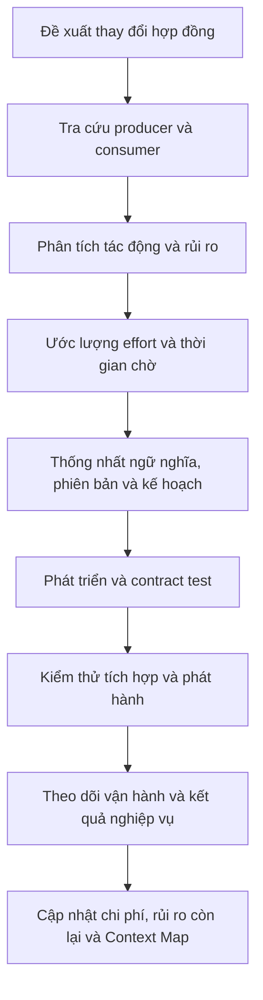

# Ghi nhận chi phí phối hợp, thay đổi hợp đồng và rủi ro giữa các nhóm

Một hệ thống doanh nghiệp thường được tạo thành từ nhiều bounded context do các nhóm khác nhau phát triển và vận hành. Mỗi context có mô hình, ngôn ngữ và quy tắc riêng, nhưng vẫn phải trao đổi dữ liệu hoặc phối hợp để hoàn thành một quy trình nghiệp vụ. Khi số lượng context tăng lên, chi phí phát triển không chỉ nằm trong từng nhóm. Thời gian chờ đợi, các buổi làm rõ, thay đổi hợp đồng, kiểm thử tích hợp, sự cố xuyên hệ thống và việc xử lý khác biệt về ngữ nghĩa đều tạo ra chi phí ở ranh giới giữa các nhóm.

Context Map giúp nhìn thấy các quan hệ đó. Tuy nhiên, một sơ đồ chỉ có tên context và đường kết nối chưa đủ để quản lý sự phụ thuộc. Đội ngũ cần ghi nhận chi phí phối hợp, lịch sử thay đổi hợp đồng và rủi ro liên quan để hiểu quan hệ nào đang tiêu tốn nhiều công sức, thay đổi nào có thể gây tác động dây chuyền và nơi nào cần cải thiện.

Trong Domain-Driven Design (DDD), những thông tin này giúp đánh giá liệu quan hệ giữa các bounded context có còn phù hợp với cách tổ chức đang làm việc hay không. Chúng cũng cung cấp bằng chứng để xem xét Context Map, điều chỉnh cách phối hợp, bảo vệ mô hình nội bộ và ưu tiên đầu tư kiến trúc.

## 1. Vì sao cần ghi nhận chi phí và rủi ro ở ranh giới context?

Mỗi bounded context có thể hoạt động tốt khi xét riêng, nhưng toàn bộ quy trình vẫn có thể chậm hoặc thiếu tin cậy do phụ thuộc giữa các context. Ví dụ, nhóm Order Management phát triển tính năng xác nhận đơn trong vài ngày, nhưng phải chờ nhóm Fulfillment cập nhật hợp đồng, môi trường kiểm thử và lịch phát hành. Thời gian chờ đó không xuất hiện trong số liệu hoàn thành của riêng nhóm Order Management, nhưng ảnh hưởng trực tiếp đến thời gian đưa giá trị tới khách hàng.

Nếu chỉ đo năng suất bên trong từng nhóm, tổ chức dễ bỏ qua những vấn đề như:

- Một thay đổi nhỏ ở context này buộc nhiều nhóm khác sửa code hoặc dữ liệu.
- Hợp đồng tích hợp thiếu định nghĩa rõ ràng, dẫn đến cách hiểu khác nhau về trạng thái và sự kiện.
- Nhóm phụ thuộc phải chờ lịch phát hành của nhóm cung cấp.
- Kiểm thử đầu cuối cần nhiều bước thủ công và môi trường dùng chung khó ổn định.
- Sự cố ở một context lan sang các quy trình khác mà không có người chịu trách nhiệm điều phối.
- Một nhà cung cấp hoặc hệ thống cũ thay đổi nhưng các nhóm sử dụng không nhận được thông tin kịp thời.

Ghi nhận các yếu tố này giúp tổ chức nhìn được chi phí thực của việc kết nối các mô hình nghiệp vụ. Mục tiêu không phải tạo thêm báo cáo để đánh giá cá nhân hoặc nhóm, mà là phát hiện những điểm phụ thuộc làm giảm khả năng thay đổi và độ tin cậy của hệ thống.

## 2. Phân biệt các loại thông tin cần theo dõi

Ba nhóm thông tin có liên quan nhưng phục vụ những mục đích khác nhau.

| Loại thông tin | Câu hỏi cần trả lời | Ví dụ |
|---|---|---|
| Chi phí phối hợp (coordination cost) | Các nhóm phải bỏ bao nhiêu thời gian và công sức để cùng thay đổi hoặc vận hành một năng lực? | Ba nhóm cần họp làm rõ hợp đồng, sửa adapter và phối hợp phát hành |
| Thay đổi hợp đồng (contract change) | Giao diện hoặc ngữ nghĩa giữa các context đã thay đổi như thế nào và ai bị ảnh hưởng? | Sự kiện `OrderConfirmed` bổ sung thông tin về phương thức giao một phần |
| Rủi ro liên context (cross-context risk) | Điều gì có thể xảy ra tại ranh giới và ảnh hưởng đến nghiệp vụ ra sao? | Consumer cũ không hiểu trạng thái mới và bỏ qua yêu cầu thực hiện |

Một thay đổi hợp đồng có thể làm tăng chi phí phối hợp và tạo ra rủi ro. Ngược lại, một rủi ro đã được phát hiện có thể khiến nhóm chủ động đầu tư vào kiểm thử hoặc thay đổi quy trình phát hành. Cần liên kết các bản ghi bằng mã tham chiếu để người đọc truy được mối quan hệ giữa nguyên nhân, chi phí và biện pháp xử lý.

Không nên gộp tất cả thành một chỉ số duy nhất. Một con số tổng hợp có thể hữu ích khi theo dõi xu hướng, nhưng cần giữ dữ liệu chi tiết để hiểu chi phí phát sinh từ đâu và rủi ro nào đang được chấp nhận.

## 3. Ghi nhận chi phí phối hợp giữa các nhóm

### Những thành phần tạo nên chi phí phối hợp

Chi phí phối hợp không chỉ là thời gian họp. Có thể phân loại thành các nhóm sau:

| Thành phần | Nội dung | Ví dụ quan sát được |
|---|---|---|
| Làm rõ nghiệp vụ | Thời gian thống nhất thuật ngữ, quy tắc và ngoại lệ giữa các context | Hai nhóm phải tổ chức workshop để làm rõ ý nghĩa “đã tiếp nhận” |
| Điều phối kế hoạch | Thời gian đồng bộ backlog, roadmap, nguồn lực và lịch phát hành | Một nhóm phải dời sprint vì nhóm phụ thuộc chưa sẵn sàng |
| Thiết kế hợp đồng | Công sức thiết kế, review và thống nhất API, event, schema hoặc chính sách phiên bản | Nhiều vòng review để xác định field bắt buộc và ngữ nghĩa trạng thái |
| Phát triển tích hợp | Công sức sửa adapter, mapping, consumer, producer và cấu hình | Thay đổi một event làm nhiều consumer phải cập nhật |
| Kiểm thử liên nhóm | Thời gian chuẩn bị môi trường, dữ liệu và chạy kiểm thử contract hoặc end-to-end | Chờ môi trường của nhóm khác hoặc phải chạy lại bộ kiểm thử |
| Chờ đợi và bàn giao | Thời gian công việc bị chặn do phụ thuộc, phê duyệt hoặc lịch triển khai | Một tính năng đã hoàn tất nhưng chưa thể phát hành |
| Xử lý sự cố | Điều tra, đối soát, phục hồi và giao tiếp khi lỗi xảy ra xuyên context | Hai nhóm cùng truy vết một giao dịch có trạng thái không nhất quán |
| Duy trì tương thích | Công sức hỗ trợ nhiều phiên bản hợp đồng hoặc nhiều hệ thống cũ | Producer phải phát cả schema cũ và mới trong giai đoạn chuyển tiếp |

Phân loại này giúp nhóm tìm được nguồn chi phí. Ví dụ, nếu phần lớn công sức nằm ở làm rõ nghiệp vụ, vấn đề có thể là thuật ngữ chưa thống nhất hoặc ranh giới context chưa rõ. Nếu chi phí chủ yếu nằm ở kiểm thử và phát hành, nhóm có thể cần cải thiện contract testing, môi trường hoặc khả năng tương thích.

### Đo thời gian và công sức theo cách có thể so sánh

Nên phân biệt **effort** và **elapsed time**:

- Effort là thời gian con người thực sự dành cho công việc, chẳng hạn số giờ review hợp đồng hoặc điều tra sự cố.
- Elapsed time là thời gian từ lúc bắt đầu đến lúc hoàn tất, bao gồm cả thời gian chờ người khác, chờ môi trường hoặc chờ lịch phát hành.

Hai chỉ số này phản ánh hai vấn đề khác nhau. Một thay đổi có thể chỉ cần bốn giờ công nhưng mất hai tuần vì chờ nhóm phụ thuộc. Nếu chỉ ghi effort, tổ chức sẽ không nhìn thấy độ trễ trong luồng giá trị. Nếu chỉ ghi elapsed time, tổ chức khó biết nguồn lực thực tế đã tiêu tốn bao nhiêu.

Khi ghi nhận, nên lưu mốc thời gian và loại công việc đủ rõ để tính lại sau này. Không cần theo dõi từng phút cho mọi cuộc trao đổi. Có thể dùng ước lượng theo khoảng hoặc tổng hợp theo thay đổi, miễn là phương pháp nhất quán và phù hợp với mục đích phân tích.

### Chi phí trực tiếp và chi phí ẩn

Chi phí trực tiếp thường dễ thấy: giờ làm việc của kỹ sư, chuyên gia nghiệp vụ, kiểm thử viên và người điều phối. Chi phí ẩn có thể bao gồm:

- Chi phí cơ hội khi đội ngũ phải trì hoãn một tính năng khác.
- Chi phí duy trì adapter và nhánh tương thích trong thời gian dài.
- Chi phí do hiểu sai ngữ nghĩa, dẫn đến sửa dữ liệu hoặc xử lý lại giao dịch.
- Chi phí vận hành khi nhiều context phụ thuộc vào cùng một hệ thống trung gian.
- Chi phí phối hợp với nhà cung cấp khi hợp đồng hoặc API thay đổi.
- Chi phí học lại khi nhân sự thay đổi mà tri thức về phụ thuộc chỉ nằm trong trao đổi miệng.

Không phải mọi chi phí ẩn đều có thể quy đổi thành tiền một cách chính xác. Hãy ghi nhận mô tả và bằng chứng trước; chỉ ước lượng giá trị tài chính khi có dữ liệu và giả định đủ rõ.

### Các chỉ số có thể sử dụng

| Chỉ số | Cách hiểu | Điều cần lưu ý |
|---|---|---|
| Coordination effort | Tổng effort cho các hoạt động phối hợp liên context trong kỳ | Phải xác định loại công việc được tính để so sánh nhất quán |
| Dependency wait time | Thời gian công việc bị chặn do chờ một context khác | Phân biệt chờ thật với thời gian công việc vẫn có thể tiến hành song song |
| Cross-context lead time | Thời gian từ lúc bắt đầu thay đổi có phụ thuộc đến khi thay đổi sẵn sàng trong các context liên quan | Ghi rõ mốc bắt đầu và kết thúc |
| Contract change frequency | Số lần hợp đồng tích hợp thay đổi trong một kỳ | Nhiều thay đổi không tự động là xấu; cần xem mức độ và lý do |
| Breaking change rate | Tỷ lệ thay đổi phá vỡ tương thích trên tổng số thay đổi hợp đồng | Cần thống nhất tiêu chí nhận diện breaking change |
| Integration rework | Công sức phải làm lại do hợp đồng, dữ liệu hoặc ngữ nghĩa không khớp | Ghi nguyên nhân, tránh gán lỗi cho một nhóm khi chưa đủ bằng chứng |
| Cross-context incident rate | Số sự cố có nguyên nhân hoặc tác động tại ranh giới context | Nên phân loại theo mức độ ảnh hưởng và nguyên nhân |
| Recovery time | Thời gian khôi phục luồng nghiệp vụ sau sự cố tích hợp | Đo theo kết quả phục hồi thực tế, không chỉ thời gian đóng ticket |

Không nên dùng một chỉ số để xếp hạng các nhóm. Ví dụ, nhóm có nhiều thay đổi hợp đồng có thể đang phục vụ một năng lực phát triển nhanh và có giá trị cao. Điều cần xem là thay đổi đó có được quản lý tốt, có gây rework hoặc sự cố không và chi phí có tương xứng với giá trị hay không.

### Cách ước lượng tổng chi phí phối hợp

Một cách tổng hợp đơn giản cho một quan hệ giữa hai context trong một kỳ:

```text
Coordination cost =
    effort làm rõ nghiệp vụ
  + effort điều phối và lập kế hoạch
  + effort thiết kế và review hợp đồng
  + effort phát triển tích hợp
  + effort kiểm thử liên context
  + effort xử lý sự cố và đối soát
  + effort duy trì tương thích
```

Nếu muốn ước lượng chi phí tiền tệ, có thể nhân effort theo vai trò với đơn giá nội bộ phù hợp. Cần ghi rõ cách tính và không cộng trùng thời gian một người tham gia nhiều hoạt động trong cùng một khoảng.

Ngoài tổng effort, nên báo cáo dependency wait time và cross-context lead time riêng. Hai số liệu này cho thấy mức độ chậm trễ do phụ thuộc, điều mà phép cộng giờ công không thể hiện.

## 4. Ghi nhận thay đổi hợp đồng giữa các context

Hợp đồng giữa các context là thỏa thuận về cách trao đổi thông tin và ý nghĩa của thông tin đó. Hợp đồng có thể bao gồm API, event, message schema, định dạng tệp, quy tắc xác thực, trạng thái, SLA và chính sách versioning.

Một thay đổi hợp đồng không chỉ là sửa một field. Thay đổi có thể tác động đến ngữ nghĩa nghiệp vụ, quyền sở hữu dữ liệu, thứ tự xử lý, tính tương thích và cam kết vận hành.

### Phân loại thay đổi

| Loại thay đổi | Ví dụ | Tác động thường gặp |
|---|---|---|
| Bổ sung tương thích (additive) | Thêm field tùy chọn mà consumer cũ có thể bỏ qua | Consumer mới có thể dùng thông tin bổ sung; vẫn cần kiểm tra schema và cách xử lý null |
| Thay đổi cấu trúc | Đổi kiểu dữ liệu, tên field hoặc cấu trúc lồng nhau | Có thể yêu cầu producer và consumer cập nhật |
| Thay đổi ngữ nghĩa | Giữ nguyên field nhưng thay đổi ý nghĩa hoặc thời điểm phát sinh | Dễ gây lỗi khó phát hiện vì schema vẫn hợp lệ |
| Thay đổi hành vi | Thay đổi thứ tự event, quy tắc retry hoặc điều kiện trả kết quả | Có thể làm thay đổi luồng nghiệp vụ của consumer |
| Thay đổi bảo mật | Thêm quyền truy cập, đổi cơ chế xác thực hoặc loại dữ liệu được chia sẻ | Có thể ảnh hưởng cấu hình, tuân thủ và khả năng truy cập |
| Thay đổi vận hành | Đổi SLA, giới hạn tốc độ, timeout hoặc thời gian lưu trữ | Ảnh hưởng độ tin cậy và cách consumer vận hành |
| Thay đổi phá vỡ tương thích (breaking) | Xóa field bắt buộc, bỏ endpoint hoặc ngừng hỗ trợ phiên bản | Consumer chưa nâng cấp có thể ngừng hoạt động |

Thay đổi additive không phải lúc nào cũng an toàn. Nếu producer thêm một giá trị enum mới mà consumer dùng switch không có nhánh mặc định, consumer có thể lỗi. Nếu field mới làm thay đổi giả định về thứ tự hoặc tính đầy đủ của dữ liệu, tác động có thể nghiêm trọng dù schema vẫn tương thích.

### Hồ sơ thay đổi hợp đồng cần có gì?

Mỗi thay đổi nên có một mã định danh và thông tin đủ để các nhóm liên quan đánh giá:

1. **Hợp đồng và phiên bản:** tên API/event/schema, phiên bản hiện tại và phiên bản đề xuất.
2. **Lý do nghiệp vụ:** vấn đề cần giải quyết, kết quả mong muốn và người yêu cầu.
3. **Mô tả thay đổi:** field, endpoint, event, quy tắc hoặc hành vi nào thay đổi.
4. **Phân loại tương thích:** additive, semantic, behavioral, operational hay breaking.
5. **Producer và consumer:** context sở hữu hợp đồng, các context sử dụng và hệ thống bên ngoài liên quan.
6. **Phân tích tác động:** code, dữ liệu, quy trình, báo cáo, bảo mật, kiểm thử và vận hành bị ảnh hưởng.
7. **Kế hoạch chuyển đổi:** thời gian hỗ trợ song song, thứ tự triển khai, migration và deprecation.
8. **Kiểm thử và quan sát:** contract test, integration test, dashboard, cảnh báo và điều kiện chấp nhận.
9. **Người chịu trách nhiệm:** người đề xuất, người review, người phê duyệt và người điều phối phát hành.
10. **Trạng thái và lịch sử:** ngày tạo, ngày thống nhất, ngày phát hành, kết quả và liên kết đến quyết định liên quan.

### Theo dõi vòng đời thay đổi

Một thay đổi hợp đồng có thể đi qua các trạng thái như:

`Proposed -> Impact Assessed -> Agreed -> Implementing -> Released -> Deprecated -> Retired`

Tên trạng thái có thể điều chỉnh theo quy trình của tổ chức. Cần phân biệt rõ thay đổi đã được đề xuất, đã thống nhất và đã được triển khai đầy đủ. Một phiên bản mới đã phát hành ở producer chưa có nghĩa là mọi consumer đã chuyển đổi xong.

Với thay đổi bị từ chối hoặc hoãn, lưu lý do và điều kiện xem xét lại. Lịch sử này giúp nhóm tránh đề xuất lại cùng một thay đổi mà không biết quyết định trước đó.

### Phân tích tác động theo đồ thị phụ thuộc

Hãy lưu danh sách producer, consumer và các hợp đồng mà từng context sử dụng. Khi một hợp đồng thay đổi, nhóm có thể lần theo đồ thị phụ thuộc để xác định context nào cần thông báo, kiểm thử hoặc nâng cấp.

Ví dụ, một event đơn hàng có ba consumer: Fulfillment, Notification và Analytics. Nếu thay đổi ngữ nghĩa của `OrderConfirmed`, cả ba consumer cần được đánh giá, dù chỉ Fulfillment là bên trực tiếp tham gia quy trình thực hiện đơn. Notification có thể gửi thông báo sai thời điểm; Analytics có thể tính sai số lượng đơn đã xác nhận.

Đừng chỉ tìm consumer trong source code. Có thể còn job định kỳ, báo cáo, luồng dữ liệu, đối tác hoặc ứng dụng cũ tiêu thụ hợp đồng. Danh mục phụ thuộc cần có người sở hữu và được cập nhật khi thêm hoặc bỏ tích hợp.

## 5. Ghi nhận rủi ro giữa các bounded context

Rủi ro liên context là khả năng xảy ra một sự kiện tại ranh giới hoặc do sự phụ thuộc giữa các context, gây ảnh hưởng đến mục tiêu nghiệp vụ, dữ liệu, vận hành hoặc khả năng thay đổi.

### Các nhóm rủi ro thường gặp

| Nhóm rủi ro | Mô tả | Ví dụ |
|---|---|---|
| Ngữ nghĩa | Hai context hiểu khác nhau về thuật ngữ, trạng thái hoặc sự kiện | Một bên hiểu “accepted” là đã nhận yêu cầu, bên kia hiểu là đã hoàn thành |
| Tương thích hợp đồng | Producer thay đổi nhưng consumer chưa sẵn sàng | Consumer lỗi khi gặp enum mới |
| Dữ liệu | Mất, trùng, sai thứ tự hoặc không nhất quán dữ liệu | Một event giao lặp làm tăng số lượng thực hiện hai lần |
| Thời gian và khả dụng | Context hoặc dịch vụ phụ thuộc chậm, ngừng hoạt động | Fulfillment không phản hồi khiến đơn hàng bị treo |
| Quyền sở hữu | Không rõ context nào có quyền sửa hoặc xác nhận dữ liệu | Hai hệ thống cùng cập nhật trạng thái giao hàng |
| Bảo mật và tuân thủ | Dữ liệu được chia sẻ vượt quyền hoặc không đúng chính sách | Thông tin cá nhân được đưa vào event không cần thiết |
| Tổ chức | Không có người điều phối hoặc không đồng bộ kế hoạch | Một nhóm phát hành thay đổi trước khi nhóm khác cập nhật |
| Nhà cung cấp | Dịch vụ bên ngoài thay đổi API, giá hoặc SLA | Đối tác ngừng hỗ trợ phiên bản đang sử dụng |
| Khả năng phục hồi | Không có cơ chế đối soát, retry hoặc xử lý trạng thái dở dang | Một giao dịch chỉ hoàn tất ở một context |

### Viết rủi ro dưới dạng có thể đánh giá

Một rủi ro nên mô tả nguyên nhân, sự kiện có thể xảy ra và hậu quả. Ví dụ:

> Do Fulfillment chưa hỗ trợ giá trị trạng thái mới, khi Order Management phát `OrderPartiallyAccepted`, consumer có thể bỏ qua thông điệp; kết quả là số lượng đã cam kết với khách hàng không khớp với số lượng kho thực hiện.

Cách viết này tốt hơn câu “rủi ro tích hợp Fulfillment” vì chỉ ra điều kiện phát sinh và tác động nghiệp vụ. Từ đó, nhóm có thể xác định biện pháp như kiểm thử contract, hỗ trợ phiên bản song song hoặc thay đổi cách phát hành.

### Đánh giá xác suất và mức độ ảnh hưởng

Có thể dùng thang định tính để phân loại rủi ro:

| Mức | Xác suất | Ảnh hưởng |
|---|---|---|
| Thấp | Ít có khả năng xảy ra trong điều kiện hiện tại | Ảnh hưởng nhỏ, có thể xử lý theo quy trình thông thường |
| Trung bình | Có thể xảy ra hoặc đã xuất hiện ở một số tình huống | Gây gián đoạn một phần, cần người phụ trách và kế hoạch xử lý |
| Cao | Dễ xảy ra hoặc có dấu hiệu lặp lại | Ảnh hưởng đáng kể đến cam kết nghiệp vụ, dữ liệu hoặc nhiều nhóm |
| Nghiêm trọng | Đang xảy ra hoặc có khả năng gây hậu quả lớn | Có thể làm ngừng quy trình quan trọng, mất dữ liệu hoặc vi phạm nghĩa vụ tuân thủ |

Ma trận dưới đây chỉ là ví dụ về cách ưu tiên; tổ chức cần định nghĩa tiêu chí phù hợp với mức độ rủi ro của mình.

| Xác suất \ Ảnh hưởng | Thấp | Trung bình | Cao | Nghiêm trọng |
|---|---|---|---|---|
| Thấp | Theo dõi | Theo dõi | Lập phương án | Ưu tiên xử lý |
| Trung bình | Theo dõi | Lập phương án | Ưu tiên xử lý | Ưu tiên xử lý |
| Cao | Lập phương án | Ưu tiên xử lý | Ưu tiên xử lý | Xử lý khẩn cấp |
| Nghiêm trọng | Ưu tiên xử lý | Ưu tiên xử lý | Xử lý khẩn cấp | Xử lý khẩn cấp |

Nếu tổ chức có phương pháp tính risk exposure, có thể dùng công thức định lượng. Ví dụ, với xác suất ước lượng (P) và thiệt hại ước lượng (I):

\[
\text{Expected Loss} = P \times I
\]

Đây chỉ là cách hỗ trợ so sánh khi dữ liệu đủ tin cậy. Không nên tạo cảm giác chính xác giả tạo bằng những con số không có cơ sở. Với rủi ro khó định lượng, mô tả tình huống, tác động và biện pháp xử lý vẫn rất có giá trị.

### Ghi nhận biện pháp xử lý và rủi ro còn lại

Mỗi rủi ro cần có người sở hữu, biện pháp xử lý, thời hạn và trạng thái. Biện pháp có thể là tránh rủi ro bằng cách thay đổi thiết kế, giảm xác suất, giảm tác động, chuyển giao một phần trách nhiệm hoặc chấp nhận rủi ro có chủ đích.

Sau khi áp dụng biện pháp, đánh giá lại **residual risk** (rủi ro còn lại). Ví dụ, contract test giảm khả năng phát hành schema không tương thích, nhưng không loại bỏ hoàn toàn rủi ro do consumer bên ngoài không chạy bộ kiểm thử đó. Rủi ro còn lại cần được theo dõi theo mức độ chấp nhận của tổ chức.

## 6. Liên kết chi phí, thay đổi hợp đồng và rủi ro

Ba nhóm thông tin nên được liên kết thay vì lưu trong các bảng độc lập không có tham chiếu. Một contract change có thể liên quan đến một hoặc nhiều risk; mỗi risk có thể tạo ra coordination task; các task này phát sinh effort và thời gian chờ.

Ví dụ:

1. Nhóm Order Management đề xuất thêm trạng thái giao một phần vào event.
2. Phân tích tác động phát hiện Fulfillment, Notification và Analytics là các consumer bị ảnh hưởng.
3. Fulfillment cần thay đổi cách phân bổ; Notification cần điều chỉnh nội dung; Analytics cần cập nhật cách tổng hợp.
4. Rủi ro được ghi nhận: consumer cũ có thể bỏ qua trạng thái mới hoặc hiểu sai ý nghĩa của sự kiện.
5. Hai nhóm lên kế hoạch tương thích, kiểm thử và phát hành theo giai đoạn.
6. Effort review, phát triển adapter, kiểm thử và thời gian chờ được ghi lại theo mã thay đổi.
7. Sau phát hành, nhóm theo dõi lỗi, thời gian phục hồi và kết quả nghiệp vụ để đánh giá rủi ro còn lại.

Mối liên kết này giúp trả lời câu hỏi: thay đổi nào tạo ra chi phí phối hợp cao, chi phí đó đến từ phụ thuộc nào và khoản đầu tư nào có thể giảm rủi ro hoặc cải thiện tốc độ thay đổi?

### Ví dụ cấu trúc dữ liệu theo dõi

Có thể lưu thông tin bằng các bản ghi có mã tham chiếu như sau:

```yaml
coordination_record:
  id: COORD-014
  context_pair:
    - "Order Management"
    - "Fulfillment"
  period: "2026-Q4"
  change_ref: "CONTRACT-022"
  activities:
    - type: "contract_review"
      effort_hours: 6
    - type: "integration_testing"
      effort_hours: 10
    - type: "dependency_wait"
      elapsed_hours: 32
  outcome: "Hợp đồng mới được thống nhất và kiểm thử"

contract_change:
  id: CONTRACT-022
  contract: "OrderConfirmed event"
  producer: "Order Management"
  consumers:
    - "Fulfillment"
    - "Notification"
    - "Analytics"
  change_type: "semantic_and_additive"
  description: "Bổ sung ý nghĩa và dữ liệu cho trường hợp giao một phần"
  compatibility_plan: "Consumer hỗ trợ song song trước khi producer phát dữ liệu mới"
  status: "Agreed"

cross_context_risk:
  id: RISK-031
  related_change: "CONTRACT-022"
  statement: "Consumer cũ có thể diễn giải sai trạng thái giao một phần."
  likelihood: "Medium"
  impact: "High"
  owner: "Integration lead"
  mitigation:
    - "Contract test cho các consumer đã biết"
    - "Triển khai tương thích theo giai đoạn"
    - "Theo dõi message bị từ chối và trạng thái không khớp"
  residual_risk: "Consumer bên ngoài chưa được kiểm thử có thể vẫn không tương thích."
  status: "Mitigating"
```

Đây là ví dụ minh họa, không phải schema bắt buộc. Trong thực tế, effort và elapsed time nên được ghi bằng trường, đơn vị và quy tắc tính nhất quán. Không nên đặt các bản ghi thực tế vào một file YAML lớn nếu tổ chức cần truy vấn, phân quyền hoặc lưu lịch sử; có thể dùng hệ thống quản lý công việc, catalog hợp đồng hoặc công cụ quản trị rủi ro hiện có.

## 7. Quy trình quản lý thay đổi liên context

Một quy trình nhẹ nhưng rõ trách nhiệm giúp tránh phát hiện tác động quá muộn.

### Bước 1: Đề xuất thay đổi

Nhóm đề xuất mô tả vấn đề nghiệp vụ, hợp đồng liên quan, kết quả mong muốn và lý do cần thay đổi. Nêu rõ context sở hữu producer, consumer và các bên có thể bị ảnh hưởng.

### Bước 2: Phân tích tác động

Lần theo danh mục phụ thuộc để xác định consumer, job, báo cáo, đối tác và luồng dữ liệu. Phân loại thay đổi theo cấu trúc, ngữ nghĩa, hành vi, bảo mật và vận hành. Ghi nhận rủi ro trước khi thống nhất giải pháp.

### Bước 3: Ước lượng chi phí phối hợp

Ước lượng effort của các nhóm, thời gian chờ, công sức kiểm thử, migration và hỗ trợ phiên bản cũ. Ghi giả định của ước lượng và mức độ không chắc chắn. Nếu chi phí cao, xem xét phương án thay đổi nhỏ hơn hoặc điều chỉnh ranh giới.

### Bước 4: Thống nhất hợp đồng và kế hoạch

Producer và consumer thống nhất ngữ nghĩa, schema, versioning, chính sách tương thích, thời điểm phát hành và tiêu chí chấp nhận. Nếu có bất đồng, xác định người có thẩm quyền giải quyết.

### Bước 5: Phát triển và kiểm thử

Mỗi nhóm triển khai phần thuộc context của mình. Chạy unit test, contract test, integration test và các kịch bản lỗi. Kiểm tra dữ liệu thực tế hoặc dữ liệu mô phỏng đủ đại diện cho trường hợp ngoại lệ.

### Bước 6: Phát hành và theo dõi

Triển khai theo thứ tự đã thống nhất, theo dõi metric, log và trace. Có kế hoạch rollback hoặc tắt tính năng nếu xuất hiện lỗi ảnh hưởng nghiệp vụ. Ghi nhận effort thực tế và độ trễ so với ước lượng.

### Bước 7: Đánh giá sau thay đổi

So sánh kết quả thực tế với mục tiêu: có giảm rework, giảm sự cố, cải thiện lead time hoặc tăng chất lượng quy trình không? Cập nhật rủi ro còn lại, đóng các hành động đã hoàn tất và ghi bài học cho thay đổi sau.



## 8. Dùng dữ liệu để cải thiện Context Map

Context Map không nên chỉ được tạo khi bắt đầu dự án rồi để nguyên. Dữ liệu về chi phí phối hợp, thay đổi hợp đồng và rủi ro có thể cho thấy quan hệ hiện tại không còn phù hợp.

### Khi một context có quá nhiều consumer

Nếu một producer phải hỗ trợ nhiều consumer với yêu cầu khác nhau, chi phí review, tương thích và điều phối có thể tăng. Nhóm có thể xem xét công bố một ngôn ngữ tích hợp ổn định, xây Open Host Service, tách các hợp đồng theo nhu cầu hoặc thiết lập quan hệ Customer-Supplier rõ hơn.

Không nên tách context chỉ vì số consumer lớn. Cần xác định liệu mô hình và quy tắc của producer có đang bị kéo theo những nhu cầu không liên quan hay không, và việc thay đổi ranh giới có giảm được phụ thuộc thực sự không.

### Khi chi phí phối hợp hai chiều liên tục tăng

Nếu hai nhóm thường xuyên phải đồng bộ từng thay đổi nhỏ, có thể cần xem lại cách chia context, mức độ ghép nối của hợp đồng hoặc phạm vi trách nhiệm. Một số logic có thể đang bị đặt sai ranh giới, hoặc hai nhóm đang cùng sở hữu một quy tắc mà chưa xác định rõ ai chịu trách nhiệm.

Partnership có thể là lựa chọn phù hợp khi hai nhóm thật sự cần cùng lập kế hoạch. Nhưng nếu Partnership biến thành nhiều cuộc họp và thời gian chờ mà không cải thiện kết quả, cần giảm phạm vi quyết định chung hoặc xem xét lại quan hệ.

### Khi ngữ nghĩa thường xuyên bị hiểu sai

Nếu cùng một event hoặc trạng thái bị diễn giải khác nhau, vấn đề có thể nằm ở ngôn ngữ tích hợp. Cần bổ sung định nghĩa, ví dụ, glossary, schema documentation và contract test. Nếu hai context có mô hình khác nhau một cách có chủ đích, dùng ACL hoặc mapping tường minh để tránh ép chúng dùng chung một khái niệm.

### Khi rủi ro tập trung tại một điểm phụ thuộc

Nếu nhiều luồng nghiệp vụ cùng phụ thuộc vào một dịch vụ hoặc context dễ gián đoạn, hãy đánh giá khả năng cô lập lỗi, dự phòng, cache, xử lý bất đồng bộ hoặc thay đổi topology. Có thể cần giảm mức độ phụ thuộc đồng bộ hoặc tạo phương án vận hành khi dịch vụ không sẵn sàng.

### Khi chi phí duy trì tương thích tăng

Nếu producer phải hỗ trợ quá nhiều phiên bản, nhiều consumer chưa nâng cấp hoặc hợp đồng cũ tồn tại lâu hơn dự kiến, cần có chính sách deprecation và owner cho từng phiên bản. Nếu không thể loại bỏ phiên bản cũ, cần hiểu rõ lý do và chi phí tiếp tục hỗ trợ.

## 9. Nguyên tắc sử dụng số liệu có trách nhiệm

Số liệu về chi phí và rủi ro có thể bị hiểu sai nếu không có bối cảnh. Một số nguyên tắc nên áp dụng:

- **Đo để cải thiện hệ thống:** dùng số liệu để tìm điểm nghẽn và phụ thuộc, không dùng để quy trách nhiệm cá nhân.
- **Giữ định nghĩa ổn định:** effort, wait time, breaking change và incident cần có cách tính thống nhất.
- **Kết hợp định lượng với định tính:** con số cho thấy xu hướng; ghi chú và bằng chứng giải thích nguyên nhân.
- **Không tối ưu một chỉ số riêng lẻ:** giảm số lần thay đổi hợp đồng có thể khiến nhóm trì hoãn cải tiến cần thiết.
- **Phân biệt tương quan và nguyên nhân:** chi phí tăng cùng lúc với số consumer tăng chưa chứng minh consumer là nguyên nhân duy nhất.
- **Ghi mức độ tin cậy:** phân biệt số liệu đo thực tế, ước lượng và nhận định chuyên gia.
- **Bảo vệ dữ liệu:** không đưa dữ liệu cá nhân hoặc thông tin nhạy cảm vào log và báo cáo nếu không cần thiết.
- **Rà soát theo chu kỳ:** xem lại xu hướng theo quý hoặc sau thay đổi lớn, tránh phản ứng thái quá với một sự cố đơn lẻ.

Khi so sánh hai quan hệ context, cần xem xét quy mô, mức độ quan trọng nghiệp vụ, số consumer và mức thay đổi. Một context có nhiều tích hợp có thể có chi phí cao vì nó phục vụ một năng lực trung tâm; cần chuẩn hóa theo khối lượng hoặc giá trị phù hợp trước khi kết luận.

## 10. Những sai lầm thường gặp

- **Chỉ đếm số cuộc họp:** bỏ qua thời gian chờ, rework, kiểm thử, sự cố và chi phí cơ hội.
- **Gộp effort với elapsed time:** khiến tổ chức không phân biệt thiếu nguồn lực với tắc nghẽn do phụ thuộc.
- **Chỉ ghi breaking change:** bỏ qua thay đổi ngữ nghĩa hoặc vận hành có thể gây lỗi dù schema không đổi.
- **Không lập danh mục consumer:** phân tích tác động thiếu hệ thống, dễ bỏ sót job, báo cáo và đối tác.
- **Đánh giá rủi ro không có chủ sở hữu:** rủi ro được ghi lại nhưng không ai theo dõi biện pháp xử lý.
- **Đánh giá rủi ro một lần rồi để quên:** xác suất và tác động thay đổi sau khi áp dụng biện pháp hoặc khi bối cảnh vận hành đổi.
- **Tạo chỉ số để xếp hạng nhóm:** làm giảm động lực chia sẻ vấn đề và khuyến khích tối ưu cục bộ.
- **Đồng nhất nhiều thay đổi với kiến trúc kém:** một hợp đồng thay đổi thường xuyên có thể phản ánh nghiệp vụ đang học hỏi; cần đánh giá chất lượng và chi phí phát sinh.
- **Lưu tài liệu nhưng không liên kết:** change log, risk register và Context Map trở thành các nguồn rời rạc, không truy được lịch sử.
- **Không cập nhật Context Map sau khi thay đổi:** sơ đồ không còn phản ánh producer, consumer, quyền sở hữu hoặc quan hệ phối hợp thực tế.

## 11. Checklist rà soát một quan hệ giữa hai context

Khi đánh giá một đường kết nối trong Context Map, hãy kiểm tra:

- Producer, consumer và chủ sở hữu hợp đồng đã được xác định chưa?
- Ý nghĩa nghiệp vụ của API, event, trạng thái và dữ liệu đã được thống nhất chưa?
- Danh mục consumer và phụ thuộc đã được cập nhật chưa?
- Chi phí effort và elapsed time có được ghi nhận riêng không?
- Lịch sử thay đổi có phân loại cấu trúc, ngữ nghĩa, hành vi và vận hành không?
- Thay đổi có phân tích tác động và kế hoạch tương thích trước khi triển khai không?
- Rủi ro có mô tả nguyên nhân, sự kiện, hậu quả, owner và biện pháp không?
- Rủi ro còn lại có được đánh giá sau khi xử lý không?
- Hai nhóm có chỉ số đầu cuối và quy trình phối hợp sự cố không?
- Dữ liệu có được dùng để xem lại Context Map và cách tổ chức nhóm không?

Ghi nhận chi phí phối hợp, thay đổi hợp đồng và rủi ro giúp tổ chức hiểu rõ cái giá của sự phụ thuộc giữa các bounded context. Khi dữ liệu được liên kết với producer, consumer, quyết định và kết quả nghiệp vụ, đội ngũ có thể nhận diện điểm nghẽn, quản lý thay đổi an toàn và điều chỉnh quan hệ trong Context Map dựa trên bằng chứng. Mục tiêu cuối cùng là giữ các mô hình nghiệp vụ rõ ràng, giúp các nhóm thay đổi độc lập trong phạm vi phù hợp và phối hợp có trách nhiệm tại những ranh giới thực sự cần thiết.
