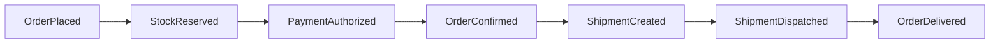
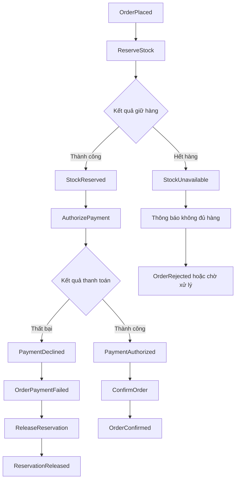

# EventStorming như một cách cộng tác khám phá nghiệp vụ

Trong Domain-Driven Design (DDD), mô hình phần mềm cần phản ánh cách doanh nghiệp thực sự vận hành. Mô hình đó không thể chỉ được suy ra từ yêu cầu viết sẵn, sơ đồ cơ sở dữ liệu hoặc ý tưởng của riêng đội phát triển. Những quy tắc quan trọng thường nằm trong kinh nghiệm của chuyên gia nghiệp vụ, các ngoại lệ trong vận hành và những quyết định mà nhiều bộ phận cùng tham gia.

**EventStorming** là một cách tổ chức buổi làm việc cộng tác để khám phá và biểu diễn quy trình nghiệp vụ bằng các sự kiện có ý nghĩa. Người tham gia cùng đưa những gì họ biết lên một bức tường hoặc bảng làm việc chung, sắp xếp theo trình tự thời gian, đặt câu hỏi và phát hiện những điểm chưa thống nhất. Nhờ nhìn thấy cùng một bức tranh, chuyên gia nghiệp vụ và đội phát triển có thể xây dựng hiểu biết chung trước khi quyết định mô hình phần mềm.

EventStorming thường dùng giấy ghi chú nhiều màu để biểu diễn các thành phần như Domain Event, Command, Actor, Policy, Read Model và hệ thống bên ngoài. Màu sắc là quy ước hỗ trợ trao đổi; cách dùng cụ thể có thể thay đổi theo nhóm. Điều quan trọng là ý nghĩa của từng ghi chú được thống nhất và mọi người đều có thể tham gia chỉnh sửa.

## 1. EventStorming giúp khám phá điều gì?

Trong một buổi họp thông thường, mỗi người có thể kể quy trình từ góc nhìn riêng. Nhân viên bán hàng nói về lúc tiếp nhận đơn, nhân viên kho nói về lúc giữ hàng, kế toán nói về thanh toán và đội giao nhận nói về vận chuyển. Các mô tả đều có thể đúng nhưng không cho thấy đầy đủ mối liên hệ giữa chúng.

EventStorming giúp nhóm trả lời các câu hỏi:

- Những sự việc nghiệp vụ nào thực sự xảy ra?
- Chúng xảy ra theo trình tự nào và có thể xảy ra song song ở đâu?
- Ai hoặc hệ thống nào khởi phát một hành động?
- Điều kiện nào khiến hành động được thực hiện hoặc bị từ chối?
- Những bộ phận và hệ thống bên ngoài nào tham gia?
- Thông tin nào cần có để một người đưa ra quyết định?
- Những tình huống ngoại lệ, điểm chờ và điểm nghẽn nằm ở đâu?
- Thuật ngữ nào đang được các bên hiểu khác nhau?

EventStorming biến kiến thức rời rạc thành một mô hình trực quan để cả nhóm cùng kiểm chứng. Nó đặc biệt hữu ích khi quy trình đi qua nhiều bộ phận, có nhiều ngoại lệ hoặc chưa có tài liệu đáng tin cậy.

### 1.1. EventStorming không phải là sơ đồ quy trình có sẵn

Một sơ đồ quy trình truyền thống thường bắt đầu bằng các bước đã được xác định. EventStorming khuyến khích người tham gia đưa ra các sự kiện mà họ biết trước, kể cả khi thứ tự hoặc quan hệ giữa chúng chưa rõ. Sau đó nhóm mới sắp xếp, thảo luận và bổ sung các hành động dẫn đến sự kiện.

Cách làm này giúp lộ ra những khoảng trống trong hiểu biết. Ví dụ, nhóm biết rằng `OrderConfirmed` đã xảy ra nhưng chưa thống nhất ai xác nhận, điều kiện nào cần thỏa mãn hoặc sự kiện đó xảy ra trước hay sau khi thanh toán. Những câu hỏi này là kết quả có giá trị của buổi khám phá.

EventStorming cũng không phải công cụ chỉ dành cho lập trình viên. Người trực tiếp thực hiện nghiệp vụ thường nắm nhiều ngoại lệ mà tài liệu và mã nguồn không thể hiện. Họ cần tham gia vào việc xây dựng mô hình và xác nhận cách diễn giải.

### 1.2. EventStorming không đồng nghĩa với Event Sourcing

Hai khái niệm có liên quan đến sự kiện nhưng phục vụ mục đích khác nhau:

| Khía cạnh | EventStorming | Event Sourcing |
|---|---|---|
| Mục đích | Khám phá và trao đổi về quy trình, sự kiện và mô hình nghiệp vụ | Lưu chuỗi sự kiện làm nguồn dữ liệu chính để tái tạo trạng thái |
| Hoạt động | Workshop cộng tác, dùng ghi chú và sơ đồ | Lựa chọn kiến trúc lưu trữ và xử lý dữ liệu |
| Kết quả | Bản đồ sự kiện, hành vi, quy tắc, vấn đề và giả thuyết mô hình | Event Store, logic phát lại sự kiện và các projection |
| Có bắt buộc triển khai không? | Không; có thể dùng để khám phá dù hệ thống lưu trạng thái thông thường | Là một quyết định kiến trúc của hệ thống |

Một nhóm có thể dùng EventStorming để khám phá domain rồi triển khai bằng cơ sở dữ liệu quan hệ thông thường. Việc sử dụng Domain Event trong mô hình cũng không bắt buộc phải chọn Event Sourcing.

## 2. Các thành phần thường xuất hiện trên bức tường EventStorming

EventStorming dùng các ghi chú có màu để người tham gia nhận biết nhanh vai trò của từng thành phần. Các quy ước màu phổ biến được trình bày dưới đây; nhóm nên thống nhất màu và cách ghi nhãn trước khi bắt đầu.

| Thành phần | Màu thường gặp | Ý nghĩa và ví dụ |
|---|---|---|
| Domain Event | Cam | Sự việc nghiệp vụ đã xảy ra, thường đặt tên ở thì quá khứ: `OrderPlaced`, `PaymentAuthorized`, `StockReserved` |
| Command | Xanh dương | Ý định yêu cầu thực hiện hành động: `PlaceOrder`, `ReserveStock`, `AuthorizePayment` |
| Actor | Vàng | Người, vai trò hoặc bộ phận khởi phát hành động: Customer, Sales Clerk, Warehouse Operator |
| Policy | Tím nhạt | Phản ứng khi một sự kiện xuất hiện: “Khi đơn được đặt, yêu cầu giữ hàng” |
| External System | Hồng | Hệ thống hoặc dịch vụ bên ngoài: Payment Gateway, ERP, đơn vị vận chuyển |
| Read Model | Xanh lá | Thông tin Actor cần đọc để quyết định: Order Details, Available Stock, Refund Status |
| Hotspot | Đỏ hoặc màu nổi bật | Câu hỏi, mâu thuẫn, rủi ro, giả định hoặc điểm nghẽn chưa được giải quyết |

Một số buổi làm việc còn biểu diễn Aggregate, Bounded Context, dữ liệu hoặc ranh giới hệ thống bằng những loại ghi chú và ký hiệu riêng. Không nên áp đặt một bộ màu cứng nhắc cho mọi nhóm. Hãy ghi tên thành phần trên giấy và giải thích ý nghĩa để tránh nhầm lẫn.

### 2.1. Domain Event: điều gì đã xảy ra?

Domain Event mô tả một sự việc nghiệp vụ đã xảy ra và có ý nghĩa với domain. Tên sự kiện thường dùng dạng quá khứ:

- `OrderPlaced`: đơn hàng đã được đặt.
- `StockReserved`: hàng đã được giữ.
- `PaymentAuthorized`: thanh toán đã được ủy quyền.
- `RefundApproved`: yêu cầu hoàn tiền đã được duyệt.
- `ShipmentDispatched`: lô hàng đã được bàn giao để vận chuyển.

Một sự kiện tốt cần cụ thể và có thể được chuyên gia xác nhận. `DataUpdated` hoặc `ProcessCompleted` thường quá chung chung vì không cho biết điều gì có ý nghĩa nghiệp vụ đã xảy ra.

Cần phân biệt sự kiện với trạng thái. `OrderPlaced` là sự việc đánh dấu một chuyển biến; `OrderStatus = PLACED` là cách biểu diễn trạng thái hiện tại của đơn. Một sự kiện có thể khiến trạng thái thay đổi, nhưng không phải mọi thay đổi kỹ thuật của một thuộc tính đều đáng trở thành Domain Event.

### 2.2. Command: điều gì được yêu cầu thực hiện?

Command diễn đạt ý định thực hiện một hành vi. Tên thường dùng dạng mệnh lệnh:

- `PlaceOrder`.
- `ReserveStock`.
- `AuthorizePayment`.
- `CancelOrder`.

Command cần có một chủ thể hoặc thành phần chịu trách nhiệm xử lý. Nó có thể thất bại vì trạng thái hiện tại hoặc điều kiện nghiệp vụ không cho phép.

Ví dụ, khách gửi `PlaceOrder`, nhưng hệ thống từ chối nếu đơn chưa có dòng hàng. Vì vậy, không nên ghi `OrderPlaced` ngay khi nhận command. Chỉ ghi sự kiện sau khi hành vi đã được chấp nhận và thực sự xảy ra.

### 2.3. Actor: ai khởi phát hành động?

Actor có thể là khách hàng, nhân viên, quản trị viên, một vai trò nghiệp vụ hoặc một hệ thống tự động. Actor giúp nhóm xác định ai có quyền hoặc trách nhiệm thực hiện hành động.

Không phải mọi sự kiện đều do con người khởi phát trực tiếp. Một Policy có thể phản ứng với một Domain Event và tạo command tiếp theo. Khi đó, Actor ban đầu có thể là Customer, còn command tiếp theo được tạo bởi một quy tắc tự động.

### 2.4. Policy: sự kiện nào dẫn đến hành động tiếp theo?

Policy mô tả phản ứng nghiệp vụ khi một sự kiện xảy ra. Có thể diễn đạt theo mẫu:

> Khi [Domain Event] xảy ra, nếu [điều kiện], hãy phát sinh [Command].

Ví dụ:

> Khi `OrderPlaced` xảy ra, hãy yêu cầu Inventory giữ hàng cho các dòng sản phẩm của đơn.

Policy giúp nhìn thấy những quy tắc nối các bước trong quy trình. Nó cũng có thể làm lộ ra một quyết định đang được thực hiện tự động nhưng chưa được chuyên gia mô tả.

Không phải mọi phản ứng đều là chính sách domain. Một số phản ứng chỉ là cơ chế kỹ thuật như ghi log hoặc gửi metric. Chỉ nên đưa lên bản đồ những phản ứng có ý nghĩa đối với quy trình hoặc cần được thảo luận.

### 2.5. Read Model: Actor cần biết điều gì để quyết định?

Read Model biểu diễn thông tin mà Actor cần đọc trước khi đưa ra một command. Ví dụ, nhân viên kho có thể cần xem lượng hàng khả dụng trước khi xác nhận giữ hàng; nhân viên hỗ trợ cần xem trạng thái đơn và giao dịch trước khi trả lời khách.

Read Model giúp nhóm nhận ra những thông tin đầu vào đang bị ẩn trong quy trình. Nếu một command cần dữ liệu mà không ai biết lấy từ đâu, hãy ghi nhận đó là một câu hỏi hoặc hotspot.

### 2.6. External System: hệ thống nào tham gia vào quy trình?

External System đại diện cho dịch vụ hoặc tổ chức nằm ngoài phạm vi mô hình đang khám phá nhưng có ảnh hưởng đến kết quả. Ví dụ:

- Cổng thanh toán trả kết quả ủy quyền hoặc từ chối.
- Đơn vị vận chuyển cung cấp mã vận đơn và trạng thái giao.
- Hệ thống ERP cung cấp thông tin kế toán hoặc tồn kho.
- Dịch vụ định danh xác thực người dùng.

Ghi nhận hệ thống bên ngoài giúp làm rõ nơi quy trình phụ thuộc vào phản hồi, thời gian xử lý hoặc lỗi từ bên ngoài. Nhóm có thể phát hiện những điểm cần retry, timeout, đối soát hoặc xử lý thủ công.

### 2.7. Hotspot: điều gì vẫn chưa rõ?

Hotspot là ghi chú đánh dấu câu hỏi hoặc vấn đề cần giải quyết. Ví dụ:

- Đơn có được đặt khi một sản phẩm tạm hết hàng không?
- Khi cổng thanh toán timeout, hệ thống có biết giao dịch đã được ủy quyền hay chưa?
- Ai có quyền duyệt hoàn tiền?
- Có thể hủy đơn sau khi kho đã đóng gói không?
- Hai nhóm đang dùng từ “xác nhận” với cùng ý nghĩa không?

Hotspot không phải lỗi của người tham gia. Nó là dấu vết của điều nhóm chưa biết hoặc chưa thống nhất. Hãy giữ chúng hiển thị và gán người chịu trách nhiệm tìm câu trả lời sau buổi workshop.

## 3. Chuẩn bị một buổi EventStorming

Một workshop có ích bắt đầu từ mục tiêu và phạm vi rõ ràng. Nếu chủ đề quá rộng, nhóm dễ bị cuốn vào những chi tiết không liên quan. Nếu quá hẹp, nhóm có thể bỏ lỡ phụ thuộc giữa các bộ phận.

### 3.1. Chọn phạm vi khám phá

Hãy mô tả phạm vi bằng một luồng nghiệp vụ có điểm bắt đầu và kết quả mong muốn. Ví dụ:

- Từ lúc khách đặt đơn đến lúc đơn được xác nhận.
- Từ lúc khách yêu cầu trả hàng đến lúc hoàn tiền.
- Từ lúc tiếp nhận yêu cầu bảo hành đến lúc đóng yêu cầu.

Nêu rõ những gì nằm ngoài phạm vi. Điều này giúp người tham gia biết khi nào cần ghi một sự kiện liên quan và khi nào chỉ cần đánh dấu một phụ thuộc để khám phá sau.

### 3.2. Mời đúng người tham gia

Một nhóm nên có đủ góc nhìn nghiệp vụ và kỹ thuật:

| Vai trò | Đóng góp |
|---|---|
| Chuyên gia nghiệp vụ | Giải thích quy trình thực tế, chính sách và ngoại lệ |
| Nhân viên vận hành trực tiếp | Cung cấp tình huống thường ngày và cách xử lý thực tế |
| Product Owner hoặc người phụ trách sản phẩm | Làm rõ mục tiêu, ưu tiên và phạm vi |
| Developer / Architect | Đặt câu hỏi về mô hình, dữ liệu, tích hợp và khả năng thực thi |
| QA / Tester | Tìm trường hợp biên, điều kiện từ chối và kết quả cần kiểm chứng |
| Facilitator | Giữ nhịp, hướng dẫn cách làm và bảo đảm mọi người đều có cơ hội đóng góp |

Không cần tất cả vai trò đều có mặt trong mọi buổi. Tuy nhiên, nếu thiếu người hiểu nghiệp vụ trực tiếp, bản đồ có thể chỉ phản ánh giả định của đội kỹ thuật.

### 3.3. Chuẩn bị không gian và vật dụng

Với workshop trực tiếp, cần một bức tường hoặc bảng đủ rộng để sắp xếp ghi chú theo chiều thời gian. Chuẩn bị giấy ghi chú nhiều màu, bút dễ đọc, băng dính và khu vực riêng cho hotspot.

Với workshop trực tuyến, dùng một bảng cộng tác có thể tạo ghi chú, di chuyển, nhóm và thêm bình luận. Người tham gia cần biết cách sử dụng bảng trước khi bắt đầu để tránh mất thời gian vào thao tác công cụ.

Các ghi chú nên ngắn, mỗi ghi chú chỉ diễn đạt một ý. Dùng chữ đủ lớn để mọi người cùng đọc và tránh viết một đoạn giải thích dài lên một mảnh giấy.

### 3.4. Thống nhất nguyên tắc làm việc

Trước khi bắt đầu, facilitator nên thống nhất một số nguyên tắc:

- Viết sự kiện bằng ngôn ngữ nghiệp vụ, thường ở thì quá khứ.
- Viết command như một hành động được yêu cầu.
- Mỗi ghi chú chỉ chứa một sự kiện hoặc hành động.
- Chưa vội tranh luận về giải pháp kỹ thuật.
- Được phép đưa ra giả thuyết và đánh dấu chỗ chưa chắc chắn.
- Mọi người có thể bổ sung, di chuyển hoặc đặt câu hỏi về ghi chú.
- Tập trung vào quy trình thực tế, kể cả những bước thủ công và ngoại lệ.

Facilitator không phải người quyết định mô hình thay cho nhóm. Vai trò chính là giúp mọi người cùng nhìn vào vấn đề, duy trì nhịp trao đổi và bảo đảm những bất đồng được ghi nhận.

## 4. Quy trình tổ chức EventStorming

Có thể triển khai workshop theo các bước sau. Thời lượng phụ thuộc độ phức tạp và số lượng người tham gia; một luồng đơn giản có thể hoàn thành trong một buổi ngắn, còn quy trình liên phòng ban có thể cần nhiều phiên.

### Bước 1: Thu thập Domain Event độc lập

Yêu cầu người tham gia ghi lại các sự kiện nghiệp vụ mà họ biết, mỗi sự kiện trên một ghi chú riêng. Ở bước đầu, chưa cần sắp xếp thứ tự và chưa cần thống nhất tất cả thuật ngữ.

Ví dụ:

- `OrderPlaced`.
- `StockReserved`.
- `PaymentAuthorized`.
- `OrderConfirmed`.
- `ShipmentDispatched`.
- `OrderDelivered`.
- `OrderCancelled`.

Khuyến khích các bộ phận ghi sự kiện từ góc nhìn của họ. Những sự kiện trùng nhau hoặc có vẻ mâu thuẫn sẽ là chủ đề để nhóm thảo luận ở bước sau.

### Bước 2: Sắp xếp theo dòng thời gian

Đặt các Domain Event lên bức tường theo thứ tự xảy ra từ trái sang phải. Nếu chưa rõ sự kiện nào trước, đặt chúng gần nhau và thêm hotspot.

Một số sự kiện có thể xảy ra song song hoặc có nhiều nhánh. Không nên ép mọi quy trình thành một đường thẳng duy nhất. Hãy thể hiện nhánh thay thế, sự kiện có điều kiện và điểm chờ bằng mũi tên hoặc ghi chú quan hệ.

### Bước 3: Bổ sung Command và Actor

Với mỗi sự kiện, hỏi: hành động nào đã khiến sự kiện đó xảy ra và ai khởi phát hành động?

Ví dụ:

- Customer gửi `PlaceOrder` dẫn đến `OrderPlaced`.
- Warehouse Operator gửi `ReserveStock` dẫn đến `StockReserved`.
- Payment Service nhận `AuthorizePayment` và phản hồi `PaymentAuthorized`.

Nếu một sự kiện xảy ra tự động, tìm Policy hoặc tác nhân hệ thống tạo command. Nếu không biết ai hoặc điều gì khởi phát, hãy ghi hotspot.

### Bước 4: Bổ sung Policy và Read Model

Khi có sự kiện và command, hãy hỏi điều gì nối chúng. Nếu một sự kiện kích hoạt hành động tiếp theo, ghi Policy tương ứng.

Ví dụ:

- Khi `OrderPlaced`, yêu cầu giữ hàng.
- Khi `StockReserved` và thanh toán đã được ủy quyền, xác nhận đơn.
- Khi `PaymentDeclined`, chuyển đơn sang quy trình xử lý thất bại theo chính sách.

Sau đó hỏi Actor cần thông tin gì trước khi gửi command. Bổ sung Read Model như `Order Details`, `Available Stock` hoặc `Payment Status`.

### Bước 5: Đưa hệ thống bên ngoài và điểm tương tác vào bản đồ

Đánh dấu các dịch vụ hoặc tổ chức bên ngoài có tham gia. Ghi nhận thông tin được gửi đi, phản hồi nhận về và các tình huống không nhận được phản hồi.

Ví dụ, `AuthorizePayment` được gửi đến Payment Gateway. Kết quả có thể là `PaymentAuthorized`, `PaymentDeclined` hoặc timeout chưa rõ kết quả. Timeout không nhất thiết đồng nghĩa với thanh toán thất bại; nhóm cần làm rõ cách đối soát hoặc truy vấn lại trạng thái.

### Bước 6: Tìm hotspot và giải quyết câu hỏi quan trọng

Đi dọc bản đồ và tìm:

- Những bước chưa rõ người chịu trách nhiệm.
- Sự kiện thiếu điều kiện hoặc không có command dẫn tới.
- Command không có kết quả hoặc nhánh từ chối.
- Hai nhóm dùng cùng thuật ngữ nhưng hiểu khác nhau.
- Các thao tác thủ công hoặc chờ đợi kéo dài.
- Phụ thuộc vào hệ thống bên ngoài.
- Các điểm có thể phát sinh lỗi, retry hoặc thực hiện lặp.

Không cần giải quyết mọi hotspot ngay tại chỗ. Phân biệt câu hỏi có thể trả lời trong workshop với câu hỏi cần dữ liệu, chuyên gia khác hoặc kiểm tra hệ thống hiện tại. Ghi lại người chịu trách nhiệm và thời điểm quay lại.

### Bước 7: Nhóm các sự kiện theo mô hình và ranh giới

Khi bức tranh đã đủ rõ, nhóm các phần có ngôn ngữ, quy tắc và trách nhiệm liên quan. Đây là thời điểm có thể bắt đầu thảo luận về Bounded Context, Aggregate và các hợp đồng tích hợp.

Không nên coi mỗi cụm ghi chú là một Bounded Context ngay lập tức. Hãy kiểm tra xem nhóm đó có mô hình nhất quán, quyền sở hữu dữ liệu và trách nhiệm riêng hay không. Một quy trình có thể đi qua nhiều context, và một context có thể chứa nhiều luồng nghiệp vụ.

### Bước 8: Chụp lại, tổng hợp và xác nhận

Chụp ảnh hoặc xuất bản đồ sau workshop. Tổng hợp các thuật ngữ đã thống nhất, hotspot chưa giải quyết, quyết định và giả thuyết cần kiểm chứng.

Gửi lại bản tổng hợp cho những người tham gia hoặc chuyên gia liên quan để xác nhận. Bản đồ EventStorming là kết quả làm việc và hiểu biết tại một thời điểm; nó nên được cập nhật khi quy trình hoặc chính sách thay đổi.

## 5. Ví dụ: EventStorming luồng đặt hàng thương mại điện tử

Giả sử nhóm muốn khám phá luồng từ lúc khách gửi đơn đến khi đơn sẵn sàng giao. Mục tiêu là hiểu các sự kiện, hành động, chính sách và phụ thuộc giữa Ordering, Inventory và Payment.

### 5.1. Bản đồ sự kiện ban đầu

Một dòng sự kiện minh họa:

Đây chỉ là một giả thuyết luồng thành công để bắt đầu thảo luận. Thứ tự thực tế có thể khác: một doanh nghiệp có thể ủy quyền thanh toán trước khi giữ hàng, hoặc giữ hàng trước rồi mới yêu cầu thanh toán. EventStorming giúp chuyên gia xác nhận thứ tự và các ngoại lệ thay vì mặc định sơ đồ này đúng với mọi hệ thống.

### 5.2. Bổ sung Actor, Command và Policy

| Actor / thành phần | Command | Policy hoặc điều kiện | Domain Event |
|---|---|---|---|
| Customer | `PlaceOrder` | Đơn có sản phẩm và thông tin giao hàng hợp lệ | `OrderPlaced` |
| Ordering Policy | `ReserveStock` | Khi đơn được đặt, yêu cầu giữ hàng | `StockReserved` hoặc `StockUnavailable` |
| Ordering Policy | `AuthorizePayment` | Khi giữ hàng thành công và chính sách cho phép thanh toán | `PaymentAuthorized` hoặc `PaymentDeclined` |
| Ordering | `ConfirmOrder` | Khi các điều kiện cần thiết đã hoàn tất | `OrderConfirmed` |
| Fulfillment Operator / System | `CreateShipment` | Đơn đã sẵn sàng giao | `ShipmentCreated` |
| Shipping System | `DispatchShipment` | Lô hàng đã được bàn giao | `ShipmentDispatched` |
| Delivery Provider | `ConfirmDelivery` | Có xác nhận giao hàng | `OrderDelivered` |

Bảng này làm rõ sự khác nhau giữa người khởi phát, lệnh được yêu cầu, chính sách điều phối và sự kiện kết quả. Một Policy có thể tạo command tự động; command có thể được gửi đến context khác và chỉ có kết quả sau khi context đó xử lý.

### 5.3. Thể hiện nhánh ngoại lệ

Quy trình thực tế cần có nhánh khi giữ hàng hoặc thanh toán thất bại:

Các nhãn và sự kiện trong sơ đồ là ví dụ để nhóm đặt câu hỏi. Chuyên gia cần xác nhận chính sách thực tế: khi hết hàng, đơn bị từ chối ngay hay được chờ bổ sung? Khi thanh toán thất bại, có giữ hàng trong một khoảng thời gian để khách thử lại không? Nếu yêu cầu giải phóng hàng bị lỗi thì ai xử lý?

Cần cẩn thận với tên sự kiện: `OrderRejected`, `OrderPaymentFailed` hoặc `ReservationReleased` chỉ nên xuất hiện nếu đó là những sự việc nghiệp vụ thực sự được ghi nhận trong mô hình. Nếu hệ thống chỉ đang chờ kết quả, hãy đặt tên thể hiện trạng thái chờ hoặc yêu cầu đang xử lý.

### 5.4. Những câu hỏi mà EventStorming làm lộ ra

Khi cả nhóm cùng nhìn vào bản đồ, các câu hỏi cụ thể có thể xuất hiện:

- `OrderPlaced` xảy ra ngay khi khách nhấn nút hay sau khi hệ thống kiểm tra đơn?
- Giá sản phẩm được chốt ở thời điểm thêm vào giỏ hay thời điểm đặt đơn?
- Ai sở hữu quyết định lượng hàng có thể giữ?
- Một `PaymentAuthorized` có hết hiệu lực sau một khoảng thời gian không?
- Nếu cổng thanh toán trả timeout, có cần truy vấn trạng thái trước khi thử lại?
- Khi `StockUnavailable`, đơn được hủy, chờ hay cho phép giao một phần?
- Ai quyết định có thể hủy đơn sau khi đã `ShipmentCreated`?
- `OrderDelivered` được xác nhận bởi khách, đơn vị vận chuyển hay hệ thống đối soát?

Những câu hỏi này giúp đội ngũ tìm quy tắc và trách nhiệm còn thiếu. Chúng cũng gợi ý những nơi cần mô hình hóa Aggregate, Domain Event, Bounded Context hoặc quy trình điều phối.

## 6. Từ bản đồ EventStorming đến mô hình DDD

EventStorming không tự động sinh ra mô hình DDD hoàn chỉnh. Bản đồ là đầu vào để nhóm thảo luận và kiểm chứng các khái niệm của DDD.

### 6.1. Tìm Entity và Aggregate

Những đối tượng có định danh và vòng đời có thể là Entity. Trong ví dụ đặt hàng:

- `Order` có mã định danh và trạng thái thay đổi theo quy trình.
- `Payment` có định danh giao dịch và vòng đời ủy quyền, thu tiền, hoàn tiền.
- `Reservation` có thể có định danh riêng và thời hạn.

Tiếp theo, tìm các quy tắc cần được bảo vệ nhất quán. Ví dụ, `Order` có thể là Aggregate Root bảo vệ điều kiện đơn phải có dòng hàng trước khi đặt và không cho sửa nội dung sau khi đã xác nhận. `Reservation` có thể là một Aggregate riêng trong Inventory vì nó bảo vệ giới hạn số lượng hàng có thể giữ.

Không nên suy ra ranh giới Aggregate chỉ từ số lượng ghi chú hoặc vị trí trên tường. Hãy dùng invariant và yêu cầu nhất quán để xác định.

### 6.2. Nhận diện Bounded Context

Các cụm sự kiện, command và quy tắc có thể gợi ý các context như Ordering, Inventory, Payment và Shipping. Để xác nhận, nhóm cần kiểm tra:

- Ngôn ngữ trong từng cụm có nhất quán không?
- Ai sở hữu dữ liệu và các quyết định?
- Quy tắc nào thuộc về context đó?
- Các context trao đổi qua sự kiện hoặc hợp đồng nào?

Một quy trình xuyên suốt có thể đi qua nhiều Bounded Context. Bản đồ sự kiện giúp thấy điểm chuyển giao, nhưng ranh giới context cần được quyết định dựa trên mô hình và trách nhiệm.

### 6.3. Phân biệt Domain Event và Integration Event

Domain Event mô tả sự việc có ý nghĩa bên trong mô hình của một Bounded Context. Integration Event là hợp đồng được công bố cho context hoặc hệ thống khác tiêu thụ.

Ví dụ, Ordering có thể ghi nhận `OrderPlaced` nội bộ. Khi cần thông báo cho Inventory, một Integration Event có thể được tạo với payload ổn định và các trường mà Inventory cần. Không nên buộc consumer bên ngoài phụ thuộc trực tiếp vào cấu trúc lớp nội bộ của Ordering.

EventStorming có thể dùng cùng một ghi chú sự kiện để thảo luận ở mức nghiệp vụ, nhưng khi thiết kế phần mềm cần xác định rõ sự kiện nào là nội bộ và sự kiện nào là hợp đồng tích hợp.

### 6.4. Tìm Policy và quy trình điều phối

Một chuỗi sự kiện thường cho thấy các phản ứng tự động. Ví dụ, `OrderPlaced` có thể dẫn đến `ReserveStock`; khi `StockReserved`, hệ thống mới yêu cầu `AuthorizePayment`.

Nếu quy trình có nhiều bước bất đồng bộ, điều kiện chờ, timeout, retry và bù trừ, nhóm có thể cần một Process Manager hoặc Saga để điều phối. EventStorming giúp làm lộ ra độ phức tạp này trước khi chọn kỹ thuật triển khai.

Không nên mặc định mọi Policy đều cần Saga. Với phản ứng đơn giản trong cùng context, một handler có thể là đủ. Chỉ chọn cơ chế điều phối phù hợp với độ phức tạp và yêu cầu nhất quán của quy trình.

## 7. Các hình thức EventStorming thường dùng

EventStorming có thể được thực hiện ở nhiều mức độ tùy mục tiêu. Ba hình thức thường được nhắc đến là Big Picture, Process Modeling và Software Design.

| Hình thức | Mục tiêu | Nội dung tập trung | Kết quả thường có |
|---|---|---|---|
| Big Picture | Khám phá bức tranh nghiệp vụ lớn | Domain Event, dòng thời gian, hotspot, các nhóm và ranh giới sơ bộ | Bản đồ tổng thể và câu hỏi cần khám phá |
| Process Modeling | Hiểu sâu một quy trình cụ thể | Command, Actor, Policy, Read Model, External System và các nhánh | Luồng hành vi, điều kiện và ngoại lệ |
| Software Design | Chuyển hiểu biết thành thiết kế phần mềm | Aggregate, Bounded Context, service, integration và quyết định kỹ thuật | Giả thuyết mô hình và thiết kế cần kiểm chứng |

### 7.1. Big Picture EventStorming

Big Picture phù hợp khi nhóm chưa có cùng hiểu biết về toàn bộ domain hoặc một quy trình lớn. Người tham gia đưa sự kiện lên trước, sau đó nhóm chúng theo thời gian và chủ đề.

Mục tiêu không phải là mô tả từng trường dữ liệu hoặc endpoint. Nhóm cần nhận ra các năng lực nghiệp vụ, các điểm chuyển giao và những hotspot lớn. Từ đó có thể xác định phạm vi cần khám phá sâu hơn.

### 7.2. Process Modeling EventStorming

Process Modeling tập trung vào một luồng cụ thể. Sau khi có các sự kiện, nhóm bổ sung command, actor, policy, read model và external system. Các nhánh thành công, thất bại, chờ và xử lý thủ công được làm rõ.

Hình thức này hữu ích khi nhóm cần hiểu chính xác một quy trình như hoàn tiền, phê duyệt khoản vay hoặc xử lý đơn trả hàng.

### 7.3. Software Design EventStorming

Software Design đi sâu hơn vào các quyết định thiết kế. Nhóm thảo luận Aggregate, invariant, Bounded Context, ranh giới tích hợp và trách nhiệm của các thành phần.

Ở mức này, developer và architect tham gia sâu hơn nhưng vẫn cần chuyên gia nghiệp vụ xác nhận ý nghĩa và quy tắc. Mục tiêu là tạo ra thiết kế có thể được kiểm chứng bằng các kịch bản đã thống nhất.

## 8. Vai trò của Facilitator và cách duy trì chất lượng workshop

Facilitator giúp workshop giữ được mục tiêu và không bị một vài người chi phối. Một facilitator tốt:

- Giải thích cách ghi Domain Event, Command và các loại ghi chú khác.
- Khuyến khích mọi người tự viết thay vì chỉ phát biểu để người khác ghi.
- Hỏi lại khi thuật ngữ mơ hồ hoặc hai ghi chú có vẻ mâu thuẫn.
- Tách câu hỏi cần quyết định ngay khỏi câu hỏi cần nghiên cứu thêm.
- Giữ các hotspot hiển thị cho đến khi có câu trả lời hoặc người chịu trách nhiệm.
- Nhắc nhóm quay lại mục tiêu khi cuộc thảo luận đi quá sâu vào chi tiết kỹ thuật.
- Tóm tắt những gì đã thống nhất và những gì còn là giả thuyết.

Facilitator không nên ép nhóm đồng ý để hoàn thành sơ đồ. Một bất đồng được ghi nhận rõ ràng hữu ích hơn một quyết định vội vàng không có căn cứ.

### 8.1. Quản lý thời gian

Một phiên làm việc có thể chia thành các khoảng:

1. Giới thiệu mục tiêu, phạm vi và quy ước.
2. Ghi các sự kiện độc lập.
3. Sắp xếp sự kiện và thảo luận thứ tự.
4. Bổ sung command, actor, policy và hệ thống ngoài.
5. Phân tích ngoại lệ, hotspot và phụ thuộc.
6. Tổng hợp kết quả, quyết định và công việc tiếp theo.

Không cần cố định thời lượng cho từng phần. Nếu nhóm phát hiện nhiều điểm chưa rõ, facilitator nên dành thời gian xác định câu hỏi và người trả lời thay vì cố hoàn thiện bản đồ bằng mọi giá.

### 8.2. Làm việc với bất đồng

Khi hai người mô tả quy trình khác nhau, đừng vội chọn một bên. Hãy hỏi:

- Hai người đang nói về cùng một trường hợp hay hai trường hợp khác nhau?
- Quy trình có thay đổi theo loại khách, kênh bán hoặc khu vực không?
- Một bên đang mô tả quy trình chính thức, bên kia mô tả cách xử lý thực tế?
- Có ngoại lệ hoặc bước thủ công chưa được tài liệu hóa không?

Nếu hai luồng đều tồn tại, hãy thể hiện cả hai và tìm điều kiện phân nhánh. Nếu chưa có bằng chứng, ghi hotspot và giao người xác minh. Cách làm này tránh biến ý kiến cá nhân thành quy tắc của hệ thống.

## 9. Những sai lầm thường gặp

**Bắt đầu bằng giải pháp kỹ thuật.** Nếu nhóm tranh luận về Kafka, REST, database hoặc microservice trước khi hiểu sự kiện nghiệp vụ, workshop dễ biến thành buổi thiết kế kiến trúc thiếu căn cứ. Hãy khám phá điều gì xảy ra và vì sao trước.

**Chỉ ghi sự kiện thành công.** Quy trình thực tế có từ chối, timeout, hủy, thử lại và xử lý thủ công. Bỏ qua chúng khiến mô hình không phản ánh cách doanh nghiệp vận hành.

**Nhầm Command với Domain Event.** `PlaceOrder` là yêu cầu đặt đơn; `OrderPlaced` là sự kiện đơn đã được đặt. Lệnh có thể thất bại, sự kiện chỉ xuất hiện khi sự việc thực sự xảy ra.

**Dùng tên sự kiện quá chung.** `Updated`, `Processed` hoặc `Completed` không cho biết ý nghĩa nghiệp vụ. Hãy đặt tên theo điều đã xảy ra.

**Đưa mọi thay đổi kỹ thuật lên bản đồ.** Không phải thao tác ghi log, cập nhật cột hay gửi metric nào cũng là Domain Event. Chỉ ghi sự việc có ý nghĩa với nghiệp vụ hoặc cần để hiểu luồng.

**Để một người điều khiển toàn bộ bản đồ.** Khi chỉ facilitator hoặc architect viết, kiến thức từ người vận hành có thể bị mất. Hãy để người tham gia trực tiếp đóng góp và chỉnh sửa ghi chú.

**Cố giải quyết mọi câu hỏi trong một buổi.** Một số vấn đề cần dữ liệu, kiểm tra hệ thống hoặc người có thẩm quyền. Hãy ghi hotspot, giao trách nhiệm và tiếp tục khi có thông tin.

**Coi bản đồ là tài liệu hoàn chỉnh và bất biến.** Quy trình thay đổi theo chính sách, sản phẩm và cách vận hành. Bản đồ cần được xem lại khi có thay đổi quan trọng.

**Suy ra Bounded Context chỉ từ cụm sự kiện.** Cụm sự kiện gợi ý nơi có mô hình hoặc trách nhiệm riêng, nhưng cần kiểm tra ngôn ngữ, quy tắc và quyền sở hữu trước khi xác định ranh giới.

**Coi EventStorming là cam kết phải dùng Event Sourcing.** EventStorming là phương pháp khám phá; kiến trúc lưu trữ được lựa chọn sau dựa trên yêu cầu thực tế.

## 10. Checklist đánh giá kết quả EventStorming

Sau workshop, nhóm có thể dùng các câu hỏi sau để đánh giá chất lượng bản đồ.

**Về phạm vi và sự kiện**

- Mục tiêu và ranh giới của luồng khám phá có rõ không?
- Các Domain Event có diễn đạt sự việc nghiệp vụ đã xảy ra không?
- Tên sự kiện có đủ cụ thể để chuyên gia hiểu và xác nhận không?
- Dòng thời gian có phản ánh đúng thứ tự, nhánh và điểm song song không?

**Về hành động và quy tắc**

- Các Command có phân biệt ý định với kết quả thực tế không?
- Actor hoặc thành phần khởi phát hành động có rõ không?
- Policy nối sự kiện với hành động tiếp theo có được mô tả không?
- Điều kiện chấp nhận và nhánh từ chối có được thể hiện không?
- Read Model có cho biết Actor cần thông tin nào để quyết định không?

**Về phụ thuộc và vấn đề chưa rõ**

- External System và điểm trao đổi có được đánh dấu không?
- Timeout, retry, xử lý lặp và bước thủ công quan trọng đã được xem xét chưa?
- Hotspot có nội dung, người chịu trách nhiệm và hướng xác minh không?
- Những thuật ngữ hoặc quy trình còn bất đồng có được ghi nhận không?

**Về kết quả DDD**

- Các nhóm sự kiện có gợi ý mô hình và trách nhiệm rõ không?
- Invariant và Aggregate cần khám phá sâu hơn đã được nhận diện chưa?
- Bounded Context được đề xuất có căn cứ từ ngôn ngữ, quy tắc và quyền sở hữu không?
- Hợp đồng giữa các context có được xác định ở mức cần thiết không?
- Chuyên gia nghiệp vụ đã xác nhận bản tổng hợp chưa?

## 11. Kết luận

EventStorming giúp chuyên gia nghiệp vụ và đội phát triển cùng khám phá quy trình bằng những sự kiện có ý nghĩa, các hành động dẫn tới sự kiện, tác nhân, chính sách, thông tin cần đọc và hệ thống bên ngoài. Việc sắp xếp các ghi chú theo thời gian khiến những khoảng trống, ngoại lệ và bất đồng trở nên dễ nhìn thấy.

Giá trị lớn nhất của workshop là tạo ra hiểu biết chung có thể kiểm chứng. Từ bản đồ đó, đội ngũ có thể tiếp tục khám phá Entity, Aggregate, Domain Event, Bounded Context và hợp đồng tích hợp. Hãy bắt đầu với một phạm vi nghiệp vụ cụ thể, mời người hiểu công việc thực tế, ghi nhận cả nhánh thất bại và giữ các câu hỏi chưa giải quyết ở trạng thái nhìn thấy được. Khi quy trình hoặc chính sách thay đổi, hãy quay lại bản đồ để cập nhật mô hình cùng với những người chịu trách nhiệm.

