# Phân biệt sự kiện, yêu cầu hành động, tác nhân và chính sách phản ứng

EventStorming là kỹ thuật workshop trực quan giúp chuyên gia nghiệp vụ và đội phát triển cùng khám phá cách một miền nghiệp vụ vận hành. Người tham gia ghi lại những điều đã xảy ra, hành động được yêu cầu, vai trò khởi tạo hành động và quy tắc khiến hệ thống phản ứng. Khi các thành phần này bị nhầm lẫn, sơ đồ dễ biến thành danh sách thao tác kỹ thuật, không còn thể hiện rõ nghiệp vụ đang diễn ra và lý do một hành động được thực hiện.

Bốn thành phần cần phân biệt là **Domain Event**, **Command**, **Actor** và **Policy**. Domain Event diễn đạt một sự thật đã xảy ra; Command diễn đạt yêu cầu thực hiện một hành động; Actor là người hoặc hệ thống khởi tạo yêu cầu; Policy diễn đạt quy tắc phản ứng khi một sự kiện xuất hiện. Chúng liên hệ với nhau trong một chuỗi nhân quả, nhưng không thể thay thế cho nhau.

Bài học này giải thích cách nhận diện từng thành phần bằng ngữ nghĩa, cách đặt tên và cách nối chúng thành một luồng EventStorming có thể kiểm chứng bằng tình huống nghiệp vụ.

## 1. Bức tranh cơ bản của một luồng EventStorming

Hãy bắt đầu bằng một ví dụ quen thuộc: khách hàng đặt một đơn hàng. Khách hàng thực hiện hành động gửi yêu cầu đặt hàng. Hệ thống tiếp nhận và ghi nhận đơn. Sau khi đơn được ghi nhận, một quy tắc nghiệp vụ yêu cầu kho giữ hàng. Khi kho giữ hàng thành công, hệ thống có thể yêu cầu thanh toán.

Trong luồng này có nhiều loại thông tin:

- “Khách hàng” trả lời câu hỏi ai khởi tạo yêu cầu.
- “Đặt đơn hàng” là yêu cầu hệ thống thực hiện một hành động.
- “Đơn hàng đã được tạo” là sự thật xác nhận việc tạo đơn đã xảy ra.
- “Khi đơn được tạo, yêu cầu kho giữ hàng” là quy tắc phản ứng với sự kiện.

Các loại thông tin trên thường được biểu diễn bằng sticky note khác màu trên bảng EventStorming. Một quy ước phổ biến là:

| Thành phần | Màu thường dùng | Câu hỏi giúp nhận diện |
|---|---|---|
| Domain Event | Cam | Điều gì đã xảy ra? |
| Command | Xanh dương | Hệ thống được yêu cầu làm gì? |
| Actor | Vàng | Ai hoặc hệ thống nào khởi tạo yêu cầu? |
| Policy | Tím nhạt | Quy tắc nào phản ứng khi sự kiện xảy ra? |

Màu sắc là quy ước trực quan phổ biến trong EventStorming; nhóm có thể điều chỉnh cách dùng màu cho phù hợp với workshop, miễn là mọi người hiểu và sử dụng nhất quán. Điều quan trọng là ý nghĩa của thông tin, không phải màu của giấy ghi chú.

## 2. Domain Event: sự thật đã xảy ra

Domain Event là một sự kiện có ý nghĩa đối với nghiệp vụ và diễn đạt điều đã xảy ra trong miền. Event thường được đặt tên ở thì quá khứ hoặc dưới dạng một sự kiện đã hoàn tất, chẳng hạn `OrderPlaced`, `PaymentAuthorized`, `InventoryReserved` hay `ShipmentDispatched`.

Một event tốt giúp người đọc hiểu được:

- Điều gì đã xảy ra?
- Đối tượng nghiệp vụ nào liên quan?
- Sự kiện thuộc phạm vi nghiệp vụ hoặc bounded context nào?
- Khi nào sự kiện xảy ra và thông tin nào cần thiết để hiểu nó?

Event không phải là ý định hoặc yêu cầu. Khi người dùng nhấn nút “Đặt hàng”, lúc đó mới có yêu cầu đặt hàng. Chỉ khi hệ thống đã chấp nhận và ghi nhận đơn theo quy tắc của mình, nó mới có thể phát sinh `OrderPlaced`. Nếu yêu cầu không hợp lệ, `OrderPlaced` không được phát ra như thể đơn đã được tạo thành công.

### 2.1. Cách đặt tên event

Ưu tiên tên diễn đạt một sự thật cụ thể, thường ở dạng quá khứ:

- `OrderPlaced` — đơn hàng đã được đặt và ghi nhận.
- `OrderAccepted` — đơn hàng đã vượt qua các kiểm tra và được chấp nhận theo quy tắc của Ordering.
- `PaymentAuthorized` — giao dịch đã được ủy quyền.
- `InventoryReserved` — số lượng hàng đã được giữ.
- `ShipmentDispatched` — lô hàng đã được bàn giao để vận chuyển.

Tránh các tên không cho biết điều gì đã xảy ra như `OrderProcess`, `PaymentAction`, `UpdateStatus` hoặc `HandleRequest`. Nếu cần thêm ngữ cảnh, có thể dùng tên sự kiện cụ thể hơn thay vì nhồi nhiều ý nghĩa vào một event chung.

### 2.2. Event là sự thật, không phải lệnh

So sánh hai câu:

- `ReserveInventory`: hãy giữ hàng cho đơn này.
- `InventoryReserved`: hàng cho đơn này đã được giữ thành công.

Câu đầu là yêu cầu cần được xử lý; câu sau là kết quả đã xảy ra. Việc phát ra event `InventoryReserved` trước khi tồn kho thực sự được giữ sẽ làm sai ngữ nghĩa và có thể khiến các phần khác của hệ thống hành động dựa trên một sự thật không tồn tại.

Một event thường được xem là dữ kiện đã xảy ra và không nên bị sửa nghĩa sau khi phát hành. Nếu cần điều chỉnh, hệ thống có thể phát sinh một event mới mô tả sự kiện hiệu chỉnh hoặc hủy bỏ theo quy tắc miền, thay vì viết lại lịch sử như thể event cũ chưa từng xảy ra.

### 2.3. Không phải mọi log kỹ thuật đều là Domain Event

Các thông tin như “HTTP request nhận được”, “method bắt đầu chạy”, “SQL query hoàn tất” hoặc “cache miss” thường là log hoặc telemetry kỹ thuật. Chúng có thể hữu ích cho vận hành nhưng không nhất thiết có ý nghĩa nghiệp vụ.

Một Domain Event cần diễn đạt sự thay đổi hoặc sự thật mà chuyên gia nghiệp vụ quan tâm. Ví dụ, `InvoiceIssued` có ý nghĩa nghiệp vụ; `InvoiceControllerPostCalled` thường chỉ mô tả chi tiết triển khai.

## 3. Command: yêu cầu hệ thống thực hiện hành động

Command là yêu cầu một hành động được thực hiện. Command diễn đạt ý định của người gửi tại thời điểm gửi, chưa khẳng định rằng hành động đã thành công. Command thường được đặt tên bằng động từ ở dạng mệnh lệnh hoặc nguyên thể, ví dụ `PlaceOrder`, `ReserveInventory`, `AuthorizePayment`, `CancelOrder`.

Một command thường có:

- Tên hành động cần thực hiện.
- Đối tượng hoặc phạm vi mà hành động hướng đến.
- Dữ liệu cần thiết để kiểm tra và thực thi yêu cầu.
- Ngữ cảnh người gửi hoặc thông tin phục vụ kiểm soát quyền nếu cần.

### 3.1. Command có thể được chấp nhận hoặc từ chối

Ví dụ, command `PlaceOrder` có thể được gửi nhưng không được chấp nhận vì giỏ hàng rỗng, sản phẩm không còn được bán hoặc thông tin bắt buộc bị thiếu. Command vẫn là một yêu cầu hợp lệ về mặt diễn đạt; kết quả xử lý mới quyết định event nào được phát sinh.

Một command có thể dẫn đến:

- Không có event nghiệp vụ nếu yêu cầu bị từ chối và việc từ chối không cần được lưu như một sự thật miền.
- Một event nếu hành động tạo ra một kết quả nghiệp vụ.
- Nhiều event nếu một hành động tạo ra nhiều sự thật có ý nghĩa.
- Một phản hồi lỗi hoặc kết quả từ chối để người gửi biết lý do yêu cầu không được thực hiện.

Không nên mặc định mỗi command luôn tạo đúng một event. Mối quan hệ giữa command và event phụ thuộc vào quy tắc nghiệp vụ.

### 3.2. Cách đặt tên command

Tên command cần nói rõ hành động được yêu cầu:

- `PlaceOrder` — yêu cầu tạo đơn hàng.
- `ChangeDeliveryAddress` — yêu cầu thay đổi địa chỉ giao hàng.
- `ReserveInventory` — yêu cầu giữ hàng.
- `AuthorizePayment` — yêu cầu ủy quyền thanh toán.
- `CancelOrder` — yêu cầu hủy đơn.

Tránh dùng tên event làm command. `OrderPlaced` nói rằng đơn đã được đặt; `PlaceOrder` yêu cầu đặt đơn. Tránh cả tên quá chung như `ProcessOrder` nếu có thể gọi tên hành động nghiệp vụ cụ thể.

### 3.3. Command không nhất thiết do con người gửi

Command có thể đến từ giao diện người dùng, một hệ thống bên ngoài, một tiến trình theo lịch hoặc một Policy phản ứng với event. Vì vậy, khi nhìn thấy command, không nên mặc định luôn có người dùng trực tiếp nhấn nút.

Ví dụ, sau `OrderPlaced`, Policy có thể phát sinh `ReserveInventory`. Command này được tạo tự động theo quy tắc nghiệp vụ, dù không có người dùng nào yêu cầu giữ hàng ở thời điểm đó.

## 4. Actor: ai hoặc hệ thống nào khởi tạo yêu cầu?

Actor là vai trò hoặc tác nhân khởi tạo một command. Actor có thể là con người, vai trò nghiệp vụ, hệ thống bên ngoài hoặc một tác nhân tự động. Actor giúp trả lời câu hỏi ai có mục tiêu và khởi xướng hành động trong tình huống đang mô hình hóa.

Ví dụ:

- `Customer` — khách hàng yêu cầu đặt đơn hoặc hủy đơn.
- `SalesRepresentative` — nhân viên bán hàng tạo đơn thay khách.
- `WarehouseOperator` — nhân viên kho xác nhận một thao tác xử lý hàng.
- `PaymentGateway` — cổng thanh toán gửi kết quả hoặc yêu cầu tích hợp về hệ thống.
- `Scheduler` — tác nhân thời gian kích hoạt một công việc theo lịch.

### 4.1. Actor là vai trò trong một ngữ cảnh

Một người có thể giữ nhiều vai trò. Cùng một nhân viên có thể là `SalesRepresentative` khi tạo đơn cho khách và là `SupportAgent` khi xử lý yêu cầu hỗ trợ. Mô hình nên thể hiện vai trò liên quan đến hành động, thay vì chỉ ghi tên cá nhân hoặc dùng một actor chung là `User` cho mọi tình huống.

Actor cũng không nhất thiết tương ứng một bảng hoặc một class trong mô hình miền. Actor có thể là một vai trò trong quy trình, một hệ thống tích hợp hoặc một nguồn khởi tạo hành động. Việc có cần mô hình hóa danh tính và quyền hạn thành entity hay không là quyết định khác.

### 4.2. Actor và người thực thi command không phải lúc nào cũng là một

Actor khởi tạo ý định; hệ thống xử lý command. Ví dụ, khách hàng gửi `PlaceOrder`, nhưng command được xử lý bởi Ordering. Sau đó, một Policy có thể tạo `ReserveInventory` và command được Inventory xử lý.

Trong sơ đồ, nên đặt actor cạnh command mà actor khởi tạo. Không cần gắn actor vào mọi event hoặc mọi bước nội bộ nếu điều đó không giúp hiểu luồng nghiệp vụ.

### 4.3. Actor và hệ thống ngoài

Một hệ thống ngoài có thể là actor khi nó khởi tạo một yêu cầu đối với context hiện tại. Ví dụ, cổng thanh toán gửi thông báo kết quả ủy quyền; adapter nhận thông báo và chuyển thành command `RecordAuthorizationResult` để Payment xử lý. Khi Payment xác nhận kết quả và cập nhật mô hình, nó có thể phát `PaymentAuthorized`.

Phân biệt actor bên ngoài với event bên ngoài rất quan trọng. “Cổng thanh toán” là nguồn gửi thông tin; “giao dịch đã được ủy quyền” là sự thật mà hệ thống cần xác minh và ghi nhận theo quy tắc của mình.

## 5. Policy: quy tắc phản ứng với sự kiện

Policy là quy tắc mô tả điều gì cần xảy ra khi một event xuất hiện. Trong EventStorming, Policy thường được diễn đạt bằng câu “Khi [event] xảy ra, nếu [điều kiện], hãy gửi [command]”. Policy giúp thể hiện sự liên kết giữa các phần của quy trình mà không phải giả định rằng một actor luôn trực tiếp khởi tạo mọi hành động.

Ví dụ:

> Khi `OrderPlaced` xảy ra, nếu đơn cần được giữ hàng, gửi command `ReserveInventory`.

Policy ở đây là quy tắc phản ứng; `ReserveInventory` là command được phát sinh theo quy tắc đó. Hai thứ có liên quan nhưng khác nhau: Policy giải thích vì sao hành động được yêu cầu, Command nói rõ hành động nào được yêu cầu.

### 5.1. Cách diễn đạt Policy

Một Policy dễ hiểu thường chỉ ra:

1. Event nào kích hoạt quy tắc?
2. Có điều kiện hoặc ngoại lệ nào cần kiểm tra không?
3. Command nào được gửi khi điều kiện thỏa mãn?
4. Nếu điều kiện không thỏa mãn thì điều gì xảy ra?

Ví dụ:

- Khi `InventoryReserved` xảy ra, nếu đơn yêu cầu thanh toán trước khi xác nhận, gửi `AuthorizePayment`.
- Khi `PaymentAuthorized` xảy ra, gửi `ConfirmOrder` cho Ordering.
- Khi `OrderCancelled` xảy ra trước khi hàng được giao, yêu cầu giải phóng số lượng đã giữ.
- Khi `ShipmentDispatched` xảy ra, gửi thông tin vận chuyển cho khách hàng.

Các câu trên là chính sách minh họa. Chính sách thực tế phải được xác nhận với chuyên gia nghiệp vụ, đặc biệt ở những trường hợp thất bại hoặc ngoại lệ.

### 5.2. Policy không phải event và cũng không phải command

Ba câu sau thể hiện ba loại thông tin khác nhau:

| Câu | Loại | Lý do |
|---|---|---|
| Đơn hàng đã được đặt | Domain Event | Một sự thật đã xảy ra |
| Hãy giữ hàng cho đơn này | Command | Một hành động đang được yêu cầu |
| Khi đơn được đặt, yêu cầu giữ hàng | Policy | Quy tắc liên kết event với command |

Policy không nhất thiết là một class `Policy` trong mã nguồn. Khi triển khai, nó có thể nằm trong application service, process manager, workflow engine, event handler hoặc một thành phần điều phối khác. EventStorming tập trung làm rõ quy tắc nghiệp vụ trước khi quyết định cấu trúc code.

### 5.3. Policy và quy trình nhiều bước

Một Policy đơn giản có thể phát sinh một command. Quy trình dài hơn có thể gồm nhiều Policy, event và command, đồng thời phải giữ trạng thái tiến trình qua nhiều bước. Khi đó, nhóm có thể cần mô hình hóa process manager hoặc saga trong thiết kế kỹ thuật.

Không nên nhồi toàn bộ quy trình vào một Policy khổng lồ. Hãy tách theo những phản ứng nghiệp vụ có thể diễn đạt rõ, và làm nổi bật điểm cần quyết định, chờ kết quả hoặc xử lý thất bại.

## 6. Phân biệt bốn thành phần bằng câu hỏi và ngữ pháp

Khi đứng trước một sticky note, hãy thử đặt nó vào một trong bốn câu hỏi:

- **Event:** Điều gì đã xảy ra? Có thể kể lại như một sự thật trong quá khứ không?
- **Command:** Hệ thống được yêu cầu làm gì? Có thể diễn đạt bằng một động từ mệnh lệnh không?
- **Actor:** Ai hoặc hệ thống nào khởi tạo yêu cầu đó? Có thể xác định vai trò cụ thể không?
- **Policy:** Quy tắc nào khiến một event dẫn đến command tiếp theo? Có thể diễn đạt bằng cấu trúc “khi... thì...” không?

Ví dụ với câu “Kho giữ hàng cho đơn sau khi đơn được ghi nhận”:

- `OrderPlaced` là event.
- `ReserveInventory` là command.
- `Customer` có thể là actor khởi tạo command `PlaceOrder` trước đó.
- Policy là “Khi `OrderPlaced` xảy ra, gửi `ReserveInventory`”.

Ngữ pháp giúp nhận diện nhanh nhưng không thay thế việc hiểu nghiệp vụ. Một cụm danh từ có thể là tên đối tượng, event hoặc dữ liệu; cần kiểm tra xem nó đang diễn đạt sự thật đã xảy ra hay chỉ là một khái niệm. Một động từ cũng có thể mô tả hành động đã hoàn thành hoặc yêu cầu chưa thực hiện; hãy xác định thời điểm và trạng thái của hành động.

## 7. Ví dụ xuyên suốt: đặt hàng, giữ kho và thanh toán

Giả sử khách hàng đặt một đơn hàng có hai dòng sản phẩm. Ordering kiểm tra thông tin và ghi nhận đơn. Sau đó, hệ thống yêu cầu Inventory giữ số lượng cần thiết. Nếu kho giữ thành công, Payment thực hiện ủy quyền thanh toán. Khi thanh toán được xác nhận, Ordering chuyển đơn sang trạng thái đã xác nhận.

### 7.1. Xác định Actor và Command đầu tiên

Actor là `Customer`. Command là `PlaceOrder`. Command mang mã khách, các dòng hàng, địa chỉ giao và dữ liệu cần thiết để Ordering kiểm tra yêu cầu.

Nếu nhân viên tạo đơn thay khách, actor có thể là `SalesRepresentative`. Cùng command `PlaceOrder` có thể được khởi tạo bởi các actor khác nhau, nhưng quy tắc xử lý của Ordering vẫn cần nhất quán trong context.

### 7.2. Xác định Event sau khi command được xử lý

Nếu yêu cầu hợp lệ và đơn được ghi nhận, Ordering phát `OrderPlaced`. Event này thể hiện sự thật rằng đơn đã được tạo. Nếu đơn bị từ chối, hệ thống có thể trả kết quả từ chối; nếu việc từ chối có ý nghĩa nghiệp vụ cần lưu hoặc thông báo, có thể phát một event cụ thể như `OrderPlacementRejected` theo mô hình đã thống nhất.

### 7.3. Xác định Policy phản ứng

Khi `OrderPlaced` xuất hiện, Policy kiểm tra quy tắc và gửi `ReserveInventory`. Inventory xử lý command. Nếu đủ hàng và giữ thành công, Inventory phát `InventoryReserved`. Nếu không đủ hàng, có thể phát `InventoryReservationRejected` hoặc một event kết quả khác phản ánh đúng ngôn ngữ miền.

Khi `InventoryReserved` xuất hiện, Policy gửi `AuthorizePayment`. Payment xử lý command và có thể phát `PaymentAuthorized` nếu nhà cung cấp chấp thuận. Khi `PaymentAuthorized` xuất hiện, Policy gửi `ConfirmOrder` đến Ordering. Ordering kiểm tra trạng thái hiện tại và phát `OrderConfirmed` nếu việc xác nhận hợp lệ.

### 7.4. Sơ đồ luồng

```mermaid
flowchart LR
    A[Actor: Customer] --> B[Command: PlaceOrder]
    B --> C[Event: OrderPlaced]
    C --> D[Policy: Khi đơn được đặt, yêu cầu giữ hàng]
    D --> E[Command: ReserveInventory]
    E --> F[Event: InventoryReserved]
    F --> G[Policy: Khi hàng được giữ, yêu cầu ủy quyền]
    G --> H[Command: AuthorizePayment]
    H --> I[Event: PaymentAuthorized]
    I --> J[Policy: Khi thanh toán được ủy quyền, xác nhận đơn]
    J --> K[Command: ConfirmOrder]
    K --> L[Event: OrderConfirmed]
```



Sơ đồ trên là một chuỗi minh họa để phân biệt bốn loại thành phần. Hệ thống thật có thể xử lý thanh toán trước khi giữ hàng, cho phép xác nhận đơn trước khi thanh toán, hoặc dùng một quy trình khác. Điều cần giữ là mỗi command, event và policy phản ánh đúng quy tắc của miền.

### 7.5. Bổ sung nhánh ngoại lệ

EventStorming có giá trị khi làm rõ cả đường đi thành công và các trường hợp ngoại lệ. Với ví dụ này, hãy thảo luận:

- Nếu `PlaceOrder` bị từ chối, khách nhận được kết quả nào và có event nghiệp vụ nào cần ghi nhận không?
- Nếu `ReserveInventory` thất bại, đơn chuyển sang trạng thái nào? Có thử kho khác hoặc chờ bổ sung hàng không?
- Nếu giữ hàng thành công nhưng `AuthorizePayment` thất bại, hàng được giải phóng khi nào?
- Nếu thanh toán thành công nhưng phản hồi bị gửi lặp lại, Payment và Ordering xử lý thế nào để không xác nhận hai lần?
- Nếu khách hủy đơn khi đang chờ giữ hàng hoặc chờ thanh toán, command nào được gửi và context nào có quyền quyết định?

Những câu hỏi này giúp nhóm phát hiện Policy còn thiếu, command chưa rõ trách nhiệm hoặc event đang gộp nhiều kết quả khác nhau.

## 8. Minh họa các thành phần bằng Java

EventStorming là hoạt động khám phá nghiệp vụ, không yêu cầu phải viết code ngay trong workshop. Tuy vậy, sau khi thống nhất ngôn ngữ, có thể biểu diễn command và event bằng kiểu dữ liệu riêng để giữ rõ ý nghĩa trong mã nguồn.

```java
import java.util.List;
import java.util.UUID;

record OrderId(UUID value) {}
record CustomerId(UUID value) {}
record OrderLineRequest(String sku, int quantity) {}

// Command: yêu cầu đặt hàng.
record PlaceOrder(
    CustomerId customerId,
    List<OrderLineRequest> lines
) {}

// Event: đơn hàng đã được ghi nhận.
record OrderPlaced(
    OrderId orderId,
    CustomerId customerId
) {}

// Command được tạo bởi Policy sau OrderPlaced.
record ReserveInventory(OrderId orderId) {}

// Event do Inventory phát ra sau khi giữ hàng thành công.
record InventoryReserved(OrderId orderId) {}
```

Trong ví dụ, `PlaceOrder` và `ReserveInventory` là các yêu cầu; `OrderPlaced` và `InventoryReserved` là các sự thật. `Customer` là actor khởi tạo `PlaceOrder`; Policy “khi đơn được đặt thì yêu cầu giữ hàng” giải thích vì sao `ReserveInventory` được tạo ra.

Đoạn mã chỉ minh họa cách đặt tên và phân loại. Trong ứng dụng thật, cần bổ sung xác thực dữ liệu, kiểm tra quyền, xử lý idempotency, lưu event bền vững nếu cần, version schema và cơ chế giao nhận tin cậy. Những chi tiết kỹ thuật này không thay đổi ngữ nghĩa của bốn thành phần trong mô hình.

## 9. Các trường hợp dễ nhầm và cách xử lý

### 9.1. “Người dùng nhấn nút xác nhận” là command hay event?

Nếu mô tả yêu cầu gửi đến hệ thống, đó là command, ví dụ `ConfirmOrder`. Nếu muốn ghi nhận việc người dùng đã nhấn nút như một hành động giao diện, đó có thể là telemetry hoặc interaction event kỹ thuật. Nó không tự động là Domain Event. Domain Event chỉ xuất hiện khi một sự thật nghiệp vụ có ý nghĩa đã xảy ra, chẳng hạn `OrderConfirmed`.

### 9.2. “Đơn hàng được xác nhận” là event hay trạng thái?

`OrderConfirmed` là event diễn đạt việc xác nhận đã xảy ra. `CONFIRMED` là một giá trị trạng thái hiện tại của đơn. Event có thể được lưu trong lịch sử; trạng thái thường là kết quả hiện tại được suy ra hoặc duy trì từ các thay đổi. Hai khái niệm liên quan nhưng không đồng nhất.

### 9.3. “Khi đơn được tạo thì gửi email” là event hay policy?

`OrderPlaced` là event. “Khi `OrderPlaced` xảy ra, gửi email xác nhận” là Policy. `SendOrderConfirmationEmail` có thể là command gửi tới thành phần thông báo. Email đã được gửi thành công có thể được biểu diễn bằng kết quả hoặc event riêng nếu nghiệp vụ cần theo dõi sự thật đó.

### 9.4. “Hệ thống tự động” là actor hay policy?

“Hệ thống tự động” thường quá chung để giúp hiểu nguyên nhân. Nếu một quy tắc phản ứng với event và phát command, hãy mô hình hóa quy tắc đó thành Policy. Nếu một tiến trình theo lịch chủ động khởi tạo command, `Scheduler` hoặc một actor có tên cụ thể có thể phù hợp. Đừng dùng Actor thay cho mọi cơ chế tự động.

### 9.5. Event từ hệ thống ngoài có phải Domain Event không?

Một thông báo từ bên ngoài có thể là event trong ngôn ngữ của hệ thống gửi, nhưng context hiện tại cần xác minh, chuyển đổi và ghi nhận theo mô hình của mình. Ví dụ, webhook `authorization.succeeded` của nhà cung cấp có thể được adapter chuyển thành command `RecordAuthorizationResult`; Payment xử lý rồi phát `PaymentAuthorized`. Cách này giữ ranh giới giữa dữ liệu ngoài và sự thật đã được mô hình nội bộ xác nhận.

### 9.6. Một event có thể kích hoạt nhiều Policy không?

Có. `OrderPlaced` có thể kích hoạt Policy yêu cầu giữ hàng, Policy ghi nhận phân tích và Policy gửi thông báo. Các phản ứng này cần được phân biệt theo mục tiêu và trách nhiệm. Không phải tất cả đều là cùng một hành động hoặc cùng một bounded context.

## 10. Cách tổ chức workshop để phân biệt đúng thành phần

Khi bắt đầu một buổi EventStorming, hãy thống nhất với người tham gia rằng mục tiêu là khám phá nghiệp vụ và dùng sticky note để thể hiện ý nghĩa, chưa phải quyết định kiến trúc kỹ thuật cuối cùng.

Một cách thực hiện:

1. **Bắt đầu bằng event:** mời người tham gia liệt kê những điều đã xảy ra trong quy trình theo thứ tự thời gian. Dùng tên quá khứ và tránh ghi hành động chưa hoàn tất như sự kiện.
2. **Bổ sung command:** với mỗi event, hỏi hành động nào đã được yêu cầu để sự kiện đó xảy ra. Ghi command ở dạng động từ và phân biệt yêu cầu với kết quả.
3. **Xác định actor:** hỏi ai khởi tạo từng command — khách hàng, nhân viên, hệ thống ngoài hay tiến trình theo lịch.
4. **Tìm policy:** hỏi vì sao command tiếp theo được gửi sau một event. Viết quy tắc “khi... thì...” và bổ sung điều kiện, ngoại lệ.
5. **Kiểm tra nhánh thất bại:** xem command có thể bị từ chối không, event kết quả nào xuất hiện, và Policy nào cần xử lý tiếp.
6. **Đọc lại chuỗi nhân quả:** bắt đầu từ actor hoặc event bên ngoài, đi qua command, event và policy; xác nhận người tham gia hiểu cùng một ý nghĩa.
7. **Ghi nhận điểm chưa rõ:** nếu chưa thống nhất một chính sách, đánh dấu câu hỏi và người cần xác nhận thay vì tự điền một quy tắc giả định.

Trong Big Picture EventStorming, nhóm thường bắt đầu bằng event trên toàn miền để nhìn ra dòng chảy và vùng nóng. Khi đi sâu vào một quy trình, command, actor, policy, hệ thống ngoài và các chi tiết khác được bổ sung để giải thích cách event xảy ra. Không cần ép mọi buổi workshop dùng một thứ tự cứng; hãy chọn mức độ chi tiết theo mục tiêu.

## 11. Sai lầm thường gặp

- **Viết command ở thì quá khứ:** `OrderPlaced` bị dùng như yêu cầu, khiến người đọc không biết đơn đã được tạo hay mới được yêu cầu tạo.
- **Viết event ở dạng mệnh lệnh:** `ReserveInventory` bị ghi như một sự thật, dù kho chưa giữ hàng.
- **Coi mọi hành động của người dùng là Domain Event:** thao tác giao diện không nhất thiết là một sự kiện nghiệp vụ.
- **Dùng Actor chung chung:** `User` hoặc `System` xuất hiện ở mọi nơi mà không cho biết vai trò nào thực sự khởi tạo yêu cầu.
- **Bỏ qua Policy:** command tiếp theo xuất hiện mà không ai giải thích vì sao nó được gửi.
- **Gộp Policy vào Command:** “khi đơn được đặt thì giữ hàng” bị ghi thành một sticky note, làm mất sự phân biệt giữa quy tắc và hành động.
- **Cho rằng mỗi command tạo đúng một event:** thực tế command có thể bị từ chối, tạo nhiều event hoặc không tạo event nghiệp vụ nào.
- **Coi event như log kỹ thuật:** sơ đồ bị lấp bởi thao tác framework và chi tiết triển khai, che khuất sự thật nghiệp vụ.
- **Chỉ mô hình hóa luồng thành công:** các nhánh thất bại, hủy, timeout và xử lý lặp thường chứa những quy tắc quan trọng.
- **Cho rằng Policy luôn là một class riêng:** EventStorming mô tả quy tắc; cách triển khai có thể khác nhau tùy kiến trúc.

## 12. Checklist kiểm tra một bảng EventStorming

Trước khi kết thúc workshop, hãy kiểm tra:

- [ ] Event mô tả sự thật đã xảy ra và có tên cụ thể, dễ hiểu.
- [ ] Command mô tả yêu cầu hành động và được đặt tên bằng động từ.
- [ ] Actor chỉ rõ vai trò hoặc hệ thống khởi tạo command.
- [ ] Policy giải thích vì sao event dẫn đến command tiếp theo.
- [ ] Đã phân biệt event nghiệp vụ với log và thao tác giao diện.
- [ ] Đã thể hiện trường hợp command bị từ chối hoặc không thể thực hiện.
- [ ] Đã làm rõ các điều kiện và ngoại lệ của Policy.
- [ ] Đã xác định context chịu trách nhiệm xử lý command và phát event.
- [ ] Chuỗi nhân quả có thể được giải thích bằng ngôn ngữ nghiệp vụ.
- [ ] Những điểm chưa thống nhất được ghi lại để tiếp tục xác nhận.

## 13. Câu hỏi tự kiểm tra

1. Domain Event khác Command ở thời điểm và ý nghĩa như thế nào?
2. Vì sao `ReserveInventory` là Command còn `InventoryReserved` là Event?
3. Một command có thể bị từ chối không? Khi đó có nhất thiết phải phát Domain Event không?
4. Actor đại diện cho điều gì? Vì sao một người có thể đóng nhiều vai trò?
5. Policy khác Command như thế nào trong câu “khi đơn được đặt thì yêu cầu giữ hàng”?
6. Vì sao command có thể được tạo bởi một Policy mà không có người dùng trực tiếp khởi tạo?
7. Phân biệt Domain Event với log kỹ thuật và trạng thái hiện tại như thế nào?
8. Khi một event kích hoạt nhiều Policy, cần làm gì để sơ đồ vẫn dễ hiểu?
9. Làm thế nào để mô hình hóa phản hồi từ hệ thống thanh toán bên ngoài?
10. Trong quy trình đặt hàng, bạn sẽ bổ sung event, command và policy nào khi giữ hàng hoặc thanh toán thất bại?

## Kết luận

Trong EventStorming, Domain Event mô tả điều đã xảy ra, Command mô tả hành động được yêu cầu, Actor cho biết ai hoặc hệ thống nào khởi tạo yêu cầu, còn Policy giải thích quy tắc phản ứng với event bằng cách phát sinh command. Phân biệt đúng bốn thành phần giúp nhóm nhìn thấy chuỗi nhân quả và trách nhiệm nghiệp vụ rõ ràng hơn.

Khi mô hình hóa, hãy kiểm tra từng sticky note bằng câu hỏi về sự thật, ý định, tác nhân và quy tắc. Sau đó đọc lại cả luồng cùng chuyên gia nghiệp vụ, bao gồm cả trường hợp thất bại. Một bảng EventStorming tốt giúp mọi người hiểu cùng một quy trình và tạo nền tảng đáng tin cậy cho các quyết định thiết kế tiếp theo.
