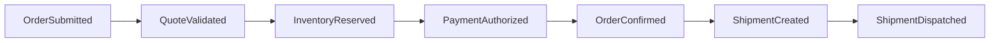
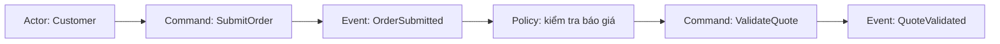
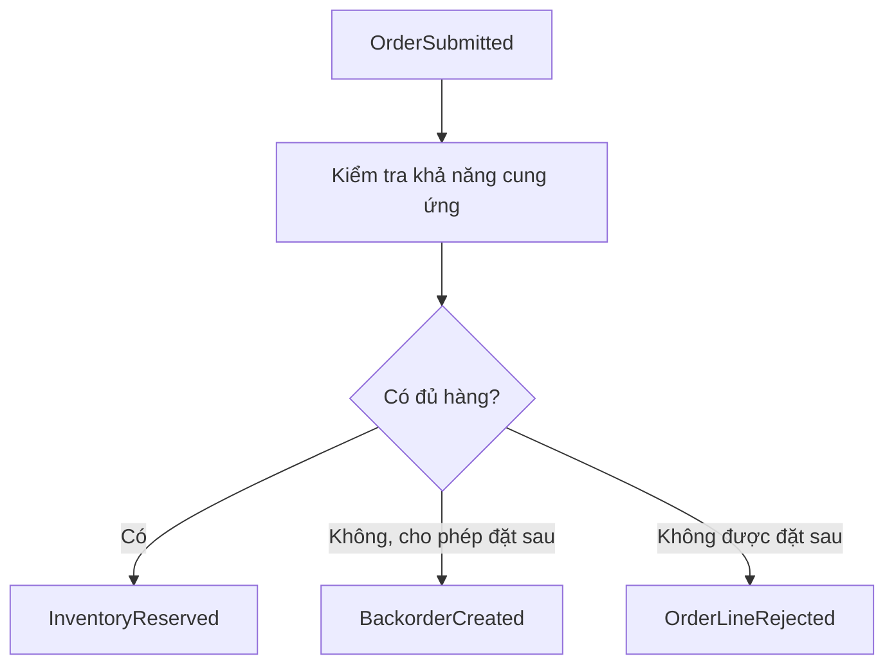
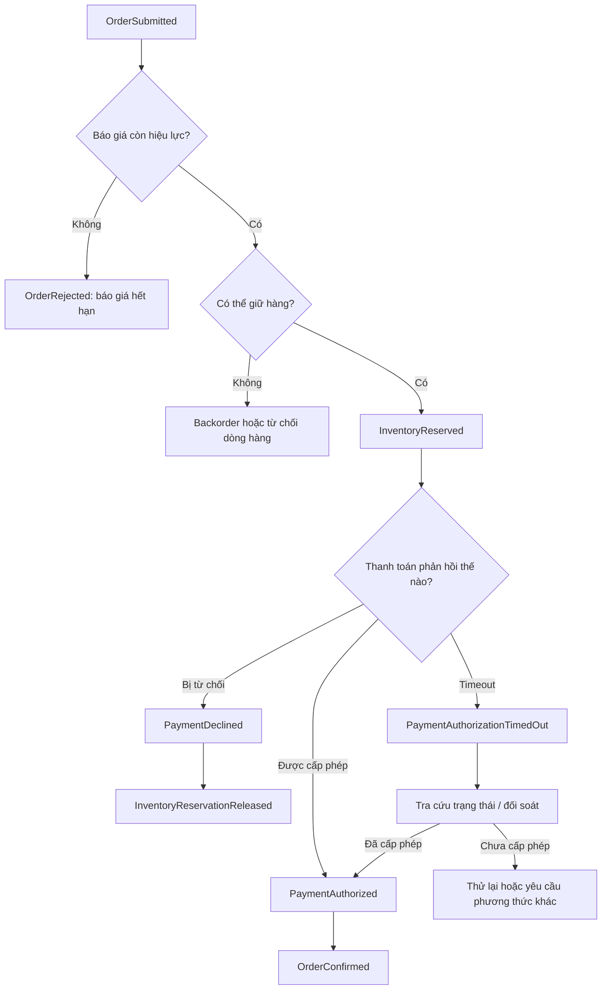

# Dựng dòng thời gian và tìm các nhánh hoặc ngoại lệ

EventStorming là kỹ thuật cộng tác giúp chuyên gia nghiệp vụ và đội phát triển khám phá cách một quy trình thực sự diễn ra. Thay vì bắt đầu bằng màn hình, bảng dữ liệu hoặc danh sách API, nhóm ghi lại các sự kiện nghiệp vụ đã xảy ra rồi sắp xếp chúng theo trình tự thời gian. Khi dòng chính đã rõ, nhóm lần lượt đặt câu hỏi về điều kiện, quyết định, thất bại, thời gian chờ và những trường hợp khác với quy trình thông thường để tìm ra các nhánh và ngoại lệ.

Một dòng thời gian tốt không chỉ mô tả con đường thành công. Nó còn cho thấy điều gì có thể khiến quy trình rẽ hướng, ai có quyền quyết định, trạng thái nào thay đổi và hệ thống cần phản ứng ra sao. Những thông tin này giúp đội ngũ hiểu nghiệp vụ sâu hơn, phát hiện quy tắc còn thiếu và xác định các ranh giới mô hình phù hợp.

## 1. Vì sao cần dựng dòng thời gian?

Mô tả nghiệp vụ bằng một đoạn văn thường che khuất thứ tự và quan hệ nhân quả. Chẳng hạn, câu “khách đặt hàng, hệ thống kiểm tra tồn kho và thanh toán rồi gửi hàng” không cho biết:

- Đơn được tạo trước hay sau khi kiểm tra tồn kho?
- Hàng được giữ trước hay sau khi thanh toán được chấp thuận?
- Điều gì xảy ra nếu báo giá hết hạn trong lúc khách đang đặt hàng?
- Nếu thanh toán thành công nhưng việc giữ hàng thất bại, hệ thống xử lý thế nào?
- Ai được phép hủy đơn sau khi hàng đã được đóng gói?
- Khi nhà cung cấp thanh toán phản hồi chậm, hệ thống chờ, thử lại hay tra cứu kết quả?

Dòng thời gian làm lộ ra những câu hỏi này. Mỗi sự kiện được đặt tại thời điểm nó thực sự xảy ra. Từ đó, nhóm có thể nhìn thấy các bước trước và sau, điều kiện để chuyển tiếp, cũng như hậu quả của một nhánh khác thường.

EventStorming không nhằm vẽ một quy trình lý tưởng để trình bày. Mục tiêu là cùng khám phá cách nghiệp vụ vận hành, bao gồm những điều chưa thống nhất, ngoại lệ hiếm gặp và những tình huống khiến người vận hành phải can thiệp.

## 2. Các thành phần thường dùng trên bản đồ

Trong Big Picture hoặc Process Modeling EventStorming, nhóm thường sử dụng giấy ghi chú nhiều màu. Quy ước màu có thể thay đổi theo cách tổ chức workshop; điều quan trọng là thống nhất ý nghĩa trước khi bắt đầu. Một quy ước phổ biến là:

| Thành phần | Màu thường dùng | Cách viết |
| --- | --- | --- |
| Domain Event | Cam | Sự việc nghiệp vụ đã xảy ra, thường dùng dạng quá khứ: `OrderSubmitted` |
| Command | Xanh dương | Yêu cầu thực hiện hành động: `SubmitOrder` |
| Actor / Role | Vàng | Người hoặc vai trò khởi tạo hành động: `Customer`, `SalesAgent` |
| Aggregate / Entity | Hồng | Đối tượng chịu trách nhiệm xử lý hành vi hoặc bảo vệ quy tắc: `Order` |
| Policy / Process | Tím nhạt | Quy tắc phản ứng với sự kiện và phát ra hành động tiếp theo |
| Read Model / View | Xanh lá | Thông tin được đọc hoặc hiển thị: `OrderSummary` |
| External System | Có thể dùng màu xám | Hệ thống bên ngoài: `PaymentProvider`, `WarehouseSystem` |
| Hot Spot | Đỏ hoặc màu nổi bật | Câu hỏi, mâu thuẫn, rủi ro hoặc điểm chưa rõ cần thảo luận |

Không nên nhầm command với event. `SubmitOrder` là yêu cầu gửi đơn; `OrderSubmitted` là sự kiện ghi nhận đơn đã được gửi. Command có thể bị từ chối hoặc thất bại. Event diễn tả điều đã xảy ra và có ý nghĩa trong miền nghiệp vụ.

Một policy thường có dạng “khi sự kiện A xảy ra và điều kiện B đúng, hệ thống yêu cầu hành động C”. Ví dụ: khi `PaymentDeclined` xảy ra, nếu đơn vẫn đang giữ hàng thì yêu cầu giải phóng lượt giữ hàng. Policy giúp nối các sự kiện với hành động tiếp theo, đặc biệt khi quy trình đi qua nhiều thành phần.

## 3. Chuẩn bị trước khi xếp dòng thời gian

Trước workshop, người điều phối cần xác định một phạm vi đủ cụ thể. “Toàn bộ hoạt động thương mại” quá rộng cho một buổi làm việc. “Từ lúc khách gửi đơn đến khi đơn được xác nhận hoặc bị từ chối” là phạm vi dễ khám phá hơn.

Nên mời những người có hiểu biết khác nhau về quy trình, chẳng hạn:

- Chuyên gia nghiệp vụ hoặc người sở hữu quy trình.
- Nhân viên trực tiếp thực hiện và xử lý trường hợp ngoại lệ.
- Đại diện sản phẩm hoặc phân tích nghiệp vụ.
- Lập trình viên, kiến trúc sư và người phụ trách tích hợp.
- Đại diện các hệ thống bên ngoài nếu có thể tham gia.

Người điều phối chuẩn bị không gian đủ rộng, giấy ghi chú và một câu hỏi mở đầu. Có thể yêu cầu mọi người kể lại một giao dịch cụ thể gần đây, bao gồm cả trường hợp thành công và trường hợp gặp vấn đề. Một ví dụ thật thường giúp nhóm phát hiện chi tiết mà quy trình trên tài liệu bỏ sót.

Trước khi vẽ, hãy thống nhất:

1. Điểm bắt đầu và kết thúc của quy trình.
2. Một đơn vị nghiệp vụ đang được theo dõi, ví dụ một đơn hàng.
3. Quy ước màu và cách ghi tên sự kiện, command, actor, policy.
4. Trục thời gian: từ trái sang phải theo thứ tự trước đến sau.
5. Cách đánh dấu câu hỏi chưa có lời giải để không biến giả định thành sự thật.

## 4. Bắt đầu từ các sự kiện nghiệp vụ

Một cách thực hành phổ biến là yêu cầu người tham gia viết các domain event mà họ biết, mỗi sự kiện trên một giấy ghi chú riêng. Dùng dạng đã xảy ra, chẳng hạn:

- `OrderSubmitted` — đơn hàng đã được gửi.
- `QuoteValidated` — báo giá đã được xác nhận còn hiệu lực.
- `InventoryReserved` — hàng đã được giữ cho đơn.
- `PaymentAuthorized` — khoản thanh toán đã được cấp phép.
- `OrderConfirmed` — đơn hàng đã được xác nhận.
- `ShipmentDispatched` — lô hàng đã được gửi đi.

Ở bước đầu, chưa cần tranh luận về mọi chi tiết kỹ thuật. Hãy để người tham gia ghi những gì họ tin rằng đã xảy ra. Sau đó, cả nhóm đọc từng giấy ghi chú, làm rõ ý nghĩa và gộp những sự kiện trùng nhau. Nếu hai người dùng cùng một tên nhưng mô tả hai kết quả khác nhau, hãy giữ câu hỏi đó thành hot spot để thảo luận.

Không nên viết tên màn hình hoặc thao tác giao diện thành domain event. “Người dùng bấm nút Xác nhận” là một hành động trên giao diện; sự kiện miền có thể là `OrderConfirmed` nếu đơn thực sự đã được xác nhận. Tương tự, “API trả HTTP 200” là kết quả kỹ thuật, không tự động là một sự kiện nghiệp vụ.

## 5. Sắp xếp sự kiện thành dòng thời gian

Sau khi có tập sự kiện ban đầu, nhóm sắp xếp chúng từ trái sang phải theo trình tự xảy ra trong một trường hợp bình thường. Đây là **happy path** — con đường phổ biến dẫn đến kết quả mong muốn.

Với quy trình đặt hàng, dòng chính có thể là:

Đây là một trình tự minh họa; quy trình thật có thể xác nhận thanh toán, giữ hàng hoặc tạo lô giao hàng theo thứ tự khác. Nhóm phải kiểm chứng thứ tự với người hiểu nghiệp vụ và các hệ thống liên quan.

Khi đặt một sự kiện lên bản đồ, hãy hỏi:

- Sự kiện này xảy ra trước hay sau sự kiện nào?
- Điều gì khiến nó xảy ra?
- Nó có thể xảy ra nhiều lần không?
- Có thể xảy ra muộn hơn dự kiến không?
- Có sự kiện nào bắt buộc phải xảy ra trước nó không?
- Ai hoặc hệ thống nào biết sự kiện này đã xảy ra?

Nếu thứ tự chưa rõ, không nên tự chọn một phương án để sơ đồ trông liền mạch. Đánh dấu hot spot, ghi các giả thuyết và tìm người có thể xác nhận. Có những quy trình mà hai sự kiện độc lập có thể xảy ra song song; không phải mọi thứ đều cần ép thành một chuỗi tuyến tính.

## 6. Bổ sung command, actor và policy

Khi dòng sự kiện chính đã tương đối rõ, nhóm bổ sung các thành phần giải thích nguyên nhân và người thực hiện.

Ví dụ:

- Actor `Customer` gửi command `SubmitOrder`.
- Aggregate `Order` kiểm tra dữ liệu và phát sinh `OrderSubmitted`.
- Policy phản ứng với `OrderSubmitted`, yêu cầu kiểm tra báo giá.
- Context Pricing xử lý command `ValidateQuote` và phát sinh `QuoteValidated` hoặc một kết quả từ chối có ý nghĩa nghiệp vụ.
- Policy tiếp theo yêu cầu giữ hàng và thanh toán theo thứ tự đã thống nhất.

Có thể biểu diễn một đoạn như sau:

Không phải event nào cũng được tạo bởi một command trực tiếp từ người dùng. Một event có thể kích hoạt policy, timer hoặc hệ thống bên ngoài. Ví dụ, khi hết thời hạn giữ hàng, bộ lập lịch phát hiện thời điểm đến hạn và yêu cầu giải phóng reservation. Điều này cần được thể hiện trên bản đồ nếu nó ảnh hưởng đến quy trình.

## 7. Tìm nhánh bằng cách đặt câu hỏi có hệ thống

Khi happy path đã rõ, đừng chỉ hỏi “Còn trường hợp nào khác?”. Câu hỏi quá rộng dễ khiến nhóm bỏ sót những nhánh hiếm nhưng có hậu quả lớn. Hãy đi qua từng điểm chuyển tiếp và kiểm tra các loại tình huống sau:

### 7.1. Điều kiện nghiệp vụ không được đáp ứng

Ở mỗi bước, hỏi điều gì xảy ra nếu điều kiện không đúng:

- Báo giá đã hết hạn hoặc không áp dụng cho khách hàng này thì sao?
- Khách hàng vượt hạn mức tín dụng thì sao?
- Số lượng khả dụng không đủ thì sao?
- Phương thức thanh toán không được chấp nhận thì sao?
- Đơn đã bị hủy nhưng một yêu cầu xác nhận cũ đến muộn thì sao?

Kết quả có thể là từ chối, yêu cầu bổ sung thông tin, chuyển sang quy trình phê duyệt, tạo backorder hoặc chọn phương án thay thế. Hãy ghi rõ điều kiện và sự kiện nghiệp vụ phản ánh kết quả.

### 7.2. Quyết định có nhiều nhánh

Một policy có thể rẽ sang nhiều kết quả tùy điều kiện. Ví dụ, nếu mặt hàng đủ tồn kho thì giữ hàng; nếu không đủ nhưng cho phép giao sau thì tạo backorder; nếu mặt hàng không được phép đặt trước thì từ chối dòng hàng.

Hãy xác định nhánh áp dụng ở cấp đơn hàng hay từng dòng hàng. Nếu một đơn có năm dòng và chỉ một dòng thiếu hàng, hệ thống có thể từ chối cả đơn, chấp nhận một phần hoặc tạo backorder cho dòng đó. Đây là quyết định nghiệp vụ quan trọng, không nên để nhóm kỹ thuật tự suy ra.

### 7.3. Lỗi từ hệ thống bên ngoài

Phân biệt lỗi nghiệp vụ với lỗi kỹ thuật. Thanh toán bị từ chối là một kết quả nghiệp vụ từ nhà cung cấp thanh toán; kết nối bị ngắt là sự cố kỹ thuật; yêu cầu gửi lại do timeout chưa chắc có nghĩa thanh toán thất bại.

Hãy hỏi:

- Hệ thống nhận được phản hồi từ bên ngoài hay không?
- Nếu không có phản hồi, làm sao biết thao tác đã được thực hiện?
- Có thể thử lại không? Thử lại có gây tính tiền hai lần không?
- Có cần tra cứu trạng thái bằng mã giao dịch hoặc khóa idempotency không?
- Khi nào chuyển sang trạng thái chờ xử lý thủ công?

Trên bản đồ, có thể ghi sự kiện nghiệp vụ như `PaymentDeclined`, `PaymentAuthorizationTimedOut` hoặc `PaymentStatusReconciled`. Không nên biến mọi lỗi mạng hoặc exception nội bộ thành domain event. Chỉ ghi event khi nó diễn tả một điều có ý nghĩa đối với nghiệp vụ hoặc vòng đời quy trình.

### 7.4. Thời gian chờ và sự kiện đến hạn

Nhiều nhánh chỉ xuất hiện khi thời gian trôi qua:

- Báo giá hết hiệu lực trước khi khách gửi đơn.
- Reservation hết thời hạn nhưng đơn chưa được thanh toán.
- Nhà cung cấp không phản hồi trong khoảng thời gian quy định.
- Đơn chờ phê duyệt quá lâu.
- Hàng đã đóng gói nhưng chưa được bàn giao cho đơn vị vận chuyển.

Đặt timer hoặc mốc thời gian lên dòng thời gian. Ghi rõ thời điểm bắt đầu tính hạn, thời hạn, múi giờ nếu liên quan và điều kiện hủy timer. Ví dụ, khi `InventoryReserved` xảy ra, hệ thống bắt đầu đếm thời gian giữ hàng; nếu chưa có `OrderConfirmed` trước thời điểm hết hạn, policy yêu cầu giải phóng reservation.

### 7.5. Hủy, hoàn tác và bù trừ

Một hành động đã xảy ra có thể cần hành động bù trừ. Nếu thanh toán đã được cấp phép nhưng đơn không thể xác nhận, hệ thống có thể yêu cầu hủy cấp phép (void authorization). Nếu tiền đã được thu, có thể phải hoàn tiền (refund). Hai hành động này có quy tắc và hậu quả khác nhau.

Không nên xóa sự kiện cũ hoặc giả vờ rằng nó chưa từng xảy ra. Hãy ghi sự kiện mới phản ánh việc bù trừ, chẳng hạn `PaymentAuthorizationVoided`, `PaymentRefunded` hoặc `InventoryReservationReleased`. Lịch sử cho thấy cả hành động ban đầu lẫn cách hệ thống xử lý hậu quả.

## 8. Ví dụ mở rộng: các nhánh trong quy trình đặt hàng

Giả sử happy path là: khách gửi đơn, báo giá hợp lệ, hàng được giữ, thanh toán được cấp phép và đơn được xác nhận. Khi workshop đi sâu, nhóm phát hiện một số nhánh:

| Điểm trong dòng thời gian | Điều kiện hoặc sự cố | Kết quả có thể có | Câu hỏi cần xác nhận |
| --- | --- | --- | --- |
| Kiểm tra báo giá | Báo giá hết hạn | `QuoteExpired`, đơn bị từ chối hoặc yêu cầu báo giá mới | Có cho phép cập nhật báo giá trong cùng đơn không? |
| Giữ hàng | Không đủ số lượng | `InventoryReservationRejected`, backorder hoặc từ chối dòng hàng | Có cho phép giao một phần không? |
| Cấp phép thanh toán | Nhà cung cấp từ chối | `PaymentDeclined`, giải phóng hàng hoặc cho thử phương thức khác | Reservation được giữ trong bao lâu để khách thử lại? |
| Cấp phép thanh toán | Timeout, không rõ kết quả | Chờ tra cứu hoặc đối soát | Làm sao tránh gửi yêu cầu thanh toán trùng? |
| Xác nhận đơn | Khách yêu cầu hủy đồng thời với xác nhận | Một thao tác thắng theo quy tắc nhất quán | Trạng thái nào là điểm không thể hủy? |
| Sau khi xác nhận | Kho chỉ đáp ứng được một phần | Tách lô giao, backorder hoặc thay thế hàng | Ai quyết định phương án thay thế? |

Một sơ đồ tổng quát có thể thể hiện các nhánh chính:

Sơ đồ này chưa mô tả mọi chi tiết triển khai. Nó giúp nhóm nhìn thấy những nhánh cần làm rõ: kết quả thanh toán không xác định, thời điểm giải phóng hàng, và cách tiếp tục quy trình sau khi thử lại. Khi có đủ thông tin, nhóm có thể bổ sung actor, command, policy, aggregate và các context tham gia.

## 9. Nhận diện các nhánh đồng thời và sự kiện đến sai thứ tự

Không phải mọi sự kiện đều đến theo thứ tự mà người thiết kế mong đợi. Hệ thống phân tán có thể nhận message trùng, message chậm hoặc phản hồi theo thứ tự khác nhau. Workshop nên hỏi về các tình huống này khi quy trình phụ thuộc vào nhiều hệ thống.

Ví dụ, `PaymentAuthorized` có thể đến sau khi khách đã yêu cầu hủy đơn. Nhóm cần thống nhất:

- Đơn có còn được phép xác nhận không?
- Nếu đơn đã hủy, có phải void authorization hoặc refund không?
- Hệ thống dựa vào phiên bản trạng thái, thời điểm hay quy tắc ưu tiên nào để quyết định?
- Nếu cùng một event được gửi hai lần, thao tác xử lý có idempotent không?
- Nếu hai lệnh cùng thay đổi aggregate, làm sao ngăn cả hai cùng vượt qua điều kiện kiểm tra?

Có thể dùng các hot spot để đánh dấu vấn đề cần quyết định về concurrency, idempotency và thứ tự sự kiện. Không cần giải quyết mọi chi tiết kỹ thuật trong workshop đầu tiên, nhưng cần ghi lại nơi nghiệp vụ có yêu cầu về tính đúng đắn và hậu quả nếu sự kiện đến trễ hoặc lặp lại.

## 10. Ghi nhánh và ngoại lệ sao cho có thể kiểm chứng

Một nhánh chỉ có ích khi người khác hiểu được điều kiện kích hoạt và kết quả của nó. Tránh ghi những nhãn mơ hồ như “lỗi”, “trường hợp đặc biệt” hoặc “xử lý lại”. Hãy mô tả cụ thể:

| Thông tin cần ghi | Ví dụ |
| --- | --- |
| Điểm rẽ nhánh | Sau `InventoryReserved` |
| Điều kiện | Nhà cung cấp thanh toán không phản hồi trong 30 giây |
| Sự kiện ghi nhận | `PaymentAuthorizationTimedOut` |
| Hành động tiếp theo | Tra cứu trạng thái giao dịch bằng khóa idempotency |
| Kết quả có thể có | Đã cấp phép, bị từ chối hoặc vẫn chưa xác định |
| Trách nhiệm | Policy thanh toán điều phối; Payment context sở hữu trạng thái giao dịch |
| Câu hỏi còn mở | Sau bao lâu chuyển sang xử lý thủ công? |

Khi một nhánh chưa được xác minh, đánh dấu nó là giả thuyết hoặc hot spot. Có thể ghi người cần hỏi và bằng chứng cần tìm. Không nên biến giả định của một thành viên thành quy tắc chính thức chỉ vì nó đã được viết lên bảng.

## 11. Các lỗi thường gặp khi dựng dòng thời gian

**Bắt đầu từ màn hình hoặc API.** Điều này khiến nhóm tập trung vào thao tác giao diện và cấu trúc kỹ thuật, trong khi mục tiêu là hiểu sự kiện và quy tắc nghiệp vụ. Hãy bắt đầu bằng điều đã xảy ra.

**Chỉ vẽ happy path.** Một sơ đồ trông liền mạch có thể che khuất phần lớn độ phức tạp. Hãy dành thời gian hỏi về từ chối, thiếu dữ liệu, timeout, hủy, hoàn tác và trường hợp một phần.

**Gộp command và event.** `ConfirmOrder` là yêu cầu; `OrderConfirmed` là kết quả đã xảy ra. Gộp hai khái niệm khiến người đọc không biết thao tác đã thành công hay mới được yêu cầu.

**Coi lỗi kỹ thuật nào cũng là sự kiện miền.** Exception, HTTP status hoặc lỗi kết nối chỉ nên xuất hiện trên bản đồ khi chúng ảnh hưởng đến quy trình nghiệp vụ. Hãy mô tả ý nghĩa nghiệp vụ của kết quả thay vì sao chép thông báo kỹ thuật.

**Ép mọi thứ thành một chuỗi tuyến tính.** Một số hành động xảy ra song song hoặc phụ thuộc vào nhiều kết quả. Hãy thể hiện nhánh và điểm hội tụ thay vì tạo thứ tự giả.

**Không ghi điều kiện của nhánh.** “Nếu lỗi thì thử lại” không đủ. Cần biết lỗi nào được thử lại, số lần, khoảng chờ, điều kiện dừng và hậu quả khi hết lần thử.

**Cố giải quyết mọi hot spot ngay tại workshop.** Một số câu hỏi cần dữ liệu, chuyên gia hoặc kiểm tra hệ thống bên ngoài. Ghi lại chủ sở hữu và bước xác minh tiếp theo để workshop vẫn giữ được tiến độ.

## 12. Cách điều phối workshop hiệu quả

Một phiên làm việc có thể đi theo trình tự:

1. **Giới thiệu phạm vi và quy ước:** xác định quy trình, điểm bắt đầu/kết thúc và ý nghĩa màu giấy.
2. **Ghi sự kiện riêng lẻ:** để người tham gia tự ghi domain event theo hiểu biết của họ trước khi thống nhất.
3. **Ghép dòng chính:** đặt sự kiện theo thứ tự thời gian và kể lại một trường hợp cụ thể.
4. **Bổ sung nguyên nhân và người thực hiện:** thêm command, actor, aggregate, policy và hệ thống bên ngoài.
5. **Đi từng điểm để tìm nhánh:** hỏi điều kiện không đạt, từ chối, timeout, hủy, thử lại, xử lý một phần và sự kiện đến trễ.
6. **Đánh dấu điểm chưa rõ:** ghi hot spot, giả thuyết, người cần xác nhận và dữ liệu cần tìm.
7. **Đọc lại toàn bộ câu chuyện:** kể lại happy path và các nhánh bằng lời, kiểm tra xem người tham gia có cùng hiểu một quy trình không.
8. **Chốt kết quả tiếp theo:** xác định câu hỏi cần giải quyết, người phụ trách và artefact cần cập nhật.

Người điều phối nên khuyến khích người trực tiếp làm nghiệp vụ kể cả những lần quy trình “không chạy như sách”. Các trường hợp bị xử lý bằng bảng tính, cuộc gọi, email hoặc thao tác thủ công thường tiết lộ quy tắc chưa được hệ thống hỗ trợ.

## 13. Từ dòng thời gian đến mô hình và thiết kế

Sau EventStorming, nhóm có thể dùng kết quả để tiếp tục khám phá mô hình miền:

- Các sự kiện liên quan đến cùng một vòng đời có thể gợi ý aggregate hoặc ranh giới nhất quán.
- Những quy tắc quyết định nhánh có thể trở thành domain policy hoặc hành vi của mô hình miền.
- Các nhóm sự kiện và thuật ngữ khác nhau có thể gợi ý bounded context.
- Các sự kiện được context khác sử dụng có thể trở thành hợp đồng tích hợp hoặc domain event được công bố.
- Những hot spot chưa rõ có thể trở thành câu hỏi nghiên cứu, thử nghiệm hoặc yêu cầu nghiệp vụ cần xác nhận.

Tuy nhiên, không nên suy ra máy móc rằng mỗi sự kiện là một aggregate, mỗi policy là một service hoặc mỗi cụm giấy ghi chú là một bounded context. Bản đồ là công cụ khám phá. Mô hình và kiến trúc cần được kiểm chứng bằng quy tắc, trách nhiệm và thay đổi thực tế.

## 14. Checklist rà soát dòng thời gian

Trước khi kết thúc workshop, hãy kiểm tra:

- Phạm vi và điểm kết thúc của quy trình đã rõ chưa?
- Happy path có các domain event theo đúng thứ tự nghiệp vụ không?
- Command, event, actor và policy đã được phân biệt chưa?
- Mỗi nhánh có điều kiện kích hoạt và kết quả cụ thể chưa?
- Đã xem xét từ chối, timeout, lỗi bên ngoài, thử lại và bù trừ chưa?
- Đã xem xét sự kiện trùng, đến trễ hoặc sai thứ tự khi có tích hợp bất đồng bộ chưa?
- Các hành động song song và trường hợp xử lý một phần đã được ghi nhận chưa?
- Hot spot có người chịu trách nhiệm và cách xác minh tiếp theo chưa?
- Các thành viên có thể kể lại cùng một câu chuyện từ bản đồ không?

## 15. Nguyên tắc cần ghi nhớ

Dựng dòng thời gian bằng domain event giúp nhóm nhìn thấy quy trình nghiệp vụ theo thứ tự thực tế. Sau khi happy path rõ ràng, hãy đi qua từng điểm chuyển tiếp và tìm các nhánh do điều kiện nghiệp vụ, lỗi hệ thống bên ngoài, thời gian chờ, hủy, bù trừ, xử lý một phần hoặc sự kiện đến sai thứ tự.

Một EventStorming có giá trị là bản đồ mà nhóm có thể dùng để kể lại điều đã xảy ra, giải thích vì sao một nhánh được chọn và chỉ ra những câu hỏi còn chưa được giải quyết. Hãy ghi rõ điều đã biết, điều đang giả định và điều cần xác minh; từ đó chuyển hiểu biết chung thành mô hình và thiết kế có thể kiểm chứng.
