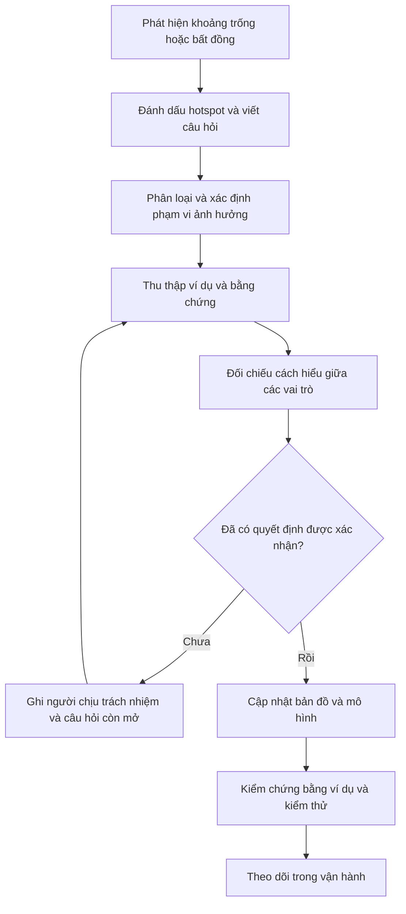

# Nhận diện điểm chưa rõ, xung đột và các khu vực cần tìm hiểu thêm

Trong Domain-Driven Design (DDD), EventStorming giúp nhiều vai trò cùng khám phá một quy trình nghiệp vụ bằng cách sắp xếp các sự kiện theo dòng thời gian. Giá trị của buổi làm việc không chỉ nằm ở việc tạo ra một sơ đồ quy trình. Khi các sự kiện, hành động, quyết định và ngoại lệ được đặt cạnh nhau, nhóm có thể nhìn thấy những chỗ còn thiếu thông tin, những cách hiểu mâu thuẫn và các khu vực cần trao đổi sâu hơn với chuyên gia nghiệp vụ.

Những điểm này thường được gọi là **hotspot** — điểm nóng cần chú ý. Hotspot có thể là một câu hỏi chưa có lời giải, hai vai trò mô tả cùng tình huống theo cách khác nhau, một quy tắc không rõ điều kiện, một bước xử lý thủ công hoặc một phụ thuộc bên ngoài chưa được hiểu. Nhận diện và xử lý hotspot giúp nhóm tránh biến giả định thành quy tắc trong mô hình miền, đồng thời xác định đúng nội dung cần tìm hiểu tiếp theo.

## 1. EventStorming và vai trò của hotspot

**EventStorming** là kỹ thuật workshop cộng tác do Alberto Brandolini giới thiệu, sử dụng các ghi chú trực quan để khám phá cách nghiệp vụ vận hành. Người tham gia thường bắt đầu bằng những sự kiện miền đã xảy ra, đặt chúng theo trình tự thời gian, sau đó bổ sung lệnh, vai trò, chính sách, hệ thống bên ngoài và các thông tin cần thiết khác.

Một số loại ghi chú thường gặp trong EventStorming:

| Thành phần | Ý nghĩa | Ví dụ |
| --- | --- | --- |
| **Domain Event** | Sự việc nghiệp vụ đã xảy ra, thường đặt tên ở thì quá khứ. | `OrderPlaced`, `PaymentReceived`, `ShipmentDispatched`. |
| **Command** | Yêu cầu thực hiện một hành động. | `PlaceOrder`, `ConfirmPayment`, `CancelOrder`. |
| **Actor** | Người hoặc vai trò khởi tạo hành động. | Khách hàng, nhân viên kho, nhân viên hỗ trợ. |
| **Policy** | Quy tắc hoặc phản ứng được kích hoạt bởi sự kiện. | Khi thanh toán được xác nhận, yêu cầu giữ hàng. |
| **Read Model** | Thông tin được đọc để hỗ trợ quyết định hoặc hành động. | Màn hình trạng thái đơn hàng, danh sách hàng còn có thể bán. |
| **External System** | Hệ thống bên ngoài tham gia vào quy trình. | Cổng thanh toán, đơn vị vận chuyển. |
| **Aggregate** | Ranh giới mô hình chịu trách nhiệm xử lý lệnh và bảo vệ bất biến. | `Order`, `Payment`, `Shipment`. |
| **Hotspot** | Câu hỏi, bất đồng, rủi ro hoặc điểm chưa được hiểu rõ. | “Khi thanh toán đến muộn, đơn hàng có được giữ hay tự hủy?” |

Màu ghi chú có thể khác nhau giữa các biến thể hoặc nhóm thực hành. Một quy ước thường gặp là Domain Event màu cam, Command màu xanh lam, Actor màu vàng, Policy màu tím và Hotspot màu hồng hoặc đỏ. Nhóm nên thống nhất bảng chú giải trước khi bắt đầu; ý nghĩa của thành phần quan trọng hơn màu sắc.

Hotspot không phải là lỗi của người tham gia hay bằng chứng rằng mô hình hiện tại sai. Nó đánh dấu nơi hiểu biết chưa đủ chắc chắn để đưa ra quyết định. Việc nhìn thấy một hotspot là kết quả tốt của workshop vì nhóm đã làm lộ ra điều trước đó bị che khuất trong trao đổi riêng lẻ.

## 2. Vì sao cần nhận diện điểm chưa rõ và xung đột?

Một quy trình nghiệp vụ được kể lại thường nghe có vẻ tuyến tính: khách đặt hàng, thanh toán, kho đóng gói và đơn vị vận chuyển giao hàng. Nhưng khi hỏi kỹ, nhóm có thể phát hiện nhiều câu hỏi:

- Đơn hàng được tạo khi khách bấm đặt hay sau khi thanh toán thành công?
- Kho giữ hàng ở thời điểm nào và giữ trong bao lâu?
- Nếu thanh toán thất bại nhưng tiền vẫn bị trừ, ai xử lý?
- Nếu chỉ giao được một phần hàng, đơn hàng có hoàn tất không?
- Ai có quyền hủy đơn sau khi kiện hàng đã bàn giao cho đơn vị vận chuyển?
- Trạng thái từ cổng thanh toán hoặc đơn vị vận chuyển có đến muộn hay lặp lại không?

Nếu nhóm bỏ qua các câu hỏi này, mỗi người có thể tự đưa ra một giả định. Lập trình viên có thể hiểu “đã giao” là đã rời kho, nhân viên chăm sóc khách hàng lại hiểu là khách đã nhận. Một người cho rằng đơn hàng chỉ được hủy trước khi đóng gói, người khác cho rằng có thể hủy đến trước khi bàn giao. Khi các giả định đó được cài đặt vào nhiều phần khác nhau, hệ thống sẽ có hành vi không nhất quán.

Nhận diện hotspot giúp nhóm:

- Phân biệt điều đã được xác nhận với điều mới chỉ là giả thuyết.
- Phát hiện các quy tắc nghiệp vụ mâu thuẫn giữa vai trò hoặc bộ phận.
- Tìm ra bước thủ công, ngoại lệ và phụ thuộc chưa xuất hiện trong mô hình.
- Xác định đúng chuyên gia hoặc bên liên quan cần được hỏi thêm.
- Ưu tiên việc tìm hiểu theo mức độ ảnh hưởng và rủi ro.
- Tránh thiết kế Entity, Aggregate, trạng thái hoặc tích hợp dựa trên thông tin thiếu chắc chắn.

## 3. Các loại hotspot thường gặp

Không phải mọi dấu chấm hỏi trên bản đồ đều giống nhau. Phân loại hotspot giúp nhóm chọn cách điều tra phù hợp và biết cần ai tham gia.

### 3.1. Thiếu thông tin hoặc chưa rõ ý nghĩa

Nhóm chưa biết một sự kiện, trạng thái hoặc thuật ngữ thực sự có nghĩa gì.

Ví dụ: nhân viên nói “đơn đã xử lý”, nhưng chưa rõ là đã duyệt, đã đóng gói, đã bàn giao hay đã giao đến khách. Đây là tín hiệu cần làm rõ ngôn ngữ chung và mốc nghiệp vụ.

Các câu hỏi gợi ý:

- Sự kiện xảy ra chính xác vào thời điểm nào?
- Ai xác nhận sự kiện đó?
- Điều kiện nào phải đúng trước khi sự kiện xảy ra?
- Có ví dụ nào không được xem là sự kiện này không?

### 3.2. Xung đột giữa các cách hiểu

Hai vai trò hoặc bộ phận mô tả cùng một tình huống nhưng đưa ra kết quả khác nhau.

Ví dụ: bộ phận bán hàng cho rằng khách có thể hủy đơn trước khi hàng rời kho; bộ phận kho cho rằng chỉ có thể hủy trước khi bắt đầu đóng gói. Nhóm cần xác định đây là hiểu nhầm thuật ngữ, chính sách khác nhau theo loại hàng hay một xung đột thật trong quy trình.

Không nên chọn ngay ý kiến của người có chức danh cao hơn hoặc người nói trước. Cần ghi lại từng cách hiểu, ví dụ và người có thẩm quyền xác nhận chính sách.

### 3.3. Quy tắc hoặc chính sách chưa rõ

Nhóm biết có một quyết định được đưa ra nhưng chưa hiểu điều kiện hoặc người chịu trách nhiệm.

Ví dụ: “đơn giá trị cao cần được duyệt”. Cần làm rõ ngưỡng giá trị, cách tính tổng tiền, vai trò có quyền duyệt, thời hạn phản hồi và điều gì xảy ra khi bị từ chối.

### 3.4. Thiếu sự kiện hoặc bước chuyển tiếp

Một sự kiện xuất hiện mà không rõ hành động nào tạo ra nó, hoặc một lệnh không dẫn đến kết quả được giải thích.

Ví dụ: bản đồ có `ShipmentDelivered` nhưng không có thông tin về việc đơn vị vận chuyển xác nhận giao hàng bằng cách nào. Có thể thiếu sự kiện `DeliveryAttempted`, `ProofOfDeliveryReceived` hoặc một bước xác minh khác.

Đây là dấu hiệu cần kiểm tra luồng thực tế, không có nghĩa nhóm phải thêm một sự kiện mới ngay lập tức.

### 3.5. Nhánh ngoại lệ và xử lý thất bại

Bản đồ chỉ mô tả luồng thành công mà không cho biết điều gì xảy ra khi một bước bị từ chối, hết thời gian chờ hoặc thất bại.

Ví dụ: cổng thanh toán không phản hồi. Đơn hàng được giữ ở trạng thái chờ bao lâu? Có thử lại không? Nếu khách thử thanh toán lần nữa, hệ thống có thể ghi nhận hai giao dịch không? Ai xử lý khi kết quả cuối cùng chưa rõ?

### 3.6. Phụ thuộc bên ngoài hoặc ranh giới chưa rõ

Một bước cần dữ liệu hoặc quyết định từ hệ thống, đối tác hay bộ phận khác nhưng bản đồ chưa cho thấy trách nhiệm và hợp đồng.

Ví dụ: hệ thống vận chuyển gửi trạng thái `DELIVERED`, nhưng nhóm chưa biết đó là trạng thái do tài xế cập nhật, do hệ thống quét mã hay do khách xác nhận. Nhóm cần làm rõ nguồn dữ liệu, ý nghĩa và độ tin cậy.

### 3.7. Bước thủ công hoặc workaround

Nhân viên thường xuyên dùng bảng tính, gọi điện, gửi email hoặc thao tác ngoài hệ thống để hoàn tất công việc.

Ví dụ: khi không xác định được giao dịch thanh toán, nhân viên phải liên hệ ngân hàng và tự cập nhật trạng thái đơn. Đây có thể là một quy tắc chưa được hỗ trợ, một hạn chế tích hợp hoặc một cơ chế kiểm soát bắt buộc.

### 3.8. Vấn đề thời gian, thứ tự và tính nhất quán

Nhóm chưa rõ thứ tự sự kiện, độ trễ, thời hạn hoặc cách xử lý sự kiện lặp.

Ví dụ: `PaymentReceived` có thể đến sau `OrderExpired`. Nhóm cần biết thời điểm nào được coi là thanh toán hợp lệ, có cho phép khôi phục đơn không và xử lý khoản tiền đến muộn ra sao.

### 3.9. Bất đồng về quyền quyết định và trách nhiệm

Hai vai trò đều nghĩ bên kia chịu trách nhiệm hoặc cùng cho rằng mình có quyền quyết định.

Ví dụ: nhân viên kho cho rằng chăm sóc khách hàng phải phê duyệt hủy đơn; chăm sóc khách hàng cho rằng kho phải xác nhận khả năng thu hồi hàng. Cần xác định quyền quyết định, dữ liệu cần có và điểm bàn giao trách nhiệm.

## 4. Dấu hiệu nhận biết hotspot ngay trên bản đồ

Khi đọc dòng thời gian EventStorming, hãy quan sát các khoảng trống và điểm không khớp giữa các thành phần. Một số dấu hiệu phổ biến:

| Dấu hiệu trên bản đồ | Điều có thể đang thiếu | Câu hỏi điều tra |
| --- | --- | --- |
| Một Domain Event không rõ ai hoặc điều gì tạo ra | Actor, Command hoặc chính sách kích hoạt | Ai đã thực hiện hành động dẫn đến sự kiện? |
| Một Command không có kết quả tiếp theo | Điều kiện từ chối, sự kiện kết quả hoặc xử lý thất bại | Lệnh có thể bị từ chối không? Khi nào được xem là thành công? |
| Hai sự kiện có thứ tự không thống nhất | Quy tắc thời gian hoặc phụ thuộc | Sự kiện nào phải xảy ra trước? Có thể xảy ra đồng thời không? |
| Cùng một từ được dùng cho nhiều trạng thái | Ngôn ngữ chung chưa rõ | Các trạng thái khác nhau ở điểm nào? |
| Một bước cần nhiều thao tác thủ công | Quy tắc, dữ liệu hoặc tích hợp còn thiếu | Vì sao hệ thống không hỗ trợ bước này? |
| Một chính sách không có điều kiện cụ thể | Ngưỡng, quyền hạn hoặc ngoại lệ chưa rõ | Ai quyết định và dựa trên tiêu chí nào? |
| Nhiều bộ phận đưa ra kết quả khác nhau | Xung đột chính sách hoặc khác biệt ngữ cảnh | Đây là cùng một quy trình hay hai ngữ cảnh riêng? |
| Một sự kiện phụ thuộc vào đối tác | Hợp đồng và nguồn sự thật chưa rõ | Ai phát sự kiện, dữ liệu đến khi nào và có đáng tin cậy không? |
| Không rõ điều gì xảy ra sau ngoại lệ | Nhánh bù trừ hoặc trạng thái chờ còn thiếu | Ai khôi phục, hoàn tiền hoặc tiếp tục xử lý? |

Một dấu hiệu không tự động chứng minh có lỗi mô hình. Ví dụ, một Command không có Domain Event tiếp theo có thể được thiết kế để trả kết quả đồng bộ hoặc bị từ chối ngay. Cần hỏi người hiểu nghiệp vụ và người chịu trách nhiệm kỹ thuật trước khi kết luận.

## 5. Cách ghi nhận hotspot rõ ràng

Hotspot cần được viết sao cho người khác có thể hiểu vấn đề và tiếp tục điều tra mà không phải nghe lại toàn bộ cuộc họp.

### 5.1. Ghi câu hỏi cụ thể, tránh ghi kết luận sớm

Ghi “Khi thanh toán được xác nhận sau khi đơn đã hết hạn, chính sách xử lý là gì?” sẽ hữu ích hơn ghi “Cần thêm trạng thái thanh toán muộn”. Câu thứ nhất thể hiện điều chưa biết; câu thứ hai đã giả định cách giải quyết.

### 5.2. Tách dữ kiện, giả thuyết và quyết định

Với mỗi hotspot, nhóm nên phân biệt:

- **Dữ kiện:** điều đã quan sát hoặc được xác nhận từ hồ sơ và người tham gia.
- **Giả thuyết:** cách giải thích có thể đúng nhưng chưa được xác nhận.
- **Câu hỏi mở:** điều cần hỏi hoặc kiểm tra thêm.
- **Quyết định:** kết luận đã được người có trách nhiệm xác nhận.

Ví dụ:

| Loại | Nội dung |
| --- | --- |
| Dữ kiện | Có giao dịch thanh toán được ngân hàng xác nhận sau thời điểm đơn hết hạn. |
| Giả thuyết | Cổng thanh toán gửi webhook chậm. |
| Câu hỏi mở | Chính sách có chấp nhận khoản thanh toán đến muộn không? |
| Quyết định | Chưa có; cần xác nhận với người phụ trách thanh toán và vận hành. |

### 5.3. Ghi vị trí hotspot trên dòng thời gian

Đặt hotspot gần sự kiện, lệnh hoặc chính sách mà nó liên quan. Nếu câu hỏi ảnh hưởng đến nhiều phần của quy trình, có thể liên kết nó với nhiều điểm hoặc ghi rõ phạm vi. Cách này giúp nhóm biết cần xem lại phần nào khi có câu trả lời.

### 5.4. Ghi người cần tham gia và bằng chứng cần có

Một hotspot có thể cần chuyên gia nghiệp vụ, nhân viên trực tiếp vận hành, người phụ trách chính sách, đối tác hoặc kỹ sư tích hợp. Ghi rõ người cần hỏi và tài liệu cần xem như hồ sơ giao dịch, log, hợp đồng, quy định hoặc ví dụ thực tế.

### 5.5. Tránh gom nhiều câu hỏi vào một hotspot

Nếu một ghi chú chứa cả câu hỏi về quyền hủy, cách hoàn tiền, thời hạn giữ hàng và trách nhiệm của đối tác vận chuyển, nhóm khó xác định câu nào đã được giải quyết. Nên tách thành các câu hỏi nhỏ có liên quan, sau đó liên kết chúng với cùng một khu vực quy trình.

## 6. Quy trình xử lý hotspot sau khi phát hiện

Nhận diện điểm chưa rõ mới là bước đầu. Nhóm cần biến chúng thành hoạt động tìm hiểu có mục tiêu và cập nhật lại mô hình sau khi có kết quả.

### Bước 1: Tạm dừng kết luận và ghi nhận điểm chưa rõ

Khi có bất đồng hoặc thiếu dữ kiện, đánh dấu hotspot và ghi câu hỏi trung lập. Không xóa các ghi chú đang mâu thuẫn chỉ để bản đồ trông gọn hơn.

### Bước 2: Xác định loại và phạm vi ảnh hưởng

Phân loại hotspot: thuật ngữ, quy tắc, ngoại lệ, thời gian, trách nhiệm, phụ thuộc bên ngoài hay ranh giới mô hình. Xác định nó ảnh hưởng đến sự kiện, lệnh, vai trò hoặc Bounded Context nào.

### Bước 3: Thu thập bằng chứng

Hỏi người trực tiếp thực hiện, người quyết định chính sách và người chịu trách nhiệm hệ thống. Khi có thể, xem hồ sơ thực tế, log, hợp đồng hoặc quan sát quy trình. Cần tìm cả ví dụ thông thường, ngoại lệ và trường hợp bị từ chối.

### Bước 4: Đối chiếu các cách hiểu

Đặt các lời giải thích cạnh nhau. Xác định chúng khác nhau do:

- Dùng cùng một thuật ngữ cho các ý nghĩa khác nhau.
- Chính sách khác nhau theo loại khách hàng, sản phẩm hoặc kênh.
- Một bộ phận đang mô tả bước khác trong cùng quy trình.
- Quy trình thực tế đã thay đổi nhưng tài liệu chưa cập nhật.
- Có xung đột thật về quyền quyết định hoặc mục tiêu.

Không nên cố ép các cách hiểu thành một quy tắc duy nhất nếu chúng thuộc các Bounded Context khác nhau hoặc có điều kiện áp dụng khác nhau.

### Bước 5: Xác nhận quy tắc và người chịu trách nhiệm

Ghi rõ điều kiện, kết quả, ngoại lệ, người có quyền quyết định và thời điểm áp dụng. Nếu chưa thể thống nhất, giữ hotspot ở trạng thái mở và ghi nhận ai sẽ quyết định, khi nào cần có câu trả lời.

### Bước 6: Cập nhật EventStorming và mô hình

Sau khi có kết luận, cập nhật sự kiện, lệnh, chính sách, vai trò hoặc mối quan hệ liên quan. Nếu phát hiện khác biệt về ngôn ngữ và quy tắc giữa các nhóm, xem xét ranh giới Bounded Context và cách phối hợp. Không phải hotspot nào cũng dẫn đến một thành phần mới trong mô hình.

### Bước 7: Kiểm chứng bằng ví dụ và theo dõi

Chạy lại các tình huống đã thảo luận, bao gồm luồng bình thường, ngoại lệ và trường hợp biên. Chuyển các quy tắc đã xác nhận thành kiểm thử phù hợp. Sau khi triển khai, quan sát xem workaround hoặc tranh chấp tương tự còn xảy ra không.



## 7. Ví dụ xuyên suốt: đơn hàng thanh toán muộn và giao một phần

Giả sử nhóm đang tổ chức EventStorming cho quy trình xử lý đơn hàng của một cửa hàng trực tuyến. Bản đồ ban đầu có dòng sự kiện:

```text
OrderPlaced
    -> PaymentRequested
    -> PaymentReceived
    -> OrderConfirmed
    -> ShipmentDispatched
    -> OrderDelivered
```

Khi đi qua các tình huống thực tế, nhân viên hỗ trợ nêu ra hai trường hợp: khách bị trừ tiền nhưng cổng thanh toán gửi xác nhận muộn; và một đơn có ba dòng hàng nhưng chỉ hai dòng được bàn giao cho đơn vị vận chuyển. Nhóm bắt đầu đánh dấu hotspot tại các điểm liên quan.

### 7.1. Hotspot về thanh toán đến muộn

**Điều đã biết:** `OrderPlaced` và `PaymentRequested` xảy ra; đơn có thời hạn chờ thanh toán. Một số giao dịch được ngân hàng xác nhận sau thời hạn đó.

**Điều chưa rõ:**

- Đơn có tự hết hạn khi quá thời gian chờ không?
- Nếu tiền được xác nhận sau khi đơn hết hạn, có khôi phục đơn không?
- Nếu không còn hàng, khoản tiền được hoàn tự động hay cần người xử lý?
- Webhook có thể đến lặp hoặc sai thứ tự không?
- Nguồn nào được xem là sự thật cuối cùng về giao dịch: cổng thanh toán, ngân hàng hay hệ thống đối soát?

**Người cần tham gia:** chuyên gia thanh toán, vận hành tài chính, đội Order, đội tích hợp cổng thanh toán và kho.

**Bằng chứng cần tìm:** hồ sơ giao dịch, thời điểm yêu cầu và phản hồi, log webhook, quy trình đối soát và chính sách hoàn tiền.

Nhóm có thể bổ sung giả thuyết để kiểm tra, chẳng hạn `PaymentConfirmationReceivedLate`, nhưng chưa nên đưa nó thành Domain Event chính thức nếu chưa thống nhất sự kiện này có ý nghĩa nghiệp vụ độc lập hay chỉ là chi tiết kỹ thuật về thời gian nhận thông điệp.

### 7.2. Hotspot về giao hàng một phần

**Điều đã biết:** đơn có nhiều dòng hàng; kho có thể giao một phần số lượng; hệ thống hiện chỉ thể hiện một trạng thái giao hàng ở cấp đơn.

**Điều chưa rõ:**

- Từng dòng hàng có vòng đời giao nhận riêng không?
- Đơn hàng được xem là hoàn tất khi dòng cuối cùng được giao hay khi một phần đã giao?
- Khách có thể hủy các dòng chưa bàn giao không?
- Phí vận chuyển và khuyến mãi được phân bổ thế nào?
- Bộ phận nào chịu trách nhiệm thông báo tình trạng giao từng phần?

**Người cần tham gia:** nhân viên kho, điều phối giao nhận, chăm sóc khách hàng, người phụ trách giá/khuyến mãi và đội Order.

**Bằng chứng cần tìm:** các đơn giao một phần đã xử lý, quy trình đóng gói, biên bản bàn giao, chính sách hủy và cách tính phí.

### 7.3. Ghi hotspot và quyết định sau điều tra

Một bảng theo dõi có thể được lập như sau:

| ID | Hotspot | Loại | Mức ảnh hưởng | Trạng thái ban đầu |
| --- | --- | --- | --- | --- |
| H-01 | Thanh toán xác nhận sau khi đơn hết hạn | Thời gian, chính sách, tích hợp | Cao: có thể phát sinh thu tiền nhưng không có đơn hợp lệ | Mở |
| H-02 | Giao hàng một phần nhưng chỉ có trạng thái ở cấp đơn | Mô hình, quy trình, ngôn ngữ | Cao: ảnh hưởng hủy, hoàn tiền và chăm sóc khách hàng | Mở |
| H-03 | Chưa rõ ai xác nhận giao hàng thành công | Trách nhiệm, phụ thuộc ngoài | Trung bình: ảnh hưởng độ tin cậy trạng thái giao | Mở |

Sau khi điều tra, giả sử nhóm xác nhận:

1. Đơn hết hạn được chuyển sang trạng thái `EXPIRED`; thanh toán đến muộn phải được đối soát và hoàn theo chính sách, không tự động khôi phục đơn.
2. Mỗi dòng hàng có thể có tiến trình giao nhận riêng; trạng thái đơn tổng hợp từ trạng thái các dòng và quy tắc nghiệp vụ.
3. Đơn vị vận chuyển cung cấp xác nhận bàn giao và giao hàng; hệ thống cần lưu nguồn cùng thời điểm nhận trạng thái để xử lý khi thông tin đến muộn.

Nhóm cập nhật bản đồ sự kiện, làm rõ trách nhiệm giữa Order, Payment, Inventory và Shipping, sau đó viết kiểm thử cho các tình huống đã thống nhất. Các quyết định trên chỉ là kết quả giả định của ví dụ; dự án thực tế phải xác nhận chính sách với người có thẩm quyền.

## 8. Ưu tiên khu vực cần tìm hiểu thêm

Workshop có thể tạo ra nhiều hotspot hơn khả năng điều tra ngay. Nhóm cần ưu tiên theo rủi ro và giá trị thông tin, không nhất thiết giải quyết theo thứ tự xuất hiện trên tường.

### 8.1. Đánh giá mức độ ảnh hưởng

Có thể xem xét các tiêu chí:

- **Tác động nghiệp vụ:** nếu hiểu sai, có mất tiền, vi phạm cam kết, ảnh hưởng khách hàng hoặc gián đoạn vận hành không?
- **Phạm vi ảnh hưởng:** có bao nhiêu Bounded Context, đội hoặc nhóm khách hàng bị tác động?
- **Khả năng xảy ra:** tình huống hiếm hay xuất hiện thường xuyên?
- **Độ bất định:** nhóm có bằng chứng rõ hay đang dựa trên nhiều giả định?
- **Chi phí trì hoãn:** nếu chưa có câu trả lời, quyết định thiết kế hoặc triển khai nào sẽ bị chặn?
- **Khả năng kiểm chứng:** có thể nhanh chóng tìm hồ sơ, hỏi đúng người hoặc chạy thử để giảm bất định không?

### 8.2. Dùng ma trận ảnh hưởng và độ bất định

| | Độ bất định thấp | Độ bất định cao |
| --- | --- | --- |
| **Ảnh hưởng cao** | Xác nhận bằng chứng và chuyển thành quy tắc/kiểm thử; tránh để quyết định đã rõ bị quên. | Ưu tiên điều tra sớm, mời đúng người quyết định và thu thập bằng chứng. |
| **Ảnh hưởng thấp** | Ghi nhận và xử lý trong công việc thông thường khi phù hợp. | Có thể theo dõi hoặc timebox việc tìm hiểu; chỉ đào sâu khi xuất hiện thêm tín hiệu. |

Ma trận này là công cụ thảo luận, không phải thang điểm khoa học. Một vấn đề ít xảy ra nhưng hậu quả rất lớn vẫn có thể cần ưu tiên cao.

### 8.3. Tạo danh sách khu vực khám phá tiếp theo

Sau workshop, nhóm có thể gom hotspot theo chủ đề để lên kế hoạch:

- Chính sách thanh toán và hoàn tiền.
- Quy tắc giữ, giải phóng và đối soát tồn kho.
- Vòng đời đơn hàng và dòng hàng.
- Quyền hủy, đổi trả và xử lý tranh chấp.
- Hợp đồng với cổng thanh toán và đơn vị vận chuyển.
- Quyền quyết định giữa bán hàng, kho và chăm sóc khách hàng.
- Thuật ngữ và ranh giới giữa các Bounded Context.

Mỗi khu vực nên có câu hỏi cần trả lời, người tham gia, bằng chứng cần thu thập và thời điểm xem lại. Không nên để danh sách hotspot trở thành một backlog vô chủ.

## 9. Phân biệt bất đồng, giả định và quyết định

Trong workshop, các ý kiến khác nhau có thể xuất hiện cùng lúc. Nhóm cần giữ được nguồn gốc và trạng thái của từng thông tin.

| Trạng thái thông tin | Ý nghĩa | Cách ghi nhận |
| --- | --- | --- |
| Dữ kiện đã xác nhận | Có hồ sơ, quan sát hoặc người có trách nhiệm xác nhận. | Ghi nguồn và bối cảnh. |
| Giả định | Cách giải thích tạm thời để tiếp tục khám phá. | Gắn nhãn giả định và người cần xác minh. |
| Ý kiến khác nhau | Các vai trò đưa ra cách hiểu hoặc kết quả không giống nhau. | Ghi riêng từng quan điểm và ví dụ hỗ trợ. |
| Câu hỏi mở | Chưa có đủ thông tin để kết luận. | Ghi câu hỏi cụ thể, người cần hỏi và hạn xem lại. |
| Quyết định đã thống nhất | Người có thẩm quyền đã xác nhận quy tắc hoặc lựa chọn. | Ghi nội dung, phạm vi, người xác nhận và ngày hiệu lực. |

Một cuộc bỏ phiếu trong workshop có thể giúp thấy mức độ đồng thuận, nhưng không thay thế quyền quyết định nghiệp vụ. Nếu có xung đột chính sách, cần đưa đến người chịu trách nhiệm thay vì lấy đa số làm chân lý.

## 10. Những sai lầm khi xử lý hotspot

### 10.1. Xóa hotspot để bản đồ trông hoàn chỉnh

Một bản đồ sạch nhưng che giấu câu hỏi chưa giải quyết có thể khiến nhóm tin rằng mình đã hiểu quy trình. Hãy giữ lại hotspot mở và làm rõ trạng thái của nó.

### 10.2. Biến mọi câu hỏi thành yêu cầu tính năng

“Chưa biết ai có quyền hủy đơn” không đồng nghĩa cần thêm nút hủy. Trước tiên cần làm rõ quyền hạn, chính sách và trách nhiệm.

### 10.3. Chọn ý kiến của người nói lớn tiếng nhất

Người tham gia có thể có góc nhìn khác nhau do họ xử lý những phần khác nhau của quy trình. Hãy tìm ví dụ và người có quyền xác nhận, không dùng mức độ tự tin làm bằng chứng.

### 10.4. Giả định mọi sự kiện đều xảy ra tuần tự

Hệ thống phân tán có thể nhận thông điệp muộn, lặp hoặc không đúng thứ tự. Bản đồ cần thể hiện những quan hệ thời gian quan trọng và các trường hợp không chắc chắn.

### 10.5. Nhầm chi tiết kỹ thuật với sự kiện miền

`WebhookReceived` có thể là một sự kiện kỹ thuật; `PaymentConfirmed` mới có thể là sự kiện nghiệp vụ có ý nghĩa với mô hình thanh toán. Một chi tiết kỹ thuật chỉ nên xuất hiện trên bản đồ nghiệp vụ khi nó ảnh hưởng đến quyết định hoặc kết quả mà người tham gia quan tâm.

### 10.6. Gộp các khác biệt theo Bounded Context

Hai bộ phận có thể dùng cùng một từ nhưng mô hình của họ phục vụ mục tiêu khác nhau. Không nên ép một định nghĩa duy nhất cho toàn doanh nghiệp. Hãy xác định phạm vi và cách ánh xạ qua ranh giới.

### 10.7. Không quay lại xác minh sau workshop

Hotspot được ghi lại nhưng không có người xử lý sẽ tiếp tục tồn tại. Mỗi câu hỏi quan trọng cần có người phụ trách, bước tiếp theo và cách xác nhận câu trả lời.

### 10.8. Coi bản đồ là mô hình miền hoàn chỉnh

EventStorming giúp khám phá và giao tiếp. Bản đồ cần được phân tích thêm để xác định Entity, Value Object, Aggregate, Domain Event, Bounded Context và hợp đồng phù hợp. Không nên chuyển mọi ghi chú trực tiếp thành lớp hoặc dịch vụ.

## 11. Tổ chức phần kết thúc workshop

Trước khi kết thúc, người điều phối nên dành thời gian đọc lại hotspot và thống nhất kết quả bàn giao. Một buổi EventStorming có ích cần tạo ra hành động tiếp theo rõ ràng.

Có thể thực hiện theo trình tự:

1. Đi lại dòng thời gian và kiểm tra các sự kiện chính.
2. Đọc từng hotspot, loại bỏ câu hỏi trùng nhưng giữ nguyên những khác biệt có ý nghĩa.
3. Xác nhận hotspot nào đã được giải đáp ngay trong buổi làm việc và ai xác nhận.
4. Nhóm các câu hỏi còn mở theo chủ đề và Bounded Context liên quan.
5. Chọn các vấn đề ưu tiên dựa trên tác động, độ bất định và chi phí trì hoãn.
6. Giao người phụ trách, chuyên gia cần tham gia, bằng chứng cần tìm và thời điểm phản hồi.
7. Thống nhất cách cập nhật bản đồ, tài liệu và kiểm thử sau khi có kết luận.

Đầu ra nên gồm bản đồ có chú giải, danh sách hotspot còn mở, các quyết định đã xác nhận và kế hoạch điều tra tiếp theo. Ảnh chụp bản đồ có thể lưu lại, nhưng cần bảo đảm các ghi chú quan trọng có thể đọc và truy xuất được sau workshop.

## 12. Checklist nhận diện và xử lý hotspot

### Trong workshop

- [ ] Các sự kiện được đặt theo trình tự và có tên thể hiện việc đã xảy ra.
- [ ] Các lệnh, vai trò và chính sách quan trọng đã được làm rõ.
- [ ] Những thuật ngữ có nhiều cách hiểu được đánh dấu.
- [ ] Các bước thủ công, ngoại lệ và phụ thuộc bên ngoài được thể hiện.
- [ ] Các mâu thuẫn về quyền quyết định, điều kiện và kết quả được ghi lại.
- [ ] Hotspot được đặt gần khu vực quy trình liên quan.
- [ ] Dữ kiện, giả định và câu hỏi mở được phân biệt.

### Sau workshop

- [ ] Mỗi hotspot quan trọng có câu hỏi cụ thể và phạm vi ảnh hưởng.
- [ ] Đã xác định người cần tham gia và bằng chứng cần thu thập.
- [ ] Đã ưu tiên theo tác động, độ bất định và chi phí trì hoãn.
- [ ] Quyết định đã xác nhận có người chịu trách nhiệm và thời điểm hiệu lực.
- [ ] Bản đồ được cập nhật sau khi điều tra.
- [ ] Các ví dụ quan trọng được chuyển thành kiểm thử khi phù hợp.
- [ ] Hotspot chưa giải quyết có người phụ trách và thời điểm xem lại.

## 13. Kết luận

Trong EventStorming, hotspot là tín hiệu cho thấy nhóm cần tìm hiểu thêm trước khi xem một quy tắc hoặc cách hiểu là đúng. Chúng có thể xuất hiện từ thuật ngữ mơ hồ, chính sách mâu thuẫn, sự kiện thiếu, nhánh ngoại lệ, bước thủ công, phụ thuộc bên ngoài hoặc vấn đề về thời gian và trách nhiệm.

Nhóm xử lý hotspot bằng cách ghi câu hỏi cụ thể, phân biệt dữ kiện với giả định, thu thập ví dụ và bằng chứng, mời đúng người xác nhận rồi cập nhật bản đồ và mô hình. Khi hotspot được ưu tiên và theo dõi đến cùng, EventStorming trở thành một vòng khám phá nghiệp vụ có thể tiếp tục sau workshop, giúp mô hình DDD phản ánh hiểu biết đã được kiểm chứng và làm lộ rõ những phần còn cần học.
