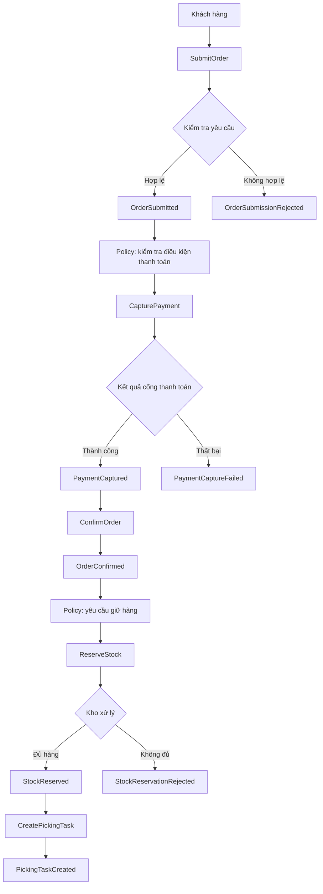

# Từ bức tranh tổng thể đến thiết kế một quy trình cụ thể

Trong Domain-Driven Design (DDD), nhóm cần hiểu cách nghiệp vụ vận hành trước khi quyết định mô hình và cấu trúc phần mềm. Một yêu cầu riêng lẻ thường chỉ cho thấy một phần của câu chuyện. Để hiểu đầy đủ, nhóm cần nhìn thấy các sự kiện đã xảy ra, người hoặc hệ thống tạo ra chúng, những quyết định dẫn đến hành động tiếp theo, các quy tắc chi phối quy trình và những điểm mà nghiệp vụ còn chưa thống nhất.

**EventStorming** là một kỹ thuật cộng tác trực quan giúp nhiều vai trò cùng khám phá miền nghiệp vụ bằng cách sắp xếp các sự kiện nghiệp vụ trên một bức tranh chung. Nhóm có thể bắt đầu từ bức tranh tổng thể của một miền, nhận diện các khu vực phức tạp và ranh giới quan trọng, sau đó chọn một quy trình để phân tích sâu và đi đến những quyết định thiết kế phần mềm cụ thể.

Quá trình này thường đi từ ba mức độ: **Big Picture** để hiểu toàn cảnh, **Process Modeling** để khám phá một quy trình cụ thể, và **Software Design** để chuyển hiểu biết thành mô hình và thiết kế có thể triển khai. Các mức độ này có liên hệ với nhau nhưng không phải một công thức cứng nhắc. Nhóm có thể quay lại bức tranh tổng thể khi phát hiện thông tin mới làm thay đổi cách hiểu về miền.

## 1. EventStorming giúp nhóm nhìn thấy điều gì?

EventStorming được phát triển bởi Alberto Brandolini. Đây là một workshop sử dụng các ghi chú trực quan, thường là giấy note nhiều màu đặt trên tường hoặc bảng lớn, để khám phá cách một miền nghiệp vụ hoạt động. Người tham gia cùng kể lại các sự kiện, hành động, quyết định và tương tác thay vì chỉ đọc một tài liệu yêu cầu đã được viết sẵn.

Trọng tâm của EventStorming là **domain event**: một sự việc nghiệp vụ có ý nghĩa đã xảy ra. Domain event thường được diễn đạt ở thì quá khứ, chẳng hạn:

- Đơn hàng đã được xác nhận.
- Kho đã hoàn tất lấy hàng.
- Thanh toán đã được ghi nhận.
- Yêu cầu hoàn tiền đã được chấp thuận.
- Hợp đồng đã hết hiệu lực.

Một sự kiện mô tả điều đã xảy ra và không còn là ý định đang chờ thực hiện. Từ các sự kiện, nhóm lần ngược để hỏi điều gì đã kích hoạt chúng, ai thực hiện, điều kiện nào được kiểm tra và hệ thống hoặc bộ phận nào cần phản ứng.

EventStorming có ích vì nó:

- Tạo một bức tranh mà chuyên gia nghiệp vụ, người vận hành, product owner, kiến trúc sư, lập trình viên và kiểm thử viên có thể cùng thảo luận.
- Làm lộ ra các bước bị bỏ sót, trường hợp ngoại lệ, quy tắc ngầm và sự khác biệt trong cách hiểu.
- Cho thấy các bộ phận và hệ thống phụ thuộc vào nhau ở những thời điểm nào.
- Giúp nhận diện vùng phức tạp, điểm nghẽn, ranh giới trách nhiệm và các ứng viên bounded context.
- Tạo đầu vào thực tế cho mô hình hóa quy trình, thiết kế domain model và kiểm thử.

EventStorming không tự động tạo ra một domain model đúng. Chất lượng kết quả phụ thuộc vào người tham gia, câu hỏi được đặt ra, khả năng xác minh thông tin và cách nhóm diễn giải những gì đã khám phá.

## 2. Ba mức độ khám phá: Big Picture, Process Modeling và Software Design

### 2.1. Big Picture: khám phá bức tranh tổng thể

Big Picture EventStorming hướng đến việc hiểu một miền nghiệp vụ rộng, chẳng hạn toàn bộ hành trình mua hàng, xử lý yêu cầu bảo hiểm hoặc quy trình tiếp nhận bệnh nhân. Nhóm chưa cần quyết định class, database hay microservice. Mục tiêu là nhìn thấy các sự kiện lớn, luồng công việc, bộ phận tham gia và vùng chưa rõ.

Ở mức này, người tham gia thường bắt đầu bằng cách ghi các domain event mà họ biết, đặt chúng lên một timeline tương đối và cùng sắp xếp lại để phản ánh trình tự thực tế. Các sự kiện có thể diễn ra song song, lặp lại, bị hủy hoặc đi theo nhánh ngoại lệ. Timeline là công cụ để khám phá, không phải khẳng định rằng mọi quy trình đều tuyến tính.

Big Picture thường giúp nhóm trả lời:

- Nghiệp vụ bắt đầu từ sự kiện nào và kết thúc ở những kết quả nào?
- Những sự kiện quan trọng nào xảy ra giữa các mốc đó?
- Bộ phận, vai trò hoặc hệ thống nào tham gia?
- Có những quy trình song song hoặc phụ thuộc nào?
- Những thuật ngữ nào đang được dùng với ý nghĩa khác nhau?
- Khu vực nào có nhiều tranh luận, ngoại lệ hoặc rủi ro?
- Ranh giới trách nhiệm nào có thể trở thành ứng viên bounded context?

Kết quả Big Picture là bức tranh chung và danh sách những câu hỏi cần đào sâu. Nó chưa phải sơ đồ kiến trúc hệ thống cuối cùng.

### 2.2. Process Modeling: khám phá sâu một quy trình

Sau khi có bức tranh tổng thể, nhóm chọn một luồng nghiệp vụ có giá trị hoặc có độ phức tạp đáng kể để phân tích sâu. Ví dụ, trong hành trình mua hàng, nhóm có thể chọn quy trình xác nhận đơn, xử lý thanh toán và chuẩn bị giao hàng.

Ở mức này, nhóm bổ sung các thành phần giúp giải thích vì sao sự kiện xảy ra:

- **Command:** ý định hoặc yêu cầu thực hiện một hành động, ví dụ `ConfirmOrder`.
- **Actor:** người, vai trò hoặc hệ thống gửi command, ví dụ khách hàng hoặc nhân viên bán hàng.
- **Policy:** quy tắc hoặc phản ứng tự động khi một sự kiện xảy ra, ví dụ khi thanh toán thành công thì yêu cầu kho chuẩn bị hàng.
- **Read model:** thông tin được đọc để người dùng hoặc quy trình đưa ra quyết định, ví dụ màn hình trạng thái đơn hàng.
- **External system:** hệ thống bên ngoài tham gia, ví dụ cổng thanh toán hoặc dịch vụ vận chuyển.
- **Hotspot:** điểm chưa rõ, mâu thuẫn, giả định hoặc vấn đề cần xác minh.

Nhóm xem xét từng bước, điều kiện, nhánh lỗi và kết quả. Một quy trình có thể chứa nhiều command dẫn đến nhiều event; một event cũng có thể kích hoạt nhiều policy hoặc quy trình tiếp theo.

### 2.3. Software Design: đi từ quy trình đến thiết kế phần mềm

Khi nhóm hiểu một lát cắt nghiệp vụ đủ sâu, có thể chuyển sang mức thiết kế phần mềm. Mục tiêu là xác định các khái niệm, hành vi, bất biến, trách nhiệm và ranh giới cần có trong mô hình.

Những câu hỏi quan trọng gồm:

- Khái niệm nào cần danh tính và vòng đời riêng để trở thành entity?
- Giá trị nào được xác định bởi các thuộc tính và có thể trở thành value object?
- Những đối tượng nào cần được bảo vệ trong cùng một ranh giới nhất quán của aggregate?
- Aggregate root cần cung cấp hành vi nào để bảo vệ bất biến?
- Quy trình nào cần application service điều phối?
- Dữ liệu nào được truy xuất qua repository?
- Sự kiện nào cần được công bố như domain event?
- Quy tắc nào thuộc context hiện tại và thông tin nào cần trao đổi qua context khác?

Software Design không có nghĩa là chuyển từng sticky note thành một class. Nhóm phải diễn giải các phát hiện theo mô hình miền, xác minh với chuyên gia và thử nghiệm xem thiết kế có bảo vệ đúng quy tắc hay không.

## 3. Chuẩn bị một buổi EventStorming

Một workshop hiệu quả bắt đầu bằng phạm vi rõ ràng và người tham gia phù hợp.

### 3.1. Chọn mục tiêu và phạm vi

Người điều phối cần nêu vấn đề mà nhóm muốn khám phá. Phạm vi quá rộng khiến người tham gia khó đi đến kết quả; phạm vi quá hẹp có thể bỏ qua những phụ thuộc quan trọng.

Ví dụ về mục tiêu:

- Khám phá hành trình từ lúc khách đặt hàng đến khi nhận hàng.
- Hiểu vì sao đơn hàng bị giữ lại trước khi xác nhận.
- Làm rõ các trường hợp thanh toán thất bại và thử lại.
- Xác định các bước khi khách yêu cầu hủy hoặc trả hàng.

Mục tiêu nên đủ cụ thể để người tham gia biết loại câu chuyện cần kể, nhưng vẫn để mở cho những phát hiện ngoài dự kiến.

### 3.2. Mời đúng người tham gia

Nên có những người hiểu công việc thực tế, người có quyền giải thích hoặc xác nhận chính sách, và người sẽ thiết kế hoặc phát triển phần mềm. Tùy phạm vi, thành phần có thể gồm:

- Chuyên gia nghiệp vụ và nhân viên trực tiếp vận hành.
- Người quản lý quy trình hoặc người có quyền quyết định chính sách.
- Product owner hoặc người đại diện nhu cầu sản phẩm.
- Lập trình viên, kiến trúc sư và chuyên viên phân tích.
- Kiểm thử viên, người vận hành hoặc đại diện các hệ thống tích hợp.
- Người điều phối workshop và người ghi nhận các điểm cần xác minh.

Người tham gia cần có quyền đóng góp vào bức tranh. Nếu chỉ có quản lý mô tả quy trình mà thiếu người trực tiếp xử lý, các ngoại lệ và thao tác thực tế có thể bị bỏ sót. Nếu chỉ có nhóm kỹ thuật, mô hình dễ bị chi phối bởi giả định triển khai.

### 3.3. Chuẩn bị không gian và vật liệu

EventStorming thường sử dụng tường hoặc bảng đủ rộng để nhiều người cùng quan sát. Giấy note nhiều màu, bút dễ đọc và khoảng trống để di chuyển các ghi chú giúp việc cộng tác thuận tiện. Công cụ trực tuyến có thể thay thế bảng vật lý khi nhóm làm việc từ xa, nhưng cần cho phép mọi người cùng thêm, di chuyển và chú thích ghi chú.

Màu sắc thường được dùng theo quy ước phổ biến, nhưng cách triển khai có thể thay đổi theo nhóm và loại workshop. Người điều phối cần giải thích legend trước khi bắt đầu, tránh coi màu sắc là một chuẩn kỹ thuật bắt buộc.

Một quy ước thường gặp:

| Màu ghi chú | Thành phần | Cách diễn đạt |
| --- | --- | --- |
| Cam | Domain event | Điều gì đã xảy ra, thường viết ở thì quá khứ |
| Xanh dương | Command | Hành động hoặc yêu cầu cần thực hiện |
| Vàng | Actor | Người hoặc vai trò gửi command |
| Tím nhạt | Policy | Quy tắc hoặc phản ứng khi một event xảy ra |
| Xanh lá | Read model | Thông tin được đọc để ra quyết định |
| Hồng | Hotspot | Câu hỏi, mâu thuẫn, giả định hoặc vấn đề chưa rõ |
| Ghi chú bổ sung | External system, aggregate hoặc ranh giới | Có thể dùng màu riêng theo legend của nhóm |

Không nên dùng màu sắc thay cho định nghĩa. Một event vẫn cần mô tả một sự việc đã xảy ra; một command vẫn thể hiện ý định. Nếu nhóm chọn màu khác, chỉ cần thống nhất và ghi rõ ý nghĩa.

### 3.4. Thống nhất nguyên tắc làm việc

Trước khi bắt đầu, người điều phối nên thống nhất:

- Ghi một ý trên mỗi sticky note.
- Viết ngắn, dễ đọc và dùng ngôn ngữ nghiệp vụ.
- Chấp nhận nhiều cách diễn đạt ban đầu; chuẩn hóa sau khi đã hiểu ý nghĩa.
- Không tranh luận quá lâu ở một điểm chưa rõ; ghi thành hotspot rồi tiếp tục.
- Không vội thiết kế class, database hoặc API khi đang khám phá quy trình.
- Khuyến khích người tham gia di chuyển và chỉnh sửa ghi chú khi có thông tin mới.
- Phân biệt điều đã xác nhận, giả định và câu hỏi còn mở.

## 4. Bước đầu: tạo Big Picture từ các domain event

### Bước 1: Viết các sự kiện nghiệp vụ

Mỗi người tham gia ghi lại những sự kiện quan trọng mà họ biết trong phạm vi đã chọn. Sự kiện nên được diễn đạt như một điều đã xảy ra, có ý nghĩa với nghiệp vụ và có thể được xác nhận.

Ví dụ cho hành trình mua hàng:

- Khách hàng đã gửi yêu cầu đặt hàng.
- Đơn hàng đã được xác nhận.
- Thanh toán đã được chấp nhận.
- Kho đã bắt đầu lấy hàng.
- Hàng đã được đóng gói.
- Đơn hàng đã được bàn giao cho đơn vị vận chuyển.
- Khách hàng đã nhận hàng.

Tránh viết event dưới dạng mệnh lệnh như “Xác nhận đơn hàng” hoặc “Giao hàng”. Đó là ý định hoặc hành động; sự kiện cần nói rõ điều gì đã xảy ra, ví dụ “Đơn hàng đã được xác nhận”.

### Bước 2: Sắp xếp theo trình tự thời gian

Nhóm cùng đặt các event lên timeline từ trái sang phải theo diễn tiến nghiệp vụ. Không cần đạt sự chính xác tuyệt đối ngay từ đầu. Khi phát hiện một event xảy ra trước hoặc sau một event khác, nhóm di chuyển ghi chú và giải thích lý do.

Nếu có nhiều nhánh, hãy để chúng tách ra. Ví dụ thanh toán thành công và thanh toán thất bại là hai kết quả khác nhau; một đơn có thể được xử lý lại sau khi thanh toán thất bại. Một sự kiện có thể xảy ra nhiều lần hoặc không xảy ra trong mọi trường hợp.

### Bước 3: Kể cả ngoại lệ và đường đi khác

Hỏi về các trường hợp bị hủy, bị từ chối, hết hàng, sai địa chỉ, thanh toán chậm, giao hàng thất bại và hoàn tiền. Những đường đi khác thường cho thấy quy tắc cốt lõi và các điểm phụ thuộc.

Ví dụ, nếu đơn đã được xác nhận nhưng thanh toán bị từ chối, đơn có tiếp tục tồn tại không? Khách hàng có được thử lại không? Kho có được phép bắt đầu lấy hàng không? Câu trả lời có thể làm thay đổi đáng kể mô hình.

### Bước 4: Nhận diện hotspot

Khi có bất đồng hoặc thiếu thông tin, ghi lại câu hỏi cụ thể. Ví dụ:

- “Đơn hàng được xem là xác nhận ở thời điểm nào?”
- “Có cho phép giao hàng trước khi thanh toán không?”
- “Ai có quyền hủy sau khi kho đã đóng gói?”
- “Một lần thanh toán có thể được phân bổ cho nhiều đơn không?”

Hotspot giúp nhóm nhìn thấy phần kiến thức chưa hoàn thiện. Nó không phải lỗi của workshop; đó là kết quả có giá trị để tiếp tục xác minh.

### Bước 5: Nhìn ra vùng nghiệp vụ và ranh giới

Quan sát những cụm event có ngôn ngữ, trách nhiệm hoặc quy tắc riêng. Một nhóm event tập trung quanh bán hàng, nhóm khác quanh thanh toán, kho hoặc giao vận. Đây có thể là tín hiệu để khám phá subdomain và bounded context.

Tuy nhiên, không nên kết luận mỗi cụm event là một bounded context hoặc mỗi phòng ban tương ứng với một context. Cần kiểm tra thêm quyền sở hữu mô hình, bất biến, mức độ thay đổi và cách các phần phối hợp.

## 5. Từ Big Picture chọn một quy trình cụ thể

Sau khi có bức tranh tổng thể, nhóm cần chọn một lát cắt đủ quan trọng để phân tích sâu. Có thể ưu tiên quy trình có nhiều hotspot, ảnh hưởng trực tiếp đến giá trị khách hàng, chứa quy tắc phức tạp hoặc thường gây lỗi trong vận hành.

Ví dụ, trong hành trình mua hàng, nhóm chọn quy trình **xác nhận đơn và chuẩn bị giao hàng**. Phạm vi bắt đầu khi khách gửi yêu cầu đặt hàng và kết thúc khi kho bàn giao kiện hàng cho đơn vị vận chuyển. Các quy trình hoàn tiền sau giao hàng có thể được ghi nhận là phần liên quan nhưng chưa đi sâu trong buổi này.

Khi chọn lát cắt, cần xác định:

- Sự kiện bắt đầu và kết quả mong muốn.
- Những actor và hệ thống tham gia.
- Các bounded context có liên quan.
- Những quy tắc hoặc hotspot cần được giải đáp.
- Phần nào nằm ngoài phạm vi để tránh workshop mở rộng vô hạn.

Lát cắt nên đủ nhỏ để có thể thảo luận đến mức hành vi và quy tắc, nhưng đủ rộng để không bỏ qua một phụ thuộc quan trọng.

## 6. Process Modeling: bổ sung command, actor và policy

### 6.1. Tìm command dẫn đến event

Với mỗi domain event, hỏi: “Điều gì đã khiến sự kiện này xảy ra?”. Câu trả lời thường là một command. Command diễn đạt yêu cầu hoặc ý định, thường dùng động từ ở dạng mệnh lệnh, ví dụ `SubmitOrder`, `ConfirmOrder` hoặc `ReserveStock`.

Ví dụ:

| Command | Event có thể xảy ra |
| --- | --- |
| `SubmitOrder` | `OrderSubmitted` hoặc `OrderSubmissionRejected` |
| `ConfirmOrder` | `OrderConfirmed` hoặc `OrderConfirmationFailed` |
| `CapturePayment` | `PaymentCaptured` hoặc `PaymentCaptureFailed` |
| `ReserveStock` | `StockReserved` hoặc `StockReservationRejected` |
| `CreatePickingTask` | `PickingTaskCreated` hoặc `PickingTaskCreationFailed` |

Một command không bảo đảm sẽ có event thành công. Nó có thể bị từ chối do điều kiện không thỏa, dữ liệu không hợp lệ hoặc một quy tắc khác được ưu tiên. Nhóm cần ghi nhận kết quả thất bại khi nó có ý nghĩa với nghiệp vụ.

### 6.2. Xác định actor

Actor là người hoặc vai trò khởi tạo command. Actor có thể là khách hàng, nhân viên, quản lý hoặc một hệ thống tự động. Việc xác định actor giúp làm rõ quyền hạn và nguồn gốc của hành động.

Ví dụ, `CancelOrder` có thể được gửi bởi khách hàng trước thời hạn tự hủy, bởi nhân viên hỗ trợ sau khi xác minh yêu cầu, hoặc bởi một policy tự động khi điều kiện thanh toán hết hạn. Các trường hợp này có thể cần những quy tắc quyền hạn khác nhau.

### 6.3. Tìm policy giữa event và command

Policy mô tả phản ứng hoặc quy tắc được kích hoạt khi một event xảy ra. Ví dụ: “Khi thanh toán được chấp nhận, yêu cầu kho tạo nhiệm vụ lấy hàng”. Policy thường được diễn đạt bằng cấu trúc “Khi X xảy ra, nếu điều kiện Y đúng, thì gửi command Z”.

Một event có thể kích hoạt nhiều policy. Chẳng hạn `OrderConfirmed` có thể làm phát sinh yêu cầu giữ hàng, tạo khoản phải thu và gửi thông báo cho khách hàng. Ngược lại, một policy có thể cần nhiều điều kiện hoặc sự kiện trước khi gửi command tiếp theo.

Không phải mọi policy đều là logic bên trong domain model. Một số policy thuộc quy trình ứng dụng hoặc điều phối giữa các context. Nhóm cần xác định nơi sở hữu quy tắc dựa trên ý nghĩa nghiệp vụ và ranh giới đã chọn.

### 6.4. Thêm read model và external system

Read model biểu diễn thông tin mà actor cần xem để ra quyết định. Ví dụ, nhân viên bán hàng có thể xem trạng thái đơn, kết quả kiểm tra tín dụng và khả năng đáp ứng hàng trước khi xác nhận. Read model có thể tổng hợp dữ liệu từ nhiều nguồn và không nhất thiết là một entity trong domain model.

External system là hệ thống nằm ngoài ranh giới đang phân tích nhưng có tham gia vào quy trình. Ví dụ cổng thanh toán, dịch vụ xác thực địa chỉ hoặc đơn vị vận chuyển. Nhóm cần đánh dấu rõ phần nào là trách nhiệm của context nội bộ và phần nào phụ thuộc vào kết quả từ bên ngoài.

## 7. Ví dụ đầy đủ: từ Big Picture đến quy trình xác nhận đơn

Giả sử một cửa hàng trực tuyến có hành trình từ lúc khách gửi yêu cầu đặt hàng đến lúc đơn được bàn giao cho đơn vị vận chuyển.

### 7.1. Bức tranh tổng thể

Các domain event chính có thể được sắp xếp như sau:

```text
Khách gửi yêu cầu đặt hàng
          |
          v
Đơn hàng đã được ghi nhận
          |
          v
Đơn hàng đã được kiểm tra
          |
          +------------------------+
          |                        |
          v                        v
Đơn hàng đủ điều kiện       Đơn hàng bị từ chối
          |                        |
          v                        v
Thanh toán đã được          Khách được thông báo
chấp nhận / hoặc thất bại
          |
          v
Kho đã giữ hàng
          |
          v
Nhiệm vụ lấy hàng đã được tạo
          |
          v
Hàng đã được lấy và đóng gói
          |
          v
Kiện hàng đã được bàn giao
```

Đây là bức tranh rút gọn. Thực tế có thể có thanh toán khi nhận hàng, giữ hàng trước thanh toán, nhiều kho, giao từng phần hoặc xử lý đơn hết hàng. Những trường hợp đó cần được bổ sung nếu nằm trong phạm vi workshop.

### 7.2. Phân tích một đoạn quy trình

Nhóm chọn đoạn từ lúc đơn được ghi nhận đến khi kho nhận yêu cầu lấy hàng. Sau khi hỏi chuyên gia, nhóm thống nhất các bước minh họa:

1. Khách gửi command `SubmitOrder`.
2. Context bán hàng kiểm tra thông tin và phát event `OrderSubmitted` nếu yêu cầu được ghi nhận.
3. Policy kiểm tra điều kiện bán và yêu cầu thanh toán hoặc phê duyệt tín dụng.
4. Cổng thanh toán trả kết quả; context thanh toán phát `PaymentCaptured` hoặc `PaymentCaptureFailed`.
5. Khi điều kiện xác nhận được thỏa mãn, context bán hàng nhận command `ConfirmOrder` và phát `OrderConfirmed`.
6. Policy điều phối gửi `ReserveStock` đến context kho.
7. Kho phát `StockReserved` hoặc `StockReservationRejected`.
8. Nếu giữ hàng thành công, kho tạo `PickingTask` và phát `PickingTaskCreated`.

Đây là một chính sách mẫu. Doanh nghiệp có thể cho phép xác nhận đơn trước khi thanh toán, sử dụng tín dụng hoặc giữ hàng ở thời điểm khác. EventStorming giúp nhóm tìm ra chính sách thực tế thay vì áp dụng chuỗi bước trên như một chuẩn chung.

### 7.3. Sơ đồ command, policy và event



Sơ đồ minh họa một luồng có thể xảy ra. Nó không thể hiện mọi nhánh, thời gian chờ, retry hoặc xử lý bù. Những chi tiết này cần được khám phá nếu ảnh hưởng đến tính đúng đắn của quy trình.

### 7.4. Xác định hotspot và câu hỏi cần trả lời

Trong ví dụ, nhóm có thể phát hiện các câu hỏi:

- Nếu thanh toán thành công nhưng giữ hàng thất bại thì xử lý tiền như thế nào?
- Giữ hàng có hết hạn không và ai chịu trách nhiệm giải phóng?
- Một đơn có thể được chia cho nhiều kho không?
- Nếu khách gửi yêu cầu hủy trong lúc thanh toán đang xử lý thì kết quả nào được ưu tiên?
- `OrderConfirmed` được phát trước hay sau khi kho giữ hàng thành công?
- Có cho phép nhân viên xác nhận thủ công khi cổng thanh toán tạm thời không khả dụng không?

Mỗi câu hỏi có thể ảnh hưởng đến mô hình, thứ tự sự kiện, chính sách và trách nhiệm giữa các context. Người điều phối cần ghi lại người có thể xác minh và quyết định nào còn đang mở.

## 8. Từ Process Modeling đến Software Design

Khi quy trình đã được hiểu đủ sâu, nhóm có thể chọn một phần để thiết kế. Hãy xem xét các quyết định sau trong ví dụ bán hàng.

### 8.1. Nhận diện entity và value object

`Order` có danh tính và vòng đời riêng nên có thể là entity. `Money`, địa chỉ giao hàng hoặc `OrderLineId` có thể là value object nếu được xác định bởi giá trị và quy tắc tương ứng. `PickingTask` có thể là entity riêng trong context kho.

Không nên tạo entity chỉ vì một sticky note có tên danh từ. Nhóm cần xác định đối tượng có danh tính ổn định, cần được theo dõi xuyên suốt hay không. Tương tự, một value object cần có ý nghĩa và quy tắc giá trị rõ ràng.

### 8.2. Xác định aggregate và bất biến

Giả sử context bán hàng cần bảo đảm:

- Không xác nhận một đơn đã bị hủy.
- Tổng tiền đơn phải được tính từ các dòng hàng và chính sách giá đã áp dụng.
- Chỉ cho phép chuyển trạng thái theo những điều kiện đã thống nhất.

Nhóm có thể xem xét `Order` là aggregate root để bảo vệ các bất biến liên quan đến đơn. Không nên đưa kho, thanh toán và vận chuyển vào cùng aggregate chỉ vì chúng cùng tham gia hành trình mua hàng. Mỗi context có thể bảo vệ các bất biến riêng và phối hợp qua event hoặc quy trình điều phối.

### 8.3. Xác định application service và domain behavior

Application service có thể điều phối command `ConfirmOrder`: tải aggregate, gọi hành vi miền, lưu thay đổi và phát sự kiện theo cơ chế của ứng dụng. Quy tắc quyết định đơn có thể được xác nhận hay không nên được đặt trong domain model hoặc domain service phù hợp.

Ví dụ minh họa:

```java
public final class Order {
    private final OrderId id;
    private OrderStatus status;

    public void confirm(ConfirmationPolicy policy) {
        if (status != OrderStatus.SUBMITTED) {
            throw new IllegalStateException(
                    "Only submitted orders can be confirmed"
            );
        }

        if (!policy.canConfirm(this)) {
            throw new OrderCannotBeConfirmedException(id);
        }

        status = OrderStatus.CONFIRMED;
        // Ghi nhận domain event OrderConfirmed.
    }
}
```

Đây là phác thảo để minh họa vị trí của hành vi và bất biến. Trong thiết kế thực tế, nhóm cần xác định cách biểu diễn policy, cách ghi nhận event, cách xử lý đồng thời và các trạng thái hợp lệ cùng chuyên gia nghiệp vụ.

### 8.4. Chọn repository và read model

Repository có thể cung cấp cách tải và lưu aggregate `Order` theo định danh. Read model cho màn hình theo dõi đơn có thể tổng hợp trạng thái từ bán hàng, thanh toán và kho. Read model không nhất thiết là bản sao đầy đủ của aggregate và không nên được dùng để thực thi bất biến thay cho domain model.

### 8.5. Xác định domain event và tích hợp

`OrderConfirmed` là một sự kiện nghiệp vụ đã xảy ra trong context bán hàng. `StockReserved` và `PickingTaskCreated` thuộc ngôn ngữ của context kho. Khi trao đổi, hai bên cần hợp đồng sự kiện và cách xử lý lỗi, trùng lặp hoặc đến sai thứ tự.

Nhóm cũng cần quyết định sự kiện nào là domain event nội bộ, sự kiện nào được công bố ra bên ngoài và thông tin nào cần được chuyển đổi ở ranh giới bounded context. Không phải mọi event nội bộ đều phải trở thành message tích hợp.

## 9. Từ kết quả workshop đến tài liệu và công việc phát triển

EventStorming chỉ có giá trị lâu dài nếu những phát hiện được chuyển thành quyết định có thể sử dụng. Sau workshop, nhóm nên tổng hợp:

- Bức tranh Big Picture và phạm vi đã khám phá.
- Các domain event và luồng chính đã được xác nhận.
- Các command, actor, policy, read model và external system của quy trình cụ thể.
- Hotspot còn mở, người phụ trách xác minh và thời điểm cần quyết định.
- Thuật ngữ và định nghĩa thuộc từng bounded context.
- Những ứng viên entity, value object, aggregate, repository và domain event cần phân tích tiếp.
- Các quan hệ giữa context và hợp đồng tích hợp liên quan.
- Những ví dụ nghiệp vụ có thể chuyển thành acceptance criteria hoặc kiểm thử.

Không cần biến toàn bộ bảng thành tài liệu dài. Hãy lưu lại những thông tin giúp nhóm hiểu mô hình, giải thích quyết định và tiếp tục công việc. Ảnh chụp workshop có thể hữu ích, nhưng nên kèm chú giải và ghi lại các quyết định đã được xác nhận.

Nhóm phát triển có thể chuyển các tình huống thành kiểm thử chấp nhận, ví dụ:

```text
Given: Đơn hàng đã được gửi và thanh toán được chấp nhận
When: Chính sách xác nhận đơn được thực thi
Then: Đơn hàng được xác nhận
And: Yêu cầu giữ hàng được gửi đến context kho
```

Một ví dụ khác cần kiểm tra nhánh lỗi:

```text
Given: Thanh toán đã được chấp nhận nhưng kho không đủ hàng
When: Yêu cầu giữ hàng bị từ chối
Then: Quy trình phải chuyển sang chính sách xử lý thiếu hàng
And: Không được âm thầm coi đơn là đã sẵn sàng giao
```

Các điều kiện cụ thể cần được chuyên gia xác nhận. Kiểm thử giúp bảo vệ cách hiểu đã thống nhất và phát hiện khi mô hình hoặc chính sách thay đổi.

## 10. Vai trò của người điều phối và cách giữ workshop hiệu quả

Người điều phối (facilitator) giúp nhóm duy trì mục tiêu, nhịp độ và chất lượng trao đổi. Họ không cần là người hiểu nghiệp vụ nhất hoặc người quyết định kiến trúc. Nhiệm vụ chính là tạo điều kiện để kiến thức từ nhiều người được đưa ra và kiểm tra.

Người điều phối nên:

- Nhắc lại phạm vi và mục tiêu khi thảo luận bắt đầu đi quá xa.
- Khuyến khích mọi người viết sự kiện trước khi tranh luận về cách triển khai.
- Hỏi “điều gì đã xảy ra?” khi sticky note đang viết command hoặc ý định.
- Hỏi “ai hoặc điều gì đã kích hoạt hành động này?” để tìm actor và policy.
- Đánh dấu bất đồng và giả định bằng hotspot.
- Tìm ví dụ thực tế để kiểm tra các phát biểu chung chung.
- Mời người trực tiếp vận hành giải thích ngoại lệ và trường hợp hiếm.
- Tổng hợp quyết định, câu hỏi mở và người chịu trách nhiệm sau mỗi phần.

Một số vấn đề làm workshop kém hiệu quả:

| Vấn đề | Cách xử lý |
| --- | --- |
| Một người nói thay tất cả bộ phận | Mời đại diện các vai trò liên quan kể lại tình huống thực tế |
| Nhóm tranh luận về class và database quá sớm | Quay lại event, command, actor và quy tắc nghiệp vụ |
| Chỉ ghi luồng thành công | Hỏi về thất bại, hủy, thử lại, hoàn tiền và ngoại lệ |
| Mọi sticky note đều được coi là sự thật | Đánh dấu điều đã xác nhận, giả định và câu hỏi mở |
| Timeline bị ép thành một chuỗi tuyến tính | Thể hiện nhánh, song song, lặp và điểm hội tụ |
| Workshop không có đầu ra sau buổi làm việc | Giao người tổng hợp event, hotspot, thuật ngữ và quyết định |
| Màu sắc bị hiểu như chuẩn cứng | Giải thích legend và cho phép điều chỉnh phù hợp với nhóm |

## 11. Những sai lầm thường gặp khi đi từ tổng thể đến thiết kế

| Sai lầm | Hệ quả | Cách cải thiện |
| --- | --- | --- |
| Bắt đầu bằng danh sách chức năng hoặc class | Bỏ qua sự kiện, quyết định và quy tắc thực tế | Bắt đầu bằng câu chuyện nghiệp vụ và domain event |
| Coi Big Picture là sơ đồ quy trình hoàn chỉnh | Bỏ sót nhánh, ngoại lệ và sự kiện lặp | Dùng bức tranh tổng thể để đặt câu hỏi rồi đào sâu lát cắt |
| Nhầm command với event | Mô hình không phân biệt ý định và sự việc đã xảy ra | Dùng động từ mệnh lệnh cho command, thì quá khứ cho event |
| Chuyển mỗi sticky note thành một class | Domain model phình to và thiếu cấu trúc | Nhóm các sự kiện theo khái niệm, hành vi và bất biến |
| Cho rằng mọi policy đều là domain service | Đặt sai trách nhiệm giữa domain và application | Xác định policy là quy tắc miền hay điều phối quy trình |
| Xem màu sticky note là chuẩn bắt buộc | Tranh luận hình thức thay vì ý nghĩa | Thống nhất legend phù hợp với workshop |
| Bỏ qua hotspot để hoàn thành sơ đồ | Giả định sai được đưa vào thiết kế | Giữ danh sách câu hỏi mở và xác minh trước quyết định quan trọng |
| Không quay lại Big Picture khi có phát hiện mới | Quy trình cụ thể bị tách khỏi bối cảnh miền | Cập nhật bức tranh tổng thể khi hiểu biết thay đổi |

## 12. Nguyên tắc thực hành

Khi sử dụng EventStorming để đi từ bức tranh tổng thể đến thiết kế một quy trình cụ thể, nhóm nên duy trì các nguyên tắc sau:

- **Bắt đầu từ sự kiện nghiệp vụ.** Tập trung vào điều đã xảy ra và có ý nghĩa, sau đó mới tìm command, actor và policy.
- **Mời người hiểu công việc thực tế.** Kiến thức của người vận hành và chuyên gia giúp kiểm tra những giả định của nhóm kỹ thuật.
- **Đi từ rộng đến sâu.** Dùng Big Picture để nhận diện vùng quan trọng, rồi chọn lát cắt có mục tiêu để Process Modeling.
- **Không ép quy trình thành tuyến tính.** Giữ lại nhánh, sự kiện song song, lặp, thất bại và quy trình bù khi chúng có ý nghĩa.
- **Phân biệt sự thật, ý định và quy tắc.** Event mô tả điều đã xảy ra; command thể hiện yêu cầu; policy mô tả phản ứng hoặc điều kiện.
- **Để hotspot hiển thị.** Điểm chưa rõ là đầu vào cho việc khám phá và xác minh, không phải thứ cần che đi.
- **Chỉ thiết kế sau khi hiểu quy tắc.** Entity, value object, aggregate và repository cần xuất phát từ mô hình nghiệp vụ đã được kiểm chứng.
- **Giữ rõ ranh giới bounded context.** Mỗi context sở hữu ngôn ngữ và bất biến của mình; tích hợp qua hợp đồng có ý nghĩa.
- **Chuyển phát hiện thành kiểm thử và quyết định.** Lưu ví dụ, quy tắc và câu hỏi mở để kết quả workshop tiếp tục hữu ích.
- **Coi mô hình là thứ có thể tiến hóa.** Quay lại sơ đồ và điều chỉnh khi có hiểu biết mới hoặc chính sách thay đổi.

EventStorming giúp nhóm chuyển từ những cách hiểu rời rạc thành bức tranh nghiệp vụ chung. Big Picture cho thấy toàn cảnh và các vùng cần khám phá; Process Modeling giải thích một quy trình qua command, event, actor, policy và các nhánh; Software Design chuyển những phát hiện đã được xác nhận thành mô hình và cấu trúc phần mềm. Khi ba mức độ được kết nối bằng đối thoại và kiểm chứng, thiết kế có cơ sở nghiệp vụ rõ ràng hơn và dễ thích nghi khi tổ chức thay đổi.

## 13. Câu hỏi tự kiểm tra

1. EventStorming là gì và vì sao domain event là điểm khởi đầu quan trọng của kỹ thuật này?
2. Phân biệt mục tiêu của Big Picture, Process Modeling và Software Design.
3. Vì sao domain event thường được diễn đạt ở thì quá khứ, còn command được diễn đạt như một yêu cầu hành động?
4. Hotspot biểu thị điều gì và nhóm nên xử lý nó như thế nào trong workshop?
5. Vì sao không nên kết luận mỗi cụm event là một bounded context hoặc mỗi phòng ban tương ứng với một context?
6. Actor và policy giúp giải thích quy trình cụ thể như thế nào?
7. Read model khác domain entity ở mục đích sử dụng nào?
8. Hãy mô tả một quy trình có nhánh thành công, thất bại và thử lại; xác định event, command và policy tương ứng.
9. Từ một quy trình đã khám phá, nhóm có thể dùng những tiêu chí nào để đề xuất entity, value object và aggregate?
10. Vì sao không nên chuyển mỗi sticky note thành một class hoặc coi mọi event đều phải được công bố ra hệ thống khác?
11. Người điều phối cần làm gì để bảo đảm các quan điểm khác nhau được ghi nhận và kiểm chứng?
12. Hãy chọn một quy trình trong lĩnh vực bạn biết, phác thảo Big Picture, chọn một lát cắt để Process Modeling và đề xuất những quyết định Software Design cần xác minh.
