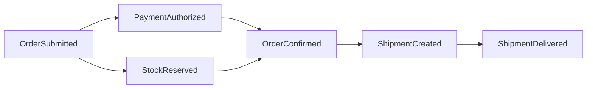
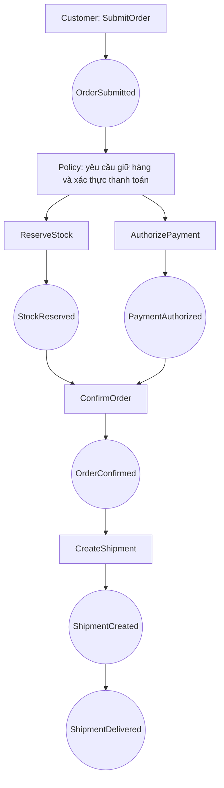

# Tìm gợi ý về aggregate và ngữ cảnh mà không coi sơ đồ là thiết kế cuối

Khi bắt đầu mô hình hóa một nghiệp vụ phức tạp, đội phát triển thường chưa biết nên đặt ranh giới aggregate ở đâu hoặc nên chia hệ thống thành những bounded context nào. Nếu vội vẽ sơ đồ lớp hay chia service từ những hiểu biết còn thiếu, mô hình dễ phản ánh cấu trúc kỹ thuật hiện tại hơn là cách doanh nghiệp thực sự hoạt động.

**EventStorming** là một kỹ thuật workshop trực quan giúp chuyên gia nghiệp vụ và đội phát triển cùng khám phá quy trình bằng những sự kiện đã xảy ra, các hành động tạo ra chúng và những quy tắc điều phối công việc. Khi đặt các sự kiện lên một dòng thời gian, đội có thể nhìn thấy điểm bàn giao, trạng thái, ngoại lệ, sự phụ thuộc và những nơi thuật ngữ thay đổi. Các dấu hiệu này cung cấp giả thuyết ban đầu về aggregate và bounded context.

Tuy nhiên, một tấm bảng EventStorming không tự quyết định aggregate, không tự xác định ranh giới bounded context và cũng không phải thiết kế phần mềm hoàn chỉnh. Đội cần kiểm tra các giả thuyết bằng quy tắc nghiệp vụ, bất biến, quyền sở hữu dữ liệu, vòng đời và các tình huống thực tế trước khi đưa ra quyết định mô hình.

## Sau bài học này

Bạn có thể:

- Giải thích mục đích và cách tổ chức một buổi EventStorming.
- Phân biệt domain event, command, actor, policy, read model và external system trên bảng.
- Dùng chuỗi sự kiện và lệnh để phát hiện các ứng viên aggregate.
- Dùng sự thay đổi ngôn ngữ, quyền sở hữu và quy trình để tìm giả thuyết bounded context.
- Nhận biết vì sao một nhóm sự kiện hoặc một cụm sticky note chưa đủ để xác định aggregate.
- Kiểm chứng giả thuyết bằng invariant, ranh giới giao dịch, ví dụ và phản ví dụ nghiệp vụ.
- Chuyển kết quả workshop thành mô hình cần thử nghiệm và tiếp tục điều chỉnh.

## 1. EventStorming là gì?

EventStorming là phương pháp workshop do Alberto Brandolini giới thiệu, sử dụng giấy ghi chú nhiều màu trên một bề mặt lớn để nhiều người cùng khám phá cách một miền nghiệp vụ vận hành. Thay vì bắt đầu bằng bảng dữ liệu, lớp Java hoặc API, người tham gia bắt đầu từ những điều đã xảy ra trong nghiệp vụ, sau đó lần ngược lại các hành động, quyết định và tác nhân liên quan.

Một domain event thường được viết ở thì quá khứ vì nó mô tả một sự thật đã xảy ra, ví dụ:

- `OrderSubmitted` – yêu cầu đặt hàng đã được gửi.
- `PaymentAuthorized` – khoản thanh toán đã được cấp phép.
- `StockReserved` – hàng đã được giữ.
- `OrderConfirmed` – đơn hàng đã được xác nhận.
- `ShipmentDelivered` – kiện hàng đã được giao.

Đội đặt các sự kiện theo trình tự thời gian, kết nối chúng với lệnh hoặc quy tắc đã dẫn đến sự kiện, rồi bổ sung các điểm ngoại lệ và câu hỏi chưa rõ. Nhờ vậy, người tham gia có thể nhìn thấy toàn bộ luồng nghiệp vụ và phát hiện những khác biệt trong cách hiểu.

EventStorming đặc biệt hữu ích khi:

- Quy trình đi qua nhiều phòng ban hoặc hệ thống.
- Tài liệu hiện tại thiếu ngoại lệ hoặc không phản ánh cách công việc thực sự diễn ra.
- Chuyên gia nghiệp vụ và đội phát triển đang dùng cùng từ nhưng hiểu khác nghĩa.
- Đội cần tìm nơi có quyết định nghiệp vụ quan trọng, điểm bàn giao hoặc phụ thuộc.
- Chưa rõ aggregate hoặc bounded context nên có ranh giới nào.

EventStorming không đồng nghĩa với Event Sourcing hay CQRS. Đây là kỹ thuật khám phá và trao đổi mô hình. Một dự án có thể dùng EventStorming rồi triển khai bằng ứng dụng CRUD, kiến trúc phân lớp, modular monolith hoặc microservices mà không cần lưu mọi thay đổi dưới dạng event log.

## 2. Các dạng workshop thường gặp

EventStorming có thể được dùng ở nhiều mức độ chi tiết. Tên gọi và cách tổ chức có thể khác nhau giữa các đội, nhưng ba dạng thường gặp là:

| Dạng workshop | Mục tiêu | Kết quả thường có |
| --- | --- | --- |
| Big Picture | Khám phá bức tranh toàn miền, các sự kiện lớn, nhóm tham gia, hệ thống ngoài và điểm nóng. | Dòng thời gian nghiệp vụ rộng, vùng chưa rõ, các điểm bàn giao và chủ đề cần đào sâu. |
| Process Modeling | Tìm hiểu chi tiết một quy trình hoặc một luồng công việc cụ thể. | Chuỗi command, event, actor, policy, read model và ngoại lệ theo một use case. |
| Software Design | Khám phá sâu một vùng nghiệp vụ để hình thành giả thuyết về mô hình phần mềm, aggregate và ranh giới context. | Ứng viên aggregate, invariant, domain service, context boundary và các quyết định cần kiểm chứng. |

Không cần cố đưa toàn bộ miền vào một buổi. Big Picture giúp chọn vùng cần đào sâu; Process Modeling làm rõ một quy trình; Software Design giúp chuyển hiểu biết đó thành giả thuyết mô hình. Có thể quay lại các buổi trước khi phát hiện thêm ngoại lệ hoặc quy tắc mới.

## 3. Chuẩn bị một buổi EventStorming

### Mời đúng người

Nên có những người trực tiếp hiểu hoặc thực hiện công việc:

- Chuyên gia nghiệp vụ hoặc người có quyền giải thích chính sách.
- Nhân viên vận hành, hỗ trợ hoặc người xử lý các tình huống ngoại lệ.
- Product owner, business analyst hoặc người chịu trách nhiệm quy trình.
- Lập trình viên, kiến trúc sư và kiểm thử viên.
- Đại diện hệ thống hoặc bộ phận bên ngoài nếu quy trình phụ thuộc đáng kể vào họ.

Không nên chỉ mời quản lý hoặc chỉ mời lập trình viên. Người thực hiện công việc thường biết các bước ngầm, thao tác thủ công và trường hợp hiếm mà tài liệu quy trình không thể hiện.

### Chuẩn bị không gian và vật liệu

Chuẩn bị một bức tường hoặc bảng đủ rộng, giấy ghi chú nhiều màu, bút dễ đọc và không gian để người tham gia có thể di chuyển. Nếu workshop từ xa, dùng bảng cộng tác trực tuyến với các loại sticky note được quy ước rõ.

Các màu thường gặp trong cách tổ chức EventStorming:

| Màu thường dùng | Thành phần | Cách viết |
| --- | --- | --- |
| Cam | Domain event | Sự thật đã xảy ra, thường dùng thì quá khứ: `OrderSubmitted`. |
| Xanh dương | Command | Yêu cầu thực hiện hành động: `SubmitOrder`. |
| Vàng | Actor hoặc aggregate | Người/hệ thống khởi tạo hành động; hoặc ứng viên chịu trách nhiệm xử lý một nhóm quy tắc. |
| Tím | Policy / reaction | Quy tắc phản ứng khi một sự kiện xảy ra: “Khi đơn được gửi, yêu cầu giữ hàng”. |
| Xanh lá | Read model / view | Thông tin mà người dùng hoặc quy trình cần đọc để ra quyết định. |
| Hồng | External system hoặc người tham gia bên ngoài | Hệ thống, tổ chức hoặc dịch vụ nằm ngoài ranh giới đang khảo sát. |
| Đỏ hoặc hồng đậm | Hotspot | Câu hỏi, mâu thuẫn, rủi ro hoặc điểm chưa thống nhất. |

Đây là quy ước phổ biến, không phải tiêu chuẩn bắt buộc. Một số nhóm dùng màu hoặc hình dạng khác nhau, đặc biệt với actor và aggregate. Hãy thống nhất legend trước khi bắt đầu và ghi tên thành phần rõ ràng để không phụ thuộc hoàn toàn vào màu sắc.

### Thống nhất phạm vi và quy tắc trao đổi

Chọn một câu hỏi cụ thể, ví dụ: “Điều gì xảy ra từ lúc khách gửi yêu cầu đặt hàng đến khi kiện hàng được giao?” hoặc “Làm thế nào xử lý khi khách yêu cầu hoàn tiền?”. Nêu rõ điểm bắt đầu, điểm kết thúc, bộ phận liên quan và loại tình huống cần khảo sát.

Thống nhất một số nguyên tắc:

- Viết điều đã hoặc có thể xảy ra bằng ngôn ngữ nghiệp vụ.
- Chấp nhận nhiều cách hiểu ban đầu; ghi câu hỏi thay vì tranh luận để tìm một sơ đồ đẹp.
- Khuyến khích người trực tiếp làm việc kể cả trường hợp ngoại lệ.
- Không để một người thiết kế thay cho cả nhóm.
- Đánh dấu điều chưa biết để quay lại xác nhận.
- Giữ các quyết định về code, database và framework ở phía sau cho đến khi hiểu quy tắc.

## 4. Xây dựng dòng thời gian từ domain event

Một cách bắt đầu phổ biến là yêu cầu mọi người viết những sự kiện quan trọng đã xảy ra trong quy trình. Mỗi sticky note nên diễn đạt một sự thật có thể kiểm tra, không phải một thao tác kỹ thuật.

Ví dụ:

- `OrderSubmitted` là sự thật nghiệp vụ sau khi yêu cầu đặt hàng được gửi.
- `PaymentAuthorized` là sự thật sau khi bên thanh toán cấp phép.
- `StockReserved` là sự thật sau khi kho giữ được số lượng.
- `OrderConfirmed` là sự thật sau khi doanh nghiệp xác nhận đơn.

Sau đó, đặt các sự kiện theo thứ tự thời gian. Khi có nhánh song song, thể hiện chúng như những nhánh riêng thay vì ép thành một chuỗi tuyến tính. Nếu thứ tự chưa rõ, ghi chú để chuyên gia xác nhận.

Sơ đồ chỉ là ví dụ giả định. Trong thực tế, xác nhận đơn có thể xảy ra trước hoặc sau khi giữ hàng; thanh toán có thể được capture ở bước khác; một đơn có thể tách thành nhiều shipment. Chính những khác biệt này là lý do cần workshop với người hiểu quy trình.

### Viết sự kiện đủ rõ

Một event tốt nên giúp trả lời “điều gì đã trở thành sự thật?”. Tên như `OrderUpdated`, `StatusChanged` hoặc `ProcessCompleted` thường quá chung. Hãy hỏi:

- Đối tượng nào đã thay đổi?
- Thay đổi gì đã xảy ra?
- Ai hoặc quy trình nào quan tâm đến sự kiện này?
- Sự kiện xảy ra ở thời điểm nào?
- Có thể phân biệt sự kiện này với một sự kiện gần nghĩa không?

Ví dụ, `PaymentAuthorized` và `PaymentCaptured` là hai sự thật khác nhau. Một khoản thanh toán được cấp phép không nhất thiết đã được thu tiền. Nếu gộp chúng thành `PaymentCompleted`, các quy tắc hoàn tiền hoặc đối soát có thể bị hiểu sai.

### Tìm ngoại lệ và hotspot

Khi dòng thời gian đã hình thành, hỏi điều gì có thể ngăn một sự kiện xảy ra hoặc làm luồng rẽ hướng:

- Thanh toán bị từ chối.
- Kho không đủ hàng.
- Khách hàng hủy đơn.
- Đối tác không phản hồi.
- Một sự kiện đến trễ hoặc được gửi lặp.
- Người vận hành phải can thiệp thủ công.

Đặt hotspot tại nơi nhóm chưa thống nhất hoặc chưa biết cách xử lý. Ví dụ: “Nếu thanh toán thành công nhưng giữ hàng thất bại, đơn ở trạng thái nào và ai chịu trách nhiệm hoàn tiền?”. Hotspot là dữ liệu quan trọng của workshop; không nên xóa chỉ để sơ đồ trông hoàn chỉnh.

## 5. Bổ sung command, actor, policy và read model

Khi dòng sự kiện đã tương đối rõ, đội lần ngược để hiểu điều gì tạo ra mỗi sự kiện và ai cần biết thông tin đó.

### Command: hành động được yêu cầu

Command diễn đạt yêu cầu thực hiện một hành động, thường dùng động từ. Ví dụ:

- `SubmitOrder`
- `AuthorizePayment`
- `ReserveStock`
- `ConfirmOrder`
- `CancelOrder`

Command có thể được gửi bởi người dùng, một hệ thống khác hoặc một policy. Command có thể bị từ chối vì điều kiện không thỏa mãn; nó không khẳng định hành động đã thành công.

### Actor: người hoặc hệ thống khởi tạo hành động

Actor có thể là khách hàng, nhân viên, hệ thống thanh toán, dịch vụ vận chuyển hoặc một vai trò nghiệp vụ. Cần ghi đúng vai trò trong tình huống cụ thể. Ví dụ, người đặt hàng không nhất thiết là người phê duyệt công nợ; người yêu cầu hoàn tiền không nhất thiết là người có quyền xác nhận hoàn tiền.

### Policy: quy tắc phản ứng với sự kiện

Policy (còn gọi là reaction hoặc process rule trong một số cách diễn đạt) mô tả điều gì cần xảy ra khi một event được ghi nhận. Ví dụ:

> Khi `OrderSubmitted` xảy ra, yêu cầu giữ hàng và xác thực thanh toán được khởi tạo.

Policy giúp phát hiện những quy tắc điều phối quy trình và các phụ thuộc giữa các bước. Nó không nhất thiết là một lớp hoặc một microservice. Cần làm rõ policy được thực hiện tự động, thủ công hay bởi hệ thống bên ngoài.

### Read model: thông tin dùng để ra quyết định

Read model biểu diễn dữ liệu mà actor hoặc policy cần đọc trước khi thực hiện command. Ví dụ, nhân viên cần xem tổng tiền, trạng thái thanh toán và tình trạng tồn kho trước khi xác nhận đơn. Việc thiếu thông tin trên màn hình hoặc báo cáo có thể làm lộ ra một phụ thuộc nghiệp vụ.

### External system: phụ thuộc nằm ngoài phạm vi

Đánh dấu hệ thống bên ngoài như cổng thanh toán, nhà cung cấp vận chuyển hoặc hệ thống hóa đơn. Ghi rõ dữ liệu gửi đi, phản hồi nhận về, thời gian chờ và tình huống lỗi. Điều này giúp đội phân biệt quyết định do miền nội bộ sở hữu với quyết định do đối tác thực hiện.

## 6. Từ EventStorming đến giả thuyết aggregate

Aggregate là ranh giới nhất quán nghiệp vụ: một nhóm entity và value object được thay đổi thông qua aggregate root để bảo vệ các invariant cần luôn đúng sau một thao tác. EventStorming giúp tìm dấu hiệu về nơi các quy tắc và hành động liên quan nhau, nhưng không thể tự xác định aggregate chỉ bằng cách gom các sticky note.

### Bắt đầu từ command và quy tắc cần bảo vệ

Với mỗi command, hãy hỏi:

1. Đối tượng hoặc thông tin nào cần được đọc để quyết định command có hợp lệ?
2. Những điều kiện nào phải luôn đúng trước và sau khi command chạy?
3. Những thay đổi nào cần được thực hiện cùng nhau trong một đơn vị nhất quán?
4. Ai có trách nhiệm từ chối command khi điều kiện không thỏa mãn?
5. Sự kiện nào được ghi nhận nếu command thành công?

Ví dụ, `ConfirmOrder` có thể cần bảo vệ các quy tắc:

- Đơn hàng phải ở trạng thái được phép xác nhận.
- Đơn phải có ít nhất một dòng hàng.
- Số lượng của mỗi dòng phải hợp lệ.
- Tổng tiền được tính theo giá và chính sách đã chốt cho đơn.

Những quy tắc này gợi ý `Order` là một ứng viên aggregate root vì nó có thể kiểm soát trạng thái và các dòng hàng liên quan khi xác nhận.

### Dùng nhóm command, invariant và event làm manh mối

Một nhóm hành động thường xuyên thay đổi cùng một tập dữ liệu và phải bảo vệ cùng các invariant có thể gợi ý một aggregate. Ví dụ:

| Command | Quy tắc cần kiểm tra | Event có thể phát ra | Ứng viên cần khảo sát |
| --- | --- | --- | --- |
| `AddOrderLine` | Đơn còn cho phép chỉnh sửa; số lượng hợp lệ. | `OrderLineAdded` | `Order` |
| `RemoveOrderLine` | Không được xóa dòng khi đơn đã xác nhận. | `OrderLineRemoved` | `Order` |
| `ConfirmOrder` | Đơn có dòng hàng và thỏa điều kiện xác nhận. | `OrderConfirmed` | `Order` |
| `ReserveStock` | Số lượng khả dụng đủ để giữ theo chính sách. | `StockReserved` hoặc `StockReservationRejected` | `InventoryItem` hoặc `StockReservation` |

Nhóm này chỉ tạo giả thuyết. `OrderLine` có thể là entity bên trong aggregate `Order`, nhưng nếu dòng hàng có vòng đời và quy tắc độc lập, đội cần khảo sát thêm. Việc nó xuất hiện như một sticky note hoặc danh từ không đủ để quyết định.

### Kiểm tra ranh giới nhất quán

Một aggregate thường phù hợp khi các thay đổi cần được bảo vệ trong cùng một giao dịch nghiệp vụ ngắn. Nếu hai nhóm dữ liệu có thể thay đổi độc lập và phối hợp bằng sự kiện hoặc quy trình, chúng có thể thuộc hai aggregate khác nhau.

Ví dụ, xác nhận đơn và giữ hàng có thể liên quan về quy trình nhưng do hai context sở hữu. Bán hàng không nên đưa toàn bộ tồn kho vào aggregate `Order` chỉ vì đơn cần hàng. Tồn kho có invariant riêng: không được giữ vượt quá số lượng khả dụng theo chính sách. Hai bên có thể phối hợp qua command và event, đồng thời chấp nhận rằng quy trình liên context có thể có trạng thái chờ hoặc thất bại cần xử lý.

### Không gom theo danh từ hoặc theo chuỗi sự kiện

Các cách suy luận dễ sai:

- Một danh từ trong workshop tương ứng với một aggregate.
- Mọi event có cùng tiền tố phải nằm trong cùng aggregate.
- Mọi event liên tiếp trên dòng thời gian phải thuộc một transaction.
- Mọi đối tượng có quan hệ khóa ngoại phải được gom vào một aggregate.
- Mỗi aggregate phải có một repository hoặc một service độc lập.

Aggregate được thiết kế quanh invariant và quyền sở hữu nhất quán. Một aggregate có thể phát nhiều event; một quy trình có thể đi qua nhiều aggregate; một event có thể khiến nhiều context phản ứng. Không có ánh xạ một-một giữa event, command, aggregate và bounded context.

### Hỏi về vòng đời và quy mô aggregate

Đối với từng ứng viên, hỏi:

- Đối tượng được tạo khi nào và kết thúc vòng đời khi nào?
- Có trạng thái nào chỉ đối tượng gốc được phép thay đổi?
- Thành phần nào không có ý nghĩa nếu tách khỏi đối tượng gốc?
- Có cần đọc hoặc cập nhật quá nhiều dữ liệu cùng lúc không?
- Hai thao tác có thể chạy đồng thời không và điều gì phải được bảo vệ?
- Có thể tham chiếu aggregate khác bằng ID thay vì nhúng toàn bộ object không?

Nếu aggregate quá lớn, nhiều thao tác không liên quan có thể tranh chấp cùng một ranh giới nhất quán. Nếu quá nhỏ, invariant có thể bị phá vỡ vì các phần liên quan được cập nhật độc lập. EventStorming giúp nêu câu hỏi; phân tích giao dịch và kiểm thử mới giúp xác nhận ranh giới.

## 7. Từ EventStorming đến giả thuyết bounded context

Bounded context là ranh giới trong đó một mô hình và ngôn ngữ có ý nghĩa nhất quán. Trên bảng EventStorming, đội có thể nhận ra dấu hiệu của ranh giới qua thay đổi về thuật ngữ, mục tiêu, quy tắc, chủ sở hữu và cách một phần quy trình tương tác với phần khác.

### Dấu hiệu từ ngôn ngữ

Một từ có thể đổi nghĩa khi đi qua các bộ phận. Ví dụ:

- Bán hàng nói `Customer` để chỉ người mua.
- Kế toán nói `Debtor` hoặc `BillingAccount` để chỉ chủ thể chịu trách nhiệm thanh toán.
- Vận chuyển nói `Recipient` để chỉ người nhận kiện hàng.

Khi cùng một từ được dùng với định nghĩa khác nhau, hoặc các bộ phận cần những thuật ngữ riêng để mô tả cùng một sự vật, đó là dấu hiệu cần khảo sát ranh giới context.

### Dấu hiệu từ quyền sở hữu và quyết định

Hãy hỏi ai có quyền thay đổi một sự thật nghiệp vụ. Bán hàng có thể quyết định giá bán và trạng thái đơn; Kế toán quyết định hóa đơn và công nợ; Tồn kho quyết định khả năng giữ hàng. Nếu mỗi nhóm có quy tắc và trách nhiệm riêng, đây có thể là những vùng mô hình riêng.

### Dấu hiệu từ vòng đời và chính sách

Một đơn hàng, khoản thanh toán và kiện hàng có vòng đời khác nhau. Đơn có thể đã xác nhận trong khi thanh toán đang chờ đối soát; một đơn có thể được giao thành nhiều kiện; một kiện có thể giao thất bại và được giao lại. Khi các trạng thái và chính sách thay đổi độc lập, đội nên kiểm tra xem chúng thuộc những context nào.

### Dấu hiệu từ điểm bàn giao

Các điểm một nhóm gửi yêu cầu, nhận kết quả hoặc phải dịch dữ liệu từ hệ thống khác có thể cho thấy ranh giới tích hợp. Tuy nhiên, điểm bàn giao không tự động là bounded context mới. Một API hoặc một nhóm làm việc riêng chưa đủ; cần xem mô hình, ngôn ngữ và trách nhiệm có thực sự khác nhau không.

### Vẽ vùng giả thuyết, không đóng khung quá sớm

Đội có thể khoanh các vùng trên dòng thời gian để ghi nhận giả thuyết như “Bán hàng”, “Thanh toán”, “Tồn kho” và “Vận chuyển”. Đánh dấu các từ dùng khác nghĩa và các phụ thuộc giữa vùng. Sau workshop, kiểm tra xem mỗi vùng có:

- Ngôn ngữ và mô hình đủ nhất quán.
- Trách nhiệm nghiệp vụ có thể giải thích rõ.
- Quy tắc và vòng đời có liên quan với nhau.
- Chủ sở hữu hoặc nhóm có thể chịu trách nhiệm.
- Hợp đồng trao đổi có thể xác định với vùng khác.

Nếu chưa có đủ bằng chứng, hãy giữ vùng đó ở dạng giả thuyết. Context map chính thức cần được xây dựng sau khi đội xác nhận quan hệ upstream/downstream, quyền sở hữu và cách tích hợp.

## 8. Ví dụ xuyên suốt: EventStorming quy trình đặt và giao hàng

Giả sử nhóm khảo sát quy trình từ khi khách đặt hàng đến khi giao xong. Sau khi làm việc với chuyên gia, nhóm thu được một phần timeline giả định:

Đây là một cách diễn giải có thể có. Trong workshop thật, nhóm cần hỏi liệu giữ hàng và xác thực thanh toán diễn ra song song không, có bước capture tiền không, đơn có được xác nhận trước khi cả hai hoàn tất không, và điều gì xảy ra nếu một nhánh thất bại.

### Giả thuyết aggregate

Từ command và invariant, nhóm có thể đưa ra một số ứng viên:

| Ứng viên | Command cần khảo sát | Invariant hoặc quy tắc cần xác nhận |
| --- | --- | --- |
| `Order` | `AddOrderLine`, `ConfirmOrder`, `CancelOrder` | Dòng hàng hợp lệ; chỉ trạng thái phù hợp mới được xác nhận hoặc hủy; giá trị đơn được chốt theo chính sách. |
| `StockReservation` hoặc `InventoryItem` | `ReserveStock`, `ReleaseStock` | Không giữ vượt số lượng khả dụng; giải phóng đúng phần đã giữ. |
| `Payment` | `AuthorizePayment`, `CapturePayment`, `RefundPayment` | Không thu tiền vượt số được phép; hoàn tiền tuân theo số đã thu và chính sách. |
| `Shipment` | `CreateShipment`, `RecordDeliveryAttempt` | Trạng thái giao hàng tuân theo vòng đời; lần giao và người nhận được ghi nhận phù hợp. |

Không thể quyết định `StockReservation` hay `InventoryItem` chỉ từ timeline. Cần tìm hiểu kho quản lý số lượng theo sản phẩm, lô, vị trí hay từng đơn giữ hàng; các quy tắc cạnh tranh và hủy giữ hàng được bảo vệ ở đâu. Tương tự, một đơn có thể có một hoặc nhiều payment và shipment. Cấu trúc aggregate phải phản ánh quy tắc thực tế.

### Giả thuyết bounded context

Timeline cũng gợi ý các vùng mô hình:

- **Bán hàng:** tiếp nhận yêu cầu, quản lý đơn, giá bán và chính sách xác nhận.
- **Tồn kho:** quản lý số lượng khả dụng và việc giữ/giải phóng hàng.
- **Thanh toán:** quản lý ủy quyền, thu tiền, hoàn tiền và đối soát.
- **Vận chuyển:** quản lý kiện hàng, lần giao và kết quả giao.

Đây là giả thuyết, không phải kết luận bắt buộc. Một hệ thống nhỏ có thể đặt nhiều vùng trong một modular monolith. Một số năng lực có thể do nhà cung cấp ngoài quản lý. Đội cần xác nhận ngôn ngữ, quyền sở hữu và mối quan hệ giữa các vùng trước khi quyết định bounded context.

### Hotspot cần giải quyết trước khi thiết kế

Workshop có thể phát hiện các câu hỏi:

- Nếu thanh toán được cấp phép nhưng giữ hàng thất bại, có cần hủy ủy quyền không?
- Nếu khách hủy sau khi đơn đã xác nhận nhưng trước khi giao, ai quyết định giải phóng hàng và hoàn tiền?
- Một đơn được giao thành nhiều kiện thì trạng thái hoàn tất của đơn được tính thế nào?
- Nếu webhook giao hàng đến trễ, hệ thống có được lùi trạng thái từ `DELIVERED` về `IN_TRANSIT` không?
- Ai có quyền sửa địa chỉ sau khi kiện đã được bàn giao cho nhà vận chuyển?

Những câu hỏi này có thể làm thay đổi ranh giới aggregate, quy trình điều phối và cách các context trao đổi. Đội nên xác nhận trước khi biến giả thuyết thành thiết kế.

## 9. Kiểm chứng giả thuyết sau workshop

EventStorming giúp tạo hiểu biết chung và đặt câu hỏi đúng. Sau buổi workshop, cần chuyển các kết quả quan trọng thành việc kiểm chứng có thể thực hiện.

### Kiểm chứng aggregate bằng ví dụ và invariant

Với mỗi aggregate ứng viên:

1. Viết các invariant bằng ngôn ngữ nghiệp vụ.
2. Chọn command làm thay đổi aggregate.
3. Xác định trạng thái hợp lệ trước và sau command.
4. Tạo ví dụ thành công, thất bại và trường hợp cạnh tranh.
5. Kiểm tra các thay đổi nào phải cùng giao dịch.
6. Xem liệu aggregate có quá lớn hoặc phải tải quá nhiều dữ liệu không.

Nếu không thể giải thích invariant hoặc không xác định được ai chịu trách nhiệm bảo vệ nó, ranh giới aggregate chưa đủ rõ.

### Kiểm chứng bounded context bằng ngôn ngữ và trách nhiệm

Với mỗi vùng context ứng viên:

- Lập danh sách thuật ngữ cốt lõi và định nghĩa.
- Ghi các thuật ngữ trùng tên nhưng khác nghĩa.
- Xác định ai sở hữu quyết định và dữ liệu.
- Xác định quy trình nào nằm trong vùng và quy trình nào đi qua ranh giới.
- Đề xuất hợp đồng trao đổi và xác định bên upstream/downstream.
- Thử mô tả một tình huống thay đổi để xem các vùng có cần thay đổi cùng nhau không.

Nếu hai vùng luôn dùng chung ngôn ngữ, quy tắc và thay đổi cùng nhau, có thể đội đã chia quá nhỏ. Nếu một vùng chứa nhiều thuật ngữ và quy tắc không liên quan, có thể cần tách hoặc làm rõ mô hình.

### Dùng ví dụ thực tế để kiểm tra lại

Đưa mô hình sơ bộ cho chuyên gia nghiệp vụ và người vận hành xem. Chọn các giao dịch gần đây, trường hợp thất bại và ngoại lệ ít gặp. Hỏi họ có thể mô tả lại điều đã xảy ra bằng các thuật ngữ trên sơ đồ không. Nếu họ phải giải thích rằng một event thực ra có nghĩa khác, hãy cập nhật mô hình.

### Chuyển kết quả thành artefact có thể tiếp tục phát triển

Sau workshop, có thể tạo:

- Timeline sự kiện và các hotspot chưa giải quyết.
- Danh sách command, actor, policy và read model.
- Danh sách aggregate ứng viên cùng invariant cần xác nhận.
- Danh sách bounded context ứng viên và glossary theo từng vùng.
- Context map sơ bộ với quan hệ và hợp đồng cần làm rõ.
- Danh sách quyết định, người chịu trách nhiệm và việc cần thực hiện tiếp.

Không cần biến mọi sticky note thành một tài liệu chính thức. Chỉ giữ lại thông tin có ích cho việc ra quyết định, kiểm thử và tiếp tục trao đổi.

## 10. Những sai lầm thường gặp

- **Coi EventStorming là sơ đồ thiết kế cuối:** sticky note thể hiện hiểu biết tại thời điểm workshop, có thể thay đổi khi phát hiện quy tắc hoặc ngoại lệ mới.
- **Gom tất cả event thành một aggregate:** event mô tả sự thật; aggregate được xác định bởi invariant và ranh giới nhất quán.
- **Mỗi danh từ là một aggregate:** danh từ có thể là thuộc tính, value object, vai trò, read model hoặc một khái niệm chưa cần đưa vào mô hình.
- **Mỗi nhóm sự kiện là một bounded context:** ranh giới context phụ thuộc vào ngôn ngữ, trách nhiệm, quyền sở hữu và mô hình, không chỉ vị trí các sticky note.
- **Bỏ qua ngoại lệ để giữ timeline đơn giản:** các trường hợp thất bại thường làm lộ ra invariant và trách nhiệm quan trọng nhất.
- **Để kỹ thuật chi phối cuộc trao đổi:** bắt đầu bằng database, REST endpoint hoặc microservice dễ khiến nhóm bỏ qua cách nghiệp vụ thực sự vận hành.
- **Đồng nhất command với event:** `ConfirmOrder` là yêu cầu; `OrderConfirmed` là sự thật chỉ xuất hiện nếu hành động thành công.
- **Cho rằng mọi event phải được lưu như event sourcing:** EventStorming không yêu cầu kiến trúc event-sourced.
- **Xem màu sticky note là tiêu chuẩn cứng:** màu chỉ là quy ước hỗ trợ giao tiếp; ý nghĩa và tên thành phần mới là điều quan trọng.
- **Không kiểm chứng sau workshop:** một sơ đồ được mọi người đồng ý tại buổi họp vẫn cần được thử với giao dịch thực tế, dữ liệu và quy tắc cụ thể.

## 11. Checklist cho một buổi EventStorming hướng đến aggregate và context

Trước khi kết thúc, người điều phối có thể rà soát:

- [ ] Phạm vi workshop và điểm bắt đầu/kết thúc đã rõ.
- [ ] Có người hiểu nghiệp vụ và người trực tiếp vận hành tham gia.
- [ ] Domain event được viết thành sự thật đã xảy ra và xếp theo thời gian.
- [ ] Command, actor, policy, read model và external system đã được bổ sung khi cần.
- [ ] Các nhánh song song, ngoại lệ và hotspot được ghi nhận.
- [ ] Aggregate ứng viên có command và invariant cần xác nhận.
- [ ] Bounded context ứng viên có ngôn ngữ, trách nhiệm và quyền sở hữu có thể giải thích.
- [ ] Các điểm bàn giao và phụ thuộc giữa vùng được nhận diện.
- [ ] Những giả thuyết chưa chắc chắn được đánh dấu rõ.
- [ ] Có người chịu trách nhiệm kiểm chứng từng câu hỏi còn mở.
- [ ] Kết quả được xem lại bằng tình huống thực tế trước khi chốt thiết kế.

## Kết luận

EventStorming tạo không gian để chuyên gia nghiệp vụ và đội phát triển cùng nhìn thấy chuỗi sự kiện, hành động, quy tắc và ngoại lệ của một miền. Từ command, invariant, vòng đời, ngôn ngữ và quyền sở hữu, đội có thể hình thành giả thuyết về aggregate và bounded context. Những giả thuyết đó cần được kiểm chứng bằng tình huống thực tế, quy tắc nhất quán và trách nhiệm của từng vùng trước khi trở thành mô hình phần mềm. Giá trị lớn nhất của workshop là giúp đội đặt đúng câu hỏi và xây dựng hiểu biết chung để tiếp tục thiết kế.
