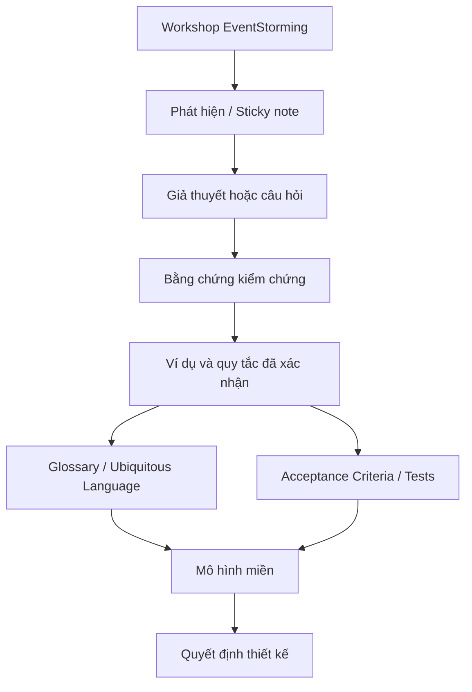

# Chuyển kết quả buổi trao đổi thành ví dụ, thuật ngữ và giả thuyết cần kiểm chứng

EventStorming giúp chuyên gia nghiệp vụ và đội phát triển cùng khám phá cách một lĩnh vực hoạt động thông qua sự kiện, quyết định, vai trò và các tình huống thực tế. Một workshop có thể tạo ra rất nhiều sticky note, dòng thời gian, câu hỏi và cuộc tranh luận có giá trị. Tuy nhiên, bảng workshop chỉ là dấu vết của quá trình khám phá. Nếu không tổng hợp và xác minh, nhóm dễ nhầm ý kiến cá nhân với quy tắc đã thống nhất, nhầm giả thuyết với sự thật hoặc đưa những thuật ngữ chưa rõ nghĩa vào mô hình phần mềm.

Trong Domain-Driven Design (DDD), kết quả EventStorming cần được chuyển thành tri thức có thể sử dụng tiếp: ví dụ nghiệp vụ cụ thể, glossary theo ngữ cảnh, danh sách sự kiện và quy tắc đã xác nhận, cùng các giả thuyết và câu hỏi mở có người chịu trách nhiệm kiểm chứng. Các đầu ra này tạo cầu nối giữa hiểu biết trong workshop với Ubiquitous Language, mô hình miền, tiêu chí chấp nhận và những quyết định Strategic Design hoặc Tactical Design.

Bài học này tập trung vào công việc sau workshop: làm sạch và cấu trúc hóa kết quả, tạo ví dụ có thể kiểm tra, chuẩn hóa thuật ngữ, quản lý giả thuyết, xác minh bằng bằng chứng và duy trì mối liên hệ giữa phát hiện với quyết định thiết kế.

## 1. Vì sao không thể dùng nguyên bảng workshop làm mô hình?

Trong workshop, người tham gia thường viết nhanh để đưa hiểu biết ra ngoài, đặt câu hỏi, phản biện và điều chỉnh cách hiểu. Một sticky note có thể là sự kiện, lệnh, vai trò, chính sách, màn hình, hệ thống bên ngoài, câu hỏi hoặc một ý tưởng chưa được xác nhận. Màu sắc và vị trí giúp điều phối thảo luận, nhưng bản thân chúng không chứng minh một nội dung là đúng.

Một bảng EventStorming thường chứa:

- Các sự kiện được kể lại từ kinh nghiệm hoặc tài liệu.
- Các lệnh và quyết định được cho là tạo ra sự kiện.
- Vai trò, người dùng hoặc hệ thống thực hiện hành động.
- Chính sách hoặc quy trình tự động phản ứng với sự kiện.
- Các hệ thống bên ngoài và điểm tích hợp.
- Những câu hỏi, mâu thuẫn, giả định và vùng nóng (hotspot).
- Các ý tưởng về trạng thái, dữ liệu, aggregate hoặc bounded context.

Những nội dung này có độ tin cậy khác nhau. Một người có thể nhớ sai thời điểm; hai bộ phận có thể dùng cùng một từ với nghĩa khác nhau; một giải pháp kỹ thuật có thể bị hiểu nhầm là quy tắc nghiệp vụ. Do đó, nhóm cần tách **điều đã quan sát**, **điều được người có thẩm quyền xác nhận**, **điều đang được giả định** và **điều chưa biết**.

Kết quả tốt sau workshop không nhất thiết là một sơ đồ hoàn hảo. Đó là một tập tri thức có nguồn gốc, có ví dụ, có trạng thái xác nhận và có bước tiếp theo rõ ràng.

## 2. Nhận diện các loại thông tin trên bảng EventStorming

Trước khi tổng hợp, cần phân loại các ghi chú theo vai trò của chúng trong mô hình nghiệp vụ. Màu sticky note thường được dùng theo quy ước phổ biến của EventStorming, nhưng mỗi nhóm có thể điều chỉnh. Hãy đọc cả nội dung và ngữ cảnh, không phân loại chỉ bằng màu.

| Loại thông tin | Câu hỏi nó trả lời | Cách nhận biết |
|---|---|---|
| Domain Event | Điều gì đã xảy ra có ý nghĩa với nghiệp vụ? | Thường viết ở thể quá khứ, ví dụ `Đơn hàng đã được xác nhận` |
| Command | Ai hoặc thành phần nào yêu cầu một hành động? | Thường là động từ mệnh lệnh, ví dụ `Xác nhận đơn hàng` |
| Actor/Role | Ai khởi tạo hoặc chịu trách nhiệm hành động? | Người mua, nhân viên kho, kế toán, hệ thống thanh toán |
| Policy/Process | Sự kiện nào kích hoạt hành động tiếp theo và theo quy tắc nào? | “Khi thanh toán được ghi nhận, gửi yêu cầu xác nhận đơn” |
| Read Model/View | Người ra quyết định cần nhìn thấy thông tin gì? | Màn hình tồn kho khả dụng, danh sách đơn chờ xử lý |
| External System | Hệ thống hoặc tổ chức bên ngoài tham gia ở đâu? | Nhà cung cấp thanh toán, đơn vị vận chuyển |
| Hotspot/Question | Điều gì chưa rõ, mâu thuẫn hoặc có rủi ro? | “Thanh toán đến sau khi reservation hết hạn thì sao?” |
| Aggregate/Boundary candidate | Dữ liệu và quy tắc nào cần nhất quán cùng nhau? | Một nhóm ghi chú có cùng vòng đời và invariant cần bảo vệ |

Không phải mọi ghi chú đều trở thành thành phần của mô hình miền. Một màn hình có thể chỉ là cách hiển thị; một bước nhập liệu có thể là chi tiết triển khai; một câu nói có thể là giả định cần xác minh. Việc phân loại nhằm làm rõ ý nghĩa trước khi quyết định giữ, gộp, đổi tên hoặc loại bỏ.

## 3. Quy trình tổng hợp sau workshop

Nên thực hiện tổng hợp khi người tham gia còn nhớ ngữ cảnh của cuộc trao đổi. Thời điểm cụ thể tùy quy mô workshop, nhưng cần tránh để bảng và các quyết định rời rạc quá lâu.

### Bước 1: Bảo toàn dấu vết gốc

Lưu ảnh hoặc bản xuất của bảng workshop, ngày giờ, phạm vi, người tham gia và người điều phối. Ghi lại các quyết định đã được chốt trong buổi làm việc, các điểm chưa đồng thuận và những phần bị bỏ dở do thiếu thời gian.

Không sửa trực tiếp bản ghi gốc để làm cho nó trông nhất quán. Hãy tạo bản tổng hợp riêng và giữ tham chiếu đến vị trí hoặc mã ghi chú ban đầu. Khi cần diễn giải lại, người đọc có thể quay về ngữ cảnh gốc.

### Bước 2: Tách nội dung theo loại

Đưa các ghi chú vào nhóm sự kiện, command, actor, policy, read model, external system và hotspot. Nếu một ghi chú có thể thuộc nhiều loại, ghi lại câu hỏi cần xác nhận. Ví dụ, “Thanh toán thành công” là sự kiện nếu nó mô tả điều đã xảy ra; “Thanh toán” có thể là command nếu người dùng yêu cầu thực hiện giao dịch.

### Bước 3: Chuẩn hóa tên gọi nhưng giữ nguyên khác biệt

Gộp các ghi chú trùng nghĩa, sửa lỗi chính tả và chọn cách diễn đạt rõ ràng. Tuy nhiên, không gộp hai thuật ngữ chỉ vì chúng có tên giống nhau. Nếu cùng một từ được dùng ở hai ngữ cảnh, ghi cả hai cách dùng và điều tra xem đó là một khái niệm hay hai mô hình riêng.

### Bước 4: Dựng lại luồng và các nhánh

Sắp xếp sự kiện theo quan hệ thời gian và nhân quả đã được xác nhận. Ghi các nhánh điều kiện, luồng thất bại, hành động bù trừ và sự kiện đến muộn. Nếu thứ tự chưa rõ, biểu diễn nó như câu hỏi thay vì tự chọn một trình tự.

### Bước 5: Tạo ví dụ cụ thể

Với mỗi quy tắc hoặc quyết định quan trọng, viết một hay nhiều tình huống có dữ liệu đầu vào, điều kiện, hành động và kết quả. Bổ sung ví dụ biên và phản ví dụ để kiểm tra cách diễn giải.

### Bước 6: Xây dựng glossary và danh sách giả thuyết

Định nghĩa thuật ngữ trong ngữ cảnh, ghi từ đồng nghĩa, khái niệm dễ nhầm lẫn và người xác nhận. Mỗi giả thuyết cần có bằng chứng hiện có, tác động nếu sai, cách kiểm chứng và người chịu trách nhiệm.

### Bước 7: Xác nhận lại với chuyên gia

Gửi bản tổng hợp cho người tham gia và người có thẩm quyền nghiệp vụ. Đi qua các ví dụ cụ thể, yêu cầu họ xác nhận hoặc sửa. Ghi rõ điều gì đã được xác nhận, điều gì chỉ được chấp nhận tạm thời và điều gì còn tranh luận.

### Bước 8: Chuyển thành đầu vào cho thiết kế và phát triển

Liên kết kết quả với câu chuyện nghiệp vụ, tiêu chí chấp nhận, kiểm thử, mô hình miền và quyết định kiến trúc. Không đưa một giả thuyết chưa kiểm chứng vào code như một quy tắc chính thức.

## 4. Chuyển Domain Event thành sự kiện có định nghĩa rõ

Domain Event mô tả một điều có ý nghĩa nghiệp vụ đã xảy ra. Tên sự kiện thường dùng thể quá khứ để thể hiện sự kiện đã được ghi nhận, chẳng hạn `Đơn hàng đã được xác nhận`, `Hàng đã được giữ` hoặc `Yêu cầu hoàn tiền đã được chấp thuận`.

### 4.1. Kiểm tra một ghi chú có thực sự là event

Hãy hỏi:

- Điều này đã xảy ra hay mới chỉ là yêu cầu?
- Có thể xác định thời điểm nó xảy ra không?
- Có vai trò hoặc context nào chịu trách nhiệm ghi nhận nó không?
- Nó có làm thay đổi hiểu biết hoặc trạng thái nghiệp vụ không?
- Các bên liên quan có cần biết sự kiện này để đưa ra quyết định tiếp theo không?

“Xác nhận đơn hàng” thường là command hoặc hành động. “Đơn hàng đã được xác nhận” là event sau khi hành động thành công. “Đơn hàng đang chờ xác nhận” là trạng thái, không phải sự kiện. Phân biệt này giúp nhóm tránh phát event trước khi kết quả nghiệp vụ thực sự được xác nhận.

### 4.2. Viết định nghĩa sự kiện

Một định nghĩa hữu ích nên bao gồm:

- Tên chuẩn của sự kiện.
- Ý nghĩa nghiệp vụ và điều kiện để sự kiện xảy ra.
- Context sở hữu và phát ra sự kiện.
- Thời điểm được xem là sự kiện đã xảy ra.
- Dữ liệu tối thiểu cần thiết để nhận diện sự kiện.
- Những sự kiện hoặc quyết định có thể xảy ra trước và sau nó.
- Các biến thể, ngoại lệ và trường hợp không phát sự kiện.

Ví dụ:

| Thuộc tính | Định nghĩa minh họa |
|---|---|
| Tên | `Đơn hàng đã được xác nhận` (`OrderConfirmed`) |
| Context sở hữu | Sales Context |
| Ý nghĩa | Đơn hàng đã vượt qua các điều kiện nghiệp vụ để được chấp nhận xử lý |
| Điều kiện | Thông tin đơn hợp lệ, chính sách thanh toán và khả năng đáp ứng đã được kiểm tra theo quy định |
| Thời điểm | Khi quyết định xác nhận được ghi nhận thành công |
| Dữ liệu tham chiếu | Order ID, thời điểm xác nhận, phiên bản hoặc mã quyết định nếu cần |
| Không có nghĩa là | Hàng đã được giao hoặc khách hàng đã nhận hàng |

Định nghĩa “không có nghĩa là” đặc biệt hữu ích khi thuật ngữ dễ bị hiểu rộng. Nó giúp consumer không suy ra một kết quả mà event không cam kết.

### 4.3. Phát hiện event trùng lặp hoặc quá chi tiết

Hai ghi chú có thể là cùng một sự kiện được diễn đạt khác nhau. Ngược lại, một ghi chú có thể đang gộp nhiều sự kiện khác nhau. Hãy so sánh điều kiện, chủ sở hữu, thời điểm và hậu quả nghiệp vụ trước khi gộp.

Ví dụ `Đơn hàng đã được tiếp nhận` và `Đơn hàng đã được xác nhận` có thể là hai sự kiện nếu tiếp nhận chỉ ghi nhận yêu cầu còn xác nhận là quyết định chấp nhận. Nếu doanh nghiệp dùng chúng cùng nghĩa, cần thống nhất một thuật ngữ. Không nên giữ cả hai chỉ vì chúng xuất hiện ở hai vị trí trên bảng.

Một thao tác kỹ thuật như “bản ghi đã được cập nhật” thường không phải domain event nếu nó không mang ý nghĩa nghiệp vụ. Có thể giữ nó trong log kỹ thuật nhưng không nhất thiết đưa vào ngôn ngữ miền.

## 5. Chuyển Command và Policy thành quy tắc có thể kiểm tra

Command mô tả yêu cầu thực hiện một hành động. Policy mô tả cách hệ thống hoặc tổ chức phản ứng khi một sự kiện xảy ra. Cả hai cần được diễn giải thành điều kiện và kết quả cụ thể.

### 5.1. Làm rõ command

Với mỗi command, hãy ghi:

- Ai hoặc thành phần nào gửi command?
- Mục tiêu nghiệp vụ của command là gì?
- Điều kiện nào phải thỏa mãn?
- Ai có quyền yêu cầu hoặc phê duyệt?
- Kết quả thành công và các lý do từ chối là gì?
- Command có thể được gửi lặp không? Nếu có, xử lý ra sao?

Ví dụ `ReserveStock` cần xác định số lượng, địa điểm, tham chiếu đơn, thời hạn mong muốn và điều kiện tồn kho. Nó không đồng nghĩa reservation chắc chắn được tạo. Kết quả có thể là chấp nhận, từ chối hoặc chưa xác định do lỗi giao tiếp.

### 5.2. Làm rõ policy

Policy thường có dạng: “Khi [event], nếu [điều kiện], [actor hoặc hệ thống] thực hiện [command]”. Ví dụ:

> Khi `Thanh toán đã được ghi nhận`, nếu đơn vẫn còn hiệu lực và chưa bị hủy, Sales Context gửi yêu cầu xác nhận đơn.

Để biến câu này thành quy tắc có thể kiểm tra, cần hỏi:

- Sự kiện thanh toán nào được xem là nguồn có thẩm quyền?
- “Đơn còn hiệu lực” nghĩa là những trạng thái nào?
- Nếu đơn bị hủy đồng thời thì quyết định nào có hiệu lực?
- Nếu gửi command thất bại thì thử lại hay chuyển cho người xử lý?
- Nếu event đến trùng lặp thì có tạo nhiều lần xác nhận không?
- Ai sở hữu policy và ai được phép thay đổi nó?

Policy có thể thuộc một context hoặc là một phần của quy trình phối hợp nhiều context. Không nên đặt mọi policy vào cùng một nơi chỉ vì chúng đều có dạng “khi event thì command”.

## 6. Chuyển tình huống thành ví dụ nghiệp vụ

Ví dụ cụ thể giúp kiểm tra xem mọi người có cùng hiểu một quy tắc hay không. Một phát biểu trừu tượng như “khách hàng thân thiết được giảm giá” chưa đủ để phát triển phần mềm. Cần biết khách hàng nào đủ điều kiện, thời điểm xác định hạng, mức giảm, cách làm tròn và trường hợp hoàn trả.

### 6.1. Cấu trúc một ví dụ tốt

Một ví dụ nên mô tả:

1. **Bối cảnh:** ai tham gia và tình huống bắt đầu khi nào?
2. **Dữ liệu:** những giá trị nào có liên quan?
3. **Điều kiện:** quy tắc nào được áp dụng?
4. **Hành động:** ai gửi command hoặc đưa ra quyết định?
5. **Kết quả:** event, trạng thái hoặc phản hồi nào được tạo ra?
6. **Giải thích:** vì sao kết quả đó đúng theo nghiệp vụ?

Ví dụ không cần chứa mọi field của hệ thống. Chỉ đưa dữ liệu cần thiết để làm rõ quy tắc.

### 6.2. Dùng ví dụ đúng, phản ví dụ và giá trị biên

Với mỗi quy tắc quan trọng, hãy tạo:

- Ví dụ thỏa điều kiện và được chấp nhận.
- Phản ví dụ không thỏa điều kiện và bị từ chối.
- Ví dụ ở ngay ranh giới giá trị hoặc thời gian.
- Ví dụ có dữ liệu thiếu, sai hoặc đến muộn.
- Ví dụ có hai hành động cạnh tranh hoặc xảy ra đồng thời.

Ví dụ về chính sách giữ hàng trong 10 phút (con số chỉ để minh họa):

| Tình huống | Thời điểm thanh toán được ghi nhận | Kết quả cần xác minh |
|---|---|---|
| Thanh toán trước hạn | 9 phút sau khi giữ hàng | Có thể tiếp tục xác nhận đơn nếu các điều kiện khác đạt |
| Thanh toán đúng thời điểm hết hạn | Đúng mốc 10 phút | Cần quy định rõ so sánh thời gian là trước hay không muộn hơn hạn |
| Thanh toán sau hạn | 11 phút sau khi giữ hàng | Có thể từ chối, đối soát hoặc hoàn tiền theo chính sách |
| Callback đến trùng lặp | Hai thông báo cùng một giao dịch | Không ghi nhận thanh toán hai lần |
| Kết quả chưa xác định | Nhà cung cấp timeout | Cần truy vấn hoặc đối soát trước khi kết luận thất bại |

Những ví dụ này làm lộ ra các khái niệm cần định nghĩa như thời điểm có hiệu lực, nguồn sự thật của thanh toán, reservation và idempotency. Không tự chọn kết quả nghiệp vụ nếu chuyên gia chưa xác nhận.

### 6.3. Chuyển ví dụ thành tiêu chí chấp nhận

Khi ví dụ đã được xác nhận, có thể diễn đạt thành tiêu chí chấp nhận theo Given/When/Then:

```gherkin
Feature: Xác nhận đơn sau khi thanh toán

  Scenario: Thanh toán được ghi nhận khi đơn còn hiệu lực
    Given đơn hàng đang chờ thanh toán
    And yêu cầu giữ hàng vẫn còn hiệu lực
    When hệ thống ghi nhận thanh toán thành công
    Then đơn hàng được xác nhận
    And hệ thống ghi nhận sự kiện OrderConfirmed

  Scenario: Thông báo thanh toán được gửi lặp lại
    Given giao dịch thanh toán đã được ghi nhận
    When hệ thống nhận lại thông báo của cùng giao dịch
    Then giao dịch không được ghi nhận lần thứ hai
```

Đây là ví dụ cấu trúc. Các điều kiện và kết quả cụ thể cần dựa trên quy tắc đã được chuyên gia xác nhận. Tiêu chí chấp nhận nên đủ rõ để cả nghiệp vụ và kỹ thuật cùng đánh giá đúng/sai.

## 7. Xây dựng glossary từ ngôn ngữ trong workshop

Ubiquitous Language cần được hình thành từ cách chuyên gia miền thực sự nói về nghiệp vụ, sau đó được chuẩn hóa và dùng nhất quán trong thảo luận, tài liệu và mã nguồn.

### 7.1. Thu thập các biến thể thuật ngữ

Ghi lại:

- Thuật ngữ xuất hiện trên bảng.
- Từ đồng nghĩa hoặc cách gọi địa phương.
- Từ viết tắt và tên gọi trong hệ thống cũ.
- Cách gọi của các bộ phận khác nhau.
- Những từ có vẻ giống nhau nhưng chỉ các khái niệm khác nhau.
- Thuật ngữ mới được đề xuất trong workshop nhưng chưa được xác nhận.

Không xóa cách gọi cũ quá sớm. Nó có thể giúp tìm kiếm tài liệu, trao đổi với người dùng lâu năm hoặc ánh xạ dữ liệu lịch sử.

### 7.2. Định nghĩa theo ngữ cảnh

Một glossary nên có các trường:

| Trường | Mục đích |
|---|---|
| Thuật ngữ chuẩn | Tên được nhóm chọn dùng trong context |
| Định nghĩa | Ý nghĩa nghiệp vụ cụ thể |
| Bounded Context | Nơi định nghĩa này có hiệu lực |
| Từ đồng nghĩa | Cách gọi khác đang được sử dụng |
| Khái niệm dễ nhầm | Những thuật ngữ gần giống cần phân biệt |
| Ví dụ | Tình huống minh họa cách dùng |
| Nguồn | Workshop, tài liệu, phỏng vấn hoặc dữ liệu hỗ trợ |
| Người xác nhận | Chuyên gia hoặc vai trò có thẩm quyền |
| Trạng thái | Đã xác nhận, tạm dùng, đang tranh luận |

Ví dụ:

| Thuật ngữ | Định nghĩa | Context | Phân biệt |
|---|---|---|---|
| Đơn được tạo | Yêu cầu mua hàng đã được ghi nhận và có định danh | Sales | Chưa có nghĩa là đã được chấp nhận |
| Đơn được xác nhận | Đơn đã vượt qua điều kiện nghiệp vụ để xử lý | Sales | Khác với đơn được giao |
| Reservation | Lượng hàng được giữ tạm thời cho một tham chiếu | Inventory | Không đồng nghĩa với hàng đã xuất kho |
| Thanh toán được ghi nhận | Kết quả thanh toán được công nhận theo nguồn có thẩm quyền | Payment | Khác với việc người dùng chỉ khởi tạo thanh toán |

### 7.3. Xử lý một thuật ngữ có nhiều nghĩa

Nếu cùng một từ được dùng khác nhau ở các context, không nên ép tất cả dùng một định nghĩa. Ví dụ:

- Sales dùng “Customer” để chỉ người hoặc tổ chức mua hàng.
- Support dùng “Customer” để chỉ người đang liên hệ yêu cầu trợ giúp.
- Finance dùng “Account Holder” để chỉ pháp nhân chịu trách nhiệm thanh toán.

Các khái niệm có thể liên quan đến cùng một thực thể ngoài đời nhưng có vai trò và quy tắc khác nhau. Hãy ghi rõ định nghĩa theo context và xác định cách tham chiếu hoặc chuyển đổi giữa chúng.

## 8. Ghi nhận giả thuyết và điểm chưa thống nhất

Một workshop thường tạo ra nhiều câu hỏi chưa có câu trả lời. Thay vì bỏ qua hoặc tự quyết định, hãy biến chúng thành giả thuyết có thể kiểm chứng.

### 8.1. Phân biệt các mức độ hiểu biết

| Trạng thái | Ý nghĩa | Ví dụ |
|---|---|---|
| Quan sát được | Có bằng chứng trực tiếp về một việc đã xảy ra | Log ghi nhận callback thanh toán đến hai lần |
| Đã xác nhận | Người có thẩm quyền và bằng chứng phù hợp đã xác nhận quy tắc | Finance xác nhận nguồn đối soát là căn cứ ghi nhận thanh toán |
| Giả thuyết | Cách giải thích hợp lý nhưng chưa đủ bằng chứng | Callback trùng là nguyên nhân của giao dịch ghi nhận hai lần |
| Câu hỏi mở | Chưa đủ dữ kiện hoặc chưa có quyết định | Thanh toán đến sau hạn giữ hàng được xử lý ra sao? |
| Quyết định tạm thời | Cách xử lý được chấp thuận trong phạm vi hoặc thời gian giới hạn | Tạm giữ đơn để đối soát, đánh giá lại sau một tháng |
| Bị bác bỏ | Đã kiểm chứng và không phù hợp | Log cho thấy giao dịch trùng đến từ retry nội bộ, không phải callback |

Một nhận định được nhiều người đồng ý trong workshop chưa tự động là quy tắc đã xác nhận. Hãy ghi ai xác nhận, dựa trên nguồn nào và phạm vi áp dụng.

### 8.2. Viết giả thuyết có thể kiểm chứng

Một giả thuyết tốt có cấu trúc:

> Chúng tôi cho rằng [nhận định] trong [phạm vi] vì [bằng chứng hiện có]. Nếu đúng, chúng ta kỳ vọng quan sát được [kết quả]. Có thể kiểm chứng bằng [phương pháp] với [người hoặc nguồn dữ liệu].

Ví dụ:

> Chúng tôi cho rằng callback thanh toán trùng có thể làm phát sinh hai lần ghi nhận trong Sales Context vì log có hai lần xử lý cùng mã giao dịch. Nếu giả thuyết đúng, các đơn bị ghi nhận trùng sẽ có cùng transaction reference và event đến trong một khoảng thời gian ngắn. Có thể kiểm chứng bằng cách đối chiếu log callback, payment ledger và lịch sử event của các đơn mẫu.

Giả thuyết này không khẳng định callback trùng là nguyên nhân cuối cùng. Nó xác định điều cần kiểm tra và dữ liệu có thể xác nhận hoặc bác bỏ.

### 8.3. Phân loại câu hỏi mở

Các câu hỏi có thể thuộc một trong những nhóm:

- **Ngữ nghĩa:** thuật ngữ hoặc trạng thái có nghĩa gì?
- **Quy tắc:** điều kiện nào cho phép hoặc từ chối hành động?
- **Quyền hạn:** ai có thể quyết định hoặc tạo ngoại lệ?
- **Thời gian:** mốc nào có hiệu lực, thời hạn và thứ tự sự kiện ra sao?
- **Dữ liệu:** nguồn sự thật, định danh và độ chính xác là gì?
- **Tích hợp:** hệ thống nào phát thông tin, ai tiêu thụ và cách xử lý lỗi?
- **Chiến lược:** năng lực thuộc subdomain hoặc bounded context nào?
- **Thiết kế:** ranh giới aggregate hoặc trách nhiệm nào cần kiểm chứng bằng ví dụ?

Phân loại giúp chọn người và phương pháp xác minh. Câu hỏi về chính sách cần chuyên gia có thẩm quyền; câu hỏi về tần suất lỗi có thể cần phân tích log; câu hỏi về ngôn ngữ có thể cần phỏng vấn nhiều vai trò.

### 8.4. Ưu tiên giả thuyết theo tác động

Không phải giả thuyết nào cũng cần giải quyết ngay. Ưu tiên dựa trên:

- Hậu quả nếu hiểu sai: tiền, quyền hạn, dữ liệu, cam kết khách hàng hoặc tuân thủ.
- Mức độ lan rộng: một thao tác, một quy trình hay nhiều context.
- Mức độ không chắc chắn và chất lượng bằng chứng hiện tại.
- Khả năng kiểm chứng: có dữ liệu, chuyên gia hoặc tình huống thử nghiệm không?
- Mức độ chặn công việc: quyết định này có đang ngăn thiết kế hoặc phát hành không?
- Chi phí trì hoãn: có deadline, chính sách mới hoặc giao dịch đang bị ảnh hưởng không?

Một giả thuyết rủi ro cao và dễ kiểm chứng nên được ưu tiên hơn một câu hỏi ít tác động nhưng khó có câu trả lời ngay.

## 9. Kiểm chứng giả thuyết bằng nhiều nguồn bằng chứng

Không nên chỉ hỏi lại cùng người đã nêu giả thuyết rồi xem câu trả lời là xác minh độc lập. Hãy chọn phương pháp phù hợp với loại nhận định.

### 9.1. Phỏng vấn chuyên gia nghiệp vụ

Phù hợp để làm rõ ý nghĩa, thẩm quyền, chính sách và những tình huống ít xuất hiện. Hãy đưa ví dụ cụ thể, yêu cầu chuyên gia dự đoán kết quả rồi hỏi lý do. Nếu các chuyên gia đưa ra kết quả khác nhau, ghi nhận sự khác biệt và tìm hiểu xem phạm vi áp dụng có khác nhau không.

### 9.2. Quan sát quy trình thực tế

Theo dõi người thực hiện công việc, các bước kiểm tra, bảng tính, trao đổi thủ công và cách họ xử lý ngoại lệ. Quan sát giúp phát hiện khoảng cách giữa tài liệu, lời kể và hành vi thật. Cần hỏi lý do của thao tác; không mặc định thói quen hiện tại là chính sách mong muốn.

### 9.3. Kiểm tra dữ liệu và lịch sử hệ thống

Log, event history, báo cáo, dữ liệu giao dịch và lịch sử thay đổi có thể kiểm tra tần suất, trình tự và tác động của tình huống. Hãy xác định nguồn, thời gian lưu, độ đầy đủ và giới hạn của dữ liệu. Việc không tìm thấy một trường hợp trong log không chứng minh trường hợp đó không xảy ra nếu log không ghi nhận đầy đủ.

### 9.4. Đối chiếu tài liệu và quy định

Quy trình vận hành, hợp đồng, chính sách, hướng dẫn và tài liệu đối tác có thể xác nhận hoặc phản bác một giả thuyết. Hãy ghi phiên bản và ngày hiệu lực. Tài liệu cũ có thể không phản ánh chính sách đang áp dụng.

### 9.5. Thử nghiệm hoặc mô phỏng

Với quy tắc phức tạp, hãy tạo bộ ví dụ, mô phỏng hoặc prototype để chuyên gia xem kết quả. Ví dụ, mô phỏng các giao dịch thanh toán đến trước, đúng và sau thời hạn giữ hàng để xác nhận chính sách. Prototype giúp làm rõ cách hiểu nhưng không tự chứng minh rằng hành vi đó là chính sách chính thức.

### 9.6. Ghi kết quả kiểm chứng

Mỗi lần kiểm chứng cần ghi:

- Giả thuyết được kiểm tra.
- Phương pháp và nguồn bằng chứng.
- Người tham gia hoặc người cung cấp dữ liệu.
- Kết quả quan sát được.
- Giới hạn của bằng chứng.
- Kết luận: xác nhận, bác bỏ, điều chỉnh hoặc chưa đủ dữ liệu.
- Quy tắc, ví dụ, glossary hoặc mô hình cần cập nhật.

## 10. Quản lý nguồn gốc và khả năng truy vết

Khi một quy tắc trong code bị hỏi lại, nhóm cần biết nó đến từ ví dụ nào, được chuyên gia nào xác nhận và dựa trên giả thuyết nào. Vì vậy, hãy duy trì liên kết giữa các artefact.

Một chuỗi truy vết đơn giản:



Mỗi artefact nên có mã hoặc đường dẫn tham chiếu ổn định. Ví dụ:

- `WS-02-NOTE-041`: ghi chú gốc trong workshop.
- `Q-018`: câu hỏi về thanh toán sau hạn.
- `H-007`: giả thuyết về callback trùng.
- `EX-023`: ví dụ đã xác nhận về xử lý thanh toán lặp.
- `TERM-012`: định nghĩa `PaymentRecorded` trong Payment Context.
- `ADR-006`: quyết định thiết kế về idempotency.

Mã chỉ là một quy ước gợi ý. Điều quan trọng là có thể truy ngược từ quyết định đến bằng chứng và từ bằng chứng đến ngữ cảnh workshop.

## 11. Ví dụ xuyên suốt: tổng hợp EventStorming cho quy trình đặt hàng

Giả sử workshop khám phá luồng đặt hàng trực tuyến có sự tham gia của bán hàng, kho, tài chính, chăm sóc khách hàng và đội phát triển. Bảng workshop có các ghi chú:

- Khách hàng gửi đơn.
- Đơn hàng được tạo.
- Hàng được giữ.
- Khách hàng thanh toán.
- Thanh toán thành công.
- Đơn hàng được xác nhận.
- Kho chuẩn bị hàng.
- Đơn hàng được giao cho đơn vị vận chuyển.
- Khách hàng yêu cầu hủy.
- Callback thanh toán đến hai lần.
- Nếu thanh toán đến sau khi giữ hàng hết hạn thì xử lý thế nào?

### 11.1. Phân loại và chuẩn hóa ghi chú

| Ghi chú workshop | Loại đề xuất | Cách xử lý khi tổng hợp |
|---|---|---|
| Khách hàng gửi đơn | Command hoặc hành động của actor | Làm rõ command chính thức và điều kiện gửi |
| Đơn hàng được tạo | Domain Event | Xác định thời điểm đơn có định danh và trạng thái ban đầu |
| Hàng được giữ | Domain Event | Xác định context sở hữu reservation và điều kiện giữ |
| Khách hàng thanh toán | Command/hoạt động bên ngoài | Phân biệt yêu cầu thanh toán với kết quả thanh toán |
| Thanh toán thành công | Domain Event từ nguồn có thẩm quyền | Xác định provider, transaction reference và thời điểm ghi nhận |
| Đơn hàng được xác nhận | Domain Event | Làm rõ điều kiện và người/context quyết định |
| Kho chuẩn bị hàng | Command hoặc bước quy trình | Xác định ai khởi tạo và có sự kiện bắt đầu/kết thúc nào |
| Đơn hàng được giao cho vận chuyển | Domain Event | Phân biệt bàn giao cho carrier với giao thành công cho khách |
| Khách hàng yêu cầu hủy | Command | Làm rõ trạng thái nào được phép hủy |
| Callback đến hai lần | Quan sát hoặc hotspot | Kiểm tra log và cơ chế chống xử lý trùng |
| Thanh toán đến sau hạn | Câu hỏi mở | Tạo giả thuyết và yêu cầu người có thẩm quyền quyết định |

### 11.2. Tạo ví dụ đã xác nhận và câu hỏi mở

Giả sử chuyên gia tài chính xác nhận rằng giao dịch chỉ được xem là thanh toán được ghi nhận khi có trạng thái thành công từ nguồn thanh toán được tổ chức công nhận và transaction reference hợp lệ. Nhóm có thể tạo ví dụ:

**Ví dụ EX-023:** Đơn `ORD-1001` đang chờ thanh toán, reservation còn hiệu lực. Payment Context ghi nhận giao dịch `TX-901` thành công và phát `PaymentRecorded`. Sales Context nhận sự kiện, kiểm tra đơn vẫn hợp lệ rồi xác nhận đơn. Ví dụ cần được chuyên gia bán hàng xác nhận thêm về điều kiện đơn hợp lệ.

Các câu hỏi vẫn mở:

- Nếu `PaymentRecorded` đến sau khi reservation hết hạn, đơn được mở lại, từ chối hay hoàn tiền?
- Nếu callback lặp nhưng transaction reference giống nhau, context nào chịu trách nhiệm chống ghi nhận trùng?
- Nếu kho đã giải phóng hàng trước khi thanh toán được ghi nhận, có thể giữ lại hàng hay phải xử lý theo một quy trình khác?
- Khách hàng có thể hủy đơn sau khi thanh toán nhưng trước khi kho chuẩn bị hàng không?

Không nên viết các câu trả lời giả định thành quy tắc chính thức. Mỗi câu hỏi được giao cho vai trò có thẩm quyền và có phương pháp kiểm chứng.

### 11.3. Glossary sơ bộ

| Thuật ngữ | Định nghĩa sơ bộ | Context | Trạng thái |
|---|---|---|---|
| OrderCreated | Đơn có định danh và được ghi nhận trong hệ thống bán hàng | Sales | Cần xác nhận trạng thái ban đầu |
| StockReserved | Một lượng hàng được giữ cho tham chiếu đơn | Inventory | Cần xác nhận thời hạn và phạm vi |
| PaymentRecorded | Thanh toán được ghi nhận theo nguồn có thẩm quyền | Payment | Đã xác nhận sơ bộ với Finance |
| OrderConfirmed | Đơn vượt qua điều kiện để được xử lý | Sales | Cần xác nhận điều kiện đầy đủ |
| ShipmentHandedOver | Hàng đã được bàn giao cho đơn vị vận chuyển | Fulfillment | Cần phân biệt với Delivered |
| OrderCancelled | Đơn đã được hủy theo quy tắc nghiệp vụ | Sales | Cần làm rõ hậu quả theo trạng thái |

### 11.4. Chuyển sang kiểm thử và mô hình

Khi các ví dụ được xác nhận, nhóm có thể chuyển chúng thành acceptance criteria và kiểm thử hành vi. Các sự kiện có thể giúp xác định thay đổi trạng thái; quy tắc giữ hàng và xác nhận đơn là đầu vào để phân tích invariant; các câu hỏi về thanh toán trễ có thể dẫn đến quy trình đối soát hoặc bù trừ.

Tuy nhiên, không nên suy ra aggregate chỉ từ vị trí sticky note. Cần kiểm tra dữ liệu nào phải thay đổi nhất quán, ai sở hữu quy tắc và ranh giới giao dịch thực tế. Tương tự, việc hai sự kiện xuất hiện gần nhau trên timeline không chứng minh chúng phải nằm trong cùng bounded context.

## 12. Mẫu artefact để dùng sau workshop

### 12.1. Phiếu sự kiện

```text
Event ID:
Tên sự kiện chuẩn:
Tên tiếng Anh (nếu dùng trong code/integration):
Định nghĩa nghiệp vụ:
Bounded Context sở hữu:
Điều kiện phát sinh:
Thời điểm có hiệu lực:
Thông tin tham chiếu cần có:
Sự kiện/command liên quan:
Trường hợp không phát sự kiện:
Nguồn workshop:
Người xác nhận:
Trạng thái:
```

### 12.2. Phiếu ví dụ nghiệp vụ

```text
Example ID:
Tên ngắn:
Mục tiêu kiểm tra:
Bối cảnh:
Dữ liệu đầu vào:
Điều kiện áp dụng:
Hành động/command:
Kết quả mong đợi:
Giải thích nghiệp vụ:
Ví dụ phản chứng hoặc tình huống biên:
Quy tắc/thuật ngữ liên quan:
Nguồn và người xác nhận:
Trạng thái:
```

### 12.3. Phiếu thuật ngữ

```text
Term ID:
Thuật ngữ chuẩn:
Định nghĩa:
Bounded Context:
Từ đồng nghĩa/cách gọi cũ:
Khái niệm dễ nhầm:
Ví dụ sử dụng:
Nguồn bằng chứng:
Người xác nhận:
Trạng thái:
Ngày xem xét lại:
```

### 12.4. Phiếu giả thuyết

```text
Hypothesis ID:
Phát biểu giả thuyết:
Phạm vi:
Bằng chứng hiện có:
Bằng chứng còn thiếu:
Nếu đúng, kết quả kỳ vọng:
Nếu sai, tác động:
Phương pháp kiểm chứng:
Người chịu trách nhiệm:
Hạn cần có câu trả lời:
Kết quả kiểm chứng:
Kết luận: CONFIRMED / REJECTED / REVISED / UNKNOWN
Artefact cần cập nhật:
```

### 12.5. Phiếu quyết định

```text
Decision ID:
Vấn đề cần quyết định:
Các phương án:
Bằng chứng và ví dụ liên quan:
Người có thẩm quyền:
Quyết định:
Lý do và đánh đổi:
Phạm vi áp dụng:
Ngày hiệu lực:
Điều kiện xem xét lại:
Các mô hình/tài liệu bị ảnh hưởng:
```

## 13. Xác nhận kết quả với người tham gia

Buổi review sau workshop không nên chỉ yêu cầu mọi người đọc tài liệu và trả lời “đúng rồi”. Hãy trình bày các ví dụ và yêu cầu họ dự đoán kết quả. Cách này giúp phát hiện thuật ngữ mơ hồ hoặc quy tắc chưa được nói ra.

Một buổi xác nhận có thể đi theo trình tự:

1. Nhắc lại mục tiêu và phạm vi workshop ban đầu.
2. Trình bày các sự kiện đã chuẩn hóa và giải thích vì sao được xem là event.
3. Đi qua luồng chính và các nhánh ngoại lệ.
4. Kiểm tra glossary bằng ví dụ và khái niệm dễ nhầm.
5. Xem các giả thuyết ưu tiên, bằng chứng hiện có và kết quả cần thu thập.
6. Chốt người có thẩm quyền và thời điểm cần quyết định.
7. Ghi nhận phần đã xác nhận, phần tạm thời và phần còn tranh luận.

Nếu hai chuyên gia đưa ra kết quả khác nhau cho cùng một ví dụ, đừng tự chọn câu trả lời. Hãy tìm hiểu xem họ đang nói về hai phân khúc, hai thời điểm, hai vai trò hay thực sự có bất đồng chính sách. Có thể cần một buổi làm việc riêng với người có thẩm quyền.

## 14. Tổ chức quản lý và cập nhật artefact

Kết quả EventStorming là tài liệu sống. Khi quy tắc thay đổi hoặc giả thuyết được xác minh, nhóm cần cập nhật các artefact liên quan và giữ lịch sử quyết định.

### 14.1. Chỉ định người chịu trách nhiệm

Có thể phân vai:

- **Facilitator:** giữ cấu trúc workshop và đảm bảo các góc nhìn được lắng nghe.
- **Scribe/Knowledge curator:** tổng hợp ghi chú, glossary, ví dụ và liên kết nguồn.
- **Domain expert:** xác nhận ý nghĩa và quy tắc nghiệp vụ.
- **Product owner/process owner:** ưu tiên câu hỏi và điều phối quyết định.
- **Developer/architect:** đánh giá khả năng mô hình hóa, tích hợp và kiểm thử.

Một người có thể đảm nhận nhiều vai trò trong nhóm nhỏ, nhưng trách nhiệm xác nhận nghiệp vụ cần rõ ràng.

### 14.2. Quản lý phiên bản và thay đổi

Khi một định nghĩa thay đổi, hãy ghi ngày, lý do, người xác nhận và các ví dụ bị ảnh hưởng. Nếu thuật ngữ đã được dùng trong API hoặc dữ liệu lịch sử, cần xem xét tác động tương thích. Không âm thầm sửa định nghĩa khiến người đọc không biết mô hình đã thay đổi.

### 14.3. Rà soát giả thuyết chưa giải quyết

Định kỳ xem lại danh sách câu hỏi mở. Cập nhật trạng thái, người phụ trách, hạn và bằng chứng mới. Đóng một giả thuyết khi đã được xác nhận hoặc bác bỏ; nếu không thể kiểm chứng, ghi rõ lý do và quyết định chấp nhận rủi ro hoặc trì hoãn.

## 15. Các lỗi thường gặp khi tổng hợp

| Lỗi | Hệ quả | Cách cải thiện |
|---|---|---|
| Coi mọi sticky note là sự thật | Giả định bị biến thành quy tắc | Gắn trạng thái và nguồn xác nhận cho từng phát hiện |
| Chỉ chép lại bảng workshop | Không có định nghĩa, ví dụ và người chịu trách nhiệm | Cấu trúc hóa thành event, rule, glossary, example và hypothesis |
| Chuẩn hóa bằng cách xóa khác biệt | Mất đi tín hiệu về nhiều mô hình hoặc ngữ cảnh | Giữ biến thể và định nghĩa theo context |
| Nhầm command với event | Hệ thống có thể công bố sự kiện trước khi hành động thành công | Phân biệt yêu cầu, kết quả và trạng thái |
| Viết ví dụ chỉ cho luồng thành công | Bỏ sót ngoại lệ và giá trị biên | Bổ sung phản ví dụ, trường hợp trễ, lặp và đồng thời |
| Xem sự đồng thuận trong phòng họp là xác minh | Quy tắc thiếu thẩm quyền hoặc bằng chứng | Kiểm tra với chuyên gia và nguồn độc lập phù hợp |
| Không ghi nguồn gốc | Không thể truy ngược lý do của mô hình | Dùng ID và liên kết workshop → giả thuyết → ví dụ → quyết định |
| Chốt aggregate từ sơ đồ | Ranh giới giao dịch bị suy ra quá sớm | Kiểm tra invariant, vòng đời và quyền sở hữu dữ liệu |
| Để câu hỏi mở không có chủ sở hữu | Phát hiện quan trọng bị quên | Giao người phụ trách và hạn kiểm chứng |

## 16. Checklist chất lượng đầu ra sau EventStorming

Trước khi xem kết quả workshop là đầu vào đáng tin cậy cho thiết kế, hãy kiểm tra:

- [ ] Bản ghi gốc, phạm vi, ngày và người tham gia đã được lưu.
- [ ] Ghi chú đã được phân loại theo event, command, actor, policy, read model, external system và hotspot.
- [ ] Tên event thể hiện điều đã xảy ra; command thể hiện yêu cầu hành động.
- [ ] Các sự kiện trùng nghĩa, khác nghĩa và quan hệ thời gian đã được xem xét.
- [ ] Quy tắc quan trọng có ví dụ đúng, phản ví dụ và trường hợp biên.
- [ ] Glossary có định nghĩa theo bounded context và người xác nhận.
- [ ] Giả thuyết được phân biệt với quan sát và quyết định đã xác nhận.
- [ ] Mỗi giả thuyết quan trọng có phương pháp, người phụ trách và hạn kiểm chứng.
- [ ] Bằng chứng và kết luận có thể truy ngược về ghi chú workshop.
- [ ] Các chuyên gia liên quan đã review ví dụ và định nghĩa.
- [ ] Acceptance criteria hoặc kiểm thử được liên kết với quy tắc đã xác nhận.
- [ ] Các quyết định mô hình hóa không được suy ra chỉ từ vị trí sticky note.

## 17. Kết nối với các bước tiếp theo của DDD

Kết quả được tổng hợp từ EventStorming bổ sung cho hoạt động khám phá nghiệp vụ và xây dựng Ubiquitous Language. Ví dụ giúp làm rõ quy tắc và trở thành tiêu chí chấp nhận. Glossary giúp đội phát triển dùng cùng thuật ngữ với chuyên gia. Danh sách event, command và policy cung cấp chất liệu để phân tích hành vi miền.

Những sự kiện và quy tắc đã xác nhận có thể được dùng để tìm invariant, vòng đời và ranh giới aggregate. Những thuật ngữ có nghĩa khác nhau hoặc quyền sở hữu khác nhau là đầu mối để xem xét subdomain, bounded context và context map. Các giả thuyết chưa giải quyết cần được kiểm chứng trước khi trở thành quyết định thiết kế quan trọng.

EventStorming không tự động tạo ra mô hình miền đúng. Giá trị của nó nằm ở việc giúp nhiều người cùng bộc lộ hiểu biết, nhìn thấy khác biệt và đặt ra câu hỏi tốt. Công việc tổng hợp, tạo ví dụ, chuẩn hóa thuật ngữ và kiểm chứng giả thuyết biến những phát hiện đó thành tri thức có thể dùng, kiểm tra và duy trì trong suốt quá trình phát triển phần mềm.
