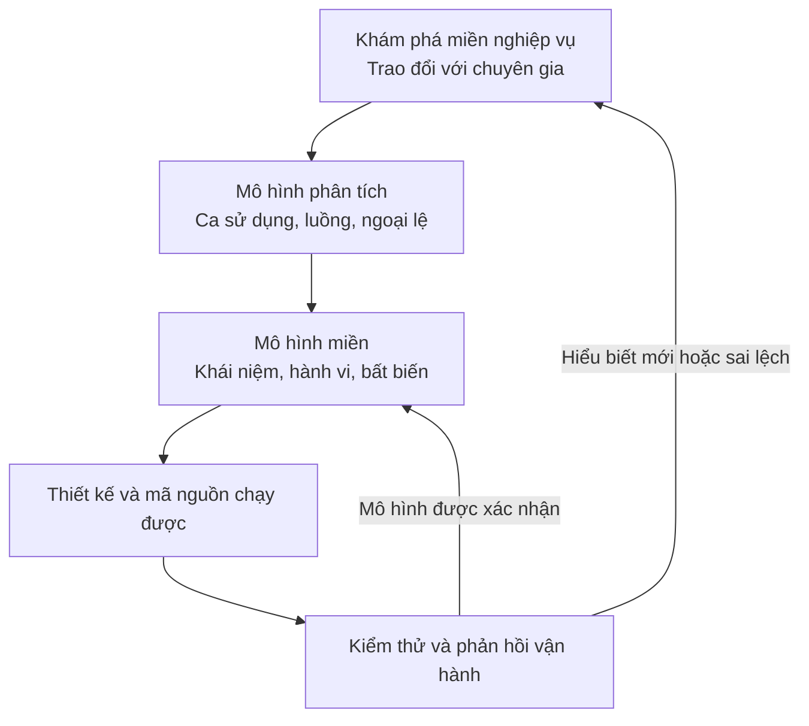

# Mô hình miền và mô hình phân tích: quan hệ với mã nguồn chạy được

Trong phát triển phần mềm, đội ngũ thường tạo ra nhiều cách mô tả một bài toán: yêu cầu, ca sử dụng, sơ đồ phân tích, mô hình khái niệm, sơ đồ lớp và mã nguồn. Những mô tả này có thể hỗ trợ nhau, nhưng nếu chúng dùng thuật ngữ khác nhau hoặc không phản ánh cùng một quy tắc, chúng sẽ nhanh chóng trở thành những phiên bản hiểu biết tách rời.

Domain-Driven Design (DDD) đặt **mô hình miền (domain model)** ở vị trí trung tâm của quá trình thiết kế. Mô hình được hình thành từ hiểu biết nghiệp vụ, diễn đạt bằng ngôn ngữ chung và được thể hiện trong mã nguồn để phần mềm thực thi các quy tắc quan trọng. **Mô hình phân tích (analysis model)** giúp đội hiểu và cấu trúc vấn đề; mô hình miền đi sâu vào những khái niệm, hành vi và bất biến cần được phần mềm bảo vệ; mã nguồn hiện thực hóa mô hình trong một thiết kế có thể chạy được.

Ba góc nhìn này có thể chồng lấn và cùng tiến hóa. Mục tiêu không phải tạo thật nhiều sơ đồ, mà là giữ cho cách hiểu nghiệp vụ, mô hình thiết kế và hành vi thực thi nhất quán với nhau.

## Mục tiêu học tập

Sau bài này, bạn có thể:

- Phân biệt mô hình phân tích, mô hình miền và mã nguồn thực thi.
- Giải thích cách mô hình miền chuyển hiểu biết nghiệp vụ thành thiết kế phần mềm.
- Nhận biết khi nào sơ đồ phân tích hữu ích và khi nào cần diễn đạt quy tắc bằng mô hình có hành vi.
- Liên hệ mô hình với Entity, Value Object, Aggregate, Repository, Domain Service và Domain Event.
- Đánh giá mức độ nhất quán giữa ngôn ngữ nghiệp vụ, mô hình và mã nguồn.
- Dùng ví dụ và kiểm thử để giữ mô hình có ý nghĩa khi phần mềm thay đổi.

## 1. Ba góc nhìn: phân tích, miền và mã nguồn

### Mô hình phân tích: hiểu vấn đề và hành vi mong đợi

Mô hình phân tích mô tả vấn đề cần giải quyết và cách hệ thống được kỳ vọng hỗ trợ người dùng hoặc quy trình. Nó thường được hình thành từ yêu cầu, ca sử dụng, luồng nghiệp vụ, mô hình khái niệm và các tương tác giữa vai trò.

Ví dụ, với ca sử dụng “xác nhận đơn hàng”, mô hình phân tích có thể ghi lại:

- Nhân viên bán hàng chọn một đơn đang ở trạng thái nháp.
- Hệ thống kiểm tra đơn có ít nhất một dòng hàng.
- Hệ thống kiểm tra các điều kiện cần thiết để xác nhận.
- Nếu hợp lệ, đơn chuyển sang trạng thái đã xác nhận.
- Nếu không hợp lệ, hệ thống giải thích lý do và giữ nguyên trạng thái.

Mô hình phân tích giúp làm rõ phạm vi, tác nhân, luồng chính, luồng thay thế và kết quả mong đợi. Nó có thể dùng sơ đồ hoạt động, sơ đồ tuần tự, mô hình khái niệm hoặc mô tả bằng văn bản. Ở giai đoạn này, một số chi tiết triển khai có thể chưa cần quyết định.

### Mô hình miền: diễn đạt khái niệm và quy tắc nghiệp vụ

Mô hình miền là sự trừu tượng hóa có chủ đích về một phần miền nghiệp vụ trong một phạm vi cụ thể. Nó mô tả những khái niệm có ý nghĩa, mối quan hệ, trạng thái, hành vi và quy tắc cần thiết để giải quyết bài toán.

Trong ví dụ đơn hàng, mô hình miền có thể có:

- **Order:** đơn hàng có định danh, các dòng hàng và trạng thái.
- **OrderLine:** mặt hàng cùng số lượng và đơn giá đã chấp nhận.
- **Money:** giá trị tiền gồm số tiền và đơn vị tiền tệ.
- **OrderStatus:** trạng thái trong vòng đời đơn hàng.
- Hành vi **confirm()**: xác nhận đơn nếu các điều kiện nghiệp vụ được đáp ứng.

Mô hình miền không chỉ ghi lại rằng trạng thái đơn hàng có thể thay đổi. Nó làm rõ ai có quyền thay đổi, khi nào được thay đổi và điều kiện nào phải luôn đúng. Những quy tắc này giúp phần mềm tránh các trạng thái không hợp lệ.

### Mã nguồn chạy được: hiện thực hóa và kiểm chứng mô hình

Mã nguồn là thiết kế được biểu diễn bằng ngôn ngữ lập trình và có thể thực thi. Khi áp dụng DDD, mã nguồn quan trọng nên thể hiện được các khái niệm và hành vi của mô hình miền.

Ví dụ, thay vì để nhiều controller tự cập nhật một cột trạng thái, mã nguồn có thể gọi **order.confirm()**. Phương thức này kiểm tra điều kiện và thực hiện chuyển trạng thái. Repository chịu trách nhiệm tải và lưu Aggregate; application service điều phối ca sử dụng và các tương tác bên ngoài.

Mã nguồn không phải bản sao nguyên xi của sơ đồ. Nó có thêm chi tiết về kiểu dữ liệu, giao dịch, xử lý lỗi, lưu trữ, giao tiếp và hiệu năng. Tuy vậy, những chi tiết đó cần hỗ trợ mô hình và giữ được ý nghĩa nghiệp vụ.

| Góc nhìn | Câu hỏi chính | Đầu ra thường gặp |
| --- | --- | --- |
| Mô hình phân tích | Vấn đề là gì và hệ thống cần hỗ trợ hành vi nào? | Ca sử dụng, luồng nghiệp vụ, mô hình khái niệm, sơ đồ tương tác |
| Mô hình miền | Những khái niệm và quy tắc nào giải thích, bảo vệ nghiệp vụ? | Entity, Value Object, Aggregate, hành vi, Domain Event |
| Mã nguồn chạy được | Mô hình được thực thi và tích hợp như thế nào? | Lớp, phương thức, module, repository implementation, adapter, kiểm thử |

Ba góc nhìn có thể dùng chung một số thuật ngữ và sơ đồ. Khác biệt nằm ở mục đích và mức độ chi tiết, không phải bắt buộc mỗi góc nhìn phải nằm trong một bộ tài liệu riêng.

## 2. Từ hiểu biết nghiệp vụ đến mô hình

Mô hình miền không nên được tạo ra chỉ bằng cách đọc danh sách yêu cầu rồi chuyển mọi danh từ thành lớp. Đội phát triển cần khám phá tình huống thực tế cùng chuyên gia nghiệp vụ, tìm ra khái niệm, hành vi, trạng thái và quy tắc có ý nghĩa.

Một quy trình khám phá có thể bắt đầu bằng các câu hỏi:

- Ai đang thực hiện công việc và họ muốn đạt kết quả gì?
- Đối tượng nào được tạo, thay đổi hoặc theo dõi?
- Những hành động nào làm thay đổi trạng thái?
- Điều kiện nào khiến hành động hợp lệ hoặc bị từ chối?
- Có ngoại lệ nào làm thay đổi cách xử lý?
- Một thuật ngữ có nghĩa giống nhau trong toàn phạm vi đang xét không?

Ví dụ, yêu cầu “cho phép hủy đơn” chưa đủ để thiết kế mô hình. Cần làm rõ khách hàng có thể hủy ở trạng thái nào, nhân viên có quyền hủy sau khi xác nhận không, đơn đã giao cho vận chuyển được xử lý ra sao, khoản thanh toán có cần hoàn lại không và hàng đã giữ có được giải phóng không.

Những câu trả lời có thể làm lộ ra nhiều khái niệm và trách nhiệm: **Order** quản lý vòng đời đơn, **Payment** quản lý giao dịch tài chính, **StockReservation** quản lý việc giữ hàng và **Shipment** quản lý giao nhận. Chúng có thể thuộc các Aggregate hoặc Bounded Context khác nhau. Mô hình cần thể hiện đúng quan hệ giữa chúng thay vì gom mọi thứ vào một lớp **OrderManager**.

### Dùng ca sử dụng để tìm hành vi, không dùng nó làm sơ đồ lớp tự động

Ca sử dụng giúp tìm các hành động mà người dùng hoặc hệ thống khác yêu cầu. Động từ trong ca sử dụng là gợi ý để khám phá hành vi miền, nhưng không phải mọi động từ đều trở thành phương thức của một Entity.

Ví dụ:

- “Tìm đơn hàng” có thể là truy vấn phục vụ màn hình, không nhất thiết là hành vi làm thay đổi trạng thái của Order.
- “Xác nhận đơn” là hành vi có thể thuộc Order hoặc một dịch vụ miền phối hợp các chính sách liên quan.
- “Gửi email xác nhận” thường là trách nhiệm của thành phần thông báo sau khi sự kiện xác nhận xảy ra, không phải trách nhiệm cốt lõi của Order.

Đội cần hỏi hành động đó thay đổi sự thật nghiệp vụ nào và ai có thẩm quyền thay đổi nó. Cách đặt trách nhiệm sẽ rõ hơn khi hiểu bản chất của hành vi.

### Giữ ngôn ngữ chung nhất quán

Thuật ngữ được chuyên gia và đội phát triển thống nhất cần xuất hiện trong mô hình và mã nguồn. Nếu nghiệp vụ phân biệt “đặt hàng”, “tiếp nhận đơn” và “xác nhận đơn”, không nên gộp chúng thành một phương thức **process()** chỉ vì cả ba đều xử lý một bản ghi.

Ngôn ngữ chung có phạm vi trong Bounded Context. Một từ có thể mang nghĩa khác ở context khác; khi đó mô hình và mã nguồn của từng context cần giữ đúng định nghĩa tại chỗ. Việc tích hợp cần chuyển đổi qua hợp đồng rõ ràng.

## 3. Mô hình miền cần có hành vi và bảo vệ quy tắc

Một mô hình chỉ có các lớp dữ liệu với getter/setter có thể hữu ích cho một số kiểu hệ thống, nhưng thường không thể hiện đầy đủ quy tắc nghiệp vụ phức tạp. Trong DDD, mô hình miền có ý nghĩa khi các hành vi và bất biến quan trọng được đặt ở nơi phù hợp.

### Entity và Value Object

Entity có định danh xuyên suốt vòng đời. Một đơn hàng vẫn là cùng một đơn hàng dù trạng thái, địa chỉ giao hoặc thông tin khác thay đổi. Vì vậy, **Order** thường là Entity.

Value Object được xác định bởi giá trị của các thuộc tính, không cần định danh riêng. **Money** gồm số tiền và loại tiền tệ; hai giá trị tiền bằng nhau nếu các thành phần có ý nghĩa của chúng bằng nhau. Value Object thường bất biến để giảm nguy cơ thay đổi ngoài ý muốn.

### Aggregate và bất biến

Aggregate xác định ranh giới nhất quán của một nhóm đối tượng. Aggregate Root là điểm truy cập để thay đổi trạng thái bên trong Aggregate và bảo vệ các bất biến cần được duy trì.

Nếu **Order** là Aggregate Root, thao tác thêm dòng hàng hoặc xác nhận đơn nên đi qua Order để kiểm tra trạng thái và điều kiện. Các đối tượng bên ngoài không nên tùy ý sửa danh sách dòng hàng hoặc thay đổi trạng thái nội bộ.

### Repository, Domain Service và Domain Event

- **Repository** cung cấp cách truy xuất và lưu Aggregate theo góc nhìn của miền. Nó không nên trở thành nơi chứa toàn bộ quy tắc nghiệp vụ.
- **Domain Service** biểu diễn một quy tắc hoặc hành vi miền không tự nhiên thuộc về một Entity hay Value Object cụ thể.
- **Domain Event** ghi nhận một sự kiện nghiệp vụ đã xảy ra, chẳng hạn **OrderConfirmed**, để các phần khác có thể phản ứng.

Các mẫu này không phải danh sách phải áp dụng cho mọi lớp. Chỉ sử dụng khi chúng giúp diễn đạt mô hình và trách nhiệm rõ hơn.

## 4. Mô hình và mã nguồn cần tiến hóa cùng nhau

Trong Model-Driven Design của DDD, mô hình miền không chỉ là tài liệu để tham khảo trước khi lập trình. Nó là cơ sở của thiết kế và cần được phản ánh trong mã nguồn. Khi mô hình thay đổi, mã nguồn cần được điều chỉnh; khi triển khai làm lộ ra một quy tắc chưa hiểu đúng, mô hình cần được xem xét lại.

Có thể hình dung vòng lặp như sau:



Vòng lặp không có điểm kết thúc cố định. Mỗi lần phát hiện một ngoại lệ, thay đổi chính sách hoặc hiểu sai thuật ngữ, nhóm có thể cần cập nhật mô hình. Mã nguồn và kiểm thử phải theo kịp để không tồn tại hai định nghĩa khác nhau về cùng một hành vi.

### Khi sơ đồ và mã nguồn mâu thuẫn

Giả sử sơ đồ phân tích nói rằng đơn chỉ được xác nhận khi có ít nhất một dòng hàng, nhưng mã nguồn cho phép xác nhận đơn rỗng. Đây là một sai lệch cần giải quyết. Đội cần xác nhận quy tắc với chuyên gia, cập nhật mô hình nếu hiểu biết đã thay đổi, rồi sửa mã nguồn và kiểm thử.

Không nên mặc định sơ đồ luôn đúng hoặc mã nguồn luôn đúng. Sơ đồ có thể đã lỗi thời; mã nguồn có thể chứa lỗi; cả hai có thể dựa trên một giả định chưa được xác nhận. Nguồn xác thực cuối cùng là hiểu biết nghiệp vụ đã được thống nhất trong phạm vi liên quan, cùng bằng chứng từ hành vi thực tế.

### Mã nguồn giúp mô hình có thể kiểm chứng

Một mô hình trong tài liệu có thể trông hợp lý nhưng không thực thi được vì thiếu quy tắc, mâu thuẫn hoặc không phù hợp với các ràng buộc thực tế. Khi mô hình được thể hiện trong mã nguồn, đội có thể kiểm thử hành vi, xác minh bất biến và quan sát hệ quả của thay đổi.

Kiểm thử nên diễn đạt các ví dụ nghiệp vụ bằng ngôn ngữ chung. Tên kiểm thử như **cannotConfirmAnEmptyOrder()** hoặc **confirmedOrderCannotBeCancelledAfterDispatch()** giúp kết nối ví dụ nghiệp vụ với hành vi thực thi. Một kiểm thử chỉ kiểm tra getter/setter không đủ chứng minh mô hình bảo vệ quy tắc.

## 5. Ví dụ: mô hình đơn hàng được thể hiện trong mã Java

Giả sử nghiệp vụ quy định:

- Đơn hàng mới bắt đầu ở trạng thái nháp.
- Chỉ đơn nháp mới được thêm dòng hàng.
- Số lượng của dòng hàng phải lớn hơn 0.
- Đơn chỉ được xác nhận khi có ít nhất một dòng hàng.
- Một đơn đã xác nhận không thể xác nhận lần thứ hai.

Mô hình phân tích mô tả ca sử dụng “Xác nhận đơn hàng” với tác nhân, điều kiện trước, luồng chính và luồng lỗi. Mô hình miền thể hiện **Order**, **OrderLine**, **Money**, **OrderStatus** cùng hành vi **confirm()**. Mã Java sau hiện thực hóa các quy tắc cốt lõi đó:

```java
import java.math.BigDecimal;
import java.util.ArrayList;
import java.util.Currency;
import java.util.List;
import java.util.Objects;

record OrderId(String value) {
    OrderId {
        Objects.requireNonNull(value);
        if (value.isBlank()) {
            throw new IllegalArgumentException("Order id is required");
        }
    }
}

record ProductId(String value) {
    ProductId {
        Objects.requireNonNull(value);
        if (value.isBlank()) {
            throw new IllegalArgumentException("Product id is required");
        }
    }
}

record Money(BigDecimal amount, Currency currency) {
    Money {
        Objects.requireNonNull(amount);
        Objects.requireNonNull(currency);
        if (amount.signum() < 0) {
            throw new IllegalArgumentException("Amount cannot be negative");
        }
    }

    Money multiply(int quantity) {
        if (quantity < 0) {
            throw new IllegalArgumentException("Quantity cannot be negative");
        }
        return new Money(amount.multiply(BigDecimal.valueOf(quantity)), currency);
    }

    Money add(Money other) {
        Objects.requireNonNull(other);
        if (!currency.equals(other.currency)) {
            throw new IllegalArgumentException("Currency must match");
        }
        return new Money(amount.add(other.amount), currency);
    }
}

record OrderLine(ProductId productId, int quantity, Money unitPrice) {
    OrderLine {
        Objects.requireNonNull(productId);
        Objects.requireNonNull(unitPrice);
        if (quantity <= 0) {
            throw new IllegalArgumentException("Quantity must be positive");
        }
    }

    Money subtotal() {
        return unitPrice.multiply(quantity);
    }
}

enum OrderStatus {
    DRAFT, CONFIRMED, CANCELLED
}

final class Order {
    private final OrderId id;
    private final Currency currency;
    private final List<OrderLine> lines = new ArrayList<>();
    private OrderStatus status = OrderStatus.DRAFT;

    Order(OrderId id, Currency currency) {
        this.id = Objects.requireNonNull(id);
        this.currency = Objects.requireNonNull(currency);
    }

    void addItem(ProductId productId, int quantity, Money unitPrice) {
        ensureDraft();
        if (!currency.equals(unitPrice.currency())) {
            throw new IllegalArgumentException(
                "Order lines must use the order currency"
            );
        }
        lines.add(new OrderLine(productId, quantity, unitPrice));
    }

    void confirm() {
        ensureDraft();
        if (lines.isEmpty()) {
            throw new IllegalStateException(
                "An order must contain at least one line"
            );
        }
        status = OrderStatus.CONFIRMED;
    }

    Money totalAmount() {
        if (lines.isEmpty()) {
            return new Money(BigDecimal.ZERO, currency);
        }
        Money total = lines.get(0).subtotal();
        for (int i = 1; i < lines.size(); i++) {
            total = total.add(lines.get(i).subtotal());
        }
        return total;
    }

    List<OrderLine> lines() {
        return List.copyOf(lines);
    }

    OrderStatus status() {
        return status;
    }

    OrderId id() {
        return id;
    }

    private void ensureDraft() {
        if (status != OrderStatus.DRAFT) {
            throw new IllegalStateException(
                "Only a draft order can be changed"
            );
        }
    }
}
```

Đoạn mã minh họa một số quyết định của mô hình:

- **OrderId** và **ProductId** thể hiện định danh có kiểu riêng, giảm việc truyền nhầm chuỗi.
- **Money** là Value Object, kiểm tra tiền không âm và không cho cộng hai loại tiền khác nhau.
- **OrderLine** bảo vệ quy tắc số lượng dương.
- **Order** là Aggregate Root, kiểm soát việc thêm dòng hàng và xác nhận đơn.
- **lines()** trả về bản sao không thể sửa danh sách nội bộ từ bên ngoài.

Ví dụ này cố ý giữ phạm vi nhỏ. Trong hệ thống thực tế, chính sách tiền tệ, làm tròn, giảm giá, thuế và đơn hàng rỗng cần được xác định theo nghiệp vụ. Việc xác nhận đơn có thể cần tương tác với tồn kho hoặc thanh toán; các tương tác đó thường được điều phối ở application service hoặc qua các Bounded Context khác, không nên giả định Order tự truy cập mọi hệ thống.

### Application Service điều phối ca sử dụng

Application Service điều phối một thao tác của ứng dụng: tải Aggregate, gọi hành vi miền, lưu thay đổi và điều phối các tương tác cần thiết. Nó không thay thế mô hình miền bằng một nơi chứa tất cả quy tắc.

```java
public final class ConfirmOrderService {
    private final OrderRepository orders;

    public ConfirmOrderService(OrderRepository orders) {
        this.orders = orders;
    }

    public void confirm(OrderId orderId) {
        Order order = orders.findById(orderId)
            .orElseThrow(() -> new IllegalArgumentException("Order not found"));

        order.confirm();
        orders.save(order);
    }
}

interface OrderRepository {
    java.util.Optional<Order> findById(OrderId id);
    void save(Order order);
}
```

Trong ứng dụng thực tế, thao tác này thường nằm trong ranh giới giao dịch phù hợp. Nếu cần phát Domain Event, hệ thống phải bảo đảm sự kiện được ghi nhận nhất quán với thay đổi dữ liệu, chẳng hạn bằng transactional outbox. Chi tiết đó thuộc thiết kế hạ tầng; ý nghĩa miền vẫn là “đơn đã được xác nhận”.

## 6. Phân biệt mô hình miền với mô hình dữ liệu và mô hình giao diện

Ba loại mô hình thường bị nhầm lẫn vì cùng chứa thông tin về đơn hàng, khách hàng hoặc sản phẩm.

| Loại mô hình | Mục đích | Ví dụ |
| --- | --- | --- |
| Domain Model | Diễn đạt ý nghĩa, hành vi và quy tắc nghiệp vụ | **Order.confirm()** kiểm tra đơn có dòng hàng |
| Data Model | Tổ chức dữ liệu để lưu trữ và truy vấn | Bảng **orders**, **order_lines**, khóa ngoại |
| Presentation/View Model | Cung cấp dữ liệu phù hợp cho màn hình hoặc API | **OrderSummaryView** có mã đơn, tổng tiền, trạng thái hiển thị |

Một **OrderSummaryView** có thể chứa tên khách hàng, số dòng hàng, tổng tiền và nhãn trạng thái để hiển thị. Nó không nhất thiết là Aggregate Order. Tương tự, một bảng **orders** có thể chứa cột trạng thái và thời điểm xác nhận, nhưng cấu trúc bảng không tự mô tả quy tắc chuyển trạng thái.

Không nên ép mọi loại mô hình thành cùng một lớp chỉ để giảm số lượng kiểu dữ liệu. Khi mục đích khác nhau, việc có mô hình riêng giúp mỗi thành phần chỉ chứa thông tin cần thiết. Tuy vậy, cũng không nên tạo lớp chuyển đổi không cần thiết cho mọi trường hợp đơn giản; quyết định cần dựa trên khác biệt về trách nhiệm và vòng đời.

## 7. Làm thế nào để giữ mô hình và mã nguồn nhất quán?

### Dùng cùng thuật ngữ trong thảo luận và code

Khi chuyên gia nói “xác nhận đơn”, tên phương thức nên diễn đạt hành vi đó nếu nó thuộc trách nhiệm của đối tượng. Tránh để tài liệu dùng “Confirm Order”, sơ đồ dùng “Process Request”, còn mã nguồn dùng **updateFlag()** cho cùng một khái niệm.

### Đặt quy tắc tại nơi có thể bảo vệ chúng

Nếu Order có bất biến về trạng thái và dòng hàng, hãy đặt các hành vi liên quan tại Aggregate Root. Nếu một chính sách liên quan đến nhiều Aggregate hoặc cần phối hợp các context, cân nhắc Domain Service hoặc Application Service phù hợp. Không nên đưa mọi quy tắc vào controller hoặc một service tổng quát.

### Dùng kiểm thử như ví dụ sống của mô hình

Tên kiểm thử và dữ liệu kiểm thử nên diễn đạt tình huống nghiệp vụ:

```java
@Test
void cannotConfirmAnEmptyOrder() {
    Order order = new Order(
        new OrderId("ORD-100"),
        Currency.getInstance("VND")
    );

    assertThrows(IllegalStateException.class, order::confirm);
}

@Test
void confirmedOrderCannotAcceptAnotherItem() {
    Order order = new Order(
        new OrderId("ORD-101"),
        Currency.getInstance("VND")
    );
    order.addItem(
        new ProductId("SKU-01"),
        1,
        new Money(
            new BigDecimal("100000"),
            Currency.getInstance("VND")
        )
    );
    order.confirm();

    assertThrows(
        IllegalStateException.class,
        () -> order.addItem(
            new ProductId("SKU-02"),
            1,
            new Money(
                new BigDecimal("50000"),
                Currency.getInstance("VND")
            )
        )
    );
}
```

Các kiểm thử này minh họa hai quy tắc. Trong dự án thật, cần kiểm thử thêm chuyển đổi trạng thái, tính tiền, chính sách hủy và các trường hợp phối hợp với context khác. Kiểm thử đơn vị giúp xác nhận hành vi Aggregate; kiểm thử tích hợp giúp xác nhận repository, giao dịch và hợp đồng bên ngoài.

### Refactor mô hình khi hiểu biết thay đổi

Khi chuyên gia làm rõ một thuật ngữ hoặc quy tắc, hãy cập nhật glossary, mô hình, mã nguồn và kiểm thử có liên quan. Không nên để sơ đồ mô tả một hành vi, code thực hiện hành vi khác và tài liệu API dùng một tên thứ ba.

Một mô hình tốt không phải mô hình không bao giờ thay đổi. Nó là mô hình có thể được cải thiện có kiểm soát khi đội học thêm về nghiệp vụ.

## 8. Những sai lầm thường gặp

- **Chuyển mọi danh từ trong yêu cầu thành Entity:** một số danh từ chỉ là thuộc tính, Value Object, vai trò hoặc khái niệm trong một báo cáo.
- **Xem sơ đồ phân tích là thiết kế hoàn chỉnh:** sơ đồ có thể chưa diễn đạt bất biến, quyền sở hữu và hành vi chi tiết.
- **Xem mô hình miền là sơ đồ lớp tĩnh:** mô hình cần thể hiện hành vi, trạng thái và quy tắc, không chỉ thuộc tính.
- **Để mã nguồn tách khỏi ngôn ngữ nghiệp vụ:** tên bảng, mã trạng thái và phương thức chung chung khiến mô hình khó nhận biết.
- **Đưa toàn bộ quy tắc vào Application Service:** Aggregate mất khả năng tự bảo vệ bất biến khi được gọi từ nhiều luồng.
- **Đồng nhất Domain Model với Data Model:** thay đổi lưu trữ không nên tự động quyết định ý nghĩa của mô hình.
- **Cố gắng mô hình hóa toàn bộ thế giới thực:** mô hình chỉ nên giữ những gì cần thiết cho vấn đề và Bounded Context đang xét.
- **Để tài liệu và code lệch nhau:** sơ đồ lỗi thời có thể gây hiểu nhầm; code chưa được kiểm thử có thể thực thi sai quy tắc.

## 9. Quy trình thực hành từ phân tích đến mã nguồn

Khi bắt đầu một chức năng nghiệp vụ, có thể đi theo các bước sau:

1. **Hiểu tình huống và mục tiêu.** Trao đổi với chuyên gia, xác định tác nhân, kết quả mong đợi và ngoại lệ.
2. **Lập mô hình phân tích vừa đủ.** Mô tả ca sử dụng, luồng chính, luồng thay thế và các thuật ngữ cần làm rõ.
3. **Khám phá mô hình miền.** Xác định Entity, Value Object, hành vi, trạng thái, bất biến và sự kiện.
4. **Xác định ranh giới.** Làm rõ Bounded Context, trách nhiệm và dữ liệu có thẩm quyền.
5. **Thiết kế mô hình có hành vi.** Đặt quy tắc tại Aggregate hoặc dịch vụ miền phù hợp.
6. **Hiện thực hóa trong mã nguồn.** Tổ chức module, repository, application service và adapter theo ranh giới.
7. **Viết kiểm thử theo ví dụ nghiệp vụ.** Kiểm tra hành vi hợp lệ, không hợp lệ và các trường hợp biên.
8. **Đối chiếu và điều chỉnh.** Khi code hoặc vận hành làm lộ hiểu biết mới, cập nhật mô hình và ngôn ngữ chung.

Không phải dự án nào cũng cần sơ đồ phân tích chi tiết cho mọi thay đổi. Với một thay đổi nhỏ đã hiểu rõ, trao đổi ngắn và kiểm thử có thể đủ. Với quy trình nhiều vai trò, nhiều ngoại lệ hoặc liên quan nhiều Bounded Context, mô hình hóa rõ ràng giúp phát hiện mâu thuẫn trước khi triển khai.

## 10. Checklist review mô hình và mã nguồn

Khi review một thiết kế DDD, hãy kiểm tra:

- [ ] Mô hình phân tích có mô tả đúng mục tiêu và tình huống nghiệp vụ không?
- [ ] Các thuật ngữ trong mô hình và mã nguồn có thống nhất với ngôn ngữ chung không?
- [ ] Domain Model có thể hiện các hành vi và bất biến quan trọng không?
- [ ] Entity và Value Object được phân biệt dựa trên ý nghĩa, không chỉ dựa trên cách lưu dữ liệu?
- [ ] Aggregate Root có bảo vệ các thay đổi cần giữ nhất quán không?
- [ ] Repository và dịch vụ có trách nhiệm rõ ràng không?
- [ ] Quy tắc thuộc context khác có bị đưa vào mô hình hiện tại không?
- [ ] Mã nguồn có phản ánh mô hình đã thống nhất không?
- [ ] Kiểm thử có diễn đạt được các ví dụ nghiệp vụ và trường hợp ngoại lệ không?
- [ ] Tài liệu, glossary và hợp đồng tích hợp có được cập nhật khi mô hình thay đổi không?

## Kết luận

Mô hình phân tích giúp đội hiểu vấn đề, vai trò, luồng và kết quả mong đợi. Mô hình miền tổ chức những khái niệm, hành vi và quy tắc có ý nghĩa trong một Bounded Context. Mã nguồn chạy được hiện thực hóa mô hình và cho phép kiểm chứng nó bằng kiểm thử và vận hành.

Trong DDD, mô hình miền cần có ảnh hưởng thực sự đến thiết kế và mã nguồn. Khi ngôn ngữ chung, hành vi, bất biến và trách nhiệm được thể hiện nhất quán, phần mềm dễ đọc hơn, quy tắc dễ kiểm tra hơn và đội phát triển có thể điều chỉnh mô hình khi hiểu biết nghiệp vụ tiến triển.
