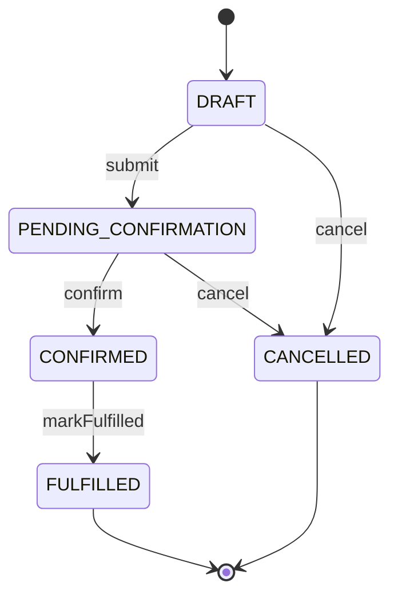

# Mô hình hóa trạng thái và các chuyển đổi hợp lệ

Trong Domain-Driven Design (DDD), một đối tượng miền thường có vòng đời: nó được tạo ra, trải qua một số hành động và cuối cùng đi đến trạng thái kết thúc. Không phải hành động nào cũng hợp lệ ở mọi thời điểm. Một đơn hàng nháp có thể được chỉnh sửa, nhưng đơn đã giao không thể quay lại trạng thái nháp; một yêu cầu hoàn tiền chỉ có thể được chấp nhận khi giao dịch đáp ứng các điều kiện nhất định.

Mô hình hóa trạng thái giúp diễn đạt rõ vòng đời đó. Mô hình cần xác định những trạng thái có ý nghĩa nghiệp vụ, hành động nào được phép tại mỗi trạng thái, điều kiện để chuyển trạng thái và sự kiện nào được ghi nhận sau khi chuyển đổi thành công. Khi các quy tắc được đặt đúng nơi, hệ thống có thể ngăn trạng thái không hợp lệ và giúp người đọc hiểu hành vi của miền qua mã nguồn.

## 1. Trạng thái biểu diễn điều gì?

Trạng thái (state) mô tả tình trạng hiện tại của một đối tượng hoặc quy trình theo góc nhìn nghiệp vụ. Nó cho biết đối tượng đang ở giai đoạn nào và những hành động nào có thể thực hiện tiếp theo.

Ví dụ, một đơn hàng có thể trải qua các trạng thái:

- `DRAFT`: đơn đang được chuẩn bị và còn có thể chỉnh sửa.
- `PENDING_CONFIRMATION`: đơn đã được gửi, đang chờ các điều kiện xác nhận hoàn tất.
- `CONFIRMED`: đơn đã được xác nhận.
- `FULFILLED`: việc thực hiện và giao đơn đã hoàn tất.
- `CANCELLED`: đơn đã bị hủy.

Trạng thái khác với dữ liệu mô tả. `customerName`, `shippingAddress` hoặc `createdAt` là thuộc tính của đơn hàng, nhưng không nhất thiết là trạng thái vòng đời. `OrderStatus` có ý nghĩa vì nó quyết định hành động nào được phép và những quy tắc nào cần áp dụng.

Trạng thái cũng cần có định nghĩa rõ. Ví dụ, `CONFIRMED` có thể có nghĩa đơn đã qua kiểm tra báo giá, đã giữ được hàng và đã được cấp phép thanh toán. Nếu mỗi nhóm hiểu trạng thái này theo một cách, tên gọi dù rõ ràng vẫn không tạo ra mô hình nhất quán.

## 2. Phân biệt trạng thái, hành động và sự kiện

Ba khái niệm thường xuất hiện cùng nhau nhưng có vai trò khác nhau:

| Khái niệm | Ý nghĩa | Ví dụ |
| --- | --- | --- |
| State | Tình trạng hiện tại của đối tượng | `PENDING_CONFIRMATION` |
| Command / Action | Yêu cầu thực hiện hành động có thể làm thay đổi trạng thái | `ConfirmOrder` |
| Domain Event | Sự việc nghiệp vụ đã xảy ra sau khi hành động thành công | `OrderConfirmed` |

Ví dụ, `ConfirmOrder` là yêu cầu xác nhận đơn. Nếu báo giá đã hết hiệu lực hoặc thanh toán chưa được cấp phép, yêu cầu có thể bị từ chối và trạng thái vẫn là `PENDING_CONFIRMATION`. Chỉ khi điều kiện được đáp ứng và đơn thực sự chuyển sang `CONFIRMED`, hệ thống mới ghi nhận `OrderConfirmed`.

Không nên phát sự kiện thành công ngay khi nhận command. Điều đó khiến các thành phần khác tin rằng một thay đổi đã xảy ra dù thao tác có thể thất bại.

## 3. Tìm các trạng thái từ vòng đời nghiệp vụ

Không nên bắt đầu bằng cách liệt kê các giá trị enum mà lập trình viên nghĩ rằng cần có. Hãy tìm trạng thái từ quy trình và cách người làm nghiệp vụ mô tả đối tượng.

Với mỗi giai đoạn, hãy hỏi:

1. Người tham gia nghiệp vụ gọi tình trạng này là gì?
2. Điều gì đã xảy ra để đối tượng đi vào tình trạng này?
3. Những hành động nào được phép và hành động nào bị cấm?
4. Ai hoặc hệ thống nào có quyền thực hiện hành động tiếp theo?
5. Điều kiện nào phải đúng trước khi chuyển sang giai đoạn khác?
6. Có thể quay lại trạng thái trước không? Nếu có, trong điều kiện nào?
7. Trạng thái này có kết thúc vòng đời hay chỉ là một bước trung gian?

Ví dụ, “đơn đã gửi” và “đơn đã xác nhận” có thể nghe gần giống nhau nhưng là hai giai đoạn khác nhau. Đơn đã gửi có thể vẫn đang chờ kiểm tra hoặc chờ thanh toán. Nếu gộp chúng thành `ACTIVE`, hệ thống sẽ khó diễn đạt chính xác hành động được phép.

Một trạng thái nên phản ánh một khác biệt có ý nghĩa đối với nghiệp vụ. Không cần tạo trạng thái riêng cho mọi thao tác kỹ thuật như `VALIDATING`, `SAVING` hoặc `SENDING_HTTP_REQUEST` trừ khi người dùng nghiệp vụ cần nhận biết và xử lý tình trạng đó.

## 4. Xác định các chuyển đổi hợp lệ

Chuyển đổi trạng thái (state transition) là việc đối tượng đi từ trạng thái hiện tại sang trạng thái mới khi một hành động được chấp nhận và các điều kiện cần thiết được thỏa mãn.

Với ví dụ đơn hàng, bảng chuyển đổi có thể là:

| Trạng thái hiện tại | Hành động | Điều kiện | Trạng thái tiếp theo |
| --- | --- | --- | --- |
| `DRAFT` | `submit` | Có ít nhất một dòng hàng, báo giá còn hiệu lực, hàng đã được giữ | `PENDING_CONFIRMATION` |
| `DRAFT` | `cancel` | Người có quyền yêu cầu hủy bản nháp | `CANCELLED` |
| `PENDING_CONFIRMATION` | `confirm` | Thanh toán được cấp phép và thông tin giữ hàng còn hợp lệ | `CONFIRMED` |
| `PENDING_CONFIRMATION` | `cancel` | Đơn chưa được xác nhận | `CANCELLED` |
| `CONFIRMED` | `markFulfilled` | Việc thực hiện đơn đã hoàn tất | `FULFILLED` |

Những chuyển đổi không có trong bảng bị từ chối. Chẳng hạn, không thể gọi `confirm` trên đơn `DRAFT`, không thể chỉnh sửa dòng hàng sau khi đơn đã gửi và không thể chuyển đơn `CANCELLED` thành `FULFILLED`.

Sơ đồ giúp nhìn thấy vòng đời và các trạng thái kết thúc:



Đây là mô hình minh họa cho một quy trình cụ thể. Nếu doanh nghiệp cho phép hủy đơn sau xác nhận, cần khám phá thêm điều kiện, phí hủy, trạng thái giao hàng và hành động bù trừ. Không nên tự thêm một mũi tên `CONFIRMED -> CANCELLED` nếu chưa biết các quy tắc đó.

## 5. Bảo vệ chuyển đổi trong mô hình miền

Đối tượng hoặc aggregate sở hữu trạng thái nên kiểm tra điều kiện chuyển đổi trước khi thay đổi trạng thái. Tránh để nhiều controller hoặc service tự gán `status` vì mỗi nơi có thể áp dụng quy tắc khác nhau.

Ví dụ Java rút gọn:

```java
public enum OrderStatus {
    DRAFT,
    PENDING_CONFIRMATION,
    CONFIRMED,
    FULFILLED,
    CANCELLED
}
```

Aggregate `Order` kiểm soát các hành động làm thay đổi vòng đời:

```java
public final class Order {
    private final OrderId id;
    private final List<OrderLine> lines = new ArrayList<>();
    private OrderStatus status = OrderStatus.DRAFT;
    private QuoteId quoteId;
    private ReservationId reservationId;
    private PaymentAuthorizationId paymentAuthorizationId;

    public Order(OrderId id) {
        this.id = Objects.requireNonNull(id);
    }

    public void addLine(OrderLine line) {
        requireStatus(OrderStatus.DRAFT);
        lines.add(Objects.requireNonNull(line));
    }

    public void submit(Quote quote, InventoryReservation reservation, Instant now) {
        requireStatus(OrderStatus.DRAFT);

        if (lines.isEmpty()) {
            throw new OrderCannotBeSubmitted("Order must contain at least one line");
        }
        if (!quote.isValidAt(now)) {
            throw new OrderCannotBeSubmitted("Quote has expired");
        }
        if (!reservation.isHeldFor(id)) {
            throw new OrderCannotBeSubmitted("Inventory is not reserved for this order");
        }

        quoteId = quote.id();
        reservationId = reservation.id();
        status = OrderStatus.PENDING_CONFIRMATION;
        registerEvent(new OrderSubmitted(id, quoteId, reservationId, now));
    }

    public void confirm(
        PaymentAuthorization payment,
        InventoryReservation reservation,
        Instant now
    ) {
        requireStatus(OrderStatus.PENDING_CONFIRMATION);

        if (!reservation.isHeldFor(id)) {
            throw new OrderCannotBeConfirmed("Inventory reservation is no longer valid");
        }
        if (!payment.isAuthorizedFor(id)) {
            throw new OrderCannotBeConfirmed("Payment is not authorized for this order");
        }

        paymentAuthorizationId = payment.id();
        status = OrderStatus.CONFIRMED;
        registerEvent(new OrderConfirmed(id, paymentAuthorizationId, now));
    }

    public void cancel(CancellationReason reason, Instant now) {
        if (status != OrderStatus.DRAFT && status != OrderStatus.PENDING_CONFIRMATION) {
            throw new OrderCannotBeCancelled("Order can no longer be cancelled at this stage");
        }

        status = OrderStatus.CANCELLED;
        registerEvent(new OrderCancelled(id, reason, now));
    }

    public void markFulfilled(Shipment shipment, Instant now) {
        requireStatus(OrderStatus.CONFIRMED);

        if (!shipment.isFor(id)) {
            throw new IllegalArgumentException("Shipment belongs to another order");
        }

        status = OrderStatus.FULFILLED;
        registerEvent(new OrderFulfilled(id, shipment.id(), now));
    }

    private void requireStatus(OrderStatus expected) {
        if (status != expected) {
            throw new InvalidOrderTransition(status, expected);
        }
    }

    private void registerEvent(DomainEvent event) {
        // Lưu sự kiện miền để application layer công bố sau khi aggregate được lưu.
    }
}
```

Đoạn mã được rút gọn để tập trung vào chuyển đổi trạng thái; các import và định nghĩa kiểu hỗ trợ chưa được trình bày. Các kiểu như `Quote`, `InventoryReservation`, `PaymentAuthorization`, `Shipment` và các event là những khái niệm miền hoặc hợp đồng được giản lược. Trong hệ thống thực tế, dữ liệu từ bounded context khác thường được chuyển qua hợp đồng tích hợp; aggregate không nên truy cập trực tiếp repository hoặc cơ sở dữ liệu của context khác.

Điểm quan trọng trong ví dụ là không có setter công khai cho `status`. Các phương thức `submit`, `confirm`, `cancel` và `markFulfilled` diễn đạt hành động nghiệp vụ và là nơi bảo vệ quy tắc chuyển đổi.

## 6. Bất biến phải đúng trước và sau chuyển đổi

Trạng thái hợp lệ không chỉ là một giá trị enum. Đối tượng còn phải thỏa mãn những bất biến (invariant) liên quan đến dữ liệu và quan hệ giữa các thuộc tính.

Ví dụ:

- Đơn `DRAFT` có thể được chỉnh sửa; đơn đã gửi không còn cho phép sửa trực tiếp dòng hàng.
- Đơn `PENDING_CONFIRMATION` phải có báo giá và reservation hợp lệ.
- Đơn `CONFIRMED` phải gắn với một kết quả cấp phép thanh toán hợp lệ theo quy tắc của quy trình.
- Đơn `FULFILLED` phải có bằng chứng thực hiện hoặc giao hàng tương ứng.
- Đơn `CANCELLED` không được tiếp tục các hành động dành cho đơn đang hoạt động.

Một chuyển đổi cần bảo đảm ba điều:

1. Trạng thái hiện tại cho phép hành động.
2. Các điều kiện nghiệp vụ của hành động được thỏa mãn.
3. Trạng thái mới và dữ liệu liên quan cùng tạo thành một tình trạng hợp lệ.

Không nên cập nhật trạng thái trước rồi mới kiểm tra các điều kiện còn lại. Nếu một điều kiện thất bại, đối tượng có thể bị lưu ở trạng thái nửa chừng. Hãy kiểm tra trước, sau đó thay đổi các thuộc tính liên quan trong cùng một thao tác nhất quán.

## 7. Trạng thái kết thúc và hành động bù trừ

Một số trạng thái kết thúc vòng đời của đối tượng. Trong ví dụ, `FULFILLED` và `CANCELLED` là trạng thái cuối: các hành động thông thường như chỉnh sửa, xác nhận hoặc giao hàng lần nữa không còn hợp lệ.

Tuy nhiên, trạng thái kết thúc không có nghĩa là doanh nghiệp không thể làm gì thêm. Một đơn đã giao có thể phát sinh yêu cầu trả hàng hoặc hoàn tiền. Những hoạt động đó thường có vòng đời riêng, ví dụ `ReturnRequest` hoặc `Refund`, thay vì đưa đơn hàng quay lại trạng thái trước đó.

Tương tự, hủy đơn sau khi thanh toán đã được cấp phép có thể yêu cầu giải phóng reservation hoặc hủy cấp phép thanh toán. Các hành động này có thể được điều phối bằng policy hoặc process manager. Việc hủy đơn và việc hoàn tất bù trừ là hai sự kiện khác nhau, cần được theo dõi riêng.

## 8. Tránh dùng quá nhiều boolean thay cho trạng thái

Một thiết kế dùng nhiều boolean có thể tạo ra những tổ hợp không hợp lệ:

```java
boolean isSubmitted;
boolean isConfirmed;
boolean isCancelled;
boolean isFulfilled;
```

Bốn biến boolean có thể tạo ra (2^4 = 16) tổ hợp, trong khi nghiệp vụ chỉ cho phép một số ít tình trạng. Ví dụ `isCancelled = true` đồng thời `isFulfilled = true` có thể không có ý nghĩa.

Một enum hoặc kiểu trạng thái tường minh giúp giới hạn tập giá trị và thể hiện các chuyển đổi hợp lệ rõ hơn:

```java
OrderStatus status;
```

Tuy nhiên, không phải mọi thuộc tính boolean đều phải biến thành một state machine. `isGiftWrapped` có thể là một lựa chọn độc lập, không phải giai đoạn vòng đời của đơn hàng. Chỉ gom các thuộc tính vào trạng thái khi chúng cùng mô tả một vòng đời và có những tổ hợp bị cấm.

## 9. Khi có nhiều chiều trạng thái độc lập

Một đối tượng hoặc quy trình lớn có thể có nhiều chiều trạng thái khác nhau. Đơn hàng có trạng thái xử lý đơn, thanh toán và giao hàng. Nếu gộp tất cả vào một enum như `PAID_RESERVED_CONFIRMED`, số lượng trạng thái kết hợp sẽ tăng rất nhanh và khó duy trì.

Ví dụ:

| Chiều trạng thái | Một số giá trị |
| --- | --- |
| Order lifecycle | `DRAFT`, `PENDING_CONFIRMATION`, `CONFIRMED`, `CANCELLED` |
| Payment lifecycle | `NOT_STARTED`, `AUTHORIZED`, `CAPTURED`, `REFUNDED`, `DECLINED` |
| Fulfillment lifecycle | `NOT_STARTED`, `PICKING`, `PACKED`, `SHIPPED`, `DELIVERED` |

Các chiều này có thể thuộc những bounded context khác nhau và được liên kết bằng định danh, hợp đồng hoặc sự kiện. Order Management không nên tự sở hữu toàn bộ trạng thái thanh toán nếu Payment context là nơi chịu trách nhiệm về giao dịch. Tương tự, trạng thái giao hàng có thể thuộc Fulfillment.

Nếu các chiều trạng thái có quan hệ phụ thuộc, hãy diễn đạt quan hệ đó bằng policy hoặc quy tắc điều phối. Ví dụ, đơn chỉ được xác nhận khi payment đã được cấp phép và reservation còn hiệu lực. Không cần tạo một enum khổng lồ để biểu diễn mọi tổ hợp.

## 10. Chọn enum, state pattern hay mô hình khác?

Với vòng đời có số trạng thái hữu hạn và quy tắc chuyển đổi tương đối đơn giản, enum kết hợp với các phương thức nghiệp vụ thường đủ rõ ràng. Mỗi phương thức kiểm tra trạng thái hiện tại và điều kiện trước khi thực hiện thay đổi.

State pattern có thể hữu ích khi mỗi trạng thái có nhiều hành vi khác nhau, logic chuyển đổi phức tạp và việc gom tất cả điều kiện vào một lớp làm mã khó đọc. Khi đó, mỗi trạng thái có thể được biểu diễn bằng một đối tượng riêng cung cấp các hành vi hợp lệ.

Không nên dùng State pattern chỉ vì một đối tượng có vài trạng thái. Nhiều lớp trạng thái có thể làm tăng độ phức tạp và khiến người đọc phải lần theo nhiều nơi để hiểu một chuyển đổi. Hãy bắt đầu với mô hình đơn giản, sau đó chỉ tách hành vi khi sự khác biệt giữa các trạng thái thực sự đáng kể.

## 11. Đồng thời, lệnh lặp và tính nhất quán

Trong ứng dụng nhiều người dùng hoặc hệ thống phân tán, hai lệnh có thể cùng tác động đến một đối tượng. Ví dụ, một yêu cầu hủy đơn và một yêu cầu xác nhận có thể đến gần như đồng thời.

Kiểm tra trạng thái trong bộ nhớ là cần thiết nhưng chưa đủ. Khi lưu dữ liệu, hệ thống cần cơ chế bảo vệ tính nhất quán, chẳng hạn optimistic locking với version của aggregate hoặc transaction phù hợp. Nếu một lệnh được xử lý dựa trên phiên bản cũ, việc lưu phải phát hiện xung đột để ứng dụng tải lại và đánh giá lại hành động.

Ngoài ra, message hoặc command có thể được gửi nhiều lần. Cần xác định hành động nào có thể xử lý lặp an toàn (idempotent), dùng command ID hoặc khóa idempotency khi phù hợp, và tránh phát domain event trùng cho một chuyển đổi đã hoàn tất. Một yêu cầu lặp lại không nên vô tình làm đơn được xác nhận hoặc thanh toán hai lần.

## 12. Kiểm thử state machine

Khi trạng thái và chuyển đổi được mô tả rõ, có thể xây dựng kiểm thử dựa trên bảng chuyển đổi thay vì chỉ kiểm thử một vài luồng thành công.

Nên kiểm tra:

- Mọi chuyển đổi hợp lệ đều đưa đối tượng sang đúng trạng thái mới.
- Mọi chuyển đổi không hợp lệ đều bị từ chối và không làm thay đổi dữ liệu.
- Điều kiện đầu vào không đạt sẽ không tạo event thành công.
- Event chỉ được ghi nhận sau khi chuyển đổi hợp lệ.
- Trạng thái kết thúc không chấp nhận hành động trái với vòng đời.
- Lệnh lặp hoặc lệnh cạnh tranh không phá vỡ bất biến.

Ví dụ một số trường hợp kiểm thử:

| Trạng thái ban đầu | Hành động | Kết quả mong đợi |
| --- | --- | --- |
| `DRAFT` | `submit` với dữ liệu hợp lệ | `PENDING_CONFIRMATION` và có `OrderSubmitted` |
| `DRAFT` | `confirm` | Bị từ chối, trạng thái vẫn `DRAFT` |
| `PENDING_CONFIRMATION` | `confirm` khi payment chưa được cấp phép | Bị từ chối, không có `OrderConfirmed` |
| `PENDING_CONFIRMATION` | `cancel` | `CANCELLED` và có `OrderCancelled` |
| `CONFIRMED` | `markFulfilled` với shipment hợp lệ | `FULFILLED` và có `OrderFulfilled` |
| `CANCELLED` | `submit` hoặc `confirm` | Bị từ chối, trạng thái vẫn `CANCELLED` |

Với tập trạng thái nhỏ, có thể rà soát tất cả cặp trạng thái và hành động. Với quy trình lớn, hãy ưu tiên các chuyển đổi quan trọng, các bất biến có hậu quả lớn và những nhánh từng gây lỗi thực tế.

## 13. Những lỗi thường gặp khi mô hình hóa trạng thái

**Cho phép cập nhật trạng thái tùy ý.** Setter công khai như `setStatus()` khiến mọi nơi có thể bỏ qua quy tắc. Hãy cung cấp phương thức nghiệp vụ có kiểm tra điều kiện.

**Dùng trạng thái quá chung chung.** `ACTIVE`, `INACTIVE` hoặc `PROCESSING` có thể che giấu nhiều giai đoạn khác nhau. Hãy dùng thuật ngữ cho biết ý nghĩa mà nghiệp vụ cần phân biệt.

**Tạo trạng thái cho chi tiết kỹ thuật.** Những bước như `CALLING_PROVIDER` hoặc `SAVING_DATABASE` thường thuộc hoạt động nội bộ, trừ khi chúng có ý nghĩa và vòng đời mà nghiệp vụ cần theo dõi.

**Dùng boolean cho một vòng đời nhiều giai đoạn.** Nhiều cờ độc lập dễ tạo tổ hợp không hợp lệ. Hãy dùng state rõ ràng khi các giá trị đại diện cho những giai đoạn loại trừ nhau.

**Gộp nhiều chiều trạng thái.** Trạng thái đơn hàng, thanh toán và giao hàng có thể thuộc các trách nhiệm khác nhau. Hãy giữ chúng ở mô hình sở hữu tương ứng và điều phối qua quy tắc rõ ràng.

**Phát event trước khi chuyển đổi thành công.** Bên tiêu thụ sẽ nhận được một sự thật không đúng. Hãy ghi nhận event sau khi điều kiện và thay đổi trạng thái được xác nhận; việc công bố ra ngoài cần được phối hợp nhất quán với lưu trữ.

**Không xử lý lệnh trùng hoặc cạnh tranh.** Hai request có thể cùng vượt qua kiểm tra nếu hệ thống chỉ dựa vào trạng thái trong bộ nhớ. Cần bảo vệ ở ranh giới lưu trữ và thiết kế idempotency phù hợp.

## 14. Quy trình xây dựng mô hình trạng thái

Có thể áp dụng các bước sau cho một entity hoặc aggregate:

1. **Chọn đối tượng và phạm vi vòng đời:** xác định đối tượng nào có trạng thái cần quản lý và context nào sở hữu nó.
2. **Thu thập thuật ngữ nghiệp vụ:** hỏi chuyên gia cách họ gọi từng giai đoạn và kết quả của các hành động.
3. **Liệt kê trạng thái có ý nghĩa:** định nghĩa mỗi trạng thái bằng điều kiện có thể kiểm chứng.
4. **Liệt kê hành động:** ghi command hoặc hành động có thể làm thay đổi đối tượng.
5. **Lập bảng chuyển đổi:** xác định trạng thái hiện tại, hành động, điều kiện và trạng thái tiếp theo.
6. **Ghi bất biến:** nêu điều gì phải luôn đúng trước và sau mỗi chuyển đổi.
7. **Xác định event:** chọn sự kiện miền phản ánh kết quả thực sự đã xảy ra.
8. **Xử lý trạng thái kết thúc và bù trừ:** làm rõ các hành động sau khi vòng đời chính kết thúc.
9. **Kiểm tra đồng thời và lặp:** xác định cách xử lý xung đột, message trùng và lệnh đến sai thứ tự.
10. **Viết kiểm thử:** kiểm tra cả chuyển đổi hợp lệ lẫn chuyển đổi bị cấm.

## 15. Nguyên tắc cần ghi nhớ

Mô hình trạng thái tốt mô tả vòng đời mà nghiệp vụ nhận biết, giới hạn các hành động được phép và bảo vệ những bất biến quan trọng. Hãy tìm trạng thái từ quy trình thực tế, lập bảng chuyển đổi, đặt quy tắc trong mô hình sở hữu trạng thái và chỉ ghi event khi thay đổi thực sự xảy ra.

Giữ mỗi chiều trạng thái ở đúng trách nhiệm của nó, xử lý lệnh lặp và cạnh tranh ở ranh giới lưu trữ, rồi kiểm thử cả đường đi hợp lệ lẫn những đường đi phải bị từ chối. Mục tiêu là làm cho trạng thái của phần mềm luôn phản ánh một tình trạng nghiệp vụ có ý nghĩa và có thể giải thích.
