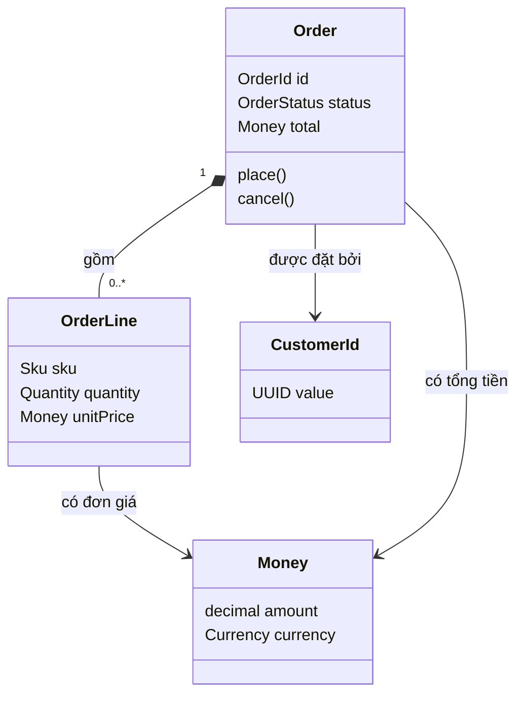
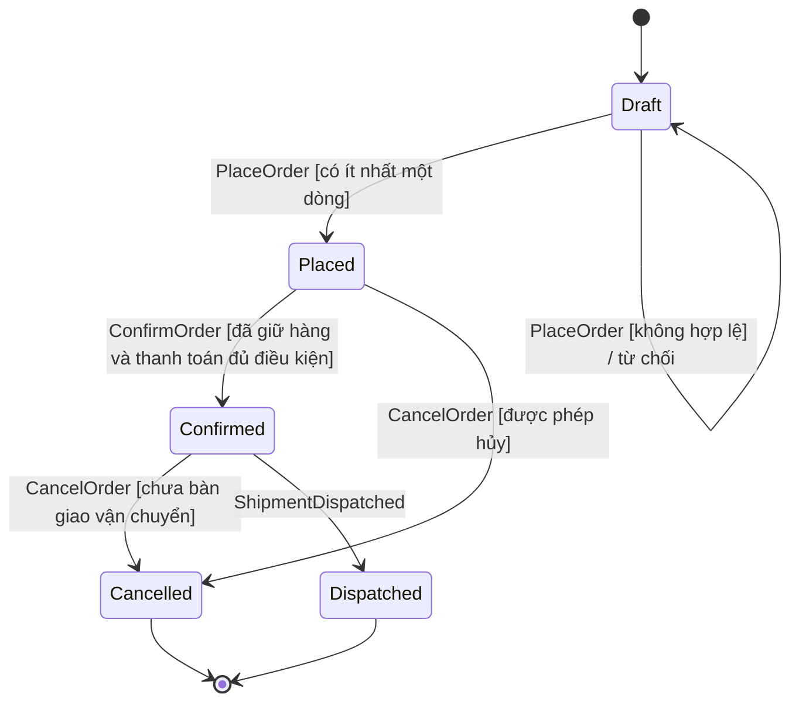
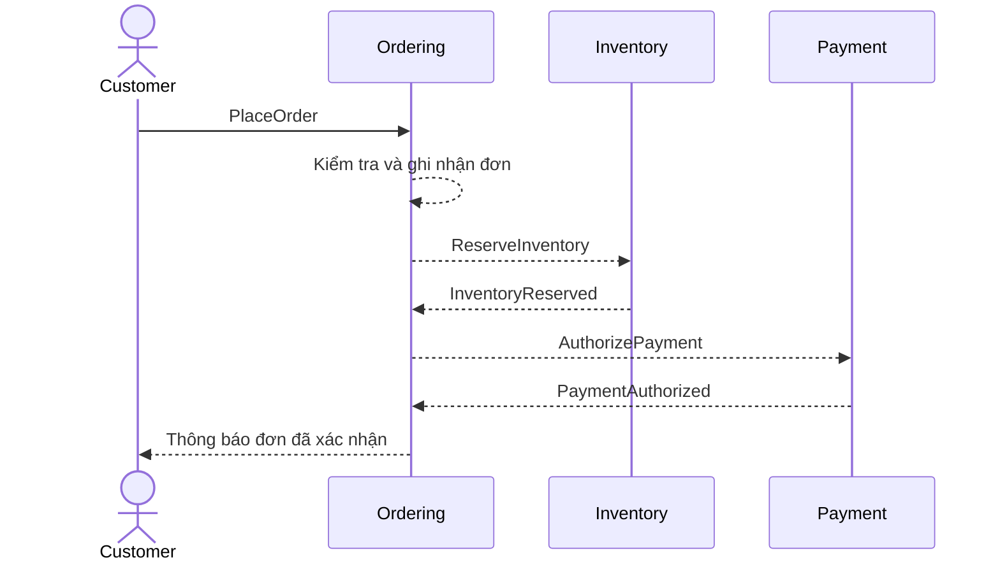
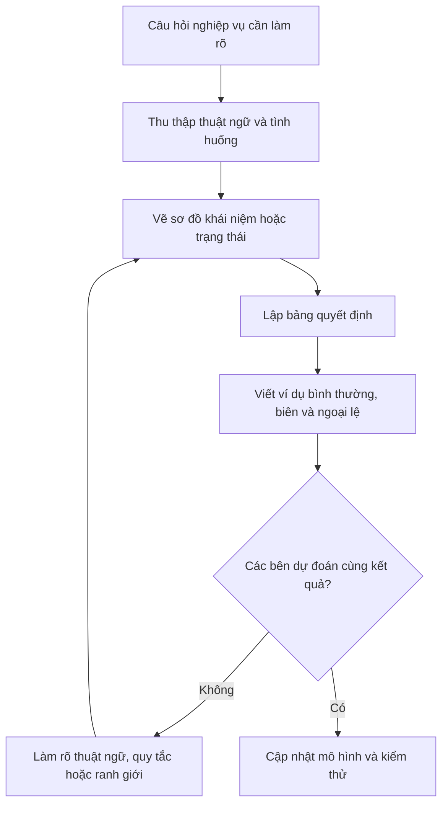
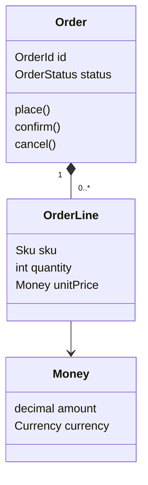

# Dùng sơ đồ, bảng quyết định và ví dụ để kiểm tra cách hiểu

Trong Domain-Driven Design (DDD), mô hình miền được hình thành qua trao đổi liên tục giữa chuyên gia nghiệp vụ và đội phát triển. Một định nghĩa nghe có vẻ rõ ràng trong cuộc họp vẫn có thể ẩn chứa nhiều cách hiểu khác nhau. Từ “đơn đã xác nhận” có thể được hiểu là khách đã gửi yêu cầu, thanh toán đã được ủy quyền hoặc kho đã giữ hàng. Nếu chỉ ghi lại thuật ngữ mà không kiểm tra bằng tình huống cụ thể, đội ngũ có thể xây dựng một mô hình nhất quán về mặt cú pháp nhưng sai với quy tắc nghiệp vụ.

Sơ đồ, bảng quyết định và ví dụ là ba công cụ giúp đưa cách hiểu từ lời nói thành những biểu diễn có thể xem xét, chất vấn và kiểm chứng. Sơ đồ cho thấy khái niệm, quan hệ, trạng thái hoặc luồng tương tác. Bảng quyết định làm rõ điều kiện và kết quả của một quy tắc. Ví dụ mô tả tình huống cụ thể để xem mô hình có đưa ra kết quả mà chuyên gia nghiệp vụ mong đợi hay không.

Các công cụ này không thay thế việc trao đổi với chuyên gia. Chúng giúp mọi người nhìn vào cùng một biểu diễn, phát hiện phần còn mơ hồ và thống nhất mô hình trước khi chi tiết kỹ thuật che khuất vấn đề nghiệp vụ.

## 1. Vì sao cần kiểm tra cách hiểu của mô hình?

Mô hình miền là một cách diễn đạt có chọn lọc về nghiệp vụ. Nó chứa những khái niệm quan trọng, mối quan hệ, hành vi, quy tắc và giới hạn mà phần mềm cần bảo vệ. Mô hình không phải bản sao đầy đủ của thế giới thực, cũng không chỉ là sơ đồ class được tạo ra từ mã nguồn.

Trong quá trình xây dựng mô hình, có một số rủi ro thường gặp:

- **Thuật ngữ chưa rõ nghĩa:** các nhóm dùng cùng một từ nhưng hiểu khác nhau hoặc dùng nhiều từ cho cùng một khái niệm.
- **Quan hệ bị giả định:** đội phát triển cho rằng một khách hàng có thể có nhiều tài khoản, trong khi nghiệp vụ chưa xác nhận quy tắc đó.
- **Quy tắc thiếu điều kiện:** “đơn được miễn phí giao hàng” chưa nói rõ giá trị đơn, khu vực, phương thức giao hay nhóm khách hàng nào đủ điều kiện.
- **Trạng thái bị gộp:** một trạng thái `CONFIRMED` có thể đang đại diện cho nhiều sự kiện khác nhau.
- **Ngoại lệ bị bỏ qua:** mô hình chỉ mô tả đường đi thành công, không giải thích trường hợp hết hàng, thanh toán thất bại hoặc khách hủy đơn.
- **Mô hình kỹ thuật lấn át nghiệp vụ:** sơ đồ có nhiều class, bảng và service nhưng không trả lời được ai quyết định điều gì và vì sao.

Kiểm tra mô hình có nghĩa là đặt ra những tình huống đủ cụ thể để xem các khái niệm và quy tắc có nhất quán hay không. Nếu hai người nhìn cùng một sơ đồ nhưng dự đoán hai kết quả khác nhau, đó là tín hiệu cần làm rõ.

## 2. Chọn công cụ biểu diễn phù hợp với câu hỏi

Không có một loại sơ đồ hoặc bảng nào trả lời được mọi câu hỏi. Hãy chọn công cụ dựa trên điều đội ngũ đang muốn kiểm tra.

| Câu hỏi cần trả lời | Công cụ phù hợp | Điều cần kiểm tra |
|---|---|---|
| Những khái niệm nghiệp vụ nào tồn tại và liên hệ ra sao? | Sơ đồ mô hình miền | Tên, danh tính, thuộc tính, quan hệ và số lượng |
| Một đối tượng có thể chuyển qua những trạng thái nào? | Sơ đồ trạng thái hoặc bảng chuyển trạng thái | Sự kiện kích hoạt, điều kiện và trạng thái kế tiếp |
| Các vai trò hoặc context phối hợp theo trình tự nào? | Sơ đồ trình tự hoặc luồng sự kiện | Trách nhiệm, thứ tự và kết quả trao đổi |
| Quy tắc phụ thuộc vào nhiều điều kiện ra sao? | Bảng quyết định | Tổ hợp điều kiện, kết quả, ưu tiên và trường hợp còn thiếu |
| Mô hình xử lý một tình huống cụ thể thế nào? | Ví dụ, kịch bản Given–When–Then | Kết quả mong đợi và ngoại lệ |

Một chủ đề có thể cần nhiều biểu diễn. Ví dụ, sơ đồ miền cho thấy `Order` có các `OrderLine`; bảng quyết định làm rõ khi nào đơn được miễn phí giao hàng; sơ đồ trạng thái mô tả khi nào đơn có thể hủy; ví dụ cụ thể xác nhận các quy tắc đó hoạt động cùng nhau.

## 3. Dùng sơ đồ để làm rõ khái niệm và quan hệ

### 3.1. Sơ đồ mô hình miền

Sơ đồ mô hình miền thể hiện các khái niệm nghiệp vụ và quan hệ giữa chúng. Ở giai đoạn khám phá, có thể dùng các hộp đơn giản thay cho UML đầy đủ. Mục tiêu là để chuyên gia nghiệp vụ xác nhận những gì tồn tại và cách chúng liên hệ.

Ví dụ trong bounded context Ordering:



Quan hệ `0..*` cho phép một đơn nháp chưa có dòng hàng. Quy tắc của hành vi `PlaceOrder` có thể yêu cầu phải có ít nhất một dòng hợp lệ trước khi đơn được ghi nhận. Đây là invariant cần kiểm tra bằng ví dụ, không nhất thiết phải biểu diễn chỉ bằng bội số tĩnh.

Sơ đồ gợi ra một số câu hỏi cần xác nhận:

- Một đơn hàng có bắt buộc phải có ít nhất một dòng hàng không?
- `OrderLine` có danh tính riêng hay chỉ tồn tại bên trong đơn hàng?
- Đơn giá của dòng hàng được chụp tại thời điểm đặt hay luôn lấy giá hiện tại từ Pricing?
- Tổng tiền được tính theo quy tắc nào và có bao gồm thuế, phí giao hàng hoặc chiết khấu không?
- Ordering cần lưu toàn bộ `Customer` hay chỉ cần một định danh khách hàng?

Đừng xem các mũi tên và bội số trên sơ đồ là sự thật đã được xác nhận. Chúng là giả thuyết của mô hình cần được kiểm tra với nghiệp vụ.

### 3.2. Phân biệt quan hệ và quyền sở hữu

Hai khái niệm có liên quan không có nghĩa là chúng phải nằm trong cùng một aggregate hoặc bounded context. Ví dụ, `Order` tham chiếu `CustomerId` không có nghĩa Ordering được phép thay đổi hồ sơ khách hàng. Sơ đồ nên giúp nhìn ra mối liên hệ, còn quyền sở hữu cần được xác nhận bằng trách nhiệm và quy tắc.

Với mỗi quan hệ, hãy hỏi:

- Quan hệ này có ý nghĩa nghiệp vụ gì?
- Một phía có thể tồn tại độc lập không?
- Phía nào tạo, thay đổi hoặc kết thúc vòng đời?
- Có cần đảm bảo hai phía thay đổi trong cùng một giao dịch không?
- Quan hệ có đi qua ranh giới bounded context không?

Nếu quan hệ chỉ phục vụ truy vấn hoặc tham chiếu, có thể dùng ID hoặc dữ liệu đã chụp thay vì kết hợp trực tiếp hai mô hình. Cách làm cụ thể phụ thuộc vào nhu cầu nhất quán và hợp đồng giữa các context.

### 3.3. Sơ đồ trạng thái

Sơ đồ trạng thái giúp kiểm tra vòng đời của một đối tượng và các điều kiện chuyển trạng thái. Nó hữu ích khi nghiệp vụ có những hành động chỉ được phép ở một số thời điểm.

Ví dụ, vòng đời đơn hàng trong Ordering có thể được mô tả như sau:



Đây là mô hình minh họa. Quy trình thật có thể có trạng thái chờ thanh toán, chờ giữ hàng, hoàn tiền hoặc giao một phần. Sơ đồ giúp chuyên gia đặt câu hỏi:

- Đơn có thể được xác nhận khi chưa có kết quả giữ hàng không?
- Đơn đã xác nhận có thể hủy không?
- Sau khi giao cho đơn vị vận chuyển, khách còn có thể yêu cầu hủy hay cần một quy trình trả hàng?
- Khi command không hợp lệ, trạng thái có giữ nguyên hay phát sinh một sự kiện từ chối?

Nếu một sơ đồ trạng thái chứa quá nhiều nhánh, có thể các vòng đời khác nhau đang bị gộp vào cùng một đối tượng hoặc cần tách rõ trạng thái nghiệp vụ với trạng thái của context khác.

### 3.4. Sơ đồ trình tự và luồng sự kiện

Sơ đồ trình tự hữu ích để làm rõ thứ tự trao đổi giữa actor, application, aggregate hoặc bounded context. Ví dụ, Ordering ghi nhận đơn rồi gửi yêu cầu giữ hàng; Inventory trả kết quả; sau đó Payment thực hiện bước tiếp theo theo chính sách đã thống nhất.



Sơ đồ này giả định Ordering điều phối quy trình. Một hệ thống khác có thể dùng Policy hoặc process manager để điều phối. Sơ đồ cần phản ánh kiến trúc và quy tắc đã chọn, đồng thời làm rõ các nhánh thất bại và cách xử lý thông điệp lặp, đến trễ.

## 4. Dùng bảng quyết định để kiểm tra quy tắc

Một quy tắc nghiệp vụ thường phụ thuộc vào nhiều điều kiện. Nếu chỉ mô tả bằng một câu dài, người đọc có thể bỏ sót trường hợp hoặc hiểu sai thứ tự ưu tiên. Bảng quyết định đưa các điều kiện và kết quả vào cùng một nơi để dễ xem xét.

### 4.1. Cấu trúc bảng quyết định

Một bảng quyết định cơ bản có:

- **Điều kiện (conditions):** những yếu tố nghiệp vụ cần kiểm tra.
- **Quy tắc (rules):** các tổ hợp giá trị của điều kiện.
- **Kết quả/hành động (actions):** điều xảy ra khi một quy tắc được thỏa mãn.
- **Giá trị không quan tâm (don't care):** điều kiện không ảnh hưởng đến kết quả của một dòng cụ thể.

Mỗi dòng cần diễn đạt một trường hợp có thể hiểu và kiểm tra. Bảng tốt giúp phát hiện dòng bị trùng, trường hợp bị bỏ sót hoặc kết quả mâu thuẫn.

### 4.2. Ví dụ: điều kiện miễn phí giao hàng

Giả sử chính sách minh họa của cửa hàng quy định khách được miễn phí giao hàng tiêu chuẩn khi đồng thời thỏa mãn ba điều kiện: địa chỉ nằm trong vùng phục vụ, tổng giá trị hàng đạt ít nhất 500.000 đồng và khách chọn phương thức giao tiêu chuẩn.

| Quy tắc | Địa chỉ thuộc vùng phục vụ? | Tổng tiền từ 500.000đ? | Chọn giao tiêu chuẩn? | Kết quả |
|---|---|---|---|---|
| R1 | Không | — | — | Không thể giao đến địa chỉ này |
| R2 | Có | Không | — | Có tính phí giao hàng |
| R3 | Có | Có | Không | Có tính phí giao hàng theo phương thức đã chọn |
| R4 | Có | Có | Có | Miễn phí giao hàng tiêu chuẩn |

Trong bảng, dấu `—` nghĩa là điều kiện đó không ảnh hưởng đến kết quả của quy tắc đang xét. Các dòng được sắp theo thứ tự ưu tiên: địa chỉ ngoài vùng phục vụ được xử lý trước; chỉ khi địa chỉ hợp lệ mới xét giá trị đơn và phương thức giao.

Bảng giúp đội ngũ xác nhận những chi tiết có thể bị bỏ qua:

- Tổng tiền được tính trước hay sau chiết khấu?
- Phí giao hàng có được tính vào ngưỡng 500.000 đồng không?
- Đơn có nhiều kiện hoặc giao từ nhiều kho thì áp dụng ngưỡng trên toàn đơn hay từng lô?
- Khách chọn giao nhanh có thể được miễn phí theo một chương trình khác không?
- Nếu địa chỉ chưa xác định được vùng phục vụ, hệ thống cần từ chối hay yêu cầu bổ sung thông tin?

Nếu chuyên gia chưa trả lời được những câu hỏi này, bảng cần ghi nhận đó là điểm chưa quyết định. Không nên tự thêm giả định vào chính sách.

### 4.3. Kiểm tra tính đầy đủ và không mâu thuẫn

Khi rà soát bảng quyết định, hãy kiểm tra:

1. **Đầy đủ:** các tổ hợp điều kiện có thể xảy ra đã được bao phủ chưa?
2. **Không chồng lấn:** một trường hợp có rơi vào nhiều dòng với kết quả khác nhau không?
3. **Nhất quán:** những trường hợp tương đương có cùng kết quả không?
4. **Ưu tiên:** nếu nhiều quy tắc có thể cùng đúng, quy tắc nào được áp dụng trước?
5. **Giá trị thiếu:** điều gì xảy ra khi dữ liệu không có, chưa biết hoặc không hợp lệ?
6. **Ngoại lệ:** có quy tắc đặc biệt cho nhóm khách, khu vực, thời gian hoặc loại sản phẩm không?

Không phải bảng nào cũng cần liệt kê toàn bộ tổ hợp theo kiểu tích Descartes. Có thể dùng dấu không quan tâm hoặc phân nhóm, nhưng phải giữ cho quy tắc rõ ràng và không tạo ra vùng kết quả mơ hồ.

### 4.4. Khi nào nên dùng bảng quyết định?

Bảng quyết định đặc biệt hữu ích với:

- Điều kiện đủ tư cách hoặc eligibility.
- Chính sách giá, chiết khấu, phí và thuế.
- Quy tắc phê duyệt theo vai trò hoặc hạn mức.
- Phân loại yêu cầu theo nhiều thuộc tính.
- Điều kiện chuyển trạng thái và xử lý ngoại lệ.
- Quy tắc phân bổ hoặc chọn phương án xử lý.

Nếu quy tắc chỉ có một điều kiện đơn giản, một câu mô tả hoặc một ví dụ có thể đã đủ. Không cần tạo bảng lớn cho mọi hành vi.

## 5. Dùng ví dụ để kiểm chứng mô hình

Ví dụ là tình huống cụ thể gồm bối cảnh, dữ liệu đầu vào, hành động và kết quả mong đợi. Ví dụ giúp kiểm tra xem các thuật ngữ và quy tắc có diễn đạt được nghiệp vụ thật hay không.

Một ví dụ tốt nên cụ thể đủ để hai người độc lập có thể dự đoán cùng một kết quả. Thay vì nói “đơn hàng hợp lệ”, hãy nêu rõ đơn có hai dòng hàng, mỗi dòng có số lượng dương, địa chỉ nằm trong vùng phục vụ và phương thức giao đã được chọn.

### 5.1. Ví dụ bình thường, biên và ngoại lệ

Khi kiểm tra một quy tắc, nên có nhiều loại ví dụ:

- **Ví dụ bình thường:** tình huống phổ biến mà quy tắc được kỳ vọng hoạt động.
- **Ví dụ biên:** giá trị nằm đúng ngưỡng hoặc tại ranh giới chuyển trạng thái.
- **Ví dụ ngoại lệ:** dữ liệu thiếu, không hợp lệ, xung đột hoặc quy trình thất bại.
- **Phản ví dụ:** tình huống gần giống ví dụ đúng nhưng phải cho kết quả khác, giúp xác định ranh giới của quy tắc.

Với chính sách miễn phí giao hàng, các ví dụ có thể là:

| Tình huống | Địa chỉ phục vụ | Tổng tiền | Phương thức | Kết quả mong đợi |
|---|---|---:|---|---|
| A | Có | 600.000đ | Tiêu chuẩn | Miễn phí |
| B | Có | 500.000đ | Tiêu chuẩn | Miễn phí, nếu ngưỡng là “từ 500.000đ” |
| C | Có | 499.000đ | Tiêu chuẩn | Có phí |
| D | Có | 600.000đ | Nhanh | Có phí theo chính sách minh họa |
| E | Không | 600.000đ | Tiêu chuẩn | Không thể giao |

Ví dụ B đặc biệt quan trọng vì nó kiểm tra cách hiểu “từ 500.000đ” so với “trên 500.000đ”. Một thay đổi nhỏ trong cách diễn đạt có thể tạo ra kết quả khác ở đúng ngưỡng.

### 5.2. Viết ví dụ theo Given–When–Then

Given–When–Then là cách diễn đạt kịch bản bằng ba phần:

- **Given:** bối cảnh hoặc trạng thái ban đầu.
- **When:** hành động hoặc sự kiện được thực hiện.
- **Then:** kết quả có thể quan sát và kiểm chứng.

Ví dụ cho quy tắc đặt đơn:

```gherkin
Scenario: Ghi nhận đơn hàng có ít nhất một dòng hợp lệ
  Given khách hàng có một giỏ hàng với một dòng sản phẩm hợp lệ
  And địa chỉ giao hàng đã được cung cấp
  When khách hàng gửi yêu cầu PlaceOrder
  Then Ordering ghi nhận đơn hàng
  And phát sinh sự kiện OrderPlaced
```

Ví dụ phản chứng:

```gherkin
Scenario: Từ chối đơn hàng không có dòng hàng
  Given khách hàng có một giỏ hàng rỗng
  When khách hàng gửi yêu cầu PlaceOrder
  Then Ordering từ chối yêu cầu
  And không phát sinh sự kiện OrderPlaced
```

Hai kịch bản giúp làm rõ “đặt đơn” là một yêu cầu và `OrderPlaced` chỉ xuất hiện khi việc ghi nhận đơn thành công. Nếu chuyên gia nghiệp vụ cho rằng đơn rỗng vẫn có thể được tạo ở trạng thái nháp, mô hình cần điều chỉnh và kịch bản cũng phải thay đổi theo.

### 5.3. Ví dụ làm lộ ra thiếu sót của mô hình

Giả sử sơ đồ miền cho thấy `Order` có `status` và phương thức `cancel()`. Một ví dụ cụ thể đặt câu hỏi: khách yêu cầu hủy sau khi hàng đã được bàn giao cho đơn vị vận chuyển. Nếu `cancel()` luôn chuyển đơn sang `CANCELLED`, mô hình đã bỏ qua sự khác biệt giữa hủy trước giao và trả hàng sau giao.

Ví dụ này có thể dẫn đến những thay đổi:

- Làm rõ trạng thái và thời điểm bàn giao vận chuyển.
- Xác định điều kiện cho phép hủy đơn.
- Tách yêu cầu trả hàng thành một khái niệm hoặc quy trình riêng nếu nghiệp vụ yêu cầu.
- Xác định trách nhiệm của Ordering, Fulfillment và Payment trong từng bước.

Như vậy, ví dụ không chỉ kiểm thử code. Nó còn giúp khám phá và cải thiện mô hình miền.

## 6. Kết hợp sơ đồ, bảng quyết định và ví dụ

Ba công cụ có vai trò bổ sung cho nhau. Một quy trình thực hành có thể bắt đầu từ khái niệm, sau đó làm rõ trạng thái và quy tắc, cuối cùng kiểm tra bằng ví dụ.

### Bước 1: Xác định câu hỏi nghiệp vụ

Chọn một hành vi hoặc quy tắc đang chưa rõ, ví dụ “khi nào một đơn được xác nhận?” hoặc “khách nào được miễn phí giao hàng?”. Viết câu hỏi cụ thể để workshop không bị lan sang những chủ đề không liên quan.

### Bước 2: Thu thập thuật ngữ và ví dụ thực tế

Yêu cầu chuyên gia mô tả các trường hợp đã xảy ra, cách xử lý hiện tại và ngoại lệ. Ghi lại từ ngữ họ sử dụng. Nếu các bên dùng cùng một từ với ý nghĩa khác nhau, giữ lại từng cách hiểu để phân tích.

### Bước 3: Vẽ sơ đồ khái niệm hoặc trạng thái

Biểu diễn các đối tượng, quan hệ hoặc vòng đời liên quan. Dùng ngôn ngữ nghiệp vụ, tránh đưa chi tiết framework hoặc database vào quá sớm. Hỏi người tham gia xem sơ đồ có phản ánh đúng đối tượng và quy tắc họ nhận biết không.

### Bước 4: Lập bảng quyết định cho quy tắc có nhiều điều kiện

Liệt kê điều kiện, kết quả và thứ tự ưu tiên. Đánh dấu giá trị không quan tâm, trường hợp chưa rõ và trường hợp có thể chồng lấn. Nhờ chuyên gia xác nhận từng dòng bằng một tình huống thực tế.

### Bước 5: Viết ví dụ bình thường và ngoại lệ

Chọn ví dụ tại ngưỡng, ví dụ thất bại và phản ví dụ. Viết Given–When–Then để người đọc có thể kiểm tra kết quả mong đợi. Nếu một ví dụ không thể được phân loại rõ ràng bằng sơ đồ và bảng, mô hình còn thiếu thông tin.

### Bước 6: Cập nhật mô hình và kiểm tra lại ngôn ngữ

Khi phát hiện khác biệt, xác định đó là vấn đề thuật ngữ, quan hệ, trạng thái, invariant hay chính sách. Cập nhật mô hình và ví dụ cùng lúc để tránh tài liệu mô tả một quy tắc trong khi code hoặc test diễn đạt quy tắc khác.

### Bước 7: Chuyển thành kiểm thử phù hợp

Những ví dụ đã thống nhất có thể trở thành unit test, domain test, acceptance test hoặc contract test tùy phạm vi. Test bảo vệ quyết định đã thống nhất; khi nghiệp vụ thay đổi, ví dụ và mô hình cần được xem xét lại cùng nhau.



## 7. Ví dụ tổng hợp: xác nhận đơn hàng

Giả sử Ordering chịu trách nhiệm quản lý vòng đời đơn hàng. Đơn chỉ được xác nhận khi đã có ít nhất một dòng hàng hợp lệ, hàng đã được giữ và điều kiện thanh toán của đơn được đáp ứng.

### 7.1. Sơ đồ khái niệm



Sơ đồ cho phép đơn nháp chưa có dòng hàng; invariant của `PlaceOrder` yêu cầu ít nhất một dòng hợp lệ khi ghi nhận đơn. Đơn giá được lưu trong dòng hàng để phản ánh giá tại thời điểm đặt; đây là quyết định cần xác nhận theo nghiệp vụ và chính sách thay đổi giá.

### 7.2. Bảng quyết định xác nhận đơn

Giả sử quy tắc minh họa là đơn chỉ được xác nhận khi có dòng hàng, tồn kho đã được giữ và thanh toán đã đạt điều kiện xác nhận.

| Quy tắc | Có dòng hàng? | Đã giữ hàng? | Thanh toán đủ điều kiện? | Kết quả |
|---|---|---|---|---|
| R1 | Không | — | — | Từ chối xác nhận |
| R2 | Có | Không | — | Chưa thể xác nhận; chờ kết quả giữ hàng |
| R3 | Có | Có | Không | Chưa thể xác nhận; chờ thanh toán hoặc xử lý thất bại |
| R4 | Có | Có | Có | Cho phép xác nhận |

Ở đây “chưa thể xác nhận” không nhất thiết là lỗi. Nó có thể là trạng thái chờ. Cần làm rõ hệ thống sẽ chờ bao lâu, có retry hay không và khi nào chuyển sang thất bại.

### 7.3. Bảng chuyển trạng thái

| Trạng thái hiện tại | Command | Điều kiện | Trạng thái tiếp theo | Event |
|---|---|---|---|---|
| `DRAFT` | `PlaceOrder` | Có ít nhất một dòng hợp lệ | `PLACED` | `OrderPlaced` |
| `PLACED` | `ConfirmOrder` | Đã giữ hàng và thanh toán đủ điều kiện | `CONFIRMED` | `OrderConfirmed` |
| `PLACED` | `ConfirmOrder` | Thiếu một điều kiện | Giữ nguyên, chờ xử lý | Không phát `OrderConfirmed` |
| `CONFIRMED` | `CancelOrder` | Chính sách cho phép hủy và chưa bàn giao vận chuyển | `CANCELLED` | `OrderCancelled` |
| `DISPATCHED` | `CancelOrder` | Đã bàn giao vận chuyển | Giữ nguyên | Từ chối hủy; xem quy trình trả hàng |

Bảng này giúp phân biệt trạng thái hiện tại, command được gửi, điều kiện bảo vệ và event kết quả. Nếu nhóm không thống nhất “thanh toán đủ điều kiện” nghĩa là đã ủy quyền hay đã thu tiền, cần quay lại làm rõ thuật ngữ trước khi hoàn thiện bảng.

### 7.4. Ví dụ kiểm tra

```gherkin
Scenario: Xác nhận đơn khi các điều kiện đã thỏa mãn
  Given đơn hàng đang ở trạng thái PLACED
  And đơn có ít nhất một dòng hàng hợp lệ
  And tồn kho đã được giữ cho toàn bộ dòng hàng
  And thanh toán đã đạt điều kiện xác nhận
  When Ordering nhận command ConfirmOrder
  Then trạng thái đơn chuyển thành CONFIRMED
  And phát sinh event OrderConfirmed

Scenario: Không xác nhận đơn khi chưa giữ đủ hàng
  Given đơn hàng đang ở trạng thái PLACED
  And một dòng hàng chưa được giữ
  And thanh toán đã đạt điều kiện xác nhận
  When Ordering nhận command ConfirmOrder
  Then trạng thái đơn vẫn là PLACED
  And không phát sinh event OrderConfirmed

Scenario: Không hủy đơn sau khi đã bàn giao vận chuyển
  Given đơn hàng đang ở trạng thái DISPATCHED
  When Ordering nhận command CancelOrder
  Then yêu cầu hủy bị từ chối
  And trạng thái đơn vẫn là DISPATCHED
```

Những ví dụ này làm rõ điều kiện và kết quả ở cả đường thành công lẫn thất bại. Chúng cũng cho thấy một số điều kiện được cung cấp bởi context khác. Ordering cần nhận kết quả đã giữ hàng và trạng thái thanh toán qua hợp đồng, nhưng vẫn chịu trách nhiệm quyết định trạng thái của chính đơn hàng.

## 8. Giữ sơ đồ và bảng dễ đọc, dễ kiểm chứng

Một biểu diễn có ích cần phục vụ cuộc trao đổi. Một số nguyên tắc giúp tránh tạo tài liệu đẹp nhưng khó dùng:

- **Một sơ đồ, một mục tiêu chính:** đừng gộp mô hình khái niệm, triển khai hạ tầng và luồng vận hành vào cùng một hình nếu người đọc không thể phân biệt.
- **Dùng tên theo ngôn ngữ chung:** thuật ngữ trong sơ đồ, bảng, ví dụ và mã nguồn nên thống nhất trong cùng bounded context.
- **Ghi rõ giả định:** nếu chưa xác nhận bội số, quyền sở hữu hoặc điều kiện, hãy đánh dấu là giả thuyết thay vì trình bày như sự thật.
- **Không lạm dụng chi tiết kỹ thuật:** chỉ thêm class, bảng, endpoint hoặc queue khi chúng cần thiết cho câu hỏi đang kiểm tra.
- **Đặt ví dụ cạnh quy tắc:** người đọc nên dễ đối chiếu dòng bảng với tình huống cụ thể.
- **Kiểm tra cả trường hợp âm:** ví dụ “không được phép” thường giúp xác định ranh giới quy tắc tốt hơn việc chỉ mô tả đường thành công.
- **Giữ phiên bản và nguồn quyết định:** khi chính sách thay đổi, ghi nhận ai xác nhận và tạo phẩm nào cần cập nhật.

## 9. Những sai lầm thường gặp

- **Vẽ sơ đồ trước khi hiểu thuật ngữ:** hình vẽ làm cho giả định trông có vẻ chắc chắn dù các khái niệm chưa được thống nhất.
- **Coi sơ đồ class là mô hình miền hoàn chỉnh:** sơ đồ có thể chỉ phản ánh cấu trúc code mà không cho thấy quy tắc nghiệp vụ.
- **Bảng quyết định thiếu trường hợp:** chỉ liệt kê đường phổ biến và bỏ qua ngưỡng, dữ liệu thiếu hoặc ngoại lệ.
- **Các dòng trong bảng chồng lấn:** một tình huống có thể khớp nhiều quy tắc nhưng cho kết quả khác nhau mà không có ưu tiên rõ.
- **Dùng từ mơ hồ trong điều kiện:** “khách tốt”, “đơn lớn”, “thanh toán hợp lệ” cần được định nghĩa bằng tiêu chí quan sát được.
- **Chỉ dùng ví dụ thành công:** mô hình không được kiểm tra với dữ liệu sai, từ chối, hủy hoặc xử lý lại.
- **Viết ví dụ không có kết quả quan sát:** Given–When–Then cần nêu kết quả cụ thể, không chỉ nhắc lại hành động.
- **Để ví dụ và mô hình lệch nhau:** code đã thay đổi nhưng bảng quyết định hoặc tài liệu vẫn mô tả chính sách cũ.
- **Nhầm kiểm thử với xác nhận nghiệp vụ:** test có thể chạy đúng theo code nhưng vẫn sai với mong muốn của doanh nghiệp nếu ví dụ ban đầu chưa được chuyên gia xác nhận.
- **Tạo quá nhiều biểu diễn trùng lặp:** nhiều sơ đồ mô tả cùng một quy tắc nhưng không có nguồn cập nhật rõ ràng sẽ nhanh chóng mâu thuẫn.

## 10. Checklist kiểm tra mô hình bằng biểu diễn

Trước khi xem một mô hình là đủ rõ để triển khai, hãy kiểm tra:

- [ ] Các khái niệm và tên gọi được chuyên gia nghiệp vụ hiểu thống nhất.
- [ ] Sơ đồ thể hiện đúng quan hệ và bội số đã được xác nhận.
- [ ] Quyền sở hữu và vòng đời của các đối tượng quan trọng đã rõ.
- [ ] Các trạng thái có ý nghĩa riêng và điều kiện chuyển trạng thái được mô tả.
- [ ] Bảng quyết định bao phủ các tổ hợp điều kiện quan trọng.
- [ ] Các dòng quyết định không mâu thuẫn hoặc chồng lấn ngoài ý muốn.
- [ ] Giá trị biên, dữ liệu thiếu và ngoại lệ đã được xem xét.
- [ ] Có ví dụ bình thường, ví dụ biên và phản ví dụ cho quy tắc quan trọng.
- [ ] Given–When–Then mô tả kết quả quan sát được.
- [ ] Những giả định chưa xác nhận được ghi lại cùng người phụ trách.
- [ ] Sơ đồ, bảng, ví dụ, test và mã nguồn dùng cùng ngôn ngữ trong bounded context.

## 11. Câu hỏi tự kiểm tra

1. Vì sao mô hình miền cần được kiểm tra bằng nhiều loại biểu diễn?
2. Sơ đồ mô hình miền giúp phát hiện những giả định nào về khái niệm và quan hệ?
3. Khi nào nên dùng sơ đồ trạng thái thay vì sơ đồ trình tự?
4. Bảng quyết định gồm những thành phần nào và giúp phát hiện trường hợp thiếu ra sao?
5. Dấu `—` trong bảng quyết định có ý nghĩa gì?
6. Vì sao cần kiểm tra cả ví dụ biên và phản ví dụ?
7. Given–When–Then giúp biến cách hiểu nghiệp vụ thành kịch bản kiểm chứng như thế nào?
8. Nếu một sơ đồ và một bảng quyết định đưa ra kết quả khác nhau, đội ngũ nên làm gì?
9. Vì sao một test chạy thành công chưa đủ chứng minh mô hình đúng nghiệp vụ?
10. Trong quy trình đặt hàng, bạn sẽ dùng sơ đồ, bảng quyết định và ví dụ nào để kiểm tra điều kiện xác nhận hoặc hủy đơn?

## Kết luận

Sơ đồ giúp mọi người nhìn thấy khái niệm, quan hệ, trạng thái và luồng phối hợp. Bảng quyết định làm rõ cách điều kiện dẫn đến kết quả. Ví dụ cụ thể kiểm tra xem mô hình có xử lý đúng tình huống bình thường, trường hợp biên và ngoại lệ hay không.

Hãy bắt đầu từ câu hỏi nghiệp vụ cần làm rõ, chọn biểu diễn phù hợp, xác nhận từng giả định với chuyên gia và cập nhật mô hình cùng các ví dụ đã thống nhất. Khi sơ đồ, bảng quyết định và kịch bản cùng diễn đạt một ngôn ngữ và một bộ quy tắc, đội ngũ có cơ sở tốt hơn để triển khai, kiểm thử và thay đổi phần mềm an toàn.
