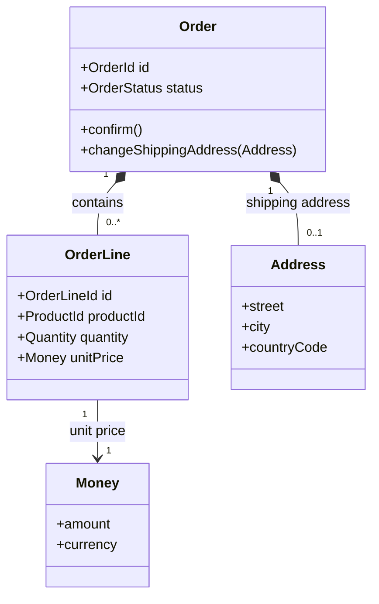
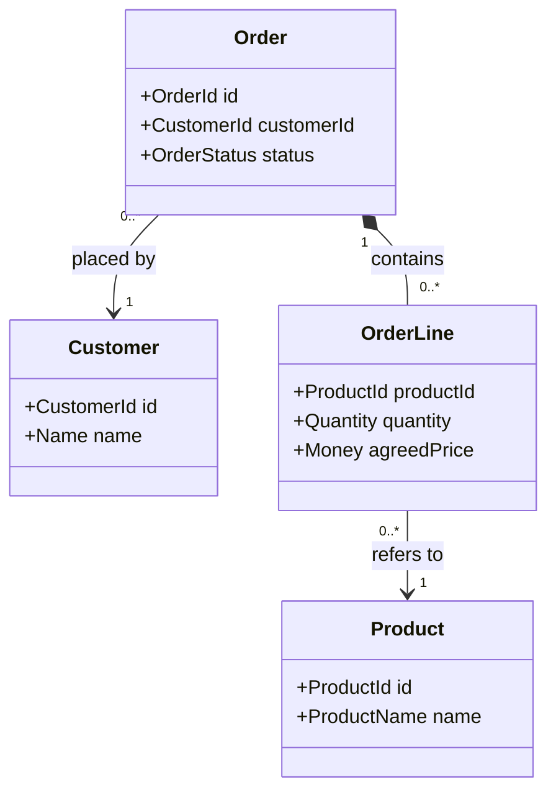

# Xác định danh tính, giá trị và quan hệ trước khi chọn cách lưu trữ

## Vì sao cần hiểu khái niệm miền trước khi thiết kế dữ liệu?

Khi bắt đầu xây dựng một hệ thống, đội phát triển thường nhìn thấy nhiều danh từ: khách hàng, đơn hàng, sản phẩm, địa chỉ, khoản tiền, dòng hàng và phương thức thanh toán. Rất dễ chuyển các danh từ này thành bảng, cột hoặc lớp dữ liệu ngay lập tức. Tuy nhiên, cùng là một danh từ, có khái niệm cần được theo dõi xuyên suốt vòng đời, có khái niệm chỉ mô tả một giá trị, và có khái niệm chỉ có ý nghĩa khi đặt trong quan hệ với khái niệm khác.

Domain-Driven Design (DDD) yêu cầu nhóm hiểu ý nghĩa nghiệp vụ trước khi chọn cách biểu diễn kỹ thuật. Một mô hình miền tốt trả lời được những câu hỏi như: điều gì làm cho một đơn hàng vẫn là đơn hàng đó sau nhiều lần thay đổi? Hai địa chỉ giống nhau có phải là cùng một đối tượng không? Một đơn hàng có thể thuộc về nhiều khách hàng không? Ai có quyền thay đổi giá đã được chốt? Những câu hỏi này liên quan đến danh tính, giá trị, vòng đời, quy tắc và quan hệ. Chúng quyết định cách mô hình hoạt động, chứ không chỉ cách dữ liệu được lưu.

Trong DDD, ba khái niệm nền tảng giúp diễn đạt các câu trả lời đó là **Entity**, **Value Object** và **Association (quan hệ)**. Nhận diện đúng ba khái niệm này giúp nhóm xây dựng mô hình phản ánh nghiệp vụ, bảo vệ các quy tắc và tạo cơ sở để xác định aggregate cũng như ranh giới lưu trữ sau này.

Sau bài học, người học có thể:

- Phân biệt entity và value object dựa trên danh tính, sự liên tục và ý nghĩa nghiệp vụ.
- Xác định thuộc tính nào tạo nên danh tính và thuộc tính nào chỉ mô tả giá trị.
- Mô tả quan hệ bằng vai trò, lực lượng (cardinality), tính tùy chọn, quyền sở hữu và vòng đời.
- Nhận diện các bất biến cần được bảo vệ khi mô hình thay đổi.
- Tránh để cấu trúc cơ sở dữ liệu hoặc ORM quyết định trước mô hình miền.

## Bắt đầu từ ý nghĩa và hành vi của khái niệm

Một danh từ xuất hiện trong yêu cầu chưa tự động trở thành entity hay value object. Hãy đặt nó vào một tình huống nghiệp vụ cụ thể và hỏi:

- Khái niệm này đại diện cho ai hoặc điều gì trong nghiệp vụ?
- Người dùng có cần phân biệt nó với những đối tượng khác cùng các thuộc tính hiện tại không?
- Nó có một vòng đời riêng và được theo dõi qua nhiều lần thay đổi không?
- Khi thuộc tính thay đổi, nghiệp vụ xem đó là cùng một đối tượng hay một giá trị mới?
- Nó có các quy tắc hoặc hành vi nào cần được bảo vệ?
- Nó có quan hệ với những khái niệm nào, và quan hệ đó có ý nghĩa gì?

Hãy dùng ví dụ thực tế và ngôn ngữ của chuyên gia nghiệp vụ. Chẳng hạn, nếu địa chỉ giao hàng thay đổi, đơn hàng có còn là đơn hàng cũ không? Có. Nếu mã định danh khách hàng thay đổi, đó là khách hàng mới hay chỉ là cập nhật thông tin? Câu trả lời tùy quy tắc miền, nhưng phải được xác nhận trước khi thiết kế.

## Entity: Khái niệm có danh tính và sự liên tục

**Entity** là đối tượng miền được phân biệt chủ yếu bằng danh tính của nó, không phải chỉ bằng tập thuộc tính tại một thời điểm. Một entity có thể thay đổi tên, địa chỉ, trạng thái hoặc các thuộc tính khác mà vẫn là cùng một entity.

Ví dụ, một đơn hàng có thể chuyển từ chờ xác nhận sang đã xác nhận, đã giao hoặc đã hủy. Địa chỉ giao hàng và trạng thái có thể thay đổi theo quy tắc nghiệp vụ, nhưng đơn hàng vẫn được nhận diện là đơn hàng đó thông qua danh tính ổn định của nó.

### Danh tính không phải là toàn bộ thuộc tính

Giả sử có hai khách hàng cùng tên, cùng ngày sinh và cùng địa chỉ. Nếu nghiệp vụ cần phân biệt hai người này, họ là hai entity khác nhau dù các thuộc tính mô tả giống nhau. Ngược lại, một khách hàng đổi địa chỉ vẫn là khách hàng cũ nếu danh tính của họ không thay đổi theo quy tắc miền.

Danh tính thường được biểu diễn bằng một định danh ổn định như `CustomerId` hoặc `OrderId`. Định danh có thể được sinh bởi hệ thống hoặc đến từ nghiệp vụ, ví dụ mã hồ sơ do tổ chức cấp. Không nên mặc định định danh miền phải là khóa tự tăng của cơ sở dữ liệu. Khóa chính vật lý là quyết định lưu trữ; định danh miền là cách nghiệp vụ phân biệt một entity.

Một entity thường có các đặc điểm sau:

- Có định danh để phân biệt với entity khác trong phạm vi mô hình.
- Có sự liên tục qua thời gian dù thuộc tính thay đổi.
- Có vòng đời hoặc trạng thái cần theo dõi.
- Có thể có hành vi làm thay đổi trạng thái theo quy tắc nghiệp vụ.
- Có các điều kiện hợp lệ cần được bảo vệ.

Không phải mọi entity đều cần nhiều hành vi phức tạp. Điều quan trọng là danh tính và vòng đời của nó có ý nghĩa đối với miền.

### So sánh entity theo danh tính

Với entity, hai tham chiếu đến cùng một định danh biểu thị cùng một entity trong phạm vi mô hình, ngay cả khi chúng được nạp ở hai thời điểm hoặc có một số thuộc tính khác nhau do cập nhật. Hai entity có cùng tên hoặc cùng thuộc tính không vì thế mà trở thành một.

Ví dụ:

| Entity | Định danh | Thuộc tính có thể thay đổi |
|---|---|---|
| Khách hàng | `CustomerId` | Tên hiển thị, địa chỉ liên hệ, trạng thái tài khoản |
| Đơn hàng | `OrderId` | Trạng thái, địa chỉ giao hàng, ghi chú theo chính sách |
| Sản phẩm trong catalog | `ProductId` hoặc mã sản phẩm miền | Tên, mô tả, trạng thái kinh doanh |
| Tài khoản | `AccountId` | Số dư, trạng thái, giới hạn giao dịch |

Định danh cần ổn định theo vòng đời mà nghiệp vụ mong đợi. Một mã có thể thay đổi theo chính sách, nhưng nếu nó là định danh duy nhất để theo dõi lịch sử thì việc thay đổi phải có quy tắc rõ ràng. Đừng chọn một thuộc tính làm định danh chỉ vì nó đang duy nhất trong dữ liệu mẫu.

### Hành vi và tính hợp lệ của entity

Entity không nên chỉ là một túi thuộc tính cho phép bất kỳ thành phần nào sửa tùy ý. Hãy đặt các hành vi liên quan đến quy tắc miền gần đối tượng có trách nhiệm bảo vệ chúng.

Ví dụ, đơn hàng chỉ được xác nhận khi có ít nhất một dòng hàng và thỏa mãn các điều kiện nghiệp vụ. Thay vì cho phép bất kỳ nơi nào gán `status = CONFIRMED`, mô hình có thể cung cấp hành vi `confirm()` và tự kiểm tra điều kiện trước khi chuyển trạng thái.

```java
import java.util.ArrayList;
import java.util.List;
import java.util.Objects;

public final class Order {
    private final OrderId id;
    private OrderStatus status;
    private final List<OrderLine> lines;

    public Order(OrderId id) {
        this.id = Objects.requireNonNull(id, "id");
        this.status = OrderStatus.DRAFT;
        this.lines = new ArrayList<>();
    }

    public void confirm() {
        if (status != OrderStatus.DRAFT) {
            throw new IllegalStateException("Order is not a draft");
        }
        if (lines.isEmpty()) {
            throw new IllegalStateException("An order needs at least one line");
        }
        status = OrderStatus.CONFIRMED;
    }
}
```

Đây là ví dụ rút gọn để minh họa nơi đặt quy tắc. Một mô hình thực tế còn cần constructor hoặc factory bảo đảm trạng thái khởi tạo hợp lệ, cách quản lý collection an toàn, xử lý lỗi miền và định nghĩa rõ điều kiện xác nhận. `IllegalStateException` trong ví dụ chỉ giúp đoạn mã ngắn gọn; ứng dụng thực tế có thể dùng kiểu lỗi miền riêng.

### Khi nào một khái niệm không cần là entity?

Không nên tạo entity chỉ vì một danh từ có nhiều thuộc tính hoặc được lưu thành một bản ghi. Nếu khái niệm không có danh tính riêng trong nghiệp vụ, không cần được theo dõi xuyên suốt và chỉ được quan tâm qua các giá trị của nó, nó có thể phù hợp hơn với Value Object.

Ví dụ, một tọa độ giao hàng có thể chỉ là cặp kinh độ và vĩ độ. Nếu hai tọa độ bằng nhau thì nghiệp vụ xem chúng là cùng một giá trị; không cần tạo `CoordinateId` để phân biệt chúng.

## Value Object: Khái niệm được xác định bằng giá trị

**Value Object** là đối tượng miền không có danh tính riêng; nó được mô tả và so sánh bằng các giá trị cấu thành. Hai value object có cùng giá trị theo quy tắc so sánh của miền được xem là tương đương, dù chúng được tạo ra ở hai thời điểm hoặc trong hai vùng nhớ khác nhau.

Ví dụ:

- `Money` gồm số tiền và đơn vị tiền tệ.
- `Address` gồm các thành phần địa chỉ có ý nghĩa trong nghiệp vụ.
- `DateRange` gồm ngày bắt đầu và ngày kết thúc.
- `Percentage` hoặc `DiscountRate` biểu diễn một tỷ lệ hợp lệ.
- `Dimensions` gồm chiều dài, chiều rộng và chiều cao theo một đơn vị xác định.

Nếu địa chỉ của khách hàng thay đổi, mô hình có thể thay value object địa chỉ cũ bằng một value object mới. Không cần giữ một danh tính riêng cho từng phiên bản địa chỉ, trừ khi nghiệp vụ cần theo dõi lịch sử địa chỉ như một khái niệm có vòng đời độc lập.

### Các đặc điểm quan trọng của Value Object

**Được xác định bằng giá trị.** Việc so sánh dựa trên những thành phần có ý nghĩa đối với miền. Hai `Money` có cùng số tiền nhưng khác tiền tệ không tương đương. Hai khoảng ngày có cùng ngày bắt đầu nhưng khác ngày kết thúc cũng không tương đương.

**Ưu tiên tính bất biến (immutability).** Sau khi tạo, value object không bị sửa từng thuộc tính tại chỗ. Khi cần thay đổi, tạo một giá trị mới và thay thế giá trị cũ. Cách này giúp giảm trạng thái chia sẻ có thể bị thay đổi ngoài ý muốn và làm quy tắc dễ kiểm soát hơn.

**Tự bảo vệ tính hợp lệ.** Value object nên kiểm tra điều kiện của chính nó khi được tạo. Ví dụ, `DateRange` phải có ngày kết thúc không sớm hơn ngày bắt đầu nếu miền cho phép khoảng một ngày; `Money` cần có đơn vị tiền tệ hợp lệ và quy tắc về độ chính xác.

**Có thể chứa hành vi.** Value object không chỉ là cấu trúc dữ liệu. `Money` có thể cung cấp phép cộng, trừ hoặc nhân với tỷ lệ, đồng thời kiểm tra tiền tệ tương thích và quy tắc làm tròn. `DateRange` có thể kiểm tra giao nhau hoặc chứa một ngày.

### Ví dụ Value Object Money

```java
import java.math.BigDecimal;
import java.util.Currency;
import java.util.Objects;

public record Money(BigDecimal amount, Currency currency) {
    public Money {
        Objects.requireNonNull(amount, "amount");
        Objects.requireNonNull(currency, "currency");
        amount = amount.stripTrailingZeros();
    }

    public Money add(Money other) {
        if (!currency.equals(other.currency)) {
            throw new IllegalArgumentException("Currencies must match");
        }
        return new Money(amount.add(other.amount), currency);
    }
}
```

Trong Java, `record` cung cấp cách biểu diễn value-based với constructor, accessor và phương thức `equals`/`hashCode` dựa trên các thành phần. Việc chuẩn hóa `BigDecimal` trong ví dụ giúp các cách biểu diễn như `10.0` và `10.00` không tạo ra khác biệt do scale khi so sánh bằng `equals`. Quy tắc làm tròn, số chữ số thập phân và giới hạn số tiền vẫn phải được xác định theo nghiệp vụ và loại tiền; không có một chính sách làm tròn chung cho mọi miền.

Ví dụ này cũng không cấm số tiền âm, vì một số miền cần biểu diễn điều chỉnh hoặc bút toán âm. Nếu một khái niệm cụ thể như `PaymentAmount` không được âm, điều kiện đó nên được thể hiện trong value object hoặc hành vi sở hữu nó theo đúng quy tắc nghiệp vụ.

### Ví dụ Value Object Address

```java
import java.util.Objects;

public record Address(
    String street,
    String district,
    String city,
    String postalCode,
    String countryCode
) {
    public Address {
        street = requireText(street, "street");
        district = requireText(district, "district");
        city = requireText(city, "city");
        postalCode = requireText(postalCode, "postalCode");
        countryCode = requireText(countryCode, "countryCode");
    }

    private static String requireText(String value, String field) {
        Objects.requireNonNull(value, field);
        if (value.isBlank()) {
            throw new IllegalArgumentException(field + " must not be blank");
        }
        return value.trim();
    }
}
```

Đây là cách mô tả đơn giản. Một hệ thống hoạt động ở nhiều quốc gia có thể cần quy tắc khác nhau về mã bưu chính, tỉnh/thành, số nhà hoặc định dạng địa chỉ. Không nên áp đặt một bộ trường cố định cho mọi địa bàn nếu nghiệp vụ không yêu cầu như vậy.

### Value Object không đồng nghĩa với DTO

DTO (Data Transfer Object) phục vụ việc truyền dữ liệu qua một ranh giới kỹ thuật, chẳng hạn request/response API hoặc thông điệp. Value Object là khái niệm trong mô hình miền, mang ý nghĩa và quy tắc nghiệp vụ. Một DTO có thể chứa dữ liệu giống value object nhưng không tự động trở thành value object. Ngược lại, một value object có thể được ánh xạ sang DTO khi trao đổi qua API.

Tương tự, một value object không nhất thiết phải được lưu trong một bảng riêng. Nó có thể được lưu bằng các cột trong bảng sở hữu, một cấu trúc nhúng, một kiểu dữ liệu chuyên biệt hoặc được tính toán khi cần. Quyết định lưu trữ không làm thay đổi bản chất miền của nó.

## Phân biệt Entity và Value Object

Hãy tập trung vào cách nghiệp vụ nhận diện và theo dõi khái niệm, không dựa vào kích thước lớp, số thuộc tính hay cách ORM ánh xạ.

| Tiêu chí | Entity | Value Object |
|---|---|---|
| Cách nhận diện | Bằng danh tính ổn định | Bằng toàn bộ giá trị có ý nghĩa |
| So sánh | Hai tham chiếu cùng định danh là cùng entity | Hai giá trị tương đương theo quy tắc so sánh là bằng nhau |
| Thay đổi thuộc tính | Có thể thay đổi mà vẫn là cùng entity | Thường tạo giá trị mới rồi thay thế giá trị cũ |
| Vòng đời | Có vòng đời cần theo dõi | Thường không có vòng đời độc lập |
| Ví dụ | Đơn hàng, tài khoản, khách hàng trong CRM | Tiền, địa chỉ, khoảng ngày, tỷ lệ |
| Câu hỏi chính | “Đây là ai/cái gì qua thời gian?” | “Giá trị này có ý nghĩa gì và có hợp lệ không?” |

Một cách kiểm tra hữu ích là thử thay đổi từng thuộc tính trong một tình huống thực tế. Nếu thay đổi địa chỉ giao hàng mà đơn hàng vẫn là đơn hàng cũ, `Order` có đặc tính entity. Nếu thay đổi một thành phần của địa chỉ làm ta có một giá trị địa chỉ mới, `Address` phù hợp với value object.

Tuy nhiên, phân loại phụ thuộc vào ngữ cảnh. Địa chỉ giao hàng trong đơn hàng có thể là value object được chụp tại thời điểm đặt hàng. Trong một hệ thống quản lý địa điểm giao nhận, một địa điểm có thể có mã định danh, lịch sử và quy trình xác minh riêng; khi đó khái niệm địa điểm có thể là entity. Cùng một từ không bắt buộc phải có cùng loại mô hình ở mọi bounded context.

## Association: Mô hình hóa quan hệ có ý nghĩa nghiệp vụ

Entity và value object hiếm khi tồn tại riêng lẻ. Chúng có quan hệ với nhau: một đơn hàng thuộc về một khách hàng, một đơn hàng có các dòng hàng, một tài khoản thuộc về một chủ tài khoản, hoặc một lịch hẹn được đặt cho một dịch vụ. **Association** mô tả mối liên hệ có ý nghĩa giữa các khái niệm trong mô hình.

Không nên xem quan hệ miền chỉ là một khóa ngoại. Khóa ngoại là cách một cơ sở dữ liệu quan hệ có thể bảo đảm tham chiếu; association còn cần diễn đạt vai trò, ý nghĩa, số lượng, tính tùy chọn, vòng đời và quy tắc thay đổi.

### Sáu câu hỏi để mô tả một quan hệ

1. **Vai trò:** Hai phía liên hệ với nhau trong vai trò gì? Ví dụ `Order` được đặt bởi `Customer`, hoặc `Order` chứa `OrderLine`.
2. **Lực lượng (cardinality):** Một phía có thể liên hệ với bao nhiêu đối tượng phía kia? Một-một, một-nhiều hay nhiều-nhiều?
3. **Tính tùy chọn:** Quan hệ có bắt buộc ngay khi tạo đối tượng không? Một đơn hàng có thể chưa có địa chỉ giao hàng ở giai đoạn nháp không?
4. **Quyền sở hữu và vòng đời:** Đối tượng nào chịu trách nhiệm tạo, thay đổi hoặc kết thúc quan hệ? Nếu đơn hàng bị hủy, dòng hàng còn tồn tại độc lập không?
5. **Hướng truy cập:** Nghiệp vụ cần đi từ phía nào sang phía nào? Có thật sự cần hai chiều hay một chiều là đủ?
6. **Quy tắc và tính nhất quán:** Quan hệ tạo ra bất biến nào? Có giới hạn số lượng, điều kiện duy nhất hoặc điều kiện trạng thái không?

Ví dụ, “một khách hàng có nhiều đơn hàng” và “một đơn hàng thuộc về một khách hàng” có thể mô tả cùng một quan hệ từ hai phía. Nhưng điều đó không có nghĩa mô hình phải giữ hai collection tham chiếu hai chiều trong bộ nhớ. Hướng truy cập cần phục vụ hành vi và quy tắc thực tế.

### Lực lượng và tính tùy chọn

Các dạng thường gặp:

| Quan hệ | Ý nghĩa | Ví dụ |
|---|---|---|
| 1–1 | Mỗi đối tượng phía này liên hệ với đúng một đối tượng phía kia | Một hồ sơ định danh chính thuộc về một tài khoản, nếu quy tắc miền bảo đảm điều đó |
| 0..1–1 | Một phía có thể chưa có đối tượng liên quan | Đơn hàng nháp có thể chưa được gán địa chỉ giao hàng |
| 1–N | Một đối tượng liên hệ với nhiều đối tượng phía kia | Một đơn hàng có một hoặc nhiều dòng hàng |
| N–N | Nhiều đối tượng ở mỗi phía có thể liên hệ với nhiều đối tượng phía kia | Nhân viên tham gia nhiều dự án và một dự án có nhiều nhân viên |

Ký hiệu `0..1`, `1`, `0..*` và `1..*` giúp diễn đạt rõ số lượng tối thiểu và tối đa. Không nên ghi “một-nhiều” rồi bỏ qua việc có cho phép không có đối tượng liên quan hay không. Điều kiện tối thiểu thường là một quy tắc nghiệp vụ quan trọng.

Quan hệ nhiều-nhiều có thể cần một khái niệm miền trung gian nếu chính mối quan hệ có thuộc tính hoặc vòng đời riêng. Ví dụ, việc nhân viên tham gia dự án có thể có vai trò, ngày bắt đầu, ngày kết thúc và tỷ lệ phân bổ. Khi đó, `ProjectAssignment` có thể là entity hoặc value object tùy việc nghiệp vụ có cần danh tính và theo dõi riêng cho lần phân công đó hay không.

### Quan hệ không đồng nghĩa với sở hữu

Một đối tượng tham chiếu đến đối tượng khác không có nghĩa nó sở hữu vòng đời của đối tượng kia. Đơn hàng có thể tham chiếu khách hàng đã đặt nó, nhưng việc hủy đơn hàng không có nghĩa khách hàng bị xóa. Ngược lại, dòng hàng thường có vòng đời gắn với đơn hàng: nếu dòng hàng bị bỏ khỏi đơn trước khi xác nhận, nó có thể không còn ý nghĩa độc lập.

Hãy phân biệt:

- **Liên kết tham chiếu:** biết hoặc cần truy cập một khái niệm khác.
- **Sở hữu vòng đời:** chịu trách nhiệm tạo, thay đổi và kết thúc đối tượng liên quan.
- **Sở hữu quy tắc:** có trách nhiệm bảo vệ điều kiện hợp lệ liên quan đến quan hệ.

Ba trách nhiệm này có thể thuộc về cùng một đối tượng, nhưng không phải lúc nào cũng vậy.

### Quan hệ một chiều và hai chiều

Chỉ tạo điều hướng hai chiều khi nghiệp vụ hoặc các hành vi trong mô hình thực sự cần. Nếu `Order` cần biết `CustomerId` để xác định người đặt, không nhất thiết `Customer` phải giữ một danh sách tất cả đơn hàng trong bộ nhớ. Danh sách đó có thể được truy vấn qua một repository hoặc read model khi cần.

Quan hệ hai chiều làm tăng số trạng thái cần đồng bộ. Nếu một phía được thêm vào collection mà phía kia không được cập nhật, mô hình có thể rơi vào trạng thái không nhất quán. Hãy ưu tiên một phía có trách nhiệm điều khiển quan hệ và cung cấp hành vi rõ ràng để thay đổi.

## Aggregate và ranh giới nhất quán của quan hệ

Khi nhiều entity và value object cần được bảo vệ bởi một nhóm quy tắc nhất quán, DDD sử dụng khái niệm **Aggregate**. Aggregate là một ranh giới nhất quán; bên ngoài truy cập nó thông qua **Aggregate Root**. Root bảo vệ các bất biến của toàn bộ aggregate.

Ví dụ, `Order` có thể là aggregate root, chứa các `OrderLine` và các value object như `Money` hoặc `Address`. Bên ngoài yêu cầu `Order` thêm dòng hàng, thay đổi địa chỉ hoặc xác nhận đơn thông qua hành vi của root. Điều này giúp bảo đảm quy tắc như “đơn đã xác nhận không được tùy tiện sửa dòng hàng” được kiểm soát tại một nơi.



Sơ đồ là một mô hình minh họa. Nó giả định `OrderLine` là entity con có định danh trong aggregate này. Đơn nháp có thể chưa có dòng hàng hoặc địa chỉ; hành vi `confirm()` kiểm tra để bảo đảm đơn có ít nhất một dòng hàng trước khi xác nhận. Các điều kiện thay đổi theo trạng thái nên được thể hiện bằng hành vi và quy tắc miền, thay vì chỉ dựa vào cardinality tĩnh trong sơ đồ.

### Khi nào nên đặt hai entity trong cùng aggregate?

Hãy hỏi liệu một quy tắc nghiệp vụ có yêu cầu cả hai đối tượng thay đổi trong cùng một giao dịch nhất quán hay không. Nếu có, chúng có thể cần nằm trong cùng aggregate. Nếu hai đối tượng có vòng đời, quyền sở hữu và quy tắc thay đổi độc lập, việc đặt chúng chung có thể làm aggregate quá lớn và tạo liên kết không cần thiết.

Không nên gộp các entity vào cùng aggregate chỉ vì chúng thường được hiển thị trên cùng màn hình hoặc cùng được lưu trong một lần thao tác. Cũng không nên tách aggregate chỉ vì chúng nằm ở hai bảng khác nhau. Ranh giới phải xuất phát từ bất biến và nhu cầu nhất quán của nghiệp vụ.

### Tham chiếu qua aggregate

Một aggregate thường tham chiếu aggregate khác bằng định danh của aggregate root thay vì giữ toàn bộ object graph. Ví dụ, `Order` có thể giữ `CustomerId` để biết người đặt, trong khi `Customer` là aggregate riêng. Điều này giúp mỗi aggregate bảo vệ bất biến của chính nó và giảm việc một thao tác vô tình sửa sâu vào mô hình khác.

Nếu một nghiệp vụ cần phối hợp nhiều aggregate, nhóm có thể dùng application service, domain event hoặc quy trình nghiệp vụ phù hợp để điều phối. Không nên cố giữ mọi thứ trong một giao dịch lớn chỉ vì muốn cập nhật nhiều đối tượng cùng lúc. Cần xác định rõ mức nhất quán mà nghiệp vụ yêu cầu.

## Ví dụ xuyên suốt: Đơn hàng, khách hàng và sản phẩm

Giả sử một cửa hàng trực tuyến cho phép khách đặt sản phẩm và giao hàng đến một địa chỉ. Một mô hình ban đầu có thể gồm:

| Khái niệm | Phân loại gợi ý | Lý do |
|---|---|---|
| `Customer` | Entity trong ngữ cảnh quản lý khách hàng | Có danh tính và hồ sơ thay đổi qua thời gian |
| `Order` | Entity và có thể là aggregate root | Có mã đơn, trạng thái và vòng đời riêng |
| `Product` | Entity trong ngữ cảnh catalog | Có danh tính sản phẩm và trạng thái kinh doanh |
| `Money` | Value Object | Ý nghĩa phụ thuộc số tiền và tiền tệ |
| `Address` | Value Object trong đơn hàng | Được chụp như thông tin giao hàng tại thời điểm đặt |
| `Quantity` | Value Object | Giá trị phải tuân theo quy tắc số lượng hợp lệ |
| `OrderLine` | Entity con hoặc Value Object tùy quy tắc | Phụ thuộc vào việc dòng hàng có danh tính và vòng đời riêng hay không |

Đây là phân loại khởi đầu để thảo luận, không phải công thức cố định cho mọi hệ thống.

### Vì sao OrderLine có thể được mô hình theo hai cách?

Nếu dòng hàng chỉ là một phần mô tả của đơn, được thay thế toàn bộ khi số lượng hoặc sản phẩm thay đổi và không được tham chiếu độc lập, nó có thể là value object. Nếu nghiệp vụ cần theo dõi một dòng hàng qua nhiều thao tác, gắn mã dòng, ghi nhận trạng thái xử lý riêng hoặc tham chiếu dòng đó từ quy trình khác, nó có thể cần danh tính và được mô hình như entity bên trong aggregate `Order`.

Điều quyết định không phải là dòng hàng có một cột `id` trong cơ sở dữ liệu hay không. Một ORM có thể tạo khóa kỹ thuật cho một value object được lưu trong collection. Hãy hỏi nghiệp vụ có cần phân biệt và theo dõi dòng hàng đó như một đối tượng riêng hay không.

### Giá tại thời điểm đặt hàng

Giá hiện tại của sản phẩm có thể thay đổi sau khi khách đã đặt hàng. Nếu đơn hàng phải giữ nguyên số tiền đã cam kết, dòng hàng nên lưu một giá trị `Money` tại thời điểm đặt hàng. Không nên mỗi lần đọc đơn lại lấy giá hiện tại từ `Product` rồi tính lại tổng tiền, trừ khi chính sách nghiệp vụ yêu cầu giá luôn được cập nhật.

Điều này cho thấy quan hệ giữa `OrderLine` và `Product` không nhất thiết có nghĩa đơn hàng phụ thuộc vào toàn bộ trạng thái hiện tại của sản phẩm. Đơn hàng có thể giữ `ProductId`, mô tả sản phẩm và giá đã chốt như một snapshot theo quy tắc miền. Cách làm này bảo vệ lịch sử giao dịch.

### Mô hình quan hệ ở mức khái niệm



Sơ đồ thể hiện ý nghĩa miền để thảo luận. Trong thiết kế aggregate, `Order` có thể chỉ lưu `CustomerId` và `ProductId`; nó không nhất thiết giữ các entity `Customer` và `Product` đầy đủ bên trong. Thông tin mô tả và giá cần cho lịch sử đơn hàng có thể được chụp thành value object hoặc dữ liệu snapshot theo quy tắc.

## Cùng một khái niệm có thể khác loại giữa các Bounded Context

DDD không yêu cầu một mô hình toàn cục duy nhất cho mọi bộ phận. Một khái niệm có thể được biểu diễn khác nhau tùy ngữ cảnh vì mục đích, quy tắc và vòng đời khác nhau.

Ví dụ, trong bounded context CRM, `Customer` có thể là entity với danh tính, lịch sử tương tác và trạng thái quan hệ. Trong bounded context Order Management, đơn hàng có thể chỉ cần `CustomerId`, tên người nhận và địa chỉ đã chụp tại thời điểm đặt. Trong báo cáo, một `CustomerSummary` có thể là read model hoặc DTO chỉ chứa dữ liệu cần hiển thị.

Không nên ép ba cách biểu diễn này thành một lớp `Customer` dùng chung toàn hệ thống. Hãy xác định ngữ cảnh, ngôn ngữ và trách nhiệm của mỗi mô hình; việc trao đổi giữa các context sẽ được thiết kế bằng hợp đồng phù hợp.

## Quy trình xác định danh tính, giá trị và quan hệ

### Bước 1: Thu thập thuật ngữ từ tình huống thực tế

Chọn một quy trình nghiệp vụ và ghi lại các khái niệm mà chuyên gia sử dụng. Thu thập ví dụ thật, các trạng thái và những trường hợp ngoại lệ. Không chuyển ngay danh sách danh từ thành entity hoặc bảng.

### Bước 2: Hỏi về danh tính và sự liên tục

Với mỗi khái niệm, hỏi liệu nghiệp vụ có cần phân biệt nó qua thời gian hay không. Khi thuộc tính thay đổi, đối tượng có còn là chính nó không? Có cần tra cứu lịch sử hoặc tham chiếu đến nó từ nơi khác không? Nếu có, tìm định danh phù hợp và xác nhận phạm vi duy nhất.

### Bước 3: Tìm các giá trị mô tả

Xác định những khái niệm được định nghĩa bằng một nhóm giá trị và không cần danh tính riêng. Ghi các điều kiện hợp lệ, quy tắc so sánh, phép tính và tính bất biến. Gom các giá trị có ý nghĩa nghiệp vụ thành value object thay vì truyền nhiều kiểu nguyên thủy rời rạc.

### Bước 4: Mô tả quan hệ

Với mỗi cặp khái niệm, đặt tên quan hệ bằng ngôn ngữ nghiệp vụ. Xác định vai trò hai phía, cardinality, tính tùy chọn, quyền sở hữu, vòng đời, hướng truy cập và các quy tắc liên quan. Hãy thử mô tả một trường hợp bình thường và một trường hợp biên.

### Bước 5: Xác định bất biến và ranh giới nhất quán

Hỏi những điều kiện nào phải luôn đúng sau mỗi hành động nghiệp vụ. Xác định entity hoặc aggregate root nào có trách nhiệm bảo vệ điều kiện đó. Nếu một quy tắc yêu cầu nhiều đối tượng thay đổi đồng thời, xem xét liệu chúng có thuộc cùng aggregate hay cần một quy trình phối hợp.

### Bước 6: Kiểm tra mô hình bằng ví dụ và phản ví dụ

Hãy thử các tình huống như đổi địa chỉ, hủy đơn, thay đổi giá, xóa dòng hàng, hợp nhất hồ sơ khách hàng hoặc thay đổi tiền tệ. Mô hình có diễn đạt được kết quả đúng theo nghiệp vụ không? Nếu phải sửa trực tiếp nhiều thuộc tính từ bên ngoài, có thể hành vi hoặc trách nhiệm chưa được đặt đúng chỗ.

### Bước 7: Sau đó mới chọn cách lưu trữ

Khi mô hình và ranh giới đã rõ, hãy quyết định cách ánh xạ entity, value object và quan hệ sang cơ sở dữ liệu hoặc kho lưu trữ. Xem xét nhu cầu truy vấn, tính nhất quán, hiệu năng, lịch sử, tích hợp và vận hành. Một entity không bắt buộc tương ứng một bảng; một value object không bắt buộc tương ứng một bảng riêng; một association không bắt buộc là một collection được nạp cùng lúc.

## Những sai lầm thường gặp

| Sai lầm | Hệ quả | Cách điều chỉnh |
|---|---|---|
| Coi mọi danh từ là entity | Mô hình có quá nhiều đối tượng và danh tính không cần thiết | Hỏi khái niệm có cần được phân biệt qua thời gian không |
| Dùng mọi thuộc tính để xác định entity | Thay đổi tên hoặc địa chỉ có thể làm mất danh tính | Dùng định danh ổn định theo quy tắc miền |
| Dùng khóa cơ sở dữ liệu làm định nghĩa miền | Mô hình bị phụ thuộc vào công nghệ lưu trữ | Phân biệt định danh miền với khóa vật lý |
| Coi value object là DTO hoặc struct dữ liệu thuần | Quy tắc hợp lệ và hành vi bị đẩy ra nơi khác | Đưa validation, equality và hành vi giá trị vào value object |
| Cho phép sửa value object tại chỗ | Trạng thái chia sẻ khó kiểm soát | Ưu tiên bất biến và thay bằng giá trị mới |
| Tạo quan hệ hai chiều ở mọi nơi | Object graph lớn và khó đồng bộ | Chỉ giữ hướng truy cập cần cho hành vi miền |
| Nhầm tham chiếu với sở hữu vòng đời | Xóa hoặc thay đổi một đối tượng gây tác động sai đến đối tượng khác | Xác định rõ vai trò, quyền sở hữu và vòng đời |
| Gộp nhiều entity vào một aggregate vì cùng màn hình | Aggregate lớn, nhiều thao tác tranh chấp và phụ thuộc | Đặt ranh giới theo bất biến và nhất quán nghiệp vụ |
| Thiết kế mô hình theo bảng hoặc ORM trước | Cấu trúc dữ liệu chi phối ngôn ngữ và quy tắc miền | Khám phá khái niệm và hành vi trước, ánh xạ lưu trữ sau |

## Checklist rà soát mô hình ban đầu

Trước khi chuyển mô hình sang thiết kế lưu trữ, hãy kiểm tra:

- [ ] Mỗi entity có lý do nghiệp vụ rõ ràng để tồn tại như một đối tượng có danh tính.
- [ ] Định danh entity ổn định và có phạm vi duy nhất được xác định.
- [ ] Các value object được so sánh bằng những giá trị có ý nghĩa và có điều kiện hợp lệ rõ ràng.
- [ ] Value object ưu tiên bất biến và không bị dùng như entity chỉ vì được lưu riêng.
- [ ] Mỗi quan hệ có tên và vai trò rõ ràng trong ngôn ngữ miền.
- [ ] Cardinality và tính tùy chọn được xác nhận bằng tình huống thực tế.
- [ ] Quyền sở hữu và vòng đời của các đối tượng liên quan được phân biệt.
- [ ] Hướng truy cập một chiều hoặc hai chiều có lý do từ hành vi miền.
- [ ] Các bất biến và ranh giới nhất quán đã được xác định.
- [ ] Ranh giới aggregate không được chọn chỉ theo cấu trúc bảng hoặc giao diện.
- [ ] Mô hình đã được kiểm tra bằng ví dụ, ngoại lệ và phản ví dụ.
- [ ] Các quyết định lưu trữ được đưa ra sau khi ý nghĩa miền đã rõ.

## Kết luận

Xác định danh tính, giá trị và quan hệ là bước quan trọng để chuyển hiểu biết nghiệp vụ thành mô hình miền có ý nghĩa. Entity giúp theo dõi những đối tượng có danh tính và sự liên tục; Value Object diễn đạt những giá trị được xác định bằng các thành phần và quy tắc của chúng; Association mô tả cách các khái niệm liên hệ, sở hữu và phối hợp. Khi mô hình đã làm rõ vòng đời, bất biến và ranh giới nhất quán, nhóm mới có cơ sở vững chắc để xác định aggregate và lựa chọn cách lưu trữ phù hợp.
