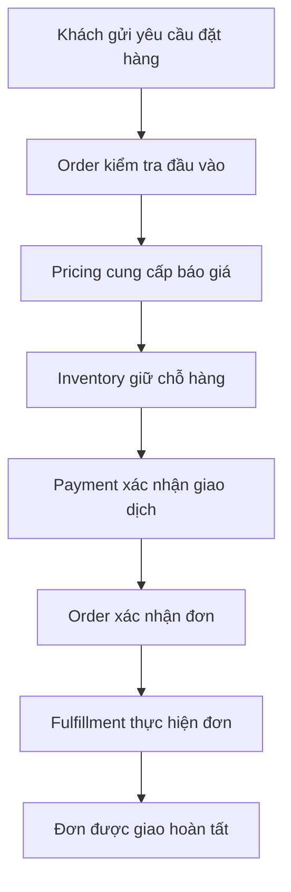
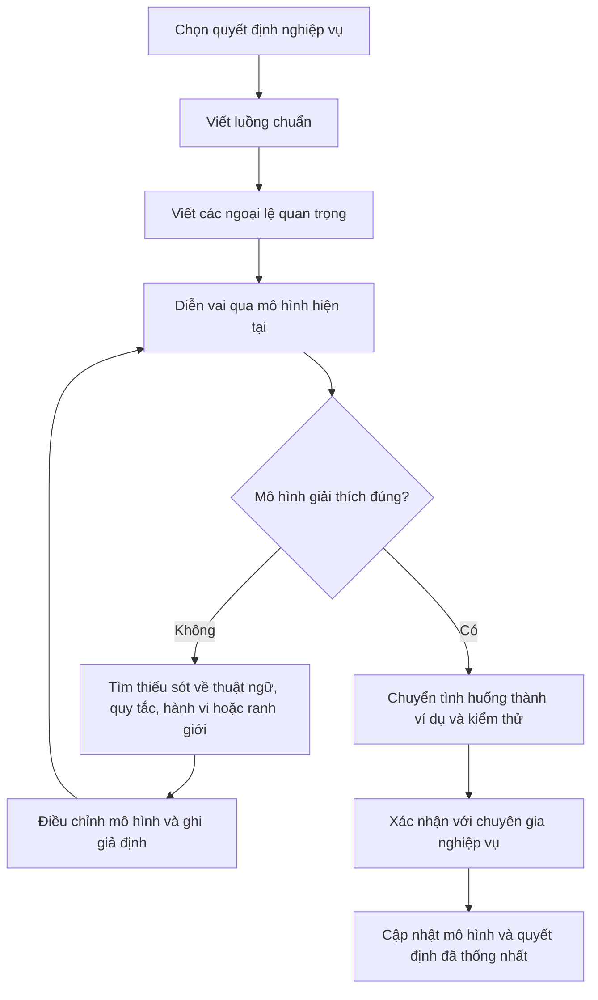

# Đối chiếu mô hình với cả luồng chuẩn và tình huống ngoại lệ

Một mô hình miền có thể trông rất hợp lý khi chỉ xem qua các entity, thuộc tính và sơ đồ trạng thái. Nhưng mô hình chỉ thực sự hữu ích khi nó giải thích được cách nghiệp vụ vận hành trong những tình huống cụ thể. Nếu mô hình chỉ mô tả con đường thuận lợi nhất, nó có thể bỏ sót các quyết định quan trọng: khi thiếu hàng thì ai quyết định, khi thanh toán bị từ chối thì đơn hàng ở trạng thái nào, khi yêu cầu bị gửi hai lần thì xử lý ra sao, và khi một kết quả đến muộn thì hệ thống phải làm gì.

Trong Domain-Driven Design (DDD), đối chiếu mô hình với **luồng chuẩn** và **tình huống ngoại lệ** là cách kiểm chứng xem ngôn ngữ, quy tắc, vòng đời và ranh giới trách nhiệm đã phản ánh đúng nghiệp vụ chưa. Luồng chuẩn cho thấy mô hình hỗ trợ hành trình thông thường như thế nào. Ngoại lệ làm lộ các điều kiện biên, quyền quyết định, bất biến và cách phục hồi mà luồng chuẩn thường không bộc lộ.

Bài này sử dụng quy trình xử lý đơn hàng bán lẻ làm ví dụ xuyên suốt. Mục tiêu là hướng dẫn cách chọn tình huống, lần theo hành vi qua mô hình, nhận ra phần còn thiếu, cập nhật thiết kế và chuyển các phát hiện thành kiểm thử có thể lặp lại. Nội dung liên hệ các khái niệm tactical design của `DOMAIN_DRIVEN_DESIGN` như entity, value object, aggregate, repository và domain event, đồng thời chú ý đến các ranh giới giữa bounded context.

## 1. Vì sao phải kiểm chứng mô hình bằng tình huống?

### 1.1. Mô hình không chỉ là cấu trúc dữ liệu

Một mô hình miền cần diễn tả ít nhất những thành phần sau:

- **Khái niệm:** các đối tượng và giá trị mà chuyên gia nghiệp vụ sử dụng, chẳng hạn Đơn hàng, Dòng hàng, Báo giá, Khoản thanh toán.
- **Quan hệ:** các khái niệm liên quan với nhau như thế nào và thuộc phạm vi trách nhiệm nào.
- **Quy tắc và bất biến:** điều gì phải luôn đúng, điều kiện nào cho phép một hành động và ai có quyền thực hiện.
- **Hành vi và vòng đời:** đối tượng được tạo, thay đổi, chuyển trạng thái hoặc kết thúc ra sao.
- **Sự kiện:** điều gì đã xảy ra và có ý nghĩa đối với các phần khác của nghiệp vụ.
- **Ranh giới:** mô hình nào sở hữu quyết định và dữ liệu nào được trao đổi với bounded context khác.

Một sơ đồ class có thể chứa `Order`, `OrderLine`, `Payment` và `Shipment`, nhưng chưa trả lời được liệu đơn hàng có được xác nhận khi thanh toán chưa thành công hay không. Một enum có `Pending`, `Confirmed`, `Cancelled` cũng chưa nói ai được chuyển trạng thái, điều kiện nào được áp dụng và cần xử lý gì khi đơn đã được giao một phần.

Vì vậy, đừng chỉ hỏi “mô hình có đủ class chưa?”. Hãy hỏi: **Khi một người dùng thực hiện hành động trong một tình huống cụ thể, mô hình có thể giải thích kết quả hợp lệ và bảo vệ quy tắc nghiệp vụ không?**

### 1.2. Luồng chuẩn cho biết mô hình hỗ trợ giá trị chính

**Luồng chuẩn (happy path hoặc main success scenario)** là chuỗi hành động và kết quả diễn ra khi các điều kiện dự kiến đều được đáp ứng. Ví dụ với đơn hàng bán lẻ:

1. Khách chọn sản phẩm và gửi yêu cầu đặt hàng.
2. Hệ thống kiểm tra mặt hàng và tạo báo giá còn hiệu lực.
3. Kho giữ chỗ đủ số lượng cần bán.
4. Thanh toán được xác nhận thành công.
5. Đơn hàng được xác nhận và chuyển sang hoàn tất đơn hàng.
6. Hàng được giao và đơn hàng hoàn tất.

Luồng này giúp kiểm tra xem mô hình có thể hỗ trợ hành trình tạo ra giá trị chính hay không. Nó cho thấy các khái niệm trung tâm, các hành vi quan trọng và những sự kiện mà context khác cần biết.

### 1.3. Ngoại lệ cho biết mô hình chịu được thực tế đến đâu

**Tình huống ngoại lệ** là tình huống mà một điều kiện, nguồn lực, hành động hoặc kết quả khác với luồng dự kiến. Ngoại lệ có thể làm quy trình dừng, chuyển sang nhánh khác, cần con người quyết định hoặc phải phục hồi một phần công việc đã thực hiện.

Ví dụ:

- Một mặt hàng không đủ số lượng để giữ chỗ.
- Thanh toán bị từ chối.
- Báo giá hết hạn trước khi khách xác nhận.
- Khách gửi cùng một yêu cầu đặt hàng nhiều lần.
- Kho đã giữ chỗ nhưng phản hồi bị timeout.
- Khách hủy đơn sau khi hàng đã được bàn giao cho đơn vị vận chuyển.
- Chỉ một phần dòng hàng có thể được giao.

Những tình huống này không phải các chi tiết phụ. Chúng có thể làm lộ quy tắc phân quyền, giới hạn vòng đời, cách xử lý trạng thái không chắc chắn, hoặc nhu cầu tách mô hình thành nhiều bounded context.

## 2. Chuẩn bị tình huống để kiểm chứng mô hình

### 2.1. Bắt đầu từ quyết định nghiệp vụ

Không cần mô phỏng mọi khả năng có thể xảy ra ngay từ đầu. Hãy chọn các quyết định có ảnh hưởng đến khách hàng, tiền, hàng hóa, nghĩa vụ hoặc tính nhất quán dữ liệu.

Với quy trình đơn hàng, các câu hỏi có thể là:

- Khi nào một yêu cầu mua hàng trở thành đơn hàng được xác nhận?
- Điều kiện nào cho phép giữ chỗ hàng?
- Khi nào một báo giá được xem là còn hiệu lực?
- Điều gì được coi là thanh toán thành công?
- Khách có thể hủy đơn ở những thời điểm nào?
- Khi giao một phần, đơn hàng và số tiền phải được thể hiện ra sao?
- Ai có quyền chấp thuận một ngoại lệ?

Mỗi câu hỏi nên gắn với một vai trò, một thời điểm và một kết quả có thể quan sát. Nếu câu hỏi còn mơ hồ, hãy làm rõ bằng hồ sơ thật hoặc ví dụ cụ thể với chuyên gia nghiệp vụ.

### 2.2. Chọn tập tình huống có độ bao phủ tốt

Một tập tình huống ban đầu nên bao gồm:

| Nhóm | Mục đích | Ví dụ với đơn hàng |
|---|---|---|
| Luồng chuẩn | Kiểm tra hành trình giá trị chính | Đủ hàng, báo giá còn hạn, thanh toán thành công và giao đủ |
| Điều kiện không đạt | Kiểm tra quy tắc từ chối hoặc yêu cầu bổ sung | Không đủ hàng, báo giá hết hạn, thanh toán bị từ chối |
| Chuyển trạng thái muộn | Kiểm tra hành vi khi kết quả đến không đúng thời điểm dự kiến | Kết quả giữ chỗ đến sau khi khách đã hủy |
| Gửi lặp hoặc sai thứ tự | Kiểm tra tính idempotent và khả năng xử lý sự kiện | Cùng yêu cầu được gửi hai lần, sự kiện giao hàng đến trùng |
| Thành công một phần | Kiểm tra mô hình có biểu diễn kết quả không đồng nhất | Một dòng hàng được giao, dòng khác còn thiếu |
| Ghi đè hoặc phê duyệt | Kiểm tra quyền hạn và dấu vết quyết định | Quản lý chấp thuận ngoại lệ sau khi xem bằng chứng |
| Lỗi kỹ thuật | Kiểm tra phục hồi và trạng thái chưa xác định | Timeout sau khi yêu cầu giữ chỗ đã được xử lý |

Ưu tiên tình huống có xác suất xảy ra cao, tác động lớn hoặc dễ làm lộ giả định sai. Không nên biến mọi tổ hợp dữ liệu thành một kịch bản riêng; hãy nhóm các trường hợp có cùng quy tắc và chỉ tách khi kết quả hoặc trách nhiệm khác nhau.

### 2.3. Ghi tình huống theo cấu trúc rõ ràng

Một tình huống có thể được ghi theo mẫu:

```text
Tên: Thanh toán bị từ chối sau khi kho đã giữ chỗ
Vai trò: Khách hàng và hệ thống xử lý đơn
Điều kiện ban đầu:
  - Báo giá còn hiệu lực
  - Kho đã giữ chỗ đủ số lượng
Hành động:
  - Khách xác nhận thanh toán
Kết quả quan sát:
  - Nhà cung cấp thanh toán trả về Declined
Quy tắc cần xác minh:
  - Đơn chưa được xác nhận
  - Reservation cần được giải phóng theo chính sách
Câu hỏi mở:
  - Nếu kết quả thanh toán đến muộn thì xử lý thế nào?
```

Ghi rõ điều kiện ban đầu, hành động, kết quả và quy tắc cần xác minh. Điều này giúp chuyên gia nghiệp vụ và đội phát triển thảo luận cùng một tình huống thay vì dùng các mô tả chung chung như “đơn bị lỗi”.

## 3. Lần theo luồng chuẩn qua mô hình

Giả sử khách đặt hai sản phẩm, báo giá còn hiệu lực, kho có đủ hàng và thanh toán thành công. Hãy lần theo từng bước và xác định mô hình nào chịu trách nhiệm.

### 3.1. Tiếp nhận yêu cầu đặt hàng

Khách gửi các dòng hàng, số lượng, thông tin giao nhận và thông tin cần thiết để báo giá. Mô hình cần phân biệt yêu cầu đầu vào với đơn hàng đã được xác nhận. Một yêu cầu có thể chưa đủ điều kiện trở thành cam kết bán hàng.

Các câu hỏi cần làm rõ:

- Có thể tạo đơn khi chưa xác định giá cuối cùng không?
- Số lượng phải là số nguyên hay có thể dùng đơn vị đo lẻ?
- Mỗi lần gửi có một mã yêu cầu duy nhất để chống tạo đơn trùng không?
- Thông tin giao nhận nào được chốt vào đơn và thông tin nào có thể thay đổi sau đó?

Một mô hình ứng viên có thể dùng `OrderRequest` hoặc `DraftOrder` cho giai đoạn chưa xác nhận, và `Order` cho cam kết đã được tạo. Không nhất thiết phải có hai entity riêng; quyết định phụ thuộc vào vòng đời và quy tắc thực tế. Điều quan trọng là không nhầm một yêu cầu chưa được chấp thuận với một đơn hàng đã có hiệu lực.

### 3.2. Xác định giá và điều kiện áp dụng

Pricing có thể trả về một `PriceQuote` gồm các dòng giá, ưu đãi, đơn vị tiền tệ và thời hạn hiệu lực. Sales / Order sử dụng báo giá theo hợp đồng đã thống nhất.

Mô hình cần trả lời:

- Giá được chốt tại thời điểm tạo báo giá hay khi xác nhận đơn?
- Báo giá hết hạn có thể được gia hạn không?
- Khi khuyến mại thay đổi, đơn đã xác nhận có bị tính lại không?
- Đơn hàng lưu giá trị nào để bảo đảm lịch sử giao dịch?

`Money`, `Currency`, `Quantity` và `PriceQuoteId` có thể là value object hoặc kiểu giá trị trong mô hình. `PriceQuote` có thể thuộc Pricing context; Order lưu ảnh chụp các giá trị đã được chấp thuận theo hợp đồng, thay vì tự tính lại chính sách khuyến mại của Pricing.

### 3.3. Giữ chỗ hàng

Inventory kiểm tra khả năng phân bổ và tạo reservation. Order nhận kết quả và quyết định bước tiếp theo.

Hãy làm rõ bất biến: tổng lượng được giữ chỗ cho một SKU tại một kho không vượt quá lượng có thể phân bổ theo chính sách của Inventory. Bất biến này thuộc Inventory, không nên bị phụ thuộc vào phép kiểm tra ở giao diện Order.

Order có thể lưu `ReservationId` và thời hạn giữ chỗ. Nó không cần sở hữu toàn bộ số lượng tồn kho hoặc quy tắc phân bổ kho.

### 3.4. Xác nhận thanh toán

Payment nhận yêu cầu thu tiền hoặc ủy quyền thanh toán. Cần làm rõ `Authorized`, `Captured`, `Declined`, `Refunded` có ý nghĩa gì và hành động nào được phép tiếp theo.

Một khoản thanh toán được ủy quyền chưa chắc đồng nghĩa tiền đã được thu. Nếu nghiệp vụ coi hai trạng thái này khác nhau, mô hình không nên gộp chúng thành `Paid`.

### 3.5. Xác nhận đơn và phát hành yêu cầu hoàn tất

Khi các điều kiện bắt buộc đã đạt, Order chuyển sang trạng thái đã xác nhận và phát ra sự kiện phù hợp, ví dụ `OrderConfirmed`. Fulfillment sử dụng thông tin được công bố để bắt đầu lấy hàng, đóng gói và giao.

Đơn hàng nên lưu các dữ kiện cần thiết để bảo vệ cam kết với khách, chẳng hạn dòng hàng, số lượng, giá đã chốt và thông tin giao nhận theo chính sách. Fulfillment sở hữu các quy tắc thực hiện giao hàng; Order không cần mô hình hóa chi tiết tuyến đường hoặc lịch làm việc của nhân viên kho.

### 3.6. Sơ đồ luồng chuẩn



Sơ đồ chỉ là luồng thành công. Khi đối chiếu mô hình, cần lần theo dữ liệu và sự kiện ở từng ranh giới, xác định context sở hữu quyết định và điều gì xảy ra nếu một bước không đạt.

## 4. Đối chiếu các tình huống ngoại lệ

### 4.1. Không đủ hàng

**Tình huống:** Khách yêu cầu hai sản phẩm nhưng Inventory chỉ có thể giữ chỗ một sản phẩm.

**Câu hỏi nghiệp vụ:**

- Có cho phép giao một phần không?
- Có thể đề xuất kho khác hoặc thời điểm giao khác không?
- Khách phải xác nhận lại trước khi đơn được thay đổi không?
- Reservation đã tạo một phần có cần giải phóng nếu toàn bộ yêu cầu bị từ chối không?

**Điều cần kiểm tra trong mô hình:**

- `Reservation` có thể biểu diễn kết quả theo từng dòng hàng hay chỉ có một trạng thái chung?
- Order có phân biệt số lượng yêu cầu, số lượng được giữ và số lượng còn thiếu không?
- Quy tắc phân bổ thuộc Inventory hay bị sao chép sang Order?
- Sự kiện được công bố là `ReservationRejected`, `ReservationPartiallyFulfilled` hay một kết quả khác đã được nghiệp vụ xác nhận?

Nếu nghiệp vụ không cho phép giao một phần, mô hình cần từ chối hoặc yêu cầu khách chọn phương án khác. Không nên tự động chuyển một phần hàng thành đơn đã xác nhận khi chưa có quy tắc.

### 4.2. Báo giá hết hạn

**Tình huống:** Khách mở trang thanh toán quá lâu; khi xác nhận, báo giá đã hết hiệu lực.

**Câu hỏi nghiệp vụ:**

- Có tạo báo giá mới tự động không?
- Nếu giá thay đổi, khách có phải chấp thuận lại không?
- Reservation đã giữ chỗ có còn hiệu lực trong lúc lấy báo giá mới không?
- Mốc hết hạn dựa trên thời gian của context nào và múi giờ nào?

**Điều cần kiểm tra trong mô hình:**

- `PriceQuote` có `ValidUntil` và hành vi `IsValidAt` hay không?
- Order có lưu phiên bản hoặc ID báo giá được chấp thuận không?
- Hành động xác nhận có kiểm tra lại hiệu lực tại thời điểm quyết định không?
- Có thể phân biệt `QuoteExpired` với lỗi kết nối Pricing không?

Một báo giá hết hạn là kết quả nghiệp vụ, không phải lỗi máy chủ. Mô hình nên cho phép quy trình yêu cầu báo giá mới và xin khách xác nhận nếu giá hoặc điều kiện thay đổi.

### 4.3. Thanh toán bị từ chối

**Tình huống:** Inventory đã giữ chỗ hàng, nhưng Payment trả về kết quả từ chối.

**Câu hỏi nghiệp vụ:**

- Đơn có được giữ ở trạng thái chờ thanh toán để khách thử lại không?
- Reservation còn hiệu lực bao lâu?
- Khi hết hạn, ai giải phóng hàng?
- Có giới hạn số lần thử thanh toán không?
- Nếu khách đổi phương thức thanh toán, báo giá có cần kiểm tra lại không?

**Điều cần kiểm tra trong mô hình:**

- Order có trạng thái `AwaitingPayment` hoặc trạng thái tương đương được nghiệp vụ xác nhận không?
- Payment có sở hữu trạng thái giao dịch và lý do từ chối không?
- Order có theo dõi ID giao dịch và số lần thử mà không sao chép toàn bộ mô hình Payment không?
- Việc giải phóng reservation được thực hiện qua một hành động có thể truy vết không?

Không nên gộp mọi kết quả từ chối thành một lỗi chung. Một số kết quả cho phép thử lại; một số cần khách đổi phương thức hoặc liên hệ đơn vị thanh toán. Quy tắc cụ thể phải đến từ nghiệp vụ và hợp đồng Payment.

### 4.4. Timeout sau khi gửi yêu cầu giữ chỗ

**Tình huống:** Order gửi yêu cầu giữ chỗ đến Inventory nhưng không nhận được phản hồi vì timeout. Inventory có thể đã xử lý thành công trước khi kết nối bị gián đoạn.

Đây là tình huống quan trọng vì **không nhận được phản hồi không đồng nghĩa thao tác thất bại**.

**Câu hỏi cần trả lời:**

- Order có mã yêu cầu duy nhất để truy vấn kết quả không?
- Inventory có bảo đảm xử lý idempotent khi nhận lại cùng yêu cầu không?
- Order có thể tra cứu reservation bằng `reservationRequestId` không?
- Nếu chưa xác định được kết quả, đơn có ở trạng thái chờ xác minh không?

**Điều cần kiểm tra trong mô hình:**

- Có phân biệt `ReservationPending`, `ReservationConfirmed` và `ReservationRejected` không?
- Có lưu mã yêu cầu và kết quả đã biết để chống tạo thao tác trùng không?
- Retry có an toàn không, hay có thể giữ chỗ hai lần?
- Ai chịu trách nhiệm đối soát khi kết quả không thể xác định ngay?

Timeout và lỗi mạng thuộc cơ chế kỹ thuật, nhưng trạng thái chưa xác định có ảnh hưởng đến quyết định nghiệp vụ. Mô hình ứng dụng cần bảo vệ trạng thái chờ và không vội khẳng định đơn thất bại.

### 4.5. Khách hủy đơn sau khi hàng đã được giao cho vận chuyển

**Tình huống:** Khách yêu cầu hủy khi Fulfillment đã bàn giao hàng cho đơn vị vận chuyển.

**Câu hỏi nghiệp vụ:**

- Hủy đơn còn được phép ở thời điểm này không?
- Có thể yêu cầu chặn giao hàng không?
- Nếu không thể chặn, quy trình đổi trả hoặc từ chối nhận hàng là gì?
- Ai quyết định hoàn tiền và phí phát sinh thuộc bên nào?

**Điều cần kiểm tra trong mô hình:**

- Order có giới hạn hành vi `Cancel` theo trạng thái và quyền hạn không?
- Fulfillment có thể từ chối yêu cầu hủy khi kiện hàng đã bàn giao không?
- Hành động hủy có phải là yêu cầu phối hợp thay vì chuyển trạng thái ngay lập tức không?
- Mô hình có phân biệt `CancellationRequested`, `CancellationAccepted` và `CancellationRejected` nếu nghiệp vụ cần không?

Một nút “Hủy đơn” trên giao diện không có nghĩa mọi đơn hàng đều có thể hủy tức thời. Mô hình cần phản ánh thời điểm, trạng thái thực hiện và cam kết đã phát sinh.

### 4.6. Chỉ giao được một phần

**Tình huống:** Đơn có ba dòng hàng; hai dòng đã giao, một dòng thiếu hàng hoặc giao thất bại.

**Câu hỏi nghiệp vụ:**

- Đơn được xem là hoàn tất khi nào?
- Có thể giao nhiều đợt không?
- Khách thanh toán một lần hay theo từng đợt?
- Phần chưa giao được giữ, hủy hay hoàn tiền?

**Điều cần kiểm tra trong mô hình:**

- Order có một trạng thái tổng thể nhưng vẫn giữ trạng thái thực hiện theo từng dòng hoặc từng shipment không?
- Fulfillment có thể phát nhiều kết quả cho một Order không?
- Payment và Refund có thể xử lý một phần số tiền không?
- Sự kiện `OrderCompleted` chỉ được phát khi điều kiện hoàn tất theo chính sách đã đạt chưa?

Nếu nghiệp vụ cho phép giao nhiều đợt, một trạng thái `Shipped` duy nhất có thể không đủ. Mô hình cần phân biệt trạng thái đơn, trạng thái từng dòng và các lần thực hiện giao hàng.

### 4.7. Yêu cầu gửi trùng hoặc sự kiện đến nhiều lần

**Tình huống:** Khách nhấn nút đặt hàng nhiều lần do trang phản hồi chậm, hoặc một message `PaymentCaptured` được giao lại.

**Câu hỏi cần trả lời:**

- Hai yêu cầu có cùng mã idempotency hay được xem là hai đơn riêng?
- Cùng một sự kiện có thể được xử lý lại mà không tạo thêm hiệu ứng không?
- Hệ thống lưu dấu vết xử lý và phát hiện trùng ở đâu?
- Nếu hai yêu cầu đến đồng thời, bất biến nào phải được bảo vệ?

**Điều cần kiểm tra trong mô hình:**

- Có định danh nghiệp vụ phù hợp cho yêu cầu và giao dịch không?
- Hành vi xác nhận hoặc ghi nhận thanh toán có bảo đảm không tạo hiệu ứng lặp không?
- Aggregate có bảo vệ được bất biến khi hai lệnh cập nhật đồng thời không?
- Consumer có lưu event ID hoặc cơ chế chống xử lý trùng không?

Idempotency là yêu cầu hành vi ở ranh giới tích hợp và ứng dụng. Không nên giải quyết bằng cách chỉ ẩn nút trên giao diện, vì yêu cầu có thể được gửi lại từ mạng, thiết bị hoặc message broker.

### 4.8. Bảng tổng hợp tình huống và điều cần xác minh

| Tình huống | Kết quả nghiệp vụ có thể có | Phần mô hình cần kiểm tra |
|---|---|---|
| Đủ hàng, thanh toán thành công | Đơn được xác nhận | Điều kiện xác nhận và bất biến Order |
| Không đủ hàng | Từ chối, đề xuất thay thế hoặc giao một phần | Reservation, số lượng theo dòng, chính sách phân bổ |
| Báo giá hết hạn | Yêu cầu báo giá và xác nhận lại | PriceQuote, thời hạn và phiên bản giá |
| Thanh toán bị từ chối | Chờ thử lại hoặc kết thúc theo chính sách | Payment status, Order status, thời hạn giữ chỗ |
| Timeout khi giữ chỗ | Chờ xác minh kết quả | Idempotency, truy vấn trạng thái, reservation request |
| Hủy sau khi bàn giao | Từ chối hủy hoặc chuyển quy trình trả hàng | Vòng đời Order, Fulfillment và Return |
| Giao một phần | Đơn còn mở hoặc hoàn tất theo điều kiện | Order line, Shipment, Partial fulfillment |
| Yêu cầu hoặc sự kiện trùng | Chỉ một hiệu ứng nghiệp vụ | Định danh, idempotency và xử lý event trùng |

## 5. Phân biệt ngoại lệ nghiệp vụ với lỗi kỹ thuật

Không phải mọi điều bất thường đều nên trở thành trạng thái nghiệp vụ. Phân loại đúng giúp mô hình giữ được ngôn ngữ rõ ràng và không bị biến thành danh sách mã lỗi.

| Loại | Bản chất | Ví dụ | Cách xử lý điển hình |
|---|---|---|---|
| Ngoại lệ nghiệp vụ | Điều kiện nghiệp vụ không cho phép hành động hoặc cần quyết định khác | Không đủ hàng, báo giá hết hạn, yêu cầu ngoài thời hạn | Trả kết quả nghiệp vụ, yêu cầu lựa chọn khác hoặc phê duyệt |
| Ngoại lệ vận hành | Quy trình cần người xử lý hoặc phối hợp đặc biệt | Hồ sơ cần kiểm tra thủ công, kho đóng cửa đột xuất | Đưa vào hàng đợi, phân công và lưu lý do |
| Lỗi kỹ thuật tạm thời | Hệ thống không thể hoàn thành thao tác do sự cố có thể phục hồi | Timeout, mất kết nối, dịch vụ tạm ngừng | Retry có kiểm soát, circuit breaker, truy vấn kết quả và giám sát |
| Lỗi dữ liệu hoặc vi phạm hợp đồng | Đầu vào sai cấu trúc hoặc không thỏa hợp đồng | Thiếu mã tiền tệ, trạng thái không hợp lệ | Từ chối tại biên, ghi log và xử lý lỗi hợp đồng |
| Kết quả chưa xác định | Không biết thao tác đã hoàn tất ở phía bên kia hay chưa | Timeout sau khi Inventory đã tạo reservation | Giữ trạng thái chờ, tra cứu bằng mã yêu cầu, đối soát |

Một ngoại lệ nghiệp vụ thường cần được mô hình hóa bằng kết quả và quy tắc có tên miền. Một lỗi hạ tầng thường được xử lý bởi cơ chế kỹ thuật. Tuy nhiên, nếu lỗi kỹ thuật khiến trạng thái nghiệp vụ chưa xác định, mô hình ứng dụng phải giữ được sự không chắc chắn đó để tránh đưa ra quyết định sai.

Tránh tạo các trạng thái như `NetworkError`, `DatabaseUnavailable` hoặc `Http500` trong entity miền nếu chúng chỉ mô tả hạ tầng. Ngược lại, đừng trả `Exception` chung cho một kết quả nghiệp vụ như `InsufficientStock` hoặc `QuoteExpired` nếu người dùng cần hiểu và lựa chọn bước tiếp theo.

## 6. Dùng tình huống để kiểm tra các thành phần tactical design

Sau khi có tập tình huống, hãy kiểm tra xem từng khái niệm trong mô hình có chịu được các nhánh thực tế hay không.

### 6.1. Entity: định danh và vòng đời có đủ rõ?

Entity có định danh liên tục qua các lần thay đổi. Khi đối chiếu tình huống, hãy hỏi:

- Đối tượng nào cần được theo dõi qua nhiều bước?
- Định danh có giữ nguyên khi trạng thái thay đổi không?
- Có cần phân biệt một yêu cầu đặt hàng với đơn hàng đã xác nhận không?
- Một lần thử thanh toán có phải là một đối tượng riêng không?
- Một đơn có thể có nhiều shipment hoặc nhiều refund không?

Ví dụ, `Order` giữ định danh xuyên suốt từ khi được tạo đến khi hoàn tất hoặc hủy. `PaymentAttempt` có thể có định danh riêng để phân biệt nhiều lần thử thanh toán. `Shipment` có thể đại diện cho một lần giao, vì một đơn có thể được giao thành nhiều đợt.

Nếu một entity phải chứa nhiều trường tùy chọn chỉ để phục vụ các giai đoạn không liên quan, hãy xem lại vòng đời và ranh giới mô hình. Không nên tách entity chỉ vì có nhiều thuộc tính; cần có định danh, vòng đời hoặc trách nhiệm riêng.

### 6.2. Value object: giá trị và đơn vị có được bảo vệ?

Value object biểu diễn khái niệm được xác định bởi giá trị thay vì định danh. Tình huống ngoại lệ thường làm lộ các giá trị cần kiểm tra:

- `Money` cần số tiền và tiền tệ; không nên cộng hai số tiền khác đơn vị mà chưa có quy tắc chuyển đổi.
- `Quantity` cần số lượng và đơn vị đo; không phải mặt hàng nào cũng chỉ bán theo số nguyên.
- `DateRange` hoặc `ValidityPeriod` cần xác định mốc bắt đầu, kết thúc và quy tắc biên.
- `Address` có thể cần được chốt tại thời điểm đặt hàng để thay đổi hồ sơ khách không làm đổi địa chỉ của đơn cũ.
- `ReservationId`, `OrderId` và `IdempotencyKey` cần được phân biệt về mục đích và phạm vi duy nhất.

Hãy kiểm tra giá trị hợp lệ ngay khi tạo value object hoặc tại điểm tiếp nhận phù hợp. Đừng để một giá trị không hợp lệ đi sâu vào mô hình rồi chỉ phát hiện khi thực hiện luồng ngoại lệ.

### 6.3. Aggregate: bất biến nào phải được bảo vệ cùng nhau?

Aggregate là ranh giới nhất quán của mô hình miền. Khi đối chiếu tình huống, hãy tìm các điều kiện cần được bảo vệ trong một lần thay đổi nghiệp vụ.

Với `Order`, một số bất biến có thể là:

- Đơn đã hủy không thể chuyển thẳng sang trạng thái đã giao.
- Đơn chỉ được xác nhận khi các điều kiện bắt buộc đã đạt theo chính sách.
- Dòng hàng đã chốt phải giữ số lượng và giá trị cam kết tại thời điểm xác nhận.
- Tổng tiền phải nhất quán với các dòng hàng, thuế và ưu đãi theo quy tắc đã thống nhất.

Các bất biến trên chỉ là ví dụ; nghiệp vụ thực tế cần xác nhận. Không nên đặt tất cả dữ liệu liên quan vào một aggregate lớn. Quy tắc giữ chỗ tồn kho thuộc `Inventory`; trạng thái giao hàng chi tiết thuộc `Fulfillment`; giao dịch thu tiền thuộc `Payment`. Order có thể lưu tham chiếu và phản ánh kết quả cần thiết cho vòng đời của mình.

### 6.4. Repository: truy xuất đối tượng theo nhu cầu miền

Repository cung cấp cách tải và lưu aggregate mà không để mô hình miền phụ thuộc vào cơ sở dữ liệu. Tình huống kiểm chứng giúp tìm ra nhu cầu truy xuất thực tế:

- Tải Order theo ID để xử lý lệnh hủy.
- Tìm yêu cầu theo idempotency key để chống tạo đơn trùng.
- Tải PaymentAttempt theo định danh giao dịch để xử lý kết quả đến muộn.
- Tìm các reservation đang chờ hết hạn để thực hiện quy trình giải phóng.

Không nên tạo một repository tổng quát có mọi phép truy vấn chỉ vì một tình huống cần đọc dữ liệu. Xác định aggregate nào sở hữu trạng thái và nhu cầu truy xuất nào thực sự thuộc trách nhiệm của context.

### 6.5. Domain event: sự kiện có diễn tả đúng điều đã xảy ra?

Domain event biểu diễn một sự kiện nghiệp vụ đã xảy ra, thường được đặt tên ở dạng quá khứ. Tình huống chuẩn và ngoại lệ giúp xác định sự kiện nào có ý nghĩa:

- `OrderPlaced`: yêu cầu đặt hàng đã được ghi nhận.
- `OrderConfirmed`: đơn đã được xác nhận theo chính sách.
- `ReservationRejected`: yêu cầu giữ chỗ bị từ chối.
- `PaymentDeclined`: giao dịch thanh toán bị từ chối.
- `OrderCancellationRequested`: khách đã yêu cầu hủy đơn.
- `OrderCancellationRejected`: yêu cầu hủy không được chấp thuận.
- `ShipmentPartiallyDelivered`: một phần hàng đã được giao.

Không phát một sự kiện khẳng định điều chưa xảy ra. Ví dụ, `OrderCancelled` chỉ nên được phát khi đơn thực sự đã hủy; việc khách gửi yêu cầu hủy có thể chỉ tạo `OrderCancellationRequested`.

Domain event cũng không nên chỉ là tên kỹ thuật như `UpdateOrderStatus`. Hãy đặt tên theo ngôn ngữ nghiệp vụ và làm rõ thời điểm, chủ thể cùng dữ liệu mà consumer cần. Nếu sự kiện được dùng giữa các bounded context, cần có hợp đồng công bố và chính sách versioning phù hợp.

### 6.6. Domain service và application service

Một quy tắc nghiệp vụ có thể cần phối hợp nhiều khái niệm mà không thuộc tự nhiên về một entity hay value object. Khi đó, domain service có thể phù hợp. Application service điều phối use case: tải aggregate, gọi hành vi miền, phối hợp repository và cổng tích hợp, lưu kết quả và phát sự kiện theo kiến trúc.

Ví dụ, application service xử lý xác nhận đơn có thể gọi Pricing để lấy báo giá, Inventory để giữ chỗ và Payment để xác nhận giao dịch. Quy tắc nội bộ như “đơn đã hủy không thể được xác nhận” vẫn nên được bảo vệ bởi mô hình Order. Đừng đưa mọi quy tắc vào application service chỉ vì nó đang điều phối luồng.

## 7. Minh họa cách kiểm tra hành vi của aggregate

Một aggregate `Order` có thể cung cấp hành vi thay vì cho phép bên ngoài sửa trạng thái tùy ý. Ví dụ minh họa bằng Java rút gọn:

```java
public final class Order {
    private final OrderId id;
    private OrderStatus status;
    private final List<OrderLine> lines;
    private PriceQuoteId acceptedQuoteId;
    private CancellationReason cancellationReason;

    public void acceptQuote(PriceQuote quote, Instant now) {
        if (status != OrderStatus.DRAFT) {
            throw new InvalidOrderTransition("Only a draft order can accept a quote");
        }
        if (!quote.isValidAt(now)) {
            throw new QuoteExpired(quote.id());
        }
        if (!quote.covers(lines)) {
            throw new QuoteDoesNotMatchOrder(quote.id());
        }

        this.acceptedQuoteId = quote.id();
        this.status = OrderStatus.AWAITING_CONFIRMATION;
    }

    public void confirm(Reservation reservation, PaymentResult payment) {
        if (status != OrderStatus.AWAITING_CONFIRMATION) {
            throw new InvalidOrderTransition("Order is not awaiting confirmation");
        }
        if (!reservation.isActiveFor(id, lines)) {
            throw new ReservationNotValid(reservation.id());
        }
        if (!payment.isAccepted()) {
            throw new PaymentNotAccepted(payment.reference());
        }

        this.status = OrderStatus.CONFIRMED;
    }

    public void requestCancellation(CancellationReason reason) {
        if (!status.canRequestCancellation()) {
            throw new CancellationNotAllowed(id, status);
        }
        this.cancellationReason = reason;
        this.status = OrderStatus.CANCELLATION_REQUESTED;
        // Việc chấp thuận hoặc từ chối yêu cầu còn phụ thuộc kết quả từ Fulfillment.
    }
}
```

Đoạn code chỉ minh họa cách gom quy tắc vào hành vi của aggregate. Một thiết kế thật cần xác định rõ:

- `Reservation` và `PaymentResult` được truyền vào như dữ liệu đã xác minh hay được tải từ cổng tích hợp.
- Hành vi xác nhận diễn ra sau khi các context liên quan trả kết quả như thế nào.
- Domain event được ghi nhận và công bố theo cơ chế nào.
- Việc kiểm tra trạng thái và lưu aggregate có bảo vệ được cập nhật đồng thời không.
- Khi một thao tác liên context thất bại giữa chừng, quy trình bù trừ hoặc tiếp tục được điều phối ra sao.

Điểm cần kiểm chứng là không có phương thức `setStatus` công khai cho phép bất kỳ caller nào bỏ qua bất biến. Mọi chuyển trạng thái quan trọng cần đi qua hành vi có tên và điều kiện rõ ràng.

## 8. Chuyển tình huống thành kiểm thử có thể lặp lại

Khi mô hình đã được chỉnh sửa, hãy biến các tình huống quan trọng thành kiểm thử. Điều này giúp đội phát triển xác nhận mô hình tiếp tục đúng khi code thay đổi.

### 8.1. Dùng Given–When–Then

Một ví dụ kiểm thử luồng chuẩn:

```gherkin
Scenario: Xác nhận đơn khi báo giá, giữ chỗ và thanh toán đều hợp lệ
  Given một đơn hàng đang chờ xác nhận
  And báo giá còn hiệu lực và khớp với các dòng hàng
  And Inventory đã giữ chỗ đủ số lượng cho đơn
  And Payment xác nhận giao dịch thành công
  When hệ thống xác nhận đơn hàng
  Then đơn chuyển sang trạng thái Confirmed
  And phát sinh sự kiện OrderConfirmed
```

Một ví dụ ngoại lệ:

```gherkin
Scenario: Không chấp nhận báo giá đã hết hạn
  Given một đơn hàng ở trạng thái Draft
  And báo giá đã hết hiệu lực
  When hệ thống chấp nhận báo giá
  Then đơn vẫn ở trạng thái Draft
  And kết quả nghiệp vụ là QuoteExpired
  And chưa gửi yêu cầu giữ chỗ đến Inventory
```

Ví dụ này cần được điều chỉnh theo chính sách thực tế về báo giá. Nếu nghiệp vụ cho phép gia hạn báo giá hoặc chấp nhận mức giá mới theo một cơ chế khác, kết quả có thể khác. Chính sự khác biệt đó cần được chuyên gia nghiệp vụ xác nhận.

### 8.2. Kiểm thử bất biến của aggregate

Một bất biến nên có kiểm thử độc lập với giao diện:

```java
@Test
void cannotAcceptExpiredQuote() {
    Order order = anOrderDraft();
    PriceQuote quote = anExpiredQuote();

    assertThrows(QuoteExpired.class,
        () -> order.acceptQuote(quote, fixedNow()));
}
```

Đây là ví dụ rút gọn. Kiểm thử thật cần thiết lập trạng thái ban đầu hợp lệ, kiểm tra kết quả và xác nhận aggregate không bị thay đổi một phần khi hành vi thất bại.

### 8.3. Kiểm thử hợp đồng giữa các context

Với các tình huống xuyên context, hãy kiểm tra:

- Producer công bố đúng schema và ngữ nghĩa đã thống nhất.
- Consumer xử lý các giá trị đã biết và có chính sách cho giá trị chưa biết.
- Yêu cầu gửi lại không tạo hiệu ứng nghiệp vụ trùng.
- Sự kiện đến trễ hoặc lặp lại không làm trạng thái quay ngược sai quy tắc.
- Timeout không bị hiểu nhầm là thao tác chắc chắn thất bại.
- Thay đổi hợp đồng được phát hiện trước khi triển khai gây lỗi consumer.

Không cần biến mọi trường hợp thành kiểm thử end-to-end chậm và khó chẩn đoán. Có thể kiểm thử hành vi aggregate ở cấp miền, use case ở cấp ứng dụng, hợp đồng ở ranh giới và chỉ giữ một số luồng tích hợp đại diện.

## 9. Cách tìm khoảng trống khi mô hình không giải thích được tình huống

Khi một tình huống không thể đi qua mô hình hiện tại, đừng lập tức thêm một thuộc tính hoặc trạng thái mới. Hãy tìm nguyên nhân theo thứ tự:

1. **Thiếu hiểu biết nghiệp vụ:** nhóm chưa biết quy tắc thật hoặc chưa hỏi đúng người có thẩm quyền.
2. **Thiếu thuật ngữ:** một khái niệm đang bị gộp dưới tên chung như `Failed`, `Completed` hoặc `Valid`.
3. **Thiếu hành vi:** mô hình chỉ có dữ liệu nhưng không thể diễn tả quyết định hoặc chuyển trạng thái.
4. **Sai bất biến:** một quy tắc được đặt ở aggregate hoặc context không sở hữu nó.
5. **Sai ranh giới:** một aggregate hoặc bounded context đang chịu trách nhiệm quá nhiều hoặc phải truy cập trực tiếp mô hình khác.
6. **Thiếu trạng thái trung gian:** quy trình có bước chờ, cần phê duyệt hoặc kết quả chưa xác định nhưng mô hình chỉ có thành công/thất bại.
7. **Thiếu cơ chế phục hồi:** mô hình và use case không giải thích được retry, đối soát, bù trừ hoặc xử lý sự kiện trùng.

Sau khi xác định nguyên nhân, cập nhật ngôn ngữ và quy tắc trước, rồi mới sửa cấu trúc mô hình. Một tình huống có thể cho thấy cần thêm hành vi, thay đổi aggregate, tạo value object, điều chỉnh hợp đồng hoặc phân chia trách nhiệm; không phải lúc nào cũng cần thêm entity.

## 10. Tránh hai thái cực khi mô hình hóa ngoại lệ

### 10.1. Chỉ mô hình hóa luồng chuẩn

Mô hình quá đơn giản thường có một trạng thái `Pending`, một trạng thái `Success`, một trạng thái `Failed` và một vài thuộc tính tùy chọn. Khi nghiệp vụ gặp tình huống thật, đội phát triển thêm các cờ như `isPaymentFailed`, `isStockUnavailable`, `isPartiallyShipped` và các nhánh if rải rác.

Hệ quả là trạng thái có thể mâu thuẫn, chẳng hạn `isCancelled = true` đồng thời `isShipped = true` mà không rõ ý nghĩa. Cần xác định các khái niệm và chuyển trạng thái theo ngôn ngữ nghiệp vụ, đồng thời kiểm tra các tổ hợp có hợp lệ không.

### 10.2. Mô hình hóa mọi sự cố thành một nhánh miền

Ở thái cực ngược lại, mô hình có thể chứa mọi mã HTTP, exception của database, lỗi mạng và thông báo của nhà cung cấp. Điều này khiến ngôn ngữ miền bị nhiễm chi tiết hạ tầng và làm thay đổi công nghệ trở nên khó khăn.

Chỉ đưa vào mô hình miền những kết quả có ý nghĩa nghiệp vụ. Chi tiết kỹ thuật nên được xử lý ở lớp phù hợp, nhưng phải bảo đảm các kết quả không chắc chắn hoặc có thể gây hiệu ứng phụ được phản ánh an toàn trong quy trình ứng dụng.

### 10.3. Chọn ngoại lệ theo giá trị kiểm chứng

Một tập tình huống tốt không phải tập dài nhất. Hãy ưu tiên:

- Ngoại lệ làm thay đổi quyết định nghiệp vụ.
- Ngoại lệ ảnh hưởng đến tiền, hàng, quyền lợi hoặc cam kết khách hàng.
- Ngoại lệ có thể tạo dữ liệu mâu thuẫn hoặc hiệu ứng trùng.
- Ngoại lệ thường xuyên xảy ra hoặc gây tổn thất lớn.
- Ngoại lệ làm lộ ranh giới trách nhiệm giữa các context.

Các trường hợp hiếm nhưng có hậu quả nghiêm trọng vẫn cần được xem xét. Tuy nhiên, đừng làm mô hình phức tạp chỉ để biểu diễn một sự kiện không có ý nghĩa nghiệp vụ hoặc có thể được xử lý ở tầng kỹ thuật.

## 11. Quy trình rà soát mô hình theo vòng lặp

Có thể áp dụng vòng lặp sau trong một buổi modeling workshop:



Trong workshop, hãy để người tham gia diễn vai theo tình huống: khách hàng, nhân viên bán hàng, quản lý kho, kế toán hoặc hệ thống bên ngoài. Với mỗi hành động, ghi rõ:

- Ai có quyền thực hiện?
- Dữ kiện nào được dùng?
- Quy tắc nào được áp dụng?
- Đối tượng nào thay đổi trạng thái?
- Sự kiện nào đã xảy ra?
- Context nào sở hữu kết quả?
- Nếu hành động thất bại giữa chừng, trạng thái nào còn lại?

Nếu các vai trò đưa ra cách hiểu khác nhau, hãy giữ lại khác biệt để khám phá thay vì ép mọi người đồng ý ngay. Có thể đó là dấu hiệu thuật ngữ chưa thống nhất hoặc có nhiều chính sách theo context.

## 12. Đầu ra sau khi đối chiếu mô hình

Một vòng kiểm chứng nên để lại các đầu ra có thể dùng tiếp trong thiết kế và phát triển:

1. **Danh mục tình huống:** luồng chuẩn, ngoại lệ, điều kiện ban đầu, hành động và kết quả mong đợi.
2. **Bảng quyết định:** điều kiện, kết quả, thẩm quyền và ngoại lệ đã được xác nhận.
3. **Mô hình miền đã cập nhật:** entity, value object, aggregate, hành vi, bất biến và domain event.
4. **Bản đồ trạng thái:** các trạng thái hợp lệ, chuyển tiếp, điều kiện và trạng thái kết thúc.
5. **Context map hoặc hợp đồng được cập nhật:** trách nhiệm và dữ liệu trao đổi giữa các bounded context.
6. **Danh sách giả định và câu hỏi mở:** điều chưa được chuyên gia xác nhận, người chịu trách nhiệm và thời điểm xem xét.
7. **Bộ ví dụ kiểm thử:** kiểm thử miền, use case, contract test và một số luồng tích hợp đại diện.

Mẫu ghi tình huống có thể dùng dạng YAML:

```yaml
scenario_id: ORDER_PAYMENT_DECLINED
name: "Thanh toán bị từ chối sau khi giữ chỗ hàng"
type: business_exception
context: SalesOrder
given:
  - "Đơn đang chờ xác nhận"
  - "Báo giá còn hiệu lực"
  - "Inventory đã tạo reservation"
when:
  - "Payment trả về kết quả Declined"
then:
  - "Đơn chưa được xác nhận"
  - "Kết quả thanh toán được ghi nhận theo hợp đồng"
  - "Reservation được xử lý theo chính sách đã xác nhận"
rules_to_verify:
  - "Có cho phép thử lại thanh toán không?"
  - "Reservation còn hiệu lực trong bao lâu?"
evidence:
  - "Hồ sơ đơn hàng lịch sử"
  - "Chính sách thanh toán và giữ chỗ"
owner: "Chủ sở hữu nghiệp vụ bán hàng và thanh toán"
confidence: "Cần xác nhận"
```

## 13. Checklist và câu hỏi tự kiểm tra

Trước khi xem mô hình là đủ để triển khai một use case quan trọng, hãy kiểm tra:

- [ ] Đã mô tả luồng chuẩn bằng tình huống cụ thể từ đầu đến cuối.
- [ ] Đã chọn ngoại lệ có tác động đến quyết định, tiền, hàng hoặc cam kết khách hàng.
- [ ] Đã phân biệt ngoại lệ nghiệp vụ với lỗi kỹ thuật và kết quả chưa xác định.
- [ ] Đã xác định vai trò, dữ kiện, điều kiện và thẩm quyền cho mỗi quyết định.
- [ ] Đã kiểm tra vòng đời entity và các chuyển trạng thái hợp lệ.
- [ ] Đã xác định value object, đơn vị đo, thời hạn và giá trị biên cần bảo vệ.
- [ ] Đã đặt bất biến vào aggregate hoặc bounded context sở hữu nó.
- [ ] Đã kiểm tra hành vi gửi lặp, sự kiện trùng, đến muộn và cập nhật đồng thời.
- [ ] Đã làm rõ hành vi phục hồi, retry, đối soát hoặc bù trừ khi cần.
- [ ] Đã kiểm tra ngữ nghĩa và hợp đồng giữa các context.
- [ ] Đã chuyển các tình huống quan trọng thành kiểm thử có thể lặp lại.
- [ ] Đã xác nhận quy tắc và thuật ngữ với chuyên gia nghiệp vụ.

Câu hỏi tự kiểm tra:

1. Vì sao mô hình chỉ chạy được luồng chuẩn chưa đủ để kết luận mô hình tốt?
2. Khách hủy đơn sau khi hàng đã được bàn giao cho vận chuyển. Vì sao không nên luôn chuyển Order sang `Cancelled` ngay lập tức?
3. Inventory timeout sau khi tạo reservation. Vì sao Order không nên kết luận thao tác giữ chỗ thất bại?
4. Điều kiện “không giữ chỗ vượt quá số lượng có thể phân bổ” nên thuộc mô hình nào? Vì sao?
5. Một đơn được giao hai đợt. Những khái niệm hoặc trạng thái nào cần được xem xét?
6. Vì sao `PaymentDeclined` có thể là kết quả nghiệp vụ còn `HttpTimeout` thường là lỗi kỹ thuật?
7. Consumer nhận cùng một domain event hai lần. Mô hình và cơ chế tích hợp cần bảo vệ điều gì?

**Gợi ý trả lời:**

- Câu 1: Luồng chuẩn không bộc lộ điều kiện biên, quyền phê duyệt, trạng thái chờ, phục hồi và các bất biến khi quy trình đi lệch dự kiến.
- Câu 2: Fulfillment có thể đã bàn giao hàng, nên việc hủy cần kiểm tra trạng thái và có thể trở thành yêu cầu phối hợp, từ chối hoặc chuyển sang quy trình trả hàng.
- Câu 3: Timeout chỉ cho biết Order không nhận được phản hồi. Inventory có thể đã xử lý thành công; cần truy vấn bằng mã yêu cầu và bảo đảm retry idempotent.
- Câu 4: Thuộc Inventory vì context này sở hữu số lượng, reservation và quy tắc phân bổ. Order chỉ sử dụng kết quả giữ chỗ theo hợp đồng.
- Câu 5: Cần xem xét Shipment hoặc Fulfillment riêng cho từng đợt, trạng thái theo dòng hàng, điều kiện hoàn tất Order và cách thu/hoàn tiền.
- Câu 6: PaymentDeclined mang ý nghĩa về quyết định thanh toán và có thể dẫn đến lựa chọn nghiệp vụ. HttpTimeout mô tả sự cố giao tiếp, chưa xác định thao tác ở phía đối tác đã hoàn tất hay chưa.
- Câu 7: Consumer cần xử lý idempotent hoặc lưu dấu vết event đã xử lý; aggregate và quy trình không được tạo hiệu ứng nghiệp vụ trùng.

## Kết luận

Đối chiếu mô hình với luồng chuẩn giúp xác nhận mô hình hỗ trợ hành trình nghiệp vụ chính. Đối chiếu với ngoại lệ giúp phát hiện quy tắc, trạng thái, quyền hạn, bất biến và cơ chế phục hồi còn thiếu. Khi phân biệt rõ kết quả nghiệp vụ với lỗi kỹ thuật, đặt trách nhiệm đúng vào entity, value object, aggregate và bounded context, rồi chuyển các tình huống quan trọng thành kiểm thử, mô hình sẽ phản ánh thực tế tốt hơn và có thể tiếp tục phát triển cùng hiểu biết của tổ chức.
