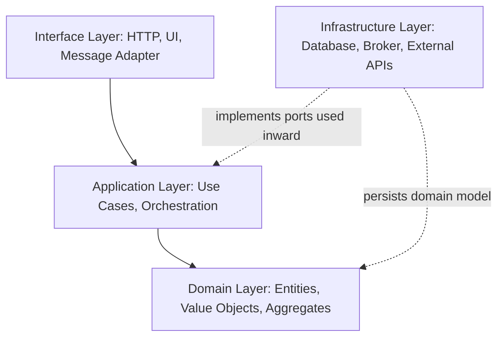
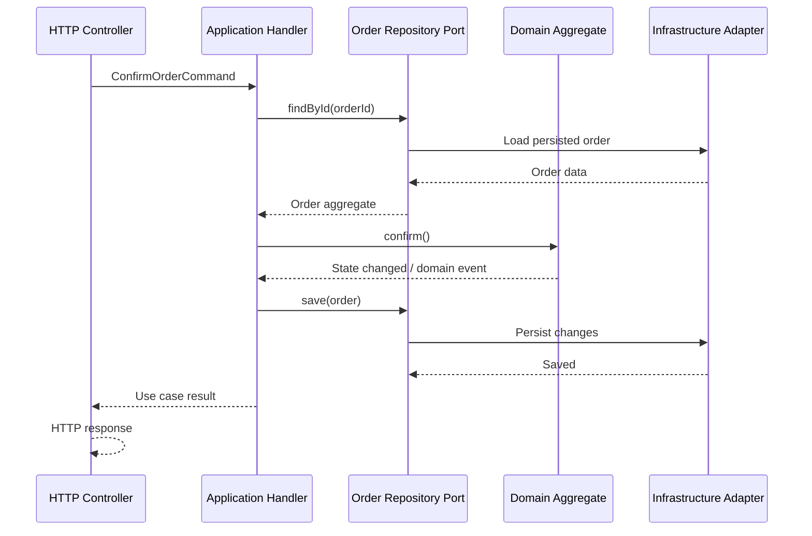

# Phân biệt lớp miền, lớp ứng dụng, lớp giao tiếp và hạ tầng

Một hệ thống dùng Domain-Driven Design (DDD) cần mô hình hóa đúng nghiệp vụ, nhưng domain model tốt vẫn có thể bị làm yếu nếu mã nguồn trộn lẫn quy tắc kinh doanh với HTTP, cơ sở dữ liệu, framework hoặc cách gửi thông điệp. Khi một thay đổi giao diện buộc phải sửa quy tắc nghiệp vụ, hoặc một lần đổi cơ sở dữ liệu làm thay đổi cách tính giá, các phần của hệ thống đang phụ thuộc vào nhau quá chặt.

Kiến trúc phân lớp giúp tổ chức mã nguồn theo trách nhiệm. Trong cách tổ chức thường gặp với DDD, có thể phân biệt **lớp miền (Domain Layer)**, **lớp ứng dụng (Application Layer)**, **lớp giao tiếp (Interface/Presentation Layer)** và **lớp hạ tầng (Infrastructure Layer)**. Mỗi lớp đảm nhận một phần công việc, đồng thời có quy tắc rõ về việc được phụ thuộc vào lớp nào.

Mục tiêu của cách chia này là giữ cho quy tắc nghiệp vụ dễ hiểu và kiểm thử, để các ca sử dụng được điều phối rõ ràng, và để chi tiết kỹ thuật có thể thay đổi mà không kéo theo thay đổi không cần thiết trong domain model. Bốn lớp là cách tổ chức trách nhiệm; chúng không bắt buộc phải tương ứng với bốn ứng dụng, bốn tiến trình hay bốn máy chủ riêng biệt.

## 1. Vì sao cần phân biệt các lớp?

Một yêu cầu nghiệp vụ thường đi qua nhiều phần của hệ thống. Ví dụ, khi khách hàng đặt hàng, ứng dụng nhận yêu cầu HTTP, kiểm tra dữ liệu đầu vào, tải thông tin sản phẩm, tạo đơn hàng, lưu dữ liệu và trả kết quả. Nếu toàn bộ các bước này được viết trong một controller hoặc một service lớn, quy tắc nghiệp vụ dễ bị trộn với chi tiết giao tiếp và lưu trữ.

Việc phân lớp giúp trả lời bốn câu hỏi:

- **Domain Layer:** Quy tắc và khái niệm nghiệp vụ nào quyết định hệ thống được phép làm gì?
- **Application Layer:** Ca sử dụng nào đang được thực hiện và cần điều phối các đối tượng nào?
- **Interface Layer:** Người dùng hoặc hệ thống bên ngoài gửi yêu cầu và nhận kết quả qua hình thức nào?
- **Infrastructure Layer:** Hệ thống dùng công nghệ cụ thể nào để lưu trữ, truyền dữ liệu hoặc gọi dịch vụ bên ngoài?

Ví dụ, quy tắc “đơn hàng chỉ được xác nhận khi có ít nhất một dòng hàng hợp lệ” thuộc miền. Việc tải đơn hàng, gọi hành vi xác nhận và lưu kết quả thuộc luồng ứng dụng. Việc nhận JSON qua REST thuộc lớp giao tiếp. Việc ghi dữ liệu bằng PostgreSQL hoặc gửi message qua broker thuộc hạ tầng.

Khi trách nhiệm được phân biệt, nhóm có thể thay đổi cách nhận yêu cầu, công nghệ lưu trữ hoặc cơ chế tích hợp mà vẫn giữ nguyên ý nghĩa nghiệp vụ.

## 2. Domain Layer — lớp miền

Domain Layer chứa mô hình và quy tắc phản ánh nghiệp vụ. Đây là phần thể hiện hiểu biết mà chuyên gia nghiệp vụ và đội phát triển cùng xây dựng thông qua ubiquitous language.

### Những thành phần thường thuộc lớp miền

| Thành phần | Trách nhiệm | Ví dụ trong hệ thống đặt hàng |
|---|---|---|
| Entity | Đối tượng có identity và vòng đời riêng | `Order`, `Customer` |
| Value Object | Giá trị được xác định bằng các thuộc tính, thường bất biến | `Money`, `Address`, `Quantity` |
| Aggregate | Nhóm đối tượng được quản lý qua một ranh giới nhất quán | `Order` cùng các `OrderLine` |
| Domain Service | Quy tắc nghiệp vụ không tự nhiên thuộc về một entity hoặc value object cụ thể | Chính sách phân bổ ưu đãi giữa nhiều đơn vị |
| Domain Event | Sự việc nghiệp vụ đã xảy ra và có ý nghĩa với domain | `OrderConfirmed`, `OrderCancelled` |
| Specification / Policy | Biểu diễn một điều kiện hoặc chính sách nghiệp vụ có thể tái sử dụng | Điều kiện một đơn hàng đủ tiêu chuẩn nhận ưu đãi |

Không phải dự án nào cũng cần tất cả các thành phần này. Hãy dùng chúng khi chúng làm mô hình rõ hơn và bảo vệ được quy tắc thực sự của nghiệp vụ.

### Lớp miền chịu trách nhiệm về quy tắc

Một entity hoặc aggregate nên tự bảo vệ những bất biến thuộc phạm vi của nó. Ví dụ, `Order` có thể kiểm tra đơn hàng có dòng hàng trước khi xác nhận, hoặc không cho phép thêm dòng hàng sau khi đã đóng. Quy tắc này không nên chỉ tồn tại trong controller hoặc câu lệnh SQL, vì các đường gọi khác có thể bỏ qua nó.

```java
public final class Order {
    private final OrderId id;
    private final List<OrderLine> lines = new ArrayList<>();
    private OrderStatus status = OrderStatus.DRAFT;

    public Order(OrderId id) {
        this.id = Objects.requireNonNull(id);
    }

    public void addLine(ProductId productId, Quantity quantity, Money unitPrice) {
        if (status != OrderStatus.DRAFT) {
            throw new IllegalStateException("Only draft orders can be changed");
        }
        lines.add(new OrderLine(productId, quantity, unitPrice));
    }

    public void confirm() {
        if (lines.isEmpty()) {
            throw new IllegalStateException("An order needs at least one line");
        }
        if (status != OrderStatus.DRAFT) {
            throw new IllegalStateException("Only draft orders can be confirmed");
        }
        status = OrderStatus.CONFIRMED;
    }
}
```

Đoạn mã chỉ minh họa vị trí của quy tắc; dự án thực tế cần dùng exception nghiệp vụ, kiểu trạng thái và cơ chế domain event phù hợp. Điểm chính là đối tượng miền kiểm soát chuyển đổi trạng thái của chính nó.

### Domain Layer nên độc lập với chi tiết kỹ thuật

Lớp miền không nên phụ thuộc trực tiếp vào servlet, controller, ORM, SQL, message broker hoặc SDK của nhà cung cấp. Nếu entity cần biết `HttpServletRequest` hoặc gọi một REST API để kiểm tra điều kiện, mô hình đã bị gắn với công nghệ bên ngoài.

Domain Layer có thể định nghĩa các abstraction mang ý nghĩa miền, chẳng hạn `OrderRepository`, nếu repository đại diện cho cách truy cập aggregate. Việc triển khai interface đó bằng JPA, SQL hay một kho dữ liệu khác thuộc Infrastructure Layer. Với các truy vấn chỉ phục vụ một ca sử dụng, application layer cũng có thể định nghĩa output port hoặc query interface riêng.

## 3. Application Layer — lớp ứng dụng

Application Layer biểu diễn và điều phối các ca sử dụng (use cases) của hệ thống. Lớp này nhận yêu cầu ở mức ứng dụng, gọi các đối tượng miền để thực hiện quy tắc, điều phối các cổng truy cập dữ liệu hoặc dịch vụ và xác định ranh giới giao dịch phù hợp.

### Trách nhiệm chính

- Cung cấp điểm vào cho từng ca sử dụng, ví dụ `PlaceOrder`, `ConfirmOrder` hoặc `CancelOrder`.
- Kiểm tra dữ liệu ở mức cần thiết để thực hiện ca sử dụng và chuyển dữ liệu sang kiểu phù hợp.
- Tải aggregate hoặc các dữ liệu cần thiết thông qua repository/port.
- Gọi hành vi của entity, aggregate hoặc domain service để thực thi quy tắc nghiệp vụ.
- Điều phối transaction, lưu thay đổi và chuyển tiếp domain event theo cơ chế của hệ thống.
- Kiểm tra quyền thực hiện ở mức use case hoặc gọi abstraction về authorization nếu cần.
- Trả kết quả ứng dụng phù hợp cho lớp giao tiếp.

Application Layer không nên trở thành nơi chứa toàn bộ quy tắc nghiệp vụ. Nếu một use case có nhiều điều kiện quyết định trạng thái của aggregate, hãy xem xét chuyển các điều kiện đó vào mô hình miền hoặc domain service.

### Application Service điều phối, không thay thế domain model

Ví dụ, use case xác nhận đơn hàng có thể tải đơn, gọi `order.confirm()` và lưu lại. Application Service biết thứ tự các bước, nhưng không tự viết lại quy tắc “đơn phải có dòng hàng” nếu đó là bất biến của `Order`.

```java
public final class ConfirmOrderHandler {
    private final OrderRepository orders;
    private final UnitOfWork unitOfWork;

    public ConfirmOrderHandler(
            OrderRepository orders,
            UnitOfWork unitOfWork) {
        this.orders = orders;
        this.unitOfWork = unitOfWork;
    }

    public void handle(ConfirmOrderCommand command) {
        Order order = orders.findById(new OrderId(command.orderId()))
                .orElseThrow(OrderNotFoundException::new);

        order.confirm();
        unitOfWork.commit();
    }
}
```

Đây là ví dụ giản lược. Transaction có thể được quản lý bởi framework hoặc decorator; domain event có thể được lưu cùng transaction qua outbox. Điều quan trọng là application handler điều phối ca sử dụng và gọi hành vi miền, còn aggregate bảo vệ bất biến của nó.

### Command, Query và DTO

Application Layer thường dùng command để mô tả ý định thay đổi trạng thái và query để đọc dữ liệu. Command có thể là `ConfirmOrderCommand`; kết quả có thể là `OrderConfirmationResult`. DTO ở ranh giới ứng dụng giúp tránh đưa trực tiếp entity hoặc aggregate ra ngoài.

Với các màn hình hoặc báo cáo phức tạp, truy vấn đọc có thể dùng projection hoặc query service riêng thay vì tải toàn bộ aggregate. Cách đọc này không làm thay đổi trách nhiệm của domain model đối với các quy tắc ghi.

### Ranh giới transaction

Application Layer thường xác định một use case cần commit thay đổi trong phạm vi nào. Với một aggregate, việc lưu thường được thực hiện như một đơn vị nhất quán. Nếu ca sử dụng cần cập nhật nhiều aggregate hoặc nhiều bounded context, không nên giả định có thể dùng một transaction ACID xuyên tất cả. Có thể cần domain event, eventual consistency, process manager hoặc saga tùy nghiệp vụ.

## 4. Interface Layer — lớp giao tiếp

Interface Layer (còn gọi là Presentation Layer hoặc adapter layer trong một số cách tổ chức) chịu trách nhiệm giao tiếp với người dùng và hệ thống bên ngoài. Nó chuyển đổi dữ liệu từ định dạng bên ngoài sang lời gọi application use case, sau đó chuyển kết quả ứng dụng sang định dạng phản hồi.

### Thành phần thường gặp

- REST controller và HTTP endpoint.
- GraphQL resolver.
- Giao diện web, mobile hoặc desktop.
- CLI hoặc giao diện quản trị.
- Message consumer nhận lệnh hoặc sự kiện từ hệ thống khác.
- Serializer, request/response DTO và mapper ở ranh giới giao tiếp.

### Trách nhiệm của lớp giao tiếp

Lớp này xử lý giao thức, định dạng và các kiểm tra đầu vào cơ bản như field bắt buộc, kiểu dữ liệu, giới hạn kích thước hoặc cấu trúc JSON. Nó xác thực thông tin giao tiếp, gọi đúng use case và ánh xạ kết quả sang HTTP status, response DTO hoặc message acknowledgement.

Lớp giao tiếp không nên tự quyết định quy tắc miền. Ví dụ, controller có thể kiểm tra `quantity` là số nguyên dương theo định dạng đầu vào, nhưng quy tắc “số lượng đặt không vượt quá giới hạn theo hợp đồng khách hàng” nên được thực thi ở miền hoặc chính sách nghiệp vụ phù hợp.

```java
@RestController
@RequestMapping("/orders")
public final class ConfirmOrderController {
    private final ConfirmOrderHandler handler;

    public ConfirmOrderController(ConfirmOrderHandler handler) {
        this.handler = handler;
    }

    @PostMapping("/{orderId}/confirm")
    public ResponseEntity<Void> confirm(@PathVariable String orderId) {
        handler.handle(new ConfirmOrderCommand(orderId));
        return ResponseEntity.noContent().build();
    }
}
```

Controller chỉ chuyển yêu cầu HTTP thành command và gọi application handler. Nếu sau này ca sử dụng được gọi từ message consumer hoặc CLI, nhóm có thể tái sử dụng cùng application handler mà không phải sao chép quy tắc nghiệp vụ.

## 5. Infrastructure Layer — lớp hạ tầng

Infrastructure Layer chứa các chi tiết kỹ thuật để hệ thống tương tác với thế giới bên ngoài. Đây là nơi triển khai các abstraction được lớp trong sử dụng và kết nối với công nghệ cụ thể.

### Thành phần thường gặp

| Thành phần | Ví dụ |
|---|---|
| Persistence adapter | Repository dùng JPA/Hibernate, JDBC, jOOQ hoặc MongoDB |
| Database configuration | Data source, connection pool, migration và mapping ORM |
| Message adapter | Kafka producer/consumer, RabbitMQ, cloud messaging |
| External service client | HTTP client gọi dịch vụ thanh toán, vận chuyển hoặc định danh |
| File/object storage | S3-compatible storage, filesystem hoặc dịch vụ tài liệu |
| Email và notification | SMTP client, SMS provider hoặc push notification SDK |
| Technical concerns | Cache, tracing, metrics, logging và cấu hình bảo mật kỹ thuật |

### Infrastructure triển khai abstraction của lớp trong

Ví dụ, domain model có thể khai báo `OrderRepository` với các thao tác có ý nghĩa đối với aggregate. Infrastructure cung cấp `JpaOrderRepository` để chuyển đổi giữa đối tượng miền và bản ghi trong cơ sở dữ liệu.

```java
public interface OrderRepository {
    Optional<Order> findById(OrderId id);
    void save(Order order);
}

public final class JpaOrderRepository implements OrderRepository {
    private final SpringDataOrderJpaRepository jpaRepository;
    private final OrderMapper mapper;

    public JpaOrderRepository(
            SpringDataOrderJpaRepository jpaRepository,
            OrderMapper mapper) {
        this.jpaRepository = jpaRepository;
        this.mapper = mapper;
    }

    @Override
    public Optional<Order> findById(OrderId id) {
        return jpaRepository.findById(id.value())
                .map(mapper::toDomain);
    }

    @Override
    public void save(Order order) {
        jpaRepository.save(mapper.toEntity(order));
    }
}
```

Trong ví dụ, interface mô tả nhu cầu truy cập aggregate; lớp triển khai phụ thuộc vào Spring Data và ORM. Domain model không cần biết bảng dữ liệu hoặc cách framework ánh xạ object.

### Dependency Injection và Composition Root

Các implementation cụ thể cần được nối với interface ở một nơi cấu hình ứng dụng, thường gọi là composition root. Dependency Injection container có thể tạo `JpaOrderRepository`, đưa implementation đó vào `ConfirmOrderHandler` và đưa handler vào controller.

Composition root thường nằm ở phần khởi tạo ứng dụng hoặc cấu hình hạ tầng. Đây là nơi hợp lý để biết framework, database và message broker cụ thể đang được sử dụng. Không nên để domain entity tự khởi tạo repository hoặc tự tìm service thông qua global service locator.

## 6. Hướng phụ thuộc giữa các lớp

Phân lớp chỉ có ý nghĩa khi các lớp có ranh giới phụ thuộc rõ ràng. Nguyên tắc thường dùng là **chi tiết kỹ thuật phụ thuộc vào chính sách nghiệp vụ; chính sách nghiệp vụ không phụ thuộc vào chi tiết kỹ thuật**.

Trong cách tổ chức DDD phổ biến:

- Interface Layer gọi Application Layer.
- Application Layer điều phối và gọi Domain Layer.
- Infrastructure Layer triển khai các interface/port mà lớp trong cần, đồng thời được cấu hình để phục vụ application.
- Domain Layer không phụ thuộc vào HTTP, ORM, database, message broker hoặc framework.



Sơ đồ nhấn mạnh hướng phụ thuộc logic. Trong mã nguồn, Infrastructure có thể tham chiếu interface được định nghĩa ở Application hoặc Domain để triển khai chúng. Khi khởi tạo, composition root kết nối các implementation với abstraction. Điều đó không có nghĩa domain phải gọi ngược vào infrastructure.

### Repository interface đặt ở đâu?

Không có một quy tắc duy nhất áp dụng cho mọi dự án. Nếu repository thể hiện collection-like access tới aggregate và là khái niệm của domain model, interface có thể đặt trong Domain Layer. Nếu đó là một port chỉ phục vụ một use case, ví dụ truy vấn dashboard hoặc tìm dữ liệu tổng hợp, interface có thể nằm trong Application Layer.

Trong cả hai trường hợp, implementation dựa trên database hoặc ORM thuộc Infrastructure Layer. Hãy đặt abstraction ở nơi sở hữu nhu cầu và ý nghĩa của nó; tránh để interface miền mang các kiểu như `EntityManager`, `JpaRepository` hoặc `HttpResponse`.

### Phụ thuộc lúc biên dịch và luồng gọi lúc chạy

Hướng phụ thuộc mã nguồn và luồng điều khiển lúc chạy không nhất thiết giống nhau. Application Handler có thể gọi `OrderRepository`, trong khi đối tượng thực tế được inject là `JpaOrderRepository`. Khi chạy, handler gọi implementation hạ tầng thông qua interface; khi biên dịch, lớp trong chỉ cần biết abstraction.

Đây là cách áp dụng Dependency Inversion Principle. Nó giúp domain và application không bị khóa vào công nghệ lưu trữ hoặc giao tiếp cụ thể.

## 7. Ví dụ luồng xử lý: xác nhận đơn hàng

Giả sử khách hàng gửi yêu cầu xác nhận đơn hàng qua REST API. Luồng xử lý có thể được phân chia như sau:

1. Interface Layer nhận `POST /orders/{id}/confirm`, kiểm tra định dạng path và xác thực yêu cầu.
2. Controller tạo `ConfirmOrderCommand` và gọi application handler.
3. Application Layer tải aggregate `Order` qua `OrderRepository`.
4. Domain Layer thực hiện `order.confirm()` và kiểm tra bất biến.
5. Application Layer lưu thay đổi và hoàn tất transaction.
6. Infrastructure Layer ghi dữ liệu qua repository implementation; nếu cần phát domain event ra broker, outbox hoặc publisher adapter đảm nhiệm việc chuyển tiếp.
7. Interface Layer ánh xạ kết quả thành HTTP response.



Sơ đồ giản lược phần transaction và event publication. Với hệ thống cần phát event đáng tin cậy, nên xem xét transactional outbox để ghi thay đổi miền và bản ghi event trong cùng transaction, sau đó publisher chuyển event ra broker. Tránh commit dữ liệu rồi phát message theo cách có thể làm mất event khi tiến trình dừng giữa hai thao tác.

## 8. Phân biệt kiểm tra đầu vào và quy tắc nghiệp vụ

Một lỗi thường gặp là đặt mọi validation ở một lớp duy nhất. Thực tế, kiểm tra nên được đặt ở nơi có đủ ngữ cảnh và quyền sở hữu.

| Loại kiểm tra | Ví dụ | Vị trí phù hợp thường gặp |
|---|---|---|
| Định dạng giao tiếp | JSON hợp lệ, UUID đúng định dạng, field bắt buộc có mặt | Interface Layer |
| Ràng buộc use case | Command có đủ dữ liệu để thực hiện ca sử dụng | Application Layer |
| Quy tắc nghiệp vụ | Đơn đã đóng không thể thêm dòng hàng | Domain Layer |
| Kiểm tra kỹ thuật | Database connection còn hoạt động, file có thể đọc | Infrastructure Layer |
| Quyền truy cập | Người gọi có quyền thực hiện use case hoặc hành động trên tài nguyên | Thường được điều phối ở Application/Interface qua abstraction; chính sách miền đặc thù có thể thuộc Domain |

Ví dụ, `quantity` có thể phải là số dương ở lớp giao tiếp để trả lỗi request rõ ràng. Nhưng việc số lượng tối đa phụ thuộc hạng khách hàng, hợp đồng hoặc giới hạn sản phẩm là quy tắc nghiệp vụ. Quy tắc đó cần được bảo vệ trong mô hình miền để mọi kênh gọi đều tuân thủ.

## 9. Tổ chức thư mục và module

Một cách tổ chức mã nguồn có thể phản ánh các lớp như sau:

```text
orders/
  domain/
    model/
      Order.java
      OrderLine.java
      OrderId.java
      Money.java
    event/
      OrderConfirmed.java
    repository/
      OrderRepository.java
    service/
      OrderPricingPolicy.java

  application/
    command/
      ConfirmOrderCommand.java
    handler/
      ConfirmOrderHandler.java
    port/
      PaymentGateway.java
    query/
      GetOrderDetailsQuery.java

  interface/
    rest/
      ConfirmOrderController.java
      OrderRequest.java
      OrderResponse.java
    messaging/
      OrderMessageConsumer.java

  infrastructure/
    persistence/
      JpaOrderRepository.java
      OrderMapper.java
    payment/
      HttpPaymentGateway.java
    messaging/
      OutboxPublisher.java
```

Đây chỉ là một ví dụ. Một dự án có thể tổ chức theo package từng bounded context, theo feature hoặc theo module Gradle/Maven. Điều quan trọng là ranh giới trách nhiệm và hướng phụ thuộc được giữ rõ. Không cần tạo package hoặc class riêng cho mỗi lớp nếu nó chỉ làm tăng cấu trúc mà không giúp mô hình dễ hiểu hơn.

Với hệ thống có nhiều bounded context, nên giữ các lớp của mỗi context trong phạm vi riêng. Ví dụ `orders.domain.Order` và `fulfillment.domain.FulfillmentRequest` là hai mô hình khác nhau dù cùng nói về quá trình thực hiện đơn hàng. Không nên gom tất cả entity vào một package `common-domain` chỉ vì chúng có liên quan nghiệp vụ.

## 10. Những sai lầm thường gặp

- **Đưa quy tắc nghiệp vụ vào controller:** các kênh gọi khác có thể bỏ qua quy tắc, và logic khó kiểm thử độc lập. Hãy chuyển quy tắc về entity, aggregate, value object hoặc domain service phù hợp.
- **Application Service trở thành domain model:** handler chứa nhiều `if/else` để quyết định trạng thái và chính sách khiến domain object chỉ còn là cấu trúc dữ liệu. Hãy để mô hình miền thực thi hành vi và bất biến.
- **Domain phụ thuộc framework:** entity có annotation hoặc kiểu dữ liệu của ORM, HTTP hay broker làm mô hình khó thay đổi. Nếu dùng annotation persistence, cân nhắc mức độ xâm nhập và giữ cho quy tắc miền không phụ thuộc framework.
- **Infrastructure bị gọi trực tiếp từ domain:** entity tự mở kết nối hoặc gọi SDK bên ngoài khiến kiểm thử và thay thế công nghệ khó khăn. Dùng abstraction và để application điều phối.
- **DTO đi sâu vào domain:** request hoặc response từ API được dùng làm kiểu dữ liệu nghiệp vụ, khiến mô hình thay đổi theo hợp đồng giao tiếp. Hãy ánh xạ sang kiểu miền có ý nghĩa.
- **Repository trả về cấu trúc database:** domain nhận row, ORM entity hoặc query result gắn với persistence thay vì aggregate phù hợp. Cần xác định abstraction theo nhu cầu của mô hình.
- **Lạm dụng Domain Service:** mọi logic được đưa vào service làm entity mất hành vi. Hãy ưu tiên đặt hành vi nơi dữ liệu và quy tắc tự nhiên thuộc về; chỉ dùng domain service khi quy tắc thực sự không thuộc một đối tượng cụ thể.
- **Dùng chung transaction xuyên nhiều context:** các context bị khóa chặt và khó triển khai độc lập. Cân nhắc eventual consistency, domain event hoặc saga khi nghiệp vụ cho phép.
- **Tạo quá nhiều lớp chuyển tiếp:** mỗi lớp chỉ đổi tên method mà không tạo ranh giới hoặc trách nhiệm rõ ràng. Phân lớp nên phục vụ sự độc lập và khả năng hiểu, không phải mục tiêu tự thân.

## 11. Kiểm thử theo trách nhiệm từng lớp

Ranh giới lớp rõ giúp lựa chọn loại kiểm thử phù hợp:

| Lớp | Loại kiểm thử phù hợp | Mục tiêu |
|---|---|---|
| Domain | Unit test | Kiểm tra entity, value object, aggregate, domain service và bất biến không cần hạ tầng |
| Application | Unit test với fake/mock port; integration test cho transaction khi cần | Kiểm tra thứ tự điều phối, use case, quyền truy cập và kết quả |
| Interface | Controller/API test, serialization test, message adapter test | Kiểm tra hợp đồng giao tiếp, status code, mapping và validation đầu vào |
| Infrastructure | Integration test với database, broker hoặc service test double | Kiểm tra mapping, query, transaction, retry và hành vi công nghệ cụ thể |
| Xuyên lớp | End-to-end hoặc acceptance test có chọn lọc | Xác minh luồng nghiệp vụ quan trọng hoạt động qua các ranh giới |

Domain test thường nên chạy nhanh và không cần database. Nếu một quy tắc chỉ có thể kiểm tra bằng cách khởi động toàn bộ ứng dụng, có thể domain model đang phụ thuộc quá nhiều vào hạ tầng hoặc bị đặt sai trách nhiệm.

Không cần kiểm thử mọi chi tiết nội bộ của từng lớp. Ưu tiên các quy tắc quan trọng, các hợp đồng có nhiều consumer và những luồng có rủi ro vận hành cao.

## 12. Quan hệ với Layered Architecture, Hexagonal và Clean Architecture

Các cách gọi kiến trúc có thể khác nhau giữa tài liệu và dự án. DDD thường được triển khai với kiến trúc phân lớp, nhưng không bắt buộc một sơ đồ duy nhất.

- **Layered Architecture:** chia hệ thống thành các lớp trách nhiệm như presentation, application, domain và infrastructure.
- **Hexagonal Architecture (Ports and Adapters):** mô tả lõi ứng dụng/domain giao tiếp với bên ngoài thông qua port và adapter; adapter có thể thay thế theo công nghệ.
- **Clean Architecture:** nhấn mạnh các vòng phụ thuộc hướng vào chính sách nghiệp vụ, với domain/use case không phụ thuộc chi tiết bên ngoài.

Các cách tiếp cận này có thể kết hợp. Một ứng dụng DDD có thể tổ chức theo bốn lớp và dùng ports/adapters để giữ Infrastructure bên ngoài. Điều quan trọng là xác định rõ abstraction thuộc về ai, ai sở hữu quy tắc và hướng phụ thuộc có được duy trì hay không.

Không nên tranh luận về tên kiến trúc nếu cấu trúc thực tế đã bảo vệ được domain model và giúp các nhóm thay đổi an toàn. Hãy chọn cách tổ chức phù hợp với độ phức tạp, quy mô và năng lực của đội ngũ.

## 13. Checklist thiết kế phân lớp cho một bounded context

Trước khi hoàn thiện kiến trúc ứng dụng, hãy kiểm tra:

- Domain Layer có chứa các khái niệm, quy tắc và bất biến nghiệp vụ quan trọng không?
- Entity, Value Object và Aggregate có được dùng đúng mục đích không?
- Application Layer có điều phối use case mà không sao chép quy tắc miền không?
- Interface Layer có tập trung vào giao thức, mapping và validation đầu vào không?
- Infrastructure Layer có chứa implementation cụ thể cho persistence, messaging và external service không?
- Các abstraction được đặt ở nơi sở hữu nhu cầu sử dụng chúng không?
- Domain model có tránh phụ thuộc vào framework và công nghệ giao tiếp không?
- Transaction và domain event có ranh giới rõ, đặc biệt khi liên quan nhiều aggregate hoặc context không?
- Composition root có chịu trách nhiệm nối implementation với interface không?
- Kiểm thử có phù hợp với trách nhiệm từng lớp và luồng nghiệp vụ quan trọng không?

Phân biệt Domain, Application, Interface và Infrastructure giúp một ứng dụng DDD duy trì ranh giới rõ giữa quy tắc nghiệp vụ, điều phối ca sử dụng, giao tiếp và chi tiết kỹ thuật. Khi hướng phụ thuộc được kiểm soát, domain model có thể phát triển theo hiểu biết nghiệp vụ, application layer điều phối các use case một cách mạch lạc, còn các adapter và công nghệ hạ tầng có thể thay đổi với tác động được giới hạn.
