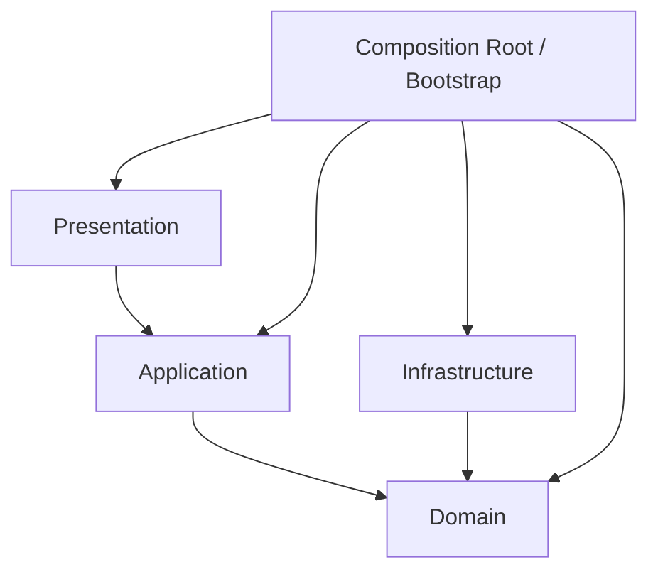
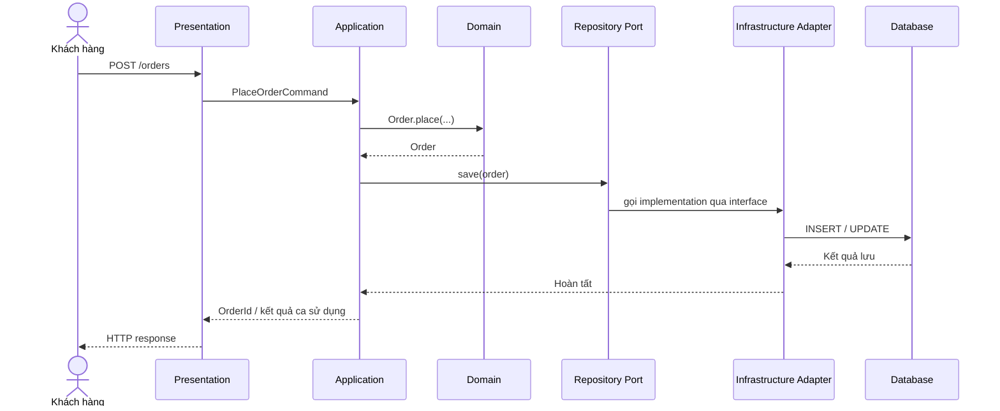

# Kiến trúc phân lớp và nguyên tắc phụ thuộc

Trong Domain-Driven Design (DDD), kiến trúc ứng dụng cần tạo điều kiện để mô hình nghiệp vụ được thể hiện rõ ràng và không bị chi phối bởi chi tiết giao diện, cơ sở dữ liệu hay framework. **Kiến trúc phân lớp (Layered Architecture)** hỗ trợ mục tiêu đó bằng cách chia ứng dụng thành các lớp có trách nhiệm khác nhau. **Nguyên tắc phụ thuộc (Dependency Rule)** quy định lớp nào được phép biết và phụ thuộc vào lớp nào.

Một cách tổ chức phổ biến trong DDD gồm Presentation, Application, Domain và Infrastructure. Presentation tiếp nhận tương tác; Application điều phối ca sử dụng; Domain chứa mô hình và quy tắc nghiệp vụ; Infrastructure cung cấp các chi tiết kỹ thuật như lưu trữ, gửi thông điệp và kết nối hệ thống ngoài. Khi được tổ chức đúng, thay đổi ở giao diện hoặc cơ sở dữ liệu ít làm ảnh hưởng đến mô hình miền.

## 1. Kiến trúc phân lớp là gì?

**Layered Architecture** chia hệ thống thành các lớp logic, mỗi lớp chịu trách nhiệm cho một nhóm công việc. Các lớp cộng tác thông qua những giao diện và quy tắc phụ thuộc được xác định trước.

Trong một ứng dụng DDD, các lớp thường gặp là:

| Lớp | Trách nhiệm chính | Ví dụ |
| --- | --- | --- |
| **Presentation** (trình bày) | Tiếp nhận yêu cầu từ người dùng hoặc hệ thống khác, chuyển đổi dữ liệu vào/ra. | REST Controller, GraphQL Resolver, giao diện web. |
| **Application** (ứng dụng) | Điều phối một ca sử dụng, quản lý luồng công việc và ranh giới giao dịch. | `PlaceOrderService`, `CancelOrderHandler`. |
| **Domain** (miền nghiệp vụ) | Biểu diễn khái niệm, hành vi, quy tắc và bất biến nghiệp vụ. | `Order`, `Money`, `OrderRepository`, Domain Service. |
| **Infrastructure** (hạ tầng) | Cung cấp cơ chế kỹ thuật để các lớp khác làm việc với thế giới bên ngoài. | JPA Repository, JDBC, message broker, email gateway. |

Đây là cách chia trách nhiệm logic, không bắt buộc mỗi lớp phải là một ứng dụng hoặc một tiến trình riêng. Một ứng dụng nguyên khối có thể chứa cả bốn lớp trong cùng một tiến trình và cùng một lần triển khai.

## 2. Vì sao DDD cần phân lớp?

Nếu tất cả logic nằm trong controller hoặc service lớn, quy tắc nghiệp vụ thường bị trộn với việc đọc HTTP request, truy vấn SQL, ánh xạ JSON và gọi dịch vụ ngoài. Một thay đổi chính sách có thể buộc nhóm sửa nhiều nơi; một thay đổi công nghệ có thể lan vào những lớp vốn chỉ nên quan tâm đến nghiệp vụ.

Ví dụ, quy tắc “đơn hàng đã xác nhận không thể bị hủy trực tiếp” có thể bị đặt trong một REST Controller. Khi hệ thống bổ sung giao diện quản trị hoặc xử lý hủy qua message queue, luồng mới có thể bỏ qua quy tắc đó. Nếu quy tắc thuộc mô hình `Order`, mọi cách gọi hành vi hủy đều đi qua cùng một điểm bảo vệ.

Phân lớp giúp:

- **Tách biệt trách nhiệm:** mỗi lớp tập trung vào một loại quyết định.
- **Bảo vệ mô hình miền:** quy tắc nghiệp vụ không phụ thuộc vào giao thức hoặc cơ chế lưu trữ.
- **Kiểm thử dễ hơn:** có thể kiểm thử quy tắc miền mà không cần khởi động web server hay cơ sở dữ liệu.
- **Thay thế chi tiết kỹ thuật:** có thể đổi JDBC sang JPA hoặc đổi nhà cung cấp message broker mà ít ảnh hưởng đến nghiệp vụ.
- **Làm rõ ranh giới:** nhóm biết logic nào thuộc ca sử dụng, logic nào thuộc mô hình miền và logic nào thuộc hạ tầng.

Phân lớp không tự động tạo ra thiết kế tốt. Nếu các lớp chỉ chuyển tiếp lời gọi hoặc chia nhỏ một cách máy móc, hệ thống vẫn có thể phức tạp. Giá trị đến từ việc đặt đúng trách nhiệm và giữ kỷ luật phụ thuộc.

## 3. Trách nhiệm của từng lớp

### 3.1. Presentation Layer — lớp trình bày

Presentation là cửa vào và cửa ra của ứng dụng. Lớp này có thể tiếp nhận HTTP, giao diện dòng lệnh, thông điệp từ một hệ thống khác hoặc thao tác từ người dùng.

Các trách nhiệm thường gồm:

- Đọc và kiểm tra cấu trúc đầu vào ở mức giao thức, chẳng hạn JSON có trường bắt buộc hay không.
- Xác thực danh tính và chuyển thông tin người dùng hoặc quyền truy cập vào ca sử dụng.
- Chuyển request thành command hoặc input model của Application.
- Gọi ca sử dụng phù hợp và chuyển kết quả thành response.
- Chuyển lỗi thành mã HTTP hoặc thông điệp giao tiếp thích hợp.

Presentation không nên quyết định quy tắc miền như một đơn hàng có được hủy hay không, cách tính tổng tiền hoặc điều kiện xác nhận thanh toán. Những quy tắc đó phải được bảo vệ ở mô hình miền hoặc dịch vụ nghiệp vụ phù hợp.

Ví dụ, `OrderController` có thể nhận `CancelOrderRequest`, chuyển thành `CancelOrderCommand` rồi gọi `CancelOrderService`. Controller không tự sửa trạng thái đơn hàng hoặc truy cập bảng dữ liệu.

### 3.2. Application Layer — lớp ứng dụng

Application biểu diễn các **ca sử dụng (use case)** mà hệ thống cung cấp. Lớp này điều phối các bước cần thiết để hoàn thành một yêu cầu, sử dụng mô hình miền và các cổng mà nó cần.

Trách nhiệm thường gồm:

- Nhận command hoặc query từ Presentation hay một adapter khác.
- Tải Aggregate cần thiết thông qua Repository.
- Gọi hành vi của Aggregate hoặc Domain Service.
- Phối hợp các thành phần và dịch vụ cần thiết theo thứ tự của ca sử dụng.
- Quản lý ranh giới giao dịch, quyền thực thi hoặc tính idempotent ở mức ca sử dụng khi phù hợp.
- Trả kết quả ở dạng phù hợp cho bên gọi.

Application thường không chứa quy tắc nghiệp vụ cốt lõi. Ví dụ, `CancelOrderService` có thể tải `Order`, gọi `order.cancel(reason)` và lưu lại. Điều kiện một đơn hàng có thể hủy hay không thuộc về `Order` hoặc chính sách miền được mô hình hóa, không nên chỉ nằm trong Application Service.

Application Service cũng không nên trở thành nơi chứa toàn bộ logic chỉ vì nó có chữ `Service`. Nếu phương thức liên tục kiểm tra trạng thái, tính toán chính sách và thay đổi nhiều thuộc tính nội bộ, cần xem lại trách nhiệm của Entity, Value Object, Aggregate hoặc Domain Service.

### 3.3. Domain Layer — lớp miền nghiệp vụ

Domain là phần trung tâm của thiết kế DDD. Nó chứa mô hình diễn đạt cách doanh nghiệp hiểu và xử lý vấn đề.

Các thành phần thường gặp:

- **Entity:** đối tượng có định danh và vòng đời, như `Order` hoặc `Customer`.
- **Value Object:** đối tượng được xác định bởi giá trị, như `Money`, `Address` hoặc `Quantity`.
- **Aggregate:** ranh giới nhất quán, có Aggregate Root bảo vệ các bất biến.
- **Domain Service:** quy tắc nghiệp vụ không thuộc tự nhiên về một Entity hoặc Value Object cụ thể.
- **Domain Event:** sự kiện nghiệp vụ đã xảy ra và có ý nghĩa với miền.
- **Repository interface:** hợp đồng để tải và lưu Aggregate mà không phụ thuộc cơ chế lưu trữ cụ thể.

Domain nên diễn đạt quy tắc bằng ngôn ngữ chung của Bounded Context. Ví dụ `order.confirm()` thể hiện ý định nghiệp vụ rõ hơn việc đặt một con số trạng thái trực tiếp.

Domain không nên phụ thuộc vào HTTP, JSON, JPA, SQL, framework dependency injection hoặc message broker. Những chi tiết đó thuộc các lớp ở ngoài mô hình miền.

### 3.4. Infrastructure Layer — lớp hạ tầng

Infrastructure cung cấp cách thực hiện các nhu cầu kỹ thuật mà Application hoặc Domain yêu cầu.

Ví dụ:

- Cài đặt Repository bằng JPA, JDBC hoặc một cơ sở dữ liệu khác.
- Gửi email, SMS hoặc thông báo qua nhà cung cấp bên ngoài.
- Gửi và nhận message qua Kafka, RabbitMQ hoặc hệ thống tương tự.
- Kết nối API của đối tác, cổng thanh toán hoặc đơn vị vận chuyển.
- Cung cấp cơ chế lưu file, cache, log và truy vết.

Infrastructure có thể phụ thuộc vào thư viện, framework và mô hình miền để triển khai các hợp đồng. Chiều phụ thuộc này cho phép lớp kỹ thuật biết cách thực hiện một giao diện do lớp bên trong định nghĩa, trong khi mô hình miền không cần biết chi tiết triển khai.

## 4. Nguyên tắc phụ thuộc: hướng vào trong

Quy tắc quan trọng là **mã nguồn của lớp bên ngoài có thể phụ thuộc vào lớp bên trong; lớp bên trong không phụ thuộc vào chi tiết của lớp bên ngoài**.

Trong mô hình bốn lớp, cách nhìn đơn giản là:



Các mũi tên biểu diễn phụ thuộc ở mức mã nguồn. Presentation gọi các ca sử dụng của Application. Application sử dụng mô hình Domain. Infrastructure triển khai các hợp đồng mà lớp bên trong định nghĩa, chẳng hạn Repository interface. Composition Root là nơi khởi tạo và nối các triển khai cụ thể với các giao diện.

Điều quan trọng không phải là mọi lời gọi lúc chạy đều đi theo một hướng. Khi Application gọi `orderRepository.save(order)`, đối tượng thực thi có thể là `JpaOrderRepository` ở Infrastructure. Ở thời điểm biên dịch, Application chỉ biết giao diện `OrderRepository`; chi tiết JPA không đi ngược vào Application hoặc Domain.

### 4.1. Phụ thuộc mã nguồn và luồng thực thi khác nhau

Hai khái niệm này thường bị nhầm lẫn:

- **Dependency direction:** lớp hoặc module nào cần biết kiểu, giao diện hay mã nguồn của module nào để biên dịch.
- **Runtime call flow:** khi chương trình chạy, lời gọi đi qua các đối tượng nào và adapter nào thực hiện công việc.

Một lớp bên trong có thể gọi một interface do chính nó định nghĩa, trong khi đối tượng thực thi interface nằm ở lớp ngoài. Đây là cách Dependency Inversion hoạt động.

### 4.2. Những phụ thuộc cần tránh

Các ví dụ sau làm mô hình miền bị ràng buộc bởi chi tiết bên ngoài:

- Entity có `@Entity`, `@Column` hoặc phụ thuộc trực tiếp vào ORM khi nhóm muốn giữ Domain thuần.
- Domain Service gọi `RestTemplate`, `WebClient` hoặc HTTP client để tự gọi đối tác.
- Entity đọc trực tiếp `HttpServletRequest` hoặc lấy thông tin người dùng từ web session.
- Domain gọi thẳng `KafkaTemplate` để phát thông điệp.
- Application Service truy vấn SQL hoặc phụ thuộc vào lớp cụ thể của cơ sở dữ liệu.

Một số dự án chấp nhận annotation hoặc framework trong mô hình vì trade-off thực tế. Đó là lựa chọn kiến trúc cần được cân nhắc rõ, nhưng nó làm tăng mức phụ thuộc và khiến việc thay thế công nghệ hoặc kiểm thử độc lập khó hơn.

## 5. Dependency Inversion Principle và các cổng

**Dependency Inversion Principle (DIP)** là một nguyên tắc SOLID: module cấp cao không nên phụ thuộc vào module cấp thấp; cả hai nên phụ thuộc vào abstraction. Abstraction không nên phụ thuộc vào chi tiết; chi tiết nên phụ thuộc vào abstraction.

Trong kiến trúc DDD, điều này thường được thực hiện bằng cách để lớp bên trong định nghĩa hợp đồng mà nó cần, còn Infrastructure cung cấp implementation.

### 5.1. Repository interface do lớp bên trong sở hữu

Ví dụ, Domain cần khả năng lưu và tải `Order`. Domain định nghĩa hợp đồng:

```java
package com.example.order.domain;

import java.util.Optional;

public interface OrderRepository {
    Optional<Order> findById(OrderId id);
    void save(Order order);
}
```

Infrastructure triển khai hợp đồng đó bằng JPA:

```java
package com.example.order.infrastructure.persistence;

import com.example.order.domain.Order;
import com.example.order.domain.OrderId;
import com.example.order.domain.OrderRepository;
import java.util.Optional;

public final class JpaOrderRepository implements OrderRepository {
    private final SpringDataOrderRepository database;
    private final OrderMapper mapper;

    public JpaOrderRepository(
            SpringDataOrderRepository database,
            OrderMapper mapper) {
        this.database = database;
        this.mapper = mapper;
    }

    @Override
    public Optional<Order> findById(OrderId id) {
        return database.findById(id.value()).map(mapper::toDomain);
    }

    @Override
    public void save(Order order) {
        database.save(mapper.toEntity(order));
    }
}
```

Các kiểu `SpringDataOrderRepository`, `OrderMapper`, `Order`, `OrderId` và phương thức ánh xạ được giả định đã được định nghĩa trong dự án. Đoạn mã minh họa chiều phụ thuộc: `JpaOrderRepository` biết `OrderRepository` và mô hình Domain; Domain không biết JPA.

### 5.2. Cổng cho dịch vụ bên ngoài

Application có thể cần gọi một hệ thống ngoài để gửi thông báo hoặc yêu cầu thanh toán. Thay vì phụ thuộc vào SDK của nhà cung cấp, Application định nghĩa một interface mô tả khả năng cần dùng:

```java
package com.example.order.application.port;

public interface PaymentGateway {
    PaymentResult requestPayment(PaymentRequest request);
}
```

Infrastructure triển khai `PaymentGateway` bằng HTTP client hoặc SDK cụ thể. Application chỉ biết hợp đồng, vì vậy có thể thay nhà cung cấp hoặc dùng fake implementation khi kiểm thử.

### 5.3. Đặt interface ở đâu?

Không có một vị trí duy nhất cho mọi interface. Nên đặt hợp đồng gần module có nhu cầu và sở hữu ý nghĩa của nó:

- `OrderRepository` thường nằm trong Domain nếu nó biểu diễn nhu cầu lưu/tải Aggregate và là một phần của mô hình miền.
- `PaymentGateway` có thể nằm trong Application nếu nó là khả năng bên ngoài mà ca sử dụng cần để hoàn thành một workflow.
- Một cổng tích hợp có thể thuộc Domain nếu quy tắc miền thực sự cần diễn đạt nó, nhưng tránh đưa giao thức hoặc chi tiết nhà cung cấp vào hợp đồng miền.

Điểm cốt lõi là module bên trong định nghĩa abstraction bằng ngôn ngữ và nhu cầu của nó; Infrastructure phụ thuộc vào abstraction đó để cung cấp cách thực hiện.

## 6. Luồng xử lý một ca sử dụng qua các lớp

Xem xét ca sử dụng đặt hàng. Khách gửi yêu cầu đặt một số sản phẩm. Ứng dụng cần kiểm tra đầu vào, tạo mô hình đơn hàng, bảo vệ quy tắc và lưu lại.



Sơ đồ tập trung vào một luồng thành công. Trong hệ thống thực tế, nhóm còn cần xác định cách xử lý lỗi, giao dịch, xác thực quyền, tính lặp của yêu cầu và các sự kiện miền phát sinh.

### 6.1. Domain bảo vệ quy tắc

Ví dụ rút gọn về Aggregate `Order`:

```java
package com.example.order.domain;

import java.util.List;
import java.util.Objects;

public final class Order {
    private final OrderId id;
    private final List<OrderLine> lines;
    private OrderStatus status;

    private Order(OrderId id, List<OrderLine> lines) {
        this.id = Objects.requireNonNull(id);
        if (lines == null || lines.isEmpty()) {
            throw new IllegalArgumentException("An order must contain at least one line");
        }
        this.lines = List.copyOf(lines);
        this.status = OrderStatus.PLACED;
    }

    public static Order place(OrderId id, List<OrderLine> lines) {
        return new Order(id, lines);
    }

    public void cancel() {
        if (status != OrderStatus.PLACED) {
            throw new IllegalStateException("Only placed orders can be cancelled");
        }
        status = OrderStatus.CANCELLED;
    }

    public OrderId id() {
        return id;
    }
}
```

Đoạn mã giả định `OrderId`, `OrderLine` và `OrderStatus` đã được định nghĩa. Nó minh họa rằng điều kiện đơn hàng phải có ít nhất một dòng và chỉ đơn ở trạng thái `PLACED` mới được hủy được bảo vệ trong Domain. Quy tắc thực tế có thể phức tạp hơn, chẳng hạn phụ thuộc vào thanh toán hoặc giao hàng.

### 6.2. Application điều phối ca sử dụng

```java
package com.example.order.application;

import com.example.order.domain.Order;
import com.example.order.domain.OrderId;
import com.example.order.domain.OrderRepository;

public final class PlaceOrderService {
    private final OrderRepository orders;

    public PlaceOrderService(OrderRepository orders) {
        this.orders = orders;
    }

    public OrderId place(PlaceOrderCommand command) {
        Order order = Order.place(command.orderId(), command.lines());
        orders.save(order);
        return order.id();
    }
}
```

Đây là ví dụ rút gọn; các kiểu command và ID cần được định nghĩa hoặc import phù hợp. Application không tự kiểm tra lại mọi bất biến của Order. Nó điều phối việc tạo Aggregate và lưu qua Repository.

### 6.3. Presentation chuyển đổi giao thức

Một REST Controller có thể nhận DTO HTTP, chuyển thành `PlaceOrderCommand`, gọi Application Service và trả về mã đơn hàng. Nếu sau này có giao diện dòng lệnh hoặc message consumer, adapter mới cũng có thể gọi cùng ca sử dụng mà không sao chép quy tắc miền.

### 6.4. Infrastructure thực hiện lưu trữ

Adapter JPA ánh xạ Aggregate sang entity lưu trữ, thực hiện truy vấn và chuyển kết quả về mô hình miền. Nếu cấu trúc bảng thay đổi, phần ánh xạ và implementation có thể được điều chỉnh mà không cần đưa annotation hoặc SQL vào Entity.

## 7. Ranh giới giao dịch và sự kiện miền

Application thường xác định phạm vi một ca sử dụng và ranh giới giao dịch cần thiết. Domain bảo vệ bất biến trong Aggregate; Infrastructure thực hiện giao dịch với cơ sở dữ liệu hoặc hệ thống ngoài.

Một giao dịch cơ sở dữ liệu thường nên bảo đảm thay đổi của một Aggregate được lưu nhất quán. Nếu một ca sử dụng cần phối hợp nhiều Bounded Context hoặc nhiều hệ thống ngoài, không nên giả định có thể bao bọc tất cả trong một giao dịch ACID duy nhất. Khi đó, có thể cần quy trình nhiều bước, Domain Event, eventual consistency và cơ chế bù trừ phù hợp.

Ví dụ, đặt đơn và giữ tồn kho có thể liên quan đến hai ngữ cảnh. Application điều phối yêu cầu; Inventory sở hữu quyết định giữ hàng; Order sở hữu vòng đời đơn hàng. Một quy trình thực tế có thể dùng sự kiện hoặc saga/process manager để xử lý khi giữ hàng thất bại hoặc phản hồi đến muộn.

Domain Event được mô hình hóa trong Domain khi sự kiện có ý nghĩa nghiệp vụ. Cách phát sự kiện ra message broker là trách nhiệm của cơ chế tích hợp hoặc Infrastructure. Nếu cần bảo đảm sự kiện được gửi sau khi dữ liệu đã commit, có thể dùng Transactional Outbox; không nên để Aggregate phụ thuộc trực tiếp vào Kafka hay RabbitMQ.

## 8. Tổ chức package và module

Cách tổ chức thư mục nên làm rõ ranh giới trách nhiệm. Một cấu trúc minh họa cho Bounded Context Order:

```text
com.example.order
├── presentation
│   └── OrderController.java
├── application
│   ├── PlaceOrderService.java
│   ├── CancelOrderService.java
│   ├── command
│   │   └── PlaceOrderCommand.java
│   └── port
│       └── PaymentGateway.java
├── domain
│   ├── Order.java
│   ├── OrderId.java
│   ├── OrderLine.java
│   ├── Money.java
│   ├── OrderStatus.java
│   └── OrderRepository.java
├── infrastructure
│   ├── persistence
│   │   ├── JpaOrderRepository.java
│   │   ├── OrderEntity.java
│   │   └── OrderMapper.java
│   └── payment
│       └── HttpPaymentGateway.java
└── bootstrap
    └── OrderConfiguration.java
```

Đây chỉ là một cách tổ chức. Dự án có thể tổ chức theo feature trước rồi chia các lớp bên trong, hoặc tách từng lớp thành module build riêng. Điều quan trọng là quy tắc phụ thuộc phải được giữ rõ ràng, kể cả khi các package nằm trong cùng một thư mục.

### 8.1. Package không tự tạo ra ranh giới kiến trúc

Đưa một lớp vào package `domain` không bảo đảm nó không phụ thuộc vào Spring hoặc JPA. Ngược lại, một package `infrastructure` có thể chứa code nghiệp vụ nếu nhóm đặt sai trách nhiệm. Cần xem import, kiểu dữ liệu, luồng gọi và quyền sở hữu hợp đồng.

### 8.2. Module build có thể củng cố quy tắc

Với dự án đủ lớn, có thể tách thành các module như `order-domain`, `order-application`, `order-infrastructure` và `order-bootstrap`. Khi đó, cấu hình build có thể ngăn module Domain phụ thuộc vào framework hoặc Infrastructure. Với dự án nhỏ, package và quy tắc review có thể đã đủ; không cần tách module chỉ để có nhiều module hơn.

## 9. Phân biệt Layered Architecture với Tiered Architecture

Hai thuật ngữ này thường bị dùng thay thế nhau nhưng mô tả hai góc nhìn khác nhau:

| Khái niệm | Mô tả | Ví dụ |
| --- | --- | --- |
| **Layer (lớp logic)** | Phân chia trách nhiệm và phụ thuộc trong mã nguồn. | Presentation, Application, Domain, Infrastructure. |
| **Tier (tầng triển khai)** | Phân chia thành các tiến trình hoặc môi trường triển khai riêng. | Web server, application server, database server. |

Một ứng dụng có bốn layer vẫn có thể được triển khai thành một tiến trình duy nhất. Ngược lại, một tier có thể chứa nhiều layer. Tách tier thường liên quan đến mở rộng, bảo mật, vận hành và giao tiếp mạng; tách layer liên quan đến tổ chức mã nguồn và trách nhiệm.

## 10. Quan hệ với Hexagonal Architecture và Clean Architecture

Layered Architecture là cách chia hệ thống theo trách nhiệm. **Hexagonal Architecture (Ports and Adapters)** nhấn mạnh việc mô hình và ca sử dụng tương tác với thế giới bên ngoài thông qua các cổng, còn adapter chuyển đổi giao thức hoặc công nghệ cụ thể. **Clean Architecture** nhấn mạnh các vòng phụ thuộc hướng vào chính sách bên trong.

Ba cách tiếp cận có thể kết hợp:

- Domain và Application nằm ở phần bên trong, giữ các chính sách nghiệp vụ và ca sử dụng.
- Interface hoặc port mô tả khả năng cần từ bên ngoài.
- Adapter ở Presentation hoặc Infrastructure triển khai giao tiếp cụ thể.
- Dependency Rule giữ cho chi tiết bên ngoài phụ thuộc vào abstraction bên trong.

Không cần tranh luận tên kiến trúc nếu nhóm đã xác định rõ trách nhiệm, hợp đồng và hướng phụ thuộc. Một hệ thống có thể dùng các lớp logic nhưng vẫn tổ chức adapter theo Ports and Adapters.

## 11. Những sai lầm thường gặp

### 11.1. Đặt toàn bộ logic vào Application Service

Application Service phình to khi tự quyết định mọi quy tắc, kiểm tra trạng thái và sửa thuộc tính của Entity. Hãy chuyển bất biến và hành vi thuộc đối tượng về Domain; Application giữ vai trò điều phối.

### 11.2. Domain phụ thuộc framework và cơ sở dữ liệu

Khi Entity chứa annotation ORM, gọi repository cụ thể hoặc phụ thuộc web framework, mô hình miền khó kiểm thử và thay thế công nghệ. Hãy giữ các hợp đồng cần thiết ở lớp trong và đặt implementation ở Infrastructure khi trade-off cho phép.

### 11.3. Presentation truy cập Repository trực tiếp

Controller gọi Repository rồi tự quyết định nghiệp vụ sẽ bỏ qua Application Layer, làm luồng xử lý phân tán và khó kiểm soát giao dịch. Nên gọi ca sử dụng qua Application.

### 11.4. Infrastructure chứa quy tắc nghiệp vụ

Nếu `JpaOrderRepository` tự quyết định đơn có được hủy hoặc tính phí theo chính sách, logic miền bị gắn vào công nghệ lưu trữ. Repository nên tập trung vào tải và lưu Aggregate.

### 11.5. Tạo interface cho mọi lớp

Không phải mọi class đều cần một interface riêng. Abstraction có ích khi nó thể hiện một hợp đồng ổn định, ranh giới hoặc điểm thay thế thực sự. Tạo interface chỉ để có thể mock từng lớp có thể làm mã nguồn phức tạp mà không cải thiện kiến trúc.

### 11.6. Nhầm hướng gọi với hướng phụ thuộc

Application có thể gọi một Repository interface nhưng implementation nằm ở Infrastructure. Điều này không vi phạm quy tắc hướng vào trong vì Application chỉ phụ thuộc vào abstraction. Cần nhìn vào kiểu được import và module tham chiếu khi biên dịch.

### 11.7. Chia lớp quá mức

Một ứng dụng CRUD nhỏ có thể không cần bốn tầng package phức tạp hoặc nhiều lớp chỉ chuyển tiếp dữ liệu. Mức độ phân lớp nên tương xứng với độ phức tạp nghiệp vụ và nhu cầu thay đổi.

### 11.8. Dùng chung một mô hình cho mọi Bounded Context

Phân lớp bên trong một ngữ cảnh không xóa đi ranh giới giữa các ngữ cảnh. Không nên chia sẻ trực tiếp Entity hoặc Aggregate nội bộ qua nhiều Bounded Context; hãy dùng hợp đồng tích hợp và mô hình riêng ở mỗi bên.

## 12. Cách kiểm tra kiến trúc phân lớp

Nhóm có thể kiểm tra kiến trúc bằng review mã nguồn, quy tắc module hoặc công cụ phân tích phụ thuộc.

Các câu hỏi hữu ích:

- Domain có import framework web, ORM, database driver hoặc message broker không?
- Application có điều phối use case hay đang chứa quy tắc nghiệp vụ đáng lẽ thuộc Domain?
- Presentation có truy cập trực tiếp Repository hoặc tự sửa trạng thái Aggregate không?
- Infrastructure có triển khai các interface do lớp bên trong định nghĩa không?
- Các hợp đồng có dùng ngôn ngữ của bên sở hữu nhu cầu không?
- Có phụ thuộc vòng giữa các package hoặc module không?
- Có thể kiểm thử quy tắc Domain mà không khởi động hạ tầng không?
- Có thể thay adapter lưu trữ hoặc giao tiếp mà không sửa mô hình miền không?

Với Java, nhóm có thể dùng cấu trúc module Gradle/Maven, ArchUnit hoặc quy tắc kiểm tra dependency để tự động phát hiện một số vi phạm. Công cụ chỉ kiểm tra được các quy tắc đã được diễn đạt; nhóm vẫn cần review để xác định một lớp có đang gánh sai trách nhiệm hay không.

## 13. Checklist thiết kế

- [ ] Presentation chỉ xử lý giao thức, đầu vào/đầu ra và gọi ca sử dụng.
- [ ] Application điều phối use case và xác định ranh giới công việc.
- [ ] Domain chứa Entity, Value Object, Aggregate và quy tắc nghiệp vụ phù hợp.
- [ ] Infrastructure triển khai lưu trữ và tích hợp bên ngoài.
- [ ] Dependency direction hướng về mô hình và chính sách bên trong.
- [ ] Interface được đặt gần module sở hữu nhu cầu và ý nghĩa của hợp đồng.
- [ ] Domain không phụ thuộc trực tiếp vào framework hoặc công nghệ hạ tầng khi mục tiêu là giữ mô hình độc lập.
- [ ] Không có phụ thuộc vòng giữa các lớp hoặc module.
- [ ] Hành vi miền được kiểm thử độc lập với hạ tầng.
- [ ] Cách triển khai giao dịch và phát Domain Event được xác định rõ.
- [ ] Ranh giới layer không bị nhầm với ranh giới Bounded Context hoặc tier triển khai.

## 14. Kết luận

Kiến trúc phân lớp giúp tổ chức ứng dụng DDD theo trách nhiệm: Presentation tiếp nhận tương tác, Application điều phối ca sử dụng, Domain bảo vệ mô hình và quy tắc nghiệp vụ, còn Infrastructure cung cấp cơ chế kỹ thuật. Nguyên tắc phụ thuộc giữ cho các lớp bên ngoài biết và triển khai hợp đồng của lớp bên trong, để mô hình miền không bị ràng buộc bởi chi tiết giao diện, lưu trữ hoặc tích hợp.

Khi kết hợp phân lớp với Dependency Inversion, các interface được đặt gần nơi sở hữu nhu cầu, còn adapter cụ thể được đặt ở hạ tầng. Nhờ vậy, nhóm có thể thay đổi công nghệ, kiểm thử quy tắc độc lập và giữ cho mã nguồn phản ánh ngôn ngữ nghiệp vụ. Cấu trúc nên vừa đủ với độ phức tạp của bài toán; điều quan trọng là trách nhiệm rõ ràng và hướng phụ thuộc được duy trì nhất quán.
