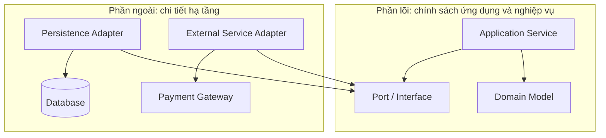
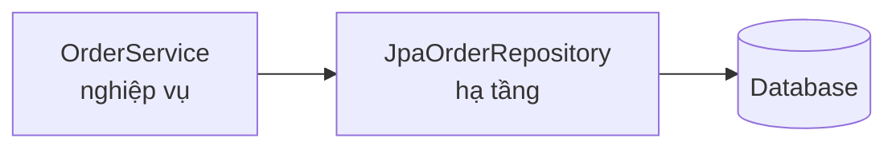
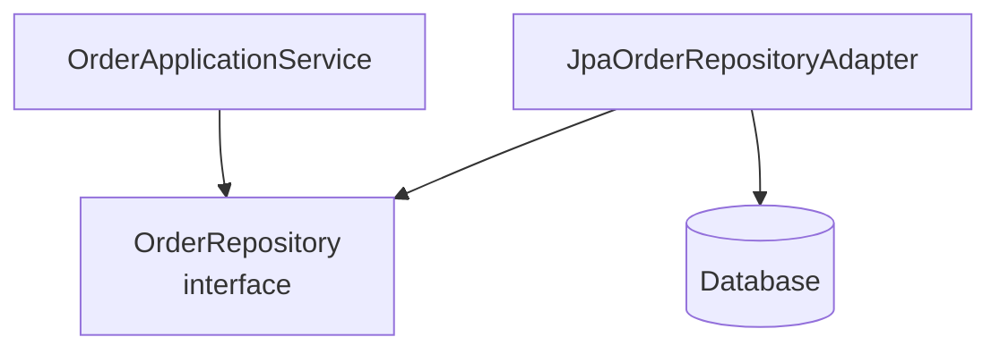
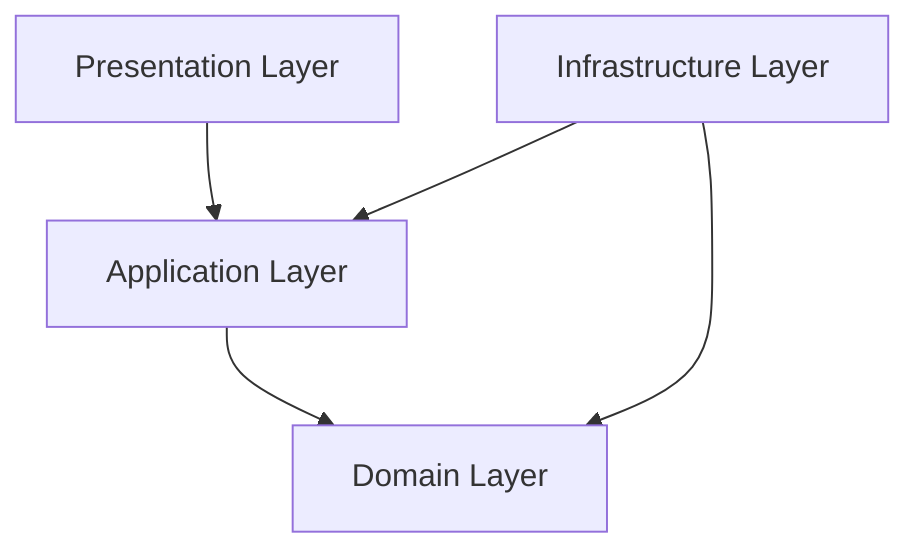
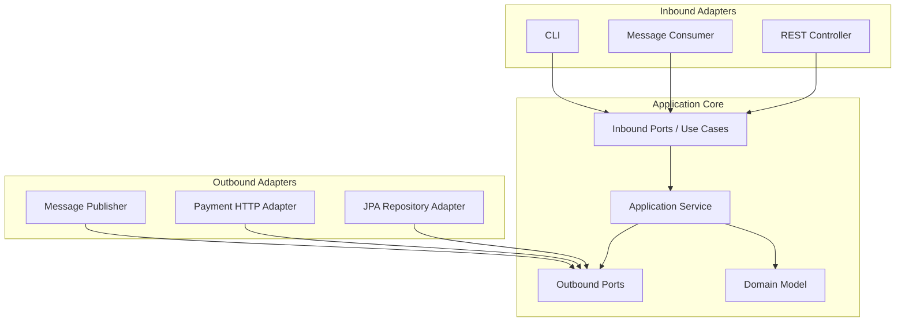

# Dependency Inversion để bảo vệ mô hình miền

Domain-Driven Design (DDD) đặt mô hình nghiệp vụ ở vị trí trung tâm. Entity, Value Object, Aggregate và Domain Service cần diễn đạt quy tắc của doanh nghiệp, không nên bị chi phối bởi cách dữ liệu được lưu, framework web hay nhà cung cấp dịch vụ bên ngoài. Tuy nhiên, một ứng dụng thực tế vẫn phải đọc ghi cơ sở dữ liệu, nhận HTTP request, gửi thông điệp và gọi các hệ thống khác.

**Dependency Inversion Principle (DIP)** giúp tổ chức mối quan hệ này. Nguyên tắc yêu cầu chính sách cấp cao và chi tiết cấp thấp cùng phụ thuộc vào những abstraction phù hợp, thay vì để mô hình nghiệp vụ phụ thuộc trực tiếp vào công nghệ hạ tầng. Nhờ đó, domain có thể giữ ngôn ngữ và quy tắc riêng, còn các chi tiết kỹ thuật có thể được thay thế mà không buộc mô hình nghiệp vụ thay đổi theo.

Trong DDD, DIP thường được thể hiện qua kiến trúc phân lớp có hướng phụ thuộc rõ ràng, kiến trúc Hexagonal (Ports and Adapters) hoặc Clean Architecture. Các cách tổ chức này có điểm chung: mã nguồn hướng vào trong, nơi chứa chính sách nghiệp vụ; phần giao tiếp với thế giới bên ngoài nằm ở rìa và triển khai các hợp đồng mà lõi ứng dụng cần.

## 1. Vì sao mô hình miền cần được bảo vệ?

Hãy xem một chức năng đặt đơn hàng. Khi khách đặt đơn, hệ thống phải kiểm tra trạng thái đơn, dòng hàng, số lượng, chính sách giá và các điều kiện nghiệp vụ. Sau khi hợp lệ, hệ thống lưu đơn vào cơ sở dữ liệu và có thể phát thông tin cho các phần khác.

Nếu lớp nghiệp vụ trực tiếp sử dụng framework lưu trữ, ví dụ:

```java
@Entity
public class Order {
    @Id
    private UUID id;

    @Enumerated(EnumType.STRING)
    private OrderStatus status;

    public void place() {
        // Kiểm tra quy tắc nghiệp vụ
    }
}
```

thì mô hình miền đang mang annotation và kiểu dữ liệu của persistence framework. Với một ứng dụng nhỏ, cách làm này có thể thuận tiện. Nhưng khi mô hình ngày càng chứa nhiều quy tắc, chi tiết lưu trữ có thể ảnh hưởng đến cách thiết kế và kiểm thử domain.

Vấn đề nghiêm trọng hơn xuất hiện khi lớp điều phối use case phụ thuộc trực tiếp vào repository cụ thể hoặc dịch vụ bên ngoài:

```java
public class OrderService {
    private final JpaOrderRepository repository;
    private final PaymentGatewayClient paymentGateway;

    public OrderService(
            JpaOrderRepository repository,
            PaymentGatewayClient paymentGateway) {
        this.repository = repository;
        this.paymentGateway = paymentGateway;
    }

    public void place(Order order) {
        paymentGateway.authorize(order.total());
        repository.save(order);
    }
}
```

Ở đây, quy tắc cấp cao về đặt đơn phụ thuộc trực tiếp vào hai chi tiết kỹ thuật: JPA và một client thanh toán cụ thể. Nếu đổi cách lưu trữ hoặc nhà cung cấp thanh toán, lớp điều phối nghiệp vụ phải thay đổi. Khi kiểm thử, ta cũng phải dựng hoặc mô phỏng các thành phần hạ tầng ngay cả khi chỉ muốn xác minh một quy tắc nghiệp vụ.

DIP giúp đảo chiều phụ thuộc mã nguồn: lớp chứa chính sách sử dụng hợp đồng trừu tượng; adapter ở bên ngoài triển khai hợp đồng đó bằng công nghệ cụ thể.

## 2. Dependency Inversion Principle là gì?

DIP là một trong năm nguyên tắc SOLID. Có thể diễn đạt thành hai ý:

1. Module cấp cao, nơi chứa chính sách và quy tắc quan trọng, không nên phụ thuộc trực tiếp vào module cấp thấp chứa chi tiết triển khai. Cả hai nên phụ thuộc vào abstraction.
2. Abstraction không nên phụ thuộc vào chi tiết. Chi tiết nên phụ thuộc vào abstraction.

Trong DDD, module cấp cao thường là Domain Layer hoặc Application Layer. Module cấp thấp thường là Infrastructure Layer, nơi chứa adapter cho database, message broker, HTTP client, file system và các dịch vụ bên ngoài.

Điểm cần chú ý là **hướng phụ thuộc của mã nguồn**. Trong lúc chạy, application vẫn có thể gọi một adapter để ghi dữ liệu. Nhưng ở thời điểm biên dịch, application chỉ biết interface mà nó cần; adapter ở bên ngoài phụ thuộc vào interface ấy và cung cấp cách thực hiện.



Mũi tên thể hiện phụ thuộc mã nguồn. Application biết abstraction; adapter biết abstraction và công nghệ cụ thể. Domain không cần biết JPA, JDBC, Kafka hay HTTP client.

### 2.1. Phụ thuộc bị đảo chiều như thế nào?

Trước khi áp dụng DIP, một module nghiệp vụ có thể phụ thuộc vào lớp repository cụ thể:



Sau khi áp dụng DIP, module nghiệp vụ định nghĩa hợp đồng mà nó cần. Adapter persistence triển khai hợp đồng đó:



Lúc chạy, dependency injection cung cấp implementation phù hợp cho application service. Hướng gọi lúc chạy và hướng phụ thuộc mã nguồn là hai góc nhìn khác nhau; hiểu rõ sự khác biệt này giúp tránh nhầm DIP với việc đảo luồng thực thi.

### 2.2. Abstraction phải phục vụ nhu cầu của phía sử dụng

Không phải cứ tạo interface là đã áp dụng DIP tốt. Interface nên diễn đạt điều mà module cấp cao cần, bằng ngôn ngữ của nghiệp vụ hoặc use case.

Ví dụ, domain cần lưu và nạp Aggregate Order:

```java
public interface OrderRepository {
    Optional<Order> findById(OrderId id);
    void save(Order order);
}
```

Hợp đồng này diễn đạt thao tác với Aggregate Order. Nó không để lộ SQL, tên bảng, Entity JPA hay kiểu truy vấn của một thư viện cụ thể.

Ngược lại, một interface như `GenericDatabaseService` với các phương thức `executeSql`, `openConnection` và `commitTransaction` có thể chỉ là abstraction bọc quanh công nghệ. Nếu domain phải sử dụng những khái niệm đó, chi tiết hạ tầng vẫn đang chi phối mô hình.

## 3. Vị trí của DIP trong kiến trúc DDD

Một cách tổ chức DDD phổ biến chia ứng dụng thành các lớp có trách nhiệm khác nhau:

| Lớp | Trách nhiệm | Ví dụ |
|---|---|---|
| Presentation / Interface | Nhận yêu cầu và trả kết quả qua giao diện bên ngoài | REST Controller, GraphQL resolver, CLI |
| Application | Điều phối use case, quản lý giao dịch và phối hợp các đối tượng domain | PlaceOrderService, CancelOrderUseCase |
| Domain | Mô hình và quy tắc nghiệp vụ cốt lõi | Order, Money, OrderPolicy, OrderRepository |
| Infrastructure | Triển khai các kết nối và chi tiết kỹ thuật | JPA adapter, Kafka publisher, HTTP client |

Hướng phụ thuộc mã nguồn thường hướng vào domain:



Sơ đồ này mô tả một cách tổ chức thường gặp. Presentation gọi application; application điều phối domain; infrastructure triển khai các abstraction mà application hoặc domain khai báo. Domain không phụ thuộc các lớp bên ngoài.

### 3.1. Domain Layer: giữ quy tắc nghiệp vụ độc lập

Domain Layer chứa những khái niệm và hành vi phản ánh domain:

- Entity và Value Object.
- Aggregate và Aggregate Root.
- Domain Service khi hành vi không thuộc tự nhiên về một Entity hoặc Value Object.
- Domain Event.
- Các abstraction thực sự thuộc mô hình domain, chẳng hạn repository cho Aggregate Root hoặc một domain policy cần nguồn dữ liệu.

Domain không nên phụ thuộc vào HTTP request, ORM entity, message broker, framework dependency injection hay API của nhà cung cấp thanh toán. Nó cần biểu đạt quy tắc bằng kiểu và hành vi của chính domain.

### 3.2. Application Layer: điều phối use case

Application Layer nhận yêu cầu từ bên ngoài và điều phối các bước để hoàn thành use case. Nó thường:

- Tìm Aggregate qua repository abstraction.
- Gọi hành vi trên Aggregate hoặc Domain Service.
- Phối hợp các port cần thiết.
- Xác định ranh giới giao dịch.
- Ghi nhận hoặc chuyển tiếp kết quả của use case.
- Trả kết quả phù hợp cho lớp gọi.

Application Service không nên trở thành nơi chứa toàn bộ quy tắc nghiệp vụ. Nếu một điều kiện luôn phải đúng với Order, hãy đặt nó trong Order. Application chỉ điều phối trình tự và phối hợp các thành phần.

### 3.3. Infrastructure Layer: triển khai chi tiết

Infrastructure Layer cung cấp cách thực hiện các hợp đồng mà lõi ứng dụng cần. Ví dụ:

- Repository adapter dùng JPA hoặc JDBC.
- Adapter gọi Payment Gateway.
- Message publisher gửi Integration Event.
- Adapter đọc file hoặc gọi hệ thống ERP.
- Cấu hình kết nối và wiring dependency.

Adapter có thể phụ thuộc vào domain và application. Đây là hướng phụ thuộc có chủ đích: chi tiết biết hợp đồng của lõi, còn lõi không biết chi tiết.

### 3.4. Presentation Layer: giao tiếp với người dùng hoặc hệ thống khác

Controller nhận HTTP request, xác thực dữ liệu đầu vào ở mức giao thức, chuyển thành command hoặc input model của application và chuyển kết quả thành HTTP response.

Controller không nên tự thực hiện invariant của Aggregate hoặc viết truy vấn SQL trực tiếp để thay đổi trạng thái nghiệp vụ. Nếu controller chứa nhiều điều kiện như “đơn chỉ được hủy khi chưa giao”, quy tắc có nguy cơ bị lặp ở nhiều điểm gọi.

## 4. Ví dụ Java: đảo chiều phụ thuộc cho OrderRepository

Hãy xây dựng một ví dụ đơn giản với use case đặt đơn. Mục tiêu là application service làm việc với hợp đồng repository; adapter JPA chịu trách nhiệm chuyển đổi giữa mô hình domain và cấu trúc lưu trữ.

### 4.1. Domain định nghĩa mô hình và hợp đồng

Trước tiên, domain biểu diễn định danh và hành vi của Order:

```java
public record OrderId(UUID value) {
    public OrderId {
        Objects.requireNonNull(value);
    }
}

public enum OrderStatus {
    DRAFT,
    PLACED
}

public class Order {
    private final OrderId id;
    private final List<OrderLine> lines;
    private OrderStatus status;

    public Order(OrderId id, List<OrderLine> lines) {
        this.id = Objects.requireNonNull(id);
        this.lines = new ArrayList<>(lines);
        this.status = OrderStatus.DRAFT;
    }

    public void place() {
        if (status != OrderStatus.DRAFT) {
            throw new IllegalStateException(
                "Only a draft order can be placed"
            );
        }

        if (lines.isEmpty()) {
            throw new IllegalStateException(
                "An order must contain at least one line"
            );
        }

        status = OrderStatus.PLACED;
    }

    public OrderId id() {
        return id;
    }

    public OrderStatus status() {
        return status;
    }

    public List<OrderLine> lines() {
        return List.copyOf(lines);
    }
}
```

Các kiểu OrderLine và quy tắc kiểm tra số lượng được lược giản để tập trung vào hướng phụ thuộc. Trong domain thực tế, Aggregate cần kiểm soát cách tạo và thay đổi dòng hàng để bảo vệ đầy đủ invariant.

Domain định nghĩa repository abstraction:

```java
public interface OrderRepository {
    Optional<Order> findById(OrderId id);
    void save(Order order);
}
```

Interface thuộc về mô hình mà nó phục vụ. Nó dùng Order và OrderId, không dùng JpaRepository hoặc kiểu dữ liệu của database.

### 4.2. Application Service chỉ biết abstraction

Use case đặt đơn có thể được viết như sau:

```java
public class PlaceOrderService {
    private final OrderRepository orders;

    public PlaceOrderService(OrderRepository orders) {
        this.orders = Objects.requireNonNull(orders);
    }

    public void handle(OrderId orderId) {
        Order order = orders.findById(orderId)
            .orElseThrow(() ->
                new IllegalArgumentException("Order not found")
            );

        order.place();
        orders.save(order);
    }
}
```

Application Service không biết đơn hàng được lưu bằng JPA, JDBC, MongoDB hay một adapter giả trong kiểm thử. Nó chỉ biết hợp đồng cần thiết để hoàn thành use case.

Trong ứng dụng thực tế, ranh giới giao dịch thường được quản lý ở application/infrastructure integration. Có thể dùng transaction manager của framework ở lớp triển khai, nhưng không cần đưa annotation hoặc kiểu transaction của framework vào domain model.

### 4.3. Infrastructure triển khai repository

Adapter persistence chuyển đổi giữa domain model và kiểu dữ liệu lưu trữ. Ví dụ rút gọn:

```java
public class JpaOrderRepositoryAdapter implements OrderRepository {
    private final SpringDataOrderRepository jpaRepository;
    private final OrderMapper mapper;

    public JpaOrderRepositoryAdapter(
            SpringDataOrderRepository jpaRepository,
            OrderMapper mapper) {
        this.jpaRepository = jpaRepository;
        this.mapper = mapper;
    }

    @Override
    public Optional<Order> findById(OrderId id) {
        return jpaRepository.findById(id.value())
            .map(mapper::toDomain);
    }

    @Override
    public void save(Order order) {
        OrderJpaEntity entity = mapper.toEntity(order);
        jpaRepository.save(entity);
    }
}
```

`SpringDataOrderRepository`, `OrderJpaEntity` và `OrderMapper` thuộc infrastructure. Adapter triển khai `OrderRepository` của domain. Mapper giúp tách cách biểu diễn của ORM khỏi cách biểu diễn của mô hình nghiệp vụ.

Cách ánh xạ cần bảo toàn invariant và trạng thái hợp lệ. Không nên để adapter tạo ra một Aggregate ở trạng thái mà domain không cho phép. Khi nạp dữ liệu cũ không còn phù hợp với quy tắc hiện tại, cần có chiến lược xử lý dữ liệu và chuyển đổi rõ ràng.

### 4.4. Dependency Injection kết nối implementation với abstraction

Một composition root hoặc cấu hình dependency injection có thể kết nối các thành phần:

```java
@Configuration
public class OrderConfiguration {
    @Bean
    OrderRepository orderRepository(
            SpringDataOrderRepository jpaRepository,
            OrderMapper mapper) {
        return new JpaOrderRepositoryAdapter(jpaRepository, mapper);
    }

    @Bean
    PlaceOrderService placeOrderService(OrderRepository orders) {
        return new PlaceOrderService(orders);
    }
}
```

Cấu hình biết cả abstraction lẫn implementation vì đây là nơi lắp ghép ứng dụng. Domain và application không cần tự tìm implementation thông qua service locator hoặc khởi tạo lớp hạ tầng.

Ví dụ dùng Spring để minh họa wiring. Với framework khác, có thể kết nối dependency bằng cấu hình tương ứng hoặc khởi tạo thủ công tại điểm khởi động ứng dụng.

## 5. Ports and Adapters: cách tổ chức DIP rõ ràng

Kiến trúc Hexagonal, còn gọi là Ports and Adapters, diễn đạt ứng dụng như một lõi có các cổng giao tiếp với bên ngoài.

- **Port** là hợp đồng mà lõi cung cấp hoặc cần từ môi trường.
- **Adapter** là thành phần chuyển đổi giao thức hoặc công nghệ bên ngoài thành cách tương tác theo port.

Có hai nhóm port thường gặp:

| Loại port | Hướng tương tác | Ví dụ |
|---|---|---|
| Inbound Port | Bên ngoài gọi vào ứng dụng | PlaceOrderUseCase, CancelOrderUseCase |
| Outbound Port | Ứng dụng cần gọi ra ngoài | OrderRepository, PaymentAuthorizationPort, NotificationPort |

Adapter inbound có thể là REST Controller, message consumer hoặc giao diện dòng lệnh. Adapter outbound có thể là JPA repository, HTTP client, message publisher hoặc adapter gửi email.



Hình lục giác chỉ là cách hình dung lõi ứng dụng và các cổng xung quanh; số lượng cạnh không có ý nghĩa kỹ thuật. Điều quan trọng là lõi không phụ thuộc vào giao thức hoặc framework của adapter.

### 5.1. Khi nào port thuộc Domain, khi nào thuộc Application?

Không phải mọi interface đều phải nằm trong Domain Layer. Hãy đặt abstraction ở nơi có nhu cầu và ý nghĩa phù hợp:

- Nếu hợp đồng thể hiện khả năng nạp và lưu Aggregate theo ngôn ngữ domain, repository interface thường được đặt trong Domain Layer hoặc một package gần domain.
- Nếu hợp đồng phục vụ một use case cụ thể, chẳng hạn gửi yêu cầu đến Payment Gateway, nó thường phù hợp ở Application Layer.
- Nếu hợp đồng là một khái niệm nghiệp vụ thực sự, chẳng hạn chính sách tính phí hoặc nguồn tỷ giá được domain sử dụng, vị trí cần dựa trên ý nghĩa và trách nhiệm của mô hình.
- Adapter triển khai hợp đồng nằm ở Infrastructure Layer.

Một nguyên tắc thực dụng: module nào cần một khả năng thì module đó hoặc lớp lõi sở hữu hợp đồng mô tả khả năng ấy. Không tạo interface chỉ để mọi class đều có một interface riêng.

### 5.2. Ví dụ port cho dịch vụ thanh toán

Domain không nên gọi trực tiếp SDK của nhà cung cấp thanh toán. Application có thể định nghĩa port cần thiết:

```java
public interface PaymentAuthorizationPort {
    AuthorizationResult authorize(
        PaymentReference payment,
        Money amount
    );
}
```

Adapter triển khai port bằng HTTP client hoặc SDK cụ thể:

```java
public class AcmePaymentAdapter
        implements PaymentAuthorizationPort {

    private final AcmePaymentClient client;

    public AcmePaymentAdapter(AcmePaymentClient client) {
        this.client = client;
    }

    @Override
    public AuthorizationResult authorize(
            PaymentReference payment,
            Money amount) {
        AcmeAuthorizationResponse response =
            client.authorize(payment.value(), amount.amount());

        return mapResult(response);
    }
}
```

`AcmePaymentClient` và `AcmeAuthorizationResponse` là chi tiết của nhà cung cấp. Chúng không nên rò rỉ vào domain hoặc application. Adapter chuyển đổi phản hồi bên ngoài thành kiểu kết quả mà use case hiểu.

Lưu ý: việc ủy quyền thanh toán thường là một tương tác có tác dụng phụ và có thể thất bại độc lập với lưu đơn hàng. Application cần xác định trình tự, trạng thái trung gian, timeout, retry và cách xử lý khi kết quả chưa rõ. Không nên gọi cổng thanh toán bên trong phương thức của Aggregate Order.

## 6. Phân biệt DIP, Dependency Injection và Inversion of Control

Ba khái niệm này liên quan nhưng không đồng nghĩa:

| Khái niệm | Trả lời câu hỏi | Ví dụ |
|---|---|---|
| Dependency Inversion Principle | Mã nguồn nên phụ thuộc theo hướng nào? | Application phụ thuộc OrderRepository abstraction |
| Dependency Injection (DI) | Dependency được cung cấp cho đối tượng bằng cách nào? | Constructor nhận OrderRepository |
| Inversion of Control (IoC) | Ai kiểm soát việc tạo và điều phối đối tượng? | Container hoặc composition root tạo và kết nối object graph |

DIP là nguyên tắc thiết kế. DI là kỹ thuật cung cấp dependency. IoC là khái niệm rộng hơn về việc chuyển quyền kiểm soát tạo hoặc điều phối từ một thành phần sang một thành phần khác.

Có thể áp dụng DIP mà không dùng framework DI:

```java
OrderRepository repository =
    new InMemoryOrderRepository();

PlaceOrderService service =
    new PlaceOrderService(repository);
```

Trong ví dụ này, application vẫn phụ thuộc vào interface. Composition root chọn implementation và truyền vào constructor. Không cần Spring hoặc container để thực hiện DIP.

Ngược lại, dùng `@Autowired` hoặc constructor injection không tự động có nghĩa là kiến trúc đã tuân thủ DIP. Nếu application vẫn phụ thuộc vào một class cụ thể của hạ tầng, dependency vẫn chưa được đảo chiều.

## 7. Kiểm thử mô hình miền nhờ phụ thuộc được đảo chiều

Khi domain không phụ thuộc database hoặc framework, có thể kiểm thử quy tắc bằng unit test đơn giản. Application service cũng có thể kiểm thử với repository giả.

### 7.1. Unit test cho Domain Model

```java
@Test
void cannotPlaceAnEmptyOrder() {
    Order order = new Order(
        new OrderId(UUID.randomUUID()),
        List.of()
    );

    assertThrows(
        IllegalStateException.class,
        order::place
    );
}
```

Kiểm thử này không cần khởi động Spring, database hoặc message broker. Nó tập trung vào invariant của Order.

### 7.2. Kiểm thử Application Service với fake repository

```java
class InMemoryOrderRepository implements OrderRepository {
    private final Map<OrderId, Order> orders = new HashMap<>();

    @Override
    public Optional<Order> findById(OrderId id) {
        return Optional.ofNullable(orders.get(id));
    }

    @Override
    public void save(Order order) {
        orders.put(order.id(), order);
    }
}
```

Fake repository cho phép kiểm tra use case và cách nó điều phối domain. Tuy nhiên, fake không chứng minh adapter JPA ánh xạ đúng hoặc giao dịch database hoạt động đúng. Những hành vi đó cần integration test riêng với công nghệ thực tế.

### 7.3. Kiểm thử từng ranh giới phù hợp

Một chiến lược kiểm thử có thể chia thành:

- **Domain unit tests:** kiểm tra invariant, hành vi Entity, Value Object và Domain Service.
- **Application tests:** kiểm tra use case, trình tự gọi port và cách xử lý kết quả.
- **Adapter integration tests:** kiểm tra mapper, truy vấn, transaction, HTTP client hoặc message broker.
- **End-to-end tests:** kiểm tra một số luồng quan trọng qua các ranh giới tích hợp.

DIP không loại bỏ nhu cầu kiểm thử hạ tầng. Nó giúp mỗi loại kiểm thử tập trung vào đúng trách nhiệm và giảm chi phí dựng môi trường khi kiểm tra quy tắc domain.

## 8. Những sai lầm thường gặp khi áp dụng DIP trong DDD

**Tạo interface cho mọi class.** Một interface chỉ lặp lại toàn bộ phương thức của implementation mà không tạo ranh giới có ý nghĩa sẽ làm tăng số lượng file và mức độ gián tiếp. Hãy tạo abstraction tại nơi có một nhu cầu độc lập hoặc một ranh giới thay đổi thực sự.

**Đặt abstraction trong Infrastructure rồi bắt Domain phụ thuộc vào nó.** Nếu interface repository nằm trong package hạ tầng và domain import nó, hướng phụ thuộc vẫn đang đi ra ngoài. Hãy đặt hợp đồng ở phía lõi cần sử dụng.

**Để abstraction phản ánh công nghệ.** Một interface có tên `JpaOrderRepository` hoặc phương thức `saveEntityManager` vẫn mang khái niệm của persistence framework. Hợp đồng nên dùng ngôn ngữ của domain hoặc use case.

**Đưa mọi logic vào Application Service.** DIP không yêu cầu application service chứa toàn bộ quy tắc. Aggregate vẫn cần bảo vệ invariant và hành vi thuộc vòng đời của nó.

**Đưa thao tác bên ngoài vào Entity.** Một phương thức `order.chargeCreditCard()` khiến Aggregate biết về dịch vụ thanh toán và tác dụng phụ bên ngoài. Hãy để application điều phối port thanh toán; domain biểu diễn các quyết định và chuyển trạng thái nghiệp vụ.

**Nhầm DI với DIP.** Constructor injection là cách cung cấp dependency. Nếu kiểu dependency vẫn là implementation hạ tầng, hướng phụ thuộc chưa được giải quyết.

**Tạo abstraction quá tổng quát.** Một `GenericRepository<T, ID>` có thể hữu ích trong một số trường hợp, nhưng nếu nó làm mất các truy vấn và hành vi có ý nghĩa riêng của Aggregate thì không nên ép mọi repository vào cùng một hợp đồng.

**Để DTO và ORM Entity rò rỉ vào Domain.** Request model, response model và persistence entity có vòng đời và mục đích khác với mô hình nghiệp vụ. Hãy chuyển đổi ở ranh giới adapter hoặc application.

**Bỏ qua ranh giới giao dịch.** Repository abstraction không tự bảo đảm nhiều thao tác được commit nguyên tử. Application và infrastructure cần phối hợp transaction boundary phù hợp với invariant và use case.

**Nghĩ rằng đảo chiều phụ thuộc loại bỏ mọi phụ thuộc.** Các module vẫn cần trao đổi qua hợp đồng. Mục tiêu là làm cho phụ thuộc có ý nghĩa, ổn định và hướng vào chính sách nghiệp vụ.

## 9. Quy trình áp dụng Dependency Inversion cho một module DDD

Có thể thực hiện theo các bước sau khi xây dựng hoặc cải tiến một module:

1. **Xác định chính sách nghiệp vụ quan trọng.** Tìm Aggregate, Domain Service và use case cần được bảo vệ khỏi thay đổi công nghệ.
2. **Liệt kê các phụ thuộc ra ngoài.** Ghi nhận database, message broker, API đối tác, hệ thống file, đồng hồ hệ thống và các dịch vụ bên ngoài.
3. **Xác định nhu cầu thực sự của lõi.** Với mỗi phụ thuộc, hỏi application hoặc domain cần khả năng gì, dùng vào thời điểm nào và cần kết quả ở dạng nào.
4. **Định nghĩa port ở phía cần sử dụng.** Dùng tên và kiểu dữ liệu theo ngôn ngữ domain hoặc use case. Chỉ đưa vào hợp đồng những thao tác cần thiết.
5. **Tạo adapter ở Infrastructure.** Chuyển đổi giữa port và công nghệ cụ thể; giữ kiểu dữ liệu và exception của framework ở ranh giới.
6. **Kết nối bằng composition root hoặc DI.** Chọn implementation ở cấu hình khởi tạo ứng dụng và truyền vào constructor.
7. **Kiểm thử theo từng lớp.** Kiểm thử domain độc lập, application bằng fake, adapter bằng integration test.
8. **Kiểm tra lại hướng phụ thuộc.** Xác nhận package domain không import framework hạ tầng và application không phụ thuộc implementation cụ thể.
9. **Đánh giá chi phí abstraction.** Nếu interface không bảo vệ ranh giới hoặc không giúp thay đổi độc lập, cân nhắc đơn giản hóa.

Không cần tạo nhiều tầng hoặc interface ngay từ đầu cho mọi thành phần. Hãy bắt đầu ở những điểm mà chi tiết kỹ thuật đang làm mô hình nghiệp vụ khó hiểu, khó kiểm thử hoặc khó thay đổi.

## 10. Checklist đánh giá hướng phụ thuộc

**Đối với Domain Layer**

- Entity, Value Object và Aggregate có phụ thuộc vào ORM hoặc framework web không?
- Quy tắc nghiệp vụ có thể được kiểm thử bằng Java thuần không?
- Domain có gọi trực tiếp database, HTTP client hoặc message broker không?
- Các abstraction trong domain có dùng ngôn ngữ của nghiệp vụ không?

**Đối với Application Layer**

- Use case có phụ thuộc vào port hoặc hợp đồng phù hợp không?
- Application Service có điều phối thay vì chứa invariant của Aggregate không?
- Transaction boundary và xử lý lỗi có được xác định rõ không?
- Dependency được truyền qua constructor hoặc cơ chế rõ ràng khác không?

**Đối với Infrastructure Layer**

- Adapter có triển khai port do lõi định nghĩa không?
- Kiểu dữ liệu của framework có được giữ ở ranh giới không?
- Mapper có chuyển đổi rõ giữa domain model và persistence model không?
- Lỗi từ hệ thống ngoài có được chuyển thành kết quả mà application hiểu không?

**Đối với toàn kiến trúc**

- Hướng phụ thuộc mã nguồn có đi vào phía chính sách nghiệp vụ không?
- Có module lõi nào import package hạ tầng không?
- Việc thay database hoặc nhà cung cấp có buộc sửa domain không?
- Các test domain và application có chạy mà không cần khởi động toàn bộ hạ tầng không?
- Mỗi abstraction có lý do tồn tại và người sở hữu rõ ràng không?

## 11. Kết luận

Dependency Inversion giúp DDD giữ mô hình nghiệp vụ độc lập với công nghệ triển khai. Domain và Application định nghĩa những hợp đồng mà chúng cần; Infrastructure triển khai các hợp đồng đó bằng database, framework và dịch vụ bên ngoài. Dependency Injection hoặc composition root kết nối các implementation khi ứng dụng khởi động.

Khi hướng phụ thuộc được tổ chức đúng, quy tắc nghiệp vụ có thể được đọc và kiểm thử mà không cần dựng toàn bộ hạ tầng. Adapter có thể thay đổi theo nhu cầu công nghệ trong khi mô hình miền giữ được ngôn ngữ và trách nhiệm của nó. Hãy bắt đầu từ các phụ thuộc đang làm domain bị gắn chặt với framework, xác định đúng port ở phía lõi, rồi kiểm chứng hướng phụ thuộc bằng cấu trúc package và các bài kiểm thử.

