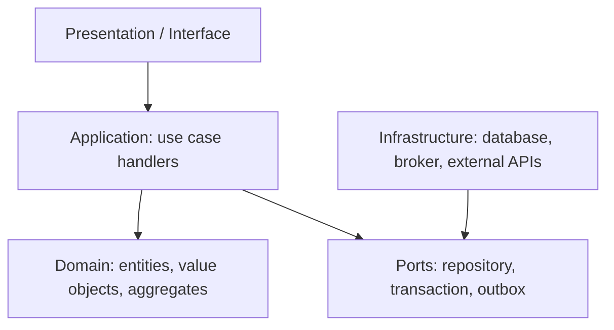
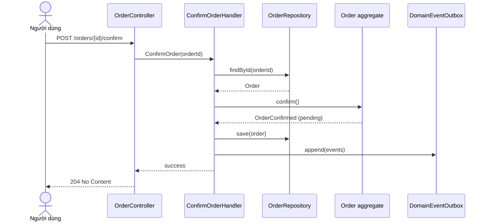

# Đặt quy tắc nghiệp vụ và điều phối ca sử dụng đúng vị trí

Trong một ứng dụng theo Domain-Driven Design (DDD), việc đặt đúng quy tắc nghiệp vụ và luồng xử lý vào đúng thành phần quan trọng không kém việc đặt tên lớp hay chia package. Nếu controller tự kiểm tra mọi quy tắc, application service chứa toàn bộ nghiệp vụ, hoặc entity chỉ có getter và setter, hệ thống sẽ khó thay đổi và khó kiểm soát tính nhất quán.

Kiến trúc ứng dụng giúp phân chia trách nhiệm giữa giao diện, điều phối ca sử dụng, mô hình miền và hạ tầng kỹ thuật. Application layer điều phối một use case; domain layer sở hữu các quy tắc và bất biến nghiệp vụ; infrastructure layer cung cấp cơ chế lưu trữ, nhắn tin và kết nối hệ thống ngoài. Các lớp giao diện nhận yêu cầu và chuyển chúng thành lời gọi phù hợp.

Ranh giới này giúp đội thay đổi cơ sở dữ liệu, framework hoặc giao thức mà không phải viết lại quy tắc miền. Đồng thời, mô hình miền có thể được kiểm thử độc lập và thể hiện nghiệp vụ bằng ngôn ngữ chung.

## Sau bài học này

Bạn có thể:

- Phân biệt trách nhiệm của presentation, application, domain và infrastructure layer.
- Giải thích vì sao application service điều phối use case còn domain model bảo vệ quy tắc nghiệp vụ.
- Phân biệt application service, domain service và infrastructure service.
- Thiết kế luồng xử lý một use case qua repository, aggregate, transaction và domain event.
- Đặt interface/port ở ranh giới phù hợp và để infrastructure cung cấp adapter triển khai.
- Xử lý truy vấn, lỗi, phân quyền và quy trình kéo dài mà không làm sai trách nhiệm các lớp.
- Nhận biết những dấu hiệu như fat controller, anemic domain model và domain phụ thuộc framework.

## 1. Vì sao cần đặt đúng trách nhiệm?

Hãy xét use case xác nhận đơn hàng. Khi khách hàng nhấn nút xác nhận, hệ thống cần tải đơn, kiểm tra đơn có thể xác nhận hay không, thay đổi trạng thái, lưu dữ liệu và thông báo cho những phần liên quan.

Nếu controller thực hiện tất cả, nó có thể phải biết cách truy vấn cơ sở dữ liệu, quy tắc trạng thái, cách tính tiền, cách gửi sự kiện và cách xử lý lỗi. Controller trở nên khó kiểm thử và phụ thuộc vào nhiều công nghệ.

Nếu application service chứa mọi điều kiện như “đơn phải có dòng hàng”, “không thể xác nhận đơn đã hủy” hoặc “số lượng phải dương”, quy tắc bị tách khỏi đối tượng sở hữu trạng thái. Một use case khác có thể thay đổi đơn theo cách bỏ qua các điều kiện đó.

Nếu entity chỉ có getter/setter, các quy tắc nằm rải rác trong service, controller và job nền. Đây là dấu hiệu của *anemic domain model* (mô hình miền nghèo hành vi). Đội khó biết nơi nào thực sự bảo vệ tính hợp lệ của dữ liệu.

Ngược lại, nếu domain object tự mở kết nối cơ sở dữ liệu, gửi HTTP hoặc gọi message broker, mô hình miền bị gắn với hạ tầng và khó kiểm thử độc lập.

Kiến trúc ứng dụng giải quyết những vấn đề này bằng cách phân biệt:

- **Điều gì cần xảy ra trong một use case?** Application layer điều phối.
- **Điều gì được phép xảy ra theo nghiệp vụ?** Domain layer quyết định và bảo vệ.
- **Thao tác kỹ thuật được thực hiện bằng cách nào?** Infrastructure layer triển khai.
- **Yêu cầu đi vào và kết quả đi ra bằng cách nào?** Presentation/interface layer xử lý giao tiếp.

## 2. Bốn vùng trách nhiệm thường gặp

Một cách tổ chức phổ biến gồm presentation, application, domain và infrastructure. Đây là các ranh giới logic; chúng có thể nằm trong cùng một ứng dụng và tiến trình.

| Vùng | Trách nhiệm | Ví dụ trong use case xác nhận đơn |
| --- | --- | --- |
| Presentation / Interface | Nhận yêu cầu, xác thực đầu vào ở mức giao thức và trả kết quả | REST controller nhận `POST /orders/{id}/confirm`. |
| Application | Điều phối use case, tải đối tượng cần thiết, quản lý transaction và gọi các cổng cần dùng | `ConfirmOrderHandler` tải đơn, gọi `order.confirm()` và lưu thay đổi. |
| Domain | Thể hiện khái niệm, hành vi, quy tắc và invariant nghiệp vụ | `Order` từ chối xác nhận nếu đơn không ở trạng thái hợp lệ hoặc không có dòng hàng. |
| Infrastructure | Hiện thực lưu trữ, message broker, email, HTTP client và các chi tiết kỹ thuật | JPA repository adapter lưu đơn; outbox adapter ghi sự kiện cần phát. |

Luồng phụ thuộc thường hướng vào phần lõi:



Mũi tên thể hiện hướng phụ thuộc ở mức mã nguồn. Application có thể gọi các interface/port mà nó cần; infrastructure triển khai các interface ấy. Domain giữ các quy tắc nghiệp vụ và không cần biết adapter đang dùng framework hay công nghệ lưu trữ nào.

### Các layer không phải là các máy chủ riêng

Một dự án có thể triển khai cả bốn vùng trong một ứng dụng Spring Boot. Presentation, application, domain và infrastructure có thể là các package hoặc module trong cùng một tiến trình. Chia layer không tự động có nghĩa là chia microservice.

Tương tự, việc dùng nhiều module Java không đảm bảo kiến trúc tốt nếu mọi module đều phụ thuộc vòng tròn hoặc truy cập trực tiếp dữ liệu của nhau. Điều cần bảo vệ là ranh giới trách nhiệm và hướng phụ thuộc.

## 3. Presentation layer: chuyển giao tiếp thành yêu cầu ứng dụng

Presentation layer bao gồm REST controller, GraphQL resolver, giao diện web, command-line interface, message listener hoặc adapter nhận yêu cầu từ một giao thức khác.

Trách nhiệm chính:

- Nhận yêu cầu theo giao thức và xác định danh tính người gọi từ cơ chế xác thực.
- Kiểm tra cấu trúc đầu vào cơ bản như trường bắt buộc, định dạng ID hoặc kiểu dữ liệu.
- Chuyển yêu cầu thành command/query hoặc lời gọi use case.
- Chuyển kết quả và lỗi ứng dụng thành response phù hợp với giao thức.

Controller không nên tự thực hiện các quy tắc như tính tổng tiền theo chính sách bán hàng, xác định đơn có được hủy hay không, hoặc quyết định hạn mức tín dụng. Những quy tắc đó thuộc mô hình miền hoặc chính sách ứng dụng tương ứng.

Ví dụ rút gọn:

```java
@RestController
@RequestMapping("/orders")
public class OrderController {
    private final ConfirmOrderHandler confirmOrder;

    public OrderController(ConfirmOrderHandler confirmOrder) {
        this.confirmOrder = confirmOrder;
    }

    @PostMapping("/{orderId}/confirm")
    public ResponseEntity<Void> confirm(@PathVariable UUID orderId) {
        confirmOrder.handle(new ConfirmOrder(new OrderId(orderId)));
        return ResponseEntity.noContent().build();
    }
}
```

Controller chỉ chuyển request thành command và trả response. Annotation Spring là chi tiết của adapter giao diện; use case không cần biết nó được gọi qua REST, message hay một giao diện khác.

### Kiểm tra đầu vào khác với kiểm tra quy tắc miền

Một số kiểm tra thuộc presentation vì chúng liên quan đến cấu trúc request: JSON có hợp lệ không, ID có đúng định dạng không, trường bắt buộc có bị thiếu không.

Một số kiểm tra thuộc domain vì chúng quyết định tính hợp lệ nghiệp vụ: đơn đã giao có được hủy không, số lượng có được phép giảm không, một khoản hoàn tiền có vượt số đã thu không.

Một số kiểm tra thuộc application vì chúng phụ thuộc vào use case hoặc quyền của người dùng: người gọi có quyền thực hiện thao tác trên đơn này không, tài khoản hiện tại có được phép truy cập đơn của khách hàng đó không. Dù kiểm tra quyền có thể được hỗ trợ bởi framework, chính sách truy cập ở mức use case cần được thực thi tại ranh giới ứng dụng hoặc một thành phần được application gọi.

## 4. Application layer: điều phối một use case

Application layer thể hiện các ca sử dụng mà hệ thống cung cấp. Mỗi use case mô tả một mục tiêu có ý nghĩa với actor hoặc hệ thống gọi, chẳng hạn:

- Tạo đơn hàng.
- Xác nhận đơn hàng.
- Hủy đơn hàng.
- Ghi nhận thanh toán.
- Yêu cầu hoàn tiền.
- Tra cứu trạng thái đơn.

Application service hoặc command handler điều phối các bước cần thiết để hoàn thành use case. Nó thường:

1. Nhận command hoặc tham số use case.
2. Kiểm tra quyền và các điều kiện ở cấp ứng dụng cần thiết.
3. Tải aggregate hoặc dữ liệu cần thiết qua repository/query port.
4. Gọi hành vi trên aggregate, entity, value object hoặc domain service.
5. Lưu thay đổi và quản lý ranh giới transaction.
6. Ghi nhận hoặc chuyển tiếp domain event theo cơ chế đã thiết kế.
7. Trả kết quả phù hợp cho caller.

Application layer biết *trình tự* cần thực hiện, nhưng không nên tự sở hữu các quy tắc miền cốt lõi. Ví dụ, nó có thể gọi `order.confirm()`, nhưng quyết định đơn có đủ điều kiện xác nhận hay không thuộc `Order` hoặc domain service thích hợp.

### Application service nên mỏng nhưng không phải rỗng

“Mỏng” nghĩa là service không chứa bản sao của quy tắc miền. Nó vẫn có trách nhiệm điều phối, quản lý transaction, gọi các cổng, phối hợp nhiều aggregate hoặc xử lý kết quả use case.

Ví dụ, `PlaceOrderHandler` có thể gọi dịch vụ định giá, tạo aggregate `Order`, lưu đơn và ghi yêu cầu phát sự kiện. Những thao tác này là điều phối use case. Cách tính giá theo chính sách, kiểm tra số lượng hoặc xác định một đơn có thể xác nhận hay không thuộc miền nghiệp vụ.

Một application service quá mỏng đến mức chỉ chuyển mọi thứ cho một domain service khổng lồ cũng không phải thiết kế tốt. Cần đặt hành vi vào đối tượng hoặc dịch vụ sở hữu đúng quy tắc.

### Command handler và query handler

Một ứng dụng có thể tách thao tác thay đổi trạng thái và thao tác đọc:

- **Command handler** thực hiện một yêu cầu có thể làm thay đổi trạng thái hoặc tạo tác động nghiệp vụ.
- **Query handler** trả dữ liệu để hiển thị hoặc hỗ trợ quyết định, không làm thay đổi trạng thái nghiệp vụ.

Tách command và query giúp mỗi use case có mục tiêu rõ. Điều này không bắt buộc phải triển khai CQRS đầy đủ hoặc dùng hai cơ sở dữ liệu. Một query handler có thể đọc từ repository hoặc một read model tối ưu cho màn hình.

## 5. Domain layer: nơi bảo vệ quy tắc nghiệp vụ

Domain layer chứa mô hình và logic cốt lõi của bounded context. Các building block thường gặp gồm entity, value object, aggregate, domain service và domain event.

### Entity và value object có hành vi phù hợp

Entity có định danh và vòng đời. Nó nên cung cấp hành vi diễn đạt các thay đổi hợp lệ thay vì để caller sửa trực tiếp mọi trường.

Value object mô tả một giá trị theo thuộc tính, thường bất biến. Nó phù hợp để đóng gói phép tính và quy tắc liên quan đến giá trị, ví dụ `Money`, `Quantity`, `Address` hoặc `DateRange`.

Ví dụ, `Money` có thể ngăn cộng hai khoản tiền khác loại tiền tệ khi chưa có quy tắc quy đổi. `OrderLine` có thể bảo vệ số lượng phải lớn hơn 0. `Order` có thể kiểm tra trạng thái trước khi xác nhận.

### Aggregate và aggregate root

Aggregate là ranh giới nhất quán của một nhóm entity/value object. Aggregate root là điểm truy cập để bên ngoài yêu cầu thay đổi nhóm đó. Root chịu trách nhiệm bảo vệ invariant của aggregate.

Ví dụ, `Order` là aggregate root quản lý các dòng hàng. Bên ngoài gọi `order.addLine(...)` hoặc `order.confirm()` thay vì tự sửa danh sách dòng hàng và trạng thái. Cách này giữ các quy tắc ở nơi có đủ thông tin để bảo vệ chúng.

### Domain service

Domain service chứa quy tắc nghiệp vụ có ý nghĩa trong miền nhưng không thuộc tự nhiên về một entity hoặc value object cụ thể. Ví dụ, chính sách xác định mức chiết khấu có thể phụ thuộc vào khách hàng, đơn hàng và thời điểm áp dụng.

Domain service nên diễn đạt ngôn ngữ miền và tránh phụ thuộc vào giao thức, cơ sở dữ liệu hoặc framework. Không nên đưa mọi nghiệp vụ vào domain service chỉ vì không biết đặt chúng ở đâu.

### Domain event

Domain event ghi nhận một sự thật nghiệp vụ đã xảy ra, ví dụ `OrderConfirmed`. Nó có thể giúp các phần khác trong cùng context phản ứng mà không buộc aggregate biết tất cả consumer.

Domain event thuộc mô hình miền. Việc lưu sự kiện, chuyển nó thành integration event và gửi qua message broker là trách nhiệm của application/infrastructure tùy kiến trúc. Domain không cần tự gọi broker.

## 6. Infrastructure layer: hiện thực các cơ chế kỹ thuật

Infrastructure layer cung cấp các chi tiết mà phần lõi cần để tương tác với thế giới bên ngoài:

- Repository adapter sử dụng JPA, JDBC hoặc cơ sở dữ liệu tài liệu.
- Adapter gửi/nhận message qua Kafka, RabbitMQ hoặc dịch vụ tương tự.
- HTTP client gọi cổng thanh toán, dịch vụ vận chuyển hoặc API đối tác.
- Adapter gửi email, lưu file, đọc cấu hình hoặc gọi dịch vụ tìm kiếm.
- Cơ chế quản lý transaction, outbox và quan sát vận hành.

Infrastructure thường phụ thuộc vào các interface/port do application hoặc domain cần. Ví dụ, application cần `OrderRepository`; infrastructure triển khai interface đó bằng JPA.

```java
public interface OrderRepository {
    Optional<Order> findById(OrderId id);
    void save(Order order);
}

@Repository
public class JpaOrderRepository implements OrderRepository {
    private final SpringDataOrderRepository dataRepository;
    private final OrderMapper mapper;

    // Constructor và các phương thức triển khai được lược giản.
}
```

Interface là hợp đồng mà application cần. `JpaOrderRepository` là adapter kỹ thuật. Khi đổi từ PostgreSQL sang một công nghệ khác, có thể thay adapter mà không đổi cách use case yêu cầu lưu một aggregate.

### Repository thường làm việc với aggregate root

Repository trong DDD thường cung cấp cách tải và lưu aggregate root, ví dụ `OrderRepository` hoặc `PaymentRepository`. Không nên tự động tạo một repository cho mỗi bảng hoặc mỗi entity con. Nếu `OrderLine` thuộc aggregate `Order`, việc truy cập và thay đổi nó thường đi qua `Order`.

Các truy vấn báo cáo hoặc màn hình có thể dùng query service/read model riêng, không nhất thiết phải tải cả aggregate chỉ để hiển thị vài trường.

### Tách persistence model khi cần

Đối tượng ORM không bắt buộc phải là domain entity. Với mô hình đơn giản, có thể dùng cùng một lớp nếu nó không làm miền phụ thuộc quá mức vào persistence. Với miền phức tạp, mapping giữa domain model và persistence model giúp tránh để annotation, lazy loading hoặc quy ước ORM chi phối hành vi nghiệp vụ.

Không nên tách lớp chỉ vì giáo điều. Hãy cân nhắc chi phí mapping, độ phức tạp miền, khả năng kiểm thử và mức phụ thuộc thực tế.

## 7. Phân biệt ba loại service

Các tên `service` dễ gây nhầm vì chúng có thể chứa trách nhiệm rất khác nhau.

| Loại | Câu hỏi nó trả lời | Ví dụ | Nơi thường đặt |
| --- | --- | --- | --- |
| Application service | Use case này cần điều phối những bước nào? | Tải đơn, gọi `confirm()`, lưu đơn và ghi outbox. | Application |
| Domain service | Quy tắc nghiệp vụ nào không thuộc tự nhiên về một entity/value object? | Tính chính sách chiết khấu dựa trên nhiều khái niệm miền. | Domain |
| Infrastructure service/adapter | Cơ chế kỹ thuật nào thực hiện một khả năng? | Gọi REST API thanh toán, lưu bằng JPA, gửi email. | Infrastructure |

Ví dụ: `ConfirmOrderHandler` điều phối use case; `PricingPolicy` tính giá theo quy tắc miền; `JpaOrderRepository` lưu aggregate. Đặt cả ba vào một lớp `OrderService` sẽ khiến trách nhiệm và lý do thay đổi bị trộn lẫn.

### Một cách nhận diện nhanh

- Nếu quy tắc vẫn đúng dù đổi REST thành giao diện dòng lệnh, đó có thể là quy tắc domain.
- Nếu logic mô tả thứ tự các bước để hoàn thành một mục tiêu của hệ thống, đó thường là application.
- Nếu logic phụ thuộc HTTP, SQL, SDK, file system hoặc message broker, đó thường là infrastructure.

## 8. Ví dụ xuyên suốt: xác nhận đơn hàng

Giả sử use case `ConfirmOrder` có quy tắc: chỉ đơn ở trạng thái `ACCEPTED` và có ít nhất một dòng hàng mới được xác nhận. Khi thành công, đơn chuyển sang `CONFIRMED` và ghi nhận domain event `OrderConfirmed`.

### Domain model bảo vệ invariant

```java
public final class Order {
    private final OrderId id;
    private final List<OrderLine> lines;
    private OrderStatus status;
    private final List<DomainEvent> events = new ArrayList<>();

    public void confirm() {
        if (status != OrderStatus.ACCEPTED) {
            throw new OrderCannotBeConfirmedException(id, status);
        }
        if (lines.isEmpty()) {
            throw new EmptyOrderCannotBeConfirmedException(id);
        }

        status = OrderStatus.CONFIRMED;
        events.add(new OrderConfirmed(id));
    }

    public List<DomainEvent> pullDomainEvents() {
        List<DomainEvent> pending = List.copyOf(events);
        events.clear();
        return pending;
    }
}
```

Ví dụ đã lược giản constructor, getter, kiểu `OrderId`, `OrderLine` và định nghĩa event. Điểm chính là `Order` tự bảo vệ điều kiện xác nhận. Caller không thể chỉ đặt `status = CONFIRMED` mà bỏ qua invariant.

### Application handler điều phối use case

```java
public record ConfirmOrder(OrderId orderId) {}

public final class ConfirmOrderHandler {
    private final OrderRepository orders;
    private final TransactionRunner transactions;
    private final DomainEventOutbox outbox;

    public ConfirmOrderHandler(
        OrderRepository orders,
        TransactionRunner transactions,
        DomainEventOutbox outbox
    ) {
        this.orders = orders;
        this.transactions = transactions;
        this.outbox = outbox;
    }

    public void handle(ConfirmOrder command) {
        transactions.run(() -> {
            Order order = orders.findById(command.orderId())
                .orElseThrow(() -> new OrderNotFoundException(command.orderId()));

            order.confirm();
            orders.save(order);
            outbox.append(order.pullDomainEvents());
        });
    }
}
```

Các interface `OrderRepository`, `TransactionRunner` và `DomainEventOutbox` là những port mà application cần. Adapter infrastructure cung cấp triển khai cụ thể. Trong ví dụ này, việc lưu aggregate và ghi outbox phải nằm trong cùng transaction để tránh trường hợp đơn đã xác nhận nhưng thông điệp cần phát lại không được ghi nhận.

Một tiến trình riêng có thể đọc outbox và gửi integration event đến broker sau khi transaction commit. Consumer cần xử lý việc gửi lại hoặc nhận lặp một cách an toàn. Application handler không nên giữ transaction cơ sở dữ liệu mở trong lúc chờ một lời gọi mạng dài.

### Adapter giao diện và adapter lưu trữ

Controller nhận HTTP request rồi gọi handler. `JpaOrderRepository` tải và lưu aggregate. Một outbox adapter ghi event vào bảng outbox. Các adapter có thể dùng Spring, JPA và broker cụ thể, nhưng use case không cần biết các chi tiết ấy.

Luồng trách nhiệm:



Sơ đồ minh họa trách nhiệm trong một use case. Chi tiết kỹ thuật như commit, rollback và phát thông điệp được thực hiện bởi transaction/outbox adapter.

## 9. Transaction và ranh giới use case

Application layer thường xác định ranh giới transaction cho một use case ghi dữ liệu. Nó biết thao tác nào cần được lưu thành một kết quả nhất quán ở mức ứng dụng.

Trong use case xác nhận đơn, việc tải đơn, gọi hành vi miền, lưu aggregate và ghi outbox có thể nằm trong một transaction cơ sở dữ liệu. Nếu invariant của aggregate bị vi phạm, thao tác không được commit.

Tuy nhiên, transaction ứng dụng không đồng nghĩa mọi bước nghiệp vụ phải nằm trong một transaction cơ sở dữ liệu lớn. Một quy trình đi qua nhiều bounded context hoặc hệ thống ngoài thường kéo dài và không thể giữ transaction phân tán mở trong suốt quá trình.

Ví dụ, xác nhận đơn có thể cần giữ hàng ở Tồn kho và thu tiền ở Thanh toán. Các context có thể xử lý độc lập, phát integration event và phối hợp bằng process manager/saga. Khi một bước thất bại, quy trình có thể cần hành động bù như giải phóng hàng hoặc hủy ủy quyền thanh toán. Đây là quy tắc điều phối quy trình, không phải lý do để gộp tất cả dữ liệu vào một aggregate.

### Tránh giữ transaction khi gọi hệ thống ngoài

Một lời gọi HTTP có thể mất nhiều giây hoặc timeout. Nếu transaction cơ sở dữ liệu vẫn mở trong lúc chờ, hệ thống có thể giữ lock lâu, tăng tranh chấp và làm giảm khả năng phục vụ. Thường nên ghi trạng thái cần thiết và outbox trong transaction ngắn, rồi thực hiện giao tiếp ngoài sau commit bằng tiến trình riêng.

### Kiểm soát cập nhật đồng thời

Hai request có thể cùng tải một aggregate và cùng cố xác nhận hoặc hủy. Repository và cơ chế persistence cần bảo vệ cập nhật đồng thời bằng optimistic locking, version column hoặc cơ chế phù hợp khác. Domain model vẫn kiểm tra invariant; persistence giúp phát hiện xung đột giữa các phiên bản được cập nhật đồng thời.

## 10. Xử lý lỗi và kết quả use case

Các lớp khác nhau có thể phát sinh loại lỗi khác nhau:

| Loại lỗi | Ví dụ | Nơi xử lý hoặc chuyển đổi |
| --- | --- | --- |
| Lỗi đầu vào/giao thức | JSON sai định dạng, ID không hợp lệ | Presentation adapter |
| Không tìm thấy tài nguyên | Không có đơn với ID được yêu cầu | Application xử lý kết quả repository và trả lỗi use case |
| Vi phạm quy tắc miền | Đơn đã hủy nên không thể xác nhận | Domain ném hoặc trả kết quả miền; application chuyển thành kết quả use case phù hợp |
| Không đủ quyền | Người gọi không được thao tác trên đơn | Ranh giới application/security policy |
| Xung đột đồng thời | Version của đơn đã thay đổi | Infrastructure phát hiện; application quyết định phản hồi hoặc retry an toàn |
| Lỗi hạ tầng | Database hoặc broker không sẵn sàng | Infrastructure báo lỗi; application/giao diện xử lý theo chính sách vận hành |

Không nên để domain phụ thuộc vào HTTP status code hoặc kiểu exception của Spring. Presentation adapter có thể ánh xạ `OrderCannotBeConfirmedException` thành response `409 Conflict`, nhưng domain chỉ cần diễn đạt lý do nghiệp vụ.

Với kết quả nghiệp vụ có thể dự đoán, một số đội thích dùng kiểu kết quả như `Result` hoặc `Either` thay vì exception. Dù chọn cách nào, cần phân biệt lỗi nghiệp vụ, lỗi đầu vào và lỗi kỹ thuật để caller xử lý đúng.

## 11. Query và read model trong kiến trúc ứng dụng

Không phải mọi request đều cần tải aggregate. Một màn hình danh sách đơn có thể cần mã đơn, tên người mua, tổng tiền và trạng thái. Việc tải toàn bộ aggregate cho từng dòng có thể tốn kém và không đem lại lợi ích bảo vệ invariant vì query không thay đổi trạng thái.

Query handler có thể đọc qua một query port hoặc read repository:

```java
public record OrderSummary(
    OrderId id,
    String buyerName,
    Money total,
    OrderStatus status
) {}

public interface OrderQueries {
    Optional<OrderSummary> findSummary(OrderId id);
}
```

Application query handler gọi `OrderQueries` và trả DTO cho presentation. Adapter infrastructure có thể thực hiện truy vấn SQL chiếu thẳng vào DTO hoặc đọc từ read model đã được cập nhật bất đồng bộ.

Đây là cách tách đọc/ghi ở mức use case. Nó không bắt buộc phải áp dụng CQRS đầy đủ, event sourcing hay hai database. Hãy chọn mức độ tách phù hợp với độ phức tạp truy vấn và nhu cầu mở rộng.

## 12. Tổ chức package và module

Một cách tổ chức theo layer có thể trông như sau:

```text
orders/
  presentation/
    OrderController.java
    OrderRequest.java
    OrderResponse.java
  application/
    ConfirmOrderHandler.java
    ConfirmOrder.java
    OrderQueries.java
    OrderRepository.java
    TransactionRunner.java
    DomainEventOutbox.java
  domain/
    Order.java
    OrderLine.java
    OrderId.java
    Money.java
    OrderStatus.java
    OrderConfirmed.java
  infrastructure/
    persistence/
      JpaOrderRepository.java
      OrderMapper.java
    messaging/
      JpaDomainEventOutbox.java
      OutboxPublisher.java
```

Đây chỉ là một cách bố trí. Với dự án lớn, có thể tổ chức theo feature/use case hoặc bounded context trước, rồi chia các thành phần bên trong. Điều quan trọng là tránh để presentation gọi thẳng repository rồi tự sửa domain state, hoặc để domain import controller, JPA repository và SDK của nhà cung cấp.

### Đặt port ở đâu?

Port nên được đặt ở phía cần khả năng đó. Nếu application cần tải và lưu aggregate để hoàn thành use case, `OrderRepository` có thể là port thuộc application. Nếu domain thực sự cần một khả năng để thực thi quy tắc, có thể khai báo abstraction ở domain, nhưng cần tránh để domain phụ thuộc vào chi tiết kỹ thuật.

Adapter triển khai port nằm ở infrastructure. Việc đặt interface trong package nào nên theo hướng phụ thuộc và ngôn ngữ của hợp đồng, không theo quy tắc “mọi interface đều phải ở một thư mục ports”.

## 13. Kiểm thử theo ranh giới trách nhiệm

Kiến trúc rõ ràng giúp kiểm thử tập trung vào hành vi cần xác nhận:

- **Domain unit test:** kiểm tra invariant, hành vi entity/value object và domain service mà không cần database hay Spring context.
- **Application test:** kiểm tra use case điều phối đúng thứ tự, xử lý trường hợp không tìm thấy aggregate, gọi repository/outbox và áp dụng transaction boundary. Có thể dùng fake hoặc mock cho port.
- **Infrastructure integration test:** kiểm tra repository adapter, mapping ORM, transaction, outbox và kết nối với broker/database thật hoặc container kiểm thử.
- **Presentation/contract test:** kiểm tra request/response, mã lỗi, xác thực và hợp đồng API hoặc message.

Không cần kiểm thử mọi phương thức getter hoặc mô phỏng toàn bộ framework trong unit test. Tập trung vào quy tắc và kết quả quan trọng với người dùng và nghiệp vụ.

## 14. Những sai lầm thường gặp

- **Fat controller:** controller vừa xác thực giao thức, vừa truy vấn, tính toán nghiệp vụ, lưu dữ liệu và gửi thông báo.
- **Application service chứa mọi quy tắc:** các điều kiện miền bị lặp lại ở nhiều use case và khó bảo vệ invariant.
- **Anemic domain model:** entity chỉ có getter/setter, mọi hành vi nằm trong service thủ tục.
- **Domain phụ thuộc framework:** entity cần Spring, HTTP request hoặc JPA session mới thực hiện được hành vi cốt lõi.
- **Repository cho mọi bảng:** làm mất ý nghĩa aggregate root và cho phép sửa entity con ngoài ranh giới nhất quán.
- **Gọi hệ thống ngoài trong transaction dài:** giữ lock trong lúc chờ mạng và tạo phụ thuộc vận hành.
- **Dùng domain event như integration event trực tiếp:** sự kiện nội bộ bị lộ thành hợp đồng bên ngoài mà không được thiết kế phiên bản và ngữ nghĩa.
- **Tách query/write quá mức:** tạo nhiều lớp và hạ tầng dù nhu cầu đọc/ghi còn đơn giản.
- **Infrastructure được gọi trực tiếp từ domain:** mô hình miền biết cách lưu SQL hoặc gửi message, khiến thay đổi kỹ thuật lan vào quy tắc.
- **Coi layer là microservice:** tách package hoặc module không tự tạo ra ranh giới triển khai độc lập.

## 15. Quy trình đặt một trách nhiệm vào đúng layer

Khi thêm một quy tắc hoặc bước xử lý mới, hãy lần lượt hỏi:

1. Đây là chi tiết của giao thức hay định dạng request/response? Nếu có, đặt ở presentation adapter.
2. Đây là trình tự để hoàn thành một use case, quản lý transaction hoặc phối hợp các thành phần? Nếu có, đặt ở application.
3. Đây là quy tắc quyết định trạng thái nghiệp vụ hợp lệ hoặc ý nghĩa của miền? Nếu có, đặt trong entity, value object, aggregate hoặc domain service phù hợp.
4. Đây là cách truy cập database, broker, HTTP, file hoặc framework? Nếu có, đặt trong infrastructure adapter.
5. Thành phần nào cần khả năng đó? Khai báo port ở phía cần dùng và để adapter bên ngoài triển khai.
6. Có thể kiểm thử quy tắc mà không khởi động hạ tầng không? Nếu không, xem xét lại mức phụ thuộc.
7. Use case có đi qua nhiều bounded context hoặc kéo dài không? Nếu có, thiết kế quy trình bất đồng bộ, trạng thái chờ và hành động bù thay vì kéo dài một transaction cục bộ.

## Kết luận

Kiến trúc ứng dụng trong DDD giúp giữ rõ ranh giới giữa giao tiếp, điều phối use case, quy tắc miền và cơ chế kỹ thuật. Presentation chuyển request thành lời gọi ứng dụng; application điều phối và quản lý transaction; domain bảo vệ hành vi cùng invariant; infrastructure triển khai các port bằng công nghệ cụ thể. Khi đặt đúng trách nhiệm, mô hình miền giữ được ngôn ngữ nghiệp vụ, use case dễ kiểm thử và hệ thống có thể thay đổi hạ tầng mà ít ảnh hưởng đến phần cốt lõi.
