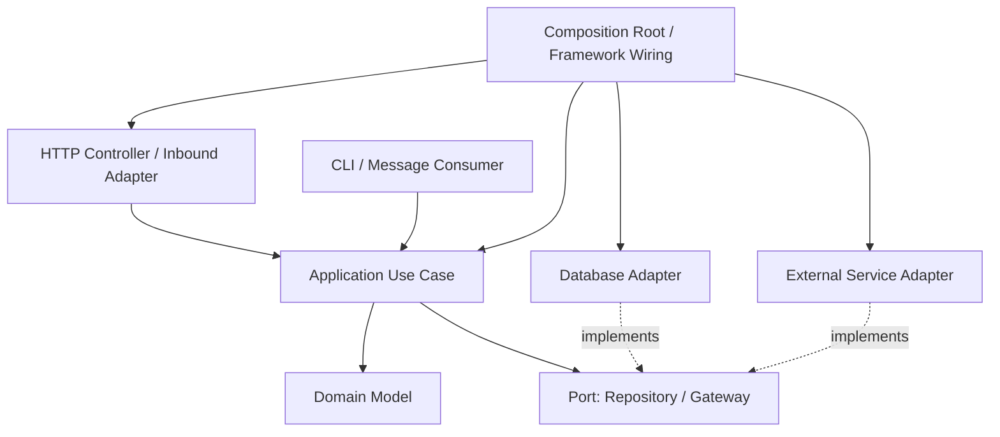

# Ngăn mô hình miền phụ thuộc trực tiếp vào HTTP, cơ sở dữ liệu và framework

Trong Domain-Driven Design (DDD), mô hình miền biểu đạt kiến thức, quy tắc và hành vi cốt lõi của nghiệp vụ. Mô hình này cần được bảo vệ khỏi những chi tiết kỹ thuật thường xuyên thay đổi như HTTP, cấu trúc bảng dữ liệu, ORM và framework. Khi domain phụ thuộc trực tiếp vào các chi tiết đó, thay đổi ở giao diện, cơ sở dữ liệu hoặc công nghệ có thể lan vào quy tắc nghiệp vụ, khiến việc kiểm thử và phát triển mô hình trở nên khó khăn.

Một cách tổ chức phổ biến là đặt mô hình miền ở phía trong, để các lớp giao tiếp và hạ tầng phụ thuộc vào nó. HTTP controller chuyển yêu cầu thành lời gọi use case; application service điều phối công việc; domain model thực thi quy tắc; adapter lưu trữ chuyển đổi giữa mô hình miền và cấu trúc persistence. Các lớp bên ngoài có thể thay đổi mà không buộc domain phải biết chúng tồn tại.

## 1. Vấn đề khi mô hình miền phụ thuộc vào công nghệ

Hãy xét một ứng dụng đặt hàng sử dụng Java, Spring và JPA. Ban đầu, nhóm tạo một entity có cả quy tắc nghiệp vụ lẫn annotation của framework:

```java
@Entity
@Table(name = "orders")
public class Order {
    @Id
    @GeneratedValue
    private Long id;

    @Enumerated(EnumType.STRING)
    private OrderStatus status;

    public void cancel() {
        if (status == OrderStatus.SHIPPED) {
            throw new IllegalStateException("Shipped order cannot be cancelled");
        }
        status = OrderStatus.CANCELLED;
    }
}
```

Đoạn mã này vẫn chứa một quy tắc nghiệp vụ hữu ích: đơn đã giao không thể bị hủy. Tuy nhiên, lớp `Order` đồng thời mang trách nhiệm làm entity của JPA. Nó phải tuân theo một số yêu cầu của persistence framework, chẳng hạn cách khai báo định danh, constructor, quan hệ và cách ORM nạp dữ liệu. Khi domain model phụ thuộc vào các annotation và kiểu dữ liệu của framework, nhóm sẽ khó sử dụng mô hình đó độc lập trong một bài kiểm thử đơn giản, một ứng dụng khác hoặc một cách lưu trữ khác.

Vấn đề thường xuất hiện rõ hơn khi các mối quan tâm bị trộn lẫn:

- Controller đọc `HttpServletRequest`, lấy header, kiểm tra session rồi truyền trực tiếp các đối tượng HTTP vào domain.
- Domain entity chứa `@Entity`, `@Column`, `@ManyToOne`, tên bảng và các quy tắc ánh xạ database.
- Quy tắc nghiệp vụ nằm trong controller, callback của ORM hoặc một lớp service quá phụ thuộc Spring.
- Domain trả về `ResponseEntity`, mã HTTP hoặc DTO được thiết kế riêng cho API.
- Entity được tuần tự hóa trực tiếp thành JSON, khiến cấu trúc API phụ thuộc vào cấu trúc persistence.
- Domain gọi thẳng repository cụ thể, `EntityManager`, JDBC, Redis client hoặc HTTP client.

Những cách làm này tạo ra các phụ thuộc không cần thiết. Thay đổi giao thức API có thể ảnh hưởng quy tắc miền; thay đổi schema có thể buộc sửa domain; thay framework có thể kéo theo việc viết lại phần nghiệp vụ.

### 1.1. Chi tiết kỹ thuật thay đổi nhanh hơn quy tắc nghiệp vụ

HTTP, JSON, SQL, ORM và framework là những cách tổ chức giao tiếp hoặc triển khai. Chúng có thể thay đổi theo yêu cầu vận hành, hiệu năng, bảo mật hoặc chiến lược công nghệ. Quy tắc như “đơn đã giao không thể bị hủy” hoặc “tổng tiền đơn hàng không được âm” thường ổn định hơn và có ý nghĩa độc lập với công nghệ.

Nếu một quy tắc chỉ có thể thực thi khi Spring đã khởi động, database đang chạy hoặc HTTP request đã tồn tại, domain đang bị buộc vào môi trường triển khai. Điều này làm giảm khả năng hiểu và kiểm chứng nghiệp vụ.

## 2. Nguyên tắc phụ thuộc hướng vào mô hình miền

Kiến trúc phân lớp, Hexagonal Architecture (Ports and Adapters) và Clean Architecture có cách diễn đạt khác nhau, nhưng cùng nhấn mạnh một ý tưởng: **các chính sách nghiệp vụ quan trọng không nên phụ thuộc trực tiếp vào chi tiết hạ tầng**.

Domain chứa mô hình và quy tắc nghiệp vụ. Application layer điều phối các ca sử dụng và xác định những cộng tác mà ca sử dụng cần. Các adapter bên ngoài triển khai việc giao tiếp với HTTP, database, message broker, file system hoặc dịch vụ của bên thứ ba.

Sơ đồ phụ thuộc khái quát:



Mũi tên liền thể hiện quan hệ sử dụng hoặc phụ thuộc mã nguồn. Đường nét đứt thể hiện adapter triển khai một port được định nghĩa ở phía trong. Composition root là nơi lắp ráp các thành phần cụ thể; nó biết cả implementation lẫn abstraction để cấu hình ứng dụng.

### 2.1. Dependency Rule

Dependency Rule yêu cầu hướng phụ thuộc mã nguồn đi từ lớp ngoài vào lớp trong. Domain không import HTTP framework, ORM, driver database hay client của dịch vụ ngoài. Application có thể phụ thuộc domain và các abstraction cần thiết. Adapter phụ thuộc vào application hoặc domain để chuyển đổi dữ liệu và thực hiện giao tiếp.

Ví dụ về hướng phụ thuộc mong muốn:

```text
HTTP adapter ───────> Application ───────> Domain
                           │
                           └──────────────> Port
                                              ▲
Database adapter ─────────────────────────────┘
```

Điều quan trọng là hướng phụ thuộc của mã nguồn, không phải chiều dữ liệu chạy lúc chương trình thực thi. Khi một use case gọi `OrderRepository`, đối tượng repository thực tế có thể là adapter JPA được Spring inject. Luồng gọi đi ra adapter, nhưng interface mà application gọi vẫn thuộc phía trong.

### 2.2. Tách chính sách khỏi cơ chế

- **Policy (chính sách):** quyết định nghiệp vụ như điều kiện hủy đơn, giới hạn chiết khấu, trạng thái hợp lệ hoặc cách tính giá.
- **Mechanism (cơ chế):** cách nhận yêu cầu HTTP, đọc dữ liệu SQL, gửi message, gọi REST API hoặc khởi tạo transaction.

Chính sách nên được mô tả bằng domain model hoặc application use case tùy phạm vi của quy tắc. Cơ chế được đặt ở adapter và hạ tầng. Không phải mọi dòng mã đều phải nằm trong domain; mục tiêu là giữ các quy tắc có ý nghĩa nghiệp vụ ở nơi có thể hiểu và kiểm tra chúng mà không cần biết framework.

## 3. Các lớp và trách nhiệm trong kiến trúc

### 3.1. Domain layer – mô hình và quy tắc nghiệp vụ

Domain layer chứa các khái niệm biểu đạt nghiệp vụ. Tùy mô hình, nó có thể gồm:

- **Entity:** đối tượng có định danh và vòng đời riêng.
- **Value Object:** đối tượng được xác định bằng giá trị, thường bất biến.
- **Aggregate và Aggregate Root:** ranh giới nhất quán cho một nhóm đối tượng miền.
- **Domain Service:** hành vi nghiệp vụ không thuộc tự nhiên về một entity hoặc value object cụ thể.
- **Domain Event:** sự kiện biểu đạt điều có ý nghĩa đã xảy ra trong domain.
- **Domain Policy/Specification:** quy tắc hoặc điều kiện nghiệp vụ có thể được mô hình hóa độc lập.
- **Repository abstraction:** hợp đồng nghiệp vụ để truy xuất và lưu aggregate khi domain cần sở hữu khái niệm này.

Domain không nên chứa `HttpServletRequest`, `ResponseEntity`, `JpaRepository`, `EntityManager`, `JdbcTemplate`, `RestTemplate`, `WebClient` hoặc kiểu dữ liệu độc quyền của framework. Domain cũng không nên trả về mã trạng thái HTTP hay định dạng JSON.

Một entity thuần Java có thể thể hiện quy tắc mà không cần Spring hoặc database:

```java
public final class Order {
    private final OrderId id;
    private OrderStatus status;

    public Order(OrderId id, OrderStatus status) {
        this.id = Objects.requireNonNull(id);
        this.status = Objects.requireNonNull(status);
    }

    public void cancel() {
        if (status == OrderStatus.SHIPPED) {
            throw new OrderCannotBeCancelledException(id);
        }
        if (status == OrderStatus.CANCELLED) {
            return;
        }
        status = OrderStatus.CANCELLED;
    }

    public OrderId id() {
        return id;
    }

    public OrderStatus status() {
        return status;
    }
}
```

Lớp trên không biết nó được tạo từ HTTP, đọc từ SQL hay khởi tạo trong unit test. Quy tắc hủy đơn có thể được kiểm thử trực tiếp bằng Java.

### 3.2. Application layer – điều phối ca sử dụng

Application layer mô tả ứng dụng cung cấp những hành động nào cho actor hoặc hệ thống khác. Một use case thường thực hiện các bước:

1. Nhận dữ liệu đầu vào đã được adapter chuyển đổi.
2. Kiểm tra điều kiện ở cấp ca sử dụng như quyền thực hiện hoặc trạng thái quy trình tổng thể.
3. Tải aggregate hoặc dữ liệu cần thiết qua port.
4. Gọi hành vi trên domain model.
5. Lưu thay đổi qua port và điều phối các cộng tác cần thiết.
6. Trả kết quả ứng dụng để adapter chuyển thành phản hồi phù hợp.

Application service không nên trở thành nơi chứa toàn bộ quy tắc miền. Nó điều phối domain object và các cổng bên ngoài; các invariant và hành vi thuộc aggregate nên nằm trong domain model.

Ví dụ một use case hủy đơn:

```java
public interface CancelOrderUseCase {
    void execute(CancelOrderCommand command);
}

public record CancelOrderCommand(String orderId, String requestedBy) {}

public final class CancelOrderService implements CancelOrderUseCase {
    private final OrderRepository orderRepository;

    public CancelOrderService(OrderRepository orderRepository) {
        this.orderRepository = orderRepository;
    }

    @Override
    public void execute(CancelOrderCommand command) {
        OrderId id = OrderId.from(command.orderId());
        Order order = orderRepository.findById(id)
            .orElseThrow(() -> new OrderNotFoundException(id));

        order.cancel();
        orderRepository.save(order);
    }
}
```

`CancelOrderCommand` là dữ liệu đầu vào của ca sử dụng, không phải HTTP request. Nó không chứa `HttpServletRequest`, cookie hoặc đối tượng Spring MVC. Nếu use case cần người thực hiện, application nhận một định danh hoặc actor context độc lập với giao thức, sau đó áp dụng chính sách quyền phù hợp.

### 3.3. Ports – hợp đồng cho cộng tác bên ngoài

Port mô tả điều mà lớp phía trong cần từ thế giới bên ngoài. Ví dụ, application cần lưu đơn hàng thì khai báo một interface repository:

```java
public interface OrderRepository {
    Optional<Order> findById(OrderId id);
    void save(Order order);
}
```

Port sử dụng kiểu dữ liệu miền hoặc kiểu dữ liệu thuộc application. Nó không nên trả về `JpaRepository`, `Page<Entity>`, `ResultSet` hay một lớp ORM cụ thể. Nhờ vậy, use case chỉ biết khả năng cần thiết, không biết cách lưu trữ.

Vị trí interface phụ thuộc ý nghĩa của nó. Nếu repository là một khái niệm của domain và làm việc trực tiếp với aggregate, có thể đặt interface ở domain layer. Nếu port chỉ phục vụ một ca sử dụng hoặc là hợp đồng giao tiếp của application, có thể đặt ở application layer. Điều quan trọng là adapter bên ngoài phụ thuộc vào hợp đồng phía trong, không để domain/application phụ thuộc implementation.

### 3.4. Adapters và infrastructure – chi tiết giao tiếp

Adapter chuyển đổi giữa hợp đồng phía trong với công nghệ cụ thể. Các adapter thường gặp:

- **Inbound adapter:** HTTP controller, GraphQL resolver, command-line interface, message consumer hoặc scheduled job. Chúng nhận đầu vào và gọi use case.
- **Persistence adapter:** JPA, JDBC, MongoDB, Redis hoặc file storage. Chúng triển khai repository/port và chuyển đổi dữ liệu.
- **External service adapter:** REST client, SOAP client, SDK của nhà cung cấp hoặc message producer.
- **Presentation adapter:** chuyển kết quả use case thành JSON, HTML hoặc định dạng giao tiếp khác.

Infrastructure chứa implementation và cấu hình kỹ thuật như connection pool, serializer, ORM mapping, HTTP client, message broker và logging. Các thành phần này có thể sử dụng framework vì chúng chính là phần gắn với framework.

## 4. Ngăn HTTP xâm nhập domain

HTTP là giao thức ở rìa hệ thống. Domain không cần biết request được gửi bằng `POST`, `PATCH`, header nào hay mã phản hồi nào. Controller có trách nhiệm chuyển đổi giao thức thành lời gọi application.

### 4.1. Controller chỉ làm nhiệm vụ chuyển đổi và điều phối

Ví dụ controller Spring MVC:

```java
@RestController
@RequestMapping("/orders")
public class OrderController {
    private final CancelOrderUseCase cancelOrder;

    public OrderController(CancelOrderUseCase cancelOrder) {
        this.cancelOrder = cancelOrder;
    }

    @PostMapping("/{orderId}/cancellation")
    public ResponseEntity<Void> cancel(@PathVariable String orderId) {
        cancelOrder.execute(new CancelOrderCommand(orderId, "api-user"));
        return ResponseEntity.noContent().build();
    }
}
```

Ví dụ rút gọn này minh họa vị trí chuyển đổi; ứng dụng thực tế cần lấy actor từ cơ chế xác thực đã được cấu hình, không hard-code người dùng như ví dụ. Controller có thể thực hiện các việc sau:

- Đọc path, query, header và body.
- Kiểm tra định dạng đầu vào ở mức giao thức.
- Chuyển request DTO thành command/query của application.
- Gọi use case.
- Chuyển kết quả hoặc lỗi thành HTTP response.

Controller không nên tự thực hiện quy tắc như “đơn đã giao không thể hủy” hoặc “chỉ chủ đơn mới được hủy”. Quy tắc nghiệp vụ thuộc domain; kiểm tra quyền truy cập có thể thuộc application/security policy tùy cách tổ chức, nhưng không nên bị gắn cứng với đối tượng request HTTP.

### 4.2. Phân biệt request DTO, command và domain object

Ba loại dữ liệu này có mục đích khác nhau:

| Loại | Mục đích | Ví dụ |
|---|---|---|
| HTTP request DTO | Biểu diễn payload của API | `CancelOrderRequest` với JSON field |
| Application command | Diễn đạt ý định thực hiện một ca sử dụng | `CancelOrderCommand` |
| Domain object | Biểu diễn khái niệm và trạng thái nghiệp vụ | `Order`, `OrderId`, `OrderStatus` |

Không nhất thiết phải tạo ba lớp riêng cho mọi endpoint. Với ứng dụng nhỏ, request DTO có thể chuyển thẳng thành command nếu cấu trúc và vòng đời phù hợp. Tuy nhiên, không nên để domain phụ thuộc vào kiểu request của Spring hoặc để thay đổi JSON làm thay đổi quy tắc miền.

### 4.3. Chuyển lỗi miền thành phản hồi HTTP

Domain có thể ném một ngoại lệ nghiệp vụ như `OrderCannotBeCancelledException`. Controller advice hoặc inbound adapter chuyển ngoại lệ đó thành mã HTTP và cấu trúc lỗi của API.

```java
@RestControllerAdvice
public class ApiExceptionHandler {
    @ExceptionHandler(OrderCannotBeCancelledException.class)
    ResponseEntity<ApiError> handleCannotCancel(
            OrderCannotBeCancelledException exception) {
        return ResponseEntity.status(HttpStatus.CONFLICT)
            .body(new ApiError("ORDER_CANNOT_BE_CANCELLED", exception.getMessage()));
    }
}

public record ApiError(String code, String message) {}
```

Domain không cần biết ngoại lệ được ánh xạ thành HTTP 409, HTTP 422 hay một mã lỗi của giao thức khác. Một CLI có thể hiển thị thông báo; message consumer có thể ghi nhận lỗi hoặc đưa message vào dead-letter queue theo chính sách riêng.

## 5. Ngăn database và ORM xâm nhập domain

Database biểu diễn dữ liệu theo cách phù hợp cho lưu trữ, truy vấn và vận hành. Domain model biểu diễn quy tắc và ngôn ngữ nghiệp vụ. Hai mô hình có thể liên quan nhưng không nhất thiết phải giống nhau.

### 5.1. Repository abstraction ở phía trong, implementation ở phía ngoài

Application hoặc domain khai báo hợp đồng cần thiết:

```java
public interface OrderRepository {
    Optional<Order> findById(OrderId id);
    void save(Order order);
}
```

Infrastructure triển khai hợp đồng bằng JPA:

```java
@Repository
public class JpaOrderRepositoryAdapter implements OrderRepository {
    private final SpringDataOrderRepository jpaRepository;
    private final OrderMapper mapper;

    public JpaOrderRepositoryAdapter(
            SpringDataOrderRepository jpaRepository,
            OrderMapper mapper) {
        this.jpaRepository = jpaRepository;
        this.mapper = mapper;
    }

    @Override
    public Optional<Order> findById(OrderId id) {
        return jpaRepository.findById(id.value())
            .map(mapper::toDomain);
    }

    @Override
    public void save(Order order) {
        jpaRepository.save(mapper.toPersistence(order));
    }
}
```

`SpringDataOrderRepository` là interface kỹ thuật của Spring Data và chỉ xuất hiện ở adapter. Domain/application không biết nó tồn tại.

### 5.2. Persistence model và domain model

Khi dùng ORM, có thể tạo một persistence model riêng để phản ánh schema và yêu cầu mapping:

```java
@Entity
@Table(name = "orders")
public class OrderJpaEntity {
    @Id
    private String id;

    @Column(nullable = false)
    private String status;

    protected OrderJpaEntity() {}

    public OrderJpaEntity(String id, String status) {
        this.id = id;
        this.status = status;
    }

    // getters cần thiết cho mapper
}
```

Mapper chuyển đổi hai mô hình:

```java
public final class OrderMapper {
    public Order toDomain(OrderJpaEntity entity) {
        return new Order(
            OrderId.from(entity.getId()),
            OrderStatus.valueOf(entity.getStatus())
        );
    }

    public OrderJpaEntity toPersistence(Order order) {
        return new OrderJpaEntity(
            order.id().value(),
            order.status().name()
        );
    }
}
```

Ví dụ chỉ gồm hai field để làm rõ hướng chuyển đổi. Trong hệ thống thực tế, mapper phải xử lý đầy đủ value object, quan hệ aggregate, collection, version và các quy tắc tương thích dữ liệu.

Tách persistence model khỏi domain model có lợi khi domain phức tạp, schema khác biệt đáng kể, ORM áp đặt nhiều ràng buộc hoặc cần nhiều cách lưu trữ. Đổi lại, nhóm phải duy trì mapping và kiểm soát sự nhất quán giữa hai mô hình.

Không phải ứng dụng nào cũng cần nhân đôi mọi entity. Với một ứng dụng đơn giản, domain model có thể đồng thời là persistence model nếu việc dùng ORM không làm domain phụ thuộc vào framework và không gây méo mó mô hình. Tuy nhiên, nếu phải thêm annotation hoặc cấu trúc chỉ để ORM hoạt động, hãy đánh giá mức độ đánh đổi. Quyết định nên dựa trên độ phức tạp và chi phí thay đổi, không phải một quy tắc hình thức.

### 5.3. Không để domain trả về cấu trúc database

Domain không nên trả về `ResultSet`, `Page<OrderJpaEntity>`, `Tuple`, `Document` hoặc một cấu trúc query riêng của database. Nếu cần phân trang hoặc truy vấn đọc phức tạp, application có thể định nghĩa query result phù hợp hoặc dùng một read adapter trả về projection dành cho use case.

Trong CQRS, mô hình đọc có thể được tối ưu cho truy vấn và khác mô hình ghi. Điều đó không làm domain phụ thuộc database: read model và query adapter vẫn là phần của solution/infrastructure, còn các quy tắc ghi quan trọng được bảo vệ trong domain model.

## 6. Ngăn framework xâm nhập domain

Framework cung cấp dependency injection, transaction, validation, ORM, web routing và nhiều tiện ích. Chúng giúp triển khai nhanh nhưng không nên trở thành ngôn ngữ của domain.

### 6.1. Domain thuần Java

Một domain model có thể được viết bằng Java thông thường:

- Không cần `@Component`, `@Service`, `@Entity` hoặc annotation của framework.
- Không kế thừa base class chỉ để đáp ứng container hoặc ORM nếu không có ý nghĩa miền.
- Không dùng framework exception, request context hoặc lifecycle callback làm cơ chế nghiệp vụ.
- Không gọi static service locator để lấy dependency.
- Không phụ thuộc vào reflection hoặc proxy của framework để thực hiện quy tắc cốt lõi.

Điều này giúp domain có thể được khởi tạo bằng `new`, kiểm thử nhanh và tái sử dụng trong nhiều adapter.

### 6.2. Dependency injection và composition root

Domain không cần tự tìm implementation của repository. Application nhận abstraction qua constructor; framework wiring ở phía ngoài cung cấp implementation cụ thể.

```java
@Configuration
public class OrderConfiguration {
    @Bean
    CancelOrderUseCase cancelOrderUseCase(OrderRepository repository) {
        return new CancelOrderService(repository);
    }
}
```

Trong ứng dụng Spring, có thể dùng component scanning và constructor injection thay cho cấu hình thủ công. Dù chọn cách nào, nơi khởi tạo phải biết implementation; domain không nên tự gọi `ApplicationContext.getBean()` hoặc tra cứu dependency từ container.

### 6.3. Transaction và các mối quan tâm xuyên suốt

Transaction là cơ chế hạ tầng nhưng thường cần bao quanh một ca sử dụng. Có vài cách tổ chức:

- Dùng `@Transactional` ở application service nếu chấp nhận application layer phụ thuộc Spring ở mức có kiểm soát.
- Dùng transaction decorator hoặc interceptor ở lớp ngoài để giữ application service độc lập framework.
- Dùng cấu hình transaction ở composition/infrastructure layer, bao quanh lời gọi use case.

Điều cần bảo vệ là domain entity không tự mở transaction, không gọi `EntityManager` và không phụ thuộc annotation ORM để thực thi invariant. Ranh giới transaction cần phản ánh yêu cầu nhất quán của ca sử dụng và aggregate, không chỉ phản ánh một request HTTP.

Các mối quan tâm như logging, tracing, metrics và security có thể được xử lý bằng middleware, filter, interceptor hoặc decorator. Nếu chúng chứa chính sách nghiệp vụ thực sự, hãy tách phần chính sách đó thành abstraction hoặc service phù hợp để có thể kiểm tra độc lập.

## 7. Domain model phải sở hữu invariant

Tách framework không có nghĩa là chuyển tất cả logic vào application service. Mục tiêu của DDD là mô hình miền thể hiện hành vi và bảo vệ các quy tắc quan trọng.

Ví dụ, nếu đơn hàng không thể có tổng tiền âm, quy tắc đó nên được bảo vệ bởi value object hoặc aggregate khi tạo và thay đổi dữ liệu. Nếu chỉ controller kiểm tra, một message consumer hoặc batch job có thể bỏ qua quy tắc.

```java
public record Money(BigDecimal amount, Currency currency) {
    public Money {
        Objects.requireNonNull(amount);
        Objects.requireNonNull(currency);
        if (amount.signum() < 0) {
            throw new IllegalArgumentException("Money cannot be negative");
        }
    }
}
```

Trong ví dụ này, `Money` bảo vệ một invariant của value object. Lỗi đầu vào ở cấp API như thiếu field hoặc chuỗi không đúng định dạng có thể được xử lý ở adapter; quy tắc giá trị tiền hợp lệ vẫn được bảo vệ trong domain để mọi cách gọi đều tuân theo.

Một cách kiểm tra vị trí logic:

| Câu hỏi | Vị trí phù hợp thường gặp |
|---|---|
| Giá trị này có hợp lệ theo quy tắc nghiệp vụ không? | Value Object hoặc Entity/Aggregate |
| Đơn hàng có được phép hủy ở trạng thái hiện tại không? | Aggregate `Order` |
| Use case cần tải đơn, gọi hành vi và lưu kết quả ra sao? | Application service |
| JSON có field bắt buộc và đúng định dạng không? | HTTP adapter / request validation |
| Mã lỗi miền ánh xạ thành HTTP status nào? | Inbound adapter / exception handler |
| Dữ liệu miền được lưu thành bảng và cột nào? | Persistence adapter / mapper |
| Kết nối database và transaction được cấu hình thế nào? | Infrastructure / transaction boundary |

Ranh giới có thể thay đổi theo mô hình cụ thể, nhưng hãy giữ nguyên tắc: quy tắc nghiệp vụ không nên chỉ tồn tại ở một giao diện hoặc một công nghệ lưu trữ.

## 8. Tổ chức package và module

Một cách tổ chức theo layer có thể như sau:

```text
com.example.order
├── domain
│   ├── model
│   │   ├── Order.java
│   │   ├── OrderId.java
│   │   └── OrderStatus.java
│   ├── exception
│   │   └── OrderCannotBeCancelledException.java
│   └── repository
│       └── OrderRepository.java
├── application
│   ├── port
│   │   └── in
│   │       └── CancelOrderUseCase.java
│   ├── command
│   │   └── CancelOrderCommand.java
│   └── service
│       └── CancelOrderService.java
└── infrastructure
    ├── inbound
    │   └── http
    │       ├── OrderController.java
    │       └── ApiExceptionHandler.java
    ├── outbound
    │   └── persistence
    │       ├── OrderJpaEntity.java
    │       ├── SpringDataOrderRepository.java
    │       ├── JpaOrderRepositoryAdapter.java
    │       └── OrderMapper.java
    └── configuration
        └── OrderConfiguration.java
```

Đây là ví dụ tổ chức package theo một bounded context hoặc module nghiệp vụ. Một số đội đặt port ở `application.port.out`, một số đặt repository abstraction trong `domain.repository`; hãy chọn vị trí theo ý nghĩa hợp đồng và giữ hướng phụ thuộc nhất quán.

Với codebase lớn, có thể dùng module build riêng để giới hạn dependency ở mức biên dịch:

```text
order-domain
      ▲
      │
order-application
      ▲
      │
order-infrastructure
```

Nếu tất cả package cùng nằm trong một module, quy ước package vẫn hữu ích nhưng chưa ngăn được import sai. Có thể bổ sung kiểm tra kiến trúc tự động để phát hiện domain import package Spring, JPA hoặc HTTP.

## 9. Kiểm thử khi domain độc lập hạ tầng

Một lợi ích lớn của việc tách domain là có thể kiểm thử hành vi nghiệp vụ mà không cần khởi động framework hoặc database.

### 9.1. Unit test cho domain

```java
class OrderTest {
    @Test
    void shippedOrderCannotBeCancelled() {
        Order order = new Order(
            OrderId.from("ORD-100"),
            OrderStatus.SHIPPED
        );

        assertThrows(OrderCannotBeCancelledException.class, order::cancel);
        assertEquals(OrderStatus.SHIPPED, order.status());
    }
}
```

Test này kiểm tra invariant và hành vi của domain. Nó không cần Spring context, mock HTTP request hoặc database.

### 9.2. Unit test cho application bằng fake adapter

Application service có thể được kiểm thử với repository giả trong bộ nhớ:

```java
final class InMemoryOrderRepository implements OrderRepository {
    private final Map<OrderId, Order> orders = new HashMap<>();

    @Override
    public Optional<Order> findById(OrderId id) {
        return Optional.ofNullable(orders.get(id));
    }

    @Override
    public void save(Order order) {
        orders.put(order.id(), order);
    }
}
```

Nhờ phụ thuộc vào interface, use case không cần biết repository là JPA hay fake. Test có thể xác minh ca sử dụng điều phối đúng và gọi domain behavior.

### 9.3. Integration test cho adapter

Persistence adapter cần được kiểm tra với database phù hợp để xác minh mapping, truy vấn, transaction và ràng buộc schema. HTTP adapter cần test routing, serialization, authentication và error mapping. Các test này kiểm tra phần tích hợp công nghệ; chúng bổ sung cho unit test domain thay vì thay thế nó.

## 10. Những trade-off cần hiểu

Tách domain khỏi hạ tầng đem lại tính độc lập, nhưng cũng tạo thêm ranh giới và chi phí chuyển đổi. Không nên biến nguyên tắc thành việc tạo interface và mapper cho mọi lớp mà không có lý do.

### 10.1. Khi nào nên tách persistence model?

Nên cân nhắc tách khi:

- Domain model giàu hành vi, có aggregate và invariant phức tạp.
- Schema database được tối ưu cho truy vấn hoặc lưu trữ theo cấu trúc khác domain.
- ORM buộc domain phải có constructor, setter hoặc quan hệ không phù hợp.
- Cần lưu một domain model vào nhiều nguồn dữ liệu hoặc thay đổi persistence thường xuyên.
- Muốn domain module không phụ thuộc thư viện persistence.

Có thể dùng chung model khi domain đơn giản, ORM không làm méo mô hình, chi phí mapping lớn hơn lợi ích và nhóm chấp nhận rõ ràng mức độ phụ thuộc. Dù dùng chung, tránh để logic nghiệp vụ phụ thuộc vào lifecycle callback hoặc lazy loading một cách khó kiểm soát.

### 10.2. Tránh abstraction không cần thiết

Không cần tạo `GenericRepository<T>`, `BaseService<T>` hoặc interface cho mọi class chỉ vì muốn “clean architecture”. Port nên xuất hiện khi có một ranh giới cần bảo vệ hoặc một cộng tác bên ngoài cần thay thế/kiểm soát. Một abstraction không có ý nghĩa nghiệp vụ và không giảm coupling chỉ làm hệ thống khó đọc hơn.

### 10.3. Không biến domain thành mô hình dữ liệu nghèo hành vi

Một domain không phụ thuộc framework nhưng mọi field đều public, mọi quy tắc nằm trong service và entity chỉ có getter/setter vẫn có thể là mô hình nghèo hành vi (anemic domain model). Hãy đặt hành vi và invariant gần dữ liệu mà chúng bảo vệ, đặc biệt ở aggregate root và value object.

Mặt khác, không phải mọi ứng dụng đều cần domain model phức tạp. Một ứng dụng CRUD đơn giản với quy tắc ít và ổn định có thể dùng mô hình đơn giản hơn. DDD khuyến khích mô hình phản ánh độ phức tạp nghiệp vụ thực tế, không yêu cầu tạo thêm tầng cho mọi trường hợp.

## 11. Lộ trình refactor khi domain đã bị framework chi phối

Không cần viết lại toàn bộ ứng dụng trong một lần. Có thể giảm phụ thuộc theo từng use case:

1. **Chọn một quy tắc nghiệp vụ quan trọng.** Ví dụ điều kiện hủy đơn hoặc tính tổng tiền.
2. **Viết test mô tả hành vi hiện tại.** Ghi nhận các trường hợp hợp lệ và ngoại lệ trước khi di chuyển logic.
3. **Tách hành vi khỏi controller và ORM callback.** Đưa quy tắc vào entity, value object hoặc domain service phù hợp.
4. **Loại kiểu framework khỏi chữ ký domain.** Thay `HttpServletRequest`, `Page<Entity>` hoặc `EntityManager` bằng kiểu miền hoặc hợp đồng phù hợp.
5. **Tạo port cho cộng tác cần thiết.** Chỉ khai báo phương thức mà use case thực sự cần.
6. **Đưa implementation ra adapter.** Chuyển truy vấn, mapping và lời gọi dịch vụ ngoài sang infrastructure.
7. **Lắp ráp dependency ở composition root.** Dùng constructor injection hoặc cấu hình rõ ràng.
8. **Kiểm tra lại hướng phụ thuộc.** Domain không import framework; application không phụ thuộc adapter cụ thể; adapter triển khai port phía trong.
9. **Bổ sung test theo từng ranh giới.** Unit test cho domain/application và integration test cho adapter.

Tiến hành từng bước giúp giữ hành vi hiện có trong khi cải thiện ranh giới. Mỗi lần di chuyển nên có test bảo vệ để tránh vô tình thay đổi quy tắc nghiệp vụ.

## 12. Các dấu hiệu kiến trúc cần xem xét

Hãy rà soát khi gặp một trong các dấu hiệu sau:

- Domain package import `org.springframework`, `jakarta.persistence`, `javax.servlet` hoặc thư viện client bên ngoài.
- Domain method nhận `HttpServletRequest`, `MultipartFile`, `ResponseEntity` hoặc DTO API.
- Entity nghiệp vụ gọi trực tiếp `EntityManager`, `JdbcTemplate`, Redis hoặc REST client.
- Controller chứa nhiều nhánh điều kiện quyết định trạng thái nghiệp vụ.
- Thay schema database khiến phải sửa hàng loạt quy tắc miền dù nghiệp vụ không đổi.
- Không thể tạo một domain object trong unit test nếu chưa khởi tạo application context.
- Cùng một quy tắc được sao chép trong HTTP controller, message consumer và batch job.
- API response được serialize trực tiếp từ JPA entity, khiến thay đổi persistence làm vỡ hợp đồng API.

Một import framework đơn lẻ trong application layer không nhất thiết làm kiến trúc sai hoàn toàn. Hãy đánh giá vị trí và tác động của phụ thuộc. Tuy nhiên, domain layer nên giữ ranh giới rõ nhất vì đây là nơi chứa mô hình và quy tắc cốt lõi.

## 13. Checklist thiết kế

Trước khi hoàn tất một use case, hãy kiểm tra:

- Domain model biểu đạt thuật ngữ, hành vi và invariant của nghiệp vụ chưa?
- Domain có thể được biên dịch và kiểm thử mà không cần HTTP framework, ORM hoặc database không?
- Controller chỉ chuyển đổi giao thức và gọi use case hay đang chứa quy tắc miền?
- Application service điều phối use case và gọi domain behavior hay đang trở thành nơi chứa toàn bộ logic?
- Các port có mô tả đúng nhu cầu của lớp phía trong không?
- Adapter database và dịch vụ ngoài có nằm ở phía ngoài và triển khai port không?
- Domain/application có tránh trả về kiểu dữ liệu của HTTP, ORM hoặc database không?
- Ranh giới transaction có bao quanh ca sử dụng phù hợp không?
- Lỗi nghiệp vụ có được adapter chuyển thành phản hồi giao thức tương ứng không?
- Các test domain/application có thể chạy độc lập với hạ tầng không?
- Có abstraction hoặc mapper nào được tạo mà chưa có lợi ích rõ ràng không?

## 14. Câu hỏi tự kiểm tra

1. Vì sao domain model không nên phụ thuộc vào `HttpServletRequest` hoặc `ResponseEntity`?
2. Dependency Rule yêu cầu hướng phụ thuộc mã nguồn đi theo chiều nào?
3. Phân biệt trách nhiệm của domain layer, application layer và infrastructure layer.
4. Port và adapter giải quyết vấn đề phụ thuộc giữa application với database như thế nào?
5. Khi nào nên tách persistence model khỏi domain model? Khi nào có thể dùng chung?
6. Vì sao controller không nên quyết định quy tắc “đơn đã giao không thể hủy”?
7. Transaction boundary nên được đặt ở đâu và vì sao không nên để domain tự mở transaction?
8. Làm thế nào kiểm thử domain behavior mà không khởi động Spring hoặc database?
9. Vì sao không nên tạo generic repository hoặc interface cho mọi class một cách máy móc?
10. Một domain model không có annotation framework nhưng chỉ chứa getter/setter có đảm bảo là rich domain model không? Giải thích.

## Kết luận

Mô hình miền cần tập trung vào ngôn ngữ, hành vi và quy tắc nghiệp vụ. HTTP adapter chuyển đổi giao thức thành lời gọi use case; application layer điều phối; domain thực thi invariant; persistence và external adapter xử lý các chi tiết kỹ thuật thông qua những port được định nghĩa ở phía trong. Hướng phụ thuộc này giúp domain có thể được hiểu, kiểm thử và thay đổi độc lập hơn khi giao diện, cơ sở dữ liệu hoặc framework thay đổi. Mức độ tách model và abstraction nên tương xứng với độ phức tạp thực tế, để kiến trúc vừa bảo vệ được nghiệp vụ vừa giữ mã nguồn dễ đọc và dễ phát triển.
