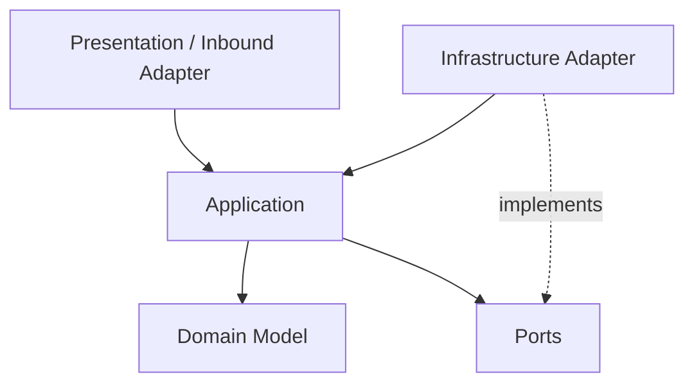

# Tổ chức gói theo ngữ cảnh và khả năng nghiệp vụ

Trong Domain-Driven Design (DDD), cách tổ chức package nên giúp người đọc nhận ra phần mềm đang mô hình hóa những năng lực nghiệp vụ nào, mỗi mô hình thuộc về bounded context nào và thành phần nào có quyền sở hữu quy tắc. Nếu mã nguồn chỉ được chia thành các package kỹ thuật chung như `controller`, `service`, `repository` và `entity`, các khái niệm của nhiều nghiệp vụ dễ bị trộn lẫn. Một thay đổi nhỏ có thể phải đi qua nhiều thư mục, trong khi ranh giới trách nhiệm vẫn không rõ.

Tổ chức package theo **bounded context** và **business capability** đưa cấu trúc mã nguồn gần với cách doanh nghiệp hoạt động. Mỗi khu vực mã nguồn thể hiện một năng lực hoặc mô hình nghiệp vụ có trách nhiệm rõ ràng; bên trong nó, nhóm có thể tiếp tục chia thành domain, application, infrastructure và giao diện. Cách tổ chức này đặc biệt phù hợp với modular monolith, nơi nhiều module nghiệp vụ cùng chạy trong một ứng dụng nhưng cần giữ ranh giới độc lập.

Bài học này trình bày mối quan hệ giữa domain, subdomain, bounded context, business capability và package; các cách tổ chức mã nguồn; quy tắc phụ thuộc; ví dụ Java; cách kiểm soát ranh giới và lộ trình tái cấu trúc.

## 1. Vì sao cấu trúc package có ý nghĩa kiến trúc?

Package không chỉ là nơi gom các file có tên gần nhau. Cấu trúc package ảnh hưởng đến cách đội phát triển tìm kiếm, hiểu trách nhiệm, kiểm soát phụ thuộc và thay đổi hệ thống.

Một cấu trúc package tốt giúp:

- Nhìn thấy các năng lực nghiệp vụ chính của ứng dụng.
- Biết mô hình và quy tắc nào thuộc về bounded context nào.
- Giữ các chi tiết triển khai gần với nơi sử dụng chúng.
- Hạn chế việc truy cập trực tiếp vào cấu trúc nội bộ của module khác.
- Làm rõ hướng phụ thuộc giữa domain, application và infrastructure.
- Hỗ trợ kiểm thử, triển khai và thay đổi từng phần với phạm vi ảnh hưởng dễ dự đoán.

Ngược lại, cấu trúc chỉ phản ánh loại công nghệ thường tạo ra các package có quá nhiều trách nhiệm. Ví dụ, mọi controller nằm trong một package, mọi repository nằm trong một package khác. Khi cần hiểu năng lực đặt hàng, lập trình viên phải tìm qua nhiều thư mục và tự ghép các lớp liên quan. Theo thời gian, các package kỹ thuật chung có thể trở thành nơi chứa nhiều nghiệp vụ không liên quan.

## 2. Phân biệt các khái niệm trước khi chọn cấu trúc

Một số khái niệm DDD có liên quan nhưng không đồng nghĩa. Cần phân biệt chúng để tránh lấy một sơ đồ nghiệp vụ làm cấu trúc package một cách máy móc.

| Khái niệm | Ý nghĩa | Tác động đến tổ chức mã nguồn |
|---|---|---|
| Domain | Lĩnh vực hoạt động và tri thức nghiệp vụ của tổ chức | Xác định phạm vi tổng thể mà ứng dụng hỗ trợ |
| Subdomain | Một phần nghiệp vụ có mục tiêu và tri thức tương đối riêng | Gợi ý các năng lực lớn cần được nhận diện |
| Business capability | Khả năng tổ chức cần có để tạo hoặc cung cấp giá trị | Có thể dùng làm trục nhóm các module nghiệp vụ |
| Bounded context | Ranh giới mà một mô hình và ngôn ngữ có ý nghĩa nhất quán | Là ứng viên quan trọng để xác định module hoặc package boundary |
| Package | Cơ chế tổ chức và đóng gói mã nguồn | Thể hiện cấu trúc trách nhiệm và quyền truy cập ở mức code |
| Module | Đơn vị tổ chức có ranh giới và hợp đồng phụ thuộc | Có thể được bảo vệ bằng package, build module hoặc JPMS |
| Deployable/service | Đơn vị được triển khai và vận hành | Có thể chứa một hoặc nhiều module tùy kiến trúc |

Business capability mô tả tổ chức cần làm được điều gì, ví dụ quản lý đơn hàng, quản lý tồn kho hoặc xử lý thanh toán. Subdomain mô tả phần tri thức của domain. Bounded context xác định phạm vi hiệu lực của một mô hình. Package là cấu trúc mã nguồn được chọn để hiện thực hóa các ranh giới đó.

Không nên mặc định mỗi subdomain, bounded context, package, module build và microservice luôn tương ứng một-một. Một bounded context có thể được triển khai bằng nhiều package hoặc module nội bộ. Một ứng dụng có thể chứa nhiều bounded context. Quyết định tách thành deployable riêng còn phụ thuộc vào nhu cầu triển khai, vận hành, mở rộng và quyền tự chủ của đội ngũ.

## 3. Hạn chế của cách tổ chức chỉ theo tầng kỹ thuật

Một cấu trúc thường gặp ở ứng dụng nhỏ là:

```text
com.example.shop
├── controller
├── service
├── repository
├── entity
├── dto
└── config
```

Cách này cho biết loại lớp nhưng không cho biết chúng phục vụ năng lực nghiệp vụ nào. Khi ứng dụng lớn dần, các package có thể chứa lớp từ bán hàng, kho, thanh toán và chăm sóc khách hàng cùng lúc.

Ví dụ, `OrderController`, `InventoryController` và `PaymentController` nằm trong cùng `controller`; `OrderService`, `InventoryService` và `PaymentService` nằm trong cùng `service`. Một thay đổi về đơn hàng có thể cần tìm qua nhiều package và dễ dẫn đến việc một service gọi trực tiếp repository của nghiệp vụ khác.

Những hệ quả thường thấy:

- Khó xác định module nào sở hữu một quy tắc.
- Các lớp cùng phục vụ một use case bị phân tán.
- Package `common`, `util` hoặc `service` phình to và trở thành nơi chia sẻ tùy tiện.
- Mô hình `Customer`, `Order` hoặc `Product` được dùng chung dù mỗi nghiệp vụ có ý nghĩa khác nhau.
- Phụ thuộc vòng xuất hiện giữa các service hoặc package.
- Việc chia nhóm phát triển theo năng lực nghiệp vụ khó thực hiện vì mã nguồn không phản ánh quyền sở hữu.

Tổ chức theo tầng kỹ thuật vẫn có thể phù hợp với ứng dụng rất nhỏ hoặc một thành phần kỹ thuật độc lập. Vấn đề xuất hiện khi nó trở thành trục tổ chức chính cho một hệ thống có nhiều năng lực và mô hình nghiệp vụ.

## 4. Tổ chức package theo business capability

Thay vì gom tất cả lớp cùng loại vào một nơi, hãy nhóm mã nguồn theo năng lực mà doanh nghiệp cần thực hiện. Ví dụ:

```text
com.example.shop
├── sales
├── inventory
├── payment
├── fulfillment
├── customer_support
└── identity
```

Mỗi khu vực thể hiện một năng lực. Khi cần hiểu luồng bán hàng, người đọc bắt đầu từ `sales`; khi cần hiểu việc giữ hàng và số lượng khả dụng, họ tìm ở `inventory`.

### 4.1. Ưu điểm của nhóm theo năng lực

- **Tính gắn kết cao hơn:** các lớp phục vụ cùng một nghiệp vụ nằm gần nhau.
- **Dễ tìm kiếm:** tên package mô tả mục đích nghiệp vụ thay vì chỉ loại lớp.
- **Giảm phụ thuộc chéo:** mỗi capability có thể công bố một số điểm truy cập rõ ràng.
- **Dễ giao quyền sở hữu:** nhóm phụ trách năng lực có thể làm việc trong phạm vi xác định.
- **Hỗ trợ tiến hóa:** có thể tách một capability thành module hoặc deployable riêng khi có lý do.

### 4.2. Chọn tên theo nghiệp vụ

Ưu tiên tên mà chuyên gia nghiệp vụ hiểu được, chẳng hạn `sales`, `inventory`, `pricing`, `fulfillment` hoặc `customercare`. Tránh tên gắn với framework hay cách triển khai như `springservices`, `database` hoặc `restcontrollers` ở cấp package nghiệp vụ cao nhất.

Tên cần ổn định và thể hiện trách nhiệm. Nếu một package `order` chứa cả xử lý thanh toán, tồn kho, giao hàng và chăm sóc khách hàng, đó có thể là dấu hiệu phạm vi đang quá rộng hoặc tên không phản ánh trách nhiệm thực tế.

## 5. Kết hợp bounded context với cấu trúc package

Business capability là trục hữu ích để nhóm các phần chức năng, nhưng bounded context mới là nơi xác định mô hình và ngôn ngữ có hiệu lực. Khi một capability có mô hình riêng, có thể dùng bounded context làm ranh giới package hoặc module.

Ví dụ, hệ thống bán lẻ có thể có các bounded context:

- **Sales Context:** giỏ hàng, đơn hàng, điều kiện xác nhận đơn và chính sách bán hàng.
- **Inventory Context:** số lượng tồn, giữ hàng, giải phóng hàng và điều chỉnh tồn.
- **Payment Context:** giao dịch, ghi nhận thanh toán, hoàn tiền và đối soát.
- **Fulfillment Context:** đóng gói, bàn giao vận chuyển và theo dõi giao hàng.
- **Customer Support Context:** yêu cầu hỗ trợ, trao đổi và xử lý khiếu nại.

Trong code, các context có thể được tổ chức thành package cấp cao tương ứng. Mỗi context giữ mô hình của mình và trao đổi qua các hợp đồng được công bố.

### 5.1. Không dùng một model chung chỉ vì tên giống nhau

Ví dụ, `Customer` có thể có nghĩa khác nhau:

- Sales cần người mua, địa chỉ nhận hóa đơn và lịch sử đặt hàng.
- Payment cần chủ thể thanh toán, phương thức thanh toán và thông tin đối soát.
- Support cần người liên hệ, kênh trao đổi và lịch sử yêu cầu hỗ trợ.

Không nên tạo một lớp `Customer` trong package `common` rồi để mọi context phụ thuộc vào nó nếu các mô hình có quy tắc và vòng đời khác nhau. Mỗi context có thể có kiểu dữ liệu riêng, hoặc dùng một định danh tham chiếu chung được định nghĩa rõ nếu đó thực sự là hợp đồng ổn định.

### 5.2. Một capability có thể bao gồm nhiều context

Một năng lực như quản lý khách hàng doanh nghiệp có thể bao gồm nhiều mô hình hoặc context khi có các quy tắc và quyền sở hữu khác nhau. Ngược lại, một bounded context có thể hỗ trợ nhiều capability liên quan. Hãy phân tích ngôn ngữ, trách nhiệm và invariant trước khi quyết định cấu trúc package.

## 6. Mẫu tổ chức bên trong một bounded context

Sau khi xác định package cấp cao theo context, có thể tổ chức phần bên trong theo các lớp trách nhiệm. Một mẫu phổ biến là tách domain, application, infrastructure và giao diện vào các package con.

```text
com.example.shop
├── sales
│   ├── domain
│   │   ├── model
│   │   ├── policy
│   │   ├── event
│   │   └── repository
│   ├── application
│   │   ├── command
│   │   ├── query
│   │   └── port
│   ├── infrastructure
│   │   ├── persistence
│   │   ├── messaging
│   │   └── external
│   └── presentation
│       └── rest
├── inventory
│   ├── domain
│   ├── application
│   ├── api
│   ├── infrastructure
│   └── presentation
└── payment
    ├── domain
    ├── application
    ├── infrastructure
    └── presentation
```

Đây là một cách tổ chức tham khảo, không phải cấu trúc bắt buộc. Context đơn giản có thể dùng ít package hơn; context lớn có thể chia theo use case hoặc capability nội bộ. Điều quan trọng là giữ trách nhiệm và hướng phụ thuộc rõ ràng.

### 6.1. Domain

Package `domain` chứa mô hình và quy tắc nghiệp vụ của bounded context:

- Entity và Value Object.
- Aggregate và invariant.
- Domain Service khi hành vi không tự nhiên thuộc một entity/value object.
- Domain Event.
- Policy hoặc specification nghiệp vụ.
- Repository interface nếu domain/application cần trừu tượng hóa việc lưu aggregate.

Domain không nên phụ thuộc vào framework web, ORM, message broker hoặc chi tiết cơ sở dữ liệu. Nó cần thể hiện nghiệp vụ bằng ngôn ngữ của context.

### 6.2. Application

Package `application` điều phối use case. Nó nhận yêu cầu từ bên ngoài, nạp mô hình cần thiết qua port, gọi hành vi domain, lưu kết quả và phát các thông điệp tích hợp theo quy trình đã xác định.

Application service không nên trở thành nơi chứa toàn bộ quy tắc nghiệp vụ. Nếu điều kiện hoặc quyết định thuộc mô hình miền, hãy đặt nó trong domain model hoặc policy phù hợp. Application chủ yếu điều phối trình tự và ranh giới giao dịch.

### 6.3. Infrastructure

Package `infrastructure` hiện thực các chi tiết kỹ thuật:

- Repository implementation dùng JPA, JDBC hoặc công nghệ lưu trữ khác.
- Adapter cho message broker và hệ thống bên ngoài.
- Cấu hình client, serialization và transaction.
- Outbox, inbox hoặc cơ chế tích hợp kỹ thuật.

Infrastructure phụ thuộc vào abstraction mà domain/application định nghĩa. Domain không nên import ngược implementation của infrastructure.

### 6.4. Presentation hoặc inbound adapter

Package `presentation` chứa REST controller, GraphQL resolver, consumer endpoint hoặc giao diện đầu vào khác. Nó chuyển đổi request thành command/query của application và chuyển kết quả thành response phù hợp.

Controller nên mỏng: kiểm tra định dạng đầu vào, xác thực quyền truy cập ở lớp phù hợp, gọi use case và ánh xạ kết quả. Không đặt quy tắc miền quan trọng trong controller.

## 7. Ví dụ Java: cấu trúc theo context

Giả sử ứng dụng Java triển khai modular monolith cho bán lẻ. Cấu trúc package có thể như sau:

```text
src/main/java/com/acme/retail
├── sales
│   ├── domain
│   │   ├── order
│   │   │   ├── Order.java
│   │   │   ├── OrderLine.java
│   │   │   └── OrderId.java
│   │   ├── pricing
│   │   └── event
│   ├── application
│   │   ├── PlaceOrderUseCase.java
│   │   └── ConfirmOrderHandler.java
│   ├── infrastructure
│   │   └── persistence
│   └── presentation
│       └── OrderController.java
├── inventory
│   ├── domain
│   │   ├── stock
│   │   └── reservation
│   ├── application
│   ├── api
│   ├── infrastructure
│   └── presentation
└── payment
    ├── domain
    ├── application
    ├── infrastructure
    └── presentation
```

Một use case trong Sales Context có thể phụ thuộc vào một port do chính Sales sở hữu:

```java
package com.acme.retail.sales.application.port;

import com.acme.retail.sales.domain.order.OrderId;
import com.acme.retail.sales.domain.order.OrderLine;
import java.util.List;

public interface StockReservation {
    ReservationResult reserve(
            OrderId orderId,
            List<OrderLine> lines
    );
}
```

Port diễn đạt nhu cầu của Sales: nó cần yêu cầu giữ hàng. Nó không nhất thiết phải biết Inventory dùng REST, messaging hay gọi một module Java khác.

Inventory công bố một API riêng, chỉ chứa Published Language và facade cần thiết. Ví dụ, package `inventory.api` có thể cung cấp:

Trong Java, mỗi kiểu top-level khai báo `public` dưới đây được đặt trong file riêng có tên tương ứng.

Các ví dụ dùng `record` và `Stream.toList()`, phù hợp với Java 16 trở lên. Với phiên bản Java cũ hơn, có thể dùng lớp bất biến thông thường và collector tương ứng.

```java
package com.acme.retail.inventory.api;

import java.util.List;

public interface InventoryApi {
    ReservationResponse reserve(ReservationRequest request);
}

public record ReservationRequest(
        String orderReference,
        String locationId,
        List<ReservationItem> items
) {}

public record ReservationItem(String sku, int quantity, String unit) {}

public record ReservationResponse(
        String reservationId,
        String status
) {}
```

Ở phía Sales, adapter thuộc `sales.infrastructure` hiện thực port mà application cần và chuyển đổi kiểu dữ liệu của Sales sang Published Language của Inventory:

```java
package com.acme.retail.sales.infrastructure.inventory;

import com.acme.retail.inventory.api.InventoryApi;
import com.acme.retail.inventory.api.ReservationItem;
import com.acme.retail.inventory.api.ReservationRequest;
import com.acme.retail.sales.application.port.StockReservation;
import com.acme.retail.sales.application.port.ReservationResult;
import com.acme.retail.sales.domain.order.OrderId;
import com.acme.retail.sales.domain.order.OrderLine;
import java.util.List;

public final class InventoryStockReservationAdapter
        implements StockReservation {

    private final InventoryApi inventoryApi;

    public InventoryStockReservationAdapter(InventoryApi inventoryApi) {
        this.inventoryApi = inventoryApi;
    }

    @Override
    public ReservationResult reserve(OrderId orderId, List<OrderLine> lines) {
        var request = new ReservationRequest(
                orderId.value(),
                "default-location",
                lines.stream()
                        .map(line -> new ReservationItem(
                                line.sku().value(),
                                line.quantity().value(),
                                "piece"))
                        .toList());

        var response = inventoryApi.reserve(request);
        return ReservationResult.from(response.reservationId(), response.status());
    }
}
```

Trong ví dụ, `InventoryApi` và các record thuộc Published Language do Inventory sở hữu; `StockReservation` và `ReservationResult` thuộc nhu cầu của Sales; adapter nối hai mô hình. Giá trị địa điểm và đơn vị trong ví dụ chỉ là minh họa, hệ thống thật phải lấy chúng từ dữ liệu nghiệp vụ phù hợp. Khi chạy trong cùng tiến trình, adapter có thể gọi facade công khai của Inventory. Khi tách tiến trình, implementation của `InventoryApi` có thể gọi HTTP hoặc message broker mà không làm thay đổi domain model của Sales.

Ví dụ về application service trong Sales phụ thuộc vào port do Sales sở hữu:

```java
package com.acme.retail.sales.application;

public final class PlaceOrderHandler {
    private final OrderRepository orders;
    private final StockReservation stockReservation;

    public PlaceOrderHandler(
            OrderRepository orders,
            StockReservation stockReservation
    ) {
        this.orders = orders;
        this.stockReservation = stockReservation;
    }

    public PlaceOrderResult handle(PlaceOrderCommand command) {
        // Tạo và kiểm tra đơn bằng mô hình Sales.
        // Gọi port của Sales; adapter sẽ chuyển đổi sang API của Inventory.
        // Lưu và trả kết quả theo quy tắc use case.
        return PlaceOrderResult.accepted();
    }
}
```

Phần thân được rút gọn để tập trung vào cấu trúc package. Trong hệ thống thực tế, cần xử lý giao dịch, timeout, kết quả chưa xác định, idempotency và quy trình bù trừ theo yêu cầu nghiệp vụ.

## 8. Quy tắc phụ thuộc giữa các package

Tổ chức package theo context chỉ có ý nghĩa nếu các ranh giới được giữ trong mã nguồn. Nếu `sales` có thể import mọi lớp nội bộ của `inventory`, hai package vẫn phụ thuộc chặt dù nằm ở hai thư mục khác nhau.

### 8.1. Nguyên tắc cơ bản

- Domain chỉ phụ thuộc vào các abstraction và kiểu miền cần thiết.
- Application điều phối domain và phụ thuộc vào các port mà use case cần.
- Infrastructure hiện thực port và phụ thuộc vào thư viện hoặc hệ thống bên ngoài.
- Presentation gọi application, không tự thực hiện quy tắc nghiệp vụ.
- Context khác chỉ sử dụng hợp đồng công khai được cho phép.
- Không truy cập trực tiếp repository, entity hoặc bảng dữ liệu nội bộ của context khác.

Hướng phụ thuộc trong một context thường có thể mô tả như sau:



Mũi tên biểu diễn phụ thuộc mã nguồn ở mức khái quát. Cách tổ chức cụ thể có thể khác, nhưng domain không nên bị buộc phụ thuộc vào framework hoặc chi tiết lưu trữ.

### 8.2. Không gọi repository của context khác

Ví dụ không nên làm:

```java
// Sales truy cập thẳng repository nội bộ của Inventory.
InventoryStockEntity stock = inventoryJpaRepository.findBySku(sku);
```

Cách này khiến Sales phụ thuộc vào persistence model và cách lưu trữ của Inventory. Nếu Inventory đổi schema hoặc cách tính tồn khả dụng, Sales có thể phải thay đổi theo.

Thay vào đó, Sales nên gọi một use case hoặc contract công khai như `InventoryGateway`, nhận kết quả có ngữ nghĩa và tự chuyển đổi sang mô hình của mình.

### 8.3. Tránh phụ thuộc vòng

Nếu Sales import Inventory, đồng thời Inventory import Sales, hai context không còn độc lập. Cần xem lại quyền sở hữu hợp đồng và hướng phụ thuộc. Một số cách giải quyết:

- Đặt Published Language hoặc integration contract ở package/API có chủ sở hữu rõ.
- Dùng port do bên gọi định nghĩa và adapter để nối với provider.
- Dùng event để thông báo thay đổi khi không cần phản hồi đồng bộ.
- Dùng ACL khi mô hình hai bên khác nhau đáng kể.

Không nên tạo một package `shared` khổng lồ chỉ để phá vòng phụ thuộc. Chỉ chia sẻ các kiểu thực sự ổn định, có ý nghĩa chung và có quy tắc quản trị rõ ràng.

## 9. Kiểm soát ranh giới trong Java

Java cung cấp một số cơ chế giúp kiểm soát truy cập, nhưng package name đơn thuần không tạo ra module boundary tuyệt đối.

### 9.1. Dùng package-private có chủ đích

Trong Java, thành phần không khai báo `public`, `protected` hoặc `private` có package-private access. Các lớp trong cùng package có thể truy cập chúng, còn lớp ở package khác không thể sử dụng trực tiếp.

Điều này hữu ích để giữ implementation nội bộ. Ví dụ, chỉ công bố facade hoặc interface cần thiết ở mức `public`; giữ các handler, mapper và helper nội bộ ở phạm vi package khi phù hợp.

Tuy nhiên, package-private không tự bảo vệ toàn bộ bounded context nếu mọi package con đều công khai quá nhiều lớp hoặc nếu các context cùng nằm trong một package tổng có nhiều quyền truy cập.

### 9.2. Dùng Java Platform Module System khi phù hợp

JPMS cho phép định nghĩa module bằng `module-info.java` và chỉ export những package cần công bố. Ví dụ:

```java
module com.acme.retail.inventory {
    exports com.acme.retail.inventory.api;

    requires java.logging;
}
```

Các package nội bộ của Inventory không được export sẽ không thể được module khác truy cập theo quy tắc JPMS thông thường. JPMS có thể tăng cường ranh giới compile-time, nhưng cần cân nhắc framework, reflection, test và cách đóng gói ứng dụng.

### 9.3. Dùng build module để tăng mức cô lập

Một modular monolith có thể chia thành nhiều Gradle/Maven module trong cùng repository. Mỗi module công bố API và khai báo dependency rõ ràng. Cách này giúp phát hiện phụ thuộc sai sớm hơn so với chỉ dùng package convention.

Không cần tạo build module cho mọi package. Chỉ nên nâng một bounded context thành module build khi lợi ích về quyền sở hữu, kiểm soát dependency, build hoặc tái sử dụng lớn hơn chi phí cấu hình và bảo trì.

## 10. Chọn mức độ phân rã phù hợp

Không có một cây package duy nhất đúng cho mọi ứng dụng. Có thể chọn cấu trúc đơn giản hoặc chi tiết tùy kích thước context, số lượng use case, độ phức tạp nghiệp vụ và cách đội ngũ làm việc.

### 10.1. Context nhỏ

Một context có ít hành vi có thể dùng cấu trúc gọn:

```text
inventory
├── InventoryFacade.java
├── Stock.java
├── Reservation.java
├── InventoryRepository.java
└── JpaInventoryRepository.java
```

Khi trách nhiệm còn đơn giản, việc tạo nhiều tầng package rỗng có thể làm tăng điều hướng mà không tăng tính rõ ràng.

### 10.2. Context vừa

Khi xuất hiện nhiều use case và adapter, có thể tách:

```text
inventory
├── api
├── domain
├── application
├── infrastructure
└── presentation
```

### 10.3. Context lớn

Context lớn có thể tiếp tục chia theo capability hoặc nhóm use case bên trong, sau đó đặt các tầng trách nhiệm ở phạm vi cần thiết:

```text
inventory
├── stock
│   ├── domain
│   ├── application
│   └── infrastructure
├── reservation
│   ├── domain
│   ├── application
│   └── infrastructure
├── replenishment
│   ├── domain
│   ├── application
│   └── infrastructure
└── api
```

Chỉ chia nhỏ khi các phần có mục tiêu, quy tắc, vòng đời hoặc nhịp thay đổi đủ khác nhau. Nếu mọi package con vẫn phải truy cập mọi thứ của nhau, việc phân rã có thể chỉ làm cây thư mục sâu hơn.

## 11. Package theo capability và package theo layer có thể kết hợp

Không cần chọn tuyệt đối một trong hai. Một cách phổ biến là **package theo capability/context ở cấp cao**, sau đó **package theo layer hoặc adapter ở bên trong**.

Ví dụ:

```text
com.acme.retail
├── sales                 # Capability / Bounded Context
│   ├── domain            # Domain layer
│   ├── application       # Use case orchestration
│   ├── infrastructure    # Persistence and outbound adapters
│   └── presentation      # Inbound adapters
├── inventory             # Capability / Bounded Context
│   ├── domain
│   ├── application
│   ├── infrastructure
│   └── presentation
└── payment               # Capability / Bounded Context
    ├── domain
    ├── application
    ├── infrastructure
    └── presentation
```

Cấu trúc này giữ các lớp liên quan đến một nghiệp vụ gần nhau, đồng thời vẫn thể hiện hướng phụ thuộc bên trong context. Nó cũng giúp một context có thể được chuyển sang module build hoặc deployable riêng khi cần mà không phải di chuyển toàn bộ mã nguồn từ các package kỹ thuật dùng chung.

## 12. Đặt tên và quản lý package `shared`, `common` và `kernel`

Các package dùng chung thường bắt đầu nhỏ nhưng dễ trở thành nơi chứa mọi thứ không biết đặt ở đâu. Cần có tiêu chí rõ trước khi đưa một kiểu dữ liệu vào đó.

### 12.1. Khi nào có thể chia sẻ?

Một kiểu có thể phù hợp để chia sẻ khi:

- Nó thực sự có cùng ý nghĩa trong các context sử dụng.
- Nó ổn định và thay đổi có quy trình phối hợp rõ.
- Không kéo theo quy tắc nghiệp vụ riêng của một context.
- Có chủ sở hữu và mục đích sử dụng được xác định.
- Chi phí chia sẻ thấp hơn chi phí chuyển đổi hoặc duy trì bản sao.

Ví dụ, một kiểu `CorrelationId` thuần kỹ thuật có thể được dùng chung. Nhưng `Money`, `Customer`, `Product` hoặc `Address` không tự động là khái niệm chung; mỗi context có thể cần quy tắc, đơn vị hoặc vòng đời khác nhau.

### 12.2. Shared Kernel trong DDD

Shared Kernel là một phần mô hình được hai hoặc nhiều context/nhóm thống nhất chia sẻ. Nó khác với một package `common` tùy tiện. Phần dùng chung cần có phạm vi nhỏ, quyền sở hữu chung, quy trình thay đổi và kiểm thử tương thích.

Nếu hai nhóm không thể phối hợp khi thay đổi, Shared Kernel có thể tạo ra phụ thuộc lớn hơn lợi ích. Trong trường hợp đó, hai mô hình riêng với adapter hoặc mapping có thể an toàn hơn.

### 12.3. Tránh package tiện ích không có ranh giới

Một package `util` hoặc `common` không nên chứa logic nghiệp vụ chỉ vì nhiều nơi gọi nó. Hãy đặt quy tắc ở context sở hữu nó. Nếu một hàm có vẻ dùng chung nhưng ý nghĩa khác nhau, giữ các implementation riêng và đặt tên theo nghiệp vụ.

## 13. Tổ chức test theo bounded context

Cấu trúc test nên giúp xác định nhanh phạm vi hành vi đang được kiểm tra. Có thể phản chiếu cấu trúc package chính:

```text
src/test/java/com/acme/retail
├── sales
│   ├── domain
│   ├── application
│   └── architecture
├── inventory
│   ├── domain
│   ├── application
│   └── architecture
└── integration
    ├── sales_inventory
    └── payment_sales
```

Các nhóm kiểm thử có thể gồm:

- **Domain unit tests:** kiểm tra invariant, hành vi entity, value object và policy.
- **Application tests:** kiểm tra điều phối use case và các port.
- **Adapter tests:** kiểm tra repository, API client, message publisher/consumer.
- **Contract tests:** xác nhận Published Language và hợp đồng giữa context.
- **Architecture tests:** kiểm tra dependency rule, package access và cấm phụ thuộc chéo.
- **End-to-end tests:** kiểm tra một số luồng nghiệp vụ quan trọng xuyên nhiều context.

Không nên chỉ dựa vào end-to-end test để kiểm tra mọi quy tắc. Domain test thường nhanh và chỉ rõ hành vi sai ở đâu; contract test giúp phát hiện lệch hợp đồng giữa các context.

## 14. Kiểm soát dependency bằng kiểm thử kiến trúc

Quy tắc package cần được kiểm tra tự động khi hệ thống đủ lớn. Một số công cụ như ArchUnit có thể diễn đạt dependency rule trong test Java.

Ví dụ ý tưởng: domain không được phụ thuộc vào presentation hoặc infrastructure:

```java
@AnalyzeClasses(packages = "com.acme.retail")
class DomainDependencyTest {

    @ArchTest
    static final ArchRule domainMustNotDependOnAdapters =
        noClasses()
            .that().resideInAnyPackage("..domain..")
            .should().dependOnClassesThat()
            .resideInAnyPackage("..presentation..", "..infrastructure..");
}
```

Có thể bổ sung quy tắc cho context:

```java
@ArchTest
static final ArchRule salesMustNotUseInventoryInternals =
    noClasses()
        .that().resideInAnyPackage("..sales..")
        .should().dependOnClassesThat()
        .resideInAnyPackage("..inventory.domain..", "..inventory.infrastructure..");
```

Ví dụ này minh họa ý tưởng, cần điều chỉnh package pattern theo cấu trúc thật. Nếu Sales được phép dùng `inventory.api`, hãy chỉ cấm các package nội bộ và cho phép API công khai. Kiểm thử kiến trúc nên phản ánh hợp đồng thực tế, không cấm mọi phụ thuộc một cách máy móc.

## 15. Lộ trình tái cấu trúc từ package theo layer sang package theo context

Không nhất thiết phải viết lại toàn bộ ứng dụng. Có thể di chuyển dần theo một năng lực nghiệp vụ có phạm vi rõ.

### Bước 1: Khảo sát dependency hiện tại

Lập danh sách use case, lớp chính, repository, entity, controller và các phụ thuộc giữa chúng. Xác định lớp nào thuộc năng lực nào và nơi nào đang chứa nhiều nghiệp vụ khác nhau.

### Bước 2: Chọn một capability để thử

Chọn phần có ranh giới tương đối rõ, ít phụ thuộc ngoài hoặc đang có nhu cầu thay đổi. Không nhất thiết chọn module lớn nhất. Một thử nghiệm nhỏ giúp nhóm kiểm tra quy ước package trước khi mở rộng.

### Bước 3: Xác định bounded context và mô hình

Làm rõ thuật ngữ, quy tắc, dữ liệu và quyền sở hữu. Không chỉ di chuyển file theo tên bảng hoặc controller. Một lớp cần được đặt theo trách nhiệm nghiệp vụ và mô hình mà nó phục vụ.

### Bước 4: Tạo package cấp context

Đưa các thành phần của capability vào package mới. Trong giai đoạn đầu có thể giữ adapter cũ hoặc facade tương thích để tránh làm thay đổi hành vi bên ngoài.

### Bước 5: Đưa quy tắc về đúng domain model

Tách quy tắc khỏi controller hoặc service kỹ thuật khi chúng thực sự thuộc nghiệp vụ. Đảm bảo domain không phụ thuộc vào framework và persistence.

### Bước 6: Thiết lập API và dependency rule

Chỉ công bố các kiểu và use case cần thiết. Chuyển truy cập trực tiếp giữa các package thành contract, port hoặc event phù hợp. Thêm kiểm thử kiến trúc để ngăn phụ thuộc sai quay trở lại.

### Bước 7: Cập nhật test và tài liệu

Di chuyển hoặc bổ sung test theo context, cập nhật sơ đồ package, hướng dẫn và ownership. Kiểm tra các luồng xuyên context sau mỗi đợt thay đổi.

### Bước 8: Lặp lại và loại bỏ đường cũ

Khi capability đầu tiên ổn định, áp dụng quy ước cho phần tiếp theo. Xóa facade hoặc package cũ khi không còn consumer. Không giữ song song hai cấu trúc vô thời hạn.

## 16. Ví dụ so sánh trước và sau

Giả sử một ứng dụng ban đầu có:

```text
com.acme.retail
├── controller
│   ├── OrderController.java
│   ├── StockController.java
│   └── PaymentController.java
├── service
│   ├── OrderService.java
│   ├── StockService.java
│   └── PaymentService.java
├── repository
│   ├── OrderRepository.java
│   ├── StockRepository.java
│   └── PaymentRepository.java
└── entity
    ├── OrderEntity.java
    ├── StockEntity.java
    └── PaymentEntity.java
```

Sau khi phân tích bounded context, có thể tổ chức:

```text
com.acme.retail
├── sales
│   ├── api
│   ├── domain
│   ├── application
│   ├── infrastructure
│   └── presentation
├── inventory
│   ├── api
│   ├── domain
│   ├── application
│   ├── infrastructure
│   └── presentation
└── payment
    ├── api
    ├── domain
    ├── application
    ├── infrastructure
    └── presentation
```

Sự khác biệt quan trọng là người đọc có thể xác định trách nhiệm theo nghiệp vụ và xem API công khai của mỗi context. Tuy nhiên, chỉ đổi tên thư mục chưa đủ. Cần chuyển quyền sở hữu mô hình, giảm truy cập chéo và thực thi dependency rule để ranh giới có hiệu lực.

## 17. Checklist đánh giá cấu trúc package

Trước khi xem cấu trúc package là phù hợp với DDD, hãy kiểm tra:

- [ ] Package cấp cao thể hiện năng lực hoặc bounded context có ý nghĩa nghiệp vụ.
- [ ] Tên package dùng ngôn ngữ mà chuyên gia nghiệp vụ có thể nhận ra.
- [ ] Mỗi context sở hữu mô hình và quy tắc riêng.
- [ ] Các lớp cùng phục vụ một use case được nhóm gần nhau.
- [ ] Domain không phụ thuộc framework, database hoặc giao diện.
- [ ] Application điều phối use case, không trở thành nơi chứa mọi quy tắc.
- [ ] Infrastructure hiện thực adapter và port ở đúng ranh giới.
- [ ] Context khác chỉ truy cập hợp đồng công khai.
- [ ] Không có truy cập trực tiếp vào repository hoặc entity nội bộ của context khác.
- [ ] Không có phụ thuộc vòng giữa các context.
- [ ] Package `common` hoặc `shared` có phạm vi và chủ sở hữu rõ.
- [ ] Test và architecture rule bảo vệ các dependency quan trọng.
- [ ] Mức phân rã không tạo ra quá nhiều package rỗng hoặc abstraction không cần thiết.
- [ ] Cấu trúc hỗ trợ cách nhóm phát triển sở hữu và thay đổi nghiệp vụ.

## 18. Kết nối với các phần khác của DDD

Tổ chức package theo bounded context là cách đưa kết quả **Strategic Design** vào cấu trúc mã nguồn. Domain, subdomain và business capability giúp hiểu các phần nghiệp vụ; bounded context xác định nơi mô hình và ngôn ngữ có hiệu lực; Context Map mô tả quan hệ giữa các context. Từ đó, package và module có thể được thiết kế để phản ánh quyền sở hữu và hợp đồng tích hợp.

Ở bên trong từng context, **Tactical Design** cung cấp các khái niệm entity, value object, aggregate, repository và domain event để biểu diễn quy tắc. Cấu trúc package nên giúp các khái niệm này nằm trong phạm vi đúng, đồng thời giữ chi tiết hạ tầng ở bên ngoài domain model.

Một cấu trúc package tốt không được đánh giá bằng số tầng hay số thư mục. Nó có giá trị khi người phát triển tìm được đúng nghiệp vụ, hiểu được quyền sở hữu, thay đổi một mô hình với phạm vi ảnh hưởng có thể dự đoán và giữ các bounded context giao tiếp qua hợp đồng rõ ràng.
