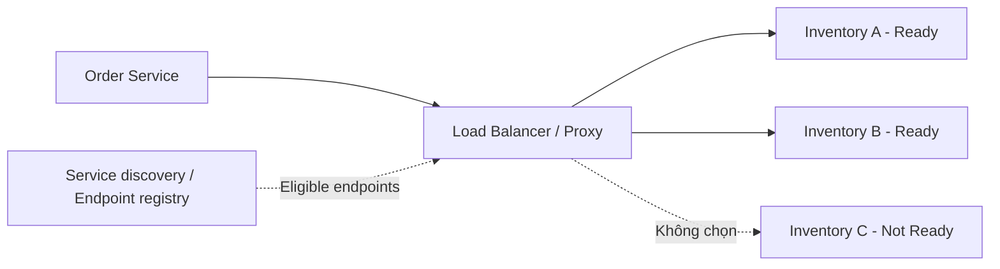
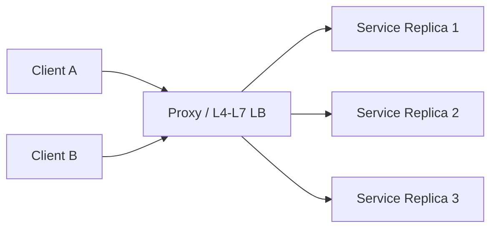
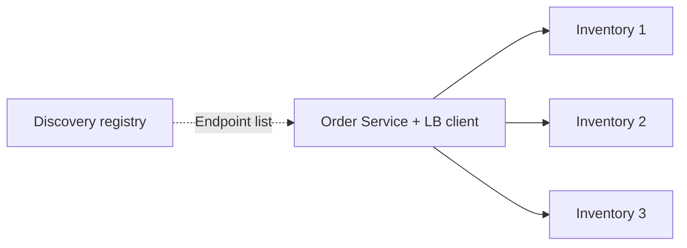
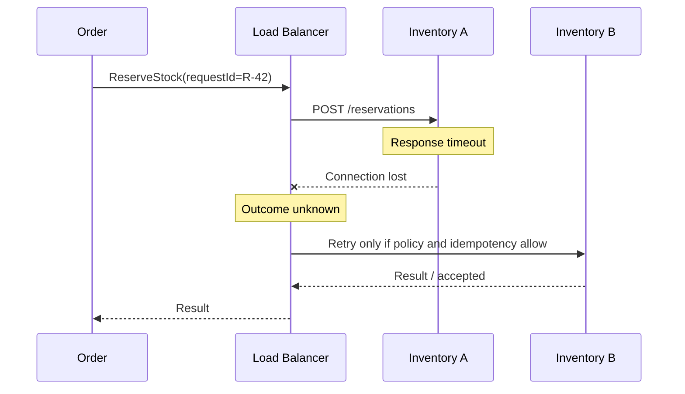
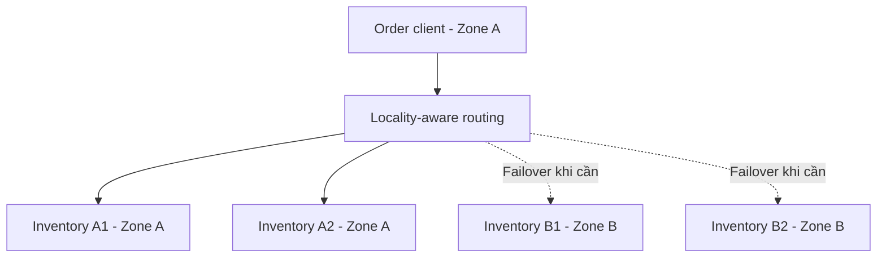
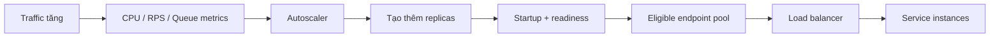
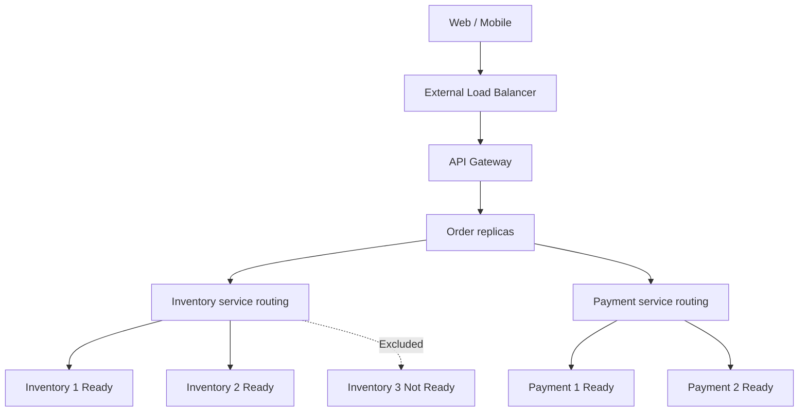

# Cân bằng tải và phân phối yêu cầu đến các thể hiện khỏe mạnh trong Microservices

## 1. Vì sao service discovery chưa đủ?

Trong kiến trúc microservices, một dịch vụ logic như Order, Inventory hoặc Payment thường chạy dưới **nhiều thể hiện (instances/replicas)** để tăng năng lực xử lý và duy trì tính sẵn sàng. Một client không nên phải biết địa chỉ IP cố định của từng container hoặc pod vì các thể hiện có thể được tạo, xóa, khởi động lại, chuyển máy và triển khai phiên bản mới liên tục.

**Service discovery** trả lời: “Hiện có những endpoint nào đại diện cho dịch vụ này?”

**Load balancing** trả lời: “Từ tập endpoint phù hợp, nên gửi yêu cầu tiếp theo đến endpoint nào?”

**Health-aware routing** bổ sung điều kiện: “Endpoint nào còn đủ khỏe, đã sẵn sàng và có khả năng nhận yêu cầu đó ở thời điểm quyết định?”

Nếu discovery đúng nhưng load balancer tiếp tục gửi request đến instance đã crash, chưa khởi động xong hoặc đang quá tải, hệ thống vẫn trả lỗi cho người dùng. Nếu health check chính xác nhưng thuật toán phân phối đẩy quá nhiều request vào một replica, sẽ có instance nghẽn trong khi những instance khác rảnh.

Mục tiêu là kết hợp **khám phá endpoint, nhận biết trạng thái, chính sách lựa chọn, kiểm soát lỗi và quan sát thực tế** để phân phối lưu lượng an toàn.

### Kết quả học tập

Sau bài này, bạn có thể:

1. Phân biệt service discovery, load balancing, readiness, liveness và circuit breaker.
2. Mô tả được luồng request từ client qua proxy/load balancer đến một instance đủ điều kiện.
3. Chọn thuật toán cân bằng tải phù hợp với đồng nhất tài nguyên, chi phí xử lý, kết nối dài và yêu cầu affinity.
4. Thiết kế health check, loại endpoint lỗi và cho endpoint hồi phục vào lại đúng thời điểm.
5. Phân biệt tải lệch do connection pooling/HTTP2 với lỗi của thuật toán routing.
6. Giải thích timeout, retry, failover, draining và cách tránh retry storm.
7. Thiết lập ví dụ Kubernetes Service và probes, rồi quan sát phân bố request.
8. Đề xuất chỉ số và kịch bản kiểm thử để xác nhận cân bằng tải có hiệu quả thực tế.

## 2. Mô hình cơ bản

Giả sử Inventory có ba replicas:



Trong mô hình này:

- Order biết **tên dịch vụ logic** Inventory, chứ không cần biết IP của từng replica.
- Discovery cung cấp danh sách endpoint và có thể kèm metadata vùng, phiên bản hoặc trạng thái.
- Load balancer duy trì tập endpoint **eligible** theo chính sách health và routing.
- Một request được gửi đến một endpoint đủ điều kiện; tùy giao thức, có thể tái sử dụng connection.
- Instance đang Not Ready không được nhận **yêu cầu mới** theo cơ chế routing đã định, dù process vẫn còn chạy để hoàn thành những công việc đang xử lý.

Sơ đồ này đơn giản hóa thực tế: một số hệ thống dùng client-side balancing thay vì proxy tập trung; một số có nhiều tầng gateway, ingress, service mesh và load balancer hạ tầng. Vì thế phải xác định **tầng nào đang quyết định endpoint cuối cùng**.

### 2.1. Các khái niệm cần phân biệt

| Khái niệm | Câu hỏi | Ý nghĩa |
| --- | --- | --- |
| Logical service | Client muốn gọi năng lực nào? | Ví dụ inventory-service |
| Instance / replica | Có bao nhiêu bản đang chạy? | Pod, VM, process hoặc task |
| Endpoint | Kết nối đến đâu? | IP:port, socket, URL phù hợp |
| Service registry | Instance nào được đăng ký? | Danh sách và metadata để discovery |
| Eligible endpoint | Endpoint nào được phép nhận yêu cầu mới? | Lọc theo readiness, health, subset, policy |
| Active health check | Endpoint có đáp ứng probe không? | LB hoặc control plane chủ động thăm dò |
| Passive health check | Traffic thực báo lỗi/timeout như thế nào? | Dựa vào kết quả request đang diễn ra |
| Liveness | Có nên khởi động lại tiến trình không? | Một loại tín hiệu khác với readiness |
| Readiness | Có nên đưa endpoint vào tập nhận tải không? | Quyết định định tuyến yêu cầu mới |
| Load-balancing policy | Chọn endpoint bằng quy tắc nào? | Round robin, least requests, hash, locality |
| Outlier ejection | Có tạm thời loại endpoint lỗi liên tiếp không? | Bảo vệ client, cần cấu hình tránh eject toàn bộ |

**Healthy không có nghĩa luôn trả thành công.** Một instance có thể trả HTTP 409 vì xung đột nghiệp vụ và vẫn hoàn toàn khỏe. Ngược lại, instance có thể trả 200 cho endpoint /health trong khi đường nghiệp vụ bị nghẽn vì pool kết nối database cạn. Tín hiệu readiness phải thể hiện khả năng phục vụ yêu cầu trong phạm vi đã thiết kế, không chỉ “process còn chạy”.

## 3. Luồng đầy đủ từ discovery đến routing

Một vòng đời thông thường:

1. **Instance khởi động**: load cấu hình, tạo connection pool, chuẩn bị cache cần thiết, thực hiện startup tasks.
2. **Đăng ký hoặc được phát hiện**: registry/control plane biết endpoint mới tồn tại.
3. **Được đánh giá readiness**: endpoint chỉ đủ điều kiện sau khi vượt qua các kiểm tra phù hợp.
4. **Load balancer nhận danh sách cập nhật**: endpoint set thay đổi theo cơ chế watch/push/poll, DNS hoặc service registry.
5. **Client phát request**: hệ thống định tuyến lọc endpoint theo route, version, zone, health và chính sách.
6. **Thuật toán chọn đích**: dùng round robin, weighted choice, least outstanding requests hoặc chính sách khác.
7. **Gửi và theo dõi**: thiết lập hoặc tái sử dụng kết nối, quan sát duration, success/failure và dấu hiệu quá tải.
8. **Xử lý sự cố**: timeout, retry tới endpoint khác khi an toàn, ejection hoặc giảm trọng số theo chính sách.
9. **Instance sắp rời hệ thống**: chuyển Not Ready, dừng nhận request mới, drain request đang chạy rồi đóng kết nối.
10. **Discovery cập nhật endpoint set**: các proxy/client ngừng dùng endpoint đã rời sau thời gian hội tụ.

### 3.1. Control plane và data plane

- **Control plane:** cung cấp cấu hình route, membership, endpoint discovery, chính sách và thông tin phiên bản.
- **Data plane:** trực tiếp chuyển request/packet tới endpoint và thu thập kết quả.

Ví dụ, Kubernetes control plane cập nhật đối tượng Service/EndpointSlice; các thành phần data plane như kube-proxy hoặc một implementation khác thực hiện chuyển tiếp lưu lượng. Với service mesh, control plane có thể phân phối endpoints và policy tới các sidecar/ambient proxies.

Phân biệt hai mặt phẳng giúp chẩn đoán: “pod Ready nhưng proxy chưa nhận endpoint mới” là vấn đề hội tụ discovery/config; “proxy biết endpoint nhưng luôn chọn instance nóng” lại có thể là thuật toán, connection pooling hoặc chỉ số tải.

## 4. Các vị trí triển khai load balancer

### 4.1. Server-side load balancing

Client gọi một địa chỉ logic/virtual IP/proxy. Load balancer đứng ở phía hạ tầng và chọn backend.



**Ưu điểm:** client đơn giản, chính sách nhất quán ở proxy, hỗ trợ tập trung quan sát, TLS termination và routing.

**Đánh đổi:** thêm hop và thành phần vận hành. Nếu triển khai một proxy duy nhất không có dự phòng, nó trở thành điểm lỗi đơn lẻ; cần kiến trúc HA phù hợp. Cấu hình sai ở LB tập trung có thể ảnh hưởng nhiều service.

### 4.2. Client-side load balancing

Client hoặc thư viện SDK lấy danh sách endpoints và tự chọn một đích:



**Ưu điểm:** không bắt buộc thêm hop qua proxy và có thể kết hợp metadata/cân bằng tải ngay ở caller.

**Đánh đổi:** logic health/routing nằm trong nhiều client; cần cập nhật thư viện và cấu hình nhất quán. Cần kiểm soát cache endpoint, version và cách xử lý khi registry không sẵn sàng.

### 4.3. Layer 4 (L4) và Layer 7 (L7)

| Đặc điểm | L4 | L7 |
| --- | --- | --- |
| Đơn vị điều phối phổ biến | Kết nối/flow TCP hoặc UDP | HTTP/gRPC request/stream tùy proxy |
| Thông tin có thể dùng | IP, port, protocol, connection state | Host, path, headers, method, status, metadata |
| Routing theo HTTP path | Thường không | Có |
| Health/rate limit theo ứng dụng | Hạn chế hoặc qua cơ chế bổ sung | Linh hoạt hơn |
| Phù hợp | Chuyển tiếp kết nối hiệu quả, giao thức không cần inspect | API routing, canary, auth, header-based routing |
| Cạm bẫy | Kết nối dài tạo phân phối request lệch | Chi phí xử lý cao hơn, cấu hình phức tạp |

Một kết nối có thể mang nhiều requests. L4 chia kết nối đều **không bảo đảm requests đều** nếu một số kết nối gửi nhiều traffic hơn. HTTP/2/gRPC multiplexing có thể làm đặc điểm này rõ rệt.

### 4.4. Nhiều tầng cân bằng tải

Một luồng có thể đi qua Cloud LB → Ingress/API Gateway → Service Mesh → Backend. Mỗi tầng có mục đích khác nhau: external access, authentication, routing theo path/tenant, hay traffic nội bộ.

Khi debug, hãy biết **tầng nào có quyền lựa chọn backend và health signal nào nó sử dụng**. Cùng một request có thể được cân bằng ở nhiều tầng; nếu hai tầng đều retry, số attempts có thể tăng khó kiểm soát.

## 5. Health-aware routing: “khỏe” gồm những tín hiệu nào?

### 5.1. Liveness, readiness và startup

Ba loại tín hiệu thường được dùng trong orchestration:

**Liveness probe** kiểm tra ứng dụng còn có thể tiến triển không. Thất bại có thể dẫn đến restart container. Không dùng nó để buộc restart mỗi khi một dependency bên ngoài chập chờn; nếu mọi pod đồng loạt restart do database tạm lỗi, sự cố có thể nặng hơn.

**Readiness probe** kiểm tra ứng dụng có nên nhận request mới hay không. Thất bại nên khiến instance ra khỏi tập endpoint có thể định tuyến, trong khi process có thể tiếp tục chạy để tự hồi phục.

**Startup probe** bảo vệ ứng dụng khởi động chậm khỏi bị liveness/readiness đánh giá quá sớm theo cơ chế tương ứng trong Kubernetes. Khi startup chưa thành công, những probe liên quan không nên ép tiến trình xử lý như đã khởi động xong.

| Tình huống | Liveness | Readiness | Giải thích |
| --- | --- | --- | --- |
| Process khỏe, đã tải xong cấu hình | OK | OK | Có thể nhận tải |
| Process đang warm up và chưa sẵn sàng | Có thể OK | Fail | Đợi trước khi đưa vào route |
| Process deadlock, không còn tiến triển | Fail | Thường Fail | Cần restart sau ngưỡng phù hợp |
| Một dependency không thiết yếu tạm lỗi | OK | Có thể OK | Hệ thống vẫn có thể phục vụ mức giảm chất lượng |
| Dependency bắt buộc cho mọi request bị gián đoạn | Có thể OK | Có thể Fail | Tránh gửi request chắc chắn thất bại, nhưng phải cân nhắc outage toàn cục |
| Instance đang draining khi rolling deploy | OK cho tới khi kết thúc | Fail | Không thêm request mới; hoàn thành in-flight |

**Không đồng nhất readiness với một truy vấn database đơn giản chạy mỗi giây**. Nếu một DB dùng chung lỗi làm tất cả instance đồng loạt Not Ready, load balancer có thể không còn upstream nào. Đôi khi trả lỗi có kiểm soát và giữ một số endpoint trong tập còn phù hợp hơn với yêu cầu phục hồi; tùy ứng dụng phải thiết kế readiness theo **khả năng phục vụ thật**, không theo một checklist máy móc.

### 5.2. Active health checks

LB/proxy định kỳ gọi endpoint /health, /ready hoặc thực hiện TCP probe. Các tham số quan trọng:

- Probe interval và timeout.
- Ngưỡng thất bại liên tiếp để đánh dấu unhealthy.
- Ngưỡng thành công liên tiếp để đưa trở lại.
- Phân biệt lỗi kết nối với HTTP status nghiệp vụ.
- Tần suất probe có phù hợp số replicas và quy mô cluster không.
- Có xác thực/giới hạn truy cập health endpoint mà vẫn cho control plane truy cập hợp lệ.

Nếu probe quá thưa, endpoint lỗi có thể vẫn nhận traffic lâu. Nếu probe quá gắt, jitter mạng hoặc GC pause ngắn có thể làm instance bị eject liên tục.

### 5.3. Passive health và outlier detection

Thay vì chỉ dựa vào probe, proxy có thể dùng quan sát từ request thật:

- Connection failures hoặc reset.
- Server errors thuộc loại phản ánh backend hỏng.
- Timeout vượt ngưỡng.
- Success rate bất thường so với nhóm.
- Latency tăng cao có tương quan với saturation.

**Cẩn thận với phân loại lỗi.** HTTP 4xx do client gửi dữ liệu không hợp lệ thường không phải lý do eject backend. Không gộp mọi lỗi nghiệp vụ vào tín hiệu instance unhealthy.

Outlier ejection thường cần:

- Cửa sổ quan sát và ngưỡng tối thiểu có đủ mẫu.
- Thời gian eject có giới hạn.
- Thử đưa lại sau khi nghỉ và quan sát phục hồi.
- Giới hạn tỷ lệ endpoint được eject để tránh tự loại toàn bộ capacity.
- Kết hợp active check khi phù hợp.

### 5.4. Hysteresis và flapping

Một endpoint liên tục đổi Ready ↔ Not Ready có thể gây **flapping**: các LB cập nhật membership liên tục, tải dồn vào replica còn lại và làm tình hình xấu hơn. Dùng ngưỡng nhiều lần, thời gian ổn định và ramp-up có kiểm soát.

Không nên dùng timeout probe cực ngắn nếu startup, mạng và GC có dao động bình thường cao hơn ngưỡng đó.

## 6. Các thuật toán cân bằng tải thường gặp

### 6.1. Round robin

Lần lượt chọn A, B, C rồi quay lại A trong tập endpoint đủ điều kiện.

**Phù hợp:** backend tương đối đồng nhất, request có chi phí gần nhau và không cần session affinity.

**Điểm yếu:** chỉ đếm số lượt chọn, không biết request nào tốn 2 ms và request nào tốn 20 giây. Nếu một instance xử lý chậm mà vẫn Ready, round robin có thể tiếp tục cấp nhiều request làm hàng đợi của instance đó tăng.

### 6.2. Weighted round robin

Mỗi endpoint được cấp trọng số tương đối, ví dụ A:B:C = 2:1:1, vì A có năng lực xử lý cao hơn hoặc đang ở giai đoạn canary/ramp-up.

Trọng số không đảm bảo tỉ lệ request hoàn toàn chính xác ở mọi cửa sổ thời gian, nhất là khi thành phần tự cân bằng phân tán và lưu lượng nhỏ. Đừng dùng trọng số để che thiếu capacity kéo dài hoặc một instance thường xuyên lỗi.

### 6.3. Least connections / least outstanding requests

Chọn endpoint có số kết nối hoặc yêu cầu đang xử lý ít hơn.

- **Least connections** hữu ích khi kết nối đại diện tương đối tốt cho tải.
- **Least requests** phù hợp hơn nếu một kết nối có thể mang nhiều HTTP/2 requests.

Các thuật toán này cần thống kê đang xử lý đúng và có thể bị ảnh hưởng bởi request dài, stream không kết thúc hoặc kết nối idle. Một endpoint có ít request đang xử lý **không nhất thiết khỏe** nếu nó vừa restart hoặc liên tục fail nhanh.

### 6.4. Power of Two Choices (P2C)

Chọn ngẫu nhiên hai endpoint từ tập hợp đủ điều kiện, rồi chọn endpoint có tải ước lượng thấp hơn. Đây là một chiến lược cân bằng tốt giữa khả năng phân phối và chi phí theo dõi tập backend, đặc biệt với số instance lớn.

Ví dụ nếu lấy hai endpoint có outstanding requests lần lượt 4 và 11 thì chọn endpoint 4; ở lần tiếp theo chọn lại cặp khác. Cần bổ sung tie-breaker, weighting và tiêu chí eligibility theo hệ thống.

### 6.5. Random và weighted random

Chọn một endpoint ngẫu nhiên, có thể theo trọng số. Đơn giản, không cần state toàn cục, thường hoạt động ổn khi lưu lượng lớn và replicas đồng nhất. Với request rất ít hoặc workloads lệch, phân phối có thể không đều trong khoảng ngắn.

### 6.6. Consistent hashing / rendezvous hashing

Từ một khóa như tenantId hoặc sessionId, ánh xạ nhiều request về một endpoint tương đối ổn định. Hữu ích cho cache locality, session affinity hoặc workload cần giảm việc di chuyển key khi membership thay đổi.

**Đánh đổi:** một tenant nóng có thể gây hotspot; replica rời hệ thống làm key phải chuyển, dữ liệu cache có thể lạnh. Không dùng hash pinning để thay thế thiết kế stateful persistence hoặc bảo đảm giao dịch. Nếu gắn session vào replica, cần chính sách failover khi replica ấy mất.

### 6.7. Latency-aware / EWMA

Ước lượng latency gần đây hoặc sử dụng chỉ số tải để giảm chọn backend có tín hiệu xử lý chậm. Thường cần số lượng mẫu đủ, smoothing, giới hạn trọng số và phân biệt lỗi do network với backend.

Không nên mặc định chọn endpoint có latency trung bình thấp nhất nếu đo trên request types khác nhau. Một instance nhận request nhẹ sẽ có latency thấp hơn dù không có capacity tốt hơn.

### 6.8. So sánh nhanh

| Thuật toán | Ưu điểm | Rủi ro / điều kiện |
| --- | --- | --- |
| Round robin | Dễ hiểu, ít state | Không nhận biết độ dài request |
| Weighted RR | Hỗ trợ capacity khác nhau | Trọng số cần đúng và được cập nhật |
| Least connections | Cân bằng kết nối dài | Không phản ánh số request trên HTTP/2 |
| Least outstanding | Xem số request đang xử lý | Cần accounting chính xác; có thể bị fast-failure đánh lừa |
| P2C | Chi phí thấp, phân bố tốt | Cần tập chọn và load estimate hợp lý |
| Random | Đơn giản, phân tán | Độ lệch ở traffic nhỏ |
| Consistent hash | Duy trì locality/affinity | Hot keys, failover và tái phân phối |
| Latency-aware | Thích nghi với performance | Phải tránh nhiễu và bias loại request |

Không có thuật toán tốt nhất cho tất cả dịch vụ. Với API đồng nhất và stateless, round robin/P2C có thể đủ. Với xử lý yêu cầu có thời lượng biến động lớn, least outstanding thường đáng thử. Với sessions/tenants có locality, có thể cân nhắc hash và cơ chế chống hotspot.

## 7. Ví dụ định lượng: ba replicas, một replica lỗi

Giả sử Inventory nhận khoảng **600 requests/giây**, có ba instances A, B, C có năng lực tương đương trong điều kiện bình thường.

Trước sự cố, round robin có thể hướng xấp xỉ 200 req/s tới mỗi instance. Nếu C chuyển Not Ready và bị loại kịp thời, hai instance A và B phải tiếp nhận tổng 600 req/s, tương đương xấp xỉ 300 req/s mỗi instance nếu tải và thuật toán cân bằng đều.

**Điểm rủi ro:** nếu mỗi instance chỉ duy trì được 250 req/s ở latency mục tiêu, hệ thống không đủ capacity sau khi mất một replica. Health-aware routing có thể tránh gửi traffic tới instance lỗi nhưng **không tạo ra capacity mới**. Cần dự phòng N+1, auto-scaling, rate limiting, graceful degradation hoặc giới hạn tải.

Nếu C chưa bị loại, một phần request có thể tiếp tục timeout. Nếu mỗi request timeout rồi client retry qua A/B, tổng số attempts và độ trễ có thể tăng, khiến cả A/B quá tải. Vì vậy việc loại endpoint lỗi phải đi cùng chính sách **retry budget và overload protection**.

## 8. Chọn endpoint trước khi chọn thuật toán

Một bộ cân bằng tải tốt không nên chạy round robin trên **toàn bộ danh sách đã đăng ký** rồi mới kiểm tra health. Hãy xác định tập **eligible** trước:

1. Dịch vụ và route có khớp không?
2. Endpoint có thuộc phiên bản/nhóm traffic được phép không?
3. Có Ready/healthy theo tín hiệu phù hợp không?
4. Có trong vùng/zone được ưu tiên và có đủ capacity không?
5. Có đang draining, ejected hoặc bị giới hạn concurrency không?
6. Có chính sách routing đặc biệt như sticky session, canary hoặc regulatory locality không?

Sau khi lọc mới áp dụng lựa chọn có trọng số/tải.

**Không phải mọi trạng thái đều nhị phân.** Một endpoint có thể healthy nhưng capacity thấp vì đang warm up; thay vì nhận full traffic ngay có thể tăng dần trọng số. Một endpoint đang drain vẫn có thể hoàn tất request cũ nhưng không nhận request mới.

### 8.1. Khi không còn endpoint nào eligible

Đây là một tình huống phải có chính sách rõ:

- **Fail closed / fast fail:** trả lỗi nhanh, chẳng hạn 503 khi không có backend; tránh tiếp tục gửi tới endpoint biết chắc hỏng.
- **Fail open có giới hạn:** một số hệ thống cho phép thử lại endpoint đã bị đánh dấu unhealthy như biện pháp cuối cùng. Có thể giúp phục hồi khi health probe sai, nhưng cũng có thể trút tải vào backend thật sự hỏng.
- **Fallback/degraded mode:** dùng cache, read-only path hoặc response giảm chức năng nếu nghiệp vụ cho phép.
- **Queue/reject:** tiếp nhận bất đồng bộ hoặc từ chối có kiểm soát nếu không thể phục vụ ngay.

Chính sách này phải được quyết định theo **tính chất nghiệp vụ**, không chỉ theo cấu hình mặc định của proxy. Với thanh toán, “thử lại tất cả backend và nhân đôi requests” có thể nguy hiểm hơn trả trạng thái Pending/Unknown rồi đối soát.

## 9. Health check phải phản ánh khả năng phục vụ thật

### 9.1. Endpoint trả 200 chưa chắc đủ khỏe

Giả sử /health trả 200 vì JVM vẫn sống, nhưng:

- Thread pool nhận request đã cạn.
- Database connection pool không còn connection khả dụng.
- Event loop bị nghẽn.
- Có hàng nghìn request chờ phía trước.
- Instance bị memory pressure và liên tục GC pause.
- Dependency bắt buộc cho use case cụ thể không sẵn sàng.

Một readiness endpoint chỉ kiểm tra process có thể đưa traffic vào instance không còn capacity.

Cần kết hợp active readiness với **passive metrics và overload protection**: concurrency limit, queue depth, error rate, timeout và một số tín hiệu saturation. Không phải đo mọi chỉ số trong một health endpoint; probe quá nặng hoặc phụ thuộc nhiều nơi có thể tự gây outage.

### 9.2. Readiness theo chức năng

Một instance có thể phục vụ read-only requests nhưng không xử lý write transactions. Nếu router và API contract hỗ trợ, có thể tạo pools hoặc routes riêng cho read/write. Nếu một readiness duy nhất cho toàn service, phải xác định **yêu cầu tối thiểu** mà service được coi là sẵn sàng phục vụ.

Đừng định nghĩa readiness trả OK khi chỉ một endpoint tiện lợi còn hoạt động, trong khi phần lớn traffic trọng yếu sẽ lỗi.

### 9.3. Hysteresis và ramp-up

Một điểm endpoint hồi phục có thể chưa đủ cache warm, connection pool còn lạnh và JIT chưa tối ưu. Đẩy ngay 100% tỷ lệ tải tương đương những replica lâu năm có thể làm nó timeout rồi bị eject lần nữa.

Có thể áp dụng:

- Một số lần probe thành công liên tiếp.
- Slow start: trọng số từ nhỏ lên mức chuẩn.
- Connection pool warm-up có giới hạn.
- Khả năng ramp-up dựa trên latency/concurrency thực.
- Thời gian eject tối thiểu và đưa trở lại có kiểm soát.

Những cơ chế này giúp tránh **thundering herd** sau khi nhiều replicas khởi động lại đồng thời.

## 10. Connection pooling, HTTP/2 và phân phối lệch

Nhiều chẩn đoán “LB không đều” thực ra do **đơn vị cân bằng không trùng đơn vị đo**.

### 10.1. Balancing per connection và per request

Một TCP connection có thể sống hàng phút và gửi hàng nghìn HTTP requests. Nếu L4 load balancer chọn backend **khi kết nối được tạo**, những requests trên kết nối ấy có thể tiếp tục đi cùng backend dù replicas mới xuất hiện.

Vì vậy:

- Phân phối số **TCP connections** không đồng nghĩa phân phối request/s.
- Client có vài kết nối dài có thể ghim traffic vào vài backend.
- HTTP/2 multiplexing và gRPC long-lived channels làm hiện tượng này rõ hơn.
- Khi thêm replicas, backend mới có thể chưa nhận nhiều traffic nếu kết nối cũ không được tái cân bằng.

### 10.2. gRPC và client-side balancing

Với gRPC, một channel có thể giữ nhiều HTTP/2 streams. Cấu hình resolver và LB policy quyết định có chọn nhiều subchannels/backend hay bám vào một kết nối. Nếu chỉ có một connection tới một virtual IP L4, phân phối thực có thể khác kỳ vọng.

Cần đo:

- Số active connections/channels theo backend.
- Requests/streams per backend.
- Connection age và quá trình reconnect.
- Endpoint set client đang dùng.
- Policy (pick-first, round-robin hoặc policy khác nếu thư viện hỗ trợ).

Không thay đổi connection churn một cách tùy tiện: thiết lập kết nối/TLS mới quá thường xuyên cũng tạo overhead. Khi cần phân phối ở cấp request, chọn cơ chế hỗ trợ request-aware routing.

### 10.3. DNS caching và endpoint staleness

Nếu client tự resolve DNS trả về nhiều IP nhưng chỉ dùng IP đầu tiên hoặc cache quá lâu, việc thêm/xóa instances không được phản ánh kịp.

Các yếu tố cần xem:

- DNS TTL và resolver behavior trong runtime.
- Caching riêng của SDK, JVM hoặc HTTP client.
- DNS trả về virtual IP hay danh sách pod/instance IP.
- Cơ chế watch/refresh của service registry.
- Thời gian hội tụ từ endpoint bị xóa đến khi client ngừng gọi.

**DNS round robin không tự thay thế health-aware request balancing**. Nó phụ thuộc resolver, TTL, thứ tự IP, reuse connection và cách client xử lý IP lỗi.

## 11. Timeout, retry và failover

### 11.1. Failover khác với retry vô hạn

**Failover** là chuyển request/lưu lượng sang instance phù hợp khác khi endpoint đang dùng không thể phục vụ. Có thể diễn ra ngay trước khi gửi do health state đã thay đổi, hoặc sau một lần request thất bại.

**Retry** là thử lại một thao tác, có thể tới cùng hoặc khác instance. Hai khái niệm có liên quan nhưng không đồng nghĩa.

Ví dụ:



**Cảnh báo:** A có thể đã commit reservation trước khi timeout. Nếu LB retry B mà business command không idempotent, có thể giữ tồn hai lần. Một chính sách retry an toàn cần xem cả **giao thức, HTTP method, trạng thái đã commit và khóa idempotency nghiệp vụ**, không chỉ HTTP status.

### 11.2. Phân loại lỗi cho retry

| Kết quả | Có nên retry ngay? | Cân nhắc |
| --- | --- | --- |
| Không kết nối được đến endpoint | Có thể, tới backend khỏe khác | Kiểm soát tổng attempts/deadline |
| HTTP 503 do overload tạm thời | Có thể, nếu có capacity nơi khác | Retry storm có thể làm nặng hơn |
| HTTP 429 | Tùy chính sách, tôn trọng Retry-After | Dừng/giảm tải thay vì nhân traffic |
| HTTP 409 do conflict nghiệp vụ | Thường không | Không phải instance unhealthy |
| HTTP 400/422 do input | Không | Sửa request |
| Timeout sau khi gửi write request | Nguy cơ outcome unknown | Cần idempotency/reconciliation |
| GET idempotent gặp lỗi mạng | Thường có thể retry có giới hạn | Vẫn cần deadline/budget |
| External payment charge | Không retry bừa bằng khóa mới | Idempotency key và đối soát |

### 11.3. Deadline tổng

Một request có deadline 800 ms không nên cho phép các tầng gọi liên tiếp mỗi tầng timeout 800 ms riêng rồi mới retry thêm ba lần. Cần truyền **remaining deadline**, đồng thời đặt connect timeout, read/response timeout và retry policy sao cho tổng thời gian không vượt budget.

Các biện pháp:

- Tổng số attempts hữu hạn.
- Retry budget toàn hệ thống hoặc theo client/route.
- Exponential backoff với jitter.
- Per-try timeout nhỏ hơn deadline tổng khi thích hợp.
- Hạn chế retry ở nhiều tầng cùng một lúc.
- Propagate cancellation khi hệ thống hỗ trợ.
- Circuit breaker và bulkhead để giới hạn lỗi dây chuyền.

**Mỗi lần retry cũng là một request tải lên backend.** Khi đang thiếu capacity, retry có thể đẩy hệ thống vào trạng thái sụp đổ nếu không kiểm soát.

### 11.4. Hedging và speculative retries

Một số hệ thống gửi thêm một request song song nếu request đầu quá chậm để giảm tail latency. Chiến lược này chỉ phù hợp với các operation an toàn và khi có capacity dư; với writes không idempotent có thể gây side effects trùng.

Không bật hedging cho payment, reservation hoặc mọi POST chỉ vì muốn giảm p99. Cần chứng minh semantics và hạn mức tải.

## 12. Graceful shutdown và connection draining

Khi rolling deployment hoặc scale down, một instance không nên biến mất đột ngột trong khi vẫn đang xử lý requests.

Quy trình đề xuất:

1. Nhận tín hiệu chuẩn bị dừng hoặc bắt đầu kế hoạch drain.
2. Chuyển readiness sang **false**, hoặc để orchestrator cập nhật endpoint condition thích hợp.
3. Chờ route/discovery/LB hội tụ để hạn chế request mới.
4. Ngừng nhận request mới nếu có thể; tiếp tục hoàn thành in-flight requests trong thời hạn giới hạn.
5. Dừng background consumers/schedulers theo chính sách, flush dữ liệu cần bền vững.
6. Đóng connection và thoát trước khi vượt termination grace period.

Trong thực tế có **race window**: một proxy chưa nhận cập nhật endpoint có thể vẫn gửi request tới instance đang rời. App cần xử lý lịch sự bằng keepalive draining, connection close/GOAWAY (tùy giao thức), retry an toàn hoặc trả lỗi rõ ràng. Không thể trông chờ chỉ một lần đổi readiness tạo ra trạng thái toàn hệ thống đồng bộ ngay.

### 12.1. Thời gian drain

Thời gian cần dựa trên:

- Tần suất cập nhật EndpointSlice/discovery và data-plane propagation.
- Thời lượng request p99 và số request đang xử lý.
- Kết nối HTTP/2/gRPC streams lâu.
- Thời gian shutdown của message consumer.
- Grace period thực của orchestrator và tín hiệu SIGTERM.

Đừng đặt sleep một giá trị tùy tiện rồi coi đó là bảo đảm. Đo thời gian hội tụ và deadline thực tế trong môi trường triển khai.

### 12.2. Không nhận traffic trước khi warm-up xong

Trong chiều ngược lại, instance mới:

- Phải nạp cấu hình và hoàn thành migrations cần thiết.
- Khởi tạo connection pools hoặc các tài nguyên bắt buộc.
- Xác nhận endpoint/handler có thể xử lý request.
- Vượt readiness khi đã sẵn sàng.
- Có thể tăng tải dần bằng slow-start nếu cần.

Một replica “Running” nhưng “Not Ready” **không phải lỗi**; đó là cơ chế quan trọng để ngăn gửi traffic quá sớm.

## 13. Ví dụ Kubernetes: Service, Deployment và probes

Kubernetes cung cấp service discovery và phân phối lưu lượng tới tập backend thông qua đối tượng Service và cơ chế data plane phù hợp. Những pod matching selector **và đủ điều kiện endpoint** sẽ được đưa vào routing tùy trạng thái/thiết lập.

Ví dụ một Deployment chạy ba replicas của inventory-service:

```yaml
apiVersion: apps/v1
kind: Deployment
metadata:
  name: inventory
spec:
  replicas: 3
  selector:
    matchLabels:
      app: inventory
  template:
    metadata:
      labels:
        app: inventory
    spec:
      terminationGracePeriodSeconds: 45
      containers:
        - name: inventory
          image: example.com/inventory:1.0.0
          ports:
            - containerPort: 8080
          startupProbe:
            httpGet:
              path: /health/startup
              port: 8080
            periodSeconds: 5
            failureThreshold: 24
          readinessProbe:
            httpGet:
              path: /health/ready
              port: 8080
            periodSeconds: 5
            timeoutSeconds: 2
            successThreshold: 1
            failureThreshold: 2
          livenessProbe:
            httpGet:
              path: /health/live
              port: 8080
            periodSeconds: 10
            timeoutSeconds: 2
            failureThreshold: 3
---
apiVersion: v1
kind: Service
metadata:
  name: inventory
spec:
  type: ClusterIP
  selector:
    app: inventory
  ports:
    - name: http
      port: 80
      targetPort: 8080
      protocol: TCP
```

**Ý nghĩa:**

- Deployment yêu cầu ba replicas.
- Service inventory là địa chỉ logic để client trong cluster gọi.
- Startup probe cho phép app có thời gian hoàn tất bootstrap trước khi những probe còn lại được thực thi bình thường.
- Readiness probe quyết định instance có nên nhận traffic mới.
- Liveness probe hướng tới phát hiện tiến trình không thể tiến triển và hỗ trợ restart.
- Grace period dành thời gian cho shutdown có kiểm soát.

Các path /health/startup, /health/ready và /health/live là **đường dẫn minh họa**. Ứng dụng phải thực sự cung cấp chúng; không chỉ đặt trong YAML. Health endpoint phải rẻ, an toàn và tránh lộ secret.

### 13.1. EndpointSlice và readiness

Trong Kubernetes, EndpointSlice giúp công bố các endpoints của Service và điều kiện trạng thái của chúng. Các thành phần routing dựa trên Service/EndpointSlice và implementation data plane để đưa traffic tới backend thích hợp.

Đường truy cập qua ClusterIP có thể được thực hiện ở tầng kết nối, nên **không mặc nhiên có per-HTTP-request round robin**. Nếu client dùng connection lâu, distribution theo request còn phụ thuộc keepalive và connection behavior. Muốn L7 request-aware balancing, cần proxy/mesh/client policy thích hợp.

### 13.2. Lệnh quan sát thực tế

```bash
kubectl get deployment inventory
kubectl get pods -l app=inventory -o wide
kubectl describe pod <pod-name>
kubectl get service inventory -o wide
kubectl get endpointslices \
  -l kubernetes.io/service-name=inventory
kubectl describe service inventory
kubectl top pods -l app=inventory
```

Các lệnh dùng trong namespace hiện hành; khi cần thêm -n <namespace>. Lệnh kubectl top yêu cầu hệ thống có metrics API hoạt động. Khi kiểm tra EndpointSlice, xem endpoint conditions và liên kết với pod/IP; đừng chỉ đếm tổng pod đang Running.

### 13.3. Readiness và ứng dụng Java/Spring Boot

Với Spring Boot Actuator có cấu hình health probes phù hợp, ứng dụng có thể phơi các endpoint liên quan liveness/readiness, thường theo cấu trúc /actuator/health/liveness và /actuator/health/readiness, tùy phiên bản và cấu hình.

Ví dụ tùy chọn:

```yaml
management:
  endpoint:
    health:
      probes:
        enabled: true
  endpoints:
    web:
      exposure:
        include: health,info
```

Nếu map probe tới một port/quy tắc routing cụ thể, xác nhận các endpoint đó thực sự phản ánh khả năng phục vụ của **cổng ứng dụng chính**, không chỉ cổng quản trị đang khỏe. Cần định nghĩa readiness của service theo các phụ thuộc bắt buộc cho use case, tránh kiểm tra chuỗi quá nhiều downstream khiến một sự cố nhỏ biến thành toàn cluster Not Ready.

### 13.4. Kubernetes không giải quyết mọi chính sách ứng dụng

Service/EndpointSlice và readiness giúp lọc backend, nhưng không tự xử lý:

- Request idempotency.
- Retry hoặc failover an toàn cho nghiệp vụ.
- Kiểm soát concurrency tại application.
- Sticky session theo business key.
- Route canary theo header hoặc user segment.
- Tương thích schema API khi rolling deploy.
- HTTP/2 request skew khi connection reuse.
- Outlier detection sâu theo loại request.

Những yêu cầu này có thể nằm ở ingress, gateway, service mesh, client library hoặc chính ứng dụng. Tránh cấu hình trùng lặp giữa nhiều tầng.

## 14. Phân phối theo zone, region và locality

Khi hệ thống chạy trên nhiều availability zones hoặc regions, chọn endpoint còn phải xét **độ trễ mạng, chi phí truyền dữ liệu và khả năng chịu lỗi của vùng**.

Ví dụ:



Locality-aware load balancing có thể ưu tiên backend cùng zone khi đủ capacity và policy cho phép, rồi dịch sang zone khác khi thiếu healthy endpoints. Tổ chức cần quyết định:

- Mức dự phòng nếu mất toàn bộ một zone.
- Có đủ capacity vùng còn lại để nhận traffic tăng đột biến không?
- Có dữ liệu cần nhất quán/đặt đúng khu vực vì pháp lý không?
- Cân bằng tải có vô tình làm bất đối xứng request giữa zones không?
- Khi một zone có ít replicas hơn, có nên spillover sớm không?
- Failover liên vùng có làm tăng p99 và phí egress đáng kể không?

**Locality không phải luôn ưu tiên tuyệt đối.** Đẩy tất cả traffic tới zone cục bộ đang gần quá tải có thể tệ hơn gửi một phần sang zone khác còn dư capacity.

### 14.1. Tránh failover làm sụp vùng còn lại

Nếu zone A có 50% tổng capacity và zone B có 50%, mất zone A có nghĩa B phải gánh toàn bộ traffic. Nếu B không có headroom, failover có thể dẫn đến cascading failure.

Cần thiết kế theo capacity dự phòng, load shedding, rate limit, auto-scaling, phân bổ traffic và SLO. Cân bằng tải là **cơ chế phân phối**, không phải phép nhân capacity.

## 15. Autoscaling không thay thế load balancing

Autoscaler tạo thêm hoặc loại bớt replicas theo tín hiệu CPU, memory, queue length, request rate hoặc custom metrics. Load balancer phân phối traffic tới **replicas đủ điều kiện tại thời điểm hiện tại**.

Một vòng điều khiển:



Trình tự quan trọng: replicas mới **không tăng capacity nhận request** cho tới khi chúng sẵn sàng và control/data plane đã thấy endpoints. Nếu traffic tăng nhanh hơn thời gian khởi động và scale-out, hệ thống vẫn cần queueing, backpressure hoặc load shedding.

### 15.1. Capacity planning với N+1

Nếu một dịch vụ cần ba instances để phục vụ tải bình thường và yêu cầu chịu được mất một instance mà không vượt SLO, hãy tính headroom thay vì chỉ cấu hình replicas=3. N+1 nghĩa là có **capacity dự phòng có ý nghĩa**, không chỉ tăng số lượng pod.

Capacity phụ thuộc CPU, memory, connection pools, database capacity, độ dài requests và network, chứ không chỉ số replicas. Những pod mới có thể chia sẻ cùng database bottleneck, vì vậy scale-out app chưa chắc giải quyết được nguyên nhân tải cao.

## 16. Giữ an toàn cho API stateful và session affinity

Với stateless HTTP APIs, mọi replica thường có thể phục vụ request tương đương nhờ state được quản lý ở nơi phù hợp. Điều này đơn giản hóa load balancing và failover.

Với ứng dụng lưu session state trong memory của một replica, request sang replica khác có thể mất trạng thái. Session affinity/sticky routing có thể giải quyết tạm thời nhưng phát sinh:

- Replica bị lỗi khiến session bị mất hoặc phải khôi phục.
- Các user nóng gây tải lệch.
- Scale up/down phân phối lại key/connection.
- Canary routing và rollback khó hơn.
- Deployment mới có thể giữ state không tương thích.

Khi có thể, nên tách session state khỏi instance, dùng store/cơ chế chia sẻ phù hợp và thiết kế request idempotent. Nếu affinity là yêu cầu thật (ví dụ stream hoặc cache locality), ghi rõ khóa affinity, TTL, chiến lược failover và giới hạn hotspot.

**Session affinity không bảo đảm transaction isolation hoặc consistency**; nó chỉ là policy định tuyến.

## 17. Pseudocode: chọn instance khỏe bằng Power of Two Choices

Đoạn sau là pseudocode ở mức khái niệm, không phải implementation production hoàn chỉnh:

```text
function chooseEndpoint(service, requestContext):
    discovered = registry.endpoints(service)

    eligible = discovered.filter(endpoint =>
        endpoint.isReady
        and not endpoint.isDraining
        and not endpoint.isEjected
        and endpoint.matchesRoute(requestContext)
        and endpoint.hasAvailableConcurrencySlot
    )

    if eligible.isEmpty():
        return NoHealthyBackend

    candidates = weightedRandomSample(eligible, upToTwo = true)

    selected = candidate with lower normalizedOutstandingLoad
    if tie:
        selected = candidate by stable tieBreak

    reserveConcurrencySlot(selected)
    return selected

function afterRequest(selected, outcome, duration):
    releaseConcurrencySlot(selected)
    recordLatencyAndOutcome(selected, outcome, duration)
    maybeUpdateOutlierState(selected)
```

Các lưu ý quan trọng:

1. “Reserve slot” phải đồng bộ/thân thiện với concurrency nếu có nhiều threads.
2. Health state cập nhật liên tục; endpoint có thể rời pool ngay sau khi được chọn. Vì vậy vẫn cần handle connection failure.
3. Outstanding requests nên được chuẩn hóa theo capacity/weight của instance nếu không đồng nhất.
4. Lấy hai mẫu cần xử lý khi pool chỉ có một endpoint.
5. Retry không nên tự động chạy với mọi operation; caller phải truyền request semantics/deadline.
6. Không phải mọi hệ thống có quyền nhìn thấy queue/concurrency nội bộ của backend; đôi khi phải ước lượng qua số request đang xử lý ở proxy.
7. Hệ thống lớn thường dùng implementation từ proxy/framework đã được kiểm chứng thay vì tự viết LB từ đầu.

### 17.1. Chiến lược khi một backend vừa lỗi

Trong load balancer hiện đại, không nên chỉ đánh dấu backend unhealthy dựa trên **một** timeout đơn lẻ khi lưu lượng nhỏ. Có thể ghi nhận failure score, áp dụng liên tiếp nhiều lỗi, thử active probe, rồi mới eject. Khi đủ điều kiện, cho backend quay lại với slow-start.

Nếu là lỗi cấp connection rõ ràng và xảy ra đồng loạt ở một pod vừa chết, loại nhanh có thể hợp lý. Độ nhạy cần điều chỉnh theo traffic và SLO.

## 18. Kiến trúc tham khảo: API Gateway và load balancing nội bộ

Một hệ thống thương mại điện tử giả định:



### 18.1. Trách nhiệm

- External LB bảo vệ/tuyến traffic công khai tới gateway instances đủ điều kiện.
- Gateway làm authentication, route selection, rate limiting ở biên tùy kiến trúc.
- Order có thể gọi logical Inventory và Payment qua proxy/service discovery.
- Backend routing lọc endpoint theo health/readiness và chọn theo policy.
- Mỗi service vẫn phải có timeout, concurrency limits và idempotency ở use case tương ứng.

**Điểm đáng chú ý:** Order.reserve() có thể cần idempotency vì một timeout của Inventory không chứng minh rằng reservation chưa commit. Đưa request sang instance khác không giải quyết được việc cả hai replica cùng chia sẻ một database đã xử lý lệnh trước đó.

### 18.2. Thất bại một replica Inventory

Giả sử Inventory 3 mất mạng:

1. Các request mới tạm thời có thể vẫn bị gửi tới I3 trong khoảng hội tụ.
2. Connection failures và readiness/proxy health đưa I3 ra khỏi eligible set.
3. Request mới được phân phối tới I1 và I2 nếu còn capacity.
4. Request cũ chưa biết kết quả phải retry **chỉ khi an toàn**, giữ reservationId/idempotency key.
5. Khi I3 phục hồi, chờ startup/readiness, rồi cho vào pool có kiểm soát.
6. Quan sát liệu p99 và error rate có trở lại mức chấp nhận hay không.

Một dashboard chỉ cho thấy “3 pods Running” không đủ xác nhận quá trình này.

## 19. Quan sát chất lượng phân phối

### 19.1. Những chỉ số nên theo dõi

| Chỉ số | Câu hỏi | Gợi ý đọc số liệu |
| --- | --- | --- |
| Ready/eligible endpoints | Có bao nhiêu backend thật sự nhận được traffic? | So với số replicas mong muốn và available capacity |
| Request rate per instance | Tải có lệch bất thường không? | Phân nhóm theo route/method và capacity |
| In-flight requests / concurrency | Instance nào đang bão hòa? | So với concurrency limit và queue |
| Connection count / age | Có ghim tải ở kết nối dài không? | So L4 connection balance với per-request balance |
| p50/p95/p99 latency | Tải đang gây tail latency ở đâu? | Phân biệt end-to-end và per-upstream |
| 5xx/connection errors | Backend nào lỗi thật? | Không gộp 4xx nghiệp vụ thành unhealthy |
| Timeout/retry rate | Có retry amplification không? | Tổng attempts trên mỗi logical request |
| Outlier ejection count | Endpoint bị loại và hồi phục ra sao? | Chú ý flapping và false positive |
| Endpoint propagation delay | LB cập nhật membership chậm bao lâu? | Quan trọng khi scale/deploy/drain |
| Queue depth / rejected requests | Có overload không? | Nên có load shedding trước khi sụp hệ thống |
| Per-zone load | Có spillover hoặc imbalance không? | So traffic/capacity và lỗi zone |
| Readiness failures | Probe có ổn định không? | Phân biệt warm-up với outage hệ thống |

Không chỉ dùng trung bình toàn service. Nếu một instance có p99 cao gấp nhiều lần nhưng traffic ít, aggregate p99 có thể che vấn đề. Nhãn metrics phải có giới hạn cardinality, không đưa userId, token hay raw URL với IDs vào label.

### 19.2. Cách xác định load imbalance

Một cách điều tra:

1. Chọn cùng một endpoint/route và cửa sổ thời gian đủ mẫu.
2. Đếm eligible replicas thật sự ở từng thời điểm.
3. So requests per backend, connection count, in-flight count và CPU.
4. Xem requests có cùng chi phí không (GET nhẹ với POST nặng).
5. Kiểm tra sticky policy, HTTP/2 connection pooling và routing weights.
6. Xem replicas vừa được thêm có đang slow-start không.
7. Xem liệu một backend lỗi nhanh nên nhìn có “ít in-flight” dù không khỏe.
8. Kiểm tra chênh lệch theo zone/region/tenant.

**Phân phối không đều không phải lúc nào cũng sai.** Nếu một replica gấp đôi CPU hoặc route theo affinity để tăng cache hit, số request khác nhau có thể là kết quả có chủ ý. Đánh giá theo **utilization, latency và success rate đã chuẩn hóa theo capacity**, không chỉ đòi mọi replica nhận đúng 1/N requests.

## 20. Kịch bản kiểm thử quan trọng

### 20.1. Một replica crash giữa lúc có traffic

**Thao tác:** tạo tải ổn định; dừng một pod/instance bất ngờ.

**Quan sát:** thời gian phát hiện, số requests tới backend đã chết, tỷ lệ lỗi, p99, retry count và tốc độ ổn định lại sau khi bị loại.

**Kỳ vọng:** không tiếp tục chọn backend đã biết không còn eligible sau khi trạng thái hội tụ. Request đang chạy có thể thất bại hoặc phải xử lý trạng thái không chắc chắn; không tuyên bố “zero error” nếu topology/protocol không hỗ trợ.

### 20.2. Replica đang startup chậm

**Thao tác:** chủ động làm startup kéo dài hoặc warm cache chậm.

**Kỳ vọng:** pod Running nhưng chưa Ready không nhận yêu cầu mới, sau đó tham gia khi thực sự sẵn sàng; có thể ramp up từ từ.

### 20.3. Backend chậm nhưng vẫn trả 200

**Thao tác:** thêm latency vào một instance mà health endpoint vẫn OK.

**Quan sát:** thuật toán RR có tiếp tục đẩy traffic vào backend chậm không? Least outstanding/outlier policy có giảm tải không? Tín hiệu thụ động có nhầm latency cao do loại request không?

### 20.4. Một zone mất hoặc bị partition

**Thao tác:** cách ly một zone/region hoặc giả lập mất liên lạc.

**Kỳ vọng:** failover theo policy nếu còn capacity, không vượt giới hạn load; timeout và lỗi có thể được kiểm soát. Xác định sự khác nhau giữa mất data-plane traffic và control-plane update.

### 20.5. Rolling deployment

**Thao tác:** thay phiên bản backend khi có requests đang xử lý.

**Quan sát:** readiness chuyển trạng thái đúng, old endpoints drain, new endpoints warm-up, không có kết nối gãy hàng loạt do shutdown thiếu grace. Kiểm tra tương thích API/schema giữa phiên bản cũ và mới.

### 20.6. HTTP/2 connections tồn tại lâu

**Thao tác:** client giữ vài gRPC channels trong lúc tăng replicas.

**Quan sát:** requests/instance sau scale-out có đổi không? Nếu không, xem LB ở tầng connection hay request, retry routing, connection age và resolver policy.

### 20.7. Retry storm

**Thao tác:** cho backend trả 503 hoặc timeout dưới tải cao.

**Quan sát:** tổng attempts/request, CPU, queue, 429/503 và circuit breaker; xác nhận retry budget ngăn lượng traffic nhân lên vô hạn.

### 20.8. Không còn backend khỏe

**Thao tác:** làm tất cả endpoints Not Ready.

**Kỳ vọng:** hệ thống có hành vi định nghĩa trước: fast fail, queue, degraded response hoặc fail-open có kiểm soát. Client nhìn thấy thông tin rõ, không quay vòng retry vô hạn.

## 21. Những anti-pattern dễ mắc

### 21.1. Dùng liveness thay readiness

Một instance chưa warm-up vẫn được coi là khỏe chỉ vì process chạy, hoặc restart cả cluster khi database tạm lỗi. Hãy dùng readiness để quyết định nhận traffic; liveness để phát hiện process không thể tiến triển.

### 21.2. Health check chỉ kiểm tra HTTP 200

Endpoint /health luôn 200 kể cả khi thread pool đã bão hòa. Cần quan sát request errors, saturation, concurrency và quyết định probe hợp lý.

### 21.3. Gửi request đến mọi instance đã đăng ký

Registry không đồng nghĩa eligible set. Phải lọc endpoint đang Not Ready/draining/ejected hoặc sai version trước khi cân bằng.

### 21.4. Cứ retry sang replica khác khi timeout

Timeout sau khi gửi write có thể là **unknown outcome**. Retry bừa tạo duplicate reservations/charges. Dùng stable idempotency key và giới hạn attempts.

### 21.5. Tất cả tầng đều retry

Gateway retry ba lần, service client retry ba lần, SDK retry ba lần. Một logical request có thể tạo rất nhiều attempts. Cần phân quyền retry và budget toàn đường gọi.

### 21.6. Chỉ đếm số replicas Running

Ba replicas Running không chứng minh ba replicas Ready, nằm trong EndpointSlice hoặc nhận traffic. Cần xem eligible endpoints thực và metrics route.

### 21.7. Coi round robin là chia đều RPS tuyệt đối

Cân bằng theo kết nối, request duration, sticky sessions, HTTP/2 channels, sampling và weights có thể khiến phân phối lệch. Đo đúng đơn vị thay vì chỉ nhìn số pod.

### 21.8. Loại instance chỉ vì một HTTP 409

409 có thể phản ánh business conflict, không phải backend unhealthy. Phân loại status/errors theo contract trước khi tính outlier.

### 21.9. Health probe phụ thuộc quá nhiều downstream

Database của một domain lỗi làm mọi service phụ thuộc nó đều tự báo Not Ready; hệ thống mất toàn bộ eligible endpoints và khó phục hồi. Thiết kế degradation và readiness theo năng lực thực.

### 21.10. Scale-out để chữa database bottleneck

Tăng replicas ứng dụng nhưng tất cả vẫn cạnh tranh một DB connection pool nhỏ hoặc lock contention. Cần đo bottleneck end-to-end trước khi coi thêm replicas là giải pháp.

### 21.11. Không drain khi shutdown

Gửi SIGTERM làm process thoát ngay, connection reset và requests đang chạy thất bại. Cần readiness propagation, graceful shutdown và grace period thực tế.

### 21.12. Đổi thuật toán không xem traffic semantics

Chuyển sang least requests có thể cải thiện tải nhưng không giải quyết backend bị ghim bởi long-lived sticky session, tenant hot key hoặc request type rất nặng. Cần hiểu nguyên nhân mới chọn policy.

## 22. Mẫu quyết định thiết kế cho một service

| Câu hỏi | Thông tin cần ghi |
| --- | --- |
| Service | Tên, owner, phạm vi nghiệp vụ |
| Replica pattern | Stateless hay stateful; số instances, vùng |
| Entry point | HTTP, gRPC, TCP, message consumer |
| Discovery | DNS, registry, Kubernetes Service/EndpointSlice, mesh |
| Routing layer | Client SDK, L4, L7 proxy hoặc nhiều tầng |
| Health semantics | Startup, liveness, readiness, active/passive |
| Eligibility | Version, zone, drain, circuit, concurrency, traffic subset |
| Balancing policy | RR, weighted, P2C, least outstanding, hash |
| Retry/failover | Operation nào an toàn, max attempts, deadline, idempotency |
| Shutdown | SIGTERM, endpoint removal, drain và connection behavior |
| Capacity | Headroom, autoscaling, zone failure, rate limits |
| Metrics | Per-endpoint RPS, p99, errors, in-flight, skew, ejection |
| Validation | Load test, kill pod, slow pod, rolling deploy, all-unhealthy |
| Trade-off | Complexity, latency overhead, coupling, cost, SLO |

Ví dụ:

> Inventory phục vụ HTTP stateless, chạy ba replicas trên Kubernetes. Client gọi DNS Service inventory; readiness chỉ OK sau warm-up và khi phần nghiệp vụ chính có khả năng nhận request. Phần route ứng dụng chọn backend theo năng lực sẵn có; với L4 Service phải chú ý reuse connection và skew theo request. Các command giữ hàng mang reservationId idempotent, retry tối đa theo deadline rõ; graceful shutdown chuyển Not Ready và drain trước khi thoát. Load test kiểm tra mất một replica có giữ p99/error budget hay không.

Đây là quyết định minh họa; cần thay các con số và giả định bằng dữ liệu production.

## 23. Bài tập thực hành

### Bài 1: Ba instance và một instance Not Ready

Một API có ba replicas A, B, C, mỗi instance chịu được 250 requests/giây ở latency SLO. Tải hiện tại 600 req/s. C chuyển Not Ready.

1. Sau khi C bị loại, A/B phải chia bao nhiêu req/s nếu thuật toán phân phối đều?
2. Hệ thống còn đạt SLO theo capacity giả định không?
3. Cần thêm bao nhiêu capacity tối thiểu hoặc giảm tải thế nào để không vượt giới hạn?
4. Nếu client retry mọi lỗi 2 lần, mức tải thực tế có thể lớn hơn bao nhiêu so với 600 logical requests/giây?

**Gợi ý:** A/B xấp xỉ 300 req/s mỗi instance, cao hơn 250 req/s/instance. Chỉ loại C không đủ; cần headroom, tăng replicas sẵn sàng hoặc load shedding. Số attempts thực tế phụ thuộc tỷ lệ lỗi và retry policy, không luôn gấp ba.

### Bài 2: Lệch tải sau scale-out gRPC

Inventory tăng từ 3 lên 6 replicas nhưng ba replicas mới nhận ít traffic. Ứng dụng dùng gRPC với vài channels dài tới Service IP.

1. Đơn vị L4 routing là connection hay từng HTTP/2 request?
2. Vì sao connections cũ có thể tiếp tục ghim vào pod cũ?
3. Những metrics và tracing nào giúp xác nhận giả thuyết?
4. Khi nào nên dùng gRPC client-side policy hoặc request-aware proxy?

### Bài 3: Readiness gây outage toàn cục

Tất cả replicas kiểm tra database chung bằng một query trong readiness. Database chậm 15 giây khiến toàn bộ pods chuyển Not Ready, dù một số API cache-only vẫn trả kết quả được.

Hãy đề xuất:

- Readiness có nên phụ thuộc database cho mọi route không?
- Có thể tách read-only/cache endpoint hoặc degraded response không?
- Cần tránh liveness restart toàn bộ pods thế nào?
- Đặt ngưỡng probe và phục hồi ra sao để tránh flapping?

### Bài 4: Timeout của thao tác ghi

Order gọi Inventory.reserve(R-123), response bị timeout. Inventory A đã commit thành công nhưng caller không biết. Load balancer thử lại Inventory B.

Hãy xác định:

1. Vì sao retry có thể tạo tác dụng phụ trùng?
2. ReservationId, unique constraint và transaction nào phải bảo vệ invariant?
3. Client cần xử lý kết quả Unknown ra sao?
4. Làm sao quan sát attempts, idempotency hits và business state?

## 24. Checklist trước khi triển khai

- [ ] Service có địa chỉ logic và cơ chế discovery phù hợp; client không phụ thuộc IP tĩnh.
- [ ] Phân biệt rõ membership/registered endpoints với eligible/healthy endpoints.
- [ ] Đã xác định tầng thực sự chọn backend (client-side, L4, L7, mesh).
- [ ] Startup/liveness/readiness mang ý nghĩa khác nhau và được cấu hình phù hợp.
- [ ] Readiness phản ánh khả năng nhận request, không chỉ process trả 200.
- [ ] Có active và/hoặc passive health monitoring với ngưỡng hợp lý.
- [ ] Outlier ejection tránh loại toàn bộ pool và có cơ chế phục hồi.
- [ ] Chính sách balancing phù hợp request duration, capacity, statefulness và connection model.
- [ ] Đã kiểm tra HTTP/2/gRPC connection pooling và skew khi scale-out.
- [ ] Có chính sách khi không còn backend đủ điều kiện.
- [ ] Retry/failover bị giới hạn bởi deadline, budget và idempotency nghiệp vụ.
- [ ] Một lỗi backend không dễ gây retry storm hoặc thread/connection starvation.
- [ ] Graceful shutdown/draining có thời gian đo được và ứng dụng xử lý SIGTERM.
- [ ] New replicas chỉ nhận traffic sau khi warm-up và readiness thành công.
- [ ] Có capacity dự phòng cho mất một replica/zone nếu SLO đòi hỏi.
- [ ] Autoscaling được phối hợp với readiness, cooldown và headroom.
- [ ] Metrics theo endpoint, p95/p99, error rate, in-flight, retry và ejection được thu thập.
- [ ] Đã thực hành kill replica, slow replica, rolling deploy, all-unhealthy và tải đỉnh.
- [ ] Document rõ owner của service/routing policy và quy trình rollback.
- [ ] Không nhầm cân bằng traffic với bảo đảm nhất quán dữ liệu hay transaction.

## 25. Kết luận

Cân bằng tải là cơ chế **chọn một endpoint phù hợp cho từng request hoặc connection**, còn health-aware routing đảm bảo lựa chọn ấy dựa trên trạng thái sẵn sàng và khả năng nhận tải thực tế. Cần phối hợp service discovery, readiness, thuật toán phân phối, thời gian hội tụ, connection reuse, retry và graceful shutdown.

Một hệ thống có nhiều replicas chưa chắc sẵn sàng cao nếu load balancer cứ chọn endpoint lỗi hoặc dồn tải vào một số instance. Ngược lại, một router khéo đến đâu cũng không thay thế được capacity dự phòng, idempotency khi xử lý lệnh ghi và cơ chế khôi phục khi dependency không sẵn sàng.

**Thiết kế đáng tin không chỉ trả lời “có bao nhiêu replicas đang chạy?”, mà còn trả lời “replicas nào thực sự phục vụ được, request đang được chọn theo tiêu chí gì, khi một replica rời pool thì hệ thống hội tụ nhanh và an toàn đến đâu?”.**