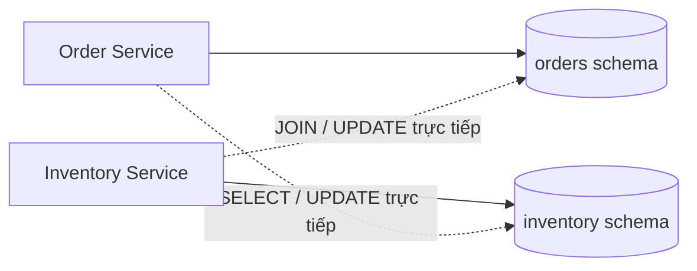
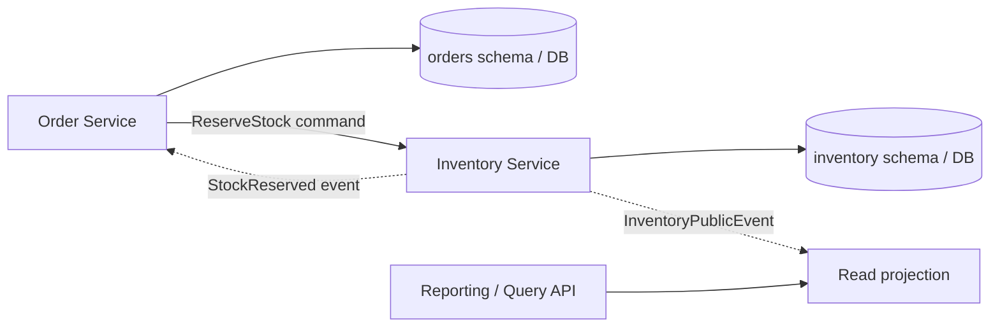
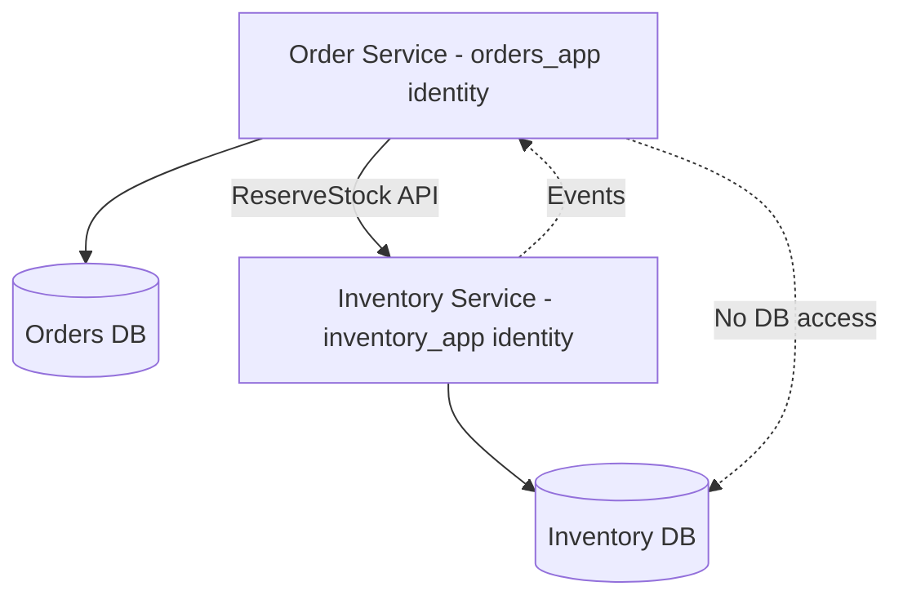
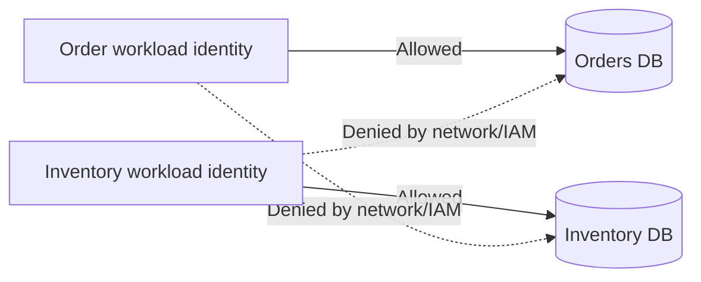
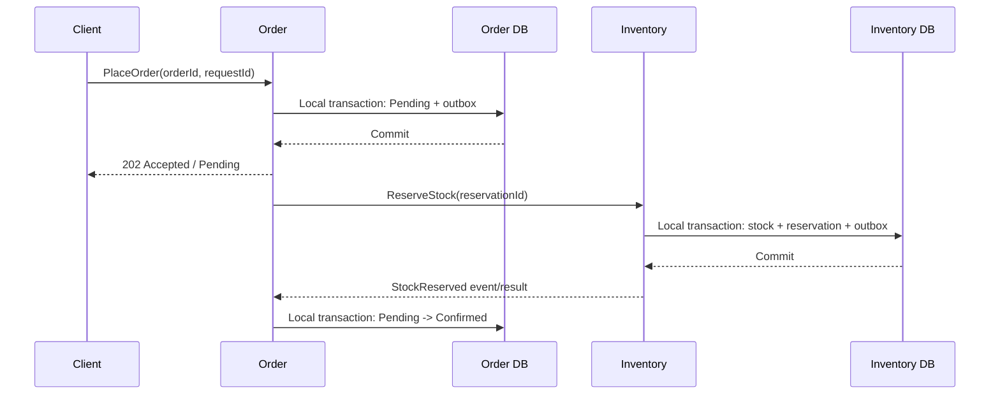

# Cấm truy cập trực tiếp bảng của dịch vụ khác bằng ràng buộc thiết kế

## 1. Bối cảnh: quyền sở hữu dữ liệu trong Microservices

Khi chia một hệ thống thành microservices, điều quan trọng không chỉ là tách code thành các repository hoặc triển khai thành nhiều container. **Mỗi dịch vụ cần có quyền sở hữu rõ đối với dữ liệu mà nó chịu trách nhiệm**, bao gồm quy tắc tạo, sửa, xóa, kiểm tra bất biến và công bố dữ liệu cho bên khác sử dụng.

Ví dụ trong hệ thống bán hàng:

- **Catalog** sở hữu sản phẩm, danh mục, mô tả và các thuộc tính chuẩn.
- **Inventory** sở hữu tồn kho khả dụng, lượng đặt giữ (reservation) và quy tắc trừ/hoàn tồn.
- **Order** sở hữu đơn hàng, dòng đơn, lịch sử trạng thái và snapshot lúc đặt hàng.
- **Payment** sở hữu payment attempt, trạng thái authorization/refund và dấu vết giao dịch.
- **Customer** sở hữu hồ sơ và những thông tin khách hàng nằm trong phạm vi của nó.

Nếu Order có thể dùng SQL trực tiếp để ```UPDATE inventory.stock```, hoặc Payment tự ```SELECT orders.order_line``` để xây dựng quy tắc, ranh giới microservice đã bị xuyên thủng dù ứng dụng vẫn giao tiếp bằng HTTP ở những luồng khác.

**Nguyên tắc thiết kế:**

> Một dịch vụ chỉ được đọc/ghi dữ liệu thuộc quyền sở hữu của mình qua lớp truy cập dữ liệu do chính nó kiểm soát. Dịch vụ khác muốn dùng hoặc thay đổi dữ liệu phải đi qua **hợp đồng công khai của chủ sở hữu**: command/query API, domain event, dữ liệu được xuất bản có quản trị hoặc một giao diện tích hợp được xác định rõ.

Đây không chỉ là “quy ước không nên làm”. Với hệ thống thật, cần biến nó thành **ràng buộc có thể kiểm chứng** ở thiết kế, mã nguồn, quyền truy cập database, hạ tầng, CI/CD và vận hành.

### Mục tiêu của bài học

Sau bài này, người học có thể:

1. Giải thích vì sao cross-service table access tạo **data coupling**, phá độc lập triển khai và có thể làm sai invariant.
2. Phân biệt **đọc dữ liệu được công bố hợp lệ** với việc tự query bảng nội bộ dịch vụ khác.
3. Xây dựng mô hình ownership, contracts và data-access matrix rõ ràng.
4. Áp dụng database-per-service hoặc schema-per-service cùng principal/role tách biệt.
5. Thiết kế quyền SQL tối thiểu để service không đọc/ghi trực tiếp bảng của service khác.
6. Thêm kiểm soát code, kiến trúc, review, static checks và integration tests vào CI/CD.
7. Chuyển một hệ thống còn dùng shared database và cross-service join sang giao tiếp qua API, event hoặc read projection.
8. Thiết kế ngoại lệ analytics, CDC, data migration và break-glass mà không xóa bỏ ranh giới nghiệp vụ.

## 2. Tại sao truy cập trực tiếp bảng khác dịch vụ nguy hiểm?

### 2.1. Phá quyền sở hữu bất biến nghiệp vụ

Giả sử Inventory có quy tắc **không được giữ hàng vượt lượng có thể bán**. Một thao tác ReserveStock chính thức cần:

1. Kiểm tra reservationId để chống yêu cầu trùng.
2. Kiểm tra lượng tồn khả dụng trong transaction phù hợp.
3. Tạo reservation và thay đổi số lượng bằng cơ chế concurrency an toàn.
4. Ghi outbox event nếu cần downstream nhận thông báo.
5. Commit hoặc rollback toàn bộ thay đổi.

Nếu Order bỏ qua Inventory API và chạy:

```sql
-- Anti-pattern: Order tự sửa bảng do Inventory sở hữu.
UPDATE inventory.stock
SET available = available - 2
WHERE sku = 'SKU-42';
```

thì transaction có thể không tạo reservation, không ghi audit, không phát StockReserved và không bảo vệ điều kiện available >= 2. Một đường truy cập tắt đã phá invariant, ngay cả khi API chính thức được thiết kế đúng.

**Mọi đường ghi có ý nghĩa nghiệp vụ phải đi qua chủ thể có quyền bảo vệ invariant**. Một service khác không được trở thành người cùng sở hữu chỉ vì nó có account database đủ quyền.

### 2.2. Coupling theo schema

Ví dụ Order đọc ```inventory.stock.available``` và dựa vào tên cột hoặc cách Inventory chuẩn hóa dữ liệu. Khi Inventory đổi schema:

- Rename ```available``` thành dữ liệu dẫn xuất từ balances + reservations.
- Tách một bảng thành nhiều bảng.
- Thay đổi biểu diễn tiền tệ, status, thời điểm hiệu lực.
- Thêm quy tắc reservation theo warehouse/lot.

Order có thể hỏng mà không hề có thay đổi hợp đồng API. Inventory buộc phải trì hoãn migration hoặc triển khai đồng bộ với Order. **Database schema nội bộ đã vô tình trở thành public API không có versioning.**

### 2.3. Coupling theo transaction và thời điểm đọc

Một JOIN SQL xuyên schema trong cùng database có thể trông thuận tiện. Nhưng khi dịch vụ tách sang database độc lập, JOIN ấy không còn chạy được. Nếu hai service tự sửa bảng của nhau trong cùng transaction, việc tách database sẽ đẩy business invariant sang giao dịch phân tán khó quản lý.

Đồng thời, việc đọc bảng trực tiếp không bảo đảm có đủ **ngữ nghĩa nghiệp vụ**. Ví dụ cột ```status='PENDING'``` ở Payment có thể có nghĩa “đang đối soát với gateway”, không phải “thất bại”. Đọc dữ liệu thô rồi tự suy diễn dễ tạo quyết định sai.

### 2.4. Rủi ro bảo mật và vận hành

Tài khoản có quyền quá rộng làm tăng blast radius khi một service có lỗ hổng hoặc bị đánh cắp credential:

- Một bug trong Order có thể xóa dữ liệu Customer.
- SQL injection ở một service có thể đọc các bảng nhạy cảm ngoài miền.
- Database migration do service A chạy có thể chặn hoặc phá schema của B.
- Việc audit không còn phân biệt ai có thẩm quyền đã thay đổi dữ liệu.
- Các nhóm có thể vô tình phụ thuộc vào read/write path không được owner giám sát.

**Least privilege và service-owned credentials** là biện pháp kỹ thuật phòng ngừa hậu quả, không chỉ là bài học tổ chức code.

## 3. Định nghĩa ranh giới đúng: dữ liệu do ai sở hữu?

### 3.1. Ownership theo ngữ nghĩa, không theo tên bảng

Một dịch vụ có thể sở hữu **bản sao dữ liệu có ngữ nghĩa khác** so với nguồn gốc.

Ví dụ:

- Customer sở hữu địa chỉ mặc định hiện tại.
- Order sở hữu **deliveryAddressSnapshot** đã được xác nhận cho từng đơn.
- Catalog sở hữu tên sản phẩm hiện tại.
- Order sở hữu **productNameAtPurchase** để hiển thị hóa đơn lịch sử.
- Payment sở hữu trạng thái authorization của gateway.
- Order sở hữu trạng thái đơn hàng suy ra từ kết quả thanh toán.

Những giá trị trông giống nhau không nhất thiết là một bản ghi dùng chung. Quyết định owner cần dựa trên **ai có quyền ra quyết định, cập nhật và bảo vệ invariant của dữ liệu**.

### 3.2. Bảng ownership mẫu

| Miền dữ liệu | Service sở hữu | Ai được ghi? | Bên khác sử dụng bằng cách nào? |
| --- | --- | --- | --- |
| Product, category | Catalog | Catalog | Catalog API; ProductChanged event; search projection |
| Stock balance, reservation | Inventory | Inventory | Reserve/Release command; Availability query/event |
| Order, order lines | Order | Order | Order API; OrderPlaced/Confirmed events |
| Payment attempt, refund | Payment | Payment | Payment API; PaymentAuthorized/Declined events |
| Customer profile | Customer | Customer | Customer API; bản sao tối thiểu có kiểm soát |
| Analytics aggregates | Reporting | Reporting pipeline | Read model, event projection hoặc governed dataset |

Tại ranh giới dịch vụ, **chủ dữ liệu định nghĩa quyền đọc được công bố và hành vi ghi hợp lệ**. Consumer không được tự quyết định rằng đọc bảng gốc chỉ vì API chưa có endpoint cần dùng.

### 3.3. Phân biệt ownership với vị trí vật lý

Có nhiều mô hình triển khai:

1. **Database-per-service:** mỗi service có database/cluster hoặc logical database riêng, credential riêng.
2. **Schema-per-service trên một DB server:** từng service có schema và role riêng; được cấp quyền chỉ trên schema của mình.
3. **Shared database không có ranh giới quyền:** nhiều service cùng dùng credential có quyền trên nhiều bảng; đây là tình trạng cần xử lý.
4. **Event-driven read models:** service lưu bản sao được nhận từ hợp đồng event, nhưng không có quyền ghi vào nguồn authoritative của service khác.

Mô hình 1 thường tạo biên bảo vệ rõ hơn, nhưng **không bắt buộc mỗi service phải có một máy chủ database riêng**. Với mô hình 2, tách schema và quyền bằng role có thể cung cấp hàng rào tốt cho giai đoạn chuyển đổi. Nếu tất cả service dùng một tài khoản superuser hoặc một role chung, chia schema chỉ là tổ chức tên, chưa phải biện pháp enforcement.

## 4. Thiết kế hợp đồng công khai thay cho bảng dùng chung

### 4.1. Command API cho thao tác ghi

Nếu Order cần giữ hàng, nó gửi **lệnh nghiệp vụ** tới Inventory, không ```UPDATE``` trực tiếp vào stock table.

```http
POST /reservations
Idempotency-Key: reservation-R-123
Content-Type: application/json

{
  "reservationId": "R-123",
  "orderId": "O-456",
  "sku": "SKU-42",
  "quantity": 2
}
```

Inventory thực hiện invariant, transaction và ghi nhận reservation. Response mang ý nghĩa nghiệp vụ như RESERVED, OUT_OF_STOCK, ALREADY_RESERVED hoặc PROCESSING, tùy hợp đồng.

Command API giúp:

- Ẩn cấu trúc bảng, chỉ công bố năng lực hợp lệ.
- Chủ dịch vụ kiểm soát authorization và validation.
- Cùng một cơ chế bảo vệ invariant cho REST, message consumer và batch.
- Có thể thay storage schema mà giữ contract ổn định.
- Truy vết requestId, business operation và version.

### 4.2. Query API khi cần dữ liệu mới và authoritative

Nếu Order cần kiểm tra trạng thái reservation hiện tại để trả lời người dùng, Inventory có thể cung cấp:

```http
GET /reservations/R-123
```

Response nên mô tả **ngữ nghĩa được hỗ trợ** thay vì lộ bản ghi thô từ DB. Ví dụ:

```json
{
  "reservationId": "R-123",
  "status": "RESERVED",
  "quantity": 2,
  "version": 7
}
```

Khi dữ liệu phải mới tại thời điểm quyết định, query API hoặc một command có kiểm tra trong owner có thể phù hợp hơn read projection cũ. Tuy nhiên, **đọc trạng thái rồi ghi quyết định ở service khác** có thể tạo TOCTOU race; invariant cuối cần được kiểm tra tại owner khi commit.

### 4.3. Domain event khi cần phản ứng bất đồng bộ

Ví dụ Inventory publish ```StockReserved``` sau khi local transaction đã commit; Order consume để cập nhật workflow.

```json
{
  "eventId": "evt-789",
  "eventType": "StockReserved",
  "schemaVersion": 1,
  "reservationId": "R-123",
  "orderId": "O-456",
  "sku": "SKU-42",
  "quantity": 2,
  "occurredAt": "2026-01-15T10:30:00Z"
}
```

Consumer cần idempotency và handling cho event trùng/sai thứ tự. Event nên biểu đạt điều **đã xảy ra**, không công bố toàn bộ row schema như một thứ hợp đồng bất biến.

### 4.4. Read projection và snapshot

Khi một màn hình phải hiển thị Orders, Product và Shipment cùng lúc, gọi ba dịch vụ đồng bộ cho mọi hàng có thể làm tăng latency. Có thể:

- Dùng API composition/BFF để lấy dữ liệu từ các owner.
- Lưu **snapshot tại thời điểm nghiệp vụ** (ví dụ tên sản phẩm lúc mua) do Order sở hữu.
- Tạo **read projection** chuyên phục vụ query, nhận dữ liệu từ event công khai.
- Tạo search index hoặc analytics store đã được cấp quyền dữ liệu và quản trị riêng.

Projection là dữ liệu **dẫn xuất**, không được âm thầm trở thành nguồn ghi mới cho owner. Cần biết độ trễ cập nhật, cơ chế replay/backfill và khả năng hiển thị dữ liệu cũ.

## 5. Sơ đồ đúng và sai

### 5.1. Anti-pattern: đọc/ghi qua bảng của nhau



Dù các service triển khai độc lập, chúng có **data coupling xuyên ranh giới**. Một thay đổi DB nội bộ có thể phá phần còn lại.

### 5.2. Ranh giới dữ liệu rõ ràng



Ở sơ đồ thứ hai:

- Order chỉ có database credential cho dữ liệu Order.
- Inventory chỉ có credential cho dữ liệu Inventory.
- Order muốn thay đổi reservation phải dùng Inventory contract.
- Reporting không đọc trực tiếp bảng live Inventory, mà dùng projection hoặc dataset được xuất bản có kiểm soát.

Lưu ý: sơ đồ đúng chưa đủ nếu credential Order vẫn được cấp quyền UPDATE bảng Inventory. **Ranh giới phải được kiểm chứng bằng quyền thực tế**.

## 6. Defense in depth: nhiều lớp ràng buộc

Không một cơ chế đơn lẻ đủ bảo vệ mọi tình huống. Thiết kế nên có các lớp sau:

| Lớp | Ràng buộc | Điều nó ngăn chặn |
| --- | --- | --- |
| Domain design | Owner, aggregate, invariant, contract được ghi rõ | Nhầm trách nhiệm dữ liệu và đường ghi |
| Code architecture | Package/module dependency rules, repository/adapter riêng | Code dùng API nội bộ hoặc DAO sai ranh giới |
| Database permissions | Per-service roles, least privilege, schema grants | Cross-service SELECT/INSERT/UPDATE/DELETE trực tiếp |
| Network/IAM | Segmentation, identity và secret isolation | Service kết nối tới DB không thuộc quyền |
| Contracts | REST/gRPC/event schemas với versioning | Consumer bám vào layout bảng nội bộ |
| CI/CD | Static checks, tests quyền, migration gates | Vi phạm mới lọt vào bản build/release |
| Observability | Audit truy cập, denied queries, dependency map | Vi phạm chưa được phát hiện và điều tra |
| Governance | Ownership registry, ADR, ngoại lệ có hạn | “Đường tắt tạm thời” biến thành coupling vĩnh viễn |

**Database permissions** là hàng rào mạnh đối với truy cập SQL trực tiếp; **architectural tests** là cảnh báo sớm ở build time; **contract design** cung cấp đường hợp pháp để đáp ứng nhu cầu nghiệp vụ.

## 7. Database-per-service: ranh giới vật lý rõ

Một kiến trúc dữ liệu tách biệt:



Ưu điểm:

- Mỗi service có endpoint và principal database riêng.
- Migration của Inventory không cần chỉnh quyền trên bảng Order.
- Có thể chọn storage phù hợp từng miền khi thực sự cần.
- Backup, restore, scale và cấu hình isolation theo dịch vụ rõ ràng hơn.
- Credential của một service không mặc nhiên đọc/ghi dữ liệu khác.

Đánh đổi:

- Nhiều database/cluster làm tăng chi phí vận hành, backup, migration, monitoring và secrets.
- JOIN xuyên miền không còn chạy trực tiếp.
- Giao dịch xuyên database phải được thiết kế lại bằng quy trình nghiệp vụ, không thể chỉ dùng một local ACID transaction.
- Reporting cần đường dữ liệu dẫn xuất hoặc data platform.

**Không phải mục tiêu là “mọi service có một server PostgreSQL riêng bằng mọi giá”.** Mục tiêu là ownership, isolation và khả năng thay đổi độc lập; hạ tầng vật lý có thể được dùng chung khi quyền và rủi ro được quản lý.

## 8. Schema-per-service: bắt đầu bằng tách schema và role

Khi nhiều dịch vụ đang dùng một PostgreSQL database, có thể giữ cùng cluster nhưng áp dụng:

- ```orders``` schema cho Order.
- ```inventory``` schema cho Inventory.
- Role runtime ```orders_app``` chỉ đọc/ghi bảng Order cần thiết.
- Role runtime ```inventory_app``` chỉ đọc/ghi bảng Inventory cần thiết.
- Role migration/DDL **khác** role runtime, được cấp quyền qua pipeline có kiểm soát.
- Không dùng shared application role có toàn quyền, không cấp SUPERUSER/BYPASSRLS cho runtime.
- Không tạo ```GRANT SELECT ON ALL TABLES IN SCHEMA public TO PUBLIC``` và không giữ quyền rộng do các bước legacy provisioning.

### 8.1. Nguyên tắc cấp quyền

Ở PostgreSQL, permission liên quan nhiều mức: quyền CONNECT trên database, USAGE trên schema, quyền trên bảng/sequence/function, membership giữa các roles và các mặc định đang có. Một role có thể nhận quyền **gián tiếp qua membership hoặc PUBLIC**.

Vì vậy, không thể chỉ nhìn một lệnh REVOKE trực tiếp rồi kết luận đã cô lập. Cần kiểm tra **effective privileges** bằng một phiên đăng nhập thực tế với service role.

### 8.2. Mẫu SQL minh họa cho PostgreSQL

Ví dụ sau nhằm minh họa việc thiết lập **tài khoản ứng dụng riêng và schema isolation** trong database đã có owner/migration role do người quản trị kiểm soát. Thực thi với role quản trị có quyền phù hợp; xác nhận grants/ownership hiện hành trước khi áp dụng trên hệ thống thật.

```sql
-- Chạy bởi DBA/provisioning automation có đủ đặc quyền.
-- Ví dụ database: commerce.
-- Credential và mật khẩu được quản lý ở secret manager/IAM,
-- KHÔNG nhúng mật khẩu vào source code hay migration.

CREATE ROLE orders_app LOGIN;
CREATE ROLE inventory_app LOGIN;

CREATE SCHEMA IF NOT EXISTS orders;
CREATE SCHEMA IF NOT EXISTS inventory;

-- Chỉ cấp quyền dùng schema cần thiết.
GRANT USAGE ON SCHEMA orders TO orders_app;
GRANT USAGE ON SCHEMA inventory TO inventory_app;

-- Quyền runtime trên những bảng mà mỗi service sở hữu.
GRANT SELECT, INSERT, UPDATE, DELETE
ON ALL TABLES IN SCHEMA orders TO orders_app;

GRANT SELECT, INSERT, UPDATE, DELETE
ON ALL TABLES IN SCHEMA inventory TO inventory_app;

-- Nếu service dùng sequence; chỉ cấp quyền tối thiểu cần thiết.
GRANT USAGE, SELECT ON ALL SEQUENCES IN SCHEMA orders
TO orders_app;

GRANT USAGE, SELECT ON ALL SEQUENCES IN SCHEMA inventory
TO inventory_app;

-- Ngăn các quyền cấp trực tiếp ngoài ý muốn (chỉ là một phần).
REVOKE ALL ON SCHEMA inventory FROM orders_app;
REVOKE ALL ON ALL TABLES IN SCHEMA inventory FROM orders_app;
REVOKE ALL ON ALL SEQUENCES IN SCHEMA inventory FROM orders_app;

REVOKE ALL ON SCHEMA orders FROM inventory_app;
REVOKE ALL ON ALL TABLES IN SCHEMA orders FROM inventory_app;
REVOKE ALL ON ALL SEQUENCES IN SCHEMA orders FROM inventory_app;
```

**Những điểm cần hiểu trước khi chạy:**

1. ```CREATE ROLE ... LOGIN``` chưa cấu hình mật khẩu hoặc cơ chế auth cụ thể; sử dụng credential do hạ tầng quản lý. Vai trò có thể tồn tại sẵn, nên provisioning phải idempotent theo môi trường.
2. ```GRANT ON ALL TABLES``` áp dụng cho các bảng hiện có tại thời điểm lệnh chạy, không tự động cấp quyền cho mọi bảng tạo trong tương lai.
3. Nếu ```orders_app``` là owner của bảng, hoặc nhận quyền qua role membership hay PUBLIC, REVOKE một grant trực tiếp có thể **không** loại bỏ effective access.
4. Cần xác định ai có quyền CREATE trên các schema và dùng role migration riêng. Runtime role thông thường không cần CREATE/ALTER/DROP.
5. Schema ```public``` và các grants legacy có thể đã cấp quyền cho nhiều role; cần kiểm kê và xử lý trước khi tin tưởng isolation.
6. Nếu database có các hàm ```SECURITY DEFINER```, views có quyền owner, FDW hoặc các proxy có credential rộng, phải xem chúng như những đường truy cập dữ liệu khác cần kiểm soát.
7. Không áp dụng lệnh REVOKE vào production khi chưa biết những ứng dụng legacy đang phụ thuộc; có thể làm dừng hệ thống đang hoạt động. Thực hiện theo kế hoạch di trú và kiểm thử quyền.

### 8.3. Default privileges dành cho bảng mới

Nếu các bảng tương lai được tạo bởi role DDL chuyên trách như ```orders_ddl```, có thể cấu hình quyền mặc định **cho những object do role ấy tạo**:

```sql
-- Chạy bởi orders_ddl (hoặc role có quyền quản lý phù hợp).
ALTER DEFAULT PRIVILEGES FOR ROLE orders_ddl
IN SCHEMA orders
GRANT SELECT, INSERT, UPDATE, DELETE ON TABLES TO orders_app;

ALTER DEFAULT PRIVILEGES FOR ROLE orders_ddl
IN SCHEMA orders
GRANT USAGE, SELECT ON SEQUENCES TO orders_app;
```

Lưu ý: default privileges là theo **object creator role** và phạm vi đã khai báo; nếu migration tạo bảng bằng role khác, quy tắc này có thể không áp dụng. Phải thiết kế migration pipeline rõ ai là owner và mỗi lần phát hành cần xác nhận hiệu lực.

### 8.4. Kiểm chứng role không thể đọc bảng bên ngoài

Một bài test chạy bằng connection thực của ```orders_app```:

```sql
-- Kết nối bằng orders_app, không phải DBA/superuser.
SELECT * FROM orders.order_header LIMIT 1;

-- Phải bị từ chối nếu ranh giới được cấu hình đúng:
SELECT * FROM inventory.stock LIMIT 1;

-- Phải bị từ chối:
UPDATE inventory.stock
SET available = 0
WHERE sku = 'SKU-42';
```

Đây là ví dụ truy vấn kiểm tra quyền, **không thực thi câu UPDATE phá dữ liệu trên production**. Dùng database thử nghiệm, transaction rollback và fixture thích hợp; test có thể kiểm tra privilege metadata thay vì gửi destructive SQL.

Ngoài kiểm tra runtime, PostgreSQL có thể cung cấp các hàm như:

```sql
SELECT
  has_schema_privilege('orders_app', 'inventory', 'USAGE')
    AS can_use_inventory_schema,
  has_table_privilege('orders_app', 'inventory.stock', 'SELECT')
    AS can_select_inventory_stock,
  has_table_privilege('orders_app', 'inventory.stock', 'UPDATE')
    AS can_update_inventory_stock;
```

Kết quả mong đợi cho quyền cross-service là false khi bảng tồn tại và chính sách cô lập được áp dụng. Phải xét grants qua membership/PUBLIC, database owner, object owner và các lối đi gián tiếp, không chỉ ba cột kiểm tra trên.

## 9. Không bỏ quên credential và connection pool

Cô lập bằng roles sẽ thất bại nếu:

- Mọi service dùng một tài khoản ```db_admin``` trong biến môi trường.
- Đội ngũ chia sẻ cùng chuỗi connection vì “tiện cấu hình”.
- App runtime chạy dưới role migration/DDL.
- Connection pool/proxy phía trước DB đăng nhập bằng một role toàn quyền thay cho identity riêng.
- Secret của Inventory nằm trong cấu hình hoặc CI job của Order.
- Sidecar hoặc scheduled job có credential dùng chung nhưng không được quản trị như một chủ thể truy cập.

Thiết kế tốt:

1. Một **runtime principal** riêng cho từng service và môi trường.
2. Một **migration/DDL principal** riêng có quyền cao hơn, chỉ được pipeline tin cậy sử dụng.
3. Secret management/IAM và rotation; không commit credential vào Git.
4. Hạn chế quyền kết nối từ mạng/identity không được phép, tùy kiến trúc DB và hạ tầng.
5. Audit DB username, client application name và workload identity.
6. Không dùng service account của production trong local development/test.
7. Cấu hình connection proxy giữ được ownership hoặc mapping user, tránh gom mọi traffic thành superuser.

Nếu bắt buộc dùng một proxy pool, cần xác nhận cách proxy chuyển tiếp hoặc đại diện identity để **database vẫn thực thi đúng quyền**. Quyền ở client không đủ khi proxy thực tế chạy một role toàn quyền.

## 10. Kiểm soát ở lớp mạng và hạ tầng

### 10.1. Separate DB endpoints

Nếu Order và Inventory có database endpoints riêng, dùng firewall/security group hoặc network policy để Order chỉ kết nối được tới Order DB và Inventory chỉ kết nối tới Inventory DB.

Một mô hình:



Đây là hàng rào bổ sung. **Network segmentation không thay thế database permissions** nếu một endpoint chung phục vụ nhiều schemas/tenants: cho phép Order kết nối tới shared PostgreSQL không có nghĩa Order được quyền đọc tất cả schema trong đó.

### 10.2. Kubernetes NetworkPolicy

Trong cluster Kubernetes, chính sách egress của Order có thể chỉ cho phép TCP tới DB endpoint được cấp phép, DNS và những dịch vụ công khai cần gọi. Nhưng:

- NetworkPolicy được thực thi theo khả năng CNI/network plugin; phải kiểm chứng implementation.
- Policy ở Kubernetes không tự đặt quyền SQL.
- Nếu mọi service dùng cùng database host/port, chặn theo IP/port **không phân biệt được schema**.
- Việc dùng external managed DB, NAT, service mesh và DNS cần được thiết kế hợp lý.
- Rule quá rộng như allow egress toàn namespace dễ vô hiệu hóa mục tiêu.

Vì vậy dùng **network policy để hạn chế đường kết nối**, và **role/privileges để hạn chế object bên trong DB**.

### 10.3. Cloud IAM và identity

Với database hỗ trợ IAM authentication hoặc workload identity, map service identity sang database role được giới hạn. Bảo đảm đường quản trị DB và migration có quyền riêng. Không mặc nhiên dùng một IAM role chung cho tất cả workloads.

Cần phân quyền cả control plane: ai có thể thay secret, sửa DB IAM policy, đổi service account hoặc chạy migration. Nếu bất kỳ pipeline nào cũng tự cấp full DB access, ranh giới runtime dễ bị vượt qua.

## 11. Kiểm soát code: repository và adapter chỉ biết dữ liệu của mình

### 11.1. Ports and Adapters / Layered Architecture

Trong Order service, ứng dụng nên có:

```text
order-service/
  src/main/java/com/example/order/
    domain/
      Order.java
      OrderLine.java
    application/
      port/in/PlaceOrderUseCase.java
      port/out/OrderRepositoryPort.java
      port/out/InventoryReservationPort.java
      PlaceOrderService.java
    adapter/in/web/
      OrderController.java
    adapter/out/persistence/
      OrderJpaAdapter.java
    adapter/out/inventory/
      InventoryHttpAdapter.java
    config/
      Wiring.java
```

**OrderRepositoryPort** là hợp đồng lưu dữ liệu thuộc Order. **InventoryReservationPort** là cổng gọi năng lực nghiệp vụ công khai của Inventory, không phải interface cho Order truy cập ```inventory.stock```.

Ví dụ port:

```java
package com.example.order.application.port.out;

public interface InventoryReservationPort {
    ReservationResult reserve(
        String reservationId,
        String orderId,
        String sku,
        int quantity
    );
}
```

Adapter HTTP có thể thực hiện:

```java
package com.example.order.adapter.out.inventory;

public final class InventoryHttpAdapter
        implements InventoryReservationPort {
    private final InventoryClient client;

    public InventoryHttpAdapter(InventoryClient client) {
        this.client = client;
    }

    @Override
    public ReservationResult reserve(
            String reservationId,
            String orderId,
            String sku,
            int quantity) {
        return client.reserve(
            reservationId, orderId, sku, quantity);
    }
}
```

```InventoryClient``` là client cho API công khai; implementation cần timeout, idempotency key, error classification và contract tests. Nó **không phải** JDBC client kết nối tới database Inventory.

### 11.2. Tránh shared entity library giữa services

Nếu Order import JPA entity ```InventoryStockEntity``` từ một thư viện chung, entity ấy sẽ kéo theo schema assumptions và có thể khiến các service cùng migration một bảng.

Thay vào đó:

- Dùng API/event DTO có version, được định nghĩa và quản trị như **public contract**.
- Giữ JPA entity, repository và migration scripts **private** trong service owner.
- Không tạo shared “common database models” để tất cả service dùng trực tiếp.
- Chỉ chia sẻ utility thật sự chung và ổn định nếu hữu ích, không nhét domain ownership vào common module.

Một hợp đồng công khai có thể là OpenAPI/gRPC proto/event schema. Nó cần semantics và version policy rõ, không chỉ serialize nguyên trạng bảng nội bộ.

### 11.3. Package-private và module boundary

Với Java, visibility (package-private), modules, Maven/Gradle module dependencies và các kiến trúc test có thể hạn chế việc import sai. Chúng giúp phát hiện coupling code ở thời điểm build.

Nhưng **source code tách package không thể ngăn một đoạn SQL string được thực thi qua credential rộng**. Vì vậy code architecture phải đi kèm quyền database.

## 12. Kiểm soát tự động trong CI/CD

### 12.1. Kiểm tra dependency

Pipeline có thể cấm:

- Order module phụ thuộc vào package ```com.example.inventory.persistence..```.
- Import trực tiếp Inventory JPA entities/repositories.
- Dùng shared schema migration jar không có owner rõ.
- Viết SQL tham chiếu schema Inventory trong Order source hoặc migration, trừ những chỗ ngoại lệ đã được quản lý.
- Tạo database connection tới service khác từ runtime configuration.

Ví dụ ArchUnit mang tính minh họa:

```java
@AnalyzeClasses(packages = "com.example.order")
class OrderArchitectureTest {

    @ArchTest
    static final ArchRule noInventoryPersistenceDependency =
        noClasses()
            .that().resideInAPackage("com.example.order..")
            .should().dependOnClassesThat()
            .resideInAnyPackage(
                "com.example.inventory.persistence..",
                "com.example.inventory.adapter.out.persistence.."
            );
}
```

Rule này phát hiện **compile-time dependency**, không nhận diện mọi SQL string hoặc reflection. Cần thêm static scan và runtime authorization tests.

### 12.2. Static SQL checks

Có thể đưa vào CI một kiểm tra tĩnh:

- Danh sách schema/table được service cho phép dùng.
- Phân tích SQL migrations, jOOQ generated sources, native queries và repository annotations.
- Báo lỗi khi service tham chiếu qualified name của schema ngoài quyền.
- Review có chủ đích khi dùng dynamic SQL, stored procedures, views hoặc FDW.
- Chỉ cho phép override có lý do và thời hạn.

Không nên chỉ ```grep "inventory."``` rồi tin rằng mọi truy cập đã được bắt. Query có thể dùng unqualified table name, search_path, alias, view, stored procedure, dynamic SQL hoặc metadata. Static checks hữu ích để **cảnh báo sớm**, còn database permissions là hàng rào cuối.

### 12.3. Integration test bằng service runtime role

Tạo database fixture có ít nhất hai schemas và hai roles. Khi chạy integration tests của Order:

1. Kết nối bằng ```orders_app```, không dùng role DBA.
2. Kiểm tra các use case Order được cấp quyền đúng trên bảng Order.
3. Xác minh truy cập trực tiếp bảng Inventory bị từ chối.
4. Chạy concurrent tests cho các invariant quan trọng.
5. Kiểm tra role runtime không thể CREATE/ALTER/DROP bảng hoặc schema không thuộc quyền nếu không cần.
6. Kiểm tra migrations chạy bằng DDL role riêng, không yêu cầu app runtime tự nâng quyền.
7. Kiểm tra quyền trên bảng/sequence mới sau migration.

Đây là **negative security tests**: build chỉ đạt khi cả hành vi được phép lẫn hành vi bị cấm đều đúng.

### 12.4. Migration gates

Khi một PR thêm bảng, pipeline cần biết:

- Service owner nào sở hữu bảng?
- Schema nằm ở đâu?
- Migration chạy bằng role nào?
- Runtime grants mới có vừa đủ không?
- Có vô tình thêm foreign key/JOIN cần cross-service transaction?
- Có public API/event contract nào cần cập nhật không?
- Có application role khác được cấp quyền trực tiếp ngoài ranh giới không?

Đặt ownership metadata hoặc ADR gần mã nguồn để reviewer có căn cứ. Không để “một lần cấp quyền tạm” tồn tại mãi trong IaC/migration.

## 13. Cross-service JOIN: thay bằng gì?

Giả sử trang Order History hiển thị mã đơn, tên sản phẩm, số lượng và trạng thái giao hàng. Trước đây có truy vấn:

```sql
-- Anti-pattern khi mỗi schema là miền riêng.
SELECT o.order_id, p.name, oi.quantity, s.status
FROM orders.order_header o
JOIN orders.order_item oi ON oi.order_id = o.order_id
JOIN catalog.product p ON p.id = oi.product_id
JOIN fulfillment.shipment s ON s.order_id = o.order_id;
```

Truy vấn này làm Order lệ thuộc trực tiếp schema Catalog và Fulfillment. Các lựa chọn thay thế:

### 13.1. Snapshot tại thời điểm phát sinh giao dịch

Order giữ ```product_name_at_purchase```, ```unit_price_at_purchase``` và currency trong các dòng đơn. Đây là **dữ liệu thuộc Order** vì hóa đơn lịch sử phải phản ánh giá/tên đã chốt khi mua, không thay đổi theo Catalog hiện tại.

Ưu điểm: không phải gọi Catalog để dựng lịch sử và phản ánh đúng ngữ nghĩa thời điểm mua.

Giới hạn: không phù hợp nếu UI muốn hiển thị trạng thái sản phẩm **hiện tại** (ví dụ còn bán không) mà không có nguồn cập nhật khác.

### 13.2. API composition hoặc BFF

Một query service/BFF gọi Order API, Catalog API và Fulfillment API, ghép DTO phục vụ màn hình. Từng service vẫn có owner.

Ưu điểm: dữ liệu có thể gần thời gian thực, không cần sao chép toàn bộ.

Đánh đổi: fan-out, latency và tính sẵn sàng đầu cuối; nên dùng batch endpoints, caching và timeouts phù hợp. Không biến BFF thành nơi ghi dữ liệu trực tiếp vào các service databases.

### 13.3. Materialized read projection

Tạo ```order_history_view``` trong read store riêng, nhận events từ Order, Catalog và Fulfillment qua hợp đồng công khai.

Ưu điểm: truy vấn nhanh, không cần nhiều synchronous hops.

Đánh đổi: eventual consistency, replay, backfill, schema evolution và vấn đề thứ tự event. Read projection **không sở hữu dữ liệu gốc**, chỉ được cập nhật bằng dữ liệu đã công bố.

### 13.4. Governed analytical dataset

Data warehouse hoặc lakehouse có thể thu nhận dữ liệu từ các dịch vụ theo chính sách bảo mật và ownership, phục vụ reporting/BI. Đây là **hệ thống phân tích** với SLA và quyền riêng, không phải cách cho Order đọc trực tiếp schema Inventory trong transaction xử lý đơn.

Cần phân định operational path và analytical path: báo cáo tổng hợp có thể chấp nhận dữ liệu trễ; quyết định giữ hàng hoặc trả tiền thường cần invariant và độ mới chặt hơn.

## 14. CDC có phải ngoại lệ hợp lệ không?

**Change Data Capture (CDC)** có thể đọc change stream từ database owner để xây projection hoặc đồng bộ dữ liệu. Tuy nhiên, việc một service consumer tự SELECT/UPDATE bảng của owner khác không trở nên hợp lệ chỉ vì nó được gọi là “CDC”.

CDC nên có các ràng buộc:

1. **Owner chủ động công bố stream** hoặc dữ liệu xuất bản theo hợp đồng rõ.
2. Quyền replication/logical decoding chỉ cấp cho connector/pipeline được quản trị, không cho mọi service.
3. Consumer chỉ sử dụng schema dữ liệu đã công bố hoặc thông qua lớp mapping ổn định, không coi physical table schema là API vĩnh viễn.
4. Khi owner thay schema, có cơ chế tương thích, versioning và migration consumer.
5. Có giới hạn PII, dữ liệu nhạy cảm, retention, reprocessing, audit và deletion.
6. Projection xây từ CDC không được dùng để bypass command API khi thay đổi authoritative data.
7. Nguồn dữ liệu đã xuất bản phải có mục đích và trách nhiệm rõ, không mở toàn bộ database log tùy ý.

Với CDC thô gắn chặt vào table schema, coupling vẫn tồn tại. Nếu tổ chức chọn nó vì lý do hiệu năng hoặc legacy migration, hãy **công nhận và quản trị coupling đó**, thay vì tuyên bố đã độc lập hoàn toàn.

## 15. Thiết kế giao dịch sau khi cấm cross-service writes

Một phản đối thường gặp là:

> “Hiện tại Order UPDATE hai bảng của Order và Inventory trong cùng transaction. Nếu cấm, làm sao bảo đảm đơn và tồn kho luôn khớp?”

Câu trả lời bắt đầu từ **bất biến nghiệp vụ** chứ không phải nỗ lực duy trì một SQL transaction xuyên miền bằng mọi giá.

### 15.1. Local transaction theo owner

Order tạo Order Pending và ghi outbox event trong local transaction của Order. Inventory nhận command ReserveStock, tự commit reservation trong local transaction của Inventory. Order cập nhật trạng thái dựa trên kết quả/sự kiện.



Đây là một phương án minh họa. Nếu response cần trả đồng bộ, thiết kế có thể chờ kết quả ReserveStock trong thời hạn hợp lý, nhưng **không giữ transaction Order mở khi gọi mạng** nếu không có lý do cực kỳ đặc biệt và kiểm soát chặt.

### 15.2. Những điểm phải bảo vệ

- Inventory bảo vệ invariant không reserve vượt tồn khi concurrency.
- Order bảo vệ trạng thái đơn hợp lệ và chống tạo đơn trùng theo request ID.
- Giao tiếp có idempotency, timeout, retry budget và xử lý unknown outcome.
- Khi Inventory đã reserve nhưng Order thất bại, có khả năng retry hoặc release reservation theo quy trình.
- Có reconciliation cho trạng thái Pending kẹt.
- Outbox/inbox nếu cần bảo đảm phát và xử lý thông điệp bền vững.
- Không coi saga compensation là rollback SQL tuyệt đối.

**Không phải invariant nào cũng nên tách.** Nếu một tập dữ liệu thật sự phải được quyết định nguyên tử, không thể bù trừ và không có protocol phù hợp, hãy xem xét giữ nó trong cùng một owner/service boundary thay vì cố chia quá nhỏ.

## 16. Hợp đồng dữ liệu phải có version và semantics

Một API/event public nên xác định rõ:

- Mục đích nghiệp vụ, không chỉ tên field.
- Schema và validation.
- Ý nghĩa của status và các chuyển trạng thái hợp lệ.
- Consistency model: tức thời, read-after-write hay eventual consistency.
- Idempotency/duplicate/retry semantics.
- Authorization và phạm vi truy cập.
- Backward/forward compatibility.
- Trách nhiệm owner khi thay đổi.
- SLA/SLO và giới hạn truy vấn.
- Retention, privacy và data deletion policy nếu liên quan.

Ví dụ ```InventoryAvailabilityChanged``` nên định nghĩa rõ “available” có tính cả reservation đang giữ hay không, phiên bản aggregate, warehouse và thời điểm hiệu lực. Nếu không, consumer có thể hiểu sai dù không đọc bảng trực tiếp.

### 16.1. Contract-first giúp giảm áp lực “xin truy cập DB”

Khi owner không cung cấp query hoặc event cần thiết, các nhóm dễ chọn đường tắt. Thay vì cấp SELECT bảng, đưa nhu cầu đó vào backlog contract:

1. Consumer mô tả quyết định nghiệp vụ hoặc màn hình cần dữ liệu.
2. Owner xác nhận dữ liệu có thể công bố và consistency cần thiết.
3. Chọn query API, event, snapshot hoặc read projection.
4. Định nghĩa schema/version và kiểm thử contract.
5. Đo chi phí latency/traffic và điều chỉnh batch/cache.
6. Chỉ sau đó từ chối hoặc xóa quyền SQL trực tiếp cũ.

Đảm bảo **đường hợp pháp đủ dùng và dễ dùng** là điều kiện để enforcement không trở thành lực cản phát triển.

## 17. Quy trình di trú từ shared database sang ownership rõ

Một hệ thống legacy có thể có rất nhiều cross-schema queries; REVOKE ngay lập tức sẽ gây outage. Cần di trú từng bước.

### Giai đoạn 1: Lập bản đồ hiện trạng

Thu thập có phạm vi:

- Ứng dụng/service accounts đang kết nối.
- Bảng nào được service nào đọc/ghi.
- Các truy vấn JOIN xuyên schema và stored procedures.
- Các batch jobs/BI scripts có quyền vượt miền.
- Các ORM entities/repositories đang chia sẻ.
- Những transaction nhiều miền có invariant cứng.
- Các credential/bí mật dùng chung và pipeline migrations.

Nguồn có thể gồm database audit/query logs, connection metadata, source code, mapping ORM, application metrics và phỏng vấn owner. Chú ý **đường hiếm** như cuối tháng, backfill, sửa dữ liệu thủ công.

### Giai đoạn 2: Xác lập owner và hợp đồng

Lập ownership matrix cho từng nhóm bảng/aggregate. Với dữ liệu dùng chung, quyết định:

- Dịch vụ nào là authoritative writer?
- Bên khác cần dữ liệu hiện tại hay snapshot lịch sử?
- Đường đọc/ghi nào phải tách trước?
- Có invariant nào buộc hai module phải cùng owner?
- Có thể chuyển sang API, event hoặc read model không?

Ghi quyết định bằng ADR nếu ảnh hưởng lớn. Không chỉ đổi schema name mà giữ cùng quyền UPDATE.

### Giai đoạn 3: Tách đường ghi trước

Thường nên ưu tiên **loại cross-service writes** vì chúng trực tiếp phá invariant. Chuyển update/delete sang command API do owner kiểm soát. Với hai service phải phối hợp, thiết kế state machine, outbox và compensation khi phù hợp.

Đảm bảo không có **dual authoritative writers**. Nếu cần dual-write khi migration, phải xác định nguồn sự thật, replay/idempotency và giai đoạn chuyển đổi, tránh hai nguồn cùng quyết định độc lập.

### Giai đoạn 4: Tách đường đọc

Chuyển SELECT/JOIN sang query API, batch API, snapshot hoặc projection. Với các query đọc rất nóng, đo tải và độ mới trước khi chọn. Không ép mọi read thành synchronous API nếu sẽ tạo N+1, latency cao hoặc availability coupling lớn.

### Giai đoạn 5: Tách runtime credentials

Tạo riêng ```orders_app```, ```inventory_app``` và migration roles; cấp quyền tối thiểu. Chạy staging với quyền chuẩn tương lai và integration tests.

Không dùng quyền admin trong test vì sẽ che lỗi permissions. Tìm các grants qua PUBLIC, membership, views, functions và proxy credentials.

### Giai đoạn 6: Thu hồi quyền cũ từng bước

Trong môi trường có kiểm soát:

1. Quan sát cross-access thực tế sau khi đổi code.
2. Cảnh báo nếu còn truy vấn cũ.
3. Chặn ở staging, rồi canary/nhóm nhỏ có rollback plan.
4. REVOKE grants ngoài ownership sau khi dependency đã được xử lý.
5. Chạy negative permission tests và giám sát error log.
6. Mở rộng rollout nếu ổn, tránh để tài khoản cũ còn full quyền mãi.

Quy trình rollback cần **khôi phục service behavior** mà không âm thầm làm ranh giới yếu đi vô thời hạn. Nếu một ngoại lệ tạm thời bắt buộc, cần có owner, thời hạn và lộ trình xóa.

### Giai đoạn 7: Chuyển database vật lý nếu có lợi ích

Khi schema/role isolation và code contracts đã ổn định, có thể cân nhắc tách physical database để tối ưu isolation, backup, scale và independent deployment.

**Tách database quá sớm**, khi code còn dựa vào cross-schema joins, có thể biến một bài toán refactor tương đối cục bộ thành một cuộc migration rủi ro.

## 18. Ngoại lệ cần quản trị: reporting, support, backfill và break-glass

Không nên diễn giải nguyên tắc thành “không ai ngoài service owner được chạm dữ liệu dưới mọi hoàn cảnh”. Có những **chủ thể vận hành có quản trị** cần truy cập vì mục đích khác, nhưng chúng không phải là runtime business logic của một service.

### 18.1. Analytics và data platform

Data pipelines có thể được cấp quyền đọc dữ liệu được phép phục vụ báo cáo, tuân thủ phân loại dữ liệu, masking, retention và audit. Tốt nhất truy cập qua CDC/public export hoặc read replica/projection được chủ quản kiểm soát.

Điểm mấu chốt: **Order runtime** không được mượn account analytics để SELECT Inventory tables. Analytics account cần được giám sát, chỉ đọc dữ liệu phù hợp mục đích và không dùng như đường tắt giao dịch.

### 18.2. Support và troubleshooting

Kỹ sư vận hành có thể cần xem trạng thái hệ thống để giải quyết sự cố. Dùng:

- Read-only diagnostic roles với quyền đúng nhu cầu.
- Just-in-time access có phê duyệt nếu dữ liệu nhạy cảm.
- Audit truy vấn và giới hạn môi trường.
- Công cụ support/API có che PII khi phù hợp.
- Không dùng credential production admin trong automation hằng ngày.

### 18.3. Backfill và migration

Một migration có thể cần đọc nguồn dữ liệu cũ từ nhiều miền hoặc chạy CDC để đồng bộ sang mô hình mới. Đây phải là **một tác vụ hữu hạn với phạm vi được phê duyệt**, có idempotency, checkpoint, reconciliation và kế hoạch dừng.

Không biến migration script thành một service thường trực với full quyền cross-domain và không có ownership.

### 18.4. Break-glass

Khi sự cố nghiêm trọng cần quyền khẩn cấp, triển khai:

- Principal khẩn cấp tách khỏi service runtime.
- Phê duyệt/logging/giới hạn thời gian.
- Truy vết ai truy cập và thay đổi gì.
- Thu hồi quyền sau sự cố.
- Post-incident review để xử lý nguyên nhân.

**Ngoại lệ vận hành được quản trị không đồng nghĩa chấp nhận service A phụ thuộc trực tiếp bảng của service B** trong luồng sản phẩm thường ngày.

## 19. Mẫu data-access matrix cho một hệ thống

| Caller / principal | orders tables | inventory tables | payment tables | Contract được phép |
| --- | --- | --- | --- | --- |
| orders_app | Read/Write trong phạm vi Order | **Deny** | **Deny** | Inventory API, Payment API/event |
| inventory_app | **Deny** | Read/Write trong phạm vi Inventory | **Deny** | Order command/event contract phù hợp |
| payment_app | **Deny** | **Deny** | Read/Write trong phạm vi Payment | Payment gateway, Order events |
| reporting_pipeline | Read dữ liệu xuất bản đã cho phép | Read dữ liệu xuất bản đã cho phép | Read dữ liệu đã phân loại/cho phép | CDC/export/warehouse, không ghi OLTP |
| ddl_migration_orders | DDL Order theo phê duyệt | **Deny** | **Deny** | Migration được quản trị |
| admin_breakglass | Theo phạm vi phê duyệt | Theo phạm vi phê duyệt | Theo phạm vi phê duyệt | Có audit, TTL và kiểm soát |

Trong thực tế, quyền không nhất thiết là toàn bộ Read/Write đối với mọi bảng nội bộ. Có thể cấp theo table, view hoặc stored procedure nếu phù hợp. Nhưng **mức service boundary** vẫn là: runtime principal của dịch vụ không thể trực tiếp thao tác dữ liệu authoritative thuộc dịch vụ khác.

### 19.1. Đặt owner của dữ liệu trong tài liệu

Một mẫu ghi ngắn:

```yaml
data_domains:
  orders:
    owner_service: order-service
    runtime_role: orders_app
    schema: orders
    authoritative_tables:
      - order_header
      - order_item
    contracts:
      commands: [PlaceOrder, CancelOrder]
      queries: [GetOrder, ListOrders]
      events: [OrderPlaced, OrderConfirmed]
    cross_domain_direct_sql: prohibited

  inventory:
    owner_service: inventory-service
    runtime_role: inventory_app
    schema: inventory
    authoritative_tables:
      - stock
      - stock_reservation
    contracts:
      commands: [ReserveStock, ReleaseReservation]
      queries: [GetReservation, GetAvailability]
      events: [StockReserved, ReservationReleased]
    cross_domain_direct_sql: prohibited
```

Đây là ví dụ metadata. Đừng để manifest chỉ tồn tại trên giấy; nối nó với code ownership, CI tests và provisioning permissions nếu tổ chức có thể.

## 20. Chẩn đoán những lối tắt thường bị bỏ sót

### 20.1. Đọc chung qua views

Một service không được SELECT bảng Inventory nhưng có thể SELECT một view trong schema của chính nó do admin tạo, view lại đọc Inventory table bằng quyền owner. Về bản chất, đây vẫn có thể là đường **truy cập gián tiếp** và coupling vào schema Inventory.

Nếu view là **public data contract** được owner cho phép, có version, ownership và kiểm soát thay đổi, có thể xem như giao diện được quản trị. Nếu nó tự ý phản chiếu toàn bộ table nội bộ, vi phạm tinh thần độc lập.

### 20.2. Stored procedures và SECURITY DEFINER

Một function/procedure chạy bằng quyền owner có thể cho runtime role thực hiện thay đổi bảng mà role đó không trực tiếp được grant UPDATE. Cần rà soát các hàm callable, đặc biệt khi dùng SECURITY DEFINER, quyền EXECUTE và search_path an toàn.

Đừng nhầm “SELECT inventory.stock bị từ chối” với “không còn đường nào có thể sửa stock”.

### 20.3. Shared database migration library

Hai service cùng phụ thuộc một JAR chứa tất cả JPA entities/migrations; khi một bảng đổi, cả hai phải cập nhật version và deploy. Đây là coupling ở tầng code/deploy dù credentials đã tách.

Hãy tách migrations theo data owner; public contract artifacts tách khỏi persistence models.

### 20.4. Direct DB access trong batch jobs

Một tác vụ theo lịch chạy trong repository Order nhưng dùng tài khoản admin để query Inventory khi cuối tháng. Vì ít chạy nên thường bị bỏ qua. Nó vẫn là cross-service read/write path cần đưa vào inventory access map và di trú.

### 20.5. Join qua foreign data wrapper hoặc federated query

Foreign data wrapper, cross-database link hoặc federated engine khiến một service “trông như” vẫn SELECT bảng cục bộ, nhưng thực chất đọc schema của dịch vụ khác. Đánh giá theo **ownership và contract**, không theo cú pháp SQL hay công cụ.

### 20.6. Read replica của owner không mặc nhiên là public interface

Một replica riêng phục vụ analytics có thể an toàn cho truy vấn nặng, nhưng nếu Order truy vấn trực tiếp table Inventory từ replica, Order vẫn phụ thuộc schema và semantics thô.

Read replica giải quyết một phần vấn đề tải hoặc availability, **không tự giải quyết coupling**. Cần một giao diện xuất bản, data contract hoặc read model được quản trị.

### 20.7. Đồng bộ bằng shared cache

Nếu Order ghi trực tiếp Redis keys được Inventory dùng làm source of truth, chỉ thay PostgreSQL bằng Redis không giải quyết ranh giới. Cache keys cũng là dữ liệu có owner, TTL, consistency và schema/version.

### 20.8. “Read-only thì vô hại”

Đọc trực tiếp bảng của dịch vụ khác không phá dữ liệu ngay như UPDATE, nhưng vẫn tạo schema coupling, security exposure và có thể ảnh hưởng workload/locking/latency. Nếu đọc làm cơ sở quyết định nghiệp vụ mà dữ liệu đã stale hoặc thiếu semantics, hậu quả có thể nghiêm trọng.

## 21. Kịch bản thực hành: Order và Inventory còn dùng chung database

### 21.1. Trạng thái ban đầu

Ứng dụng có một PostgreSQL cluster, hai schemas nhưng cùng credential ```commerce_user``` với quyền SELECT/UPDATE trên cả hai.

Order đặt hàng bằng transaction:

```sql
BEGIN;

INSERT INTO orders.order_header(order_id, status)
VALUES ('O-100', 'PENDING');

UPDATE inventory.stock
SET available = available - 1
WHERE sku = 'SKU-9';

UPDATE orders.order_header
SET status = 'CONFIRMED'
WHERE order_id = 'O-100';

COMMIT;
```

Các vấn đề:

- Order trực tiếp bảo vệ/không bảo vệ stock invariant theo cách riêng.
- Không tạo stock reservation có ID nhất quán.
- Không có Inventory domain event/audit nếu chính sách yêu cầu.
- Inventory không thể thay schema một cách độc lập.
- Credential bị lộ làm lộ cả hai miền.

### 21.2. Đề xuất điểm chuyển

1. Inventory tạo command ReserveStock(reservationId, orderId, sku, quantity).
2. Inventory kiểm tra invariant, ghi stock + reservation + outbox trong local transaction.
3. Order chuyển sang tạo Pending, phát lệnh hoặc gọi command API.
4. Inventory trả kết quả hoặc phát StockReserved/Rejected theo hợp đồng.
5. Order chuyển trạng thái trên thông điệp/kết quả có idempotency.
6. Hệ thống đối soát đơn Pending và reservation hết hạn.
7. Khi luồng mới ổn định, Order bỏ toàn bộ SQL tham chiếu ```inventory.*```.
8. Cấp ```orders_app``` chỉ quyền trên ```orders```; kiểm thử Order không thể SELECT/UPDATE Inventory.
9. Thu hồi credential cũ, migrate secret và thêm CI rule ngăn tái phạm.

### 21.3. Kết quả mong đợi

- Mỗi business decision có một owner.
- Schema Inventory không còn là dependency compile-time/SQL của Order.
- Đổi cấu trúc stock table không phải triển khai Order theo.
- Các trường hợp timeout/redelivery có protocol rõ thay vì một transaction SQL xuyên miền.
- Việc phát hiện và ngăn cross-domain SQL có thể tự động hóa.
- Audit cho biết service nào đã thực hiện command và tại sao.

### 21.4. Trade-off cần công khai

Giải pháp mới có thể tốn thêm network round trip, trạng thái Pending và phức tạp ở outbox/retry/reconciliation. Đây là **giá của việc tách đúng ranh giới giao dịch**. Nếu nghiệp vụ yêu cầu một commit nguyên tử không thể bù trừ, nhóm phải xem lại ranh giới domain; không nên tuyên bố service đã độc lập chỉ nhờ có REST API.

## 22. Kiểm thử tiêu cực: cấm truy cập phải thất bại có chủ đích

Một bộ test không chỉ hỏi “ReserveStock trả 200 không?” mà còn hỏi:

- Order kết nối bằng ```orders_app``` có SELECT ```inventory.stock``` được không? **Không.**
- Order có INSERT/UPDATE/DELETE ```inventory.stock``` được không? **Không.**
- Order có CREATE view/function trong schema Inventory được không? **Không.**
- Inventory có truy cập ```orders.order_header``` được không? **Không**, trừ một public contract có quản trị.
- Một secret bị lộ chỉ cấp đúng privileges cần thiết không? **Có.**
- Migration role có tách runtime role không? **Có.**
- Một bảng Inventory mới được tạo có tự vô tình grant cho Order không? **Không.**
- Service đang dùng FDW/view/proxy shared credential để vượt quyền không? **Không.**
- Cross-schema SQL trong Order repository bị CI phát hiện hoặc runtime DB từ chối không? **Có.**

### 22.1. Mẫu pseudocode integration test

```text
test("orders_app cannot access inventory schema"):
    connect as orders_app to test DB
    assert query("SELECT 1 FROM orders.order_header LIMIT 1")
        is allowed

    assert query("SELECT 1 FROM inventory.stock LIMIT 1")
        fails with permission denied

    assert execute("UPDATE inventory.stock SET available=0 ...")
        fails with permission denied

test("inventory_app owns inventory data access"):
    connect as inventory_app
    assert inventory local use cases can commit
    assert any direct orders table query is denied

test("no accidental grants after migration"):
    apply migration using orders_ddl
    login as inventory_app
    assert newly created orders table is inaccessible
```

Các destructive tests chỉ chạy trên **fixture database** hoặc giao dịch được thiết kế an toàn; không thử UPDATE bảng production để “xác minh” sự cấm đoán. SQL privilege metadata hữu ích nhưng nên kết hợp test bằng role thật.

## 23. Định nghĩa hoàn tất cho một ranh giới dữ liệu

Một service có thể được xem là đã được cô lập ở mức thiết kế và runtime khi thỏa những dấu hiệu:

1. **Owner:** dữ liệu authoritative có service và nhóm chịu trách nhiệm rõ.
2. **Write path:** không service khác trực tiếp INSERT/UPDATE/DELETE dữ liệu owner.
3. **Read path:** consumer không SELECT table nội bộ; mọi nhu cầu được đáp ứng bằng contract hoặc dữ liệu được xuất bản có quản trị.
4. **Credentials:** runtime principal riêng, không dùng superuser/admin hoặc cross-service shared role.
5. **Privileges:** effective permissions bị giới hạn đúng schema/table/functions/sequence cần thiết.
6. **Deployment:** migrations thuộc owner, không phá schema của service khác.
7. **Contracts:** API/event/exports versioned, semantics và consistency được tài liệu hóa.
8. **CI:** có code architecture checks, static SQL checks và negative permission tests.
9. **Observability:** truy cập bị từ chối, role misuse và dependency violations được ghi nhận/cảnh báo.
10. **Migration/exception:** đường legacy và ngoại lệ có owner, thời hạn và kế hoạch loại bỏ.

Không cần chờ hoàn thành mọi hạng mục cùng lúc để bắt đầu cải thiện; nên ưu tiên các **cross-domain writes có nguy cơ phá invariant**, rồi xử lý shared reads và permission hardening.

## 24. Mẫu ADR ngắn cho quyết định cấm SQL xuyên dịch vụ

```markdown
# ADR: Service-owned data access

## Context
Order và Inventory cùng dùng PostgreSQL, có SQL truy cập
bảng của nhau làm schema/transaction coupling.

## Decision
- Inventory là owner duy nhất của stock và reservation.
- Order không SELECT/INSERT/UPDATE/DELETE bảng Inventory.
- Order gửi ReserveStock/ReleaseReservation qua public contract.
- Inventory publish StockReserved/Rejected; Order consumer idempotent.
- Runtime dùng orders_app và inventory_app với privileges tách biệt.
- Migration role riêng; CI kiểm tra cross-schema SQL và grants.

## Consequences
- Tăng network call và cần xử lý Pending/retry/reconciliation.
- Có thể thay schema Inventory độc lập hơn.
- Cần contract/versioning và integration tests giữa dịch vụ.
- Không thể giữ SQL transaction xuyên hai miền theo cách cũ.

## Validation
- Negative permission tests.
- Contract/integration tests.
- Tracing số cross-service calls, duplicate, Pending age.
- Audit xác nhận không còn SQL ngoài owner.

## Exceptions
- Chỉ tác vụ data migration/reporting được phê duyệt,
  có identity riêng, audit và ngày hết hạn.
```

## 25. Bài tập áp dụng

### Bài 1 — Tìm vi phạm ownership

Cho ba service:

- Catalog sở hữu bảng product.
- Order sở hữu order_header và order_item.
- Payment sở hữu payment_attempt.

Trong code Order có ba thao tác:

1. ```SELECT * FROM catalog.product WHERE id = ?```.
2. ```INSERT INTO orders.order_header ...```.
3. ```POST /payments/authorize``` với paymentAttemptId ổn định.

Hãy xác định thao tác nào vi phạm ranh giới dữ liệu, vì sao, và đề xuất API/snapshot/read model thay thế. Xem xét trường hợp Order cần **tên sản phẩm tại lúc đặt hàng** khác tên hiện tại.

**Gợi ý:** thao tác (1) là phụ thuộc trực tiếp vào bảng của Catalog; (2) hợp lệ trong owner Order; (3) hợp lệ nếu Payment cung cấp public command và có xử lý retry/idempotency.

### Bài 2 — Permission tests

Hệ thống dùng PostgreSQL schemas orders và inventory. Hai service đều dùng một role full quyền.

Hãy đề xuất:

- Runtime roles, migration roles và schema grants.
- Cách kiểm tra quyền đã nhận qua PUBLIC/membership.
- Negative integration tests.
- Phương án di trú không làm service đang chạy ngừng hoạt động đột ngột.

**Gợi ý:** tạo roles riêng trước, chuyển code và secrets, kiểm thử, rồi REVOKE quyền legacy theo rollout có quan sát.

### Bài 3 — Báo cáo cần JOIN ba miền

Màn hình Order History cần tên sản phẩm, trạng thái đơn, trạng thái giao hàng.

So sánh:

- Query API composition.
- Snapshot tên sản phẩm tại lúc đặt hàng.
- Materialized read projection từ events.

Hãy chỉ rõ độ mới dữ liệu, latency, chi phí vận hành và đường lỗi của từng phương án. **Không dùng cross-schema JOIN của runtime Order như giải pháp mặc định.**

### Bài 4 — External reporting account

Data platform đề nghị cấp SELECT mọi bảng production cho một tài khoản dùng chung, sau đó cho mọi nhóm dùng.

Hãy chỉ ra nguy cơ lộ dữ liệu, blast radius, audit thiếu chi tiết và coupling theo schema. Đề xuất dữ liệu được xuất bản có quản trị, account chỉ đọc theo mục đích, masking, retention và cơ chế cấp quyền có thời hạn.

## 26. Checklist trước khi triển khai

- [ ] Mỗi bounded context và authoritative dataset có owner cụ thể.
- [ ] Không có đường ghi cross-service bằng SQL trực tiếp.
- [ ] Không có đường đọc vào bảng nội bộ service khác từ runtime business service.
- [ ] Nhu cầu đọc/ghi được thiết kế bằng API, event, snapshot hoặc projection có contract.
- [ ] Runtime DB identity riêng theo service và môi trường, không dùng superuser/DDL.
- [ ] Effective grants trên schema, tables, sequences, functions, views và role membership đã được xét.
- [ ] Legacy PUBLIC/shared grants được xử lý có kế hoạch.
- [ ] Migration role tách runtime; bảng mới không tự mở quyền cho dịch vụ khác.
- [ ] Credential, connection pools/proxies và secret management không bỏ qua identity.
- [ ] Network/IAM policy hạn chế kết nối, không nhầm network isolation với SQL object privileges.
- [ ] CI ngăn dependency vào persistence package/entities của service khác.
- [ ] Static SQL/ORM/migration checks cảnh báo cross-schema references.
- [ ] Negative integration tests xác minh SQL không hợp lệ bị từ chối.
- [ ] Contracts có version, semantics, consistency, auth và owner.
- [ ] Có idempotency, local transaction, outbox/saga khi tách cross-service writes cần thiết.
- [ ] Các read projections có kiểm soát freshness, replay, backfill và deletion.
- [ ] Analytics/CDC/migration/support dùng principal riêng, được phê duyệt và audit.
- [ ] Break-glass có thời hạn, log và post-incident review.
- [ ] Có metrics/audit về denied access và đường legacy còn tồn tại.
- [ ] Thay đổi được rollout từng bước và có rollback/khôi phục được thiết kế.
- [ ] Đã xem xét trường hợp phải giữ hai trách nhiệm trong cùng owner để bảo vệ invariant cứng.

## 27. Kết luận

**Quyền sở hữu dữ liệu là ranh giới kiến trúc phải có hiệu lực ở runtime, không chỉ là sơ đồ nhóm dịch vụ.** Nếu Order có thể trực tiếp query và sửa bảng Inventory, hệ thống vẫn chia sẻ implementation schema, quyền ghi và rủi ro giao dịch dù chạy thành hai microservices.

Thiết kế tốt gồm ba phần gắn kết:

1. **Một owner cho dữ liệu authoritative và invariant.**
2. **Một đường giao tiếp hợp lệ** qua command/query API, domain event hoặc data product được công bố có quản trị.
3. **Ràng buộc phòng ngừa có thể kiểm chứng** bằng per-service credentials, least privileges, network/IAM, code architecture rules, CI tests và audit.

Đối với hệ thống legacy dùng shared DB, hãy di trú theo thứ tự hợp lý: lập ownership, tách cross-domain writes, thay shared reads bằng public contracts/projections, áp dụng runtime roles riêng, thu hồi quyền cũ và duy trì negative tests. Đừng bắt đầu bằng một lần REVOKE mù gây downtime; cũng đừng trì hoãn enforcement vô hạn vì “mọi người đã thống nhất không query chéo”.

**Một service thực sự sở hữu dữ liệu khi nó là nơi duy nhất có quyền quyết định và thay đổi dữ liệu đó trong luồng nghiệp vụ, còn những dịch vụ khác phải tương tác qua hợp đồng mà owner có thể thay đổi implementation bên dưới mà không phá vỡ consumer.**