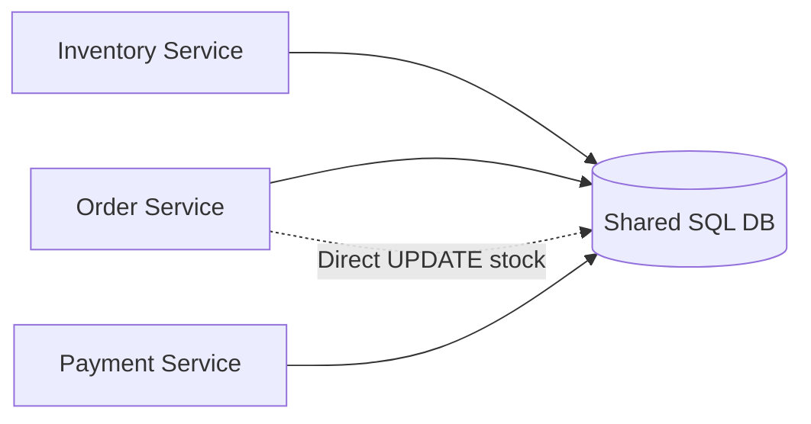
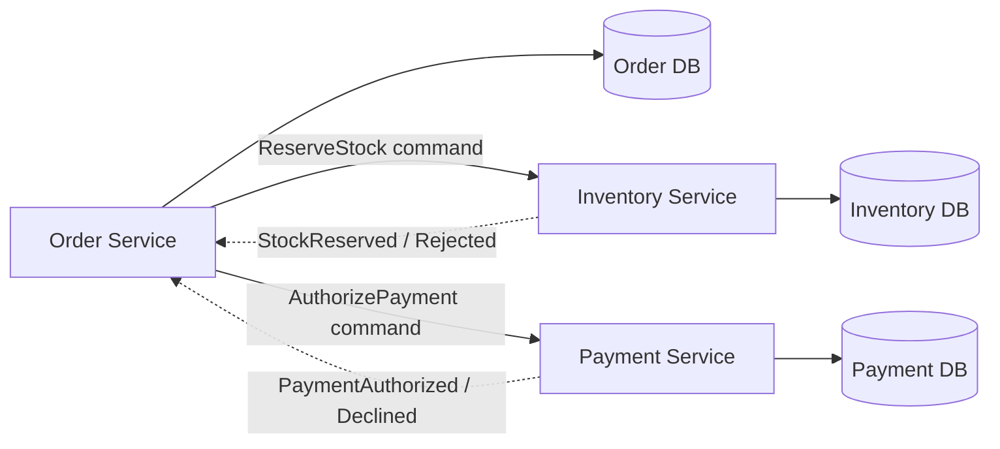
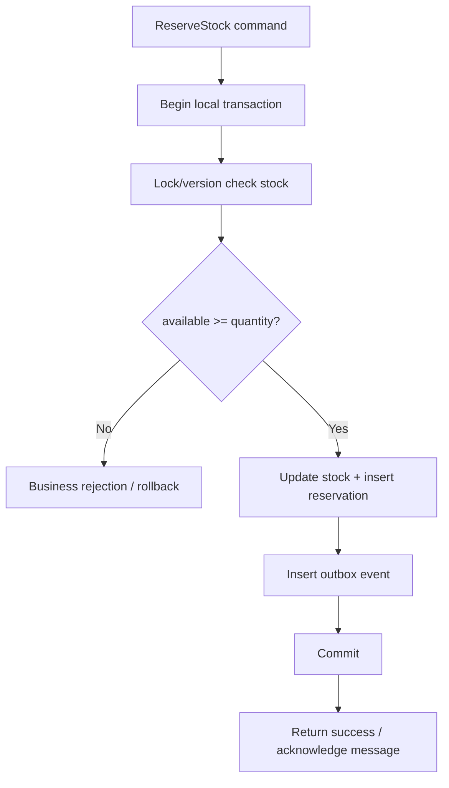
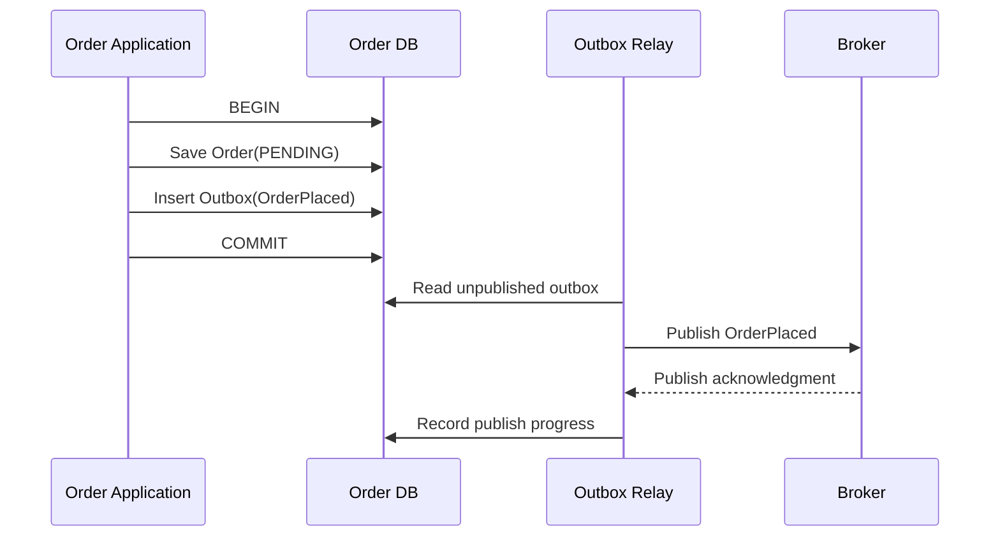
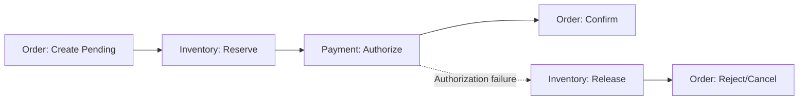
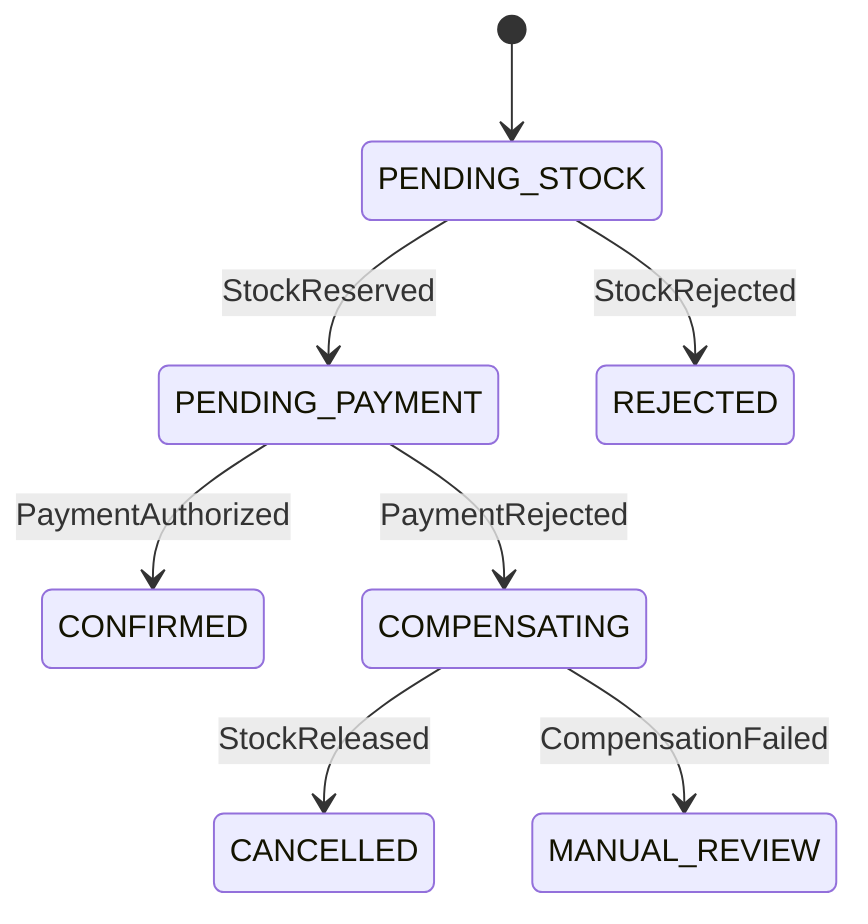
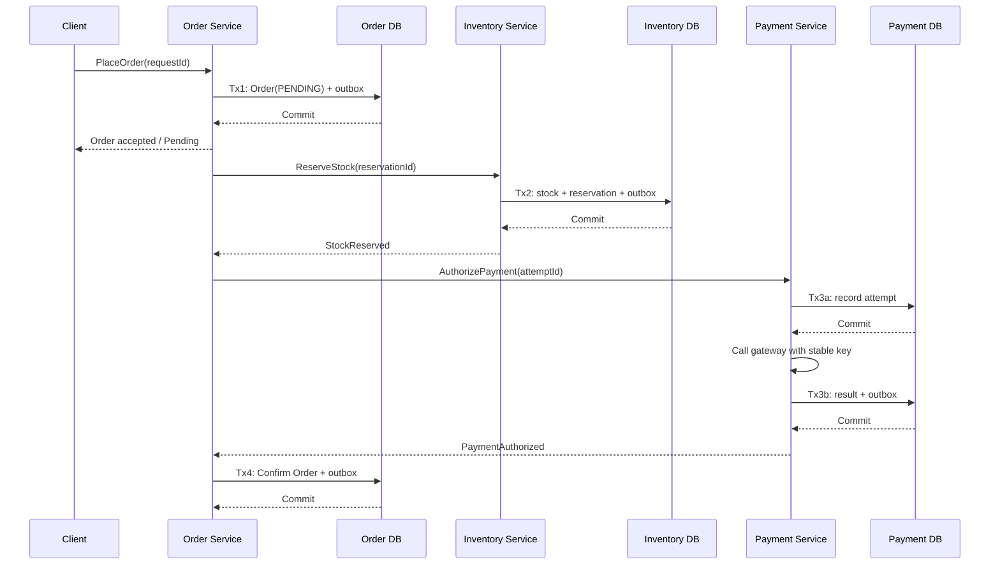

# Ranh giới giao dịch cục bộ và quy tắc bất biến trong Microservices

## 1. Mục tiêu và bối cảnh

Khi xây dựng microservices, việc tách một hệ thống thành nhiều dịch vụ độc lập khiến **ranh giới dữ liệu** và **ranh giới giao dịch** trở thành hai quyết định kiến trúc quan trọng nhất. Trong một ứng dụng đơn khối dùng một database, nhà phát triển có thể mở transaction rồi cập nhật nhiều bảng trước khi commit. Sau khi chia hệ thống theo bounded context, mỗi dịch vụ thường sở hữu dữ liệu của mình, vì vậy không thể mặc nhiên dùng một giao dịch ACID duy nhất để cập nhật trạng thái của tất cả các dịch vụ.

Ví dụ người dùng đặt một đơn hàng:

- Order cần ghi nhận đơn hàng.
- Inventory cần giữ hàng.
- Payment cần thực hiện ủy quyền thanh toán.
- Shipping cần tạo yêu cầu giao hàng sau khi các điều kiện phù hợp.

Nếu cả bốn nhiệm vụ nằm ở các dịch vụ và database khác nhau, **một lệnh đặt hàng không còn tương đương một transaction SQL duy nhất**. Mỗi dịch vụ bảo vệ dữ liệu của mình bằng local transaction, còn toàn bộ quy trình phải chấp nhận những trạng thái trung gian, lỗi từng phần, retry và một số hình thức phối hợp liên dịch vụ.

Bài học này tập trung vào hai câu hỏi:

1. **Quy tắc bất biến (invariant) nào phải đúng ngay tại thời điểm commit, và ai sở hữu nó?**
2. **Giao dịch cục bộ nên bao gồm những thay đổi nào, và những bước nào cần phối hợp bằng hợp đồng liên dịch vụ thay vì cố kéo transaction qua mạng?**

Một thiết kế đúng không nhất thiết làm mọi trạng thái trong hệ thống thay đổi cùng một thời điểm. Nó làm rõ trạng thái nào bắt buộc đúng nguyên tử, trạng thái nào được phép nhất quán sau và hệ thống sẽ phục hồi thế nào khi một bước thất bại.

### Sau bài học, người đọc có thể

1. Phân biệt local ACID transaction, invariant, aggregate, distributed workflow và eventual consistency.
2. Xác định ranh giới transaction theo dữ liệu owner và aggregate consistency boundary.
3. Phân biệt business invariant với input validation, giới hạn kỹ thuật và chính sách quy trình.
4. Chọn công cụ database phù hợp để bảo vệ invariant dưới concurrent requests.
5. Xác định transaction boundary trong ứng dụng Java/Spring Boot mà không kéo khóa qua HTTP hoặc message broker.
6. Thiết kế idempotency, outbox/inbox và saga cho những quy trình nhiều dịch vụ.
7. Phân tích tình huống crash trước/sau commit và lỗi có kết quả không chắc chắn.
8. Đặt ra tiêu chí kiểm thử, monitoring và quyết định thiết kế khi invariant liên quan nhiều bounded contexts.

## 2. Các khái niệm nền tảng

### 2.1. Local transaction là gì?

**Giao dịch cục bộ** là một nhóm thao tác được hệ quản trị dữ liệu hỗ trợ commit hoặc rollback theo một ranh giới xác định. Trong database quan hệ, transaction ACID thường gồm:

- **Atomicity:** các thao tác thuộc cùng transaction có kết quả commit như một đơn vị hoặc rollback theo cơ chế được database bảo đảm.
- **Consistency:** các ràng buộc được định nghĩa và thực thi vẫn được giữ sau transaction hợp lệ; database không tự hiểu mọi luật nghiệp vụ nếu ứng dụng không mã hóa chúng.
- **Isolation:** những transaction đồng thời quan sát và tác động đến nhau theo mức cô lập được cấu hình.
- **Durability:** dữ liệu đã commit được lưu bền vững theo cam kết và cấu hình của hệ thống lưu trữ.

Một local transaction trong Inventory có thể cập nhật bảng stock, ghi reservation và ghi bản ghi outbox **nếu chúng nằm trong cùng transactional resource/transaction manager**. Nó không tự bao gồm trạng thái trong Order database, HTTP response của Payment, hoặc email đã gửi.

### 2.2. Invariant là gì?

**Quy tắc bất biến** là điều kiện nghiệp vụ phải luôn đúng tại các thời điểm được thiết kế cho một miền. Ví dụ:

- Tồn kho không thể reserve vượt số lượng khả dụng.
- Một reservationId không tạo hai reservation chủ động có cùng tác dụng.
- Tổng tiền đã chốt của đơn hàng phải bằng tổng các dòng và điều chỉnh hợp lệ theo quy tắc làm tròn.
- Một đơn hàng không được chuyển trực tiếp từ CANCELED sang SHIPPED nếu state machine không cho phép.
- Một tài khoản không được chi vượt hạn mức theo mô hình số dư đã cam kết.
- Một payment attempt không được ghi nhận là captured nhiều lần vì cùng một lệnh nghiệp vụ.

Từ “luôn đúng” cần gắn với **phạm vi thời gian**. Một invariant cục bộ có thể phải đúng tại mỗi database commit. Một invariant tiến trình như “đơn đã thanh toán sẽ được giao hoặc được hoàn tiền” có thể là nghĩa vụ **eventual**; trong thời gian chờ giữa các bước, trạng thái Pending/Compensating vẫn hợp lệ.

### 2.3. Aggregate là ranh giới nhất quán trong domain

Trong Domain-Driven Design, một **aggregate** là cụm đối tượng nghiệp vụ có root và những invariant cần được kiểm soát nhất quán trong ranh giới đó. Thay vì cho code ở nhiều nơi cập nhật trực tiếp field, thao tác thay đổi đi qua các hành vi có ý nghĩa, ví dụ:

- Stock.reserve(quantity)
- Order.confirm(paymentReference)
- CreditAccount.debit(amount)
- Reservation.release(reason)

Aggregate root từ chối trạng thái không hợp lệ. Tuy nhiên, **aggregate không thay thế transaction và cơ chế concurrency của database**. Hai request có thể cùng đọc một trạng thái hợp lệ rồi đồng thời ghi giá trị sai nếu không có lock, version, conditional update hoặc constraint.

Không bắt buộc một aggregate tương đương đúng một bảng. Một aggregate có thể có nhiều bảng trong cùng nguồn lưu trữ; điều quyết định là quy tắc cần bảo vệ nguyên tử.

### 2.4. Phân biệt ba phạm vi

| Phạm vi | Bảo vệ điều gì? | Ví dụ |
| --- | --- | --- |
| Domain invariant | Luật và chuyển trạng thái hợp lệ | Không giữ vượt tồn, không chi âm |
| Local transaction | Commit/rollback các ghi cục bộ | Stock + reservation + outbox cùng commit |
| Cross-service process | Tiến triển nghiệp vụ qua nhiều transaction | Order Pending → Inventory Reserved → Payment Authorized |

Một quyết định tốt thường giữ **invariant nguyên tử ở cùng owner/local transaction**, trong khi quy trình xuyên service có trạng thái rõ, thông điệp tin cậy và cách xử lý khi chỉ một phần đã hoàn tất.

## 3. Vì sao ranh giới microservice liên quan đến ranh giới transaction?

Tách service theo package hoặc container nhưng dùng chung bảng và một shared transaction manager có thể khiến các dịch vụ phụ thuộc chặt vào schema, tốc độ deploy và availability của nhau.

Ví dụ:



Trong mô hình đó, Order có thể cập nhật bảng Inventory, bỏ qua các kiểm tra tồn kho, event/audit và quyền sở hữu dữ liệu. Dù runtime tách thành ba dịch vụ, dữ liệu và quy tắc chưa được cô lập.

Mô hình rõ hơn:



Điều kiện:

1. Mỗi owner quyết định và ghi dữ liệu authoritative của mình.
2. Không có đường SQL trực tiếp cho dịch vụ khác UPDATE bảng nội bộ.
3. Mỗi use case commit bằng local transaction phù hợp.
4. Các dịch vụ trao đổi qua command/query API hoặc domain event có version và semantics rõ.
5. Cross-service workflow không giả định commit đồng thời hay rollback nguyên tử xuyên các database.

Điều này cũng đúng khi các service dùng chung một PostgreSQL server nhưng tách schema và **runtime roles**: nếu không cấp quyền truy cập bảng chéo, ownership có thể được thực thi ở mức database. Database-per-service là một mô hình triển khai hữu ích, nhưng ownership quan trọng hơn việc buộc mỗi service có một máy chủ vật lý riêng.

## 4. Tìm invariant trước, chọn transaction sau

Một lỗi kiến trúc phổ biến là bắt đầu bằng câu “service nào nên có transaction?” thay vì “quy tắc nào cần giữ ngay lúc commit?”.

### 4.1. Danh mục invariant của hệ thống bán hàng

| Quy tắc | Owner đề xuất | Thời điểm phải đúng | Cơ chế bảo vệ |
| --- | --- | --- | --- |
| Không reserve quá tồn khả dụng | Inventory | Khi commit reservation | Lock/version/atomic conditional update |
| Một reservationId không bị áp dụng hai lần | Inventory | Khi commit | Unique key + idempotency |
| Order total đã chốt khớp dòng đơn | Order | Khi commit tạo/chốt order | Domain calculation + constraints |
| Order không chuyển trạng thái trái phép | Order | Mỗi lần commit trạng thái | State machine + version check |
| Payment attempt không thu trùng trong cùng operation | Payment + gateway contract | Khi hoàn tất/đối soát attempt | Stable idempotency key, ledger constraints |
| Order đã trả tiền cuối cùng phải giao hoặc hoàn/đối soát | Cross-service process | Trong thời hạn nghiệp vụ cho phép | Saga/process manager + reconciliation |

Không nên dùng local transaction của Order để cưỡng chế invariant stock thuộc Inventory. Chính Inventory cần cung cấp thao tác ReserveStock có hiệu lực nguyên tử.

### 4.2. Ba câu hỏi định ranh giới

**Câu hỏi A — Ai sở hữu dữ liệu được thay đổi?** Nếu một invariant cần cập nhật hai entity trong cùng miền, cân nhắc một aggregate hoặc một local transaction tại owner. Nếu đụng hai owner khác nhau, xác định phần nào là cam kết cục bộ và phần nào là kết quả quy trình.

**Câu hỏi B — Điều gì phải đúng đồng thời?** Nếu cập nhật balance và reservation mà thiếu một trong hai làm sai số liệu, chúng phải commit cùng nhau hoặc dùng một cơ chế lưu trữ nguyên tử tương đương.

**Câu hỏi C — Điều gì có thể tồn tại tạm thời?** Một Order PENDING_STOCK trong khi Inventory chưa xử lý command có thể là trạng thái hợp lệ. Nhưng Inventory.available âm ngay sau commit là lỗi nếu domain cấm.

### 4.3. Invariant cứng và điều kiện tiến trình

Ví dụ “khách không được đặt hàng vượt hạn mức” có thể được diễn giải theo nhiều cách:

- Không được **xác nhận** order nếu tổng nghĩa vụ đã chốt vượt hạn mức.
- Có thể **tạo** order Pending, sau đó từ chối nếu hạn mức không được giữ.
- Hạn mức do Credit service sở hữu, cần command ReserveCredit nguyên tử.
- Hiển thị số dư dự kiến có thể chậm nhưng kiểm tra khi commit phải authoritative.

Một yêu cầu mơ hồ có thể dẫn đến sai lầm: dùng cache cũ để quyết định một invariant cần tuyệt đối đúng. Trước khi chọn saga/event, cần viết rõ **mức độ nhất quán, thời điểm hiệu lực và chi phí chấp nhận sai lệch tạm**.

## 5. Thiết kế aggregate và boundary trong một dịch vụ

### 5.1. Ví dụ Inventory

Một mô hình Inventory có:

- StockBalance(sku, warehouse, available)
- Reservation(reservationId, orderId, sku, quantity, status)
- InventoryOutbox(eventId, type, payload)

Quy tắc khi ReserveStock:

1. Quantity > 0.
2. SKU/warehouse hợp lệ.
3. ReservationId chưa được áp dụng trước hoặc lệnh trùng phải trả kết quả idempotent.
4. Available >= quantity tại điểm ghi có kiểm soát concurrency.
5. Nếu thành công, giảm available và ghi reservation.
6. Ghi intent phát StockReserved trong cùng transaction, nếu quy trình yêu cầu publish tin cậy.

Trong một transaction SQL:



Một transaction chỉ nên bao những thao tác dữ liệu cục bộ cần atomicity. Việc publish ra broker thường được thực hiện **sau commit** qua outbox relay, vì broker không cùng database transaction.

### 5.2. Không phải mọi use case cần aggregate lớn

Nếu một use case chỉ chỉnh một setting độc lập, local transaction có thể rất nhỏ. Nếu một thao tác cần ghi 15 bảng vì aggregate được thiết kế quá rộng, contention và latency có thể tăng.

Thiết kế aggregate dựa trên **invariant thật**, không dựa trên sơ đồ quan hệ foreign key. Một bảng có thể chứa nhiều aggregate instances; một aggregate có thể có nhiều bảng. Không cần ép mọi quan hệ tham chiếu thành một transaction khổng lồ.

### 5.3. Tham chiếu aggregate khác bằng định danh

Một Order aggregate có thể chứa customerId, productId, reservationId và paymentAttemptId như **references**, không phải JPA entity của những service khác được load/cascade trong transaction Order.

Không cấu hình ORM cascade để một thao tác lưu Order tự động UPDATE các bảng do Inventory hoặc Payment sở hữu. Quan hệ tham chiếu xuyên bounded context được quản lý bằng contracts, trạng thái workflow và reconciliation.

## 6. Local ACID không tự bảo vệ invariant khi có concurrent requests

Một domain method có kiểm tra điều kiện đúng vẫn có thể thất bại khi hai transaction chạy đồng thời.

### 6.1. Lost update / oversell

Giả sử SKU-42 còn 5 đơn vị:

1. Transaction T1 đọc available=5, muốn reserve 4.
2. Transaction T2 cũng đọc available=5, muốn reserve 3.
3. Cả hai kiểm tra thành công vì dữ liệu đọc ban đầu đủ.
4. Nếu ghi đè không an toàn, database có thể lưu giá trị sai hoặc cả hai reservation đều thành công dù tổng cần 7.

**Không thể giải quyết chỉ bằng câu if (available >= quantity).** Cần cơ chế đồng bộ quyết định tại nguồn lưu trữ.

### 6.2. Atomic conditional update

Một phương án PostgreSQL:

```sql
UPDATE inventory.stock
SET available = available - :quantity
WHERE sku = :sku
  AND warehouse_id = :warehouseId
  AND available >= :quantity
RETURNING sku, available;
```

Nếu cập nhật 1 dòng, transaction đã giữ điều kiện available >= quantity tại điểm ghi. Nếu không có dòng nào, cần phân biệt SKU không tồn tại với không đủ hàng tùy yêu cầu API.

Reservation record và outbox phải được lưu trong **cùng transaction** với UPDATE này. Unique constraint trên reservationId vẫn cần để không trừ lần nữa khi command được gửi lặp.

### 6.3. Pessimistic locking

Một cách khác là SELECT ... FOR UPDATE hoặc cơ chế JPA PESSIMISTIC_WRITE trên stock row, rồi kiểm tra và ghi trong transaction đó.

```sql
BEGIN;

SELECT sku, available
FROM inventory.stock
WHERE sku = :sku
FOR UPDATE;

-- Application kiểm tra available >= quantity.
-- Nếu không đủ: ROLLBACK hoặc kết thúc transaction hợp lệ.
-- Nếu đủ:
UPDATE inventory.stock
SET available = available - :quantity
WHERE sku = :sku;

INSERT INTO inventory.reservation(
  reservation_id, sku, quantity, status
) VALUES (:reservationId, :sku, :quantity, 'RESERVED');

INSERT INTO inventory.outbox(
  event_id, event_type, aggregate_id, payload
) VALUES (:eventId, 'StockReserved', :sku, :payload);

COMMIT;
```

Ví dụ dùng cú pháp SQL định hướng PostgreSQL. Trong code thật, cần xử lý branch không đủ hàng, duplicate key, timeout và rollback tự động. Lock có thể tạo contention; đừng giữ row lock khi gọi HTTP hoặc chờ broker.

### 6.4. Optimistic locking

Thêm version cho aggregate:

```sql
UPDATE inventory.stock
SET available = :newAvailable,
    version = version + 1
WHERE sku = :sku
  AND version = :expectedVersion;
```

Nếu affected rows = 0, transaction khác đã thay đổi bản ghi; cần reload/retry **có giới hạn và an toàn** hoặc trả conflict. Version là cơ chế chống lost update, nhưng nghiệp vụ phải xử lý retry và uniqueness đúng. Với workload tranh chấp cao, optimistic retries nhiều có thể tốn chi phí hơn row locking/conditional update.

### 6.5. Unique constraint và idempotency

```sql
ALTER TABLE inventory.reservation
ADD CONSTRAINT uq_reservation_id
UNIQUE (reservation_id);
```

Nếu cùng reservationId được gửi hai lần, database ngăn hai bản ghi trùng. Tuy nhiên, thứ tự thao tác và rollback rất quan trọng: nếu UPDATE stock thành công nhưng INSERT reservation bị unique violation, **transaction phải rollback toàn bộ** để không trừ stock lần thứ hai.

Một SELECT existsById trước INSERT **không thay thế** unique constraint; hai request có thể cùng SELECT không thấy và cùng cố INSERT. Lưu nội dung command/payload hash theo idempotency key nếu cần phát hiện cùng ID nhưng quantity khác.

### 6.6. Isolation levels không được hiểu máy móc

- READ COMMITTED thường ngăn đọc dữ liệu chưa commit nhưng vẫn có thể xuất hiện non-repeatable reads/những anomaly khác tùy SQL và DB.
- REPEATABLE READ giữ cách nhìn snapshot ổn định hơn theo implementation cụ thể, nhưng không đồng nghĩa mọi invariant đều an toàn.
- SERIALIZABLE cố gắng tạo kết quả tương đương một thứ tự tuần tự, nhưng có thể abort transaction do serialization conflict; ứng dụng cần retry toàn transaction theo chính sách.
- Row locks và atomic conditions giúp giải một số invariant cục bộ mà không buộc mọi transaction toàn hệ thống dùng SERIALIZABLE.

**Mức isolation phải được chọn theo kiểu truy cập và invariant**, không chỉ theo mức “cao nhất”. Độ an toàn thực còn phụ thuộc database, index, truy vấn, điều kiện unique và cách ứng dụng handle lỗi.

## 7. Ví dụ Java: domain model và application transaction

### 7.1. Domain invariant

Ví dụ Java thuần, không phụ thuộc HTTP hoặc JPA:

```java
public final class Stock {
    private final String sku;
    private int available;

    public Stock(String sku, int available) {
        if (sku == null || sku.isBlank()) {
            throw new IllegalArgumentException("SKU required");
        }
        if (available < 0) {
            throw new IllegalArgumentException("Negative available");
        }
        this.sku = sku;
        this.available = available;
    }

    public void reserve(int quantity) {
        if (quantity <= 0) {
            throw new IllegalArgumentException("Quantity must be positive");
        }
        if (available < quantity) {
            throw new InsufficientStockException(sku, quantity);
        }
        available -= quantity;
    }

    public int available() {
        return available;
    }
}
```

Stock.reserve biểu đạt business rule. Nhưng để chống concurrent updates, adapter persistence phải bảo vệ bằng optimistic locking, pessimistic locking hoặc atomic conditional update thích hợp.

### 7.2. Inbound port/use case

```java
public record ReserveStockCommand(
    String reservationId,
    String orderId,
    String sku,
    int quantity
) {}

public record ReserveStockResult(
    String reservationId,
    ReservationStatus status
) {}

public enum ReservationStatus {
    RESERVED, ALREADY_RESERVED, OUT_OF_STOCK
}

public interface ReserveStockUseCase {
    ReserveStockResult reserve(ReserveStockCommand command);
}
```

Command đi vào application, còn controller hoặc message consumer ở adapter nhận payload và chuyển đổi. Domain không cần biết HTTP status hoặc Kafka headers.

### 7.3. Outbound ports

```java
public interface StockRepositoryPort {
    // Tải row với concurrency policy đã thống nhất.
    Stock loadForUpdate(String sku);
    void save(Stock stock);
}

public interface ReservationRepositoryPort {
    Optional<Reservation> findById(String reservationId);
    void insert(Reservation reservation);
}

public interface OutboxPort {
    void append(OutboxEvent event);
}
```

Port có thể nằm trong application/domain tùy cách chia module. Adapter PostgreSQL/JPA implement chúng. Không để application import JPA entity hoặc EntityManager nếu mục tiêu là giữ lõi độc lập với persistence.

### 7.4. Application service điều phối local transaction

```java
@Service
public class ReserveStockService implements ReserveStockUseCase {
    private final StockRepositoryPort stockRepository;
    private final ReservationRepositoryPort reservationRepository;
    private final OutboxPort outbox;

    public ReserveStockService(
        StockRepositoryPort stockRepository,
        ReservationRepositoryPort reservationRepository,
        OutboxPort outbox
    ) {
        this.stockRepository = stockRepository;
        this.reservationRepository = reservationRepository;
        this.outbox = outbox;
    }

    @Override
    @Transactional
    public ReserveStockResult reserve(ReserveStockCommand command) {
        if (command.quantity() <= 0) {
            throw new IllegalArgumentException("Invalid quantity");
        }

        Optional<Reservation> existing =
            reservationRepository.findById(command.reservationId());
        if (existing.isPresent()) {
            existing.get().assertSameRequest(
                command.orderId(), command.sku(), command.quantity());
            return new ReserveStockResult(
                command.reservationId(), ReservationStatus.ALREADY_RESERVED);
        }

        Stock stock = stockRepository.loadForUpdate(command.sku());
        try {
            stock.reserve(command.quantity());
        } catch (InsufficientStockException businessRejection) {
            return new ReserveStockResult(
                command.reservationId(), ReservationStatus.OUT_OF_STOCK);
        }

        stockRepository.save(stock);
        reservationRepository.insert(
            Reservation.reserved(command.reservationId(),
                command.orderId(), command.sku(), command.quantity()));

        outbox.append(OutboxEvent.stockReserved(
            command.reservationId(), command.orderId(),
            command.sku(), command.quantity()));

        return new ReserveStockResult(
            command.reservationId(), ReservationStatus.RESERVED);
    }
}
```

Đây là **minh họa trách nhiệm**, không phải một implementation production đầy đủ. Các type Reservation, OutboxEvent và exceptions cần định nghĩa riêng. Cần thêm concurrency control thực ở persistence, unique constraint trên reservationId và xử lý conflict. Với cách trả OUT_OF_STOCK trong transaction, lưu ý transaction vẫn có thể commit những thay đổi vô tình đã được thực hiện trước khi trả; giữ nhánh reject không có tác dụng phụ hoặc chủ động rollback.

**Một race vẫn tồn tại** nếu hai request cùng reservationId đọc chưa có bản ghi. Database unique constraint và rollback toàn transaction là hàng rào cuối. Khi gặp duplicate concurrent insert, ứng dụng nên rollback rồi đọc lại kết quả đã commit; không chỉ swallow exception trong một transaction đã bị đánh dấu failed.

### 7.5. Transaction boundary đặt ở đâu?

Với Spring, đặt @Transactional ở public application service method là lựa chọn thực dụng. Nếu muốn application là Java thuần, có thể dùng transactional decorator/adapter bên ngoài. Hai lựa chọn có trade-off:

- Annotation Spring dễ đọc và cấu hình, nhưng application phụ thuộc một phần framework.
- Decorator giữ core độc lập nhưng tăng cấu hình và wiring.

Dù chọn gì, controller và message consumer phải gọi **đúng entry point được bao transaction**, không gọi trực tiếp một method nội bộ và vô tình bỏ qua transaction proxy.

### 7.6. Một transaction không thể bao trùm tùy ý mọi resource

@Transactional chỉ có hiệu lực trên **transaction manager và resources được cấu hình tham gia**. Nếu StockRepository dùng PostgreSQL A, OutboxPort dùng database B, và application gọi HTTP Payment trong cùng method, một annotation không tự mang lại atomic commit giữa chúng.

Khi local transaction là bất biến thiết kế, cần kiểm tra:

- Stock, reservation và outbox có thực sự dùng chung transaction manager không?
- Nếu có nhiều data sources, có transaction coordination được thiết kế minh bạch không?
- ORM có flush/cascade đúng trước commit không?
- Exception có làm rollback theo policy mong muốn không?
- Khi publish event, có dùng outbox thay vì side effect chưa commit không?

## 8. Các lỗi transaction thường gặp trong ứng dụng Java/Spring

### 8.1. Self-invocation bỏ qua proxy

Một method @Transactional được gọi từ một method khác **trên cùng object** có thể không đi qua Spring AOP proxy theo cấu hình phổ biến. Vì vậy transaction mới có thể không được tạo như mong đợi.

Nên đặt boundary ở public bean method được gọi từ bên ngoài proxy, hoặc dùng programmatic transaction/decorator thích hợp.

### 8.2. Checked exception và rollback rules

Trong cấu hình transaction phổ biến của Spring, mặc định rollback cho RuntimeException và Error, còn checked exceptions có thể không gây rollback nếu không cấu hình. Nếu use case ném checked exception sau khi đã sửa nhiều bảng, phải khai báo rollbackFor hoặc dùng design tránh mơ hồ.

Đừng giả định mọi throw đều rollback giống nhau; cần test đường lỗi sau khi đã ghi dữ liệu.

### 8.3. Transaction chỉ bao quanh mỗi repository.save

Nếu application gọi saveStock rồi saveReservation mà từng repository tự mở và commit transaction riêng, một bước lỗi có thể để lại trạng thái nửa chừng.

Đặt transaction bao quanh **toàn bộ nhóm ghi cần atomicity**, không chỉ từng statement. Tránh để mỗi adapter cố tự quyết định commit khi application cần sự nhất quán giữa chúng.

### 8.4. Gọi HTTP trong lúc giữ transaction

Ví dụ:

```java
@Transactional
public void confirmOrder(String orderId) {
    Order order = repository.lock(orderId);
    paymentClient.authorize(order.paymentRequest()); // network call
    order.confirm();
    repository.save(order);
}
```

Nếu Payment chậm 10 giây, transaction có thể giữ connection và lock nhiều giây. Nếu Payment đã authorize nhưng Order transaction rollback, side effect bên ngoài vẫn tồn tại.

**Giải pháp:** tách các bước: ghi Pending/intent → commit, gọi Payment có idempotency key → ghi kết quả trong transaction mới; hoặc dùng process manager/saga tùy yêu cầu. Khi cần quyết định đồng bộ, vẫn phải tránh giả định rollback local có thể đảo ngược side effect mạng.

### 8.5. Transaction quá rộng

Giữ transaction cho cả xử lý file, tính toán nặng, gửi email, gọi API ngoài và chờ event làm tăng thời gian giữ lock, connection pool pressure và độ khó khôi phục.

Phạm vi transaction nên **ngắn, rõ và tập trung vào ghi nguyên tử**. Đưa công việc chậm ra ngoài transaction, trừ khi semantics thật sự yêu cầu và có công nghệ hỗ trợ.

## 9. Transactional Outbox: kết nối transaction với thông điệp

Khi local transaction hoàn tất, microservice có thể cần thông báo cho dịch vụ khác. Một lỗi phổ biến là:

1. INSERT order rồi commit DB.
2. Publish OrderPlaced tới broker.
3. Crash giữa hai bước.

Kết quả: Order đã tồn tại nhưng downstream không có event. Nếu publish trước commit rồi DB rollback, downstream lại thấy event của một order không tồn tại.

### 9.1. Ý tưởng outbox

Ghi **business state và intent phát event** trong cùng database transaction:



Điều này bảo đảm một thay đổi Order và bản ghi outbox **cùng có hoặc cùng không có** tại local commit. Relay có thể publish trùng nếu crash sau khi broker nhận nhưng trước khi đánh dấu đã phát; consumer phải idempotent.

### 9.2. Outbox không tạo distributed ACID

Không hiểu outbox là transaction bao cả broker và mọi consumer. Nó chỉ giúp bảo đảm **ý định phát** gắn với commit nguồn; việc giao và xử lý ở downstream có thể diễn ra sau, trùng và sai thứ tự trong một số điều kiện.

Mỗi consumer cần tự bảo vệ invariant cục bộ. Với một bước chuyển trạng thái dựa trên event, cần:

- eventId và businessOperationId ổn định.
- Consumer inbox/dedup hoặc unique business key.
- Transaction cục bộ của consumer.
- State machine/version check khi event sai thứ tự.
- Retry, DLQ và reconciliation khi chưa xử lý được.

## 10. Idempotency là điều kiện cho local transaction an toàn khi retry

### 10.1. Khi response bị mất

Inventory đã commit reservation R-123 rồi trả response, nhưng mạng bị mất. Order không biết Inventory có thành công không, nên gửi lại ReserveStock với **cùng reservationId**.

Nếu Inventory trừ stock một lần nữa, invariant có thể bị phá hoặc tồn giảm quá mức. Nếu Inventory nhận diện request trùng và trả trạng thái đã lưu, request có thể retry an toàn hơn.

### 10.2. Business key và message key

Hai ID khác nhau có mục đích khác nhau:

- **messageId/eventId:** chống xử lý lặp của cùng bản tin khi broker redelivery.
- **reservationId/paymentAttemptId/orderOperationId:** chống tác dụng phụ trùng của cùng thao tác nghiệp vụ, kể cả upstream gửi hai message với eventId khác nhau.

Chỉ dedup messageId có thể chưa đủ nếu producer tạo sự kiện mới cho cùng business command. Một business key nên có phạm vi, validation payload và thời hạn sống được định nghĩa rõ.

### 10.3. Bảng xử lý thông điệp trong consumer

```sql
CREATE TABLE inventory.processed_message (
    consumer_name VARCHAR(100) NOT NULL,
    message_id VARCHAR(150) NOT NULL,
    processed_at TIMESTAMP NOT NULL DEFAULT CURRENT_TIMESTAMP,
    PRIMARY KEY (consumer_name, message_id)
);
```

Consumer có thể insert dấu xử lý cùng transaction với cập nhật domain. Nếu một delivery trùng đến, unique constraint ngăn ghi lại. Tuy vậy, bảng processed_message chỉ chống **trùng theo event identity**, không thay thế unique reservationId, concurrency control và business state rules.

### 10.4. Ack phải sau durable processing

Với at-least-once delivery, consumer nên commit local database transaction thành công rồi mới ack/commit offset. Nếu crash sau DB commit trước ack, message có thể được giao lại; idempotency ngăn business effect trùng.

Nếu ack trước commit, crash có thể làm mất message về mặt nghiệp vụ. Không có một thời điểm ack nào tự tạo exactly-once end-to-end giữa broker và database độc lập.

## 11. Bất biến xuyên dịch vụ: điều gì thật sự cần nguyên tử?

Giả sử yêu cầu: “Không bao giờ tồn tại Order CONFIRMED nếu chưa giữ hàng”.

Có ít nhất hai diễn giải:

1. **Hard condition lúc xác nhận:** Order chỉ chuyển CONFIRMED sau khi đã nhận bằng chứng Inventory Reserved. Nếu chưa có, Order ở PENDING_STOCK.
2. **Mọi bước cùng commit ngay lập tức:** tạo Order, reserve stock và authorize payment phải atomic trong một transaction xuyên nhiều service.

Diễn giải thứ hai thường không phù hợp với mục tiêu độc lập của microservices và hạ tầng thực tế. Diễn giải thứ nhất có thể đạt bằng **state machine + authoritative reservation + idempotent workflow**, nhưng vẫn cần xử lý tình huống Inventory reserved mà event về Order chưa đến.

### 11.1. Không dùng cached state để bảo vệ invariant cứng của owner

Nếu Inventory là owner của stock, Order không nên đọc cached available=5 rồi tự quyết định reserve 5 thành công. Cache có thể cũ; một request khác đã giữ hàng trong lúc đó.

Order có thể dùng cache để **hiển thị ước lượng** hoặc gợi ý UX, nhưng lệnh ReserveStock phải kiểm tra và commit tại Inventory.

### 11.2. Đặt invariant ở nơi thay đổi dữ liệu

Nếu invariant liên quan cả stock balance và reservation, để Inventory quyết định. Nếu invariant liên quan cả order lines và discount đã chốt của đơn, Order/Pricing boundary phải được xác định rõ ai có thẩm quyền. Nếu hai service luôn phải cùng transaction để bảo vệ một luật không thể tách, hãy **xem lại service boundary**.

Không nhất thiết thêm saga để “bắt cầu” mọi ranh giới chưa tốt; có trường hợp gộp hai aggregate liên quan vào cùng owner đơn giản hơn và an toàn hơn.

## 12. Saga và process manager cho workflow nhiều dịch vụ

**Saga** là một cách tổ chức quy trình thành các **local transactions** phối hợp với nhau, có bước bù trừ hoặc phục hồi khi một số bước thất bại. Nó không tạo một ACID transaction phủ toàn bộ hệ thống.

Ví dụ Checkout:



### 12.1. Trạng thái workflow minh bạch

Một Order có thể đi qua:



Đây là ví dụ trạng thái, không phải state machine duy nhất. Các hệ thống còn có timeout, duplicate, cancellation, partial fulfillment, fraud review và các trạng thái Unknown phải xác định rõ.

### 12.2. Choreography và orchestration

**Choreography:** các service phát/nhận events để tiến triển workflow. Ưu điểm là không cần một coordinator tập trung; nhược điểm là luồng tổng thể có thể khó quan sát khi nhiều bên cùng phản ứng và phát sự kiện.

**Orchestration:** một process manager/coordinator gửi commands, theo dõi trạng thái và chọn bước tiếp theo. Ưu điểm là workflow dễ mô tả tập trung; nhược điểm là cần bảo đảm coordinator bền vững, không trở thành God Service chiếm invariant của tất cả miền.

Bất kể cách nào, mỗi owner vẫn thực hiện local transaction riêng và giữ quyền quyết định của domain mình.

### 12.3. Compensation không giống rollback

ReleaseStock có thể bù lại ReserveStock nếu chưa giao hàng. Nhưng hoàn tiền sau khi đã capture có phí, độ trễ hoặc kiểm soát pháp lý; nó **không hoàn nguyên lịch sử** giống rollback SQL.

Do đó cần mô tả bù trừ bằng nghiệp vụ cụ thể, không chỉ gọi một hàm undo tổng quát. Có những side effects không thể bù hoàn toàn; kiến trúc phải có chính sách trạng thái cuối hoặc manual intervention.

### 12.4. Có deadline và reconciliation

Một saga có thể bị kẹt khi event không đến, worker crash hoặc downstream outage kéo dài. Cần:

- Timeout theo bước và toàn workflow.
- Durable state của process manager.
- Idempotent commands và deduplicated responses.
- Retry có backoff, giới hạn và DLQ.
- Reconciliation cho Pending/Unknown quá hạn.
- Dashboard hiển thị những workflow đang chờ, đang bù, hoặc cần hỗ trợ thủ công.

**Không coi một request HTTP được trả 202 là workflow đã hoàn tất**. Hệ thống phải tiếp tục tiến triển hoặc kết thúc trong một trạng thái nghiệp vụ có thể giải thích.

## 13. “Unknown outcome” là bài toán quan trọng

Giả sử Payment gateway đã authorize thành công nhưng Payment service crash trước khi commit kết quả hoặc trả response.

Caller nhìn thấy timeout, không thể kết luận authorization thất bại. Nếu gửi yêu cầu mới với key khác, khách có thể bị xử lý tài chính trùng.

Cách thiết kế:

1. Tạo paymentAttemptId và idempotency key ổn định.
2. Ghi intent/trạng thái PENDING trong local transaction trước khi gọi gateway.
3. Dùng cùng key qua retry nếu provider hỗ trợ.
4. Nếu timeout không rõ kết quả, query provider hoặc reconciliation theo attempt.
5. Chỉ chuyển trạng thái Paid/Declined khi có bằng chứng hợp lệ.
6. Ghi event downstream qua outbox, không publish trước local commit.
7. Có quy trình Manual Review nếu provider không trả kết quả có thể tin cậy.

**Transaction rollback trong Payment DB không rollback giao dịch đã xảy ra ở cổng thanh toán.** Đây là ranh giới side effect mà local transaction không thể vượt qua bằng annotation.

## 14. Bảng phân chia bảo đảm theo từng ranh giới

| Tình huống | Local transaction giải quyết? | Cần thêm gì? |
| --- | --- | --- |
| Stock balance và reservation cập nhật cùng DB | Có, nếu cùng transaction | Invariant + concurrency control + unique key |
| Order state và Order outbox cùng DB | Có | Relay + consumer idempotency |
| Order DB và Inventory DB cùng cập nhật | Không tự động | Command/event workflow, saga hoặc xem lại boundary |
| Database commit nhưng HTTP response mất | Không tự xóa bất định | Idempotency key + query/reconciliation |
| Message đã xử lý nhưng broker ack mất | Không tạo exactly-once | Inbox/dedup + ack sau commit |
| Payment gateway thành công rồi app crash | Không | Provider idempotency + durable attempt + reconciliation |
| Cần query dữ liệu hiện tại của service khác | Không nên đọc DB chéo | Query API hoặc owner command |
| Read model trễ so với source of truth | Không cần local cross-DB transaction | Freshness policy, version, replay |
| Consumer nhận event sai thứ tự | Không tự sửa được | Aggregate version/state machine/ordering |
| Hai request ghi cùng resource | Tùy isolation/SQL | Lock, version, conditional update, constraint |

## 15. Thiết kế transaction boundary trong microservice thực tế

### 15.1. Quy trình quyết định

1. **Liệt kê use cases:** CreateOrder, ReserveStock, AuthorizePayment, ShipOrder.
2. **Liệt kê dữ liệu bị thay đổi** trong mỗi use case và owner của từng bộ dữ liệu.
3. **Viết invariants** dưới dạng điều kiện có thể kiểm chứng, không ghi chung chung “phải nhất quán”.
4. **Xác định atomic commit set:** những thay đổi phải cùng thành công/thất bại trong một transactional resource.
5. **Thiết kế aggregate/API:** đưa quyết định invariant về owner.
6. **Chọn persistence concurrency policy:** unique/constraint, lock, version, atomic update.
7. **Xác định cross-service process:** state Pending, command/event, compensation và timeout.
8. **Thiết kế durability:** outbox, inbox/idempotency, ack và replay.
9. **Xác định failure modes:** crash trước/sau commit, unknown outcome và phân hoạch mạng.
10. **Kiểm thử/giám sát:** đo invariant violation, stuck workflow, retry và latency.

### 15.2. Transaction checklist cho mỗi use case

| Câu hỏi | Trả lời cần có |
| --- | --- |
| Owner dữ liệu? | Service/aggregate chịu trách nhiệm |
| Các ghi atomic? | Bảng/records cùng local transaction |
| Invariant cụ thể? | Công thức hoặc trạng thái không được vi phạm |
| Isolation/concurrency? | Lock, version, conditional update, unique |
| Transaction bắt đầu/kết thúc ở đâu? | Application boundary, manager và resource |
| Có network call trong transaction không? | Tốt nhất không; nếu có phải có lý do và kiểm soát |
| Có phát event cần tin cậy không? | Outbox commit cùng dữ liệu |
| Command có thể bị gửi lại không? | Idempotency và duplicate policy |
| Nếu crash sau commit thì sao? | Read/retry/reconcile không nhân đôi effect |
| Nếu bước kế tiếp fail thì sao? | Pending/compensation/manual review |
| Có bảo vệ privilege boundary không? | Chỉ owner ghi authoritative data |

## 16. Nghiên cứu tình huống: đơn hàng và tồn kho

### 16.1. Thiết kế sai: một transaction khái niệm xuyên dịch vụ

Order mở transaction, ghi đơn, gọi Inventory qua HTTP để update stock, gọi Payment qua HTTP rồi commit Order. Nếu Payment timeout:

- Inventory có thể đã commit reservation.
- Order rollback, không còn bản ghi đơn tương ứng.
- Payment có thể đã authorize hoặc không.
- HTTP timeout không nói được trạng thái commit của bên kia.

**Không có một lệnh ROLLBACK ở Order giải quyết được tất cả.** Kể cả dùng orchestration đồng bộ, các side effects ở service khác đã có transaction riêng.

### 16.2. Thiết kế có owner và local transactions



Sơ đồ tuần tự trình bày một **happy path** minh họa; triển khai có thể dùng message broker thay HTTP, và trạng thái thực tế cần thêm nhánh lỗi/reconciliation.

### 16.3. Invariants từng bước

- **Tx1 Order:** không tạo hai Order cho cùng client operation; dữ liệu đơn và outbox cùng commit.
- **Tx2 Inventory:** không reserve vượt tồn; một reservationId chỉ áp dụng một lần; stock/reservation/outbox cùng commit.
- **Tx3 Payment:** payment attempt có identity ổn định, chuyển trạng thái hợp lệ, external outcome được đối soát.
- **Tx4 Order:** chỉ CONFIRMED khi có bằng chứng reservation + authorization phù hợp; transition idempotent và được bảo vệ bằng version.

### 16.4. Tình huống cần bù trừ

Nếu Inventory đã reserve nhưng Payment từ chối:

1. Order chuyển sang COMPENSATING hoặc REJECTED theo state machine.
2. Process manager gửi ReleaseReservation với cùng reservationId.
3. Inventory kiểm tra reservation còn active, release nguyên tử, ghi outbox.
4. Order ghi nhận completion sau khi thấy ReservationReleased.
5. Nếu Release không hoàn tất, workflow giữ trạng thái cần xử lý và retry/reconcile có kiểm soát.

Không “bù” bằng cách Order trực tiếp UPDATE inventory.stock: hành động phải do owner Inventory thực thi.

## 17. Sự khác nhau giữa dữ liệu snapshot và invariant mạnh

Trong Order, một bản sao productNameAtPurchase hoặc unitPriceAtPurchase có thể được sở hữu bởi Order để tái hiện lịch sử giao dịch. Nhưng Order đọc số lượng tồn hiển thị từ projection và tự cho rằng đó là reservation có hiệu lực sẽ sai nếu business invariant cần mới nhất.

Phân loại:

- **Snapshot lịch sử:** dữ liệu đã chốt làm bằng chứng cho giao dịch, không cần thay khi Catalog đổi.
- **Read projection:** dữ liệu dẫn xuất/có thể trễ, phù hợp hiển thị hoặc gợi ý nếu nghiệp vụ cho phép.
- **Authoritative command result:** quyết định có tác dụng thay đổi nguồn sự thật, phải do owner bảo vệ invariant tại commit.
- **Workflow state:** tổng hợp kết quả từ nhiều owner, có trạng thái Pending/Unknown và cần đối soát.

Tách các khái niệm này giúp giảm phụ thuộc đồng bộ mà vẫn giữ đúng quy tắc bắt buộc.

## 18. Các lựa chọn khi invariant thật sự trải rộng nhiều service

Đôi khi team nhận thấy một quy tắc cần đồng thời kiểm tra dữ liệu A và B. Có ba hướng cần cân nhắc nghiêm túc:

### 18.1. Chuyển quyền quyết định về một owner

Tạo một dịch vụ/aggregate sở hữu quyết định có hiệu lực nguyên tử. Các bên khác gửi command hoặc cung cấp snapshot/contract. Điều này thường phù hợp khi invariant thuộc cùng bounded context nhưng đã bị chia quá nhỏ.

### 18.2. Reserve/commit protocol ở cấp nghiệp vụ

Dùng những thao tác có ngữ nghĩa như HoldCredit, ReserveStock, ConfirmPayment, ReleaseReservation. Mỗi thao tác commit local và trả token/ID, không giữ DB locks qua toàn workflow.

Ưu điểm: có thể phục hồi và bù trừ. Đánh đổi: nhiều trạng thái trung gian, timeout, expiry và reconciliation. Phải định nghĩa trường hợp token hết hạn hay người dùng hủy giữa chừng.

### 18.3. Hệ thống quản lý giao dịch phân tán có chủ đích

Một số hệ thống dùng 2PC/XA hoặc một nền tảng dữ liệu có transaction xuyên nguồn. Đây là một lựa chọn kỹ thuật **có điều kiện**, nhưng tăng coupling tới coordinator, availability, resource locking và yêu cầu driver/resource hỗ trợ. Không được mặc định rằng nó tự hoạt động với HTTP microservices hay payment gateway.

Với microservices độc lập, business workflow có trạng thái rõ thường được ưu tiên hơn giữ distributed lock dài. Nhưng nếu yêu cầu nghiệp vụ thật sự đòi atomicity xuyên resource và công nghệ hỗ trợ, cần đánh giá chi phí và failure semantics cụ thể thay vì cấm tuyệt đối theo khẩu hiệu.

## 19. Outbox, inbox và uniqueness không thay thế nhau

| Cơ chế | Đối tượng bảo vệ | Chưa giải quyết |
| --- | --- | --- |
| Domain invariant | Quy tắc và transition tại một owner | Race nếu DB không bảo vệ |
| Unique constraint | Không tạo hai records cùng business key | Mọi loại cạnh tranh hoặc side effect bên ngoài |
| Optimistic/pessimistic lock | Concurrency trên dữ liệu được ghi | Duplicate command khi retry |
| Local transaction | Atomicity của một tập ghi trong resource | Commit của resource khác |
| Transactional outbox | Ý định publish đi cùng local commit | Delivery duplicate, downstream effect |
| Consumer inbox/dedup | Xử lý lặp cùng message | Hai message khác ID cho cùng business operation |
| Business idempotency | Chống side effect lặp của cùng operation | Unknown outcome bên provider không hỗ trợ |
| Saga/process manager | Tiến triển và bù trừ nhiều local transactions | ACID rollback xuyên hệ thống |
| Reconciliation | Phát hiện và chữa trạng thái kẹt/lệch | Loại bỏ mọi cửa sổ bất nhất tức thời |

Một hệ thống đáng tin thường dùng **nhiều lớp bảo vệ bổ sung**, không kỳ vọng một cơ chế bao quát mọi failure.

## 20. Kiểm thử invariant và transaction boundary

### 20.1. Domain unit tests

Kiểm tra quy tắc trong mô hình domain không cần database:

```java
@Test
void cannotReserveMoreThanAvailable() {
    Stock stock = new Stock("SKU-1", 3);

    assertThrows(
        InsufficientStockException.class,
        () -> stock.reserve(4));

    assertEquals(3, stock.available());
}
```

Test này chứng minh method không cho phép thao tác sai **trong cùng một object instance**. Nó chưa chứng minh database không oversell khi có nhiều request đồng thời.

### 20.2. Integration test cho transaction atomicity

Dùng database có semantics giống production, ví dụ PostgreSQL qua Testcontainers:

1. Tạo stock=5.
2. Trong transaction, update stock và insert reservation.
3. Cố tình gây lỗi trước khi insert outbox.
4. Assert rollback: stock vẫn 5, reservation không tồn tại, outbox không có event.
5. Lặp test với lỗi sau insert outbox nhưng trước commit.

Cần kiểm tra rollback rules thực của framework và persistence adapters, không chỉ giả định mọi exception đều rollback.

### 20.3. Concurrency test

Gửi hai reserve requests cho cùng SKU có tổng quantity vượt available, chạy đồng thời với barrier/latch. Kết quả mong đợi:

- Không có hơn một tập reservation làm tổng lượng reserve vượt stock.
- Available không âm.
- Database không mất update.
- Các request thất bại trả business outcome rõ hoặc retry an toàn.
- Unique reservation ID đúng dưới concurrency.

Không kiểm tra bằng một chuỗi test tuần tự rồi kết luận đã chống race.

### 20.4. Idempotency test

Gửi cùng reservationId 5 lần, cùng payload:

- Chỉ một business effect.
- Nếu message đến trùng, handler trả result cũ hoặc no-op hợp lệ.
- Một reservationId với payload khác phải được phân loại conflict, không âm thầm chấp nhận như cùng lệnh.
- Không có hai outbox intents vô tình tạo hai sự kiện độc lập cho một thao tác nghiệp vụ.

### 20.5. Crash-window test

Mô phỏng:

- Crash trước DB commit.
- Crash sau DB commit nhưng trước HTTP response.
- Crash sau DB commit nhưng trước broker ack.
- Outbox relay publish thành công rồi crash trước mark-sent.
- Workflow đã reserve nhưng chưa nhận kết quả Payment.
- Compensation gửi lại nhiều lần.
- Event đến sai thứ tự hoặc out-of-date.

Test đúng ở các điểm này quan trọng hơn việc chỉ có một happy-path integration test với tất cả service luôn hoạt động.

## 21. Monitoring và vận hành

Những chỉ số nên theo dõi:

| Chỉ số | Diễn giải |
| --- | --- |
| transaction_commit/rollback | Số commit và rollback theo use case |
| deadlock/serialization_conflicts | Dấu hiệu concurrent writes và isolation conflicts |
| lock_wait_duration | Thời gian chờ lock hoặc row contention |
| invariant_rejection_count | Business rejection như OUT_OF_STOCK |
| duplicate_command_count | Lệnh trùng được xử lý idempotent |
| outbox_backlog/oldest_age | Ý định publish chưa ra broker |
| consumer_retry/DLQ | Downstream không thể tiến triển bình thường |
| pending_workflow_age | Quy trình kéo dài bất thường |
| compensation_failure_count | Bước bù trừ bị kẹt |
| reconciliation_open_items | Số trường hợp Unknown chưa được giải quyết |
| cross_service_db_access_denied | Hàng rào dữ liệu đang phát hiện đường SQL sai |
| payment_unknown_outcome | External side effect cần xác minh |

Logs/traces nên mang correlationId, orderId, reservationId và paymentAttemptId phù hợp, nhưng tránh đưa thông tin tài chính/PII nhạy cảm vào nhãn metrics hoặc log chưa che. Cần có runbook điều tra:

1. Workflow đang ở trạng thái nào?
2. Local transaction nào đã commit?
3. Event/outbox nào đã được phát/ack?
4. Có duplicate/timeout/unknown outcome hay không?
5. Owner nào có quyền thực hiện bước phục hồi?
6. Lệnh replay/compensation có giữ idempotency key cũ không?

Không xử lý sự cố bằng việc trực tiếp UPDATE bảng của service khác khi không có công cụ và quy trình được phê duyệt; điều đó có thể bỏ qua invariant và audit.

## 22. Anti-pattern thường gặp

### “Có @Transactional là toàn bộ quy trình an toàn”

Annotation chỉ bảo vệ những resource tham gia transaction manager. Nó không rollback HTTP call, Kafka message đã nhận hay payment capture từ hệ thống ngoài.

### “Nếu kiểm tra available trước khi trừ thì không bao giờ âm”

Hai transaction có thể đồng thời đọc cùng available. Cần database constraint, lock, version hoặc conditional update để xử lý concurrency thực.

### “Đơn hàng chỉ có Confirmed hoặc Cancelled; không cần Pending”

Trong quy trình nhiều dịch vụ, từng bước có thể commit độc lập. Nếu không cho biểu diễn trạng thái trung gian, hệ thống có thể giấu trạng thái không chắc chắn hoặc trả kết quả sai.

### “Saga có thể rollback mọi thứ”

Compensation là hành vi nghiệp vụ mới, có thể trễ, thất bại hoặc không thể đảo ngược hoàn toàn. Cần mô tả nghĩa và điều kiện bù trừ cụ thể.

### “Mỗi use case phải có một transaction thật dài”

Transaction càng dài càng tăng lock wait và connection pressure. Chỉ giữ những ghi cần atomicity bên trong; network side effect được phối hợp bằng cơ chế khác.

### “Dùng outbox là exactly-once”

Outbox bảo đảm intent được lưu cùng state cục bộ, relay có thể phát trùng. Consumer vẫn cần idempotency và version/state checks.

### “Một query read-only từ DB khác không ảnh hưởng ranh giới”

Đọc bảng nội bộ owner khác tạo schema coupling, có thể lộ dữ liệu và làm sai quyết định vì thiếu business semantics; dùng query API/public projection phù hợp.

### “Kiểm tra duplicate bằng SELECT là đủ”

SELECT trước INSERT có race. Unique constraint, transaction và policy xử lý conflict mới là phòng vệ hiệu lực.

### “Eventual consistency nghĩa là trạng thái nào cũng được”

Không đúng: mỗi local invariant vẫn phải được giữ. Eventual consistency áp dụng cho **sự đồng bộ giữa các owner** theo một thời hạn, trạng thái và chính sách phục hồi được định nghĩa rõ.

### “Chuyển hết sang SERIALIZABLE là xong”

Serializable có thể tăng abort/retry và không mở rộng transaction qua database/service khác. Nó cũng không thay thế ownership, idempotency và external reconciliation.

### “Càng chia nhỏ microservices càng độc lập”

Nếu hai service luôn cần commit cùng nhau để giữ invariant không thể bù trừ, ranh giới dịch vụ có thể sai. Cần xác định lại bounded context/aggregate thay vì cố duy trì distributed transaction phức tạp.

## 23. Mẫu ADR cho quyết định transaction boundary

```markdown
# ADR: Inventory reservation transaction boundary

## Context
Order tạo đơn và Inventory giữ hàng.
Stock balance và reservation phải nhất quán nguyên tử.
Order và Inventory là hai data owners riêng.

## Decision
- Inventory sở hữu stock và reservation.
- ReserveStock là command công khai, có reservationId idempotent.
- Inventory dùng một local transaction cho:
  + atomic stock decrement / concurrency guard;
  + unique reservation record;
  + StockReserved/Rejected outbox intent (khi phù hợp).
- Order không UPDATE Inventory DB.
- Order giữ trạng thái PENDING_STOCK đến khi nhận bằng chứng.
- Cross-service workflow có timeout, retry, reconciliation.
- Payment là resource ngoài transaction Inventory.

## Consequences
- Có trạng thái trung gian và cần outbox/consumer idempotency.
- Có thể triển khai Inventory schema độc lập hơn.
- Không có rollback SQL toàn hệ thống; compensation có semantics riêng.

## Validation
- Parallel reservation tests; no oversell.
- Rollback tests; stock/reservation/outbox atomic.
- Duplicate reservationId tests.
- Crash-after-commit, before-response tests.
- Workflow stuck/reconciliation monitoring.
```

## 24. Bài tập thực hành

### Bài 1 — Tìm atomic commit set

Cho Inventory gồm bảng stock, reservation, outbox và bảng analytics_counter trong cùng database. Khi ReserveStock thành công, hệ thống cần trừ tồn, tạo reservation, phát thông báo và tăng số đo thống kê.

Hãy xác định:

- Những ghi nào phải cùng transaction để giữ invariant?
- Bản ghi outbox nằm ở đâu?
- Có cần giữ analytics_counter trong cùng critical transaction không?
- Nếu publish broker thất bại sau commit, xử lý thế nào?

**Gợi ý:** stock + reservation + outbox là nhóm ghi quan trọng nếu event cần tin cậy; thống kê có thể được cập nhật từ event/projection khi nghiệp vụ chấp nhận, tránh làm dài transaction.

### Bài 2 — Hai lệnh reserve cạnh tranh

Available=5. Hai request song song reserve 4 và 3. Cả hai gọi Stock.reserve sau khi đọc available=5.

1. Vì sao unit test domain vẫn pass nhưng integration có thể oversell?
2. Viết câu atomic conditional update hoặc đề xuất optimistic version.
3. Xử lý return 0 rows như thế nào?
4. Nếu request reserve 4 bị retry với cùng reservationId, điều gì ngăn giảm thêm 4?

### Bài 3 — Payment Unknown

Order đã tạo Pending và giữ hàng. Payment gọi gateway nhưng timeout; không rõ tiền đã bị authorize hay chưa.

1. Có nên gọi authorize mới bằng attemptId khác ngay không?
2. Bước nào cần local transaction trong Payment?
3. Cần idempotency key và reconciliation ra sao?
4. Khi nào được release reservation? Khi nào phải Manual Review?

### Bài 4 — Phân loại invariant

Cho các yêu cầu:

- Stock available không âm.
- Order có địa chỉ giao hàng chốt lại tại thời điểm checkout.
- Nếu Payment đã capture, Order cuối cùng phải Confirmed hoặc được xử lý hoàn tiền.
- Sản phẩm đã đổi tên trên Catalog phải xuất hiện ngay ở Order History cũ.
- Một reservationId không thể thực hiện trừ tồn hai lần.

Hãy phân loại invariant cứng, snapshot semantics, eventual workflow obligation và yêu cầu có thể sai về mặt nghiệp vụ. Với mỗi mục, chỉ ra owner và transaction boundary phù hợp.

### Bài 5 — Kiểm tra code Spring

```java
@Service
class CheckoutService {
    @Transactional
    void placeOrder(Order order) {
        orderRepository.save(order);
        inventoryHttpClient.reserve(order.id(), order.items());
        paymentHttpClient.charge(order.payment());
        outboxRepository.save(OrderPlaced.of(order));
    }
}
```

Hãy liệt kê những side effects không được rollback khi Order DB rollback, nguy cơ giữ connection/lock, cách refactor thành local transactions và workflow có state. Đề xuất thêm test crash window tương ứng.

## 25. Checklist triển khai

- [ ] Mỗi dataset/aggregate có owner rõ.
- [ ] Invariant được viết thành điều kiện có thể kiểm chứng, nêu thời điểm phải đúng.
- [ ] Không để hai services cùng ghi authoritative table.
- [ ] Các ghi cần atomicity nằm trong cùng local transactional resource.
- [ ] Transaction boundary nằm ở use case/application thích hợp, không rải ở từng save.
- [ ] Domain model bảo vệ state transitions và validation nghiệp vụ.
- [ ] Database có unique/constraint/lock/version/conditional update cần thiết.
- [ ] Concurrency tests xác nhận không oversell, lost update hoặc double-spend.
- [ ] Runtime transaction manager thực sự bao các repository/outbox liên quan.
- [ ] Không giữ DB transaction trong lúc chờ HTTP/broker/external gateway khi không có thiết kế đặc biệt.
- [ ] Outbox được dùng khi thay đổi cục bộ cần phát event tin cậy.
- [ ] Consumer có idempotency, inbox/dedup và ack sau durable processing.
- [ ] Business operation ID giữ nguyên qua retry, không chỉ messageId.
- [ ] Có state Pending/Unknown/Compensating khi workflow có thể dở dang.
- [ ] Cross-service saga/manager có timeout, retry, compensation, reconciliation.
- [ ] Side effects ngoài DB có khóa idempotency hoặc cơ chế xác minh outcome.
- [ ] Event contracts/version và state machine xử lý duplicate/out-of-order.
- [ ] Isolation level và rollback policy được kiểm thử bằng database thực.
- [ ] Đường đọc projection không bị hiểu lầm là nguồn quyết định authoritative.
- [ ] Negative tests đảm bảo service không thể sửa bảng thuộc owner khác.
- [ ] Logs/metrics/traces hiển thị rollback, outbox lag và workflow kẹt.
- [ ] Có runbook replay/compensation và thao tác hỗ trợ có quản trị.
- [ ] Khi invariant không thể tách, ranh giới service được đánh giá lại.

## 26. Kết luận

**Ranh giới transaction và ranh giới quyền sở hữu dữ liệu phải cùng kể một câu chuyện.** Một dịch vụ có nhiệm vụ bảo vệ invariant đối với dữ liệu nó sở hữu; local transaction là công cụ commit những thay đổi phải thành công hoặc thất bại cùng nhau. Domain rule phải được hỗ trợ bởi concurrency control của database để vẫn đúng khi nhiều yêu cầu chạy đồng thời.

Khi nghiệp vụ cần phối hợp nhiều microservices, không kéo một local transaction qua network rồi kỳ vọng rollback mọi hệ thống. Thay vào đó, xác định trạng thái trung gian hợp lệ, command/event contracts, idempotency, transactional outbox, saga hoặc process manager, compensation và reconciliation. Với invariant không thể tách hoặc bù, hãy xem lại bounded context/service boundary.

**Thiết kế đáng tin không bảo đảm rằng mọi dịch vụ thay đổi cùng một thời điểm; nó bảo đảm rằng mỗi local commit không vi phạm quy tắc của owner, còn workflow xuyên dịch vụ có thể tiến triển, phát hiện lỗi và phục hồi một cách giải thích được.**