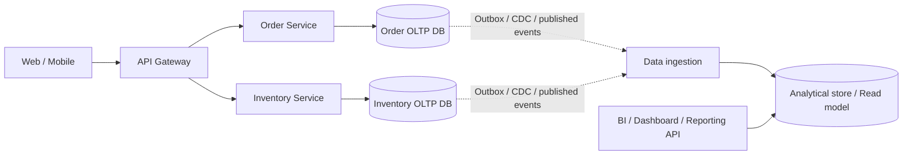
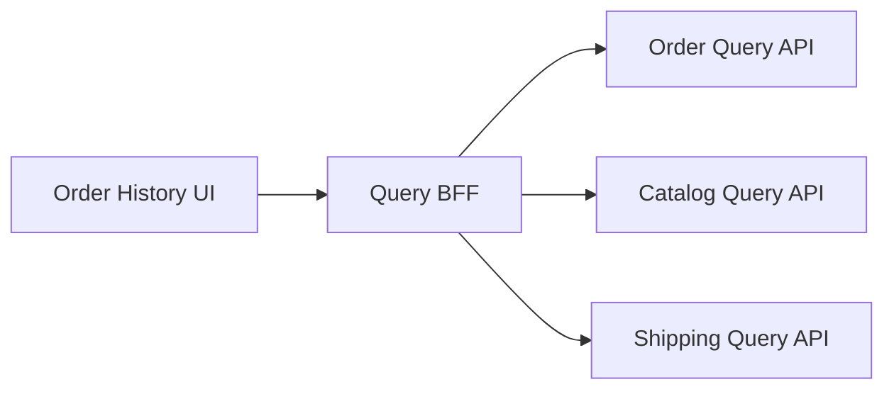
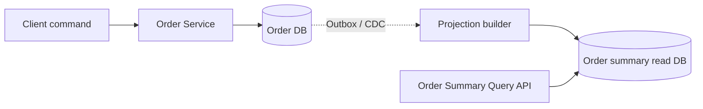
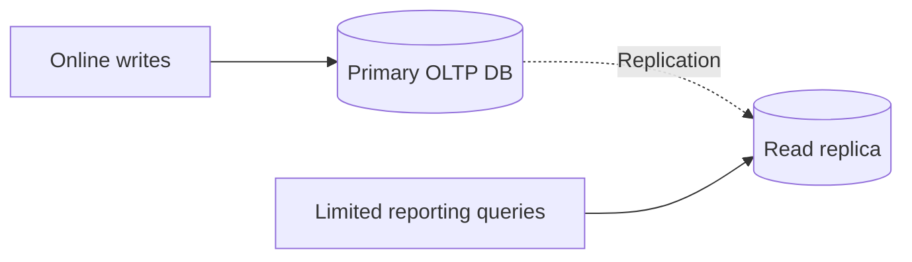
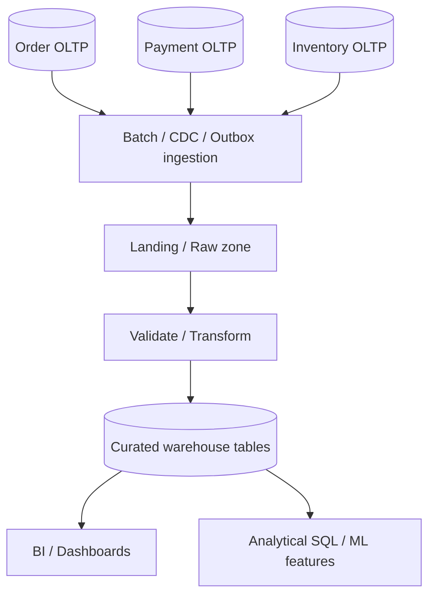
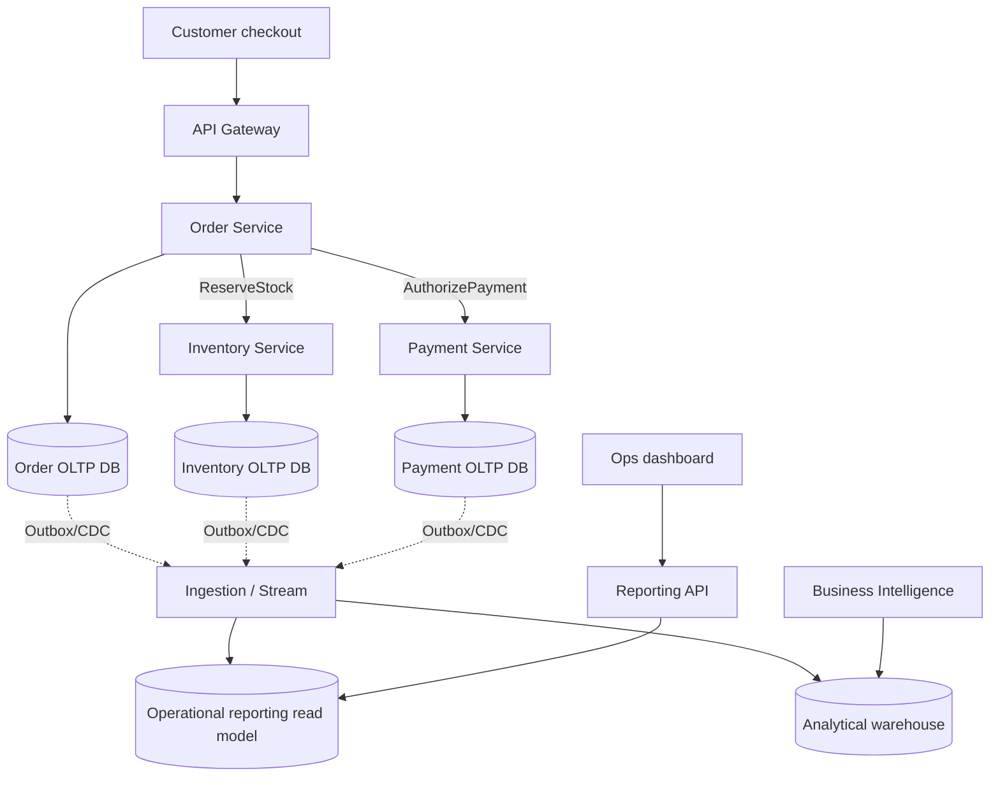
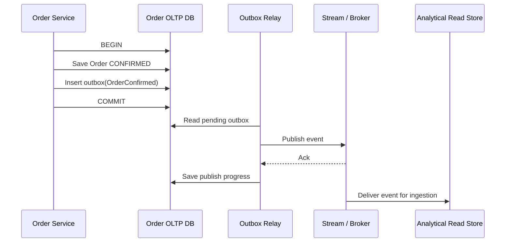

# Tách truy vấn phân tích khỏi luồng giao dịch trực tuyến trong Microservices

## 1. Bài toán: báo cáo có thể làm chậm giao dịch

Trong hệ thống microservices, các dịch vụ giao dịch như Order, Payment, Inventory và Customer thường được tối ưu để xử lý yêu cầu trực tuyến: tạo đơn, giữ hàng, thanh toán, cập nhật trạng thái, xác nhận người dùng và trả phản hồi nhanh. Những thao tác này phải giữ quy tắc nghiệp vụ, kiểm soát transaction, chống ghi trùng và đảm bảo độ trễ theo SLO.

Trong khi đó, các yêu cầu phân tích có đặc điểm rất khác:

- Tính tổng doanh thu theo ngày, tuần, tháng, kênh bán và khu vực.
- Phân tích tỷ lệ chuyển đổi qua nhiều bước của hành trình đặt hàng.
- Tính tồn kho bình quân theo kho, thời điểm và nhóm sản phẩm.
- Tính cohort, retention, giá trị vòng đời khách hàng hoặc dự báo nhu cầu.
- Chạy truy vấn nhiều bảng, nhiều service và hàng chục triệu bản ghi.
- Xuất dữ liệu lớn cho dashboard, báo cáo tài chính hoặc mô hình máy học.

Nếu đặt các truy vấn ấy trực tiếp lên database phục vụ giao dịch, chúng có thể cạnh tranh CPU, I/O, memory, connection pool, lock và tài nguyên cache với các request quan trọng. Một báo cáo chậm không chỉ làm dashboard chậm: nó có thể khiến Checkout timeout hoặc Payment ghi nhận trạng thái không kịp thời.

**Nguyên tắc chính:**

> Truy vấn phân tích nên có **đường đọc, mô hình dữ liệu, năng lực xử lý và giới hạn tài nguyên riêng** với luồng giao dịch trực tuyến. Các service giao dịch vẫn sở hữu dữ liệu nghiệp vụ; hệ thống phân tích sử dụng dữ liệu được xuất bản qua hợp đồng có quản trị, không trở thành một đường cập nhật trực tiếp vào bảng của owner.

“Tách” không nhất thiết có nghĩa ngay lập tức xây một data warehouse lớn. Nó có thể bắt đầu từ read model, read replica có kiểm soát hoặc bảng tổng hợp riêng, tùy yêu cầu độ mới, volume, ngân sách và giới hạn tài nguyên.

### Mục tiêu học tập

Sau bài này, người học có thể:

1. Phân biệt đặc điểm OLTP và OLAP cũng như lý do không nên trộn workload bừa bãi.
2. Xác định đường xử lý online transaction và đường analytics/query riêng.
3. Chọn giữa API composition, CQRS read projection, read replica, event/CDC pipeline, warehouse hoặc lakehouse.
4. Giữ quyền sở hữu dữ liệu của các microservices dù analytics cần JOIN nhiều miền.
5. Thiết kế ingestion có idempotency, xử lý event trùng/trễ/sai thứ tự, backfill và reconciliation.
6. Xác định SLA về dữ liệu mới, độ trễ truy vấn, tính đúng đắn và khả năng tái lập báo cáo.
7. Thiết kế các biện pháp resource isolation, concurrency limit, caching, workload governance và quan sát.
8. Lập kế hoạch di trú từng bước từ những truy vấn báo cáo đang chạy trực tiếp trên production OLTP.

## 2. OLTP và OLAP khác nhau ở đâu?

**OLTP — Online Transaction Processing** hướng tới những giao dịch ngắn, thường đọc/ghi ít bản ghi, có transaction và invariant cần bảo vệ tức thời.

**OLAP — Online Analytical Processing** hướng tới quét, lọc, nhóm, tổng hợp và kết hợp nhiều dữ liệu để khám phá xu hướng hoặc phục vụ quyết định, thường có tính chất read-heavy, nhiều cột/đo lường hoặc khối lượng dữ liệu lịch sử lớn.

| Khía cạnh | OLTP | OLAP / analytics |
| --- | --- | --- |
| Câu hỏi | “Đơn O-100 đã thanh toán chưa?” | “Doanh thu theo khu vực quý trước là bao nhiêu?” |
| Độ rộng dữ liệu | Một aggregate, vài rows theo khóa | Nhiều ngày/tháng, nhiều nguồn và dimensions |
| Kiểu truy vấn | Point lookup, insert/update, indexed filter | Scan, JOIN, GROUP BY, window functions |
| Mô hình dữ liệu | Chuẩn hóa theo nghiệp vụ và consistency | Denormalized, fact/dimension, columnar khi phù hợp |
| Độ trễ mong muốn | Thấp, ổn định, quan trọng p95/p99 | Theo lớp workload: tương tác, batch, scheduled |
| Thời gian chạy | Ngắn | Có thể dài hoặc nặng |
| Concurrency | Nhiều request nhỏ cùng lúc | Ít truy vấn nhưng tài nguyên lớn mỗi truy vấn |
| Tính nhất quán | Invariant tại commit, read-your-writes theo hợp đồng | Có thể eventual, snapshot theo thời điểm |
| SLA | Giao dịch thành công, correctness, latency | Freshness, completeness, query latency và tái lập |
| Tác động lỗi | Có thể mất đơn/thu tiền sai | Báo cáo sai/chậm, quyết định sai |
| Tài nguyên chính | Transaction log, indexes, locks, connection pools | CPU scan, I/O, memory, shuffle, aggregation |

Một cơ sở dữ liệu hiện đại có thể hỗ trợ cả hai kiểu workload trong những phạm vi nhất định. Nhưng khi truy vấn phân tích làm ảnh hưởng mục tiêu giao dịch, **resource/workload isolation** trở thành yêu cầu kiến trúc, không chỉ là tối ưu SQL.

### 2.1. Hai yêu cầu về “nhanh” khác nhau

Một endpoint “PlaceOrder” có thể có deadline dưới một giây và rất nhiều người dùng đồng thời. Một báo cáo doanh thu có thể được phép chạy vài chục giây nhưng cần trả số liệu chính xác tới mốc chốt sổ.

Vì vậy, không thể chỉ đặt cùng một SLO “mọi query dưới 500 ms”. Cần xác định cụ thể:

- OLTP request latency p95/p99 và error budget.
- Dashboard query latency p95 và giới hạn concurrent queries.
- Data freshness: độ trễ từ sự kiện nguồn đến khi có trong báo cáo.
- Data completeness: tỉ lệ dữ liệu lẽ ra có mà đã nhập đủ.
- Reporting correctness: chính sách hoàn tiền, hủy đơn, múi giờ và tính tiền.
- Availability và kế hoạch degraded mode của analytics khi data pipeline tạm lỗi.

## 3. Vì sao một truy vấn báo cáo có thể làm OLTP chậm?

Xét truy vấn trên dữ liệu Order:

```sql
-- Minh họa workload phân tích, không phải query nên chạy trên OLTP nóng.
SELECT
    DATE_TRUNC('day', created_at) AS order_day,
    country,
    COUNT(*) AS order_count,
    SUM(total_amount) AS gross_amount
FROM orders
WHERE created_at >= :start_time
  AND created_at < :end_time
GROUP BY DATE_TRUNC('day', created_at), country
ORDER BY order_day;
```

Nếu bảng có rất nhiều rows, truy vấn có thể phải scan hoặc đọc lượng lớn index/data pages, thực hiện aggregate và sort. Kể cả chỉ đọc, nó vẫn tiêu thụ:

- **I/O và buffer cache:** đẩy những page được OLTP dùng thường xuyên khỏi cache.
- **CPU và memory:** xử lý aggregation/hash/sort tranh tài nguyên với request mới.
- **Database connections:** báo cáo chạy dài chiếm slot trong pool.
- **Storage bandwidth:** scan ảnh hưởng transaction log flush/đọc ghi.
- **Replica/network resources:** nếu chạy qua replica nhưng cùng hạ tầng lưu trữ/băng thông, vẫn có thể bị ảnh hưởng gián tiếp.
- **Lock/transaction resources:** tùy database, query dài có thể giữ snapshot, ngăn vacuum/cleanup hoặc tương tác lock với DDL và thao tác khác.
- **Query plan instability:** khi dữ liệu tăng, kế hoạch thực thi thay đổi và p99 OLTP khó dự đoán nếu tài nguyên chung bị saturate.

**Read-only không đồng nghĩa free-of-cost**. Một câu SELECT rất nặng vẫn có thể làm service giao dịch chậm dù không ghi một dòng nào.

## 4. Ba đường dữ liệu cần phân biệt

Có thể phân chia luồng giao tiếp:

1. **Command path (online write):** người dùng gửi lệnh; owner thực thi invariant và ghi database giao dịch.
2. **Operational query path:** ứng dụng đọc dữ liệu cần thiết để phục vụ ngay một màn hình hoặc quyết định nghiệp vụ; yêu cầu độ mới và độ trễ thường cao.
3. **Analytical query path:** dashboard và báo cáo truy vấn dữ liệu tổng hợp, lịch sử hoặc nhiều miền qua read-optimized store.



**Điểm then chốt:** dashboard không gọi vòng qua tất cả dịch vụ để scan bảng live, và cũng không mở kết nối trực tiếp đến các bảng do những service khác sở hữu. Data ingestion là đường xuất bản dữ liệu có chủ đích; analytical store không có quyền ghi trở lại authoritative tables.

### 4.1. Online query không phải lúc nào cũng analytical query

Một trang “Order History” với 20 đơn gần nhất là operational query nếu mục tiêu là trải nghiệm người dùng, pagination nhanh và dữ liệu tương đối mới. Có thể dùng Order query API hoặc read projection dành cho user-facing path.

Một báo cáo “Doanh thu toàn hệ thống theo 100 dimension trong 24 tháng” là analytical query. Hai luồng không nên bị ép vào cùng một endpoint chỉ vì đều là câu SELECT.

### 4.2. Data warehouse không phải database giao dịch thứ hai

Warehouse có thể chứa bản sao hoặc cấu trúc dẫn xuất của dữ liệu Order, Inventory, Payment nhưng **không trở thành nơi quyết định stock reservation hay payment authorization**.

Nếu warehouse cập nhật chậm vài phút thì vẫn có thể đáp ứng báo cáo doanh thu hàng ngày. Nhưng nó không nên được dùng để cho phép reserve hàng khi invariant tồn kho cần đúng tại commit.

## 5. Cách xác định lúc nào cần tách workload

Các dấu hiệu thường gặp:

- Dashboard chạy theo giờ làm CPU OLTP tăng mạnh và checkout p99 xấu đi.
- Có query JOIN nhiều bảng lớn, GROUP BY/ORDER BY trên toàn lịch sử, export dữ liệu hàng triệu rows.
- Query báo cáo cần dữ liệu từ nhiều bounded contexts.
- Schema phục vụ giao dịch bị thêm nhiều indexes chỉ để hỗ trợ analytics và làm write amplification tăng.
- Các đội ngũ BI yêu cầu quyền SELECT trực tiếp vào production DB của nhiều services.
- Cùng một câu query báo cáo được hàng trăm người gọi lại với tham số gần giống.
- Thời gian thực thi query và độ trễ ETL chưa có SLO riêng; nhóm OLTP phải trực hệ thống vì báo cáo.
- Autoscaling application không cải thiện hiệu năng vì database scan/connection pool là bottleneck.
- Một đợt backfill/đối soát làm production query timeout.
- Schema changes trong Order khiến reporting jobs hỏng dù hợp đồng dịch vụ không đổi.

Đánh giá bằng tracing, query plans, database metrics và business criticality. Một query nhẹ, có chỉ mục tốt và traffic thấp chưa cần lập tức xây cả data platform; nhưng **đường phân tích nặng không được chiếm tài nguyên không giới hạn của luồng giao dịch**.

## 6. Các phương án kiến trúc chính

### 6.1. API composition cho truy vấn giao diện nhỏ

Một BFF/query service gọi APIs của Order, Customer và Catalog rồi ghép dữ liệu để trả về màn hình.



**Phù hợp khi:**

- Tập kết quả nhỏ, phân trang được và nguồn cần khá mới.
- Owner có batch query APIs hợp lệ.
- Fan-out và latency budget được kiểm soát.
- Không cần quét toàn bộ dữ liệu lịch sử.

**Hạn chế:** hiệu năng phụ thuộc các dịch vụ cùng hoạt động; rất dễ xuất hiện N+1 calls nếu mỗi row lại gọi nhiều APIs. Không dùng API composition để tải toàn bộ hàng triệu orders rồi tự tổng hợp trong request HTTP của người dùng.

### 6.2. CQRS read model / materialized projection

Tách mô hình **ghi** (command side) khỏi mô hình **đọc** (query side). Dữ liệu được chủ sở hữu ghi bằng local transaction; một projection được cập nhật từ sự kiện đã công bố hoặc change stream.



Read model có thể denormalize dữ liệu để trả nhanh một giao diện hoặc dashboard gần thời gian thực. Nó có thể là bảng trong database riêng, index tìm kiếm hoặc data store tối ưu truy vấn.

**Phù hợp:** operational reports, tổng hợp theo khóa, UI cần nhiều trường từ các owner nhưng chấp nhận độ trễ được công bố.

**Đánh đổi:** eventual consistency, xử lý trùng/sai thứ tự, versioning, replay, backfill, rebuild và quản lý dữ liệu xóa.

### 6.3. Read replica

Đưa read-heavy workload sang replica của OLTP database:



Read replica giúp giảm một phần cạnh tranh tài nguyên trực tiếp trên primary và hỗ trợ những truy vấn cần schema gần giống OLTP.

**Nhưng read replica không phải warehouse**:

- Schema vẫn là giao dịch/chuẩn hóa; quét lớn có thể tốn chi phí.
- Replica có replication lag, không đảm bảo read-after-write.
- Một số hệ thống replica chịu ảnh hưởng từ long-running queries, replay conflicts hoặc storage/network capacity.
- Replica có thể chia sẻ tài nguyên hạ tầng; primary không hoàn toàn “miễn nhiễm” với mọi ảnh hưởng.
- Consumer vẫn phụ thuộc vào physical schema của owner nếu được phép tự viết SQL lên replica.
- Không tự giải quyết JOIN dữ liệu giữa nhiều database/service owners.

Vì vậy read replica phù hợp như **bước trung gian có giới hạn** hoặc khi workload đọc vẫn mang tính operational, không phải mặc định cho mọi phân tích quy mô lớn.

### 6.4. Data warehouse

Data warehouse thu nhận dữ liệu nhiều nguồn, chuẩn hóa semantics, tạo fact/dimension hoặc các bảng tổng hợp tối ưu cho truy vấn. Các engine columnar/distributed có thể phù hợp với việc scan nhiều rows và GROUP BY.



**Phù hợp:** reporting đa chiều, lịch sử dài, JOIN giữa nhiều bounded contexts, tính toán batch và BI có concurrency cao.

**Đánh đổi:** chi phí pipeline/compute/storage, data governance, schema evolution, freshness và nhu cầu reconciliation.

### 6.5. Lakehouse hoặc data lake

Phù hợp khi cần lưu dữ liệu thô/lịch sử lớn, nhiều loại format và workloads từ SQL analytics tới machine learning. Kiến trúc có thể gồm object storage, table formats, catalog, transformation và query engines.

Không chọn lakehouse chỉ vì tên công nghệ: mục tiêu vẫn là **tách tải phân tích khỏi OLTP** và quản trị contracts, freshness, độ chính xác, quyền truy cập. Với quy mô nhỏ, một warehouse quản lý tốt hoặc vài read models có thể đủ.

### 6.6. Bảng tổng hợp/precompute/cache

Nếu dashboard chỉ cần “doanh thu hôm nay theo giờ” hoặc “số đơn pending theo cửa hàng”, có thể duy trì bảng tổng hợp incremental. Truy vấn trở thành đọc một số rows thay vì quét hàng triệu rows.

Giải pháp này hữu ích khi workload hẹp và số chiều giới hạn; cần định nghĩa update semantics, corrections, late events và rebuild. Caching query result không thay thế dữ liệu gốc nhưng có thể giảm chi phí lặp truy vấn.

## 7. So sánh phương án theo yêu cầu

| Phương án | Độ mới dữ liệu | Tải trên OLTP | Cross-service aggregation | Phức tạp vận hành |
| --- | --- | --- | --- | --- |
| Query trực tiếp OLTP | Thường rất mới | Có thể lớn | Dễ tạo coupling sai nếu truy cập DB chéo | Ban đầu thấp, tăng khi tải |
| API composition | Theo APIs và thời điểm gọi | Tăng số API/read calls | Tốt cho dữ liệu nhỏ | Trung bình |
| Read replica | Trễ theo replication | Giảm tải trên primary, không phải zero impact | Hạn chế, phụ thuộc schema | Thấp đến trung bình |
| CQRS/read projection | Theo event/CDC lag | Thường thấp sau ingestion setup | Tốt cho query cụ thể | Trung bình |
| Warehouse | Batch hoặc near-real-time theo pipeline | Tách compute/query tương đối rõ | Rất phù hợp | Trung bình đến cao |
| Lakehouse/data lake | Theo ingestion/processing | Tách khỏi OLTP khi kiến trúc đúng | Rất phù hợp, kể cả historical/ML | Có thể cao |
| Aggregate cache | Theo refresh/incremental updates | Thấp khi cache hit | Theo mô hình cache | Tùy quản trị freshness |

Các mô tả “mới” hay “thấp” mang tính tương đối. Một hệ thống streaming chậm hoặc lỗi có thể cho dữ liệu cũ hơn batch tốt; một read replica cùng máy chủ yếu có thể không đủ resource isolation.

## 8. Quyền sở hữu dữ liệu vẫn phải được giữ

Trong microservices, Order là owner của order state; Payment là owner của payment attempt; Inventory là owner của stock balance. Analytics cần kết hợp dữ liệu giữa chúng, nhưng **không được trở thành writer authoritative của những miền đó**.

Một bảng trong warehouse có thể tên “fact_order_payment” và chứa thông tin từ hai nguồn. Bảng ấy là **derived analytical data product**, không phải thay thế Order DB và Payment DB.

### 8.1. Hợp đồng dữ liệu giữa owner và pipeline

Mỗi owner nên công bố một trong các hình thức:

- Domain events có schema/version và semantics rõ.
- Curated export/snapshot theo hợp đồng.
- CDC feed được quản trị qua connector/platform, có mapping schema và quyền.
- Query/aggregation API được thiết kế riêng cho mục đích đọc.
- Dữ liệu đã masked/minimized cho mục đích phân tích.

Consumer không nên tự SELECT/UPDATE các bảng nội bộ của owner bằng superuser credential chỉ vì cần báo cáo đa miền.

### 8.2. CDC không tự làm biến mất schema coupling

CDC từ transaction log có thể giúp giảm áp lực đọc, hỗ trợ near-real-time và bắt các INSERT/UPDATE/DELETE. Nhưng nếu downstream phụ thuộc nguyên trạng vào cột/table nội bộ, schema migration của owner có thể làm pipeline gãy.

Một hợp đồng xuất bản cần:

1. Owner và người dùng dữ liệu được ghi rõ.
2. Tên trường, kiểu, semantics và version được quản trị.
3. Quy định khóa chính, event identity, update/delete và ordering.
4. Chính sách compatibility, rollout và replay.
5. Giới hạn dữ liệu nhạy cảm và retention.
6. Cơ chế giám sát/đối soát trong thay đổi schema.

CDC là **cơ chế vận chuyển biến động dữ liệu**; data contract và modeling mới biến biến động đó thành dữ liệu phân tích đáng tin.

### 8.3. Reporting service không được gọi lệnh ghi

BI không nên có DB credentials cho bảng giao dịch, cũng không nên dùng query endpoint có quyền UPDATE ẩn. Phân tích thường là read-only, và những hành động vận hành từ dashboard (ví dụ “duyệt hoàn tiền”) phải đi qua **public command API** của owner với authentication, authorization và audit riêng.

## 9. Ví dụ kiến trúc e-commerce: checkout không bị báo cáo chặn

Giả sử hệ thống có:

- Order Service tạo/hủy/xác nhận đơn.
- Payment Service xử lý thanh toán/hoàn tiền.
- Inventory Service xử lý reservation và điều chỉnh tồn.
- Customer Service sở hữu hồ sơ khách hàng.
- Reporting API phục vụ dashboard vận hành.
- Analytics Warehouse tính GMV, doanh thu thuần, conversion và cohort.



Luồng checkout quan tâm request latency, invariant và trạng thái giao dịch. Luồng analytics nhận dữ liệu từ pipeline sau commit, có freshness riêng.

Nếu warehouse ngừng xử lý trong 15 phút, **checkout vẫn phải phục vụ** nếu các dependencies giao dịch đều khỏe. Khi phục hồi, ingestion có thể catch up/replay và báo cáo đánh dấu dữ liệu đang trễ.

### 9.1. Một yêu cầu phải định nghĩa rõ

“Doanh thu hôm nay” có thể mang nhiều nghĩa:

- Tổng giá trị order đã tạo (GMV) chưa trừ hủy/refund.
- Tổng tiền đã capture thành công.
- Doanh thu đã ghi nhận theo chính sách kế toán.
- Doanh thu thuần sau refund/chargeback, có điều kiện thời điểm.
- Múi giờ business locale hay UTC, ngày tạo order hay ngày capture.

Analytics store tách khỏi OLTP không tự giải quyết **đúng semantics**. Cần owner business metric và định nghĩa event/tables tương ứng.

## 10. Thiết kế ingestion: batch, event và CDC

### 10.1. Batch export

Owner định kỳ xuất dữ liệu/snapshot sang staging hoặc object storage, sau đó data pipeline tải vào warehouse.

**Ưu điểm:** dễ vận hành, cost predictable, dễ đối chiếu theo mốc chốt, phù hợp dashboard ngày.

**Đánh đổi:** freshness theo lịch chạy, cần watermark/checkpoint để không mất dữ liệu, có thể tăng tải nếu full extract từ primary.

Các cách giảm tác động:

- Extract incremental theo change sequence/updated_at có kiểm soát, không chỉ timestamp thiếu uniqueness.
- Phân trang theo keyset, giới hạn batch size/concurrency và chạy ngoài giờ cao điểm khi phù hợp.
- Dùng replica/export được owner hỗ trợ, tránh scan primary nóng.
- Ghi snapshot boundary nhất quán, metadata và dấu hiệu completeness.
- Tách backfill lịch sử khỏi incremental workload.

### 10.2. Event-driven ingestion

Các owner phát domain events như OrderPlaced, OrderConfirmed, OrderCancelled, PaymentCaptured, RefundIssued. Consumer cập nhật projection hoặc warehouse staging.

**Ưu điểm:** độ trễ thấp hơn batch theo lịch khi pipeline vận hành tốt; events có nghĩa nghiệp vụ rõ.

**Đánh đổi:** consumer cần idempotency, xử lý out-of-order, schema versions, replay và tính đầy đủ. Một bộ event không được thiết kế để tái tạo toàn trạng thái có thể thiếu những trường cần cho phân tích lịch sử.

### 10.3. CDC ingestion

Connector đọc change stream của database, đưa row changes tới stream/landing zone. CDC có thể bắt được các thay đổi mà domain events chưa bao phủ, nhưng phải quản trị semantics của operations, deletes, snapshots và schema migration.

**Ưu điểm:** giảm polling/batch full scans; phù hợp xây data replica/pipeline cập nhật.

**Đánh đổi:** schema coupling, log retention, connector failover, snapshot consistency, duplicate events, quyền replication, upstream backpressure và dữ liệu nhạy cảm trong change log.

### 10.4. Hybrid: backfill + incremental

Một pattern phổ biến:

1. Chốt mốc ban đầu (snapshot boundary).
2. Nạp snapshot lịch sử vào staging.
3. Thu nhận CDC/events tiếp tục từ checkpoint đã ghi, không bỏ biến động giữa snapshot và stream.
4. Áp dụng dữ liệu theo khóa/version với idempotency.
5. Đối chiếu totals/row counts theo mốc.
6. Chuyển dashboard sang read store mới khi có số liệu tương ứng.
7. Tiếp tục monitoring completeness/freshness và hỗ trợ replay.

Phải định nghĩa cơ chế nối snapshot với stream theo công nghệ cụ thể; **không** đơn giản chạy full export rồi bật CDC ở thời điểm tùy ý vì có thể mất các thay đổi xảy ra trong khoảng giao nhau.

## 11. Transactional outbox cho dữ liệu cần công bố tin cậy

Nếu Order đã commit một trạng thái nhưng ứng dụng crash trước khi publish event, reporting có thể không thấy biến động. Nếu publish trước DB commit rồi rollback, reporting lại có sự kiện sai.

**Transactional outbox** lưu dữ liệu nghiệp vụ và intent phát thông điệp trong cùng local transaction:



Điều này giải quyết ranh giới “DB commit và ý định publish” trong owner. Nhưng relay có thể publish lại khi crash sau broker ack trước khi mark sent. Vì vậy **at-least-once ingestion** và idempotent projection vẫn cần thiết.

### 11.1. Invariant của pipeline analytics

Một dashboard không nên tăng revenue hai lần chỉ vì cùng PaymentCaptured event được xử lý lặp. Với mỗi event cần:

- eventId ổn định và, nếu phù hợp, aggregateId + version.
- Dấu đã xử lý theo consumer hoặc idempotent upsert theo business key.
- State-machine logic cho hủy, refund và correction.
- Điều kiện monotonic/version guard tránh event cũ ghi đè dữ liệu mới.
- Metadata lineage: nguồn, phiên bản schema, thời điểm ingest, checkpoint.

Đừng tin rằng “broker bảo đảm message delivery” đồng nghĩa “báo cáo luôn đúng”.

## 12. Kế hoạch dữ liệu: raw, curated, serving

Một pipeline tách thành ba lớp giúp phục hồi:

### 12.1. Raw/landing zone

Lưu dữ liệu gốc được xuất bản (đã tuân thủ policy PII) và metadata phục vụ replay: event ID, source, schema version, event time, ingest time, partition/offset hoặc checkpoint.

Raw zone không nhất thiết phải giữ vô thời hạn; retention, data deletion, encryption và mục đích xử lý phải được quản trị.

### 12.2. Curated/standardized zone

Ánh xạ dữ liệu từ nhiều owners sang schema dùng chung cho analytics, làm sạch type, chuẩn hóa currency/timezone, xử lý version, dedup và business semantics.

Ví dụ Payment service có status AUTHORIZE_OK, còn báo cáo cần metric "captured_amount"; không thể coi authorization đồng nghĩa tiền đã được thu. Curated zone biểu đạt đúng loại giao dịch và trạng thái.

### 12.3. Serving/marts

Tối ưu dữ liệu cho từng nhóm truy vấn:

- Fact orders/payments/refunds.
- Dimension product, channel, customer segment, region.
- Daily sales summary theo tenant/timezone.
- Operational order dashboard projection.
- Fraud/reporting marts với quyền xem giới hạn.

Không nên để dashboard production chạy mọi phép nối phức tạp trực tiếp từ raw change log nếu có thể precompute metric ổn định.

## 13. Mô hình dimensional và business keys

Data warehouse thường biểu diễn:

- **Fact:** một sự kiện/đơn vị đo, ví dụ payment captured amount, order line, shipment delivery.
- **Dimension:** thuộc tính để nhóm/lọc, ví dụ product category, region, channel, date.
- **Grain:** một hàng fact đại diện chính xác cho điều gì.

### 13.1. Xác định grain trước khi SUM

Ví dụ fact_payment_capture có grain = **một capture transaction đã thành công**, xác định bởi capture_id. Fact_order_line có grain = **một dòng đơn đã chốt**.

Nếu JOIN một capture với nhiều order lines rồi SUM capture amount ở mỗi line, số tiền có thể bị nhân lên.

Ví dụ sai:

```sql
-- Minh họa double counting do JOIN one-to-many.
SELECT SUM(p.capture_amount)
FROM fact_payment_capture p
JOIN fact_order_line l ON l.order_id = p.order_id;
```

Một capture 100 đơn vị tiền cho một order có ba lines sẽ có thể bị tính thành 300 nếu JOIN thô. Cần thống nhất grain và cách phân bổ:

- Aggregate payment per order trước khi JOIN.
- Chọn fact riêng cho mỗi metric.
- Dùng bridge/allocation theo quy tắc được business phê duyệt.
- Dùng distinct business key khi phù hợp, nhưng không lạm dụng SUM(DISTINCT amount), vì hai giao dịch có cùng amount là khác nhau.

### 13.2. Slowly Changing Dimensions (SCD)

Sản phẩm có thể chuyển category từ A sang B. Báo cáo “doanh thu lịch sử theo category tại thời điểm mua” khác “doanh thu lịch sử theo category hiện tại”.

Có thể lưu snapshot category trên fact, hoặc dimension có phiên bản hiệu lực (SCD Type 2) nếu analytics cần truy vấn theo thời điểm.

Cần chọn semantics:

- Category at transaction time.
- Category current.
- Product hierarchy at report cutoff date.

**Không mặc định JOIN với bảng catalog hiện tại** rồi khẳng định đó là báo cáo lịch sử đúng.

## 14. Event time, ingestion time và báo cáo theo ngày

Trong kiến trúc phân tán, có nhiều mốc thời gian:

- **occurredAt/event time:** lúc sự kiện nghiệp vụ thực sự xảy ra theo owner.
- **committedAt:** lúc thay đổi được commit ở source.
- **publishedAt:** lúc producer/relay phát ra broker.
- **ingestedAt/processing time:** lúc pipeline xử lý.
- **reportedAt/cutoff:** mốc chốt số liệu hoặc lúc báo cáo được tạo.

Giả sử PaymentCaptured xảy ra 23:58 ngày 30/6 nhưng pipeline nhận được lúc 00:03 ngày 1/7. Nếu báo cáo nhóm theo ingestedAt, giao dịch bị đẩy sang ngày hôm sau dù business muốn nhóm theo thời điểm capture.

Cần định nghĩa:

1. Múi giờ dùng để xác định ngày kinh doanh.
2. Nguồn thời gian authoritative.
3. Độ trễ tối đa cho late events.
4. Watermark và cửa sổ được phép cập nhật số liệu đã công bố.
5. Chính sách chỉnh số liệu kỳ đã khóa.
6. Cách ghi lại version của bảng báo cáo và thời điểm cutoff.

Không xóa sự khác biệt giữa dữ liệu “chưa đến” và dữ liệu “không có”. Dashboard nên hiển thị **as-of timestamp** hoặc trạng thái freshness, đặc biệt khi hỗ trợ quyết định tài chính/vận hành.

## 15. Đảm bảo completeness, dedup và ordering

### 15.1. At-least-once và idempotent upsert

Ingestion có thể nhận cùng sự kiện nhiều lần. Dùng eventId hoặc business key/version để tránh double count. Với bảng theo khóa:

```sql
-- SQL minh họa theo cách PostgreSQL có thể dùng cho read model.
INSERT INTO order_projection (
    order_id, status, version, updated_at
)
VALUES (
    :order_id, :status, :version, :updated_at
)
ON CONFLICT (order_id)
DO UPDATE SET
    status = EXCLUDED.status,
    version = EXCLUDED.version,
    updated_at = EXCLUDED.updated_at
WHERE order_projection.version < EXCLUDED.version;
```

Cách này chống **event cũ ghi đè state mới** khi version tăng đơn điệu cho mỗi aggregate. Nhưng nó không tự xử lý mọi mô hình fact-event accounting và không thay thế unique eventId khi một event riêng có tác dụng cộng dồn. Cần chọn upsert/append/dedup theo grain của dữ liệu.

### 15.2. Event trễ và sai thứ tự

Nếu OrderConfirmed(version=5) đến trước OrderCreated(version=1), consumer phải biết cách trì hoãn, tạo placeholder hoặc áp dụng các sự kiện với version/order guard. Không biến một event version=1 thành trạng thái “mới” sau version=5.

Với payment/refund facts, event ordering có thể không trùng thời gian kinh doanh; hãy phân biệt event time, commit sequence và nghiệp vụ chốt số.

### 15.3. Delete, soft delete và quyền xóa

CDC phải xử lý DELETE và tombstone đúng semantics. Nếu data owner xóa/mask thông tin cá nhân theo chính sách hoặc yêu cầu hợp lệ, analytical datasets phải biết dữ liệu cần xóa/ẩn/ẩn danh ở đâu.

Một bảng fact lịch sử có thể cần giữ số đo tổng hợp nhưng không giữ identity cá nhân. Data retention và mục đích sử dụng có thể khác giữa OLTP và analytics; cần governance thay vì copy mọi dữ liệu vô thời hạn.

### 15.4. Reconciliation

Không chỉ kiểm tra pipeline “RUNNING”. Cần đối soát định lượng:

- Số orders committed theo ngày/tenant từ source.
- Tổng số payment captures/refunds theo business cutoff.
- Số business keys duy nhất, duplicate events bị loại.
- Tổng số records được ingest theo checkpoint.
- Những giao dịch thiếu fact hoặc thiếu dimension cần giải thích.
- Chênh lệch giữa các hệ thống theo trạng thái cuối hợp lệ.

**Đối soát phải dùng cùng định nghĩa và cutoff.** So sánh “Order created” với “Payment captured” mà không xét pending/cancelled sẽ tạo cảnh báo sai.

## 16. Tách tài nguyên: isolation không chỉ là đổi database URL

### 16.1. Compute isolation

Nếu warehouse chạy trên compute riêng, query OLAP không tranh CPU trực tiếp với OLTP. Với engine hỗ trợ workload groups/virtual warehouses, có thể tách nhóm BI và batch ETL, tránh job rất nặng làm dashboard tương tác bị chậm.

### 16.2. Storage isolation

Sao chép dữ liệu sang storage phục vụ phân tích giúp scan lớn không đụng index/cache của OLTP primary. Nhưng ingestion/replication vẫn cần đọc log/changes từ nguồn; phải theo dõi log retention, WAL pressure, network và slot/connector lag.

### 16.3. Connection isolation

Không cấp chung pool giữa report queries dài và request transaction ngắn. Nếu giai đoạn đầu vẫn dùng read replica, sử dụng user/pool dành riêng cho reporting, giới hạn statement timeout, concurrency và query memory; ngăn query tùy ý chạy trên primary.

### 16.4. Capacity và quotas

Đặt giới hạn theo client/tenant/reporting workload:

- Max concurrent queries.
- Query timeout và memory/spill quota.
- Data scanned/compute budget.
- Rate limit cho export/download.
- Pagination và số rows tối đa trong API.
- Scheduled job priority hoặc admission control.
- Precomputation/caching cho truy vấn phổ biến.

Mục tiêu không phải ngăn nhà phân tích làm việc, mà ngăn một dashboard/report đơn lẻ **làm cạn tài nguyên của luồng giao dịch hoặc toàn bộ nền tảng phân tích**.

### 16.5. Tách lỗi độc lập

Khi analytical pipeline bị lỗi, checkout và payment online phải có thể tiếp tục làm việc. Tránh dependency ngược như Order.confirm gọi warehouse để lấy một con số mới nhất rồi chờ. Nếu operation cần quyết định authoritative, gọi owner đúng hoặc giữ invariant trong local transaction.

## 17. Read replica: sử dụng đúng giới hạn

Read replica thường là lựa chọn tương đối ít thay đổi khi muốn chuyển báo cáo hiện tại ra khỏi primary. Nhưng cần xem **có phù hợp mức tách mong muốn**.

### 17.1. Ưu điểm có điều kiện

- Giảm contention query trực tiếp trên primary.
- Có thể giữ SQL/schema hiện có ở giai đoạn migration.
- Dễ đặt read-only account và query timeout riêng.
- Hỗ trợ một số operational read queries khi độ trễ replication chấp nhận được.

### 17.2. Các vấn đề cần kiểm tra

- Replica lag theo thời điểm và transaction volume.
- Khi replica bị ngắt, dashboard có fallback về primary không? **Không nên fallback tự động** nếu điều đó sẽ làm nóng OLTP.
- Query dài có ảnh hưởng recovery/replay hoặc storage cleanup theo implementation không?
- Replica có được phép làm nguồn cho BI trong chính sách data access không?
- Dữ liệu có thuộc một owner hay đang bị consumer dùng JOIN xuyên miền?
- Có giới hạn query time/scan/connection và dữ liệu nhạy cảm không?
- Dữ liệu cập nhật nhiều có làm replica không theo kịp không?
- Nếu Primary dùng chung storage/network quota, mức cô lập vật lý tới đâu?

### 17.3. Quy tắc vận hành quan trọng

> **Nếu read replica không sẵn sàng, không chuyển các dashboard nặng về primary chỉ để giữ báo cáo xanh.**

Fallback về primary cần được đánh giá riêng theo mức tải nhỏ và SLO giao dịch, không thể bật mặc định. Với báo cáo không thiết yếu, trả dữ liệu cache kèm freshness warning hoặc tạm từ chối sẽ an toàn hơn.

## 18. Thiết kế một Reporting API

Khi analytics có read store riêng, vẫn cần API rõ để bảo vệ hệ thống và người dùng:

```http
GET /reports/orders/daily?from=2026-01-01&to=2026-01-31&region=VN
```

Response minh họa:

```json
{
  "metric": "confirmed_orders",
  "region": "VN",
  "from": "2026-01-01",
  "to": "2026-01-31",
  "timezone": "Asia/Ho_Chi_Minh",
  "asOf": "2026-02-01T02:00:00Z",
  "freshnessSeconds": 180,
  "rows": [
    {"date": "2026-01-01", "count": 412},
    {"date": "2026-01-02", "count": 438}
  ]
}
```

Đây là **giá trị minh họa**, không phải dữ liệu thực. Trường asOf/freshness có tác dụng giúp người dùng hiểu báo cáo được cập nhật tới đâu.

### 18.1. API contract nên xác định

- Tên metric và công thức đúng.
- Allowed date ranges, filters và group-by dimensions.
- Múi giờ và cutoff rules.
- Read model/source dataset version.
- Maximum query cost và pagination/async export policy.
- Cache TTL và freshness target.
- Permission scope theo tenant/role.
- Khi dữ liệu chưa đủ, trả trạng thái thế nào.
- Chế độ request trả đồng bộ hay tạo report job chạy bất đồng bộ.

### 18.2. Báo cáo nặng nên chạy asynchronous

Nếu một truy vấn có thể mất nhiều phút, không nên giữ một HTTP request và connection ứng dụng chờ vô hạn.

Mẫu API:

```http
POST /report-jobs
Content-Type: application/json

{"reportType":"monthly_revenue","month":"2026-01","region":"VN"}
```

```http
202 Accepted
Location: /report-jobs/JOB-42
```

Client poll hoặc nhận notification khi job hoàn tất; file kết quả được lưu ở nơi có quyền truy cập và thời hạn phù hợp. Job cần idempotency, cancellation, retry, quota, audit và trạng thái rõ (QUEUED, RUNNING, SUCCEEDED, FAILED, EXPIRED).

Không sử dụng worker của OLTP để xử lý report job nặng chỉ vì nó có sẵn thread pool.

## 19. Ví dụ SQL: xây bảng tổng hợp riêng

Giả sử warehouse/serving store có fact_order với mỗi orderId một bản ghi authoritative trong mô hình analytics, và có dữ liệu trạng thái đã chuẩn hóa.

```sql
-- Bảng serving dạng ngày/vùng minh họa.
CREATE TABLE daily_order_summary (
    business_date DATE NOT NULL,
    region_code VARCHAR(20) NOT NULL,
    confirmed_orders BIGINT NOT NULL,
    gross_amount NUMERIC(20, 2) NOT NULL,
    refreshed_at TIMESTAMP NOT NULL,
    PRIMARY KEY (business_date, region_code)
);
```

Một batch refresh có thể aggregate từ fact table:

```sql
-- Pseudocode SQL định hướng PostgreSQL.
INSERT INTO daily_order_summary (
    business_date,
    region_code,
    confirmed_orders,
    gross_amount,
    refreshed_at
)
SELECT
    DATE(confirmed_at AT TIME ZONE 'Asia/Ho_Chi_Minh'),
    region_code,
    COUNT(*),
    COALESCE(SUM(total_amount), 0),
    CURRENT_TIMESTAMP
FROM fact_order
WHERE status = 'CONFIRMED'
  AND confirmed_at >= :start_utc
  AND confirmed_at < :end_utc
GROUP BY
    DATE(confirmed_at AT TIME ZONE 'Asia/Ho_Chi_Minh'),
    region_code
ON CONFLICT (business_date, region_code)
DO UPDATE SET
    confirmed_orders = EXCLUDED.confirmed_orders,
    gross_amount = EXCLUDED.gross_amount,
    refreshed_at = EXCLUDED.refreshed_at;
```

Khi chạy thực tế cần xác định DB/session timezone, cutoff, input snapshot và phạm vi refresh. Đừng trộn thời gian UTC được đưa vào WHERE với logic ngày địa phương mà không kiểm tra boundary. Cần refresh cả các ngày có thể bị late events/corrections tác động; trường hợp một ngày không còn rows cũng cần cơ chế xóa/reset dữ liệu cũ, không chỉ upsert các nhóm xuất hiện.

### 19.1. Các kiểu cập nhật aggregate

**Recompute window:** tính lại toàn bộ ngày/khoảng thời gian có thể thay đổi, rồi thay thế kết quả. Đơn giản cho correction và backfill nếu cửa sổ vừa phải.

**Incremental delta:** mỗi event cập nhật số đếm/tổng. Hiệu quả hơn nhưng cần idempotency rất chặt, đặc biệt khi refund/cancel/transition đến trùng.

**Hybrid:** incremental để hiển thị gần thời gian thực, batch reconciliation định kỳ để sửa lệch và khóa số liệu chính thức.

Cách lựa chọn phụ thuộc data volume, late arrival, mức chính xác và chi phí tính toán. Không được cộng thêm revenue vào aggregate mỗi lần thấy OrderConfirmed nếu pipeline có at-least-once delivery mà chưa dedup.

## 20. Ví dụ Java: chỉ dùng data store đọc riêng trong Reporting Service

Giả sử Reporting API nhận request dashboard, repository chỉ trỏ vào analytical read store:

```java
public record DailyOrderMetric(
    LocalDate businessDate,
    String regionCode,
    long confirmedOrders,
    BigDecimal grossAmount
) {}

public interface DailyOrderReportPort {
    List<DailyOrderMetric> getDailyOrders(
        LocalDate fromInclusive,
        LocalDate toExclusive,
        String regionCode
    );
}

@Service
public class DailyOrderReportService {
    private final DailyOrderReportPort reports;

    public DailyOrderReportService(DailyOrderReportPort reports) {
        this.reports = reports;
    }

    public List<DailyOrderMetric> execute(
            LocalDate from,
            LocalDate to,
            String region) {
        if (from == null || to == null ||
                !from.isBefore(to)) {
            throw new IllegalArgumentException("Invalid date range");
        }
        if (ChronoUnit.DAYS.between(from, to) > 90) {
            throw new IllegalArgumentException(
                "Use asynchronous export for large ranges");
        }
        return reports.getDailyOrders(from, to, region);
    }
}
```

Đoạn này minh họa separation of responsibilities, chưa gồm imports, auth, controller, DB adapter và các yêu cầu production. Với hệ thống thực, cần input validation, tenant authorization, timeout, pagination/quotas, query-plan/index review và định nghĩa chính xác report metadata/freshness.

### 20.1. Điều không nên làm

Trong OrderService, đừng thêm method ```getMonthlyRevenueByJoiningAllTables()``` chạy query scan trên cùng DataSource phục vụ PlaceOrder. Cũng đừng cho ReportingService dùng credential của Order production DB để tự đọc bảng nội bộ nếu ownership policy không cho phép.

Reporting adapter nên kết nối tới **read-optimized store hoặc dữ liệu xuất bản hợp pháp**, với read-only principal và quyền tối thiểu.

## 21. Kịch bản ingest event: Java/Spring pseudocode

Một consumer nhận OrderConfirmed, cập nhật read projection:

```java
public record OrderConfirmedEvent(
    String eventId,
    String orderId,
    long orderVersion,
    BigDecimal total,
    Instant confirmedAt,
    String regionCode
) {}

public interface ProcessedEventPort {
    // Unique key: consumerName + eventId, cùng local transaction.
    boolean markIfFirst(String consumerName, String eventId);
}

public interface OrderProjectionPort {
    // Upsert with version guard, preserving latest aggregate state.
    void upsertConfirmed(OrderConfirmedEvent event);
}

@Service
public class OrderProjectionHandler {
    private static final String CONSUMER = "order-reporting";
    private final ProcessedEventPort processed;
    private final OrderProjectionPort projections;

    public OrderProjectionHandler(
            ProcessedEventPort processed,
            OrderProjectionPort projections) {
        this.processed = processed;
        this.projections = projections;
    }

    @Transactional
    public void handle(OrderConfirmedEvent event) {
        if (!processed.markIfFirst(CONSUMER, event.eventId())) {
            return;  // Duplicate delivery; effect already committed.
        }
        projections.upsertConfirmed(event);
    }
}
```

Cần đảm bảo hai ports cùng local transaction, unique constraint ở processed_event và version guard ở projection. Framework listener chỉ ack message sau khi transaction commit phù hợp. Nếu batch/parallel processing, đừng commit offset vượt records chưa xử lý thành công.

**Lưu ý:** projection của trạng thái Order khác với fact revenue tổng hợp. Nếu PaymentCaptured và RefundIssued làm thay đổi metric tiền, không được chỉ dùng OrderConfirmed event để tính doanh thu thuần. Business semantic model quyết định nguồn sự thật.

### 21.1. Lỗi thường gặp trong consumer projection

- Chỉ kiểm tra đã xử lý bằng SELECT mà không có unique constraint.
- Mark message processed ở transaction khác, rồi crash trước upsert.
- Nhận version cũ nhưng ghi đè state mới.
- Cộng dồn số tiền khi event bị redeliver.
- Bỏ qua delete/tombstone hoặc nghiệp vụ refund.
- Không có backfill/replay path.
- Bỏ qua schema version nên consumer fail khi owner deploy.
- Ack trước durable commit nên mất cập nhật trong read store.

## 22. Dữ liệu gần thời gian thực: “real-time” phải định nghĩa cụ thể

Một dashboard được gọi là “near-real-time” có thể cho phép dữ liệu trễ 5 giây, 30 giây hoặc 5 phút tùy use case. Cần đặt freshness SLO:

- **Data freshness latency:** thời gian từ lúc source event commit đến khi bản ghi xuất hiện trong read store.
- **End-to-end ingestion lag:** thời gian theo từng hop, ví dụ outbox lag, broker lag, transform lag, warehouse load lag.
- **Completeness at cutoff:** những records thuộc mốc đã cam kết đã đủ chưa.
- **Alert threshold:** khi freshness vượt giới hạn, dashboard hiển thị dấu cảnh báo hoặc trả dữ liệu tạm thời.
- **Recovery objective:** sau outage, pipeline catch up trong bao lâu.

Không đồng nhất API trả nhanh 100 ms với dữ liệu mới. Một query rất nhanh đọc bảng được refresh từ hôm qua vẫn là **dữ liệu cũ**.

### 22.1. Watermark

Watermark biểu đạt mốc thời gian/sequence mà pipeline tin rằng phần lớn dữ liệu trước đó đã được xử lý theo quy tắc định nghĩa. Khi late events đến, có thể cập nhật lại các cửa sổ trong phạm vi cho phép.

Một kiến trúc báo cáo cần phân biệt:

- **Provisional results:** số liệu còn có thể điều chỉnh.
- **Finalized results:** số liệu được khóa theo quy tắc, correction đi qua quy trình điều chỉnh có audit.
- **Missing/stale:** pipeline chưa bắt kịp, không được hiển thị im lặng như số chính thức.

### 22.2. Khi nào cần đồng bộ trực tiếp?

Một thao tác cần kiểm tra hạn mức tín dụng, tồn kho hoặc quyền truy cập ở thời điểm commit không nên trông vào analytical store có lag. Lúc này phải gọi owner authoritative hoặc để owner thực thi command.

Analytics có thể cung cấp insight/gợi ý/cảnh báo, nhưng **không thay thế transaction-level invariant** khi hậu quả sai nghiêm trọng.

## 23. Caching và precomputation cho dashboard

Một dashboard thường có nhiều người dùng xem cùng số liệu. Nếu mỗi lần tải trang đều chạy lại query warehouse lớn, chi phí có thể tăng không cần thiết.

Các cách tối ưu:

- Query result cache theo tenant/metric/filter/cutoff.
- Materialized views và scheduled refresh.
- Incrementally maintained aggregates theo fact grain hợp lệ.
- Asynchronous report generation cho yêu cầu lớn.
- Pagination và giới hạn dimensions.
- Push update cho dashboard gần thời gian thực khi phù hợp.

### 23.1. Cache key phải có ngữ nghĩa

Một cache key tốt có thể gồm metricVersion, tenantId, date range, timezone, filters và source snapshot/asOf. Nếu bỏ timezone, cùng ngày có thể bị nhóm sai. Nếu không gắn tenant authorization, dữ liệu có thể bị lộ chéo khách hàng.

### 23.2. Cache invalidation

Khi source được cập nhật, cache có thể:

- Expire theo TTL.
- Invalidate khi projection version thay đổi.
- Refresh theo lịch.
- Serve stale có chú thích trong outage.
- Recompute khi có correction/backfill.

Không nên dùng cache như lý do tránh định nghĩa freshness. Cache làm query rẻ hơn, nhưng có thể làm số liệu cũ hơn.

## 24. Bảo mật và quản trị dữ liệu phân tích

Tách analytical store tạo **bản sao dữ liệu**, vì vậy phạm vi bảo vệ tăng chứ không giảm.

### 24.1. Least privilege

- OLTP runtime chỉ có quyền trên dữ liệu của owner.
- Ingestion connector có quyền đọc/export tối thiểu theo dữ liệu được phép công bố.
- Reporting API chỉ có quyền đọc serving tables cần thiết.
- Analyst chỉ có quyền trên datasets/columns phù hợp vai trò.
- PII/financial data có masking/tokenization và audit nếu cần.
- Production warehouse credentials không dùng chung cho mọi developer.

### 24.2. Tenant isolation

Nếu hệ thống đa thuê bao:

- Mọi dataset cần trường tenant/partition key hoặc policy tương đương nếu cần.
- Truy vấn Reporting API ràng buộc tenant từ identity đáng tin cậy, không chỉ theo query param tùy ý.
- Row-level/column-level security ở analytical engine khi có thể.
- Aggregate dashboard công khai phải tránh vô tình lộ nhóm khách quá nhỏ.
- Exports và share links có thời hạn/quyền truy cập phù hợp.

### 24.3. Lineage và audit

Một KPI quan trọng cần truy nguyên được:

**Dashboard metric → serving table → curated transformation → raw event/export → source owner → định nghĩa nghiệp vụ.**

Nếu không có lineage, khi doanh thu lệch giữa Finance và Growth, rất khó xác định do timezone, refund semantics, duplicate events hay dữ liệu chưa ingest.

### 24.4. Data deletion và retention

Khi owner xóa/ẩn danh dữ liệu cá nhân, analytics cần cập nhật theo chính sách tương ứng. Cần biết những bản sao nào ở warehouse, cache, export, backup và downstream marts. Những dữ liệu phục vụ kiểm toán có thể có nghĩa vụ giữ theo chính sách riêng; việc xóa phải tuân thủ luật/chính sách áp dụng.

## 25. Monitoring: hai nhóm SLO độc lập

### 25.1. Online transaction SLO

| Metric | Mục tiêu |
| --- | --- |
| Checkout p95/p99 latency | Đảm bảo trải nghiệm và deadline |
| Payment success/error rate | Theo ngữ nghĩa nghiệp vụ |
| OLTP CPU/I/O/connection utilization | Phát hiện saturation |
| Transaction lock wait / deadlock | Tránh contention |
| API queue depth / rejected requests | Bảo vệ overload |
| Database write latency | Theo dõi journal/commit latency |
| Impact khi BI workload tăng | Xác minh workload isolation |

### 25.2. Analytical pipeline SLO

| Metric | Ý nghĩa |
| --- | --- |
| Outbox oldest age | Ý định publish đang tồn đọng |
| CDC/source lag | Pipeline chưa bắt kịp nguồn |
| Broker consumer lag | Backlog xử lý events |
| Transform/load failures | Lỗi chuẩn hóa hoặc ghi warehouse |
| Freshness by dataset | Dữ liệu trễ bao lâu so với SLO |
| Completeness at cutoff | Dữ liệu cần có đã đủ chưa |
| Duplicate / late events | Nhu cầu dedup và điều chỉnh |
| Query p95/p99 / scanned bytes | Chất lượng dashboard và chi phí |
| Concurrency / queue wait | Tình trạng nghẽn tài nguyên analytics |
| Warehouse compute spend | Chi phí theo team/report |
| Reconciliation differences | Chênh lệch với nguồn authoritative |
| DLQ age / replay backlog | Dữ liệu chưa được xử lý đúng |
| Data quality failures | Null key, invalid status, schema mismatch |

Một pipeline không có lỗi HTTP nhưng warehouse lag 6 giờ vẫn là outage về **freshness**. Ngược lại, dashboard có lỗi tạm không nhất thiết là sự cố giao dịch; nên có alert routing và runbook riêng.

### 25.3. Theo dõi ảnh hưởng ngược lên source

Khi bật CDC hoặc batch extract, cần quan sát:

- WAL/transaction log retention hoặc storage growth.
- Source CPU/I/O/network.
- Snapshot extraction concurrency.
- Query latency của OLTP trong khung ingestion/backfill.
- Read replica lag hoặc load.
- Connector retry/backoff và sự cố checkpoint.

Tách OLAP compute không có nghĩa ingestion hoàn toàn không tạo áp lực lên OLTP. Mục tiêu là **giới hạn và đo được áp lực ấy**.

## 26. Kiểm thử sự cố và dữ liệu chính xác

### 26.1. Test workload isolation

1. Đo baseline checkout p95/p99 khi không có báo cáo lớn.
2. Chạy báo cáo tổng hợp/scan lớn trên analytics store.
3. So sánh latency/error/saturation OLTP với baseline.
4. Tăng concurrent reporting queries đến ngưỡng giới hạn.
5. Kiểm tra dashboard bị throttle/queue trước khi OLTP bị ảnh hưởng.
6. Test OLAP outage: checkout vẫn hoạt động bình thường.
7. Test ingestion catch-up: khi pipeline khôi phục không gây tải đột biến ngoài budget.

Kỳ vọng cần dựa trên SLO đo được, không phải “dashboard đã chạy trên server khác” là đủ.

### 26.2. Test duplicate và replay

- Publish cùng OrderConfirmed event hai lần.
- Crash consumer sau commit read model nhưng trước ack.
- Replay lại cả partition hoặc snapshot.
- Xác minh fact/aggregate không tăng sai.
- Với event cũ, version guard không ghi đè trạng thái mới.

### 26.3. Test late events và corrections

- PaymentCaptured đến trễ sang ngày hôm sau.
- OrderCancelled sau khi OrderConfirmed đã được tính.
- RefundIssued sau kỳ báo cáo.
- Product category thay đổi giữa kỳ.
- Schema event nâng phiên bản.

Kết quả phải đúng theo metric definitions và cutoff. Một dashboard “doanh thu” không nên tự động xóa toàn bộ lịch sử order chỉ vì một status hiện tại thay đổi nếu yêu cầu là doanh thu đã ghi nhận.

### 26.4. Test backfill với incremental pipeline

- Bật stream checkpoint theo quy trình.
- Nhập snapshot lịch sử.
- Bơm concurrent updates trong lúc backfill.
- Xác minh không thiếu/thừa records tại điểm giao nhau.
- Chạy reconciliation count/sum theo cutoff.
- Cố tình fail job rồi resume từ checkpoint.
- Đảm bảo replay không tạo facts trùng.

### 26.5. Test bảo mật

- Reporting role không thể UPDATE OLTP.
- Analyst tenant A không thể đọc facts của tenant B.
- Raw data exports không lộ secrets, token hoặc PII vượt quyền.
- Audit có thông tin về người truy cập/export.
- Data deletion/correction được phản ánh trong các downstream datasets theo policy.

## 27. Lộ trình di trú từ báo cáo trên OLTP

### Giai đoạn 1: Lập bản đồ truy vấn

Thu thập các truy vấn báo cáo/exports hiện đang chạy trên primary:

- Query nào quét nhiều rows hoặc chạy dài?
- Ai gọi, vào thời điểm nào, tần suất bao nhiêu?
- Bảng/domain owner nào liên quan?
- Mức độ mới cần thiết là bao nhiêu?
- Có những query nào trùng ý nghĩa và có thể hợp nhất metric?
- Những report nào là vận hành trực tuyến và những report nào là phân tích lịch sử?

Dùng query logs, tracing, execution plans và stakeholder interviews; không chỉ search source code vì BI tools có thể phát query động.

### Giai đoạn 2: Định nghĩa SLO và data contracts

Với từng báo cáo, ghi rõ:

- Grain và công thức metrics.
- Date/timezone, nguồn authoritative, trạng thái nghiệp vụ.
- Freshness target và cutoff.
- Data access permissions.
- Query latency/cost budget.
- Owner và cách xử lý corrections.

### Giai đoạn 3: Chặn tăng thêm coupling

Ngăn nhóm mới cấp trực tiếp SELECT toàn production DB cho BI. Tạo đường đề xuất contract/export. Thêm query timeouts/concurrency limits trên những tài khoản báo cáo đang tồn tại, tránh ảnh hưởng checkout trong thời gian chuyển đổi.

### Giai đoạn 4: Chọn lát cắt đầu tiên

Chuyển một báo cáo nặng, dễ kiểm chứng: ví dụ daily confirmed orders. Xây read store/warehouse table và ingestion riêng. Giữ truy vấn cũ làm baseline trong cửa sổ so sánh có kiểm soát.

### Giai đoạn 5: Xây ingestion và materialized dataset

Thiết lập snapshot/backfill, incremental stream, dedup/version, metrics freshness, data model và transformation. Có đường replay/rebuild khi schema hoặc logic thay đổi.

### Giai đoạn 6: Đối soát và chạy song song

So sánh dữ liệu cũ và mới theo cùng cutoff:

- Row counts và distinct business keys.
- Sum theo currency/region/status.
- Những trường hợp pending/cancel/refund.
- Dữ liệu late arrival và corrections.
- Query latency, chi phí và tác động lên OLTP.

Phân biệt chênh lệch do **logic metric khác** với chênh lệch do **pipeline thiếu dữ liệu**.

### Giai đoạn 7: Chuyển dashboard có kiểm soát

Đưa traffic báo cáo qua Reporting API/read store mới; theo dõi freshness và query errors. Có rollback/feature flag nhưng **không bật fallback mặc định sang OLTP primary** cho query nặng.

### Giai đoạn 8: Thu hồi quyền query trực tiếp

Sau khi tuyến mới ổn, revoke quyền cross-service/BI trực tiếp vào bảng nội bộ, tách database principals và cập nhật ownership. Giữ ngoại lệ reporting được phê duyệt với time limit, audit, không để account full quyền tồn tại vô hạn.

### Giai đoạn 9: Tối ưu và mở rộng

Đo query workload theo tháng, thêm preaggregation, partitioning, clustering/index, caching hoặc workload queues theo evidence. Tiếp tục làm từng data product, không cần chuyển mọi query một lúc.

## 28. Một kiến trúc mẫu ở nhiều mức trưởng thành

### 28.1. Mức nhỏ: service + read-only summary

- Owner vẫn lưu giao dịch trong OLTP.
- Một job theo lịch tạo bảng thống kê đã denormalize ở database riêng hoặc read store có kiểm soát.
- Dashboard đọc bảng tổng hợp, không quét OLTP.
- Dữ liệu cập nhật theo lịch và gắn asOf.

**Phù hợp:** ít nguồn, báo cáo đơn giản, freshness giờ/ngày là đủ.

### 28.2. Mức trung bình: outbox/CDC + CQRS

- Owner phát events hoặc CDC feed.
- Consumers duy trì read projections cho nhiều views.
- Reporting API có cache, pagination và auth.
- Có lag metrics, replay và reconciliation.
- Analytic queries nặng được chuyển khỏi operational projection.

**Phù hợp:** nhiều services, dashboard cần gần thời gian thực, có đội vận hành pipeline.

### 28.3. Mức lớn: warehouse/lakehouse + semantic layer

- Dữ liệu từ các bounded contexts được công bố có governance.
- Raw/curated/marts phân tách; facts/dimensions rõ grain.
- Semantic layer định nghĩa metrics thống nhất.
- Batch + streaming ingestion, data quality checks, lineage và data access policies.
- Compute groups/quota riêng cho BI, data science, exports.
- Có khả năng backfill lịch sử, point-in-time reproducibility và reconciliation.

**Phù hợp:** phân tích đa miền phức tạp, nhiều team, lịch sử lớn và yêu cầu audit.

Không nên coi mức lớn là đích đến bắt buộc. Kiến trúc hợp lý là kiến trúc đáp ứng SLO và ownership với chi phí vừa đủ.

## 29. Những anti-pattern cần tránh

### 29.1. Chạy GROUP BY nhiều năm trên production primary

Báo cáo dùng nhiều tài nguyên, tăng p99 checkout. Cách sửa: offload sang read store/warehouse, precompute và giới hạn query đồng thời.

### 29.2. Dùng chung connection pool cho reporting và transaction

Report giữ connections rất lâu, online API không lấy được connection. Cách sửa: tách DataSource/role/pool và resource limits; với truy vấn lớn nên tách compute/storage.

### 29.3. Dùng read replica rồi cho mọi nhóm SELECT mọi bảng

Giảm tải primary phần nào nhưng tạo schema coupling, nguy cơ bảo mật và thiếu contract. Cách sửa: publish data contracts/datasets, role tối thiểu và governance.

### 29.4. Dùng warehouse làm source of truth cho thanh toán hoặc tồn kho

Warehouse có lag và semantics derived. Cách sửa: quyết định invariant ở owner với local transaction; analytics chỉ hỗ trợ đọc/đánh giá theo phạm vi phù hợp.

### 29.5. Đồng nhất event time với ingest time

Late event bị nhóm sai ngày, số liệu lịch sử lệch. Cách sửa: định nghĩa timezone, business cutoff, event time, late-arrival policy và correction.

### 29.6. Cộng event vào aggregate mà không dedup

At-least-once delivery làm số đếm/doanh thu bị nhân. Cách sửa: eventId/business key, local transaction/upsert có version, reconciliation.

### 29.7. Không định nghĩa grain

JOIN Payment và OrderLine làm doanh thu bị nhân lên. Cách sửa: fact grain, distinct business keys và metric modeling đã được duyệt.

### 29.8. “Real-time” nhưng không có freshness SLO

Dashboard nhanh nhưng dữ liệu từ nhiều giờ trước. Cách sửa: asOf, ingestion lag, completeness, stale warning và runbook.

### 29.9. Backfill quét primary khi traffic cao

Batch job lịch sử làm user-facing transactions timeout. Cách sửa: read replica/export, throttling, schedule, checkpoint và tài nguyên riêng.

### 29.10. Warehouse thất bại thì tự chuyển query về OLTP

Khi analytics outage, hàng loạt queries nặng đổ về primary và kéo sập checkout. Cách sửa: degraded analytics mode, cached snapshot hoặc fast fail có kiểm soát; fallback chỉ được bật theo budget đã xác minh.

### 29.11. Mọi dữ liệu đều phải copy, không có data minimization

Nhân bản PII không cần thiết, tăng rủi ro và chi phí. Cách sửa: dữ liệu phân tích chỉ nhận trường cần thiết, masking, retention, lineage và deletion policy.

### 29.12. Cập nhật code owner làm gãy dashboard

Pipeline phụ thuộc trực tiếp physical schema mà không có compatibility. Cách sửa: versioned contracts, schema migration plan, contract tests và replay.

### 29.13. Không phân biệt provisional và finalized report

Late refunds/corrections làm số liệu đã công bố thay đổi âm thầm. Cách sửa: as-of/cutoff, data version, audit và chính sách khóa/điều chỉnh kỳ.

### 29.14. Reporting API cho truy vấn không giới hạn

Một user tự chọn khoảng 10 năm và 100 dimensions trong request đồng bộ. Cách sửa: validated filters, max scan/rows/concurrency, async report job và quota.

### 29.15. Data pipeline có trạng thái xanh nhưng chênh lệch nguồn

Consumer tiếp tục chạy nhưng bỏ sót events do một lỗi mapping. Cách sửa: completeness/reconciliation, schema error alert, DLQ visibility và business data quality checks.

## 30. Mẫu quyết định thiết kế một báo cáo

| Câu hỏi | Nội dung cần ghi |
| --- | --- |
| Tên use case | Ví dụ Daily Net Revenue |
| Người dùng | Finance, Growth, Ops hay customer dashboard |
| Grain | Một capture/refund, một order hay một order line |
| Định nghĩa metric | Captured minus refunds theo cutoff |
| Sources | Payment events + Order dimensions từ contracts |
| Data owner | Payment/Order giữ authoritative state |
| Query serving | Warehouse mart / CQRS projection / API |
| Freshness | Ví dụ dưới 5 phút hoặc chốt theo ngày |
| Correctness | Currency, timezone, refunds, chargebacks |
| Late/correction | Recompute window hay adjustment journal |
| Isolation | Không query OLTP primary, dedicated compute |
| Authorization | Tenant/role/PII restrictions |
| Retry/replay | Idempotent ingestion, checkpoint/backfill |
| Tests | Reconciliation, duplicate, late event, failure |
| Monitoring | Lag, completeness, query latency, cost |
| Hành vi khi stale | Stale indicator, degraded/blocked export |
| Owners | Business metric owner + technical pipeline owner |

Một mẫu ADR:

```markdown
# ADR: Separate reporting from Order OLTP

## Context
Monthly analytics scans Order OLTP tables and affects checkout p99.
The dashboard combines Order, Payment and Customer data.

## Decision
- Order remains authoritative for order state.
- Payment remains authoritative for captures/refunds.
- Owners publish versioned events/exports.
- Ingestion builds curated analytical facts and daily marts.
- Reporting API reads the analytical store only.
- No cross-service SQL read/write from runtime services.
- Large exports run asynchronously with quotas.
- Freshness/asOf are visible; reconciliation is scheduled.

## Consequences
- New pipelines, costs, lag monitoring and backfill.
- Report results may be eventually consistent within SLO.
- Checkout is protected from heavy analytical scans.
- Business metric semantics must be documented.

## Validation
- OLTP p95/p99 under BI load.
- Source-to-report completeness at cutoff.
- Duplicate/replay/late-event tests.
- Access control and isolation tests.
```

## 31. Bài tập thực hành

### Bài 1 — Phân loại query

Hãy phân loại:

1. GET /orders/O-123 để người mua xem đơn.
2. Top 20 sản phẩm có doanh thu cao nhất trong 12 tháng.
3. Kiểm tra stock.available trước khi reserve.
4. Tổng số đơn Pending hôm nay theo từng kho, refresh mỗi phút.
5. Xuất 5 triệu dòng để phân tích churn.

Với mỗi mục, chọn authoritative service query, operational read projection, warehouse hoặc async export. Giải thích vì sao không nên mặc định query production OLTP.

**Gợi ý:** (1) operational query của Order; (3) invariant tại Inventory; (2) OLAP; (4) projection; (5) batch analytical export.

### Bài 2 — Revenue bị nhân đôi

Warehouse có một capture 100.00 cho Order A, và Order A có 4 order lines. Một SQL JOIN fact_payment_capture với fact_order_line rồi SUM capture_amount trả 400.00.

Hãy xác định lỗi grain, viết hướng aggregate đúng trước JOIN và đề xuất bảng fact/metric phù hợp. Nêu tác động của một Order có nhiều captures hoặc refunds.

### Bài 3 — Late event và múi giờ

PaymentCaptured xảy ra 23:58 ngày 31/12 theo Asia/Ho_Chi_Minh, nhưng broker giao event tới warehouse ngày 1/1. Dashboard tính doanh thu theo processing date.

Giải thích kết quả bị lệch, cách dùng event time, cutoff và chính sách correction. Nêu trường hợp event đến sau khi kỳ đã được khóa.

### Bài 4 — Outbox relay phát trùng

Order Service commit OrderConfirmed + outbox. Relay publish thành công rồi crash trước khi đánh dấu đã phát; event được publish lại.

Hãy thiết kế consumer read model để không cộng confirmed_order_count hai lần, xác định eventId, aggregate version và transaction boundary.

### Bài 5 — Read replica gặp sự cố

Reporting đang dùng read replica. Replica bị lỗi trong khi Finance chạy báo cáo cuối tháng. Team muốn tự động redirect query về primary.

Hãy đánh giá rủi ro với checkout, đề xuất stale cache hoặc async retry và quy trình bật fallback có giới hạn nếu thực sự cần. Nêu những metrics/guardrails tối thiểu.

### Bài 6 — Migration incremental

Hệ thống có bảng orders 50 triệu rows, mỗi giây hàng trăm updates. Cần backfill sang analytical store đồng thời không mất những updates phát sinh.

Hãy mô tả snapshot boundary, checkpoint CDC, idempotent upsert, reconciliation và cách phát hiện khoảng hở dữ liệu khi chuyển từ snapshot sang stream.

## 32. Checklist áp dụng trong dự án

- [ ] Đã phân loại các query theo OLTP operational và OLAP analytical.
- [ ] Đã xác định owner của mỗi nguồn dữ liệu và business metric.
- [ ] Không chạy truy vấn scan/tổng hợp lớn trên primary OLTP phục vụ giao dịch.
- [ ] Reporting/BI không sử dụng credential ghi hoặc SQL truy cập trực tiếp bảng nội bộ service khác.
- [ ] Có read store/projection/warehouse hoặc phương án isolation phù hợp.
- [ ] Read replica (nếu dùng) có lag/timeout/concurrency policy và không tự fallback nặng sang primary.
- [ ] Data contracts/versioning/ownership rõ cho event/export/CDC.
- [ ] Ingestion có checkpoint, dedup, version guard và replay/backfill.
- [ ] Snapshot-to-stream handoff không để mất dữ liệu.
- [ ] Fact grain và các định nghĩa revenue/order/refund/currency được thống nhất.
- [ ] Timezone, event time, ingest time, cutoff và late-arrival policy được định nghĩa.
- [ ] Dữ liệu thiếu/trễ có asOf, freshness indicator và cảnh báo.
- [ ] Có đối soát số liệu với source authoritative theo cùng cutoff.
- [ ] Reporting API có auth, tenant isolation, query quotas và pagination.
- [ ] Export/report jobs nặng chạy bất đồng bộ với trạng thái và timeout riêng.
- [ ] Compute/storage/connections của analytics được giới hạn/tách khỏi transaction path.
- [ ] Dashboard queries có caching hoặc preaggregation khi phù hợp.
- [ ] Đã kiểm thử load BI không phá checkout p95/p99.
- [ ] Đã kiểm thử duplicate, replay, late events, deletes và corrections.
- [ ] Pipeline có lag, completeness, DLQ và cost metrics.
- [ ] Security/PII/retention/lineage/audit được thực thi ở cả analytical copies.
- [ ] Có runbook khi source/ingestion/warehouse/query API lỗi.
- [ ] Migration có chạy song song, reconciliation, cutover và rollback an toàn.
- [ ] Không dùng analytical read model để quyết định invariant ở thời điểm ghi.
- [ ] Ownership và freshness expectations được thể hiện trong tài liệu/ADR.

## 33. Kết luận

**Tách truy vấn phân tích khỏi luồng giao dịch trực tuyến** là một quyết định nhằm bảo vệ cả hiệu năng lẫn ranh giới dữ liệu của hệ thống microservices. OLTP cần xử lý giao dịch ngắn, giữ invariant và trả kết quả ổn định; OLAP cần tổng hợp lịch sử, nhiều dimensions và nhiều bounded contexts. Hai workload có mục tiêu, mô hình dữ liệu, độ trễ và nhu cầu tài nguyên khác nhau.

Cách làm có thể từ đơn giản đến phức tạp: read replica có giới hạn, bảng tổng hợp, CQRS projection, event/CDC pipeline, data warehouse hoặc lakehouse. Dù chọn gì, **owner vẫn sở hữu dữ liệu authoritative**, dữ liệu được công bố bằng contract có quản trị, pipeline có idempotency/replay/đối soát và dashboard có freshness/correctness SLO rõ ràng.

Một kiến trúc tốt không chỉ giúp báo cáo chạy nhanh hơn. Nó bảo đảm rằng **một truy vấn tổng hợp nặng, một job backfill hoặc một sự cố warehouse không kéo theo lỗi checkout và thanh toán**, đồng thời người dùng báo cáo biết số liệu đến từ đâu, được chốt ở thời điểm nào và có thể tin cậy trong phạm vi nào.