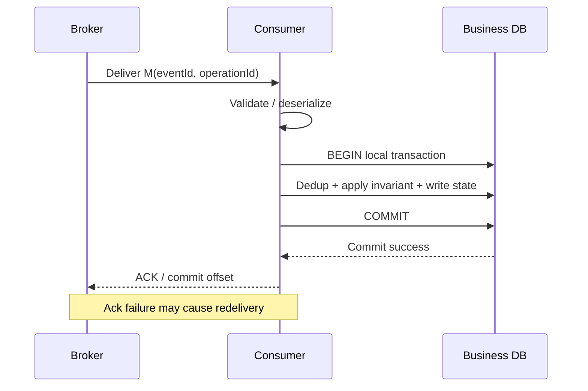
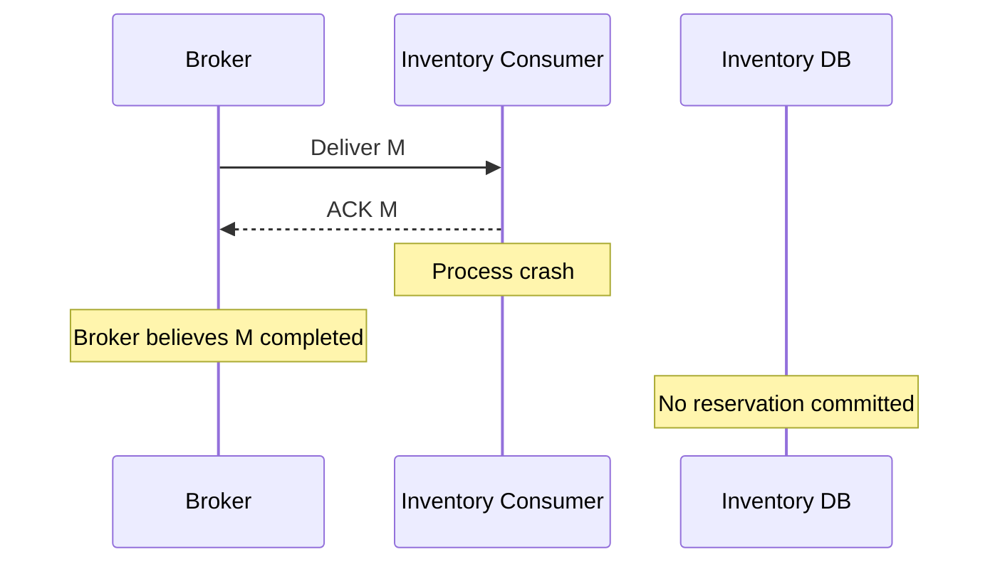
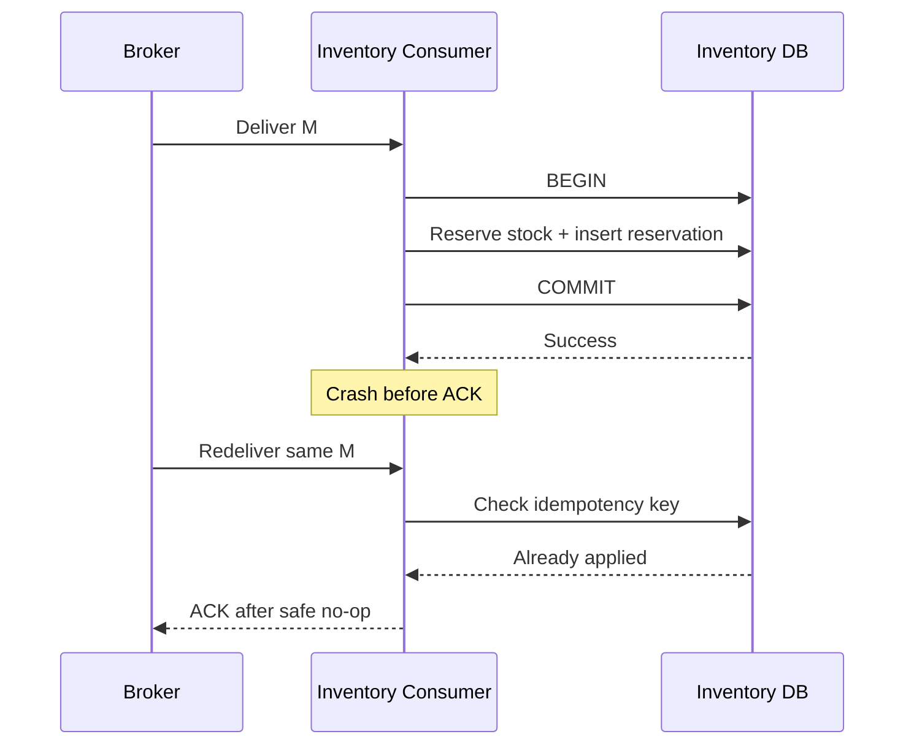
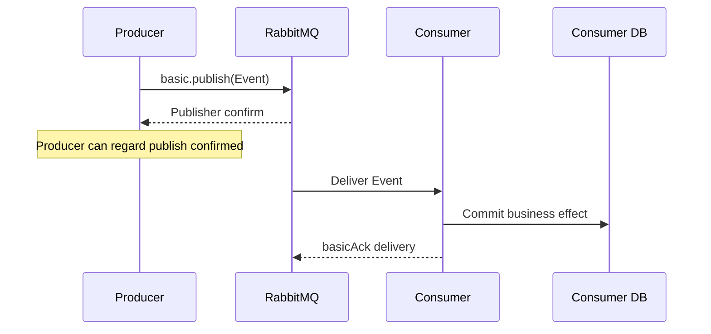
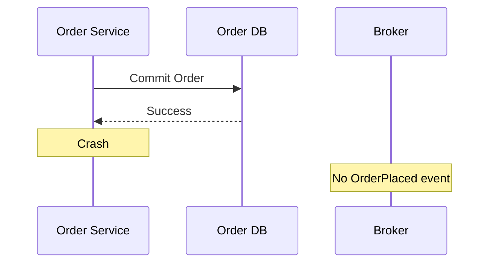
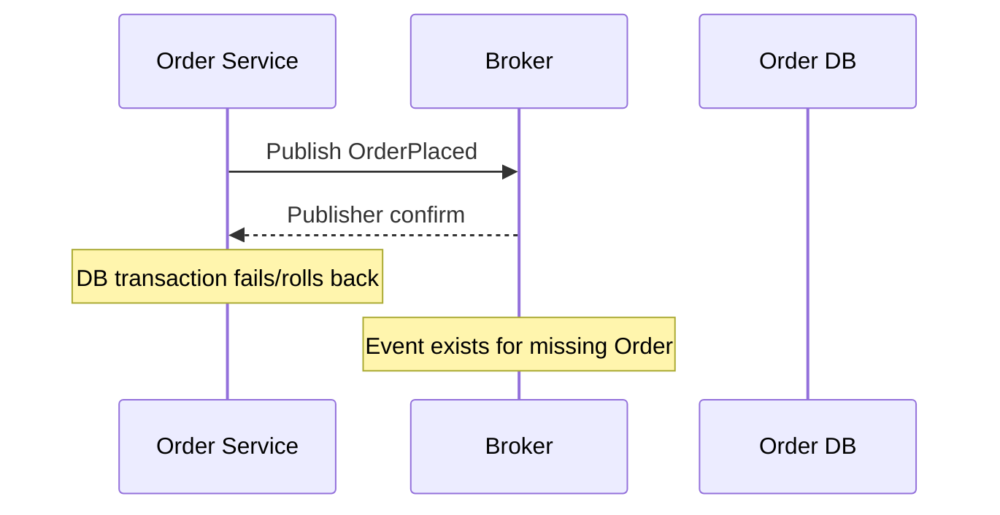
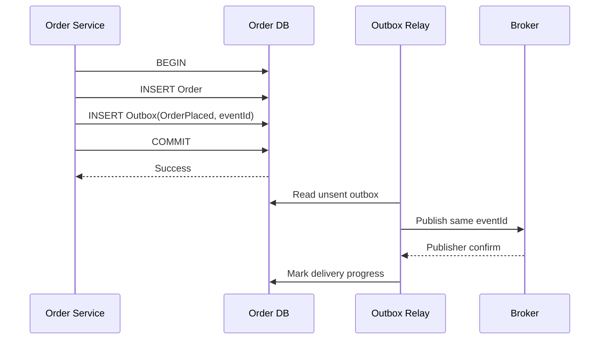
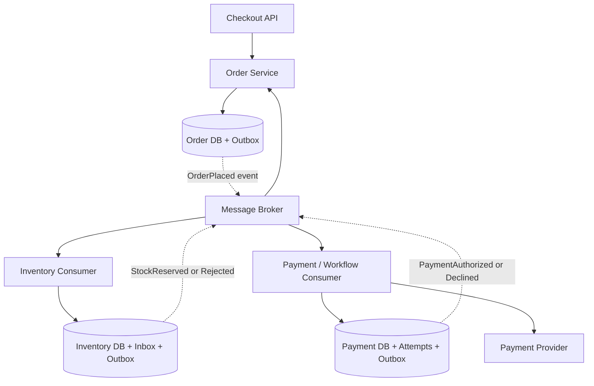

# Thời điểm xác nhận thông điệp so với thời điểm commit trong Microservices

## 1. Vấn đề cốt lõi: commit rồi mới ack, hay ack rồi mới commit?

Trong kiến trúc microservices giao tiếp bằng message broker, một consumer thường thực hiện các bước:

1. Nhận thông điệp từ broker.
2. Kiểm tra schema, identity và quy tắc nghiệp vụ.
3. Đọc hoặc thay đổi dữ liệu trong database của mình.
4. Commit giao dịch cục bộ.
5. Thông báo với broker rằng thông điệp đã được xử lý: acknowledgment (ack), hoặc ghi nhận tiến độ consumer bằng committed offset.

**Thứ tự bước 4 và 5 quyết định một lớp lỗi rất quan trọng:**

- Nếu **ack trước commit**, consumer có thể crash sau ack nhưng trước khi lưu dữ liệu. Broker coi message đã được xử lý, nên nghiệp vụ có thể bị **mất**.
- Nếu **commit trước ack**, consumer có thể crash sau commit nhưng trước khi broker ghi nhận ack. Broker có thể giao lại message; nghiệp vụ phải chịu được **xử lý trùng**.

Không thể xóa hoàn toàn hai cửa sổ này chỉ bằng việc di chuyển một dòng code. Trong trường hợp thông thường, **broker và business database là hai hệ thống có trạng thái và commit độc lập**. Vì vậy, chiến lược phổ biến cho thông điệp nghiệp vụ quan trọng là **durable local commit trước, ack sau, kết hợp idempotency**.

Nguyên tắc thực hành:

> **Không xác nhận thành công một thông điệp trước khi tác dụng nghiệp vụ cần bảo vệ đã được commit bền vững, hoặc trước khi đã ghi một intent đủ bền vững để tiếp tục xử lý an toàn. Khi ack sau commit, phải coi redelivery là hành vi bình thường và thiết kế consumer idempotent.**

Bài học nằm trong chủ đề **Truyền sự kiện tin cậy** của thiết kế Microservices. Ngoài trường hợp consumer, còn cần xem thời điểm producer nhận publisher confirm và thứ tự commit database với publish event.

### Mục tiêu học tập

Sau bài này, bạn có thể:

1. Phân biệt **DB commit**, **consumer ack**, **offset commit**, **producer confirm** và **business completion**.
2. Giải thích chính xác các cửa sổ crash trước/sau commit hoặc acknowledgment.
3. Thiết kế consumer **at-least-once + idempotent effect** bằng unique key, local transaction và inbox.
4. Giải thích vì sao ack trước commit có thể mất thông điệp và ack sau commit có thể nhận trùng.
5. Triển khai mẫu an toàn trên Kafka hoặc RabbitMQ/AMQP theo khả năng của từng hệ thống.
6. Xử lý transaction thất bại, retry, redelivery, poison messages, DLQ và unknown outcome.
7. Dùng transactional outbox để phối hợp giữa business transaction và ý định publish event.
8. Kiểm thử crash windows bằng thử nghiệm có chủ đích thay vì chỉ chạy happy path.

## 2. Từ vựng và ranh giới bảo đảm

### 2.1. Consumer acknowledgment

**Consumer acknowledgment** là tín hiệu của consumer cho broker biết delivery có thể được coi là hoàn tất theo protocol đang dùng. Với một số broker, ack loại delivery khỏi trạng thái đang chờ; với hệ thống dạng log như Kafka, consumer thường **commit offset** để ghi nhận tiến độ đọc của một consumer group.

Ack/offset commit **không phải** là bằng chứng database đã commit. Broker thường không thể nhìn thấy transaction trong PostgreSQL, MySQL hay một API thanh toán bên ngoài.

### 2.2. Database commit

**DB commit** là thời điểm hệ thống lưu trữ xác nhận local transaction hoàn tất theo cơ chế durability/isolation đã cấu hình. Một transaction có thể cập nhật nhiều bảng trong cùng database/resource, ví dụ ghi Order, OrderStatusHistory và Outbox.

DB commit không tự xác nhận rằng message đã được broker nhận; cũng không tự đánh dấu consumer offset.

### 2.3. Producer acknowledgment / publisher confirm

Ở chiều ngược lại, producer gửi một message đến broker và có thể đợi **publisher confirm** hoặc kết quả gửi tương đương. Đây là tín hiệu liên quan việc broker đã chấp nhận message theo cấu hình cụ thể.

Producer confirm **không đồng nghĩa consumer đã xử lý**, và càng không đồng nghĩa downstream đã hoàn thành business transaction.

### 2.4. Business acknowledgment

Một số quy trình có event riêng như PaymentAuthorized hoặc OrderConfirmed để nói **kết quả nghiệp vụ đã xảy ra**. Đây không phải broker ack. Một message đã được delivery-ack có thể chỉ có nghĩa consumer đã lưu yêu cầu xử lý vào durable queue cục bộ, trong khi business workflow còn ở trạng thái PENDING.

Vì vậy, cần mô tả rõ ranh giới:

| Tín hiệu | Ai phát? | Trả lời câu hỏi nào? | Không tự bảo đảm điều gì? |
| --- | --- | --- | --- |
| Publish return/confirm | Broker hoặc producer client | Broker đã chấp nhận/ghi message ở mức nào? | Consumer đã xử lý nghiệp vụ |
| Consumer ack | Consumer gửi cho broker | Delivery có thể đánh dấu hoàn tất? | Local database commit nếu app ack sớm |
| Offset commit | Kafka consumer/group | Group tiếp tục đọc từ vị trí nào? | Business side effect đúng một lần |
| DB commit | Database | Các thay đổi local đã commit? | Broker đã nhận ack hoặc event |
| Business result event | Owner nghiệp vụ | Quy trình có kết quả gì? | Broker bảo đảm end-to-end exactly once |
| HTTP 200/202 | Service/application | Yêu cầu được xử lý/tiếp nhận theo contract? | Mọi downstream đã hoàn tất nếu chỉ trả Accepted |

Một hệ thống đáng tin cần mô tả đầy đủ **cả giao nhận message lẫn hậu quả nghiệp vụ**, không chỉ ghi một dòng “enable manual ack”.

## 3. Sơ đồ consumer tiêu chuẩn



**Tại sao phải commit trước ack?** Nếu consumer chết trước khi commit, message chưa được ack nên broker có thể phân phối lại; business effect chưa có và lần sau có thể thử tiếp.

**Tại sao vẫn cần chống trùng?** Nếu consumer chết hoặc mất mạng sau commit nhưng trước khi broker lưu ack, message có thể quay lại dù thay đổi nghiệp vụ đã được ghi.

Đây là một bài toán kinh điển về hai hệ thống không chia sẻ cùng transaction: consumer **không biết chắc** broker đã nhận ack, còn broker **không biết chắc** consumer đã commit DB.

## 4. Kịch bản A: ack trước commit dẫn đến bỏ sót

Giả sử một thông điệp StockReserveRequested yêu cầu giữ hai sản phẩm cho đơn O-123.



Thông điệp đã được coi là tiêu thụ. Consumer không kịp ghi reservation. Nếu broker không redeliver và không có một cơ chế phục hồi khác, yêu cầu giữ hàng **bị bỏ sót**.

Ở Kafka, nếu application commit offset bao phủ record trước khi xử lý bền vững, crash có thể khiến group bắt đầu từ vị trí sau record đó. Ở AMQP với auto-ack hoặc manual ack quá sớm, delivery cũng có thể được coi là xong trước khi database thay đổi.

### 4.1. Khi nào chủ động chấp nhận ack sớm?

Chỉ khi sản phẩm chấp nhận mất một số thông điệp, ví dụ:

- Một điểm telemetry/metric có tần suất cao mà việc mất mẫu không làm sai nghĩa nghiệp vụ quan trọng.
- Một cập nhật thoáng qua phục vụ hiển thị, có thể refresh từ nguồn mới.
- Một dòng log không bắt buộc có audit/compliance, với chính sách sampling rõ.

Với OrderPlaced, PaymentRequested, StockReserveRequested, CreditChanged hoặc một lệnh có tác động tài chính, **ack sớm thường không phải lựa chọn phù hợp**.

### 4.2. “Xử lý trước” chưa chắc đã commit

Một lỗi rất dễ gặp:

```java
@Transactional
public void onMessage(Event event, Acknowledgment ack) {
    repository.save(toEntity(event));
    ack.acknowledge(); // RỦI RO: method chưa return, transaction có thể chưa commit.
}
```

Ở nhiều mô hình proxy transaction, local transaction commit **sau khi method được bọc transaction return thành công**, không phải ngay khi repository.save() được gọi. Ack bên trong method này có thể đi trước commit thực tế.

**Đặt ack ngoài transactional method, sau khi lời gọi method kết thúc thành công**, hoặc dùng cơ chế framework chứng minh đã commit trước khi tiến độ message được ghi nhận. Cần phân biệt transaction của DB với transaction của broker.

## 5. Kịch bản B: commit trước ack dẫn đến nhận trùng

Giả sử consumer đã ghi reservation và commit, sau đó crash trước khi gửi ack.



Nếu lần thứ hai consumer chạy lại lệnh “available = available - 2” mà không có idempotency, tồn kho sẽ giảm hai lần. Nếu tạo payment attempt mới, người dùng có thể bị trừ tiền lặp.

**At-least-once delivery coi khả năng redelivery là một phần contract**, không phải lỗi hiếm cần “không bao giờ xảy ra”. Cấu hình retry/rebalance, kết nối bị gián đoạn và consumer shutdown đều có thể kích hoạt lại message chưa được broker ghi nhận thành công.

### 5.1. Vậy ack sau commit có phải exactly-once?

Không. Ack sau commit giúp **giảm nguy cơ mất xử lý** nếu broker còn giữ thông điệp và retry được, nhưng không loại bỏ duplicate. Để có **effectively-once business effect** cho một thao tác, consumer cần cơ chế idempotency và transaction ở nơi xảy ra side effect.

Một hệ thống có thể nhận một message ba lần nhưng tạo đúng **một reservation**. Điều cần kiểm chứng là **số hiệu ứng nghiệp vụ**, không phải số lần broker deliver bằng một.

## 6. Ma trận crash windows

| Thời điểm xảy ra sự cố | Consumer ack trước DB commit | Consumer DB commit trước ack |
| --- | --- | --- |
| Trước khi broker giao M | Tùy broker/storage có giữ M | Tùy broker/storage có giữ M |
| Đã giao M, chưa xử lý | Nếu đã ack: nguy cơ mất | Chưa ack: có thể redeliver |
| Đang trong DB transaction | Nếu đã ack: rollback có thể làm mất | DB rollback: redeliver và thử lại |
| DB commit thành công | Có thể không có duplicate từ redelivery, nhưng ack sớm nguy hiểm ở các tình huống trước | Nếu chưa ack: có thể redeliver |
| Gửi ack nhưng mạng mất | Broker có thể đã/ chưa ghi ack | Broker có thể đã/ chưa ghi ack; cần idempotency |
| Ack được broker ghi nhận | Không redeliver theo policy thông thường | Không redeliver theo policy thông thường |
| Consumer restart/rebalance | Record được đọc lại hay không phụ thuộc tiến độ đã commit | Có thể lặp các record chưa có ack/offset commit |

**Các giới hạn cần ghi rõ:** broker không nhất thiết giữ thông điệp vô thời hạn. TTL, retention, queue policy, persistence/replication, operator actions và lỗi không phục hồi đều ảnh hưởng khả năng redelivery. Không nên quảng cáo at-least-once như lời hứa tuyệt đối khi các điều kiện ấy chưa được bảo đảm.

## 7. Mốc commit nằm ở đâu trong Java/Spring Boot?

### 7.1. Service method chứa local transaction

Ví dụ:

```java
@Service
public class ReserveStockHandler {
    private final StockRepository stockRepository;
    private final ReservationRepository reservationRepository;
    private final ProcessedMessageRepository processedMessages;
    private final OutboxRepository outbox;

    public ReserveStockHandler(
            StockRepository stockRepository,
            ReservationRepository reservationRepository,
            ProcessedMessageRepository processedMessages,
            OutboxRepository outbox) {
        this.stockRepository = stockRepository;
        this.reservationRepository = reservationRepository;
        this.processedMessages = processedMessages;
        this.outbox = outbox;
    }

    @Transactional
    public void handle(ReserveStockRequested event) {
        if (!processedMessages.insertIfAbsent(
                "inventory-reserver", event.eventId())) {
            return; // Đã xử lý thành công trong transaction trước.
        }

        // Concurrency guard thực phải được bảo vệ ở DB.
        boolean reserved = stockRepository.reserveAtomically(
            event.sku(), event.quantity());

        if (!reserved) {
            outbox.insert(StockReservationRejected.from(event));
            return;
        }

        reservationRepository.insertUnique(
            event.reservationId(), event.orderId(),
            event.sku(), event.quantity());

        outbox.insert(StockReserved.from(event));
    }
}
```

Trong ví dụ này, khi method **hoàn tất thành công qua Spring transaction proxy**, transaction manager mới commit theo cấu hình. Nếu commit thất bại, caller nhận exception và **không được ack như thành công**.

Lưu ý implementation thực tế cần xử lý:

- Unique reservationId, eventId và kiểm tra payload khác nhau dưới cùng business operation key.
- Nếu insert reservation bị unique violation, rollback toàn transaction (bao gồm trừ stock), sau đó có thể đọc kết quả đã commit ở transaction riêng.
- Kiểu lỗi business như OUT_OF_STOCK có semantics kết thúc hợp lệ; lưu rejection + outbox nếu yêu cầu downstream nhận kết quả.
- Trạng thái domain và outbox phải ở **cùng transactional database resource**.
- Logic validation không được cập nhật dữ liệu trước khi xác định branch lỗi.
- Một câu UPDATE atomic chống oversell, ví dụ WHERE available >= quantity, thường an toàn hơn kiểu đọc rồi ghi không có khóa.

### 7.2. Adapter nhận message quyết định ack

Ví dụ giả lập listener/adapter:

```java
public void onBrokerDelivery(
        ReserveStockRequested event,
        DeliveryAck ack) {
    try {
        handler.handle(event);
        // handle() đã return sau proxy transaction commit.
        ack.ack();
    } catch (TransientPersistenceException ex) {
        ack.retryLater(ex);
    } catch (InvalidEventException ex) {
        ack.quarantine(ex);
    }
}
```

Đây là pseudocode về thứ tự. DeliveryAck, exceptions và cơ chế retry/quarantine cần adapter cụ thể. Không tự tạo API ack giả rồi nghĩ nó đã được broker hỗ trợ.

**Quan trọng:** method handler.handle phải được gọi qua bean/proxy có @Transactional thật. Nếu tự gọi method trong cùng object (self-invocation) hoặc cấu hình transaction manager sai, giả định “return = commit” có thể không đúng.

### 7.3. Không ack trong callback chỉ báo repository.save thành công

Với ORM/JPA, save có thể chỉ đưa entity vào persistence context, SQL thực sự flush muộn hơn và constraint violation có thể chỉ xuất hiện lúc flush/commit. Chỉ ack sau khi service transaction đã hoàn thành thành công.

Cần test lỗi constraint xảy ra **tại commit**. Một service có thể chạy hết logic mà vẫn rollback, nên try/catch bên trong transaction chưa chắc quan sát được commit failure ở đúng điểm.

## 8. Inbox và business idempotency

### 8.1. Inbox / processed_messages

Trong database Inventory:

```sql
CREATE TABLE processed_message (
    consumer_name VARCHAR(100) NOT NULL,
    message_id VARCHAR(160) NOT NULL,
    processed_at TIMESTAMP NOT NULL DEFAULT CURRENT_TIMESTAMP,
    PRIMARY KEY (consumer_name, message_id)
);
```

Consumer ghi messageId đã xử lý **trong cùng transaction** với thay đổi nghiệp vụ. Khi message được giao lại, unique constraint giúp nhận ra lần xử lý trước đã commit.

Đây không phải nơi lưu log tùy ý: bản ghi “processed” phải có semantics **business effect đã commit** hoặc “kết quả nghiệp vụ đã được ghi bền vững” theo hợp đồng. Đừng mark processed trước rồi thực hiện side effect trong transaction khác mà không có kế hoạch phục hồi.

### 8.2. Tránh SELECT rồi INSERT không có ràng buộc duy nhất

Hai consumer xử lý cùng message đồng thời:

1. Consumer A SELECT, chưa thấy messageId.
2. Consumer B SELECT, cũng chưa thấy.
3. A và B cùng thực hiện business effect.
4. Cả hai mới INSERT dấu “đã xử lý”.

Nếu không có unique key và transaction đúng, duplicate vẫn xuất hiện. Cần dựa vào **database-enforced uniqueness**, lock/conditional update và cách xử lý conflict sau rollback.

### 8.3. PostgreSQL INSERT ... ON CONFLICT DO NOTHING

Một ví dụ ở adapter:

```sql
INSERT INTO processed_message(
    consumer_name, message_id
)
VALUES (:consumerName, :messageId)
ON CONFLICT (consumer_name, message_id)
DO NOTHING;
```

Adapter dựa vào affected rows để biết insert mới hay đã tồn tại. Đây là cách tránh unique-violation làm transaction rơi vào failed state khi muốn xử lý duplicate an toàn.

Nhưng hãy đảm bảo nếu messageId đã tồn tại thì đó là **kết quả đã commit**, không phải một intent PENDING đang phải tiếp tục thực hiện. Trong nhiều thiết kế, inbox record có trạng thái PENDING/COMPLETED và lease để xử lý work dài; trường hợp ấy phải kiểm soát claim/visibility rõ thay vì “có record = xong”.

### 8.4. Business operation ID khác event ID

Nếu producer phát hai messages khác eventId nhưng đều là ReserveStock(reservationId=R-123), inbox theo eventId sẽ cho cả hai message đi qua. Inventory vẫn cần unique reservationId để bảo đảm **cùng thao tác giữ hàng chỉ áp dụng một lần**.

Ba loại identity:

| Identity | Chống vấn đề | Ví dụ |
| --- | --- | --- |
| Message/event ID | Redelivery của cùng logical event | evt-9a1 |
| Business operation ID | Hai message khác nhau cho cùng lệnh | reservation R-123 |
| Delivery attempt | Theo dõi từng lần broker gửi | attempt 1, 2, 3 |

Không dùng delivery tag hoặc offset như business idempotency key một cách máy móc. Offset có ý nghĩa theo partition, còn delivery tag theo channel; chúng không đồng nghĩa một reservation hay payment attempt.

### 8.5. Thời gian giữ dấu idempotency

Xóa processed_messages quá sớm có thể khiến một message cũ được replay lại sau nhiều ngày và tạo effect trùng. Retention nên dựa vào:

- Thời gian broker có thể redeliver.
- Khả năng replay/backfill vận hành.
- Tuổi tối đa của business command.
- Mức quan trọng của side effect.
- Chính sách lưu trữ/audit/privacy.

Với nghiệp vụ tài chính, business-operation uniqueness có thể cần dài hơn TTL một message; không được chỉ dựa vào inbox table có TTL ngắn.

## 9. Cơ chế xác nhận ở Kafka

Kafka là log phân vùng theo topic-partition. Consumer group dùng **committed offsets** để xác định vị trí tiếp tục đọc. Offset commit không nhất thiết xảy ra ngay khi application nhận record.

### 9.1. At-most-once với offset commit sớm

```text
records = consumer.poll()
commit offsets covering records
process records and update business DB
```

Nếu consumer crash sau offset commit và trước DB commit, group thường không tự đọc lại record đã được ghi là tiêu thụ. Nguy cơ mất business processing xuất hiện.

### 9.2. At-least-once với offset commit sau DB commit

```text
records = consumer.poll()
for each record in partition order:
    begin DB transaction
    perform durable idempotent business processing
    commit DB transaction
commit only offsets for fully processed records
```

Nếu consumer crash sau DB commit nhưng trước offset commit, record có thể được poll lại sau restart/rebalance. Consumer phải nhận diện duplicate.

### 9.3. Offset là vị trí tiếp theo

Khi đã xử lý thành công record ở offset 17, committed offset thường là **18** (vị trí tiếp tục), không phải 17. Với một batch có các offsets 10, 11, 12, nếu 12 thất bại thì không được commit tiến độ qua 12 như thể tất cả đã xử lý.

Tình huống cần lưu ý:

- Commit vị trí cuối batch khi **một record trong batch lỗi** có thể làm bỏ qua record chưa xử lý.
- Nếu xử lý song song, record offset 20 xong không có nghĩa offset 19 đã xong; không commit vượt “lỗ” chưa được xử lý.
- Nếu rebalance xảy ra, consumer có thể mất ownership partition trước khi commit; transaction DB đã commit của record cũ vẫn cần idempotency.
- Auto-commit theo chu kỳ có thể làm lệch tiến độ khỏi durable business processing nếu code/framework cấu hình không phù hợp.
- Retention có thể loại record cũ dù offset chưa được commit, nên phải tính cả retention và backlog SLO.

### 9.4. Kafka transaction có phạm vi cụ thể

Kafka có các cơ chế transaction/idempotent producer để đạt bảo đảm mạnh cho một số pipeline **Kafka topic → xử lý → Kafka topic**, khi offsets và writes tham gia một transaction Kafka phù hợp và downstream đọc với isolation thích hợp.

Tuy nhiên:

- Kafka transaction **không tự bao phủ** một PostgreSQL DB độc lập.
- Kafka transaction **không rollback** email đã gửi, HTTP call hoặc payment gateway.
- Khi có external DB side effect, vẫn cần local transaction + idempotency và quyết định offset commit an toàn.
- Muốn tránh lost outbox publish, dùng một cơ chế kết nối local DB commit với intent publish.

Không đưa ra tuyên bố chung “bật exactly once cho Kafka là không thể nhận message trùng” mà không nói rõ phạm vi Kafka topic/state store, DB và business effect.

### 9.5. Spring Kafka: điểm cần xác minh trong project

Tùy phiên bản Spring Kafka, listener container có nhiều ack modes (record, batch, manual, transactional). Người triển khai phải xác định:

- Auto commit của Kafka consumer có bị vô hiệu hóa hay đang hoạt động?
- Container commit offset tại thời điểm nào so với listener return và DB commit?
- Có Kafka transaction hay chỉ DB transaction?
- Error handler có seek/retry, recover hoặc DLT những records chưa xử lý không?
- Listener batch có commit offset vượt record lỗi không?
- Partition reassignment khi rebalance được handle ra sao?
- Các callback transaction/ack có chạy đúng lifecycle và thread không?

Không sao chép annotation hoặc cấu hình “MANUAL ack” từ ví dụ khác mà không test **crash sau DB commit, trước offset commit** và **DB commit failure** trong phiên bản framework thực tế.

## 10. Cơ chế xác nhận ở RabbitMQ/AMQP

Trong mô hình queue của RabbitMQ, consumer có thể dùng **automatic acknowledgment** hoặc **manual acknowledgment**.

### 10.1. Auto ack

Với auto ack, broker coi delivery đã được xác nhận theo cơ chế ngay khi giao hoặc không đợi consumer hoàn tất business effect. Nếu consumer chết trong lúc xử lý, message có thể bị mất về mặt nghiệp vụ.

Phù hợp với một số workload chấp nhận mất, nhưng không nên mặc định cho lệnh tạo order, giữ hàng hoặc ghi sổ.

### 10.2. Manual ack

Consumer nhận delivery, xử lý và chỉ gửi basicAck khi local DB transaction đã commit.

```text
receive delivery M (manual ack)
parse/validate
begin DB transaction
dedup + update domain + outbox
commit DB
basicAck(deliveryTag)
```

Nếu channel/connection đóng khi message còn unacked, RabbitMQ thường đưa delivery về trạng thái có thể giao lại theo semantics và cấu hình queue. Bản redelivery có thể có **delivery tag khác**. Dùng eventId/business key cho dedup, không dùng deliveryTag làm khóa nghiệp vụ.

### 10.3. Ack, nack, reject và requeue

- **basicAck:** xác nhận đã xử lý delivery.
- **basicNack/basicReject:** báo không xử lý thành công, có thể yêu cầu requeue hoặc không theo policy.
- **Dead-letter routing:** đưa message lỗi sang nơi cách ly khi cấu hình hỗ trợ.
- **Prefetch:** giới hạn số delivery chưa ack; ảnh hưởng backpressure, fairness và memory.

Nếu message lỗi schema vĩnh viễn được nack(requeue=true) liên tục, có thể tạo **hot retry loop**. Cần phân loại lỗi và delay/limit retries hoặc DLQ.

### 10.4. Publisher confirms là khác hoàn toàn consumer ack

RabbitMQ có **publisher confirms** cho producer biết broker đã nhận/tiếp nhận publish theo mức bảo đảm và cấu hình. Consumer basicAck dùng để báo delivery đã được xử lý ở phía consumer.

Hai tín hiệu này không thay nhau:



Ngay cả khi producer nhận publisher confirm, consumer vẫn có thể chưa đọc message. Ngay cả khi consumer xử lý rồi basicAck, producer không nhất thiết biết business outcome nếu contract không có result event.

### 10.5. Queue durability, persistence và quorum

Manual ack chỉ giải quyết việc broker biết delivery đã được xử lý chưa. Độ bền khi broker crash còn phụ thuộc queue type, durability/persistence, replication, confirms và cấu hình thực tế.

Không suy luận rằng “manual ack = bảo đảm không thể mất message”. Với lệnh quan trọng cần thiết kế cả **producer-to-broker durability** và **consumer processing**.

## 11. Producer: commit database trước hay publish trước?

Cho Order Service:

1. Lưu Order mới.
2. Phát OrderPlaced để Inventory và Notification tiếp tục.

Nếu dùng hai thao tác độc lập, có hai thứ tự đều có cửa sổ lỗi:

### 11.1. DB commit trước, publish sau



Order đã tồn tại nhưng downstream có thể không biết. Nếu event là bắt buộc để tiến trình tiếp tục, đây là **lost event** sau DB commit.

### 11.2. Publish trước, DB commit sau



Consumer có thể xử lý một order chưa commit hoặc không tồn tại. Ngay cả nếu publish bị chặn cho tới khi gần commit, luôn có race khi broker và DB không dùng chung atomic transaction.

### 11.3. Transactional outbox

Giải pháp phổ biến là lưu **state và outbox event intent** trong cùng local DB transaction:



**Ưu điểm:** nếu Order commit, outbox intent cũng tồn tại; relay có thể tiếp tục phát sau crash. Nếu transaction rollback, cả Order và outbox đều không tồn tại.

**Khoảng hở mới:** broker có thể nhận publish, relay crash trước khi đánh dấu đã gửi. Lần chạy sau relay publish lại cùng eventId. Vì thế outbox thường cho **at-least-once publish**; consumer phải idempotent.

### 11.4. Không dùng “publish after transaction callback” làm giải pháp duy nhất

Một callback chạy sau commit rồi publish trực tiếp có thể tránh phát event cho DB transaction đã rollback, nhưng **không tự bảo đảm delivery**: process vẫn có thể crash giữa commit và callback/publish. Nếu mất event là không chấp nhận được, cần intent bền vững như outbox hoặc một cơ chế transactionally integrated tương đương.

## 12. Bảng tóm tắt thứ tự ở producer và consumer

| Đường | Thứ tự | Cửa sổ lỗi | Cơ chế cần |
| --- | --- | --- | --- |
| Consumer sai cho dữ liệu quan trọng | ACK → DB COMMIT | Crash sau ack → mất xử lý | Đổi sang commit trước ack |
| Consumer at-least-once | DB COMMIT → ACK | Crash sau commit → duplicate | Inbox + business idempotency |
| Producer dễ mất event | DB COMMIT → publish | Crash sau DB commit → không phát | Transactional outbox |
| Producer có phantom event | Publish → DB COMMIT | DB rollback sau publish | Transactional outbox |
| Outbox relay | Publish → confirm → mark sent | Crash trước mark sent → publish trùng | Stable eventId + idempotent consumer |
| Consumer xử lý external API | Call provider → DB COMMIT → ACK | Provider thành công, DB rollback | Provider idempotency + reconciliation |

“Đúng thứ tự” không có nghĩa tất cả hệ thống được commit như một transaction. Nó làm rõ **hướng ưu tiên: không bỏ sót, chấp nhận thử lại có kiểm soát**, đồng thời bổ sung idempotency để giữ kết quả nghiệp vụ đúng.

## 13. Đối với tác dụng phụ bên ngoài: DB commit không đủ

Giả sử Payment Consumer nhận PaymentRequested, gọi gateway để authorize, rồi ghi DB và ack.

1. Gateway thực hiện authorization thành công.
2. Kết nối bị timeout.
3. Consumer không biết gateway đã hoàn tất.
4. DB chưa có kết quả.
5. Broker giao lại PaymentRequested.
6. Consumer gọi gateway lần nữa bằng một key mới.

Điều này có thể tạo hai authorizations, dù consumer tuân theo “DB commit rồi ack” ở những trường hợp bình thường. Lý do là **external gateway nằm ngoài local DB transaction**.

### 13.1. Lưu intent trước khi gọi ngoài

Một mô hình an toàn hơn:

- Nhận PaymentRequested với paymentAttemptId ổn định.
- Trong DB transaction, tạo hoặc tìm payment attempt, trạng thái PENDING, lưu idempotency key.
- Commit ý định xử lý.
- Gọi gateway với **cùng idempotency key** qua retry, nếu gateway hỗ trợ contract ấy.
- Nếu thành công hoặc bị từ chối rõ, ghi kết quả trong transaction khác và outbox event.
- Nếu kết quả Unknown, query/reconcile theo cùng attempt; không tạo yêu cầu mới vô điều kiện.
- Chỉ ack inbound message sau khi đã **ghi bền vững trạng thái đủ để phục hồi và tiếp tục xử lý**, theo chính sách workflow, không nhất thiết sau khi mọi external step đã hoàn tất.

Đây là khác biệt giữa **ack “đã tiếp nhận an toàn”** và **ack “toàn bộ business process đã xong”**. Có thể ack khi work đã được bền vững hóa và một worker khác đảm bảo tiếp tục, nhưng phải tài liệu hóa rõ mốc ấy.

### 13.2. Không ack chỉ vì đã gọi thành công API ngoài

Một HTTP 200 từ provider có thể không mang cùng nghĩa với một trạng thái nghiệp vụ đã được ghi/đối soát trong database. Nếu consumer ack rồi crash trước khi lưu provider reference, hệ thống có thể không biết cách tiếp tục hoặc bù trừ.

Lưu các định danh và trạng thái quan trọng, hoặc durable intent, trước khi coi trách nhiệm của consumer đã được chuyển an toàn sang bước kế tiếp.

## 14. Trạng thái business failure khác lỗi xử lý message

Ví dụ Inventory nhận ReserveStock nhưng hết hàng.

**Hết hàng là một kết quả nghiệp vụ hợp lệ**, không nhất thiết là lỗi tạm cần broker redeliver hàng trăm lần.

Một luồng hợp lý:

1. Transaction ghi kết quả REJECTED hoặc event StockReservationRejected khi cần.
2. Commit trạng thái/intent bền vững.
3. Ack message.
4. Owner Order nhận rejection và xử lý quy trình.

Ngược lại, nếu database connection bị reset và transaction không commit, không ack như thành công; retry khi điều kiện kỹ thuật phục hồi.

### 14.1. Ma trận lỗi

| Loại lỗi | Ví dụ | Xử lý khuyến nghị |
| --- | --- | --- |
| Thành công nghiệp vụ | Reservation committed | Ack sau commit |
| Business rejection hợp lệ | OUT_OF_STOCK, credit limit exceeded | Ghi kết quả bền vững, ack; phát result event nếu cần |
| Transient infrastructure | DB timeout, broker connection lost | Không ghi nhận hoàn tất; retry có backoff |
| Invalid payload / unknown schema | Thiếu trường bắt buộc, không deserialize | Quarantine/DLQ có evidence; không retry nóng mãi |
| Duplicate message | Event ID đã commit thành công | Safe no-op hoặc trả kết quả cũ, rồi ack |
| Same business key khác payload | ReservationId lặp nhưng quantity khác | Conflict/alert; không áp dụng lệnh mới âm thầm |
| Unknown provider outcome | Gateway timeout sau request | Reconcile với stable key trước retry effect |
| Programming bug | Null pointer trên event hợp lệ | Cách ly/cảnh báo, sửa code và replay an toàn |
| Commit failure | Unique violation, deadlock, serialization abort | Transaction rollback; classify/retry trong ngân sách |

DLQ chỉ ghi nhận message không thể xử lý theo chính sách, **không đồng nghĩa business process đã hoàn tất**. Cần runbook replay và xử lý kết quả thiếu.

## 15. Poison message và DLQ: ack sau khi nào?

Một message hỏng vĩnh viễn không thể bị giao lại vô hạn trên hot queue. Có thể route sang dead-letter và xem delivery gốc đã được xử lý theo policy.

Tuy nhiên, nếu tự viết consumer **publish sang DLQ rồi ack delivery gốc**, lại xuất hiện một cửa sổ giữa hai thao tác:

- Ack gốc trước khi DLQ được ghi bền vững → message có thể mất khỏi cả hai nơi.
- DLQ publish thành công trước ack gốc → crash khiến message xuất hiện lại và có thể tạo hai DLQ copies.

Một giải pháp là sử dụng **broker-native dead-lettering** đã được cấu hình và hiểu rõ semantics, hoặc lưu quarantine intent bền vững và chấp nhận duplicate có kiểm soát. Không nói rằng publish-to-DLQ + ack thủ công là transaction nguyên tử nếu công nghệ không có bảo đảm đó.

### 15.1. DLQ cần gì?

- Original event ID và business operation ID.
- Error class và số attempts.
- Thời điểm first-seen và last failure.
- Correlation/causation IDs.
- Safe payload metadata, không vô ý log secret hoặc PII.
- Quy trình khôi phục, replay, giới hạn thời gian và người phụ trách.
- Consumer idempotency khi re-drive message.

Khi replay, tốt nhất giữ **business identity ban đầu**. Đổi sang ID nghiệp vụ mới để “tránh dedup” có thể gây hiệu ứng trùng tai hại.

## 16. Xử lý batch và acknowledgment: đừng bỏ qua record lỗi

Với batch processing, một consumer có thể poll 100 records, xử lý 99 thành công và record thứ 70 lỗi. Nếu commit offset tới sau record 100, các records chưa xử lý thành công trước đó có thể bị bỏ qua.

### 16.1. Quy tắc contiguous progress

Đối với một Kafka topic-partition, chỉ commit tiến độ vượt qua **dải records liên tiếp** đã xử lý thành công theo chính sách. Nếu records 10–14 thành công, 15 chưa xử lý, 16–20 đã xong song song, chưa được commit offset 21 nếu việc đó làm bỏ qua 15.

### 16.2. Parallel workers

Nếu listener giao records vào thread pool rồi return ngay, framework có thể coi callback đã xử lý trong khi worker còn đang chạy. Cần một chiến lược rõ:

- Chỉ ack khi CompletableFuture/worker hoàn tất và effect đã commit.
- Không gọi ack API từ thread không được framework/protocol cho phép.
- Theo dõi in-flight jobs khi consumer rebalance/shutdown.
- Duy trì thứ tự và không commit vượt “lỗ” trên partition.
- Dùng bounded concurrency/backpressure để không poll quá nhiều message.

Khi consumer mất quyền sở hữu partition sau rebalance, nó có thể đã commit DB nhưng chưa commit offset. Consumer tiếp theo vẫn cần idempotency.

### 16.3. RabbitMQ multiple ack

Với AMQP, một số API cho phép ack nhiều deliveries tới một delivery tag. **Không dùng multiple ack** nếu có delivery trước đó chưa xử lý thành công; điều này có thể xác nhận cả những deliveries còn dở dang.

Cần hiểu delivery tag scope của channel và lifecycle khi channel đóng. Chỉ gọi ack theo cách framework/protocol đảm bảo không nuốt các công việc chưa hoàn thành.

## 17. Lỗi retry storm khi ack sau commit

Ack sau commit an toàn hơn trước nguy cơ mất xử lý, nhưng nếu lỗi vĩnh viễn khiến consumer không bao giờ commit, broker liên tục gửi lại có thể tạo:

- Requeue hot loop và CPU cao.
- Một partition Kafka kẹt vĩnh viễn.
- Hàng đợi phát triển vượt giới hạn.
- Tăng tải database với nhiều transaction lặp.
- DLQ bị bỏ qua vì retry vô hạn.
- Hệ thống downstream saturation.

Cần policy:

1. Lỗi tạm thời vs vĩnh viễn.
2. Backoff + jitter, giới hạn attempts/thời gian.
3. Timeout/deadline và retry budget.
4. DLQ/quarantine khi không thể xử lý.
5. Alert theo độ tuổi/lag thay vì chỉ số lỗi.
6. Replay/reconciliation khi đã sửa nguyên nhân.

**Không ack trước transaction như một “mẹo giảm retry”** nếu kết quả nghiệp vụ bắt buộc phải được thực hiện.

## 18. Idempotency và concurrency: giao lại trên hai consumer

Một vấn đề nâng cao: khi queue/partition ownership thay đổi, hoặc có nhiều messages độc lập chứa cùng business key, hai consumer có thể chạy đồng thời.

Nếu cả hai cùng SELECT “reservation R-123 chưa có” rồi trừ stock, business effect vẫn có thể lặp dù có check trong application.

### 18.1. Dùng unique business key ở DB

```sql
CREATE TABLE stock_reservation (
    reservation_id VARCHAR(100) PRIMARY KEY,
    order_id VARCHAR(100) NOT NULL,
    sku VARCHAR(100) NOT NULL,
    quantity INTEGER NOT NULL CHECK (quantity > 0),
    status VARCHAR(30) NOT NULL
);
```

Nếu duplicate request cùng reservationId đến, unique constraint ngăn hai reservation records. **Mọi thay đổi stock phải nằm trong cùng transaction** để insert conflict rollback việc trừ stock đã làm.

### 18.2. Atomic stock update

```sql
UPDATE stock
SET available = available - :quantity
WHERE sku = :sku
  AND available >= :quantity
RETURNING available;
```

Nếu 0 rows được cập nhật, có thể SKU không tồn tại hoặc không đủ hàng; business code cần phân biệt theo contract. Query này chống oversell cho mô hình đơn giản khi được thực thi đúng transaction và khóa uniqueness.

Một câu if trong Java sau SELECT chưa đủ nếu request đồng thời cùng thấy stock=5. Cần bảo vệ invariant ở đúng nguồn lưu trữ.

### 18.3. Transaction isolation

READ COMMITTED, REPEATABLE READ và SERIALIZABLE có semantics khác nhau tùy DB. Isolation level cao có thể làm transaction bị abort do serialization conflict; ứng dụng cần retry **toàn transaction** khi được phép.

Không dựa vào một mức isolation chung để bỏ qua unique constraint và business identity. Cơ chế cụ thể phải khớp invariant được bảo vệ.

## 19. Thực hành với Spring Boot và RabbitMQ

Ví dụ dưới minh họa việc **tách listener không transactional khỏi service transactional**, để ack chỉ sau lời gọi service đã return/commit.

```java
@Component
public class ReservationRabbitListener {
    private final ReserveStockHandler handler;

    public ReservationRabbitListener(ReserveStockHandler handler) {
        this.handler = handler;
    }

    @RabbitListener(queues = "stock.reserve")
    public void receive(
        ReserveStockRequested event,
        Channel channel,
        @Header(AmqpHeaders.DELIVERY_TAG) long tag
    ) throws IOException {
        try {
            handler.handle(event);  // @Transactional DB đã commit khi return.
            channel.basicAck(tag, false);
        } catch (TransientDataAccessException ex) {
            // Chính sách thực nên backoff/delay; requeue ngay có thể hot loop.
            channel.basicNack(tag, false, true);
        } catch (InvalidEventException ex) {
            // Chỉ phù hợp nếu DLX/quarantine được cấu hình và giám sát.
            channel.basicReject(tag, false);
        }
    }
}
```

**Điều kiện bắt buộc của ví dụ:**

- Listener container phải được cấu hình **manual acknowledgment**, không phải AUTO/auto-ack theo ngữ nghĩa khác.
- Import các loại Channel, header và exceptions phù hợp phiên bản project.
- Framework container có error handler, retry và transaction policy riêng; không trộn xử lý exception thủ công với container recovery theo cách làm double-ack.
- Hành vi khi channel đóng, ack thất bại và redelivery phải được test.
- handler.handle phải dùng cùng local DB transaction cho state/inbox/outbox.
- Không dùng basicNack(requeue=true) liên tục cho poison message.
- Nếu ứng dụng dùng declarative container transaction/AMQP transaction, xem lại thời điểm commit từng resource thay vì giả định sample này bảo đảm mọi thứ.

**Ví dụ là sơ đồ trách nhiệm**, không phải cấu hình production có thể dán nguyên xi vào mọi phiên bản Spring AMQP.

## 20. Thực hành với Spring Kafka: phân biệt DB transaction và offset

Ví dụ cấu trúc listener:

```java
@Component
public class OrderEventKafkaListener {
    private final ApplyOrderEventService service;

    public OrderEventKafkaListener(ApplyOrderEventService service) {
        this.service = service;
    }

    @KafkaListener(topics = "orders.events", groupId = "billing")
    public void onEvent(OrderEvent event, Acknowledgment ack) {
        service.applyInLocalTransaction(event);
        // Sau khi service return/commit thành công.
        ack.acknowledge();
    }
}
```

### 20.1. Những gì phải cấu hình/xác minh

- Listener container đang dùng **manual acknowledgment** phù hợp và có cung cấp Acknowledgment parameter.
- Thời điểm acknowledgment được framework convert thành offset commit có thể phụ thuộc ack mode; không nhất thiết commit ngay trong cùng stack frame.
- Nếu service ném exception/commit thất bại, listener không ack.
- Error handler/seek/retry và DLT policy không đánh dấu record là hoàn tất sai cách.
- Đã xác định consumer auto-commit hay không và việc đó không vô tình chạy trước DB commit.
- Nếu listener xử lý batch, quản lý offset tương ứng từng record/partition.
- Với rebalances, in-flight tasks và commit failures, idempotency giữ business effect đúng.

Một số mode có thể được framework tự quản lý offset sau listener thành công, không cần gọi manual ack. Mấu chốt là **chứng minh tiến độ được ghi nhận sau durable processing**, chứ không phải ép mọi dự án dùng một annotation hoặc API.

## 21. Bài toán đổi thứ tự commit giữa DB và broker

Có thể có người đề xuất “dùng transaction của broker và transaction của DB, commit cả hai trong một method”.

Tùy framework, hai transaction local có thể được phối hợp theo một thứ tự; nhưng nếu không có cơ chế atomic commit phân tán thực sự, vẫn còn cửa sổ:

- DB commit thành công, broker transaction commit thất bại.
- Broker commit thành công, DB commit thất bại.
- Coordinator/process crash giữa hai commit.

**Đặt hai annotation @Transactional gần nhau không tự biến hai resources thành một distributed ACID transaction.**

### 21.1. Khi nào 2PC/XA?

Một cơ chế two-phase commit có thể cung cấp atomic commit cho những tài nguyên và driver hỗ trợ đúng giao thức, với chi phí về coordinator, lock, recovery và availability. Tuy nhiên, nhiều broker, API ngoài hoặc cloud services không cung cấp hợp đồng XA end-to-end thích hợp cho quy trình.

Với microservices độc lập, outbox/inbox và idempotent workflow thường thực dụng hơn. Nếu tổ chức lựa chọn distributed transaction, phải ghi rõ resources tham gia, recovery semantics và failure modes, không coi nó là tính năng mặc định.

### 21.2. Không đánh tráo nghĩa “exactly once”

Một câu như “Kafka exactly once” phải được diễn giải theo phạm vi:

- Bản ghi trong output Kafka topics?
- Kafka Streams state store?
- Consumer local DB?
- Kết quả gửi email?
- Payment captured ở external provider?
- Kết quả cuối cùng của saga?

Chỉ tuyên bố bảo đảm cho phạm vi đã có bằng chứng kỹ thuật/test. Đối với external side effect, cần business idempotency và reconciliation theo contract provider.

## 22. Trạng thái Unknown và quyết định ack

Trong hệ phân tán, “request bị timeout” không chứng minh “downstream chưa xử lý”. Ví dụ:

1. Inventory A nhận ReserveStock.
2. Transaction commit thành công.
3. Response về caller bị mất.
4. Caller retry qua Inventory B.
5. B có thể đọc cùng database với A.

Nếu dùng reservationId ổn định và unique key, B trả ALREADY_RESERVED hoặc kết quả trước đó. Nếu tạo reservationId mới, hệ thống có thể giữ thêm hàng.

Điều này cho thấy ranh giới ack cần gắn với **business operation identity**, không chỉ một delivery attempt.

### 22.1. Ack khi chỉ mới tiếp nhận vào durable work queue?

Có thể hợp lệ nếu một consumer làm vai trò “ingestion adapter”: nó nhận message, ghi **durable intent** vào DB/queue cục bộ cùng dedup rồi ack broker. Một worker khác tiếp tục xử lý sau.

Nhưng hệ thống phải có:

- Bản ghi work không mất sau crash.
- Một worker/reconciler chắc chắn sẽ đọc lại phần chưa hoàn tất theo SLA.
- Idempotency ở bước tiếp theo.
- Visibility timeout/lease hoặc state machine để tránh work bị kẹt.
- Dead-letter/manual handling cho công việc không hoàn thành.
- Theo dõi tuổi Pending và khả năng khôi phục.

Nếu chỉ ghi vào in-memory queue rồi ack, process crash có thể làm mất work. **Durable acceptance khác với hoàn tất nghiệp vụ**; contract phải nói rõ.

## 23. Rủi ro thực tế khi phản hồi “thành công” quá sớm

Hãy phân biệt:

- Broker ack: consumer không cần nhận lại delivery đó theo policy thông thường.
- HTTP 202 Accepted: server đã tiếp nhận yêu cầu để xử lý sau theo contract.
- HTTP 200 OK: operation trả kết quả tại thời điểm hiện tại theo contract.
- Domain event BusinessCompleted: nghiệp vụ tương ứng được owner ghi nhận đã hoàn tất.

Nếu một Checkout API trả “Order Confirmed” trong khi chỉ mới enqueue PaymentRequested, người dùng có thể hiểu sai trạng thái. Một thiết kế đúng có thể trả Pending và cung cấp GET status/query event result.

Sự khác biệt này cũng liên quan **outbox**: Order có thể commit PENDING và outbox event trước khi Payment thực hiện authorization; không nên coi outbox được ghi là bằng chứng Payment đã thành công.

## 24. Metrics và observability cho ack/commit

Một hệ thống truyền sự kiện tin cậy cần giám sát riêng:

| Metric | Ý nghĩa |
| --- | --- |
| consumer_processing_success/error | Số messages xử lý thành công/thất bại |
| local_db_commit_success/failure | Số transaction commit/rollback |
| consumer_ack_success/failure | Vấn đề với tiến độ broker |
| offset_commit_lag | Records đã xử lý nhưng tiến độ group chưa ghi |
| redelivery_count | Bao nhiêu delivery được gửi lại |
| duplicate_detected_count | Idempotency đang chặn tác dụng phụ lặp |
| retry_attempts_per_operation | Retry amplification |
| oldest_unacked_age | Message chưa được xác nhận quá lâu |
| consumer_lag | Dữ liệu Kafka/queue chưa xử lý |
| outbox_oldest_age | Event intent chưa được publish |
| publisher_confirm_error | Producer/relay chưa chắc broker nhận |
| DLQ_depth/oldest_age | Message lỗi chưa xử lý |
| reconciliation_pending_age | Business effect có kết quả chưa rõ |
| business_invariant_violation | Lỗi thực sự cần ưu tiên cao |

Không cố làm duplicate_detected_count bằng 0 bằng cách tắt redelivery. **Duplicate được phát hiện và bỏ qua an toàn là một cơ chế phòng vệ hoạt động đúng**.

### 24.1. Trace và correlation

Message metadata có thể gồm:

- eventId, eventType, schemaVersion.
- businessOperationId, aggregateId, aggregateVersion.
- correlationId, causationId.
- occurredAt/publishedAt/processedAt.
- Consumer name, retry attempt và outcome.

Log nên phân biệt:

- FIRST_PROCESSING_COMMITTED.
- DUPLICATE_ALREADY_COMMITTED.
- TRANSIENT_ERROR_RETRY_SCHEDULED.
- REJECTED_BUSINESS_OUTCOME.
- QUARANTINED_INVALID_EVENT.
- UNKNOWN_EXTERNAL_OUTCOME.
- ACK_FAILED_AFTER_COMMIT.

Không log raw credit card data, access token hoặc PII không cần thiết vào payload/metric labels. Một trace có thể lưu thông tin business identity đã được giảm thiểu, không cần chứa toàn bộ message.

## 25. Kế hoạch kiểm thử failure windows

Happy path “nhận → save → ack” không chứng minh an toàn. Cần dừng process tại từng điểm:

### 25.1. Test 1 — Crash trước DB commit

- Consumer nhận message.
- Bắt đầu DB transaction, chưa commit.
- Chủ động kill process hoặc gây rollback.
- Khởi động lại consumer.
- **Mong đợi:** broker có thể redeliver (theo policy, retention và cấu hình); lần xử lý tiếp theo commit effect một lần.

### 25.2. Test 2 — Crash sau DB commit, trước ack

- Consumer nhận message.
- Commit thành công stock/reservation/inbox.
- Dừng process trước acknowledgment.
- Cho message được giao lại.
- **Mong đợi:** duplicate được nhận diện; stock không giảm lần thứ hai; consumer ack sau khi xác nhận đã xử lý an toàn.

### 25.3. Test 3 — Commit thất bại muộn

- Tạo conflict/constraint violation phát sinh khi flush hoặc commit.
- Listener phải quan sát exception từ transactional service.
- **Mong đợi:** không ack thành công; toàn bộ local effect rollback; retry hoặc phân loại lỗi thích hợp.

### 25.4. Test 4 — Ack không chắc chắn

- Cho DB commit hoàn tất.
- Cắt kết nối broker ngay khi gửi ack/commit offset.
- **Mong đợi:** dù broker ghi nhận ack hay chưa, lần redelivery nếu có không làm tác dụng phụ lặp.

### 25.5. Test 5 — Publisher confirm mất

- Outbox relay publish.
- Broker nhận nhưng confirm về relay bị mất.
- Relay retry với cùng eventId.
- **Mong đợi:** consumer idempotent, trạng thái cuối đúng; outbox tiến triển sau khi có bằng chứng/đối soát hợp lệ.

### 25.6. Test 6 — Batch có record lỗi ở giữa

- Poll offsets 10–19.
- Record 14 thất bại; records sau có thể xử lý song song.
- **Mong đợi:** không commit vượt qua record 14 như đã hoàn tất; replay an toàn mà không làm trùng effects của records đã commit DB.

### 25.7. Test 7 — Rebalance, shutdown và takeover

- Consumer A có record đang xử lý.
- Bị revoke partition/channel hoặc mất connection.
- Consumer B nhận lại record.
- **Mong đợi:** uniqueness và state machine giữ invariant; không double reservation.

### 25.8. Test 8 — Poison message và DLQ

- Một payload không thể deserialize.
- Retry hữu hạn/delay hoặc DLQ theo policy.
- **Mong đợi:** không hot loop; message còn có evidence để xử lý; backlog có alert; replay không đổi business identity.

### 25.9. Test 9 — External side effect Unknown

- Payment gateway thành công nhưng response timeout.
- Consumer crash trước khi lưu result.
- Broker redeliver.
- **Mong đợi:** cùng paymentAttemptId/idempotency key và reconciliation, không charge mới bừa bãi.

### 25.10. Test 10 — Business rejection

- Inventory không đủ hàng.
- Ghi rejection result/outbox có kiểm soát.
- **Mong đợi:** ack sau khi outcome bền vững; không retry mãi như lỗi database.

Các kiểm thử này nên chạy với broker và database gần production semantics, ví dụ môi trường tích hợp/Testcontainers phù hợp. Fake in-memory hữu ích để test domain nhưng không mô phỏng đầy đủ offset commit, channel close, crash, network partition và unique constraint concurrency.

## 26. Kịch bản đầu-cuối: Order → Inventory → Payment

### 26.1. Kiến trúc đề xuất



Mỗi owner có local transaction. Order, Inventory, Payment không cùng commit bằng một transaction SQL chung.

### 26.2. Luồng thành công

1. Order ghi PENDING và outbox OrderPlaced trong một local transaction.
2. Outbox relay publish event và xử lý broker confirm.
3. Inventory consume, transactionally dedup + reserve stock + ghi result outbox.
4. **Inventory ack sau khi transaction commit**.
5. StockReserved được relay ra broker (có thể trùng).
6. Payment nhận command/result theo workflow, quản lý payment attempt ID bền vững.
7. Payment gọi gateway bằng idempotency key, ghi kết quả + outbox và ack khi đã hoàn tất trách nhiệm có thể phục hồi.
8. Order consume result, update state idempotent rồi ack sau local commit.

### 26.3. Một số nhánh thất bại

**Inventory commit rồi crash trước ack:** StockReserved vẫn được ghi outbox; redelivery OrderPlaced không làm reserve thêm nếu reservationId đã tồn tại.

**Outbox publish rồi crash trước mark sent:** StockReserved có thể phát hai lần; downstream dedup eventId và business operation.

**Payment gateway timeout:** Payment giữ trạng thái UNKNOWN/PENDING_RECONCILIATION và không gọi bằng key mới vô điều kiện.

**Order consumer nhận duplicate PaymentAuthorized:** Order không chuyển trạng thái lần hai hoặc tạo hai shipment requests nếu operation key/state guard đã đúng.

**Broker DLQ một event quan trọng:** Workflow vẫn Pending/Compensating và hệ thống có alarm, không giả định đã hoàn tất vì message ra khỏi queue chính.

### 26.4. Khái niệm "hoàn tất"

Với từng điểm cần thống nhất:

- Outbox persisted: đã ghi **ý định phát**.
- Broker confirmed: message được broker tiếp nhận ở mức được cấu hình.
- Consumer DB committed: business effect của consumer đã được ghi.
- Consumer acked: delivery được broker coi là hoàn tất theo protocol.
- Workflow completed: trạng thái nghiệp vụ tổng thể đã đạt một kết thúc hợp lệ.

Một dashboard có thể hiển thị riêng các mốc này. Không gộp thành một cờ SUCCESS mơ hồ.

## 27. Những anti-pattern cần tránh

### 27.1. Ack trong method @Transactional trước khi method return

Lỗi: tưởng repository.save là DB commit. Giải pháp: tách listener và transactional handler hoặc dùng transaction callback có chứng minh commit đúng thời điểm.

### 27.2. DB commit sau khi ack vì “sợ nhận message trùng”

Lỗi: có thể mất nghiệp vụ khi crash. Giải pháp: commit trước ack và xử lý idempotency, trừ khi workload chấp nhận mất có chủ ý.

### 27.3. Coi manual ack là exactly-once

Lỗi: crash sau commit trước ack vẫn có redelivery. Giải pháp: inbox, business unique key, atomic transaction và replay tests.

### 27.4. Producer publish sau DB commit nhưng không có outbox

Lỗi: crash giữa hai bước làm mất event. Giải pháp: transactional outbox hoặc cơ chế đáng tin cậy tương đương.

### 27.5. Outbox relay thay eventId mỗi lần retry

Lỗi: consumer không biết hai messages là cùng logical event. Giải pháp: lưu eventId một lần trong outbox và phát lại cùng identity.

### 27.6. Ghi processed_message trong transaction riêng trước business state

Lỗi: crash sau mark processed khiến lần sau bỏ qua công việc chưa hoàn thành. Giải pháp: cùng local transaction, hoặc durable work state machine có resume.

### 27.7. Chỉ dedup theo broker offset/delivery tag

Lỗi: identity không phản ánh business operation; replay hoặc producer duplicate có thể khác identity. Giải pháp: eventId và business operation ID ổn định.

### 27.8. Commit offset cho cả batch dù một record chưa xong

Lỗi: record lỗi có thể bị bỏ qua. Giải pháp: contiguous progress theo partition, phối hợp parallel processing và error handler.

### 27.9. Nack/requeue vô hạn ngay lập tức

Lỗi: poison message gây hot loop và nghẽn queue/partition. Giải pháp: retry có giới hạn, delay/backoff, DLQ và vận hành replay.

### 27.10. Nhầm publisher confirm với consumer business completion

Lỗi: producer nghĩ nhận confirm là stock/payment đã xử lý. Giải pháp: domain result event hoặc query trạng thái theo contract.

### 27.11. Gọi payment gateway lại với idempotency key mới sau timeout

Lỗi: external outcome có thể đã thành công. Giải pháp: stable paymentAttemptId, provider idempotency và reconciliation.

### 27.12. Ack khi mới ghi message vào in-memory executor

Lỗi: process crash mất công việc. Giải pháp: durable intent/work queue rồi mới ack, cùng chính sách phục hồi.

### 27.13. Dùng @Transactional chung cho Kafka và DB rồi giả định XA

Lỗi: nhiều transaction managers không tạo atomic commit giữa resources. Giải pháp: xác định ranh giới thực, outbox/inbox và test crash giữa các commit.

### 27.14. Không quan sát ack failures vì “message đã xử lý rồi”

Lỗi: redelivery và retry amplification làm hệ thống quá tải; duplicate vô hại vẫn cần đo. Giải pháp: metrics theo processing/commit/ack/duplicate và backlog.

## 28. Mẫu quyết định thiết kế: ack policy của một consumer

| Câu hỏi | Nội dung cần xác định |
| --- | --- |
| Consumer | Tên service, group/queue, owner |
| Business message | Event/command, version, semantics |
| Data owner | Service nào có authoritative state |
| Local atomic writes | Những bảng trong cùng transaction |
| Commit boundary | Handler nào, transaction manager nào |
| Ack mechanism | Kafka offset / AMQP manual ack / framework-managed |
| Ack time | Sau local durable commit hoặc durable acceptance có resume |
| Duplicate identity | eventId, businessOperationId |
| Concurrency control | Unique keys, conditional update, version/locks |
| Retry policy | Lỗi nào retry, attempts, delay, budget |
| Poison message | DLQ/quarantine, audit, replay |
| Producer side | Outbox/publisher confirm, stable eventId |
| External effects | Provider idempotency, Unknown/reconciliation |
| Batch/parallel | Offset gap, channel lifecycle, bounded concurrency |
| SLO | Lag, oldest unacked, processing p99, replay completion |
| Tests | Crash before/after commit, ack loss, duplicate, rebalance |

### Mẫu ADR rút gọn

```markdown
# ADR: Acknowledge StockReserveRequested only after durable commit

## Context
Inventory consumes StockReserveRequested from a durable broker.
A command may be redelivered if ack is lost or consumer restarts.

## Decision
- Inventory is the sole owner of stock and reservations.
- Consumer runs one local DB transaction for:
  processed_message eventId, reservationId uniqueness,
  atomic stock change, reservation record, result outbox.
- The consumer acknowledges only after that transaction commits.
- Duplicate deliveries return a safe no-op/previous result.
- Transient errors are retried with limits and backoff.
- Permanent invalid messages are quarantined with observability.
- The producer uses an outbox and stable eventId.
- No attempt to span DB and broker with a fake atomic transaction.

## Consequences
- A crash after commit and before ack may redeliver the message.
- Inbox and business idempotency are mandatory.
- Poison messages and DLQ require operations ownership.
- Monitoring tracks commit success, ack failure, duplicates and lag.

## Validation
- Kill after DB commit but before ack.
- Cause DB commit failure before ack.
- Replay one event multiple times.
- Run two concurrent requests with the same reservationId.
- Trigger outbox relay publish-confirm ambiguity.
```

## 29. Bài tập thực hành

### Bài 1 — Phân tích timeline

Cho ba bước trong listener:

A. Update Inventory DB.
B. Ack message.
C. Commit DB transaction.

Hãy lập bảng hậu quả nếu crash ở mọi khoảng giữa các bước cho hai thứ tự:

1. B → A → C.
2. A → C → B.

Giải thích vì sao thứ tự thứ hai thường thích hợp hơn cho lệnh giữ hàng, nhưng vẫn cần idempotency.

### Bài 2 — Lỗi @Transactional trong Spring

```java
@Transactional
public void handle(Event event, Acknowledgment ack) {
    entityRepository.save(new Entity(event.id()));
    ack.acknowledge();
}
```

Hãy giải thích vì sao ack có thể diễn ra trước commit, nhất là khi JPA flush/commit ở cuối method. Viết lại thành listener gọi transactional service rồi mới acknowledge.

### Bài 3 — Kafka batch offset

Consumer poll được offsets 40, 41, 42, 43, 44 của cùng partition. Record 42 lỗi, 40–41 đã commit DB, 43–44 đã xử lý trên worker song song.

1. Consumer có được commit offset 45 không?
2. Nếu commit offset 42 (next position sau 41), record nào sẽ đọc lại?
3. Idempotency giúp record 43–44 không gây effect trùng thế nào khi replay?
4. Nếu framework không hỗ trợ per-record ack an toàn trong mô hình hiện tại, cần đổi cách điều phối ra sao?

### Bài 4 — Publisher confirm khác consumer ack

Order DB đã commit và outbox relay publish OrderPlaced. Broker gửi publisher confirm, nhưng Inventory chưa nhận event.

1. Order có được tuyên bố StockReserved chưa?
2. Consumer ack xuất hiện ở bước nào?
3. Relay crash sau confirm trước mark sent sẽ gây điều gì?
4. EventId và reservationId giải quyết những loại trùng nào khác nhau?

### Bài 5 — Payment Unknown

Consumer gọi gateway, gateway charge thành công nhưng response timeout trước khi Payment DB lưu kết quả.

1. Một DB transaction có rollback được charge không?
2. Có nên gửi charge mới bằng attemptId khác?
3. Cần lưu durable intent và idempotency key như thế nào?
4. Khi nào được ack inbound message mà không đánh mất trách nhiệm xử lý?

### Bài 6 — Poison message

Một payload có trường bắt buộc bị thiếu, khiến consumer thất bại trước DB transaction. Broker redeliver ngay khi nack.

Hãy thiết kế đường xử lý giới hạn retry, DLQ/quarantine, preserving original identity, alert và replay an toàn sau khi sửa code/schema.

## 30. Checklist triển khai

- [ ] Đã xác định rõ producer confirm, consumer ack, offset commit và DB commit khác nhau.
- [ ] Đã chọn delivery semantics theo hậu quả mất/trùng của business operation.
- [ ] Consumer không ack trước khi local transaction hoặc durable acceptance hoàn tất.
- [ ] Transactional service commit thực trước khi listener ghi nhận tiến độ broker.
- [ ] DB state, dedup/inbox và outbox nằm cùng local transactional resource khi cần atomicity.
- [ ] EventId và businessOperationId ổn định qua retry/redelivery.
- [ ] Unique constraints và concurrency control ngăn duplicate side effect.
- [ ] Retry transient errors có giới hạn/backoff, tránh hot loop.
- [ ] Business rejection được lưu/đưa kết quả nghiệp vụ trước khi ack.
- [ ] Invalid messages có quarantine/DLQ, metadata và replay policy.
- [ ] Offset commit không vượt record chưa xử lý thành công trong batch/parallel workflows.
- [ ] Rabbit manual ack/requeue/prefetch/channel lifecycle được hiểu đúng.
- [ ] Kafka ack mode, auto-commit, transaction managers và error handler được kiểm chứng.
- [ ] Publisher có outbox hoặc cơ chế bền vững thay thế, không dựa vào callback sau commit đơn thuần.
- [ ] Outbox relay giữ eventId và consumer chịu được publish trùng.
- [ ] External API/gateway side effects có stable idempotency key và reconciliation.
- [ ] Có metrics về DB commit failures, ack failures, duplicates, retries, DLQ và oldest unacked.
- [ ] Có thể khôi phục message chưa xử lý trong giới hạn retention/TTL.
- [ ] Đã test crash trước commit, sau commit trước ack và ack outcome uncertain.
- [ ] Đã test rebalance/shutdown, batch gap, out-of-order và duplicate concurrency.
- [ ] Đã kiểm tra rằng ack “đã tiếp nhận bền vững” không bị hiểu là “quy trình đã hoàn tất”.
- [ ] Documentation/ADR ghi rõ ai sở hữu commit boundary và responsibility sau ack.

## 31. Tổng kết

**Thời điểm xác nhận thông điệp so với commit** quyết định hệ thống sẽ đánh đổi thế nào giữa **nguy cơ mất xử lý** và **nguy cơ xử lý lặp** khi consumer, broker hoặc mạng gặp sự cố.

- **Ack trước DB commit:** có thể bỏ sót tác dụng nghiệp vụ nếu consumer crash sau ack.
- **DB commit trước ack:** cho phép phục hồi/retry an toàn hơn, nhưng có thể redeliver message sau khi hiệu ứng đã ghi.
- **Idempotency + unique business key + local transaction:** biến redelivery thành thao tác không gây side effect lặp.
- **Transactional outbox ở producer:** giải quyết cửa sổ DB commit thành công nhưng chưa publish; relay vẫn có thể publish trùng.
- **External side effects:** cần stable operation ID và reconciliation vì local DB rollback không đảo ngược gateway/email/API ngoài.

Quy tắc có thể nhớ là **“commit bền vững trước, acknowledge sau; chấp nhận redelivery và xử lý nó một cách an toàn”**, nhưng phải áp dụng đúng ranh giới thực: broker, DB, durable work acceptance và kết quả nghiệp vụ không phải một giao dịch duy nhất. Một thiết kế đáng tin là thiết kế chịu được crash ở mọi khoảng giữa các mốc ấy mà vẫn giữ invariant và có cách tiếp tục hoặc đối soát.