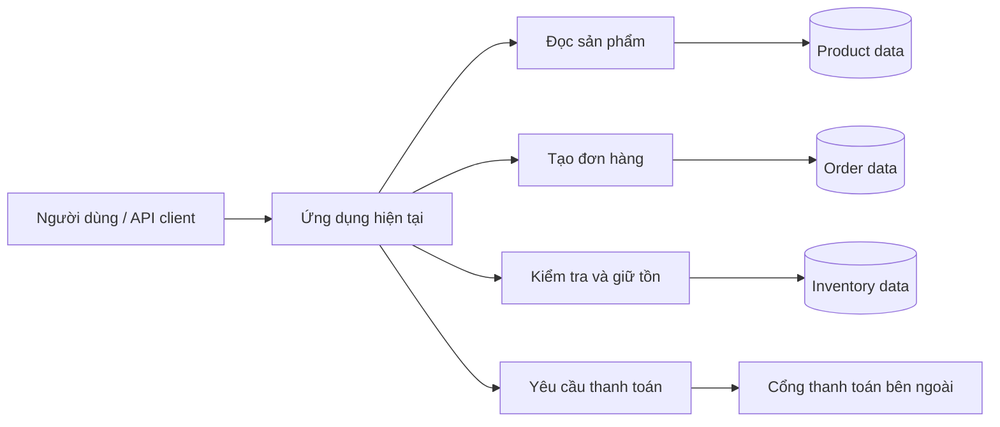
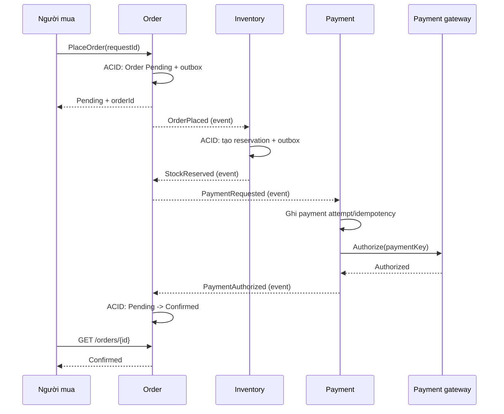
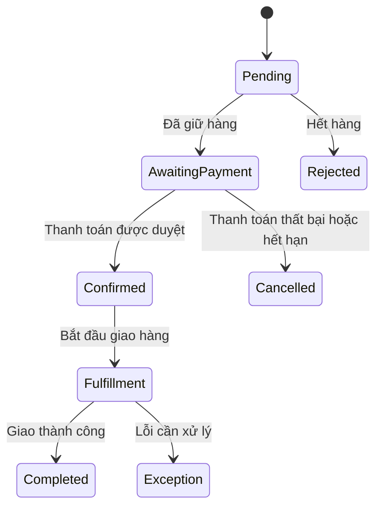

# Phân tích luồng dữ liệu và giao dịch để đánh giá điểm cắt Microservices

## 1. Mục tiêu và bối cảnh

Khi phân rã một hệ thống thành microservices, câu hỏi quan trọng không phải là “mỗi bảng dữ liệu tương ứng với dịch vụ nào?” mà là **“những trách nhiệm nghiệp vụ nào có thể tự quản lý dữ liệu, bảo vệ quy tắc nhất quán và hoàn thành công việc mà ít phụ thuộc vào nơi khác?”**

Một điểm cắt (service boundary) tốt cần thể hiện cả ba góc nhìn:

1. **Luồng dữ liệu:** dữ liệu được tạo ra ở đâu, ai có quyền sửa, ai đọc, dữ liệu đi qua những thành phần nào và dưới hình thức nào.
2. **Luồng giao dịch:** một yêu cầu nghiệp vụ thực hiện những bước gì, các bước nào bắt buộc thành công hoặc thất bại cùng nhau, các bước nào có thể xử lý sau.
3. **Ranh giới nghiệp vụ:** phần nào có quy tắc, vòng đời, mức độ thay đổi và quyền sở hữu tương đối độc lập.

Phân tích hai luồng đầu giúp kiểm chứng ranh giới tìm được bằng Domain-Driven Design (DDD), event storming hoặc sơ đồ module hiện có. Nó đặc biệt hữu ích khi hệ thống có nhiều bảng liên quan, các transaction dài, nhiều bước ghi dữ liệu và tích hợp bên ngoài.

Kết quả mong muốn là một **bản đồ các luồng dữ liệu/giao dịch cùng lý do đề xuất giữ chung hoặc tách dịch vụ**. Chỉ riêng sơ đồ component hoặc danh sách thực thể thường chưa đủ để ra quyết định.

## 2. Khái niệm nền tảng cần phân biệt

### 2.1. Luồng dữ liệu (data flow)

Luồng dữ liệu mô tả dữ liệu từ nguồn phát sinh đến nơi được sử dụng:

- **Command / write path:** hành động làm đổi trạng thái, như tạo đơn hàng, giữ tồn kho, hoàn tiền.
- **Query / read path:** hành động truy vấn, tổng hợp, hiển thị; thường được phép dùng bản sao hoặc read model.
- **Domain event:** thông báo một sự kiện nghiệp vụ đã xảy ra, như OrderPlaced hay StockReserved.
- **Data owner / source of truth:** thành phần có quyền quyết định và cập nhật trạng thái có thẩm quyền.
- **Derived data / projection:** dữ liệu được sao chép, tổng hợp hoặc tính từ nguồn gốc nhằm phục vụ nhu cầu đọc.

Một thực thể có thể xuất hiện ở nhiều luồng nhưng vẫn chỉ có một nơi làm **chủ nguồn dữ liệu có thẩm quyền**. Ví dụ danh sách đặt hàng có thể lưu tên sản phẩm tại thời điểm mua; tên đó là một snapshot lịch sử thuộc Order, không có nghĩa Order được tùy ý sửa tên sản phẩm gốc của Catalog.

### 2.2. Giao dịch (transaction) và tính nhất quán

**Giao dịch cục bộ (local transaction):** tập thay đổi thuộc cùng một nguồn lưu trữ có cơ chế ACID phù hợp. Chúng commit hoặc rollback theo khả năng của cơ sở dữ liệu.

**Bất biến nghiệp vụ (business invariant):** điều kiện phải đúng theo chính sách nghiệp vụ; ví dụ “không được xác nhận đặt chỗ vượt sức chứa”, “một mã yêu cầu thanh toán không tạo hai khoản thu” hoặc “tổng debit/credit của bút toán phải cân bằng”.

**Nhất quán tức thời (strong/immediate consistency):** sau khi thao tác hoàn tất, các điều kiện bắt buộc đã được bảo vệ; thường cần transaction hoặc cơ chế đồng bộ có thể kiểm chứng.

**Nhất quán cuối cùng (eventual consistency):** trạng thái của một số thành phần có thể tạm thời khác nhau rồi hội tụ sau khi sự kiện/đồng bộ được xử lý. Không được dùng nó cho bất biến cần đúng tức thời nếu chưa có giao thức nghiệp vụ bảo vệ tương đương.

**Business transaction / process:** một hoạt động kinh doanh kéo dài qua nhiều bước, có thể bao gồm giao dịch cục bộ, lời gọi ngoài hệ thống, chờ người dùng hoặc thông điệp bất đồng bộ. Một business transaction không nhất thiết tương ứng với một ACID transaction.

### 2.3. Điểm cắt dịch vụ

Điểm cắt là ranh giới trách nhiệm có hợp đồng giao tiếp rõ ràng, vòng đời dữ liệu riêng và khả năng phát triển/vận hành tương đối độc lập. Một điểm cắt tốt có **cohesion cao bên trong**, **coupling thấp bên ngoài** và tránh phải đồng bộ giao dịch xuyên ranh giới trong phần lớn use case.

Không nên đồng nhất điểm cắt với lớp controller, bảng database, endpoint, tác vụ nhỏ, hoặc một đội/người phát triển. Những yếu tố đó có thể cung cấp tín hiệu, nhưng quyết định cuối cần dựa vào mô hình nghiệp vụ và sự phụ thuộc thực tế.

## 3. Thu thập dữ liệu đầu vào trước khi vẽ sơ đồ

Chọn các use case có tác động lớn: luồng doanh thu, luồng nhiều lần ghi, luồng có sự cố thường gặp, tác vụ cần latency thấp và quy trình qua nhiều nhóm. Với mỗi use case, ghi nhận:

| Nội dung | Câu hỏi cần trả lời |
| --- | --- |
| Tác nhân và điểm bắt đầu | Ai kích hoạt? API, UI, batch, lịch chạy hay sự kiện? |
| Lệnh nghiệp vụ | Người dùng muốn đạt trạng thái cuối nào? Hành động nào có quyền đổi dữ liệu? |
| Các bước xử lý | Các bước theo thứ tự nào? Bước nào song song hay bất đồng bộ được? |
| Thực thể / aggregate | Bước nào đọc, ghi, khóa hoặc tính lại thực thể nào? |
| Kho dữ liệu | Bảng, database, cache, object storage, search index và hệ thống bên ngoài nào liên quan? |
| Điều kiện phải giữ | Bất biến nào cần đúng tức thời? Điều kiện nào chỉ cần hội tụ sau? |
| Transaction hiện tại | Các lệnh SQL hoặc thao tác đang nằm trong cùng transaction nào? |
| Độ trễ và tải | p95/p99, throughput, kích thước payload, các cuộc gọi mạng và thời gian chờ là bao nhiêu? |
| Đường lỗi | Nếu bước thứ ba thất bại sau hai bước thành công, hệ thống làm gì? |
| Ownership và thay đổi | Ai chịu trách nhiệm? Những use case nào thường cùng sửa một nhóm mã/bảng? |

**Chỉ mô hình hóa những luồng đang quan trọng**, nhưng cần bao gồm cả đường thành công lẫn ít nhất một đường thất bại thật. Nếu chỉ xét happy path, một điểm cắt có thể trông độc lập dù thực tế đòi hỏi rollback phức tạp.

## 4. Vẽ luồng dữ liệu theo trách nhiệm đọc/ghi

Bắt đầu bằng một sơ đồ đơn giản từ yêu cầu đến dữ liệu:

Sơ đồ này mô tả **hoạt động**, chưa khẳng định mỗi ô là một microservice. Để đánh giá điểm cắt, thêm các thông tin:

1. **Đánh dấu chủ dữ liệu:** Catalog sở hữu thông tin sản phẩm; Inventory sở hữu số lượng khả dụng và reservation; Order sở hữu vòng đời đơn; Payment sở hữu trạng thái giao dịch thanh toán.
2. **Đánh dấu mọi mũi tên ghi:** thành phần nào được phép thay đổi bản ghi hoặc thực thi bất biến? Có trường hợp hai module cùng UPDATE một bảng không?
3. **Đánh dấu dữ liệu dẫn xuất:** tên, giá, thuế tại thời điểm đặt hàng có thể là snapshot trong Order; báo cáo tổng hợp có thể lấy từ projection.
4. **Đánh dấu các join xuyên miền:** truy vấn nào đang join bảng Catalog với Order hoặc Payment? Khi tách, cần đổi thành query API, read model hay snapshot?
5. **Đánh dấu phụ thuộc đồng bộ:** một request phải chờ kết quả của bao nhiêu hệ thống? Có chuỗi gọi nối tiếp hoặc vòng phụ thuộc không?

Chú ý phân biệt **dữ liệu tham chiếu** với **quyền sửa**. Một dịch vụ có thể giữ bản sao read-only của dữ liệu dịch vụ khác, nhưng mọi thay đổi dữ liệu có thẩm quyền phải đi qua owner hoặc giao thức được chủ sở hữu công bố. Nếu hai dịch vụ tự cập nhật chung một bảng, ranh giới khó vận hành độc lập.

### 4.1. Data ownership khi một dữ liệu được nhiều nơi dùng

Ví dụ một người mua thay đổi địa chỉ mặc định tại Customer. Đơn hàng cũ cần giữ địa chỉ giao tại thời điểm chốt đơn, nên Order sở hữu **deliveryAddressSnapshot** cho đơn đó. Việc Customer sửa địa chỉ mới không được tự ý làm thay đổi địa chỉ của đơn đã xác nhận.

Đây là hai dữ liệu có ngữ nghĩa khác nhau. Tách ownership theo ngữ nghĩa nghiệp vụ giúp tránh dùng chung bảng chỉ vì trường dữ liệu có tên giống nhau.

### 4.2. Read model và CQRS là lựa chọn, không phải nghĩa vụ

Đối với trang “Lịch sử đơn hàng”, client có thể cần tên sản phẩm, tổng tiền, thanh toán và trạng thái giao hàng. Nếu mỗi lần mở trang phải gọi năm dịch vụ đồng bộ, latency và độ sẵn sàng đầu cuối giảm.

Có thể tạo read model được cập nhật bằng domain event, lưu dữ liệu cho đúng mục đích truy vấn. Khi dùng projection cần xác định độ trễ cho phép, thứ tự cập nhật, khả năng rebuild và cách hiển thị trạng thái cũ. Không bắt buộc áp dụng CQRS toàn bộ hệ thống chỉ vì có microservices.

## 5. Vẽ luồng giao dịch và đặt ranh giới commit

Sau sơ đồ dữ liệu, lập bảng thứ tự các bước **cho từng use case**, bao gồm transaction cục bộ, lời gọi dịch vụ, side effect và thất bại có thể xảy ra.

Ví dụ nghiệp vụ đặt hàng:

| Bước | Hành động | Chủ sở hữu dự kiến | Tính chất giao dịch | Nếu thất bại |
| --- | --- | --- | --- | --- |
| 1 | Kiểm tra yêu cầu, khóa chống gửi trùng | Order | Local transaction hoặc idempotency record | Từ chối hoặc trả lại kết quả cũ |
| 2 | Tạo đơn Pending và ghi sự kiện vào outbox | Order | Cùng một local transaction | Rollback cả đơn và bản ghi outbox |
| 3 | Giữ hàng (reserve) | Inventory | Local transaction trên dữ liệu tồn kho | Phát StockReservationRejected |
| 4 | Xin ủy quyền thanh toán | Payment + gateway | Tác vụ ngoài DB; kết quả được lưu riêng | Retry có kiểm soát / thông báo lỗi |
| 5 | Xác nhận đơn | Order | Local transaction đổi trạng thái | Retry xử lý thông điệp, đối soát |
| 6 | Chuẩn bị giao hàng | Fulfillment | Quy trình riêng, có thể bất đồng bộ | Tạo tác vụ sửa lỗi / hoàn tác phù hợp |

**Không thể gói mọi bước trên trong một ACID transaction duy nhất** khi có cổng thanh toán và nhiều hệ thống độc lập. Việc giữ kết nối SQL transaction mở trong lúc gọi API ngoài cũng là thiết kế rủi ro: giữ khóa lâu, timeout và không rollback được tác động ở phía nhà cung cấp.

Cần xác định rõ **điểm commit**. Ví dụ tạo đơn Pending và ghi thông điệp vào outbox trong cùng transaction; còn đặt chỗ và thanh toán được xử lý tiếp với trạng thái rõ ràng. Trạng thái Pending là trạng thái nghiệp vụ hợp lệ, không phải lỗi tạm cần giấu đi.

### 5.1. Sơ đồ trình tự minh họa

Sơ đồ sau là **một phương án thiết kế**, không phải công thức cho mọi hệ thống thương mại:

Nếu Inventory không giữ đủ hàng, Order có thể chuyển sang Rejected mà không gọi Payment. Nếu Payment thất bại sau khi đã giữ hàng, quy trình phải phát lệnh release reservation và đóng đơn theo chính sách. Nếu Payment đã ủy quyền nhưng Order cập nhật chậm, hệ thống cần retry/idempotency hoặc reconciliation, tránh tự động thu tiền lần nữa.

Lựa chọn thứ tự giữ hàng và thanh toán tùy tính chất ngành hàng, chính sách giữ chỗ, yêu cầu tài chính và khả năng hoàn tác. Với giao dịch không thể bù trừ, mô hình có thể phải thay đổi để giữ bất biến trong một ranh giới, thay vì cố cưỡng ép một saga.

## 6. Dùng bất biến để quyết định có nên cắt hay không

Một câu hỏi then chốt: **“Những dữ liệu nào phải cùng nằm trong một quyết định nguyên tử?”** Nếu nhiều bảng phải cùng commit để bảo vệ bất biến bắt buộc, đó là bằng chứng mạnh để giữ chúng trong cùng aggregate hoặc ranh giới dịch vụ.

Ví dụ:

| Bất biến | Nơi nên bảo vệ | Ý nghĩa với điểm cắt |
| --- | --- | --- |
| Tồn khả dụng không được âm khi giữ chỗ | Inventory, tại điểm quyết định reservation | Ghi tồn và reservation cần được điều phối nhất quán trong cùng owner; tránh mỗi dịch vụ tự trừ tồn |
| Bút toán kế toán cân bằng | Ledger / Accounting | Debit/credit cần cùng transaction phù hợp; tách theo từng bút toán rời làm khó bảo đảm bất biến |
| Mã đơn hàng duy nhất và trạng thái chuyển hợp lệ | Order | Bản ghi đơn và các chuyển trạng thái lõi thuộc cùng owner |
| Một yêu cầu thanh toán không bị thực hiện hai lần | Payment cùng cơ chế idempotency của gateway | Không giải quyết bằng việc để Order tự gửi lệnh charge nhiều lần |
| Thông tin giao hàng trên đơn giữ nguyên sau chốt | Order | Lưu snapshot thay vì phụ thuộc truy vấn Customer tại mọi thời điểm |
| Trang dashboard hiển thị doanh thu sau vài giây | Reporting projection | Có thể chấp nhận nhất quán cuối cùng và tách luồng đọc |

### 6.1. Kiểm tra quy tắc “phải đồng thời”

Mỗi khi một người thiết kế nói “hai dữ liệu bắt buộc cập nhật cùng lúc”, cần hỏi:

1. Đây là **điều kiện pháp lý/nghiệp vụ thật** hay chỉ là kết quả của thiết kế database hiện tại?
2. Người dùng có thể nhìn thấy trạng thái **Processing/Pending** hợp lệ không?
3. Nếu một bước thất bại, có hành động sửa sai rõ ràng không?
4. Nếu trạng thái tạm thời lệch nhau trong vài giây/phút, hậu quả là gì?
5. Nếu mạng mất kết nối hoặc thông điệp đến hai lần, invariant vẫn được bảo vệ ở đâu?

Nếu bắt buộc nguyên tử và không có cơ chế tương đương khả thi, **không nên cắt qua ranh giới ấy**. Nếu nghiệp vụ cho phép chờ và hoàn tác, một quy trình nhiều local transaction có thể thích hợp.

### 6.2. Aggregate trước, microservice sau

Trong DDD, aggregate thường là đơn vị bảo vệ các invariant cục bộ bằng transaction. Một bounded context có thể chứa nhiều aggregate. Một microservice có thể hiện thực một bounded context hoặc phần hợp lý của nó, tùy năng lực đội ngũ và nhu cầu triển khai.

Không nên suy luận “một aggregate = một microservice” hay “một bảng = một microservice”. Dịch vụ quá nhỏ có thể buộc nhiều API calls cho một business command, làm tăng phụ thuộc và độ phức tạp giao dịch.

## 7. Phân tích các loại phụ thuộc xuyên ranh giới

### 7.1. Phụ thuộc dữ liệu

- **Shared write:** hai module cùng sửa một bảng hoặc cùng quyền update một aggregate. Đây là tín hiệu điểm cắt chưa rõ.
- **Shared read:** nhiều module đọc một dữ liệu; có thể giải bằng API, cache, snapshot, projection hoặc data product.
- **Cross-database join:** nếu use case đọc cần join nhiều miền liên tục, cần xem read model hoặc cân nhắc chưa tách, tùy tính tức thời.
- **Thay đổi schema đồng loạt:** nếu sửa một field buộc nhiều thành phần deploy cùng nhau, hợp đồng hoặc ownership đang yếu.

### 7.2. Phụ thuộc giao dịch

- **Atomic write:** nhiều cập nhật phải commit cùng nhau để bảo vệ invariant cứng; ưu tiên giữ gần nhau.
- **Business process dài:** có nhiều bước có trạng thái trung gian; có thể dùng saga/process manager.
- **External side effect:** thanh toán, gửi email, gọi vận chuyển không rollback được bằng rollback SQL; cần cơ chế xử lý riêng.
- **Giao tiếp đồng bộ chặt:** nếu một request phải chờ A → B → C → D và mỗi thành phần có lỗi/timeout riêng, rủi ro latency lan truyền tăng.

### 7.3. Phụ thuộc thay đổi và tổ chức

- Hai vùng mã luôn cùng thay đổi theo một ticket là bằng chứng về cohesion hoặc ranh giới đang chia sai.
- Nhóm A phải xin quyền thay đổi bảng do nhóm B quản lý là dấu hiệu ownership mờ.
- Nhiều nhóm cần scale/deploy khác nhau có thể hưởng lợi từ dịch vụ độc lập **nếu** dữ liệu và giao dịch cho phép.

Các phụ thuộc này cần được xem cùng nhau. Một điểm cắt đẹp trên sơ đồ domain nhưng có 12 lời gọi đồng bộ và chung một transaction quan trọng có thể không đáng tách.

## 8. Đánh giá các cạnh trên đồ thị phụ thuộc

Biểu diễn mỗi nhóm trách nhiệm nghiệp vụ thành một nút. Nối hai nút khi có quan hệ ghi dữ liệu, giao dịch, đọc đồng bộ, sự kiện hoặc thay đổi cùng nhau. Với mỗi cạnh, ghi:

| Thuộc tính cạnh | Câu hỏi đánh giá |
| --- | --- |
| Tần suất tương tác | Bao nhiêu lần trên mỗi request hoặc trên mỗi giây? |
| Tính đồng bộ | Caller phải chờ ngay hay có thể nhận kết quả sau? |
| Ràng buộc consistency | Có invariant bắt buộc đúng cùng lúc không? |
| Chia sẻ dữ liệu | Có shared write, foreign key hoặc join nghiệp vụ xuyên miền không? |
| Tính quan trọng | Khi cạnh lỗi, nghiệp vụ nào bị chặn, mức thiệt hại bao nhiêu? |
| Mức độ thay đổi chung | Hai phần thường cùng sửa, cùng deploy không? |
| Khả năng thay thế | Có thể dùng snapshot, cache, event, contract hay read model không? |
| Chi phí tách | Tăng latency, công cụ, nhân sự, dữ liệu sao chép và vận hành bao nhiêu? |

Một cách trợ giúp workshop là cho điểm áp lực **giữ cùng ranh giới** từ 0 đến 3 trên một số tiêu chí:

- 0: gần như không phụ thuộc hoặc chỉ tương tác bất đồng bộ dễ quản lý.
- 1: có phụ thuộc nhưng hợp đồng rõ, chi phí tách thấp.
- 2: thường xuyên đồng bộ/chia sẻ dữ liệu hoặc nhiều thay đổi cùng nhau.
- 3: có bất biến nguyên tử khó tách, shared write rất chặt hoặc điều kiện rủi ro cao.

Có thể cộng điểm theo trọng số do nhóm cùng định nghĩa để **xếp ưu tiên điều tra**, nhưng đây không phải thuật toán quyết định kiến trúc. Một cạnh điểm 3 về invariant có thể đủ để giữ hai trách nhiệm cùng owner dù tổng điểm các cạnh khác thấp. Trọng số và ngưỡng phải dựa trên ngữ cảnh thật, không áp dụng máy móc.

### 8.1. Quy tắc diễn giải đồ thị

- Nút liên kết dày, thay đổi cùng nhau và có transaction chung thường nên ở **cùng một ranh giới trước mắt**.
- Cạnh chủ yếu là domain event, ít yêu cầu đọc tức thời, ownership rõ có thể là **ứng viên điểm cắt**.
- Nút nhận read traffic rất lớn nhưng ít thay đổi có thể thích hợp **tách mô hình đọc hoặc worker** trước khi tách toàn bộ miền nghiệp vụ.
- Cạnh quan trọng xuyên dịch vụ phải có timeout, chiến lược retry, hợp đồng rõ và cơ chế xử lý thất bại.
- Chu trình phụ thuộc A → B → C → A là tín hiệu cần xem lại thiết kế use case hoặc phân phối trách nhiệm.

## 9. Chọn mô hình giao tiếp khi đã xác định điểm cắt

### 9.1. Request/response đồng bộ

Thích hợp khi caller phải có kết quả ngay, như tra cứu thông tin để ra quyết định ở màn hình tương tác. Cần định nghĩa latency budget, timeout và lỗi trả về.

Rủi ro: chuỗi đồng bộ dài khiến khả năng thành công đầu cuối phụ thuộc nhiều thành phần; retry thiếu kiểm soát làm quá tải hoặc gây tác dụng phụ lặp.

Không nên gọi vòng qua ba dịch vụ chỉ để xác thực invariant thuộc về một owner. Hãy đưa quyết định đó về owner và công bố một command cấp nghiệp vụ.

### 9.2. Domain event bất đồng bộ

Thích hợp khi thông báo việc đã xảy ra và cho phép thành phần khác phản ứng sau. Ví dụ OrderConfirmed có thể kích hoạt invoice, notification và analytics.

Phải thiết kế rõ:

- Event có tên quá khứ phản ánh **sự kiện đã commit**, không phải yêu cầu mơ hồ.
- Có eventId, aggregateId, phiên bản schema và metadata truy vết phù hợp.
- Consumer chấp nhận nhận lặp và có idempotency.
- Thứ tự event có thể khác giữa các partition; nếu cần thứ tự theo aggregate, phải có partitioning/sequence hoặc kiểm tra phiên bản.
- Thông điệp có thể bị trễ hoặc mất trong tình huống lỗi nếu không có cơ chế phát bền vững.
- Có replay, dead-letter, giám sát lag và quy trình xử lý poison message.

### 9.3. Saga / process manager

Khi một business process đi qua nhiều dịch vụ và mỗi dịch vụ chỉ có local transaction, saga điều phối các bước và hành động bù trừ (compensation) khi cần.

- **Orchestration:** một process manager lưu trạng thái, quyết định bước tiếp theo; thuận lợi để quan sát quy trình phức tạp.
- **Choreography:** mỗi bên phản ứng theo sự kiện; đơn giản với luồng ngắn nhưng dễ khó theo dõi khi phát sinh nhiều phụ thuộc ngầm.
- **Compensation:** là **một hành động nghiệp vụ mới**, không phải đảo ngược hoàn hảo mọi thay đổi. Hoàn tiền, hủy giữ hàng và hủy vận đơn có quy tắc riêng; có trường hợp không thể hoàn tác.
- **Reconciliation:** đối soát định kỳ hoặc theo sự kiện để tìm trạng thái kẹt; đặc biệt quan trọng với thanh toán và tích hợp ngoài.

Không dùng saga chỉ để “né” một ranh giới dữ liệu bất hợp lý. Nếu có quá nhiều bước bù trừ, cần xem lại cách nhóm trách nhiệm hoặc quy trình nghiệp vụ.

## 10. Bảo đảm giao dịch cục bộ và phát thông điệp tin cậy

### 10.1. Transactional outbox

Lỗi phổ biến: ghi Order thành công vào DB rồi ứng dụng crash trước khi publish OrderPlaced. Order đã tồn tại nhưng dịch vụ khác không biết.

Transactional outbox giải quyết khoảng hở này:

1. Trong **cùng local transaction**, ghi thay đổi nghiệp vụ và bản ghi outbox.
2. Commit transaction.
3. Worker/relay đọc outbox và gửi event tới broker.
4. Chỉ đánh dấu bản ghi đã gửi sau khi broker chấp nhận theo cơ chế đã định.

Relay có thể gửi lại do retry hoặc crash, vì vậy consumer vẫn phải xử lý **at-least-once** và idempotency. Outbox không tự đảm bảo “exactly once” trên mọi hệ thống.

### 10.2. Idempotency và chống lặp

Đối với command có tác dụng phụ, gắn khóa yêu cầu duy nhất trong phạm vi nghiệp vụ hợp lệ; khi nhận lặp, trả lại kết quả hoặc bỏ qua tác dụng phụ đã thực hiện. Ví dụ Payment dùng idempotencyKey ổn định khi gọi gateway và lưu kết quả transaction của riêng mình.

Tránh cách xử lý “nếu lỗi thì gửi yêu cầu charge lại ngay với khóa mới”: đó có thể là nguồn phát sinh hai khoản thu. Khi kết quả gateway không rõ (timeout sau khi gửi), phải truy vấn/đối soát trạng thái của khóa cũ.

### 10.3. Isolation, concurrency và dữ liệu cạnh tranh

Tách dịch vụ không giải quyết race condition bên trong một owner. Inventory cần kiểm soát hai request cùng giữ món hàng cuối cùng bằng update có điều kiện, optimistic concurrency, locking hoặc cơ chế phù hợp với database. Điều kiện “available >= requested” phải được bảo vệ nguyên tử tại nơi ra quyết định.

Không lấy cache đọc nhanh làm cơ sở duy nhất để xác nhận hết/còn hàng khi chính xác tồn kho là invariant cứng. Cache vẫn hữu ích để hiển thị dự đoán, nhưng owner cần quyết định khi commit reservation.

## 11. Phân tích đường lỗi và trạng thái trung gian

Với mọi bước xuyên ranh giới, ghi rõ:

- **Timeout:** liệu xử lý ở phía nhận có thể đã thành công dù caller không nhận được phản hồi?
- **Duplicate:** lệnh hoặc sự kiện đến hai lần thì dữ liệu có bị ghi trùng không?
- **Out of order:** thông điệp mới đến trước thông điệp cũ; quyết định theo version/state machine ra sao?
- **Partial failure:** một số bước thành công, bước khác thất bại; trạng thái business nào hợp lệ?
- **Poison message:** một event xử lý mãi không xong thì đi đâu, ai nhận cảnh báo?
- **Stale read:** client xem trạng thái cũ; giao diện có giải thích “đang xử lý” hay bảo đảm read-after-write khi cần?
- **Mất kết nối dài:** luồng có thể phục hồi, đối soát và tiếp tục sau khi hệ thống trở lại không?

Ví dụ trạng thái đơn hàng có thể là:

Các trạng thái và chuyển trạng thái phải do **Order owner** kiểm soát. Payment và Inventory cung cấp kết quả của miền mình; chúng không được cùng tùy ý UPDATE trạng thái đơn trong một database dùng chung.

Với các bước không thể hoàn tác ngay, cần quyết định công khai về trạng thái Exception, thao tác thủ công, SLA và quy trình hỗ trợ người dùng. Thiếu đường lỗi là dấu hiệu luồng chưa sẵn sàng để tách.

## 12. Ví dụ phân rã một hệ thống thương mại điện tử

Giả sử hệ thống hiện tại có các module Catalog, Inventory, Order, Payment, Fulfillment và Notification nhưng chung một ứng dụng và database. Nhóm muốn tăng tốc phát hành Catalog và scale công việc xử lý ảnh. Phân tích theo luồng cho kết quả giả định:

| Ranh giới đề xuất | Dữ liệu chủ sở hữu | Invariant / giao dịch quan trọng | Phụ thuộc xuyên ranh giới | Nhận xét |
| --- | --- | --- | --- | --- |
| Catalog | Product, category, mô tả, media metadata | Product phải có trạng thái và thuộc tính hợp lệ | Order giữ snapshot của sản phẩm đã mua; Search dùng projection | Ứng viên tách nếu thay đổi/scale độc lập |
| Inventory | Stock balance, reservation | Không nhận reservation vượt tồn khả dụng theo chính sách | Nhận yêu cầu giữ hàng; phát kết quả cho Order | Cần owner ghi rõ; tránh chia sẻ quyền UPDATE stock |
| Order | Order, order lines, trạng thái vòng đời | Chuyển trạng thái hợp lệ, đơn có tổng tiền/snapshot xác định | Nhận kết quả tồn, thanh toán, giao hàng | Trung tâm state machine của đặt hàng |
| Payment | Payment attempt, authorization, refund | Chống thu trùng, theo dõi trạng thái giao dịch | Gateway ngoài, thông báo cho Order | Có lý do tách về an toàn và tích hợp nếu đủ năng lực |
| Fulfillment | Shipment, pick-pack-ship workflow | Không giao đơn không đủ điều kiện, quản lý chuyển trạng thái | Nhận OrderConfirmed, gửi shipment status | Có thể tách khi nghiệp vụ logistics độc lập |
| Notification | Template và lịch sử gửi | Không gửi trùng ngoài chính sách | Consume events từ nhiều miền | Tác vụ async phù hợp tách worker/service |

Ví dụ một câu query liên hệ order_line với product name có thể được xử lý bằng **snapshot tên sản phẩm tại lúc đặt hàng**, giúp Order hiển thị lịch sử đúng ngay cả khi Catalog đã đổi tên. Dashboard tổng hợp trạng thái giao hàng có thể dùng projection từ Fulfillment và Order; nếu dữ liệu lệch vài giây chấp nhận được, không cần synchronous join mọi lần xem.

Ngược lại, nếu doanh nghiệp yêu cầu kiểm tra hạn mức tín dụng, xuất hóa đơn và ghi sổ phải tuân thủ một invariant tài chính không thể trì hoãn, đừng chia các quyết định ấy thành những service chỉ vì bảng hiện tại có tên khác nhau. Cần phân tích owner của invariant và protocol cam kết trước.

### 12.1. Đánh giá hai điểm cắt cạnh tranh

**Phương án A — tách Order và OrderLine thành hai service**

Mọi thao tác tạo/sửa/hủy đơn đều phải đồng bộ giữa hai service; tổng tiền và các dòng đơn cùng tạo nên invariant của đơn. Phương án này làm tăng lời gọi, nguy cơ partial failure và cần transaction phân tán không đáng có. Thông thường nên **giữ Order và OrderLine trong cùng một ranh giới**.

**Phương án B — tách Catalog/Search khỏi Order**

Catalog thay đổi mô tả, hình ảnh và taxonomy theo nhịp riêng; Order lưu snapshot tại thời điểm mua. Search có thể index bất đồng bộ. Nếu luồng checkout không cần transaction cùng Catalog, đây là **ứng viên tách hợp lý hơn**. Vẫn phải xác định cách xử lý giá có hiệu lực, khuyến mãi, hạn bán và dữ liệu sản phẩm hết hạn tại thời điểm Order xác nhận.

Hai ví dụ chỉ cho thấy cách lập luận; ranh giới thực tế phụ thuộc invariant và chính sách cụ thể của hệ thống.

## 13. Bảng quyết định: giữ chung, tách hay đổi luồng

| Dấu hiệu | Hướng xử lý ưu tiên |
| --- | --- |
| Hai phần cùng bảo vệ một invariant cần atomic commit | Giữ cùng owner/aggregate hoặc thiết kế lại quy tắc nghiệp vụ trước khi tách |
| Hai phần chỉ chia sẻ dữ liệu đọc, chịu được trễ | Xác định source of truth; cân nhắc projection, snapshot hoặc API |
| Một phần chủ yếu là batch/worker nặng tài nguyên | Tách workload/worker độc lập, kể cả khi business core vẫn là modular monolith |
| Hai miền có roadmap và release độc lập, ít cross-write | Ứng viên service boundary |
| Thay đổi thường sửa nhiều service và phát hành đồng thời | Xem lại điểm cắt, hợp đồng và coupling |
| Giao dịch dài với nhiều tác vụ có thể bù trừ | Xem xét saga/process manager và trạng thái trung gian |
| Giao dịch liên quan external side effect không thể rollback bằng SQL | Dùng idempotency, đối soát, tiến trình trạng thái; tránh transaction giữ khóa qua network |
| Một API cần gọi nối tiếp quá nhiều service | Đưa quyết định về owner phù hợp, gom use case hoặc dùng read model |
| Chưa có observability, owner và CI/CD ổn định | Củng cố nền tảng và module boundary trước khi tách thêm dịch vụ |

Một quyết định có thể là **chưa tách**. Chứng minh được rằng một module hiện tại nên ở lại modular monolith là kết quả có giá trị của quá trình phân tích.

## 14. Quy trình thực hiện workshop từ dữ liệu đến điểm cắt

### Bước 1. Chọn luồng đại diện

Chọn 3–5 use case có nhiều ghi dữ liệu, nhiều bước hoặc nhiều thay đổi thực tế. Bao gồm ít nhất một use case lỗi hoặc hoàn tác. Gắn mức ưu tiên kinh doanh và các yêu cầu về latency/độ tin cậy.

### Bước 2. Dựng bản đồ dữ liệu

Vẽ command, query, event, bảng/database và bên thứ ba. Với mọi dữ liệu ghi, ghi chính xác owner, transaction hiện tại, mã nguồn gọi và nơi đọc. Đánh dấu shared-write và cross-join.

### Bước 3. Đánh dấu invariant và commit

Đặt dấu tại điểm “quyết định nghiệp vụ trở thành sự thật”: đơn được xác nhận, tồn được giữ, tiền được ủy quyền. Nhóm các thay đổi cần atomic. Phân biệt invariant cần đúng tức thời với projection có thể cập nhật sau.

### Bước 4. Mô phỏng lỗi

Cho từng cạnh xuyên ranh giới, thử các trường hợp timeout sau commit, retry trùng, mất event, thứ tự đảo, gateway trả kết quả không rõ và một phần quy trình hỏng. Vẽ state machine cùng hành động bù trừ/reconciliation.

### Bước 5. Đề xuất ranh giới

Gom các hoạt động bảo vệ cùng invariant, thay đổi cùng nhau và cần dùng chung transaction. Đánh dấu ranh giới giao tiếp theo hợp đồng API hoặc event. Mỗi ranh giới cần có owner dữ liệu và nhóm chịu trách nhiệm rõ.

### Bước 6. So sánh chi phí và lợi ích

Đối chiếu các lựa chọn: giữ nguyên nhưng cải thiện module, trích xuất một worker, tách một bounded context, hoặc phân rã rộng hơn. Ước lượng số request mạng, transaction xuyên miền, độ trễ, số thành phần vận hành và khả năng triển khai riêng.

### Bước 7. Thử nghiệm một lát cắt

Chọn luồng có ownership và bất biến tương đối rõ. Đặt contract, tracing, idempotency và logging trước; triển khai dần bằng strangler pattern nếu phù hợp. Quan sát dữ liệu thực, giữ phương án rollback hoặc chuyển hướng an toàn.

### Bước 8. Đo lại sau triển khai

So sánh trước/sau trên cùng loại workload: lead time thay đổi, số thay đổi cần phối hợp liên nhóm, p95/p99, tỷ lệ lỗi, thời gian phục hồi, độ trễ event, số giao dịch kẹt và chi phí hạ tầng. Nếu chi phí phân tán lớn hơn lợi ích, điều chỉnh ranh giới và dừng việc tách thêm.

## 15. Mẫu biểu phân tích một điểm cắt

Có thể điền mẫu sau trong tài liệu thiết kế:

| Trường | Nội dung cần ghi |
| --- | --- |
| Use case | Tên lệnh và kết quả nghiệp vụ mong muốn |
| Actor / trigger | User/API/event/batch |
| Dữ liệu đọc | Danh sách nguồn và yêu cầu độ mới |
| Dữ liệu ghi | Aggregate, bảng, owner dự kiến |
| Invariant bắt buộc | Quy tắc phải luôn đúng và thời điểm kiểm tra |
| Điểm commit | Tại bước nào transaction địa phương commit |
| External side effect | Payment, email, shipment, file, tích hợp khác |
| Chỗ có thể async | Bước nào cho phép trạng thái Pending và hội tụ sau |
| Failure/compensation | Retry, bù trừ, đối soát, cảnh báo, người xử lý |
| Quan hệ với miền khác | API/event, schema, sync/async, latency budget |
| Độ kết dính | Thay đổi cùng nhau, dùng chung transaction, chia sẻ code |
| Đề xuất | Giữ chung / tách / thử nghiệm; lý do và trade-off |
| Chỉ số kiểm chứng | Ví dụ lead time, p99, error rate, event lag, chi phí |

### Ví dụ điền ngắn

- **Use case:** PlaceOrder.
- **Dữ liệu ghi:** Order và OrderLine trong một local transaction của Order; reservation trong transaction riêng của Inventory; payment attempt trong Payment.
- **Invariant cứng:** trạng thái Order phải hợp lệ; reservation không vượt quy tắc stock; lệnh thanh toán không gây charge trùng.
- **Consistency:** trạng thái hoàn tất của toàn quy trình được phản ánh cuối cùng; mỗi miền tự bảo vệ invariant của mình.
- **Failure:** thiếu hàng → Rejected; thanh toán thất bại → release stock; kết quả gateway không rõ → đối soát với idempotencyKey.
- **Phán đoán điểm cắt:** giữ Order và OrderLine cùng nhau; xem xét Inventory và Payment riêng khi ownership, contract và năng lực vận hành đáp ứng.
- **Cách đo:** tỷ lệ đơn kẹt Pending, thời gian tới Confirmed, số lần charge trùng, lỗi reservation và số thay đổi liên dịch vụ.

## 16. Những sai lầm thường gặp

**Cắt theo bảng:** mỗi bảng thành một service tạo ra các transaction xuyên mạng cho một thao tác đơn giản. Cần xuất phát từ trách nhiệm, invariant và quan hệ thay đổi.

**Cắt theo màn hình:** một màn hình đọc dữ liệu nhiều miền không đồng nghĩa phải tạo một service mới làm chủ toàn bộ dữ liệu ấy. Hãy cân nhắc BFF/read model trong khi giữ ownership.

**Tách trước, giải quyết shared database sau:** nhiều service cùng ghi database vẫn phụ thuộc schema, migration và lock; triển khai độc lập chỉ là bề ngoài.

**Coi event là giao dịch nguyên tử:** publish event không tự biến nhiều local transaction thành một ACID transaction. Phải xử lý phát trùng, mất thứ tự, lỗi giữa chừng và outbox/inbox theo nhu cầu.

**Coi compensation như rollback:** hoàn tiền không giống chưa từng thu tiền; có phí, thời gian xử lý và nghĩa vụ đối soát. Chọn điểm cắt dựa trên tác động thực tế.

**Bỏ qua đường đọc:** quá tập trung vào write command khiến UI phải query chéo nhiều dịch vụ ở mọi request. Xác định nhu cầu read model/snapshot từ đầu.

**Không làm rõ trạng thái Pending:** nếu quy trình bất đồng bộ, API và UI phải biểu đạt việc đã nhận yêu cầu nhưng chưa hoàn tất; không trả “thành công cuối cùng” quá sớm.

**Bỏ qua ranh giới đội ngũ:** dù transaction hợp lý, việc nhiều nhóm phải thay đổi hợp đồng liên tục và chịu trách nhiệm mơ hồ vẫn làm service boundary khó duy trì.

## 17. Checklist trước khi phê duyệt điểm cắt

- [ ] Có sơ đồ command, query, event và dữ liệu nguồn của các use case quan trọng.
- [ ] Mỗi tập dữ liệu có một owner ghi có thẩm quyền; shared-write đã được xử lý.
- [ ] Các invariant cứng được nêu rõ cùng vị trí bảo vệ và thời điểm commit.
- [ ] Không vô tình tách một transaction nguyên tử thành chuỗi lời gọi không được kiểm soát.
- [ ] Xác định thao tác nào thật sự cần sync, thao tác nào có thể async.
- [ ] Có kế hoạch cho snapshot, projection và dữ liệu đọc xuyên ranh giới.
- [ ] Đường lỗi, duplicate, timeout, message ordering và partial failure đã có hành vi nghiệp vụ rõ.
- [ ] Có idempotency, outbox hoặc cơ chế tương đương tại nơi cần bảo đảm phát/nhận tin cậy.
- [ ] Quy trình bù trừ và đối soát khả thi đối với tác dụng phụ đã xảy ra.
- [ ] Chi phí latency, triển khai, tracing, test, dữ liệu và on-call đã được ước lượng.
- [ ] So sánh với phương án modular monolith hoặc trích xuất nhỏ hơn.
- [ ] Có thước đo thực tế để xác nhận lợi ích sau khi thử nghiệm.

## 18. Kết luận

**Luồng dữ liệu cho biết ai thực sự sở hữu dữ liệu; luồng giao dịch cho biết điều gì buộc phải nhất quán; luồng thay đổi cho biết ranh giới nào có khả năng vận hành độc lập.** Khi cả ba cùng chỉ về một ranh giới, điểm cắt có cơ sở tốt.

Giữ chung những trách nhiệm phải bảo vệ invariant nguyên tử hoặc thường xuyên thay đổi cùng nhau. Chỉ tách khi quyền sở hữu rõ ràng, giao tiếp qua hợp đồng có thể kiểm soát và độ trễ/chi phí phân tán được chấp nhận. Với business process kéo dài, cần mô hình trạng thái, local transaction và xử lý thất bại rõ ràng.

Một cuộc phân tích tốt có thể kết luận nên **giữ modular monolith**, tách một worker, hoặc chỉ trích xuất một bounded context. Giá trị nằm ở quyết định được chứng minh bằng dữ liệu và giao dịch thực, thay vì số lượng microservices tạo ra.